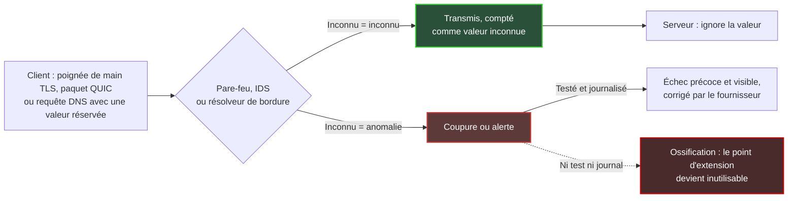
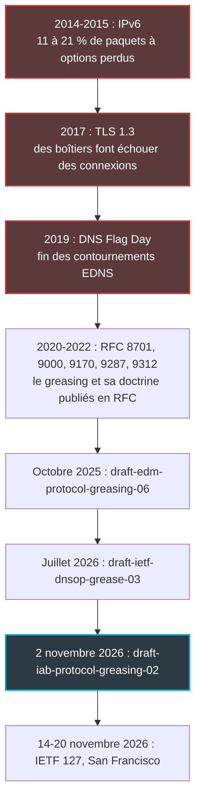
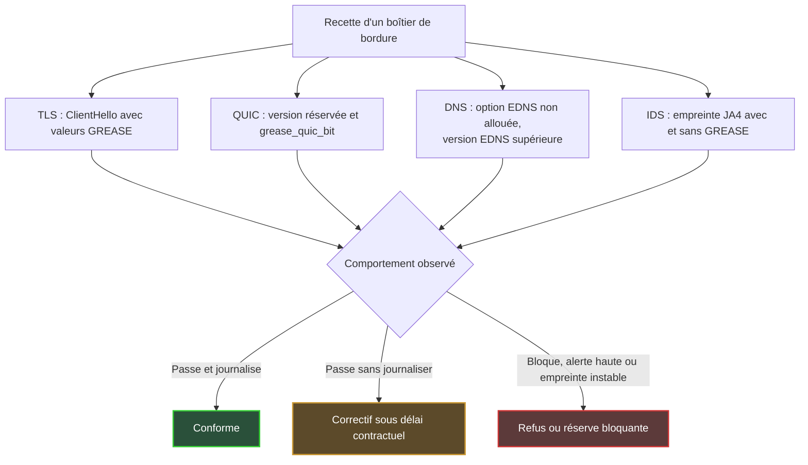

## Quand un boîtier décide de ce qu'Internet a le droit de devenir

En février 2017, Chrome et Firefox ont commencé à activer une nouvelle version du chiffrement web pour une partie de leurs utilisateurs. Des connexions sont mortes en route. Ni le navigateur ni le serveur n'étaient en cause : le coupable était posé entre les deux, sous la forme d'un pare-feu, d'un proxy ou d'une sonde de sécurité qui n'avait jamais vu passer ce format et a préféré couper.

Cette scène concerne quiconque exploite des réseaux en bordure : hôtels, enseignes de retail, résidences étudiantes, DSI multi-sites. Ces lieux accueillent chaque jour des terminaux que personne ne maîtrise. Derrière, quelques modèles de boîtiers (pare-feu, sondes de détection d'intrusion, résolveurs DNS) sont dupliqués à l'identique sur des dizaines ou des centaines de sites. Quand l'un de ces modèles refuse ce qu'il ne connaît pas, le défaut n'est pas local. Il est multiplié par la taille du parc.

Pourquoi maintenant ? Le 2 novembre 2026, un Internet-Draft du flux IAB (Internet Architecture Board, l'instance chargée de veiller à l'architecture d'Internet) a remis sur la table une technique au nom curieux : le greasing. Le principe tient en une phrase. On glisse volontairement des valeurs absurdes dans le trafic pour vérifier que personne ne s'étouffe.

Ma position est simple : les boîtiers qui s'étouffent, ce sont ceux que nous achetons. L'ossification des protocoles n'est pas un sujet de comité de normalisation. C'est un risque d'achat, qui se teste en recette et se verrouille dans un contrat.

## Le videur qui connaît par cœur la mode de l'an dernier

Tout protocole sérieux prépare son avenir. Il ménage des points d'extension : des champs de version, des listes d'options, des codes réservés à des usages qui n'existent pas encore. C'est la promesse qu'on pourra l'enrichir demain sans tout casser.

Sauf qu'un point d'extension que personne n'utilise finit par gripper.

Imaginez un videur de boîte de nuit qui, au lieu d'appliquer le dress code, a mémorisé les tenues de l'an dernier. Tout ce qui sort de sa mémoire est refoulé, même quand c'est parfaitement réglementaire. Les équipements posés sur le chemin des paquets se comportent exactement ainsi : ils apprennent ce qui passe d'habitude, puis traitent le reste comme suspect.

L'IAB a documenté ce glissement à deux reprises. RFC 8546 (2019) énonce presque une loi physique : tout ce qui est observable dans l'image d'un protocole sur le fil finira par être exploité par des équipements intermédiaires. RFC 9170 (2021) constate que certains déploiements, en particulier les pare-feu, bloquent délibérément les capacités inconnues. Sa leçon tient en quatre mots : *use it or lose it*.

Le greasing est la parade. Le terme vient de GREASE, pour *Generate Random Extensions And Sustain Extensibility* : on injecte régulièrement dans le trafic réel des valeurs réservées, dépourvues de sens, que le destinataire doit simplement ignorer. Pour filer l'image, on envoie de temps en temps au videur un client en tenue improbable mais conforme. S'il le refoule, on le sait tout de suite, et on le recadre avant l'arrivée de la vraie nouvelle mode.

Le cas d'école est TLS (Transport Layer Security, le protocole qui chiffre le web). RFC 8701, publié en janvier 2020 par un ingénieur de Google, y réserve 16 valeurs, de 0x0A0A à 0xFAFA, réparties entre suites de chiffrement, identifiants de protocole applicatif, extensions, groupes, algorithmes de signature et versions. Le texte file lui-même la métaphore du joint rouillé, bloqué faute d'avoir servi. Ses règles sont sèches. Un serveur ne doit pas traiter une valeur GREASE autrement qu'une autre valeur inconnue, ni la négocier. Et une implémentation ne devrait pas réessayer sans GREASE après un échec : sinon, un attaquant n'aurait qu'à provoquer l'échec pour neutraliser le mécanisme.

*Une charnière qu'on ne fait jamais jouer finit par se gripper : c'est toute l'idée de l'ossification protocolaire.*

Le schéma ci-dessous résume les deux destins possibles d'une valeur grease qui croise un boîtier de bordure.

L'essentiel se lit en bas du schéma. Un échec visible et journalisé est un bon échec : il remonte chez le fournisseur, qui corrige. Un échec silencieux, lui, fabrique de la rouille.

## 2014, 2017, 2019 : l'ossification a déjà un casier

Rien de tout cela n'est théorique. Trois épisodes mesurés montrent ce qui arrive quand des boîtiers intermédiaires décident seuls de ce qui est acceptable.

**TLS 1.3, 2017.** Retour à la scène d'ouverture. Selon le retour d'expérience publié par Nick Sullivan (Cloudflare) en décembre 2017, la version Draft 18 de TLS 1.3 réussissait 92,3 % des connexions entre Chrome et Gmail, contre 98,3 % pour TLS 1.2. Entre Firefox et Cloudflare, l'écart était de 96,1 % contre 97,8 %. Six points perdus côté Chrome, à l'échelle du web, c'est considérable. La parade n'a pas consisté à corriger les boîtiers. Elle a consisté à rendre la nouvelle poignée de main plus ressemblante à l'ancienne : numéro de version déplacé dans une extension dédiée, réintroduction d'un identifiant de session, champ de compression vide, retour du message ChangeCipherSpec hérité de TLS 1.2. En Draft 22, Chrome affichait 98,8 % de succès en TLS 1.3, contre 98,6 % en TLS 1.2. Le protocole s'est plié aux boîtiers, pas l'inverse.

**DNS Flag Day, 2019.** Le 1er février 2019, les principaux logiciels résolveurs (BIND 9.14, Knot Resolver 3.3.0, Unbound 1.9.0, PowerDNS Recursor 4.2.0) ont retiré les contournements qu'ils maintenaient pour dialoguer avec des serveurs gérant mal EDNS. EDNS (Extension Mechanisms for DNS) est justement le mécanisme qui permet d'ajouter des options au DNS. Quelques jours plus tôt, l'Afnic avait mesuré l'impact probable sur le .fr. En mode strict, le nombre de zones mortes passait de 103 047 (3,17 %) à 113 316 (3,49 %), soit environ 10 000 zones de plus. Parmi les causes citées à l'époque figuraient des pare-feu mal configurés, qui bloquaient les paquets porteurs d'options EDNS.

**IPv6, 2014-2015.** Le troisième exemple est cité par le draft IAB lui-même. RFC 7872 a mesuré la perte de paquets IPv6 portant des en-têtes d'extension. Avec un en-tête Destination Options de 8 octets, entre 10,91 % et 21,33 % des paquets étaient perdus selon les jeux de données, le pire cas concernant les serveurs de noms de l'Alexa Top 1M. Avec un en-tête Hop-by-Hop de même taille, la perte montait jusqu'à 54,12 %. Ces mesures datent d'août 2014 et de juin 2015, et le RFC prévient que les taux actuels peuvent différer. L'ordre de grandeur suffit pourtant : un mécanisme prévu par la spécification était inutilisable sur une part notable d'Internet.

Je tire de ces trois épisodes une leçon commune. Chaque fois, le coût de l'ossification a été supporté par ceux qui exploitent les réseaux et les services : contournements, tickets, pertes de service. Le fournisseur du boîtier fautif, lui, n'a guère payé.

## Ce que dit le draft IAB, et ce qu'il ne dit pas

Le texte du 2 novembre s'appelle `draft-iab-protocol-greasing-02`, et son statut mérite une précision. C'est un Internet-Draft du flux IAB, qui vise le statut Informational. Ce n'est ni une RFC ni une norme. La bannière du datatracker, le portail de suivi des documents de l'IETF (l'organisme qui élabore les standards d'Internet), rappelle d'ailleurs qu'un Internet-Draft n'a aucune valeur formelle. Cosigné par Pardue (Cloudflare), Pauly (Apple) et Thaler (Armidale Consulting), il expire le 6 mai 2027. Il remplace `draft-edm-protocol-greasing`, dont la version -06 datait du 19 octobre 2025, et se présente comme une synthèse des discussions du programme EDM de l'IAB (Evolvability, Deployability & Maintainability).

Le cœur du document est une doctrine, que je résume en sept points :

- réserver les valeurs grease par algorithme, avec une seule entrée au registre de l'IANA (l'organisme qui tient les registres de numéros d'Internet) ;
- choisir des valeurs imprévisibles, et les émettre de façon imprévisible ;
- ne pas traiter le grease comme un cas spécial : vérifier explicitement les valeurs invalides connues, ignorer tout le reste ;
- journaliser les valeurs inconnues et grease, pour ne pas masquer ou mal attribuer un échec ;
- introduire le greasing tôt dans la vie d'un protocole ;
- envisager de le désactiver après des échecs répétés ;
- signaler l'ossification plutôt que pénaliser lourdement les émetteurs qui ne greasent pas.

Le draft ajoute une notion moins connue, la variabilité : modifier délibérément la façon dont on utilise certains éléments de protocole, pour que les observateurs ne se figent sur aucune attente. Ses exemples vont des trames QUIC à IPv6, en passant par TLS post-quantique. Il reconnaît aussi, dans ses considérations de sécurité, que des équipements de sécurité peuvent prendre le grease pour une attaque : dans ce cas le greasing échoue et les émetteurs risquent d'y renoncer. C'est exactement notre sujet.

Ce que le draft ne fait pas, c'est noter les équipements. Il ne définit ni grade ni test de conformité pour les pare-feu ou les IDS (systèmes de détection d'intrusion). Il faut aussi rester honnête sur les limites de l'outil. RFC 9170 admet que le grease n'exerce qu'une petite partie de l'usage réel des extensions, que son efficacité générale n'est pas démontrée et qu'il suppose d'accepter un risque d'interopérabilité. Le greasing est un détecteur de fumée, pas un extincteur.

### QUIC et DNS, deux chantiers à des stades très différents

QUIC, le protocole de transport sur UDP qui porte HTTP/3, a intégré le greasing dès sa conception. RFC 9000 (mai 2021) réserve des numéros de version de la forme 0x?a?a?a?a et des identifiants de paramètres de transport de la forme 31 × N + 27. Une extrémité peut même envoyer un paquet à version réservée pour vérifier que son pair le rejette correctement. RFC 9287 (août 2022) ajoute le paramètre `grease_quic_bit`, qui autorise à faire varier un bit d'en-tête jusque-là fixe. Ses considérations de sécurité le disent sans détour : QUIC devient plus difficile à identifier, ce qui peut entrer en conflit avec les opérateurs qui classifient le trafic.

Côté DNS, le chantier est nettement moins mûr. `draft-ietf-dnsop-grease-03`, daté du 6 juillet 2026 et signé par Shumon Huque (Salesforce) et Mark Andrews (ISC, l'éditeur de BIND), est un document de groupe de travail dont l'en-tête vise le statut Informational. Il propose de *graisser* les points d'extension non alloués du DNS, des drapeaux d'en-tête aux types d'enregistrement. Le gisement le plus large concerne les codes d'option EDNS, dont environ 65 000 restent libres. Côté résolveur, le texte évoque l'envoi périodique de valeurs non allouées, avec un ordre de grandeur d'une requête sur 1 000, suivi d'un point d'interrogation qui dit tout. Côté serveur faisant autorité, le greasing serait désactivé par défaut.

Surtout, le groupe de travail n'a pas atteint de consensus sur la réservation de plages, et plusieurs sections restent en chantier. Sans nouvelle version, le texte expire le 7 janvier 2027. Il rappelle au passage un fait cruel : EDNS, spécifié en 1999, n'est toujours pas universellement déployé. Le draft IAB pointe enfin un piège propre au DNS. Les résolveurs ont l'habitude de réessayer sans options quand une requête échoue, ce qui s'accorde mal avec le grease.

*Web chiffré, transport UDP, résolution de noms : trois couches, un même principe. Une valeur inconnue doit franchir le point de contrôle sans provoquer de coupure.*

## Côté hôtel, côté campus : le suspect dort dans l'armoire réseau

Ce qui suit relève de l'analyse d'auteur, pas de la synthèse des drafts.

Un opérateur de Wi-Fi managé dans l'hôtellerie, le retail ou les résidences étudiantes vit avec un parc de terminaux qu'il ne choisit pas : smartphones, ordinateurs, consoles, téléviseurs, objets connectés. Le GREASE TLS a été spécifié pour être émis par les clients comme par les serveurs. Dès qu'un terminal invité en envoie, un pare-feu intolérant ne se découvre plus en laboratoire. Il se découvre à la réception, sur le téléphone d'un client qui ne comprend pas pourquoi une application refuse de charger.

Deuxième facteur, la duplication. Pare-feu multi-sites, passerelle de portail captif, relais DNS, sonde IDS : ces équipements sont déployés à l'identique sur tout un parc et mis à jour lentement, parce que chaque mise à jour se planifie site par site. Une intolérance dans un parseur cesse alors d'être un bug. Elle devient un défaut multiplié par le nombre de sites. RFC 9170 décrit précisément ce mécanisme d'usure. RFC 9413, sans jamais parler de greasing, défend la même philosophie : maintenir activement les protocoles plutôt que tout tolérer indéfiniment.

Les IDS méritent un paragraphe à part. Les méthodes d'empreinte TLS JA3 et JA4, qui identifient un logiciel client à la forme de sa poignée de main, ont tranché la question. JA3, créé chez Salesforce en 2017, ignore les valeurs GREASE pour qu'un même programme garde une empreinte unique. La spécification JA4 impose d'écarter le GREASE partout où il apparaît, puis trie les extensions. Un IDS qui n'élimine pas le grease avant de calculer ses empreintes fabrique donc des signatures instables pour un même navigateur. Règles qui ne correspondent plus, faux positifs, analystes qui perdent confiance : le coût est réel, même sans la moindre coupure.

Il faut maintenant être transparent sur une lacune. Je n'ai trouvé aucune mesure publique récente du comportement des pare-feu et IDS du marché face au GREASE ou aux options EDNS inconnues. Je n'ai rien trouvé non plus sur la façon dont Suricata ou Zeek, deux moteurs de détection open source courants, traitent ces valeurs. Mon argument ne repose donc pas sur un banc d'essai, mais sur des précédents mesurés : TLS 1.3 en 2017, le Flag Day en 2019, IPv6 en 2014-2015. Je ne dis pas que vos fournisseurs échouent. Je dis que personne ne le sait, et que c'est exactement ce qui doit changer.

Reste la tension la plus délicate : la visibilité. Un opérateur veut classifier le trafic, pour la sécurité, la qualité de service ou la conformité. RFC 9287 reconnaît ce conflit. RFC 9312, le guide de gestion de QUIC destiné aux opérateurs, en tire des consignes nettes : le bit fixe n'est pas un identifiant fiable, l'admission d'un flux ne doit pas dépendre de la version QUIC, et l'état d'une session doit être conservé au moins deux minutes sur les équipements à état. Il ajoute que les identifiants de connexion QUIC ne sont pas des clés fiables pour la traduction d'adresses (NAT).

Ma position : classifier sur des éléments stables et documentés, jamais sur des invariants accidentels. Le nom de serveur demandé (SNI, Server Name Indication), le protocole applicatif annoncé (ALPN, Application-Layer Protocol Negotiation), les ports et le comportement du flux sont des appuis légitimes. Un bit qui se trouve être fixe aujourd'hui ne l'est pas. Bloquer QUIC pour garder la visibilité reste un choix défendable, à condition d'en faire une décision d'architecture assumée et documentée, pas un réglage par défaut. Et si l'on bloque, RFC 9312 recommande de couper dès les premiers paquets, pour que le client se replie proprement sur TCP, plutôt que de laisser la connexion démarrer puis échouer.

*Des points d'accès par dizaines, quelques boîtiers de bordure : une intolérance de parseur se réplique à l'échelle de tout le parc.*

## Huit clauses pour le prochain appel d'offres

Voici où je veux en venir. Avertissement explicite : la grille qui suit est une extrapolation éditoriale de ma part, construite à partir des sources citées. Ce n'est pas une exigence du draft IAB, qui ne définit aucun test d'équipement.

1. **La règle de l'inconnu.** Une extension TLS, un identifiant ALPN, une version QUIC, un paramètre de transport ou un code d'option EDNS inconnus sont transmis par défaut, ou au pire traités comme n'importe quelle valeur inconnue. Jamais bloqués, jamais classés comme attaque. C'est la transposition directe de RFC 8701 et RFC 9170.
2. **Des jeux d'essai en recette.** Un ClientHello (le premier message de la poignée de main TLS) portant des valeurs GREASE, un paquet QUIC à version réservée avec `grease_quic_bit`, des requêtes DNS avec une option EDNS non allouée et une version EDNS supérieure. Critère d'acceptation : trafic légitime inchangé, aucune coupure, aucune alerte de sévérité haute.
3. **Journaliser sans masquer.** Un compteur dédié aux valeurs inconnues, distinct des alertes de sécurité : la recommandation de journalisation du draft, appliquée au boîtier.
4. **Des empreintes propres.** Élimination du GREASE avant tout calcul d'empreinte JA3 ou JA4, et parseurs TLS et QUIC tolérants aux extensions inconnues, vérifiés par test et non sur déclaration.
5. **Une politique QUIC explicite.** Admission indépendante de la version et du bit fixe, timeouts d'état d'au moins deux minutes, blocage éventuel documenté comme décision d'architecture.
6. **Des résolveurs de bordure conformes.** Conformité EDNS au sens du Flag Day 2019, et aucun repli silencieux et non journalisé vers des requêtes sans EDNS : dnsop-grease-03 note qu'un tel repli peut permettre à un adversaire de désactiver une fonction de sécurité. S'y ajoutent la possibilité de couper tout greasing émis par le résolveur et, s'il est activé, un aléa réel des valeurs pour éviter l'empreinte.
7. **Une cadence de correction.** Délai contractuel de correction d'un bug d'intolérance, notes de version qui signalent tout changement de comportement face aux extensions inconnues. Le lien avec les obligations de maintenance du Cyber Resilience Act (CRA), le règlement européen sur les produits comportant des éléments numériques, est direct.
8. **Une clause de test opposable.** Le droit d'exécuter ces jeux d'essai à la recette et à chaque mise à jour majeure, avec un résultat qui engage le fournisseur.

Rien dans cette grille n'est exotique. Les valeurs de test sont publiques, décrites dans des RFC disponibles depuis 2020 pour TLS et 2021 pour QUIC. Les rejouer relève d'une campagne de recette ordinaire, pas d'un programme de recherche. Un fournisseur qui refuse de s'y soumettre envoie déjà un signal.

## Faire échouer tôt plutôt que subir tard

L'IETF 127 s'ouvre le 14 novembre à San Francisco, dans six jours, et se tient jusqu'au 20. C'est l'échéance de calendrier, sans plus : la page officielle de la réunion ne dit pas si ces drafts y seront discutés. Le texte DNS, lui, expirera le 7 janvier 2027 s'il n'est pas mis à jour. La normalisation avancera à son rythme, avec ses débats légitimes sur les plages réservées et sur la visibilité des opérateurs. Nos décisions d'achat, elles, se prennent maintenant.

Le prochain test grandeur nature se profile déjà. La transition post-quantique alourdit les poignées de main TLS et fait apparaître de nouvelles valeurs dans des champs que les boîtiers croient connaître ; le draft IAB range d'ailleurs TLS post-quantique parmi ses exemples. Les boîtiers qui ont fait échouer TLS 1.3 en 2017 ont des descendants dans les armoires réseau d'aujourd'hui. Parier qu'ils ont tous appris la leçon serait naïf.

La philosophie du greasing tient en une idée : mieux vaut un échec précoce, visible et attribuable qu'une panne tardive, diffuse et mystérieuse. C'est exactement la logique d'une recette d'achat. Je préfère qu'un pare-feu échoue un mardi matin sur un banc de test plutôt qu'un vendredi soir de check-in, devant un client qui ne retiendra qu'une chose : le Wi-Fi ne marche pas.

Le greasing n'est pas qu'un sujet d'IETF. C'est une ligne de cahier des charges. Ajoutez-la avant que la prochaine extension ne trouve la porte rouillée.

_Vues personnelles, pas position Wifirst._

## Sources

1. IAB, `draft-iab-protocol-greasing-02` (2 novembre 2026) — https://www.ietf.org/archive/id/draft-iab-protocol-greasing-02.html
2. Datatracker, `draft-iab-protocol-greasing` (statut, flux IAB, filiation) — https://datatracker.ietf.org/doc/draft-iab-protocol-greasing/
3. IETF DNSOP, `draft-ietf-dnsop-grease-03` (6 juillet 2026) — https://www.ietf.org/archive/id/draft-ietf-dnsop-grease-03.html
4. Datatracker, `draft-ietf-dnsop-grease` — https://datatracker.ietf.org/doc/draft-ietf-dnsop-grease/
5. RFC 8701, Applying GREASE to TLS Extensibility (janvier 2020) — https://www.rfc-editor.org/rfc/rfc8701.html
6. RFC 9170, Long-Term Viability of Protocol Extension Mechanisms (décembre 2021) — https://www.rfc-editor.org/rfc/rfc9170.html
7. RFC 9287, Greasing the QUIC Bit (août 2022) — https://www.rfc-editor.org/rfc/rfc9287.html
8. RFC 9312, Manageability of the QUIC Transport Protocol (septembre 2022) — https://www.rfc-editor.org/rfc/rfc9312.html
9. RFC 8546, The Wire Image of a Network Protocol (avril 2019) — https://www.rfc-editor.org/rfc/rfc8546.html
10. RFC 7872, mesures de perte des en-têtes d'extension IPv6 (juin 2016) — https://www.rfc-editor.org/rfc/rfc7872.html
11. RFC 9000, QUIC (mai 2021) — https://www.rfc-editor.org/rfc/rfc9000.html
12. Cloudflare, Why TLS 1.3 isn't in browsers yet (26 décembre 2017) — https://blog.cloudflare.com/why-tls-1-3-isnt-in-browsers-yet/
13. Afnic, February 1, 2019: is the DNS going to shake? (24 janvier 2019) — https://www.afnic.fr/en/observatory-and-resources/expert-papers/february-1-2019-is-the-dns-going-to-shake/
14. ISC, Infoblox et MS-ISAC sur le DNS Flag Day (2019) — https://victor.isc.org/blogs/dns-flag-day/ ; https://www.infoblox.com/blog/community/dns-flag-day/ ; https://www.cisecurity.org/ms-isac/cyber-alert-dns-flag-day
15. FoxIO, spécification JA4 — https://github.com/FoxIO-LLC/ja4/blob/main/technical_details/JA4.md
16. Salesforce Engineering, TLS Fingerprinting with JA3 and JA3S — https://engineering.salesforce.com/tls-fingerprinting-with-ja3-and-ja3s/
17. IETF 127, San Francisco (14-20 novembre 2026) — https://www.ietf.org/meeting/127/
18. Datatracker, programme IAB EDM — https://datatracker.ietf.org/program/edm/documents/ ; https://datatracker.ietf.org/program/edm/about/
19. RFC 9413, Maintaining Robust Protocols (juin 2023) — https://www.rfc-editor.org/rfc/rfc9413.html
