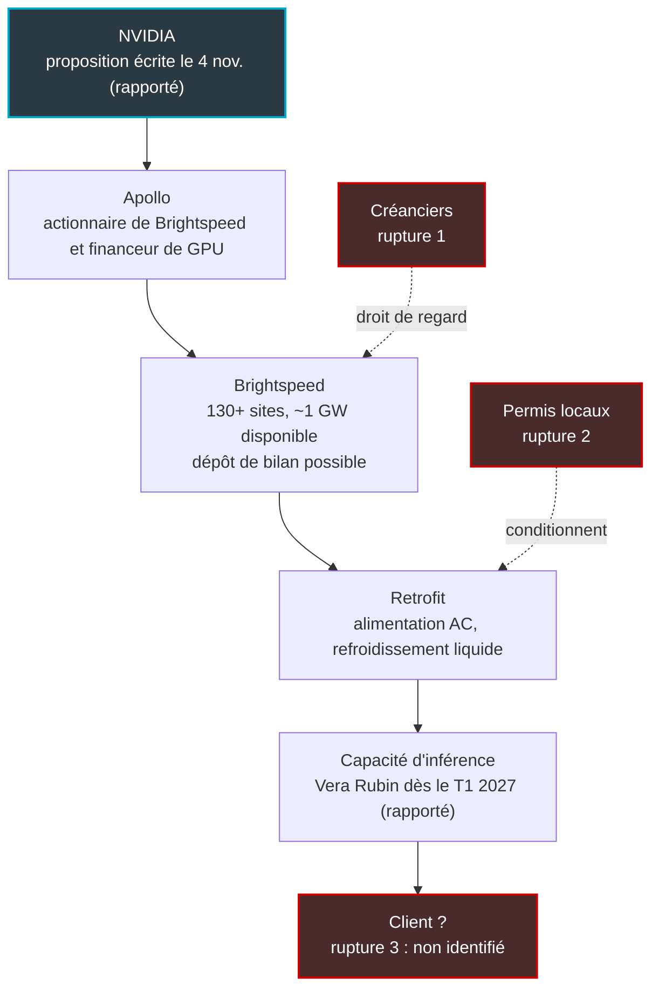

## Le bâtiment le plus ennuyeux de la ville

Pendant un siècle, le central téléphonique a été le bâtiment le plus ennuyeux de la ville. Des murs de briques, peu de fenêtres, des kilomètres de cuivre et une arrivée électrique dimensionnée pour des commutateurs disparus depuis longtemps. Personne ne le regardait. Les opérateurs américains ont même commencé à les vendre par lots, comme on solde un stock d'invendus.

Cette semaine, ce bâtiment a attiré l'attention de NVIDIA. Selon The Information, le fabricant de puces a proposé à Apollo, le fonds qui détient l'opérateur américain Brightspeed, de transformer certains de ses centraux en petits datacenters d'inférence. Comprendre : des sites qui ne servent pas à entraîner des modèles d'IA, mais à les faire tourner pour répondre aux requêtes des utilisateurs. Le parc évoqué compte plus de 130 bâtiments, répartis sur une vingtaine d'États, pour environ un gigawatt de puissance disponible.

Le détail qui change tout ? D'après la presse financière américaine, Brightspeed prépare un possible dépôt de bilan, peut-être dès décembre.

Pour tout opérateur qui exploite des points de présence (PoP), des nœuds techniques ou des salles d'équipement, la question devient très concrète. Ces murs valent-ils encore par le cuivre qu'ils abritent, ou par ce qu'ils permettent de brancher ? Et qui accepte d'installer des milliards de dollars de serveurs chez un propriétaire en pleine négociation avec ses créanciers ? Ma position tient en une phrase : le central redevient stratégique, mais c'est le contrat, pas le bâtiment, qui crée la valeur.

## Rapporté, pas confirmé : ce que contient vraiment le dossier

Avant de bâtir une thèse, il faut trier. À l'heure où j'écris, ni NVIDIA, ni Apollo, ni Brightspeed n'ont confirmé quoi que ce soit publiquement. Tout part d'un article payant de The Information publié le 5 novembre, fondé sur des sources anonymes proches du dossier, et que je connais uniquement par ses reprises [1][2][3]. Voici l'état des lieux.

| Élément | Ce qui est rapporté | Ce qu'il faut en penser |
|---|---|---|
| Bâtiments | Plus de 130 | C'est le parc total de Brightspeed. Le nombre que NVIDIA veut réellement convertir est inconnu. |
| Puissance | Environ 1 GW | Puissance disponible agrégée du portefeuille. Ni capacité installée, ni capacité livrable. |
| Géographie | Jusqu'à 20 États | Recoupe l'empreinte historique de Brightspeed, héritée de Lumen. Un périmètre, pas un plan de déploiement. |
| Matériel | Racks Vera Rubin, démarrage évoqué au T1 2027 | Discussions avec des fournisseurs, rapportées. Aucune spécification de rack publique vérifiée. |
| Calendrier | Proposition écrite remise le 4 novembre, avec demande de données et de visites | Ni signature, ni date de mise en service. |
| Clients | SpaceX, Anthropic, OpenAI cités comme utilisateurs possibles | The Information ignore s'ils ont été approchés. Pure hypothèse. |

Deux lignes méritent qu'on s'y arrête. D'abord, « plus de 130 » ne désigne pas une cible : c'est la totalité du parc. Personne ne sait combien de bâtiments NVIDIA veut vraiment équiper.

Ensuite, le gigawatt. Un calcul de coin de table, qui est le mien et non celui de The Information : un gigawatt réparti sur 130 sites donne environ 7,7 MW par bâtiment en moyenne. Pour des centraux conçus à l'origine pour la voix, c'est un ordre de grandeur élevé. Soit la puissance est concentrée sur une poignée de gros sites, soit le chiffre agrège des capacités de raccordement théoriques plutôt que des mégawatts prêts à l'emploi. Dans les deux cas, la moyenne ne dit presque rien de ce qui sera exploitable.

Pourquoi maintenant ? Le titre de la reprise Stocktwits donne la clé de lecture : il s'agirait de contourner les moratoires sur les datacenters [3]. Un retrofit (la reconversion d'un bâtiment existant) reste soumis à des permis locaux, notamment pour le refroidissement, mais demanderait moins d'approbations qu'une construction neuve. L'argument pèse dans une Amérique où les datacenters se sont invités dans la campagne des élections de mi-mandat du 3 novembre. Des candidats démocrates, dont Gina Hinojosa au Texas, ont plaidé pour un moratoire, et des mesures locales restrictives sont passées dans l'Ohio [15]. Aucun moratoire d'État n'a pourtant été adopté par scrutin à ce stade. Le risque réglementaire est réel. Ce n'est pas une loi.

Dernier élément rapporté : la technologie d'inférence à faible latence de Groq pourrait être intégrée au dispositif. NVIDIA en détient une licence non exclusive depuis le 24 décembre 2025, pour un montant que la presse situe autour de 20 Md USD et que Groq n'a pas publié [17]. La logique se tient. Des sites petits et proches des utilisateurs appellent des puces taillées pour répondre vite, pas pour entraîner.

*Plus de 130 bâtiments, une vingtaine d'États, environ un gigawatt agrégé : les chiffres rapportés décrivent un parc, pas encore un projet.*

## Le transformateur, la fibre et le permis

Un central télécom ressemble à une vieille usine implantée en centre-ville. Personne ne la rachète pour ses machines, bonnes pour la casse. On la rachète pour son transformateur, son embranchement ferroviaire et son permis d'exploiter : trois choses qu'on n'obtiendrait plus aujourd'hui, ou pas sans des années de procédures.

Transposé au central, cela donne trois attributs rares.

**La puissance raccordée.** Un central a été construit pour alimenter des commutateurs, des batteries de secours et la climatisation qui va avec. À mesure que le cuivre se retire, cette puissance se libère. Nous l'avons décrit le 9 septembre : avec les Remote OLT (les équipements de tête de réseau fibre déportés hors du central, au plus près des abonnés), le central se vide. Ce qui libère des mètres carrés libère surtout des kilowatts. Et le kilowatt raccordé est devenu une denrée rare pour quiconque veut faire tourner des GPU.

**La fibre.** Par construction, un central est un point de convergence. Plusieurs routes de fibre y arrivent, souvent par des chemins physiquement distincts, au cœur des zones où vivent et travaillent les utilisateurs. Pour de l'inférence, qui vit de latence et de coût de transport, c'est exactement le bon endroit. Verizon monétise déjà cet atout : son contrat de plus de 1 Md USD avec Google porte sur la connexion de datacenters via sa fibre noire [8].

**Le droit d'usage.** Un central est déjà un bâtiment technique, autorisé comme tel. Sa conversion demande des permis, pas la bataille d'urbanisme d'un campus neuf. Dans le contexte politique décrit plus haut, c'est peut-être l'attribut le plus précieux des trois.

Il ne faut pas pour autant romantiser la brique. L'opérateur régional Ziply Fiber, qui convertit d'anciens centraux cuivre en colocation de proximité, donne une mesure plus terre à terre [13]. Ses sites accueillent de une à dix baies, reliées par un backbone à 400 Gbit/s. Selon DCD, le principal défi n'a pas été le foncier, mais la mise à disposition d'une alimentation en courant alternatif suffisante. Le refroidissement liquide, lui, se décide site par site.

Zac Smith, CEO de Datum, résume l'ambivalence dans les reprises de The Information : ces vieux bâtiments offrent de la puissance sous-utilisée, mais leur exploitation coûte plus cher, parce que leurs équipements vieillissent [3]. Le central est donc rare, mais pas gratuit. Sa valeur se mesure en mégawatts livrables après travaux, pas en mégawatts inscrits au contrat de raccordement.

*Le vrai chantier d'un retrofit : pas les mètres carrés, mais l'alimentation électrique, les jeux de barres et les boucles de refroidissement.*

## Verizon, AT&T, Ziply : le précédent existe, la rentabilité pas encore

NVIDIA n'invente rien ici. L'idée de recycler les centraux circule chez les grands opérateurs américains depuis plus d'un an, avec des modèles économiques très différents.

Le plus avancé est Verizon. Lors de la présentation de ses résultats du deuxième trimestre 2026 (relayée le 27 juillet), son CEO Dan Schulman a déclaré que l'opérateur était « in the early stages of retrofitting many of our central offices into data centers for inference edge computing » [8]. Verizon insiste sur des sites « power-ready and permitted ». Ce sont exactement les trois attributs décrits plus haut, mais chez un propriétaire solide.

AT&T a choisi la voie immobilière. En janvier 2025, l'opérateur a cédé 74 centraux, plus de 13 millions de pieds carrés, à Reign Capital pour plus de 850 M USD [12]. L'opération est une cession-bail : AT&T vend les murs et reste locataire. Le montage est habile, puisque AT&T conserve un partage des revenus de redéveloppement et un droit d'approbation sur les plans, tout en préparant sa sortie du cuivre d'ici 2029. Selon CoStar (cité par la presse immobilière), le portefeuille cédé n'était utilisé qu'à environ 35 %, ce qui laisse penser que près des deux tiers des surfaces étaient inutilisées.

NVIDIA a lui-même posé le cadre en mars 2026, à sa conférence GTC, avec AI Grid : une architecture de référence pour exécuter et monétiser l'inférence dans les hubs régionaux, les centraux et les sites de commutation des opérateurs [9]. Comcast, AT&T, T-Mobile et Indosat étaient cités. Aucun chiffre de sites ni de mégawatts, en revanche. Le journaliste de RCR Wireless doutait que cela tienne mieux que les promesses passées de l'edge computing.

Reste le cas qui a brouillé le débat : l'AI-RAN, c'est-à-dire l'IA intégrée au réseau d'accès radio, jusqu'au pied des antennes. NVIDIA a investi 1 Md USD dans Nokia en octobre 2025 pour pousser ce modèle, et T-Mobile US doit mener des essais à partir de 2026 [11]. Mais quelques mois plus tôt, les opérateurs eux-mêmes restaient sceptiques. En mars 2025, Ulf Ewaldsson (T-Mobile) tranchait : « Today it's economically not feasible to put them [GPUs] into the basestation ». Igal Elbaz (AT&T) ajoutait : « I'm not sure I've heard any use case that requires inferences in every cell site » [10].

Ces citations datent, mais elles tracent la bonne frontière. Le site radio est trop petit, trop nombreux, trop cher à équiper. Le central métropolitain, lui, agrège toute une zone urbaine derrière une seule arrivée électrique et un seul faisceau de fibres. L'inférence en périphérie a bien un bon endroit. Ce n'est pas le pied du pylône. C'est le central.

Reste à savoir si la chaîne tient de bout en bout chez Brightspeed. Elle compte au moins trois points de rupture.

*La chaîne rapportée, de la puce au client. En rouge, les trois points de rupture : créanciers, permis, client.*

## Le maillon faible : un propriétaire qui compte ses mois de trésorerie

Imaginez signer pour des milliards de dollars de serveurs dans un immeuble dont le propriétaire ne décidera peut-être plus de rien dans quelques semaines. C'est, sur le papier, la situation de Brightspeed.

Selon Fierce Network, qui cite le WSJ Pro, l'opérateur prépare un possible dépôt de bilan dès décembre [5]. Sa trésorerie fond : 2,4 Md USD fin 2025, 1,8 Md au trimestre suivant, puis 1,2 Md. Sa dette brute se situe de l'ordre de 11 à 12 Md USD, selon les sources et les dates de mesure [5][16]. Et Apollo, toujours selon ces informations, ne remettrait pas de capital.

Le 2 novembre, Light Reading rapportait le remplacement de Michel Combes par Shawn O'Donnell, un ancien de FTI au profil de spécialiste des restructurations [6]. On ne nomme pas ce type de dirigeant pour préparer une phase de croissance. L'analyste David Barden (New Street) estime les besoins de financement à environ 3 Md USD jusqu'en 2027. Brightspeed chercherait une facilité adossée à son réseau fibre et envisagerait de titriser des actifs.

Le patrimoine immobilier, lui, est déjà sur le marché. En février 2025, six centraux de l'Ohio étaient proposés en cession-bail, avec un bail de 20 ans de type triple net (le locataire paie taxes, assurance et entretien), pour 1,9 à 6,2 M USD pièce [7]. Des sites du Missouri et de Virginie avaient précédé.

D'où une question que personne n'a tranchée publiquement. Parmi les 130 bâtiments évoqués, combien Brightspeed possède-t-il encore, combien loue-t-il, combien sont grevés de sûretés au profit de ses prêteurs ? En cas de restructuration, ces créanciers auraient la main sur tout accord. NVIDIA ne négocierait plus avec un opérateur, mais avec un comité de prêteurs.

Paradoxe : c'est peut-être ce qui rend l'opération possible. Pour les créanciers, l'actif stratégique de Brightspeed n'est pas le central, c'est la fibre. L'opérateur vise 4 millions de foyers fibrés et en a dépassé 3 millions [6]. Les centraux sont un actif secondaire, qu'on peut céder ou louer pour lever du cash sans toucher au cœur du réseau. Un projet adossé à NVIDIA peut valoriser des murs qui, dans un dossier de faillite, ne valaient presque rien.

Un mot enfin sur Apollo, qui joue ici plusieurs rôles. Le fonds est l'actionnaire de Brightspeed et le destinataire de la proposition de NVIDIA. Une entité qu'il gère est aussi, selon plusieurs sources, la contrepartie d'un engagement de bail financier d'environ 40 Md USD annoncé par SpaceX le 26 octobre, pour des GPU Vera Rubin livrables au premier semestre 2027 [14]. SpaceX figure par ailleurs parmi les utilisateurs possibles évoqués, sans qu'on sache s'il a été approché. Le fournisseur de puces cherche des murs et des financeurs pour placer ses puces. Ce n'est pas une irrégularité, c'est un schéma de financement, que nous avons décortiqué le 30 octobre.

*D'un côté, de la capacité d'inférence ; de l'autre, 11 à 12 milliards de dollars de dette. La fibre relie les deux, et c'est elle que regardent les créanciers.*

## Trois scénarios, et ce que j'en retiens pour nos propres PoP

Rien n'est signé. Trois issues me semblent possibles.

1. **L'accord complet.** Brightspeed, ou l'entité qui sortira de sa restructuration, signe avec NVIDIA. Les créanciers valident, les premiers racks arrivent en 2027. Il faut pour cela un propriétaire stabilisé, un client engagé et une puissance réellement livrable : trois conditions, aucune acquise aujourd'hui. C'est le scénario le moins probable.
2. **L'accord dilué.** Une poignée de sites, les mieux alimentés et les mieux placés, sortent du périmètre. Ils sont cédés ou loués à un véhicule tiers dans le cadre de la restructuration, puis équipés. C'est mon pari : il donne du cash aux créanciers et des mégawatts à NVIDIA, sans exiger que Brightspeed survive en l'état.
3. **L'abandon.** Aucun client ne s'engage, les permis traînent, les créanciers préfèrent vendre les murs au plus offrant et concentrer la valeur sur la fibre. Le projet rejoint la longue liste des promesses de l'edge.

Pour un opérateur comme Wifirst, qui exploite PoP, nœuds de collecte et transit pour des clients de l'hôtellerie, du retail ou des résidences étudiantes, la mauvaise leçon serait : louons nos PoP aux GPU. La bonne tient en deux chantiers.

**Inventorier nos murs en mégawatts, pas en mètres carrés.** Pour chaque PoP : puissance souscrite, puissance réellement consommée, marge d'extension auprès du gestionnaire de réseau électrique, coût d'adaptation (alimentation, refroidissement), nombre de routes fibre physiquement distinctes, nature du droit d'occupation (propriété, bail, convention). La plupart des opérateurs connaissent leurs surfaces au mètre près. Très peu connaissent leurs kilowatts disponibles à dix près.

Cet inventaire sert immédiatement, même sans locataire GPU. Pour nos clients, le cas d'usage plausible n'est pas l'IA dans chaque borne Wi-Fi, mais l'inférence métropolitaine : agents pour le centre de supervision réseau (NOC), analyse vidéo, assistants vocaux traités localement. Les raisons sont toujours les mêmes. Latence, souveraineté, coût de transport.

**Contractualiser l'inférence comme on contractualise un cloud.** Que l'on soit hébergeur ou locataire de capacité, toute location d'inférence devrait porter les clauses qu'on exigerait d'un fournisseur cloud, et quelques autres :

- une clause de *step-in*, pour reprendre l'exploitation du site si le propriétaire défaille ;
- un droit d'accès physique garanti, opposable à un éventuel repreneur ;
- une séparation nette des actifs, pour que les serveurs ne tombent pas dans le patrimoine du bailleur ;
- un engagement de niveau de service (SLA) exprimé en mégawatts livrés, pas seulement en disponibilité ;
- une assurance couvrant la perte d'exploitation liée à la défaillance du propriétaire ;
- un plan de continuité en cas de procédure collective.

Sur ce dernier point, prudence. En droit français (art. L. 622-13 du Code de commerce) comme sous le Chapter 11 américain (11 U.S.C. § 365(e)), une clause qui résilie automatiquement le contrat du seul fait de l'ouverture d'une procédure est en principe inopposable, sauf exceptions. Ne comptez donc pas sur elle : privilégiez des garanties qui ne dépendent pas de l'ouverture de la procédure (droit d'accès, séparation des actifs, step-in sur défaut d'exécution). Elles ne sont pas pour autant à l'abri : des actes conclus peu avant la procédure peuvent être contestés (période suspecte en France, actions en annulation de transferts préférentiels ou frauduleux aux États-Unis). À valider avec vos juristes, pas avec votre fournisseur de GPU.

## Le central est une option, pas un rendement

Le dossier NVIDIA-Brightspeed dit quelque chose de vrai, même s'il ne se conclut jamais. Le central télécom a changé de nature. Il ne vaut plus par son cuivre ni par ses mètres carrés, mais par trois attributs devenus rares : de la puissance raccordée, de la fibre et un droit d'usage déjà acquis.

Mais c'est un actif d'option, pas un actif de rendement. Sa valeur d'inférence dépend de trois conditions cumulatives : une puissance réellement livrable, un client engagé, un propriétaire solvable. Chez Brightspeed, la première n'est pas prouvée, la deuxième n'est pas identifiée, et la troisième est aujourd'hui sérieusement fragilisée, si l'on en croit les informations sur un possible dépôt de bilan.

Je ne crois donc pas au grand réseau d'inférence de 130 centraux. Je crois en revanche que quelques-uns de ces bâtiments finiront par héberger des GPU, sous un autre propriétaire ou sous la tutelle des créanciers. Tous les opérateurs, des deux côtés de l'Atlantique, devraient en tirer la même conclusion : savoir au mégawatt près ce que valent leurs murs, avant que quelqu'un d'autre ne vienne le leur expliquer.

Le cuivre quitte les centraux. Les mégawatts restent. Toute la question est de savoir qui signera pour les brancher.

_Vues personnelles, pas position Wifirst._

## Sources

1. Tom's Hardware, NVIDIA et la reconversion de plus de 130 bâtiments télécoms, discussions avec Brightspeed après une approche d'Apollo (reprise de The Information), vers le 6 nov. 2026 — https://www.tomshardware.com/tech-industry/data-centers/nvidia-wants-to-repurpose-over-130-old-telco-buildings-as-tiny-data-centers-report-claims-company-in-talks-with-brightspeed-after-pitching-idea-to-parent-company-apollo-global-management
2. AI Weekly, la proposition de NVIDIA à Apollo sur les bâtiments Brightspeed (reprise de The Information), 5 nov. 2026 — https://aiweekly.co/alerts/nvidia-pitches-apollo-on-converting-130-brightspeed-telecom-buildings-into-1gw
3. Stocktwits, NVIDIA, les sites télécoms d'Apollo et les moratoires sur les datacenters (reprise détaillée de The Information), 5 nov. 2026 — https://stocktwits.com/news-articles/markets/equity/nvidia-eyes-apollo-s-struggling-telecom-sites-to-sidestep-data-center-moratoriums-report/cNG1vn9R94o
4. CryptoBriefing, contexte uniquement, 5 nov. 2026 — https://cryptobriefing.com/nvidia-retrofits-old-buildings-data-center-backlash/
5. Fierce Network, Brightspeed face à un possible dépôt de bilan (d'après le WSJ Pro), 30 oct. 2026 — https://www.fierce-network.com/broadband/fiber-operator-brightspeed-faces-potential-bankruptcy
6. Light Reading, changement de CEO chez Brightspeed et estimations New Street, 2 nov. 2026 — https://lightreading.com/broadband/brightspeed-swaps-ceos-as-it-reportedly-nears-bankruptcy
7. SDxCentral, six centraux Brightspeed mis en vente dans l'Ohio, 6 fév. 2025 — https://www.sdxcentral.com/news/six-brightspeed-central-offices-up-for-sale-in-ohio/
8. Constellation Research, Verizon et la reconversion de ses centraux pour l'inférence, 27 juil. 2026 — https://www.constellationr.com/insights/news/verizon-sees-ai-data-center-transformation-ahead-rivals-eye-inference
9. RCR Wireless, l'architecture NVIDIA AI Grid pour les opérateurs, 19 mars 2026 — https://www.rcrwireless.com/20260319/ai/nvidia-telco-ai-grid
10. Light Reading (Mike Dano), citations d'opérateurs sur NVIDIA et l'IA dans le réseau radio, 12 mars 2025 — https://www.lightreading.com/ai-machine-learning/nvidia-the-vendor-that-must-not-be-named
11. eeNews Europe, partenariat NVIDIA-Nokia sur l'AI-RAN, 29 oct. 2025 — https://www.eenewseurope.com/en/nvidia-and-nokia-partner-on-ai-ran-to-drive-6g-evolution
12. GlobeSt, cession-bail de 74 centraux AT&T à Reign Capital, 27 janv. 2025 — https://www.globest.com/2025/01/27/att-strikes-850m-sale-leaseback (voir aussi Dallas Innovates, https://dallasinnovates.com/?p=270730, et le communiqué AT&T, https://about.att.com/story/2025/reign-capital.html)
13. Fierce Network, Ziply Fiber et la conversion de ses centraux en datacenters, 2025 — https://www.fierce-network.com/cloud/whats-old-new-again-ziply-turns-old-cos-data-centers (voir aussi DCD, juin 2025, https://www.datacenterdynamics.com/en/analysis/copper-to-colo-ziplys-plan-to-repurpose-its-central-offices/)
14. Verdict, engagement de bail financier SpaceX d'environ 40 Md USD, 26 oct. 2026 — https://www.verdict.co.uk/newsletters/spacex-secures-40bn-finance-lease-commitment
15. Tech Policy Press, tribune sur les datacenters et les scrutins de mi-mandat, 5 nov. 2026 — https://techpolicy.press/data-centers-were-on-the-ballot-across-the-us-and-they-lost-what-comes-next
16. Octus, analyse crédit Brightspeed, 2026 — https://octus.com/?p=44331
17. TechSpot, accord de licence non exclusive NVIDIA-Groq, déc. 2025 — https://www.techspot.com/news/110723-nvidia-20-billion-groq-deal-looks-lot-like.html
18. The Information, article original du 5 nov. 2026 (payant, non consulté, cité comme source des reprises) — https://www.theinformation.com
