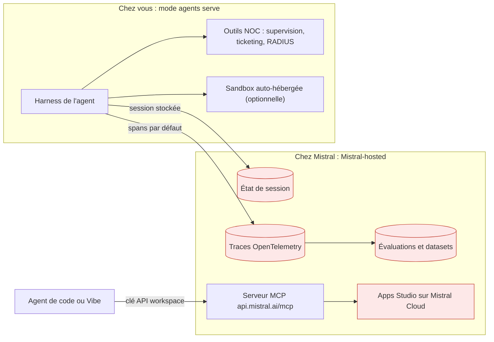
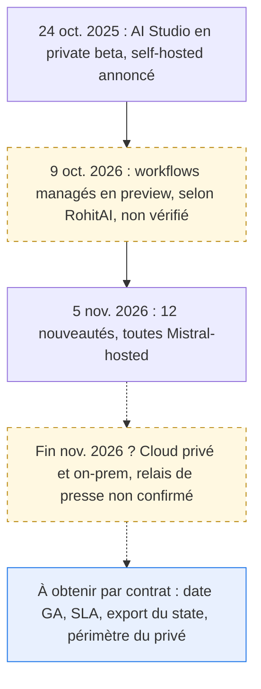

## Un agent d'astreinte qui ne dort jamais, et qui ne loge pas chez vous

Chez Mistral, quand une alerte de production tombe, le premier à ouvrir la procédure d'incident n'est plus forcément un ingénieur. C'est un agent logiciel. Il déroule le runbook, demande une validation humaine avant toute action sensible et poste son diagnostic dans Slack. L'éditeur affirme y gagner « des centaines d'heures par mois ». Chiffre maison, sans point de comparaison publié. Mais l'image parle à quiconque a déjà été réveillé à 3 heures du matin par une sonde passée au rouge.

Pour un opérateur qui supervise des milliers de bornes Wi-Fi dans des hôtels, des résidences étudiantes ou des magasins, la promesse est limpide : un centre de supervision réseau (NOC) où la machine fait le premier tri pendant que l'humain garde la main sur les décisions. Quand cette promesse vient d'un champion français qui a fait de la souveraineté son argument commercial, la tentation de signer vite est forte.

Le 5 novembre 2026, Mistral a donné corps à cette promesse dans Studio, sa plateforme pour entreprises : bacs à sable d'exécution, sous-agents, traces d'exécution, constructeur de workflows en langage naturel. Le problème tient dans une étiquette répétée douze fois dans les notes de version : « Mistral-hosted ». Hébergé chez Mistral.

Ma thèse est simple. Tant que l'état de vos sessions et vos traces vivent chez le fournisseur, la souveraineté de vos agents n'est pas une fonctionnalité qu'on active. C'est une clause qu'on négocie.

## Ce que Mistral a vraiment mis sur la table

Rendons d'abord à Mistral ce qui lui revient. Avec cette livraison, l'orchestration d'agents devient une couche d'exploitation concrète : de quoi faire tourner un agent pendant des heures, le cloisonner, l'observer et reprendre la main.

**Les bacs à sable.** Une sandbox est l'enclos dans lequel l'agent exécute du code ou des commandes sans toucher au reste du système. Détail révélateur : Studio n'en active aucune par défaut. Vous choisissez entre un conteneur par session chez Mistral, l'hôte qui fait tourner le harness de l'agent (le programme qui orchestre ses appels au modèle et aux outils), ou une sandbox que vous gérez vous-même. Pour un NOC, c'est à mes yeux la meilleure nouvelle de l'annonce : un agent qui doit interroger vos équipements peut le faire depuis votre propre réseau. C'était déjà la leçon de notre article d'octobre sur Modal : louez le bac à sable si vous voulez, mais gardez les clés.

**Les sous-agents.** Un agent peut déléguer des morceaux de tâche à d'autres agents. La documentation que j'ai lue s'arrête là : rien sur leur isolation, leurs limites ou l'héritage des permissions. Même silence sur les « frontières » d'outils, de données et d'actions que Mistral promet de pouvoir imposer à un agent, avec approbation humaine. Le principe est annoncé. Aucune spécification n'est publiée.

**Les traces.** Studio annonce des traces au format OpenTelemetry (OTel), le standard ouvert que la plupart des outils d'observabilité savent déjà lire. Un span, c'est-à-dire une ligne de trace horodatée, est produit par appel de modèle et par appel d'outil, sans configuration, sur les agents déployés. Le choix du standard est le bon. L'export vers un collecteur tiers, le vôtre par exemple, n'est en revanche pas documenté.

**Le workflow builder.** Vous décrivez un processus en langage naturel dans Mistral Vibe, l'outil génère le workflow, le teste et le déploie, et le code reste éditable. Les déclencheurs et les webhooks sont, eux aussi, en public preview.

**Le serveur MCP.** C'est le point qui prête le plus à confusion. MCP (Model Context Protocol) est le standard qui permet à un agent d'appeler des outils externes. Mistral expose désormais un serveur MCP sur `api.mistral.ai/mcp`, authentifié par une clé API rattachée à l'espace de travail.

Mais ce serveur expose... Studio lui-même : apps, facturation, connecteurs, évaluations, observabilité, organisation, secrets, skills, workflows, mais aussi documentation, bases de connaissances, bibliothèques et prompts. C'est un plan de contrôle pour piloter Studio depuis un agent de code, pas une passerelle vers vos outils réseau. La documentation précise que les valeurs des secrets ne sont jamais renvoyées et recommande une approbation par outil pour toute écriture. Elle ne dit rien, en revanche, du statut de ce serveur.

Sur les statuts justement, le décompte des [notes de version](https://docs.mistral.ai/resources/release-notes) est sans ambiguïté. Douze entrées : dix en public preview, une en private preview (les connecteurs HTTP API), une seule en disponibilité générale, ou GA (les apps Studio dans Vibe Code Web). L'agrégateur AlphaSignal a titré sur des « Workflows GA ». Les notes de version classent le workflow builder en preview. Je retiens la source primaire.

*Bac à sable chez vous, sous-agents à l'intérieur : l'exécution se déporte, mais un fil de traces continue de filer vers le fournisseur.*

## Le code chez vous, la boîte noire chez eux

Imaginez une compagnie aérienne qui possède ses avions, recrute ses pilotes et paie son kérosène. Un constructeur lui propose un excellent pilote automatique. Une seule condition : le plan de vol en cours et la boîte noire sont stockés dans les hangars du constructeur. Les avions décollent bien de chez la compagnie. La mémoire du vol, elle, dort ailleurs.

C'est, à peu de chose près, le modèle de Studio. La [documentation des Managed Agents](https://docs.mistral.ai/studio/agents/overview) décrit deux modes. Avec `agents serve`, le harness et les outils tournent sur vos serveurs, et la doc précise aussitôt : « Mistral stores the session ». Avec `agents deploy`, Mistral gère tout : « you host nothing ». Dans les deux cas, l'état de session réside chez Mistral.

Le reste de la plateforme suit la même pente. Selon la [vue d'ensemble de Studio](https://docs.mistral.ai/studio/overview), les apps tournent toujours sur Mistral Cloud. Agents et workflows peuvent s'exécuter dans le cloud de Mistral ou sur votre infrastructure. L'observabilité et les évaluations sont réservées aux organisations de niveau Enterprise.

Qu'y a-t-il dans l'état de session d'un agent NOC ? La doc ne le détaille pas ; voici mon interprétation d'exploitant. L'alarme d'origine. Les extraits de configuration lus. Les journaux RADIUS consultés (le serveur qui authentifie les utilisateurs du Wi-Fi). Le raisonnement intermédiaire, les actions proposées, validées ou refusées. Autrement dit, la mémoire de travail d'un incident, avec tout ce qu'elle charrie de données clients et de topologie réseau.

Côté traces, deux relais de la documentation complètent le tableau, sans que j'aie pu les recouper à la source : la page dédiée au tracing était introuvable lors de nos vérifications. Data Studios rapporte une politique de masquage par défaut des secrets et des données personnelles avant qu'elles ne quittent le worker. RohitAI, blog d'analyse tiers, ajoute que les traces incluent le contenu des prompts et des réponses, et que ce masquage fondé sur des motifs peut rater des formats inconnus. Une clé Wi-Fi partagée au format maison, un numéro de chambre accolé au nom d'un client : ce sont précisément ces formats-là qu'un opérateur manipule tous les jours.

*Exécution déportable, état non déporté : tout ce qui est en rouge relève du périmètre contractuel à négocier.*

## La souveraineté existe, mais pas dans les notes de version

Il serait malhonnête de s'arrêter là. La [page d'annonce](https://mistral.ai/news/build-with-studio/) présente le déploiement en VPC (un réseau privé isolé au sein d'un cloud) et sur site comme des options actuelles, pas futures. Elle cite Su Yang, de BNP Paribas : « we run Mistral Studio on our own infrastructure and keep those systems under our control ». Citation choisie par l'éditeur, que je n'ai aucun moyen de vérifier. Prise au mot, elle dit qu'au moins un grand compte fait tourner Studio chez lui.

La promesse n'est pas neuve non plus. Le 24 octobre 2025, Mistral lançait [AI Studio](https://mistral.ai/news/ai-studio) en private beta, avec des déploiements « hybrid, dedicated, and self-hosted » et une « full data ownership ». La [page produit](https://mistral.ai/products/studio) affiche toujours « Self-hosted : Nothing leaves your perimeter ». Formule marketing, sans date ni périmètre fonctionnel. L'auto-hébergement est donc une promesse de plus d'un an.

Comment concilier tout cela avec douze nouveautés hébergées chez Mistral ? Les deux sont vrais. RohitAI propose une lecture que je trouve convaincante, tout en rappelant qu'elle émane d'un tiers : le déploiement privé de Studio serait un arrangement contractuel, distinct du simple worker auto-hébergé. L'annonce elle-même renvoie d'ailleurs vers les commerciaux : « For an enterprise rollout ... talk to our team ». La souveraineté de Studio n'est donc pas inexistante. Elle est non documentée, non datée et sous contrat.

Reste le calendrier. Les agrégateurs AI Weekly et AlphaSignal écrivent que le cloud privé et l'on-prem arriveraient « fin novembre », en attribuant la phrase à Mistral, sans lien. Je ne retrouve cette date ni dans l'annonce, ni dans les notes de version, ni dans la documentation, ni sur la page produit. Tenez-la pour un relais de presse non confirmé par Mistral. Et même confirmée, une date sur un blog n'engage personne.

Un dernier avertissement, par honnêteté envers le lecteur : je n'ai trouvé aucune source indépendante de premier rang sur cette annonce. Pas d'analyste, pas de presse spécialisée de référence. Tout l'écosystème secondaire reprend la page de Mistral.

*Une promesse d'auto-hébergement vieille d'un an, une livraison documentée entièrement hébergée chez Mistral, et un calendrier qui ne tient qu'à des relais de presse.*

**Le motif n'a rien de spécifiquement français.** Anthropic, avec [Claude Managed Agents](https://platform.claude.com/docs/en/managed-agents/overview), toujours en beta, propose exactement le même schéma : sandbox dans le cloud d'Anthropic ou auto-hébergée, sessions avec état, transcriptions stockées côté serveur jusqu'à suppression. Sa documentation précise que le service n'est éligible ni au Zero Data Retention (l'engagement de non-conservation des données) ni au BAA HIPAA (l'accord de conformité santé américain), « including Self-hosted sandboxes ».

OpenAI, de son côté, a présenté Frontier le 5 février 2026 pour construire, déployer et gérer des agents avec permissions et frontières. Pas de date de disponibilité générale, pas de prix, et aucune précision sur la localisation du déploiement dans la source consultée. Le critère n'est donc pas « Mistral contre les Américains ». C'est : où vit l'état ?

## Une preview publique, c'est un chantier ouvert au public

On peut visiter. On ne devrait pas emménager.

La documentation de Mistral le dit sans détour : « Managed Agents and the Agents SDK are in public preview ». L'API, le comportement et les limites peuvent changer, et les mises à jour peuvent exiger des modifications de votre code. Aucun prix publié pour les nouveautés du 5 novembre. Aucune date de disponibilité générale. Aucun SLA (engagement contractuel de niveau de service) trouvé.

Data Studios signale en outre que l'ancienne Agents API et les « durable agents » de Workflows seraient promis à la dépréciation, sans date. Source unique, non recoupée. Mais si c'est exact, ceux qui ont construit sur la génération précédente l'apprennent par un tiers. Voilà pourquoi un préavis se négocie par écrit.

Les limites par défaut méritent aussi un regard d'exploitant : session de 24 heures, inactivité de 4 heures, attente d'approbation humaine de 1 heure. La doc indique qu'elles sont relevables. Faites quand même l'exercice. 3 h 10 du matin, une boucle réseau couche un étage de résidence étudiante. L'agent diagnostique, propose de couper un port, demande validation. L'astreinte dort, téléphone en silencieux. À 4 h 10, le délai d'approbation expire. Et ensuite ? L'action est-elle abandonnée, la session close, le contexte perdu ? Je n'ai pas trouvé la réponse dans les pages lues. Ce n'est pas un détail : c'est précisément la nuit où vous comptiez sur l'agent.

Deux autres points de gouvernance. D'abord les quotas de déploiements managés : 0, 3 en pay-as-you-go et 10 en Enterprise, selon Magica et RohitAI qui citent la doc. Je ne les ai pas relus à la source. Pour un opérateur qui imagine un agent par famille d'incidents, dix partent vite.

Ensuite la clé API du serveur MCP, rattachée à l'espace de travail entier. Une clé qui ouvre tout le workspace, c'est un passe-partout. Mon conseil : une clé par agent, des droits minimaux, et l'approbation par outil que la doc recommande pour les écritures, appliquée sans exception.

*L'humain valide, l'agent agit, mais le carnet de bord de l'incident reste rangé dans les locaux du fournisseur.*

## La grille à poser sur la table, chez Mistral ou ailleurs

Le 2 novembre, je détaillais ici les clauses qui encadrent le périmètre d'autonomie d'un agent NOC, c'est-à-dire ce qu'il a le droit de faire. Je ne les répète pas. La question du jour est différente : où vit ce que l'agent produit, et que devient-il quand le produit change sous vos pieds ?

| Composant | Où il vit aujourd'hui | Ce que j'exige |
|---|---|---|
| Code de l'agent, skills, connecteurs MCP | Sur vos serveurs en mode `agents serve` | Peu de chose : c'est la partie la plus portable |
| État de session | Chez Mistral, même en `agents serve` | Localisation, rétention, accès du support, suppression, export |
| Traces OpenTelemetry | Observabilité Studio, réservée à Enterprise | Export vers votre collecteur, format documenté |
| Évaluations et datasets | Studio, réservés à Enterprise | Export complet, droit de suppression |
| Apps Studio | Toujours sur Mistral Cloud | Inventaire des données qu'elles manipulent |

**1. Le périmètre des données, composant par composant.** Pour chaque ligne du tableau, plus l'index de recherche managé : où ça tourne, où c'est stocké, qui y accède (support de l'éditeur compris), combien de temps, et comment on le supprime. Un agent en `agents serve` n'est pas « chez vous » tant que sa session ne l'est pas.

**2. Une sortie de preview datée.** Une date de disponibilité générale, ou à défaut une clause de sortie. Un préavis de rupture d'API de 6 à 12 mois. Un préavis de dépréciation, puisqu'un relais en évoque déjà une. Des crédits en cas d'indisponibilité. Ma règle : pas d'agent NOC en production critique sans SLA écrit.

**3. La portabilité du state.** Le code se déménage : SDK Python, skills, connecteurs. La session, les traces, les jeux d'évaluation et l'index, non, ou du moins rien ne le documente. ExplainX relève que l'annonce ne dit pas si agents et workflows peuvent être exportés. Absence de preuve n'est pas preuve d'absence, donc demandez : API d'export des sessions, traces au format OTel vers votre propre collecteur, format documenté. Et testez la réversibilité avant de signer, pas après.

**4. Le calendrier du privé, dans le contrat.** Une date publique, confirmée ou non, n'est pas un engagement. Exigez le périmètre fonctionnel de la version privée (parité avec le managé ?), le numéro de version, le partage des responsabilités d'exploitation, le support et le tarif. Sans cela, la souveraineté ne se mesure pas.

Dernier réflexe : appliquez la même grille à chaque fournisseur. Anthropic stocke lui aussi l'état côté serveur, hors Zero Data Retention. Cette grille ne sert pas à disqualifier Mistral. Elle sert à comparer des contrats plutôt que des slogans.

*Les premières marches sont en preview, le palier du privé reste dans le brouillard : la seule rampe solide, c'est le contrat.*

## Ma position : tester maintenant, signer plus tard

Mistral a livré un vrai travail d'ingénierie, et je tiens à le dire avant de conclure. Le choix d'OpenTelemetry plutôt que d'un format maison est le bon. Le mode `agents serve` va dans le bon sens. Les sandboxes au choix aussi. Pour un acteur européen, c'est une base crédible face à une concurrence américaine qui, chez Anthropic par exemple, garde elle aussi l'état de session côté serveur.

Mais la souveraineté ne se décrète pas dans un communiqué, et elle ne s'active pas dans une console. Je testerais Studio dès maintenant, sur des données non sensibles et sans droit d'action : synthèse d'alertes, préparation de comptes rendus d'incident, recherche dans les runbooks. Je ne brancherais en revanche aucun agent sur un NOC de production, chez Mistral comme ailleurs, tant que le périmètre des données, la sortie de preview, l'export du state et le calendrier du privé ne sont pas écrits noir sur blanc.

Pour la question du modèle lui-même et de sa licence, je renvoie à notre article du 1er novembre sur Mistral Large 4. Ici, l'enjeu est ailleurs. La souveraineté, ce n'est pas l'endroit où tourne votre code. C'est l'endroit où dort sa mémoire.

_Vues personnelles, pas position Wifirst._

## Sources

1. [Mistral — Build Enterprise Agents, Workflows & Apps in Mistral Studio](https://mistral.ai/news/build-with-studio/) — annonce, date non affichée (5 novembre 2026 d'après les notes de version)
2. [Mistral Docs — Release notes](https://docs.mistral.ai/resources/release-notes) — documentation officielle, 5 novembre 2026
3. [Mistral Docs — Managed Agents overview](https://docs.mistral.ai/studio/agents/overview) — documentation officielle, consultée le 9 novembre 2026
4. [Mistral Docs — Studio overview](https://docs.mistral.ai/studio/overview) — documentation officielle, consultée le 9 novembre 2026
5. [Mistral Docs — MCP server](https://docs.mistral.ai/resources/mcp) — documentation officielle, consultée le 9 novembre 2026
6. [Mistral — AI Studio (private beta)](https://mistral.ai/news/ai-studio) — annonce, 24 octobre 2025
7. [Mistral — page produit Studio](https://mistral.ai/products/studio) — page marketing, consultée le 9 novembre 2026
8. [Data Studios — Mistral Studio managed agents, workflows, apps: public preview](https://www.datastudios.org/post/mistral-studio-managed-agents-workflows-apps-public-preview) — analyse des notes de version, novembre 2026
9. [AI Weekly — Mistral opens Studio managed agents in public preview](https://aiweekly.co/alerts/mistral-opens-studio-managed-agents-in-public-preview-adds-workflow-builder-and) — agrégateur, 6 novembre 2026
10. [AlphaSignal — Mistral rebuilds Studio into a full enterprise AI agent platform](https://alphasignal.ai/news/mistral-rebuilds-studio-into-a-full-enterprise-ai-agent-platform) — agrégateur, 5 novembre 2026
11. [ExplainX — Mistral Studio managed agents, workflows, apps](https://explainx.ai/blog/mistral-studio-managed-agents-workflows-apps-le-chonk-enterprise-otel-sovereign-2026) — analyse, 5 novembre 2026
12. [Let's Data Science — Mistral expands Studio with managed agents, workflows and apps](https://letsdatascience.com/news/mistral-expands-studio-with-managed-agents-workflows-and-app-2bc33868) — presse tech, 5 novembre 2026
13. [Magica — Mistral Studio managed agents, apps, enterprise control](https://magica.com/news/mistral-studio-managed-agents-apps-enterprise-control) — analyse, novembre 2026
14. [RohitAI — Mistral Studio agent deployment and data controls](https://rohitai.com/blog/mistral-studio-agent-deployment-data-controls) — blog d'analyse, 5 novembre 2026
15. [ai-tldr — Mistral Studio managed agents and apps](https://ai-tldr.dev/releases/mistral-studio-managed-agents-apps/) — résumé de release, 5 novembre 2026
16. [Anthropic — Claude Managed Agents overview](https://platform.claude.com/docs/en/managed-agents/overview) — documentation officielle, consultée le 9 novembre 2026
17. [Verdent — Claude Managed Agents pricing](https://verdent.ai/guides/claude-managed-agents-pricing) — blog, 2026
18. [PYMNTS — OpenAI targets enterprise market with new AI agent platform](https://www.pymnts.com/news/artificial-intelligence/2026/openai-targets-enterprise-market-with-new-ai-agent-platform/) — presse, 5 février 2026
