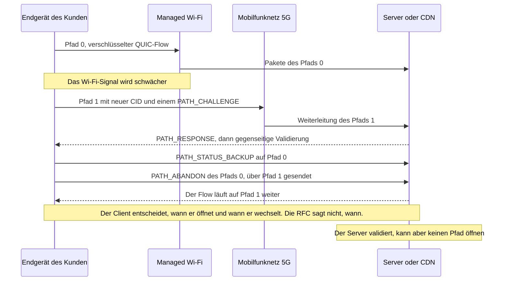

## Neun Jahre, damit ein Videocall auf dem Parkplatz nicht mehr einfriert

Ein Hotelgast verlässt mitten in einer Videokonferenz die Lobby. Drei Schritte auf dem Parkplatz, das Wi-Fi wird schwächer, das Telefon springt auf 5G, und das Bild friert ein, bis die Anwendung die Teile wieder zusammengesetzt hat. Nichts Dramatisches. Außer man multipliziert die Szene mit Hunderten von Standorten (Hotels, Studierendenwohnheime, Ladengeschäfte, Campus) und ist derjenige, der das Wi-Fi betreibt. Für den Nutzer liegt der Abbruch immer am Wi-Fi.

Am 7. November 2026 hat die Organisation, die die Protokolle des Internets standardisiert, den Text veröffentlicht, der genau auf solche Wechsel zielt. Die RFC 10069 (Request for Comments, die Reihe, in der die Internetstandards erscheinen) erweitert QUIC, das verschlüsselte Transportprotokoll als Alternative zu TCP, auf mehrere Netzwerkpfade innerhalb einer einzigen Verbindung. Wi-Fi und Mobilfunk, Festnetzanbindung und Satellit. Erster Entwurf im Oktober 2017. Übernahme durch die Arbeitsgruppe 2022. Dann fast 300 Tickets und mehr als 326 Änderungsvorschläge, bis der Status eines Standards erreicht war.

Die Versuchung wird sofort da sein: diesen Text als Todesurteil für proprietäre Link-Aggregations-Appliances zu lesen. Das sagt er nicht. Die RFC normiert die Mechanik, nicht die Entscheidung. Welchen Pfad man öffnet, wann, und wie man den Traffic darauf verteilt, bleibt Sache jeder einzelnen Implementierung, und der Text schreibt das schwarz auf weiß. Wer Netzwerk einkauft, findet den Wert dieses Standards daher nicht im Standard. Er liegt in dem, was Sie von Ihren Lieferanten schriftlich verlangen.

## Der Lieferschein, nicht der Disponent

Stellen Sie sich vor, Sie vertrauen eine vertrauliche Akte gleichzeitig zwei Kurierdiensten an. Damit das funktioniert, braucht es einen Lieferschein pro Kurier, getrennt nummeriert. Es braucht Empfangsbestätigungen, die sagen, wer was zugestellt hat. Und es braucht eine saubere Möglichkeit, einen Kurier zu verabschieden, der trödelt. Die RFC 10069 ist genau dieser Lieferschein. Was sie nicht leistet: entscheiden, welcher Kurier welchen Umschlag nimmt, oder einen zweiten Kurier auftreiben, wenn Sie nur einen haben. Das ist die Aufgabe des Disponenten. Und der Disponent ist nicht genormt.

*Eine einzige verschlüsselte Verbindung, zwei Routen: Die RFC 10069 normiert den Lieferschein, nicht die Wahl des Kuriers.*

Das Dokument umfasst 33 Seiten und trägt sechs Unterschriften. Y. Liu (Alibaba), Q. De Coninck (UMONS) und M. Kühlewind (Ericsson) sind die Editoren, neben O. Bonaventure (UCLouvain), C. Huitema (Private Octopus) und Y. Ma (Harvey AI). Im März 2026 genehmigt, erscheint es als Proposed Standard, der ersten Stufe des Standardisierungswegs der IETF (Internet Engineering Task Force).

Konkret ist der Text als Erweiterung von QUIC Version 1 angelegt. Sie wird nur aktiv, wenn beide Enden sie während des Handshakes ankündigen, über einen Transportparameter namens `initial_max_path_id` (Code 0x3e). Kündigt der Client oder der Server sie nicht an, darf keiner von beiden irgendeinen Mechanismus der RFC verwenden. Kein Fallback-Modus: Es gilt alles oder nichts, Verbindung für Verbindung.

Ist die Erweiterung aktiv, erhält jeder Pfad eine Kennung, die Path ID: 0 für den initialen Pfad, danach aufsteigende Werte, die nie wiederverwendet werden. Vor allem hat jeder Pfad seinen eigenen Paketnummernraum. Das war eine der beiden großen Debatten in der Arbeitsgruppe, neben der Verknüpfung von Pfaden und Connection IDs. Das Ergebnis: ein Zähler pro Pfad.

Jede Connection ID (CID, das Etikett, an dem sich eine QUIC-Verbindung auch dann erkennen lässt, wenn sich die IP-Adresse ändert) ist genau einem Pfad zugeordnet und darf nicht mehr leer sein. Da zwei Pfade nun dieselbe Paketnummer tragen können, fließt die Path ID auch in die Berechnung des Nonce ein, des eindeutigen Werts, der jedes verschlüsselte Paket begleitet. Die Sicherheitseigenschaften von QUIC und TLS bleiben unverändert.

Die Signalisierung folgt derselben Logik. Die Empfangsbestätigungen werden pfadspezifisch. Das Schließen eines Pfads läuft zwingend über einen expliziten Frame, PATH_ABANDON, selbst nach einer Phase der Inaktivität oder bei Paketverlusten. Zwei Status-Frames erlauben es, der Gegenseite zu sagen: „Halte diesen Pfad als Reserve vor“ (PATH_STATUS_BACKUP) oder „nutze ihn normal“ (PATH_STATUS_AVAILABLE). Alle diese neuen Frames reisen ausschließlich in den verschlüsselten Paketen, die nach dem Handshake ausgetauscht werden. Für ein Gerät auf der Strecke sind sie unsichtbar.

Letzte strukturelle Entscheidung, und die am wenigsten bekannte: Nur der Client öffnet neue Pfade. Die Formulierung ist eindeutig: „a QUIC server does not initiate the creation of a path“. Der Server validiert lediglich den vorgeschlagenen Pfad: Challenge-Response-Austausch, die üblichen Anti-Amplification-Schutzmaßnahmen von QUIC, eine minimale Paketgröße von 1.200 Byte, pro Pfad geprüft. Bei der Congestion schließlich behält jeder Pfad seinen eigenen Zustand. Eine Wi-Fi-Strecke und eine 5G-Strecke haben weder dieselbe Kapazität noch dieselbe Latenz.

## Was der Text bewusst offenlässt

Die ehrlichste Stelle der RFC 10069 ist ihre Zusammenfassung. Sie benennt selbst, was sie nicht leistet: „This document does not specify address discovery or management, nor how applications using QUIC schedule traffic over multiple paths“. Weder Adressermittlung noch Scheduling. Die Einleitung legt nach: Es gibt heute keine IETF-Spezifikation eines Algorithmus, der mehrere Pfade gleichzeitig nutzt. Abschnitt 5.5 kommt zu dem Schluss, dass das Scheduling „eine lokale Entscheidung“ ist, abhängig von den Präferenzen der Anwendung und der Implementierung.

Operativ übersetzt: Zwei vollkommen konforme Stacks können sich im selben Netz gegensätzlich verhalten. Der eine öffnet einen zweiten Pfad nur bei Verschlechterung. Der andere belastet dauerhaft beide. Beide dürfen „RFC 10069“ auf dem Produktdatenblatt führen.

Selbst die Status-Frames sind Wünsche, keine Befehle. PATH_STATUS_BACKUP drückt eine Präferenz aus, unabhängig für jede Seite, und der Text stellt klar, dass eine Gegenseite „might not follow the peer's advertisements“. Sind alle Pfade als Reserve markiert, gibt die RFC keinerlei Hinweis.

Der Text geht noch weiter und benennt selbst seinen ausgereiften Anwendungsfall. Der Wechsel zwischen Wi-Fi und Mobilfunknetz, schreibt er, sei ein gut bekannter Fall, der zwei Pfade nur vorübergehend gleichzeitig nutzt, um Übertragungspausen zu vermeiden. Die gleichzeitige Nutzung dagegen „needs more consideration than specified in this document“, insbesondere wenn die Daten eines einzelnen Streams auf Pfade mit unterschiedlichen Laufzeiten verteilt werden. Anders gesagt: Kontinuität ja. Aggregation noch nicht.

Die RFC liefert ein Zahlenbeispiel, das jeder kennt, der schon einmal Festnetz und Satellit gekoppelt hat. Ein Paket geht über die Festnetzstrecke, 50 ms pro Richtung. Seine Empfangsbestätigung kommt über einen geostationären Satelliten zurück, 300 ms pro Richtung. Der Sender misst dann 350 ms Round-Trip Time (RTT), gegenüber 100 ms bei reinem Festnetz und 600 ms bei reinem Satellit. Je nachdem, welchen Pfad die Bestätigungen nehmen, erscheint dieselbe Strecke dreieinhalbmal langsamer, als sie ist. Ein naiver Scheduler wird sich davon täuschen lassen.

Dieselbe Vorsicht gilt bei der Congestion. Nichts garantiert, dass zwei Pfade tatsächlich disjunkt sind: Sie können sehr wohl weiter hinten im Netz im selben Engpass landen. In diesem Fall kann eine pro Pfad angewandte Standard-Congestion-Control die Bandbreite auf Kosten benachbarter Flows an sich reißen. Die RFC nennt als adaptierbar LIA (RFC 6356), einen „gekoppelten“ Algorithmus, der über die Gesamtheit der Pfade urteilt. Für jeden neuen Algorithmus verweist sie auf die Best Practices der IETF (BCP 133, RFC 9743). Vorschreiben tut sie keinen.

```mermaid
flowchart LR
  subgraph NORME["RFC 10069: genormt"]
    A["initial_max_path_id (0x3e) von beiden Seiten angekündigt"]
    B["Path ID + Paketnummernraum pro Pfad"]
    C["PATH_ABANDON und PATH_STATUS_BACKUP / AVAILABLE"]
    D["Congestion Control getrennt pro Pfad"]
    I["Nur der Client öffnet einen Pfad"]
  end
  subgraph HORS["Außerhalb der RFC: Sache der Implementierung"]
    E["Adressermittlung"]
    F["Paket-Scheduling"]
    G["Wann ein Pfad geöffnet / geschlossen wird"]
    J["Gekoppelter Congestion-Algorithmus"]
  end
  NORME -->|"überlässt"| HORS
  HORS --> H["Vertraglich einzufordern: Endgeräte, Proxys, CDN"]
```

*Was die RFC 10069 festlegt und was sie ausdrücklich den Implementierungen überlässt.*

## Das Versprechen ist real, das Bonding bleibt

Schon vor der RFC hat Alibaba gemessen, was ein hauseigenes Multipath QUIC namens XLINK in der Android-App von Taobao bei Kurzvideos bringen kann. Der A/B-Test umfasste 100.000 Teilnehmer und mehr als 3 Millionen Wiedergaben in zwei Wochen. Das 2021 veröffentlichte Ergebnis gegenüber Single-Path-QUIC: Die Abschlusszeit der Anfragen verbesserte sich im Median um mehr als 2,3 %, im 95. Perzentil um mehr als 9,4 % und im 99. um mehr als 19 %. Der Gewinn konzentriert sich dort, wo der Nutzer wirklich leidet, in den schlechtesten Sessions.

Vier Vorbehalte, bevor man daraus ein Verkaufsargument macht. Ein einziges Unternehmen. Mobilfunk. Video. Und ein Protokoll, das älter ist als die RFC, gemessen, bevor die Arbeitsgruppe sich für einen Paketnummernraum pro Pfad entschieden hat. Nichts erlaubt es, diese Zahlen auf das Wi-Fi eines Hotels oder Wohnheims zu übertragen.

**Analyse des Autors.** Meine Einschätzung: Die RFC 10069 macht die proprietäre Link-Aggregation, jenes „Bonding“, das SD-WAN (softwaregesteuerte Weitverkehrsnetze) und Multi-Link-Router betreiben, kurzfristig nicht obsolet. Drei Gründe, alle dem Text entnommen.

- **Sie deckt nur QUIC Version 1 ab.** Der TCP-Traffic, vom verschlüsselten HTTP/2 bis zu Fachanwendungen, ist nicht betroffen. Das Web kann über HTTP/3, das auf QUIC aufsetzt, profitieren, aber das ist eine Folge und keine Klausel: Die RFC erwähnt weder HTTP/3 noch Proxys.
- **Es braucht beide Enden.** Client und Server müssen die Erweiterung ankündigen. Schweigt auch nur einer, aktiviert sich nichts.
- **Die gleichzeitige Aggregation ist nicht gelöst.** Der Text sagt es selbst.

Ein Bonding auf Tunnelebene schützt alles, was darin läuft, unabhängig vom Protokoll. Multipath QUIC schützt ausschließlich QUIC-Flows, bei denen beide Enden mitspielen. Das sind keine Konkurrenten. Es sind zwei verschiedene Schichten.

Dieselbe Verwechslung ist beim WAN-Backup zu vermeiden. Multipath QUIC arbeitet Verbindung für Verbindung, Ende zu Ende, zwischen einem Endgerät und einem Server. Es schaltet nicht die Anbindung eines Standorts um. Hinter einem einzigen CPE (dem beim Kunden installierten Zugangsgerät) sieht ein Smartphone nur einen Pfad, das Wi-Fi, auch wenn dieses Gerät über Glasfaser und einen 5G-Festnetzzugang (FWA) als Reserve verfügt. Der Standortwechsel bleibt Sache des Routers oder des SD-WAN. Multipath QUIC kann den Übergang der QUIC-Flows glätten, aber nur unter einer Bedingung: Das Endgerät muss selbst zwei getrennte Pfade haben, typischerweise das Wi-Fi und seine eigene SIM-Karte.

Die Mobilfunkwelt ist bereits weiter, aber auf ihrem eigenen Terrain. Die Spezifikation TS 23.501 des 3GPP (der Organisation, die die Mobilfunknetze standardisiert) beschreibt eine Steuerung des Traffics zwischen zellularem und nicht zellularem Zugang namens ATSSS, die sich auf Multipath QUIC stützen kann. Der zugehörige Proxy sitzt im Mobilfunk-Kernnetz, in der Funktion, die die Daten der Teilnehmer weiterleitet.

Das MASSS-Vorhaben von Release 19, im September 2025 mit Apple als Berichterstatter abgeschlossen, ergänzt dort IP- und Ethernet-Modi, wobei die Pakete als Payload von HTTP-Datagrammen reisen. Zwei Einschränkungen. Die eingesehene Version (v20.2.0) zitiert noch den Entwurf (Draft) der IETF, nicht die finale RFC. Und dieser Proxy ist ein 3GPP-Konstrukt, über das die RFC 10069 nichts sagt: Er gehört dem Mobilfunkbetreiber, nicht dem Wi-Fi-Betreiber, es sei denn, es gibt ein kombiniertes Angebot.

Bleibt der Fall, den die RFC selbst als ausgereift darstellt: der unterbrechungsfreie Wechsel von Wi-Fi zu Mobilfunk. Für unseren Kunden auf dem Parkplatz ist das genau das Versprechen. Aber schauen Sie, wer am Steuer sitzt.

*Wechsel von Wi-Fi zu 5G mit Multipath QUIC: Das Endgerät entscheidet, das Zugangsnetz sieht nur verschlüsselte Pakete vorbeiziehen.*

Der Client öffnet den Pfad, wählt den Zeitpunkt und schließt den alten. Die RFC hält es übrigens für „generell vorzuziehen“, einen neuen Pfad zu öffnen und dann den alten aufzugeben, statt einen einzelnen Pfad zu migrieren. Der Server validiert. Nach meiner Lesart der Regel zur lokalen Entscheidung wählt er anschließend, über welchen offenen Pfad er seine eigenen Daten sendet, ohne verpflichtet zu sein, der Präferenz des Clients zu folgen. Der Wi-Fi-Betreiber taucht in der Entscheidung nirgends auf. Er kann sie lediglich nicht behindern.

*Zwei Zugänge für dasselbe Smartphone, das Wi-Fi des Hauses und das Mobilfunknetz: Das Endgerät entscheidet über das Öffnen des zweiten Pfads, nicht der Wi-Fi-Betreiber.*

## Auf der NOC-Seite: ein Flow, mehrere Gesichter

Nicht behindern ist bereits eine Baustelle. Aus Sicht des Zugangsnetzes kann ein Multipath-Endgerät für einen einzigen logischen Austausch mit mehreren Adress-Port-Paaren und mehreren Connection IDs auftreten. Da die Status- und Abschluss-Frames verschlüsselt sind, erfährt Ihr NOC (Network Operations Center) nicht, dass ein Pfad in den Reservestatus gewechselt ist oder aufgegeben wurde. Die RFC räumt selbst die Komplexität einer Mischung aus überwachten und nicht überwachten Pfaden ein. Für den Betrieb verweist sie auf die RFC 9312, die der Betreibbarkeit (Manageability) von QUIC gewidmet ist.

Der Haken: Die RFC 9312 stammt vom September 2022 und behandelt nicht Multipath, sondern nur die Connection Migration. Ihre Empfehlungen bleiben die beste verfügbare Grundlage:

- den NAT-Zustand (Network Address Translation) eines QUIC-Flows **mindestens 2 Minuten** lang halten (§4.2);
- eine Adressänderung nicht verschleiern (§4.3);
- sich vor Routing allein anhand der Adresse hüten, das Pakete nach einer Adressänderung auf NAT-Seite zum falschen Server schickt (§4.3);
- QoS und Lastverteilung pro Flow anwenden, nie pro Paket (§4.8).

Die RFC 10069 bringt eigene Fallstricke mit. Es gibt keinen Idle-Timeout pro Pfad, und der Text empfiehlt nicht, Keep-alive-Nachrichten zu senden. Falls man welche sendet, muss ihr Takt die Timeouts der zwischengeschalteten Geräte berücksichtigen. Ein stumm gebliebener Reservepfad kann also in der NAT-Tabelle einer Firewall ablaufen und sollte vor dem Einsatz sondiert werden.

Sicherheitsseitig erhöht das gleichzeitige Öffnen oder Migrieren mehrerer Pfade das Amplification-Risiko. Der Text rät deshalb, die maximale Pfadanzahl „klein“ zu halten. Die Nutzungsgrenzen der Verschlüsselungsschlüssel werden über die Gesamtzahl der Pakete aller Pfade gezählt. Ein letztes nützliches Detail für die QoS: Ein und dasselbe Adress-Port-Paar kann mehrere Pfade tragen, etwa mit unterschiedlichen DiffServ-Markierungen (der im IP-Header eingetragenen Priorität).

**Analyse des Autors.** Bevor Sie irgendetwas aktivieren oder blockieren, verdienen drei Einstellungen eine Überprüfung: die UDP- und NAT-Timeouts, die QoS pro Flow und eine Telemetrie, die noch davon ausgeht, dass ein Flow gleich eine Adresse ist. UDP zu blockieren, um den Betrieb zu „vereinfachen“, hieße, von vornherein auf eine Session-Kontinuität zu verzichten, die Ihre Kunden ohne zusätzliches Gerät bekommen könnten.

## Die Ausschreibung, wo sich der Wert entscheidet

Erste, nüchterne Feststellung: Heute kann Ihnen niemand mit öffentlichen Quellen belegen, wer die finale RFC unterstützt. Das Wiki der Arbeitsgruppe, das die Multipath-Implementierungen auflistet, hat sich seit Februar 2025 nicht mehr bewegt. Es führt sechs Stacks auf, von aioquic bis picoquic, einschließlich xquic von Alibaba, darunter einen Apple-Stack, beschrieben als „currently testing MPQUIC client“. Nichts zur finalen Version, die mehr als anderthalb Jahre später erschienen ist.

Im Januar 2026 haben die Projekte iroh und Quinn auf der Konferenz FOSDEM ihre Übernahme von Multipath QUIC vorgestellt, mit eigener NAT-Traversal und eigener Pfadwahl-Logik. Der Disponent bleibt auch hier hausgemacht. Ein weiterer Punkt für die Wachsamkeit: Die älteren Drafts verwendeten andere Parameterkennungen als die finale Version. Nichts garantiert, dass ein „Multipath“-Stack aus der Zeit vor der RFC ohne Weiteres mit einem konformen Stack kommuniziert.

Schließlich hat die Recherche für diesen Artikel keine öffentliche Dokumentation einer Unterstützung im Produktivbetrieb auf der Seite von iOS, Android, Browsern, großen Content Delivery Networks (CDN) oder Herstellern von Wi-Fi-Access-Points gefunden. Genau diese Lücke muss ein Vertrag schließen.

**Analyse des Autors.** Hier ist die Checkliste, die ich in die nächste Ausschreibung aufnehmen würde. Sie ergibt sich unmittelbar aus dem, was die RFC festlegt, und dem, was sie offenlässt.

*Vom Endgerät bis zum CDN muss jedes Glied seine Unterstützung belegen: Die RFC legt den Mechanismus fest, der Vertrag das Verhalten.*

1. **Endgeräte und Betriebssysteme.** Unterstützung der finalen RFC 10069, nicht eines Drafts, mit tatsächlich angekündigtem Parameter 0x3e. Dokumentierte Richtlinie zum Öffnen von Pfaden. Standardverhalten bei Wi-Fi und Mobilfunk über das MDM (das Werkzeug zur Flottenverwaltung) konfigurierbar.
2. **Server, Proxys, CDN.** Unterstützung auf Server- und auf Proxy-Seite. Maximale Anzahl akzeptierter Pfade, klein zu halten, wie die RFC rät. Verhalten hinter Load Balancern, die anhand der Connection ID statt anhand der Adresse verteilen müssen. Logging pro Path ID.
3. **Access Points, Firewalls, CPE.** UDP-NAT-Timeouts von mindestens 2 Minuten. Keine Verschleierung von Adressänderungen. Keine QoS pro Paket. Unterstützung von DiffServ-Markierungen pro Pfad, wenn Ihre Richtlinien welche verwenden.
4. **Scheduling.** Schriftliche Beschreibung des Schedulers und der gekoppelten Congestion Control, LIA oder gleichwertig. Dann gemessene Nachweise: unterbrechungsfreier Wechsel, Fairness gegenüber Single-Path-Flows an einem gemeinsamen Engpass.
5. **Sicherheit.** Obergrenze für Pfade, Takt der Validierungen, Einhaltung der über alle Pfade gezählten Verschlüsselungsgrenzen.
6. **Weiterentwicklung.** Verpflichtung zur Anpassung an künftige Standards für Scheduling und Adressermittlung, sobald sie veröffentlicht sind. Standards, die es, wie die RFC selbst sagt, heute nicht gibt.

Klausel 4 ist die wichtigste und die am häufigsten vergessene. Ohne sie sind zwei „RFC-10069-konforme“ Angebote nicht vergleichbar. Das eine schützt die Session im kritischen Moment. Das andere beansprucht womöglich dauerhaft das Mobilfunkkontingent Ihrer Flottengeräte, ohne sichtbaren Nutzen für den Anwender. Ein Anbieter, der seinen Scheduler nicht beschreiben kann, hat vermutlich nie dessen Fairness gemessen. Verlangen Sie die Messung.

## Ein guter Standard, weil er weiß, was er nicht leistet

Ich werfe der RFC 10069 nichts vor. Ein Text, der die Mechanik normiert, sich weigert, einen Scheduler festzuschreiben, für den es keine Spezifikation gibt, und das schon in der Zusammenfassung einräumt, ist ehrliche Ingenieurarbeit. Das General Review der Revision 18 im Dezember 2025 hat übrigens weder größere noch kleinere Probleme festgestellt. Der Vorwurf, falls es einen gibt, gilt eher denen, die „Multipath QUIC“ als abgehaktes Kästchen verkaufen werden.

Meine Position ist einfach. Bauen Sie Ihre SD-WAN-Lösungen und Standortumschaltungen nicht ab: Multipath QUIC ersetzt sie nicht. Blockieren Sie aber auch nicht aus Betriebsbequemlichkeit UDP: Sie würden Ihren Kunden eine Session-Kontinuität vorenthalten, die kein zusätzliches Gerät erfordert. Bereiten Sie das Netz vor: Timeouts, QoS pro Flow, Telemetrie. Und vor allem: Schreiben Sie die Klauseln jetzt, bevor die Produktdatenblätter sie an Ihrer Stelle schreiben.

Eine Norm, die den Scheduler den Implementierungen überlässt, ist ein Vertrag, dessen Leistungsklausel leer geblieben ist. Neun Jahre Arbeit haben einen hervorragenden Lieferschein hervorgebracht. Den Disponenten müssen Sie selbst einfordern.

_Persönliche Ansichten, nicht die Position von Wifirst._

## Quellen

1. RFC 10069, Managing Multiple Paths for a QUIC Connection (texte) — https://www.rfc-editor.org/rfc/rfc10069.txt (fiche : https://www.rfc-editor.org/info/rfc10069)
2. IETF Datatracker, rfc10069 — https://datatracker.ietf.org/doc/rfc10069/
3. IETF Datatracker, historique de draft-ietf-quic-multipath — https://datatracker.ietf.org/doc/draft-ietf-quic-multipath/history/
4. IETF Datatracker, write-up du shepherd — https://datatracker.ietf.org/doc/draft-ietf-quic-multipath/writeup/
5. Revue Gen-ART de la révision -18 (2025-12-19) — https://datatracker.ietf.org/doc/review-ietf-quic-multipath-18-genart-lc-shirazipour-2025-12-19/
6. RFC 9312, Manageability of the QUIC Transport Protocol — https://www.rfc-editor.org/rfc/rfc9312.html
7. RFC 9298, Proxying UDP in HTTP — https://www.rfc-editor.org/rfc/rfc9298.html
8. 3GPP TS 23.501 §5.32.6.1 (miroir whatthespec, v20.2.0) — https://whatthespec.net/sos/spec/ts-23501/5.32.6.1
9. 3GPP work item MASSS (Rel-19, ATSSS Phase 4) — https://whatthespec.net/3gpp/wi/1050057-masss
10. Wiki quicwg, implémentations avec support multipath — https://github.com/quicwg/multipath/wiki/QUIC-Implementations-with-multipath-support
11. APNIC Blog, Efficient multipath transport with QUIC for video services (XLINK) — https://blog.apnic.net/2021/12/08/efficient-multipath-transport-with-quic-video-services/
12. arXiv 2210.13663, Single Packet Number Space in Multi-Path QUIC (Alibaba) — https://arxiv.org/abs/2210.13663
13. FOSDEM 2026, Building QUIC Multipath (iroh/Quinn) — https://archive.fosdem.org/2026/schedule/event/XGKCJU-building_quic_multipath/
