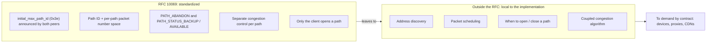
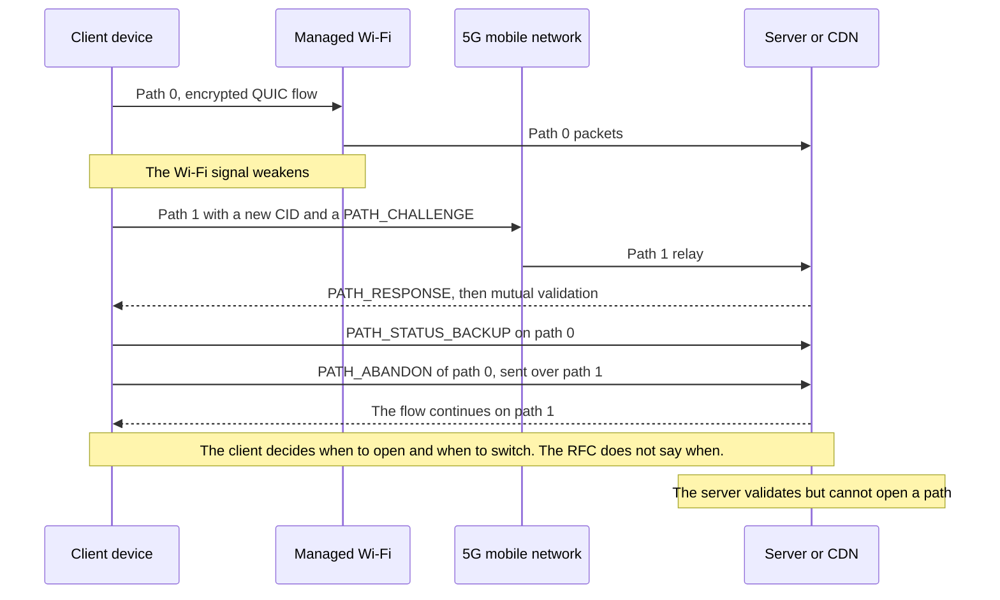

## Nine years so a video call stops freezing in the parking lot

A hotel guest walks out of the lobby in the middle of a video call. Three steps into the parking lot, the Wi-Fi weakens, the phone switches to 5G, and the picture freezes while the app stitches things back together. Nothing dramatic. Unless you multiply that scene across hundreds of sites (hotels, student residences, stores, campuses) and you are the one running the Wi-Fi. In the user's mind, the dropout always comes from the Wi-Fi.

On November 7, 2026, the body that standardizes Internet protocols published the text aimed squarely at this kind of handover. RFC 10069 (Request for Comments, the series in which Internet standards are published) extends QUIC, the encrypted transport protocol designed as an alternative to TCP, to multiple network paths on a single connection. Wi-Fi and cellular, terrestrial link and satellite. First draft in October 2017. Adoption by the working group in 2022. Then nearly 300 tickets and more than 326 change proposals before reaching standard status.

The temptation will be immediate: to read this text as the death knell for proprietary link-aggregation boxes. That is not what it says. The RFC standardizes the mechanics, not the decision. Which path to open, when, and how to spread traffic across them remain up to each implementation, and the text says so in black and white. For anyone buying network services, the value of this standard is therefore not found in the standard. It is found in what you demand in writing from your suppliers.

## The waybill, not the dispatcher

Imagine you hand a confidential file to two courier companies at the same time. To make that work, you need one waybill per courier, numbered separately. You need delivery receipts that say who delivered what. You need a clean way to dismiss a courier who is dragging their feet. RFC 10069 is exactly that waybill. What it does not do: decide which courier takes which envelope, or dig up a second courier when you only have one. That is the dispatcher's job. And the dispatcher is not standardized.

*One encrypted connection, two routes: RFC 10069 standardizes the waybill, not the choice of courier.*

The document runs 33 pages and carries six signatures. Y. Liu (Alibaba), Q. De Coninck (UMONS) and M. Kühlewind (Ericsson) are the editors, alongside O. Bonaventure (UCLouvain), C. Huitema (Private Octopus) and Y. Ma (Harvey AI). Approved in March 2026, it is published as a Proposed Standard, the first rung on the IETF (Internet Engineering Task Force) standards track.

In practice, the text is an extension of QUIC version 1. It only activates if both endpoints announce it during the handshake, via a transport parameter named `initial_max_path_id` (code 0x3e). If either the client or the server fails to announce it, neither is allowed to use any mechanism of the RFC. No degraded mode: it is all or nothing, connection by connection.

Once the extension is active, each path receives an identifier, the path ID: 0 for the initial path, then increasing values, never reused. Above all, each path has its own packet number space. That was one of the working group's two big debates, along with the link between paths and connection IDs. The verdict: one counter per path.

Each connection ID (CID, the label that lets you recognize a QUIC connection even when the IP address changes) is tied to exactly one path, and can no longer be empty. Since two paths can now carry the same packet number, the path ID also goes into the computation of the nonce, the unique value that accompanies each encrypted packet. The security properties of QUIC and TLS do not change.

Signaling follows the same logic. Acknowledgments become per-path. Closing a path requires an explicit frame, PATH_ABANDON, even after a period of inactivity or losses. Two status frames let you tell the peer "keep this path as a backup" (PATH_STATUS_BACKUP) or "use it normally" (PATH_STATUS_AVAILABLE). All these new frames travel only inside encrypted packets exchanged after the handshake. For a device sitting on the path, they are invisible.

One last structural choice, and the least well known: only the client opens new paths. The wording is unambiguous: "a QUIC server does not initiate the creation of a path". The server merely validates the proposed path: challenge-response exchange, QUIC's usual anti-amplification protections, a minimum packet size of 1,200 bytes checked path by path. On the congestion side, finally, each path keeps its own state. A Wi-Fi link and a 5G link have neither the same capacity nor the same delay.

## What the text leaves open, in black and white

The most honest passage of RFC 10069 is its abstract. It states for itself what it does not do: "This document does not specify address discovery or management, nor how applications using QUIC schedule traffic over multiple paths". No address discovery, no scheduling. The introduction drives the point home: today there is no IETF specification of an algorithm for using multiple paths simultaneously. Section 5.5 concludes that scheduling is "a local decision", a function of application preferences and of the implementation.

In operational terms: two perfectly compliant stacks can behave in opposite ways on the same network. One will open a second path only when conditions degrade. The other will load both permanently. Both can put "RFC 10069" on the product sheet.

Even the statuses are wishes, not orders. PATH_STATUS_BACKUP expresses a preference, independent for each peer, and the text specifies that a peer "might not follow the peer's advertisements". If every path is marked as backup, the RFC gives no guidance.

The text goes further and names its own mature use case. Switching between Wi-Fi and a mobile network, it writes, is a well-known case that uses two paths at the same time only temporarily, to avoid transmission pauses. Simultaneous use, for its part, "needs more consideration than specified in this document", in particular when the data of a single stream is spread across paths with different delays. In other words: continuity, yes. Aggregation, not yet.

The RFC provides a worked example that will speak to anyone who has ever paired a terrestrial link with a satellite one. A packet leaves over the terrestrial path, 50 ms each way. Its acknowledgment comes back over a geostationary satellite, 300 ms each way. The sender then measures a 350 ms round trip (RTT, Round-Trip Time), against 100 ms on pure terrestrial and 600 ms on pure satellite. Depending on the path the acknowledgments take, the same link looks three and a half times slower than it is. A naive scheduler will be fooled.

Same caution on congestion. Nothing guarantees that two paths are truly disjoint: they may very well end up in the same bottleneck further along the network. In that case, standard congestion control applied path by path can grab bandwidth at the expense of neighboring flows. The RFC cites LIA (RFC 6356) as adaptable, a "coupled" algorithm that reasons across all paths. For any new algorithm, it points to IETF best practices (BCP 133, RFC 9743). It imposes none.

*What RFC 10069 fixes, and what it explicitly leaves to implementations.*

## The promise is real, bonding is still here

Even before the RFC, Alibaba measured what a home-grown multipath QUIC, dubbed XLINK, could deliver in the Taobao Android app, on short videos. The A/B test covered 100,000 participants and more than 3 million plays over two weeks. Result published in 2021, against single-path QUIC: request completion time improved by more than 2.3% at the median, by more than 9.4% at the 95th percentile and by more than 19% at the 99th. The gain concentrates where users really suffer, in the worst sessions.

Four caveats before turning this into a sales argument. A single company. Mobile. Video. And a protocol that predates the RFC, measured before the working group settled on one packet number space per path. Nothing allows you to carry these figures over to the Wi-Fi of a hotel or a residence.

**Author's analysis.** My reading: RFC 10069 does not make proprietary link aggregation obsolete in the short term, the "bonding" practiced by SD-WAN (software-defined wide area networks) and multi-link routers. Three reasons, all drawn from the text.

- **It only covers QUIC version 1.** TCP traffic, from encrypted HTTP/2 to line-of-business applications, is not concerned. The web will be able to benefit through HTTP/3, which builds on QUIC, but that is a consequence and not a clause: the RFC mentions neither HTTP/3 nor proxies.
- **Both endpoints are required.** Client and server must announce the extension. If just one stays silent, nothing activates.
- **Simultaneous aggregation is not solved.** The text says so itself.

Bonding at the tunnel level protects everything that goes through it, whatever the protocol. Multipath QUIC only protects QUIC flows whose two ends play along. These are not competitors. They are two different layers.

Same confusion to avoid on the backup WAN. Multipath QUIC operates connection by connection, end to end, between a device and a server. It does not fail over a site's link. Behind a single CPE (the access box installed at the customer's premises), a smartphone sees only one path, the Wi-Fi, even if that box has fiber and a fixed 5G access (FWA) as backup. Site failover remains the job of the router or the SD-WAN. Multipath QUIC can smooth the transition of QUIC flows on one condition only: that the device itself has two distinct paths, typically Wi-Fi and its own SIM card.

The mobile world has already moved ahead, but on its own turf. The 3GPP (the body that standardizes mobile networks) specification TS 23.501 describes a traffic steering mechanism between cellular and non-cellular access, called ATSSS, which can rely on multipath QUIC. The corresponding proxy sits in the mobile core network, in the function that carries subscribers' data.

The MASSS work item of Release 19, closed in September 2025 with Apple as rapporteur, adds IP and Ethernet modes to it, with packets traveling as HTTP datagram payloads. Two nuances. The version consulted (v20.2.0) still cites the IETF draft, not the final RFC. And this proxy is a 3GPP construct that RFC 10069 does not mention: it belongs to the mobile operator, not to the Wi-Fi operator, unless there is a combined offer.

That leaves the case the RFC itself presents as mature: seamless Wi-Fi to cellular handover. For our guest in the parking lot, that is exactly the promise. But look at who holds the wheel.

*Wi-Fi to 5G handover in multipath QUIC: the device decides, the access network only sees encrypted packets go by.*

The client opens the path, chooses the moment and closes the old one. The RFC even deems it "generally preferable" to open a new path and then abandon the old one, rather than migrate a single path. The server validates. By my reading of the local decision rule, it then chooses on which open path it sends its own data, with no obligation to follow the client's preference. The Wi-Fi operator, for its part, appears nowhere in the decision. It can only avoid getting in the way.

*Two accesses for the same smartphone, the venue's Wi-Fi and the mobile network: it is the device, not the Wi-Fi operator, that decides to open the second path.*

## NOC side: one flow, many faces

Not getting in the way is already a project. Seen from the access network, a multipath device can show up with several address-port pairs and several connection IDs for a single logical exchange. Since status and closing frames are encrypted, your NOC (network operations center) will not know that a path has gone to backup or has been abandoned. The RFC itself acknowledges the complexity of mixing monitored and unmonitored paths. For operations, it points to RFC 9312, devoted to the manageability of QUIC.

The catch: RFC 9312 dates from September 2022 and does not cover multipath, only connection migration. Its recommendations remain the best base available:

- keep the NAT (network address translation) state of a QUIC flow for **at least 2 minutes** (§4.2);
- do not mask an address change (§4.3);
- be wary of routing on the address alone, which sends packets to the wrong server after an address change on the NAT side (§4.3);
- apply QoS and load balancing per flow, never per packet (§4.8).

RFC 10069 adds its own pitfalls. There is no per-path idle timeout, and the text does not recommend sending keep-alive messages. If they are sent, their pace must account for the timeouts of intermediate devices. A backup path that has stayed silent can therefore expire in a firewall's NAT table, and will deserve probing before it is used.

On the security side, opening or migrating several paths at once increases the amplification risk. The text therefore advises keeping the maximum number of paths "small". Encryption key usage limits are counted on the total of packets, all paths combined. One last detail useful for QoS: a single address-port pair can carry several paths, for example with different DiffServ markings (the priority written in the IP header).

**Author's analysis.** Before enabling or blocking anything, three settings deserve a review: UDP and NAT timeouts, per-flow QoS, and telemetry that still assumes one flow equals one address. Blocking UDP to "simplify" operations would amount to giving up, up front, a session continuity that your customers could get without any extra box.

## The call for tenders, where the value is made

First finding, a factual one: nobody can tell you today, with public sources to back it up, who supports the final RFC. The working group wiki that lists multipath implementations has not moved since February 2025. It lists six stacks, from aioquic to picoquic by way of Alibaba's xquic, including an Apple stack described as "currently testing MPQUIC client". Nothing on the final version, published more than a year and a half later.

In January 2026, at the FOSDEM conference, the iroh and Quinn projects presented their adoption of multipath QUIC, with their own NAT traversal and their own path-selection logic. The dispatcher, once again, stays in-house. Another point of vigilance: the older drafts used different parameter identifiers than the final version. Nothing guarantees that a pre-RFC "multipath" stack will talk as is to a compliant stack.

Finally, the research conducted for this article found no public documentation of production support on the iOS, Android, browser, major content delivery network (CDN) or Wi-Fi access point vendor side. That is precisely the hole a contract must fill.

**Author's analysis.** Here is the checklist I would slip into the next call for tenders. It follows directly from what the RFC fixes, and from what it leaves open.

*From device to CDN, every link must prove its support: the RFC fixes the mechanism, the contract fixes the behavior.*

1. **Devices and OS.** Support for the final RFC 10069, not a draft, with parameter 0x3e actually announced. Documented path-opening policy. Default Wi-Fi and cellular behavior configurable through MDM (the fleet management tool).
2. **Servers, proxies, CDNs.** Server-side and proxy-side support. Maximum number of accepted paths, to be kept small as the RFC advises. Behavior behind load balancers, which must route on the connection ID rather than on the address. Logging by path ID.
3. **Access points, firewalls, CPEs.** UDP NAT timeouts of at least 2 minutes. No masking of address changes. No per-packet QoS. Support for per-path DiffServ markings if your policies use them.
4. **Scheduling.** Written description of the scheduler and of the coupled congestion control, LIA or equivalent. Then measured evidence: uninterrupted handover, fairness against single-path flows on a shared bottleneck.
5. **Security.** Path cap, pace of validations, compliance with encryption limits counted across all paths.
6. **Evolvability.** Commitment to align with future scheduling and address-discovery standards as soon as they are published. Standards that, the RFC says so itself, do not exist today.

Clause 4 is the most important, and the most often forgotten. Without it, two "RFC 10069 compliant" offers cannot be compared. One protects the session at the critical moment. The other may constantly draw on the cellular data plan of your fleet devices, with no visible gain for the user. A supplier unable to describe its scheduler has probably never measured its fairness. Ask for the measurement.

## A good standard, because it knows what it does not do

I have no complaint against RFC 10069. A text that standardizes the mechanics, refuses to freeze a scheduler for which no specification exists, and admits it from its abstract, is honest engineering. The general review of revision 18, in December 2025, found neither a major nor a minor issue, for that matter. The complaint, if there is one, will rather go to those who will sell "multipath QUIC" as a checked box.

My position is simple. Do not tear out your SD-WANs or your site failovers: multipath QUIC does not replace them. Do not block UDP for operational comfort either: you would deprive your customers of a session continuity that requires no extra equipment. Prepare the network: timeouts, per-flow QoS, telemetry. And above all, write the clauses now, before the product sheets write them for you.

A standard that leaves the scheduler to implementations is a contract whose performance clause was left blank. Nine years of work produced an excellent waybill. The dispatcher is yours to demand.

_Personal views, not Wifirst's position._

## Sources

1. RFC 10069, Managing Multiple Paths for a QUIC Connection (texte) — https://www.rfc-editor.org/rfc/rfc10069.txt (fiche : https://www.rfc-editor.org/info/rfc10069)
2. IETF Datatracker, rfc10069 — https://datatracker.ietf.org/doc/rfc10069/
3. IETF Datatracker, historique de draft-ietf-quic-multipath — https://datatracker.ietf.org/doc/draft-ietf-quic-multipath/history/
4. IETF Datatracker, write-up du shepherd — https://datatracker.ietf.org/doc/draft-ietf-quic-multipath/writeup/
5. Revue Gen-ART de la révision -18 (2025-12-19) — https://datatracker.ietf.org/doc/review-ietf-quic-multipath-18-genart-lc-shirazipour-2025-12-19/
6. RFC 9312, Manageability of the QUIC Transport Protocol — https://www.rfc-editor.org/rfc/rfc9312.html
7. RFC 9298, Proxying UDP in HTTP — https://www.rfc-editor.org/rfc/rfc9298.html
8. 3GPP TS 23.501 §5.32.6.1 (miroir whatthespec, v20.2.0) — https://whatthespec.net/sos/spec/ts-23501/5.32.6.1
9. 3GPP work item MASSS (Rel-19, ATSSS Phase 4) — https://whatthespec.net/3gpp/wi/1050057-masss
10. Wiki quicwg, implémentations avec support multipath — https://github.com/quicwg/multipath/wiki/QUIC-Implementations-with-multipath-support
11. APNIC Blog, Efficient multipath transport with QUIC for video services (XLINK) — https://blog.apnic.net/2021/12/08/efficient-multipath-transport-with-quic-video-services/
12. arXiv 2210.13663, Single Packet Number Space in Multi-Path QUIC (Alibaba) — https://arxiv.org/abs/2210.13663
13. FOSDEM 2026, Building QUIC Multipath (iroh/Quinn) — https://archive.fosdem.org/2026/schedule/event/XGKCJU-building_quic_multipath/
