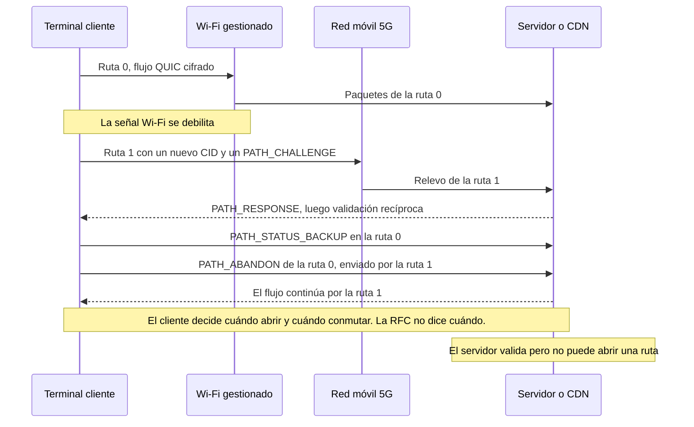

## Nueve años para que una videollamada no se congele en el parking

Un cliente de un hotel sale del lobby en plena videoconferencia. Tres pasos hacia el parking, el Wi-Fi se debilita, el teléfono salta a la 5G y la imagen se congela mientras la aplicación recompone las piezas. Nada dramático. Salvo cuando se multiplica la escena por cientos de sedes (hoteles, residencias universitarias, tiendas, campus) y uno es quien opera el Wi-Fi. En la mente del usuario, el corte siempre es culpa del Wi-Fi.

El 7 de noviembre de 2026, el organismo que normaliza los protocolos de Internet publicó el texto que apunta precisamente a este tipo de salto. La RFC 10069 (Request for Comments, la serie donde se publican los estándares de Internet) extiende QUIC, el protocolo de transporte cifrado concebido como alternativa a TCP, a varias rutas de red dentro de una misma conexión. Wi-Fi y celular, enlace terrestre y satélite. Primer borrador en octubre de 2017. Adopción por el grupo de trabajo en 2022. Después, cerca de 300 tickets y más de 326 propuestas de modificación antes de alcanzar el estatus de estándar.

La tentación será inmediata: leer este texto como la sentencia de muerte de los equipos propietarios de agregación de enlaces. No es lo que dice. La RFC normaliza la mecánica, no la decisión. Qué ruta abrir, cuándo y cómo repartir el tráfico entre ellas sigue siendo asunto de cada implementación, y el texto lo deja por escrito. Para quien compra red, el valor de este estándar no está, por tanto, en el estándar. Está en lo que usted exija por escrito a sus proveedores.

## La guía de envío, no el dispatcher

Imagine que confía un expediente confidencial a dos empresas de mensajería a la vez. Para que funcione, hace falta una guía de envío por mensajero, numerada por separado. Hacen falta confirmaciones de recepción que digan quién entregó qué. Hace falta una forma limpia de despedirse de un mensajero que se retrasa. La RFC 10069 es exactamente esa guía de envío. Lo que no hace: decidir qué mensajero se lleva qué sobre, ni encontrar un segundo mensajero cuando usted solo tiene uno. Eso es trabajo del dispatcher. Y el dispatcher no está normalizado.

*Una sola conexión cifrada, dos itinerarios: la RFC 10069 normaliza la guía de envío, no la elección del mensajero.*

El documento tiene 33 páginas y seis firmas. Y. Liu (Alibaba), Q. De Coninck (UMONS) y M. Kühlewind (Ericsson) son sus editores, junto con O. Bonaventure (UCLouvain), C. Huitema (Private Octopus) e Y. Ma (Harvey AI). Aprobado en marzo de 2026, se publica como Proposed Standard, el primer escalón de la vía de estándares del IETF (Internet Engineering Task Force).

En concreto, el texto se presenta como una extensión de QUIC versión 1. Solo se activa si ambos extremos la anuncian durante el handshake, mediante un parámetro de transporte llamado `initial_max_path_id` (código 0x3e). Si el cliente o el servidor no lo anuncia, ninguno de los dos tiene derecho a usar el menor mecanismo de la RFC. No hay modo degradado: es todo o nada, conexión por conexión.

Una vez activa la extensión, cada ruta recibe un identificador, el path ID: 0 para la ruta inicial, luego valores crecientes, nunca reutilizados. Sobre todo, cada ruta dispone de su propio espacio de números de paquete. Era uno de los dos grandes debates del grupo de trabajo, junto con el vínculo entre rutas e identificadores de conexión. El veredicto: un contador por ruta.

Cada identificador de conexión (CID, la etiqueta que permite reconocer una conexión QUIC incluso cuando cambia la dirección IP) está asociado a exactamente una ruta y ya no puede estar vacío. Como dos rutas pueden ahora llevar el mismo número de paquete, el path ID entra también en el cálculo del nonce, el valor único que acompaña a cada paquete cifrado. Las propiedades de seguridad de QUIC y de TLS, por su parte, no cambian.

La señalización sigue la misma lógica. Las confirmaciones de recepción pasan a ser propias de cada ruta. El cierre de una ruta pasa obligatoriamente por una trama explícita, PATH_ABANDON, incluso tras un periodo de inactividad o de pérdidas. Dos tramas de estado permiten decirle al par «mantén esta ruta de reserva» (PATH_STATUS_BACKUP) o «úsala con normalidad» (PATH_STATUS_AVAILABLE). Todas estas nuevas tramas viajan únicamente en los paquetes cifrados intercambiados después del handshake. Para un equipo situado en el trayecto, son invisibles.

Última decisión estructural, y la menos conocida: solo el cliente abre rutas nuevas. La fórmula no deja lugar a dudas: «a QUIC server does not initiate the creation of a path». El servidor se limita a validar la ruta propuesta: intercambio desafío-respuesta, las protecciones antiamplificación habituales de QUIC, tamaño mínimo de paquete de 1.200 octetos verificado ruta por ruta. En cuanto a la congestión, cada ruta conserva su propio estado. Un enlace Wi-Fi y un enlace 5G no tienen ni la misma capacidad ni la misma latencia.

## Lo que el texto deja abierto, negro sobre blanco

El pasaje más honesto de la RFC 10069 es su resumen. Anuncia por sí mismo lo que no hace: «This document does not specify address discovery or management, nor how applications using QUIC schedule traffic over multiple paths». Ni descubrimiento de direcciones, ni planificación. La introducción lo remacha: hoy no existe ninguna especificación del IETF de un algoritmo para usar varias rutas simultáneamente. La sección 5.5 concluye que la planificación es «una decisión local», función de las preferencias de la aplicación y de la implementación.

Traducción operativa: dos stacks perfectamente conformes pueden comportarse de forma opuesta en la misma red. Uno abrirá una segunda ruta solo en caso de degradación. El otro cargará las dos de forma permanente. Ambos podrán mostrar «RFC 10069» en la ficha de producto.

Incluso los estados son deseos, no órdenes. PATH_STATUS_BACKUP expresa una preferencia, independiente para cada par, y el texto precisa que un par «might not follow the peer's advertisements». Si todas las rutas están marcadas como reserva, la RFC no da ninguna indicación.

El texto va más lejos y señala él mismo su caso de uso maduro. El salto entre Wi-Fi y red móvil, escribe, es un caso bien conocido que solo usa dos rutas a la vez de forma temporal, para evitar pausas en la transmisión. El uso simultáneo, en cambio, «needs more consideration than specified in this document», en particular cuando los datos de un mismo flujo se reparten entre rutas con latencias distintas. Dicho de otro modo: continuidad, sí. Agregación, todavía no.

La RFC aporta un ejemplo numérico que le sonará a cualquiera que haya combinado alguna vez un enlace terrestre con un satélite. Un paquete sale por el enlace terrestre, 50 ms por sentido. Su confirmación de recepción vuelve por un satélite geoestacionario, 300 ms por sentido. El emisor mide entonces 350 ms de ida y vuelta (RTT, Round-Trip Time), frente a 100 ms en terrestre puro y 600 ms en satélite puro. Según la ruta que sigan las confirmaciones, el mismo enlace parece tres veces y media más lento de lo que es. Un planificador ingenuo se equivocará.

La misma cautela vale para la congestión. Nada garantiza que dos rutas sean realmente disjuntas: pueden muy bien converger en el mismo cuello de botella más adelante en la red. En ese caso, un control de congestión estándar aplicado ruta por ruta puede acaparar el ancho de banda en detrimento de los flujos vecinos. La RFC cita como adaptable LIA (RFC 6356), un algoritmo «acoplado» que razona sobre el conjunto de las rutas. Para cualquier algoritmo nuevo, remite a las buenas prácticas del IETF (BCP 133, RFC 9743). No impone ninguno.

```mermaid
flowchart LR
  subgraph NORME["RFC 10069: normado"]
    A["initial_max_path_id (0x3e) anunciado por los 2 pares"]
    B["Path ID + espacio de números de paquete por ruta"]
    C["PATH_ABANDON y PATH_STATUS_BACKUP / AVAILABLE"]
    D["Control de congestión separado por ruta"]
    I["Solo el cliente abre una ruta"]
  end
  subgraph HORS["Fuera de la RFC: local a la implementación"]
    E["Descubrimiento de direcciones"]
    F["Planificación de paquetes"]
    G["Cuándo abrir / cerrar una ruta"]
    J["Algoritmo de congestión acoplado"]
  end
  NORME -->|"deja a"| HORS
  HORS --> H["A exigir por contrato: terminales, proxys, CDN"]
```

*Lo que fija la RFC 10069 y lo que deja explícitamente a las implementaciones.*

## La promesa es real, el bonding sigue ahí

Incluso antes de la RFC, Alibaba midió lo que podía aportar un multipath QUIC propio, bautizado XLINK, en la aplicación Android de Taobao, con vídeos cortos. La prueba A/B abarcó 100.000 participantes y más de 3 millones de reproducciones en dos semanas. Resultado publicado en 2021, frente a un QUIC de una sola ruta: el tiempo de finalización de las solicitudes mejoró más de un 2,3 % en la mediana, más de un 9,4 % en el percentil 95 y más de un 19 % en el 99. La ganancia se concentra donde el usuario sufre de verdad, en las peores sesiones.

Cuatro cautelas antes de convertirlo en argumento comercial. Una sola empresa. Móvil. Vídeo. Y un protocolo anterior a la RFC, medido antes de que el grupo de trabajo se decantara por un espacio de números de paquete por ruta. Nada permite trasladar estas cifras al Wi-Fi de un hotel o de una residencia.

**Análisis del autor.** Mi lectura: la RFC 10069 no deja obsoleta, a corto plazo, la agregación de enlaces propietaria, ese «bonding» que practican los SD-WAN (redes de área extensa definidas por software) y los routers multienlace. Tres razones, todas extraídas del texto.

- **Solo cubre QUIC versión 1.** El tráfico TCP, desde HTTP/2 cifrado hasta las aplicaciones de negocio, queda fuera. La web podrá beneficiarse a través de HTTP/3, que se apoya en QUIC, pero es una consecuencia y no una cláusula: la RFC no menciona ni HTTP/3 ni proxy.
- **Hacen falta ambos extremos.** Cliente y servidor deben anunciar la extensión. Basta con que uno calle para que nada se active.
- **La agregación simultánea no está resuelta.** El propio texto lo dice.

Un bonding a nivel de túnel protege todo lo que pasa por dentro, sea cual sea el protocolo. El multipath QUIC protege únicamente los flujos QUIC cuyos dos extremos juegan el juego. No son competidores. Son dos capas distintas.

Conviene evitar la misma confusión con el WAN de respaldo. El multipath QUIC opera conexión por conexión, de extremo a extremo, entre un terminal y un servidor. No conmuta el enlace de una sede. Detrás de un único CPE (el equipo de acceso instalado en casa del cliente), un smartphone solo ve una ruta, el Wi-Fi, aunque ese equipo disponga de fibra y de un acceso 5G fijo (FWA) de respaldo. La conmutación de la sede sigue siendo asunto del router o del SD-WAN. El multipath QUIC puede suavizar la transición de los flujos QUIC con una sola condición: que el propio terminal tenga dos rutas distintas, típicamente el Wi-Fi y su propia tarjeta SIM.

El mundo móvil ya ha avanzado, pero en su propio terreno. La especificación TS 23.501 del 3GPP (el organismo que normaliza las redes móviles) describe un direccionamiento del tráfico entre acceso celular y no celular, bautizado ATSSS, que sabe apoyarse en el multipath QUIC. El proxy correspondiente reside en el núcleo de la red móvil, en la función que encamina los datos de los abonados.

El proyecto MASSS de la Release 19, cerrado en septiembre de 2025 con Apple como ponente, le añade modos IP y Ethernet, con los paquetes viajando como cargas de datagramas HTTP. Dos matices. La versión consultada (v20.2.0) cita todavía el borrador (draft) del IETF, no la RFC final. Y ese proxy es una construcción del 3GPP de la que la RFC 10069 no habla: pertenece al operador móvil, no al operador Wi-Fi, salvo oferta combinada.

Queda el caso que la propia RFC presenta como maduro: el salto de Wi-Fi a celular sin cortes. Para nuestro cliente del parking, es exactamente la promesa. Pero fíjese en quién lleva el volante.

*Salto de Wi-Fi a 5G en multipath QUIC: el terminal decide, la red de acceso solo ve pasar paquetes cifrados.*

Es el cliente quien abre la ruta, elige el momento y cierra la anterior. La RFC considera además «generalmente preferible» abrir una nueva ruta y luego abandonar la antigua, en lugar de migrar una única ruta. El servidor valida. Según mi lectura de la regla de decisión local, elige después por cuál de las rutas abiertas envía sus propios datos, sin obligación de seguir la preferencia del cliente. El operador Wi-Fi, por su parte, no aparece en ninguna parte de la decisión. Solo puede no impedirla.

*Dos accesos para un mismo smartphone, el Wi-Fi del establecimiento y la red móvil: es el terminal, no el operador Wi-Fi, quien decide abrir la segunda ruta.*

## Desde el NOC: un flujo, varios rostros

No impedirla ya es todo un proyecto. Visto desde la red de acceso, un terminal multipath puede aparecer con varios pares dirección-puerto y varios identificadores de conexión para un único intercambio lógico. Como las tramas de estado y de cierre están cifradas, su NOC (centro de supervisión de red) no sabrá que una ruta ha pasado a reserva o ha sido abandonada. La propia RFC reconoce la complejidad de mezclar rutas supervisadas y no supervisadas. Para la operación, remite a la RFC 9312, dedicada a la gestionabilidad de QUIC.

El problema: la RFC 9312 es de septiembre de 2022 y no trata el multipath, solo la migración de conexión. Sus recomendaciones siguen siendo la mejor base disponible:

- conservar el estado NAT (traducción de direcciones) de un flujo QUIC durante **al menos 2 minutos** (§4.2);
- no enmascarar un cambio de dirección (§4.3);
- desconfiar del enrutamiento basado solo en la dirección, que envía los paquetes al servidor equivocado tras un cambio de dirección en el NAT (§4.3);
- aplicar QoS y balanceo de carga por flujo, nunca por paquete (§4.8).

La RFC 10069 añade sus propias trampas. No existe un tiempo de inactividad por ruta, y el texto no recomienda enviar mensajes de keep-alive. Si se envían, su ritmo debe tener en cuenta los timeouts de los equipos intermedios. Una ruta de reserva que permanece en silencio puede, por tanto, expirar en la tabla NAT de un firewall, y convendrá sondearla antes de usarla.

En el plano de la seguridad, abrir o migrar varias rutas a la vez aumenta el riesgo de amplificación. El texto aconseja por ello mantener «pequeño» el número máximo de rutas. Los límites de uso de las claves de cifrado se cuentan sobre el total de paquetes, todas las rutas incluidas. Un último detalle útil para la QoS: un mismo par dirección-puerto puede llevar varias rutas, por ejemplo con marcados DiffServ (la prioridad inscrita en la cabecera IP) diferentes.

**Análisis del autor.** Antes de activar o bloquear nada, tres ajustes merecen una revisión: los timeouts UDP y NAT, la QoS por flujo, y una telemetría que todavía da por hecho que un flujo equivale a una dirección. Bloquear el UDP para «simplificar» la operación equivaldría a renunciar de entrada a una continuidad de sesión que sus clientes podrían obtener sin equipo adicional.

## La licitación, donde se juega el valor

Primera constatación, factual: hoy nadie puede decirle, con fuentes públicas que lo respalden, quién soporta la RFC final. El wiki del grupo de trabajo que recoge las implementaciones multipath no se ha movido desde febrero de 2025. Lista seis stacks, desde aioquic hasta picoquic pasando por xquic de Alibaba, entre ellos un stack de Apple descrito como «currently testing MPQUIC client». Nada sobre la versión final, publicada más de un año y medio después.

En enero de 2026, en la conferencia FOSDEM, los proyectos iroh y Quinn presentaron su adopción del multipath QUIC, con su propio NAT traversal y su propia lógica de elección de ruta. El dispatcher, una vez más, sigue siendo propio. Otro punto de vigilancia: los antiguos drafts usaban identificadores de parámetro distintos a los de la versión final. Nada garantiza que un stack «multipath» anterior a la RFC dialogue tal cual con un stack conforme.

Por último, la investigación realizada para este artículo no encontró ninguna documentación pública de soporte en producción por parte de iOS, Android, los navegadores, las grandes redes de distribución de contenido (CDN) o los fabricantes de puntos de acceso Wi-Fi. Es precisamente ese hueco el que un contrato debe cubrir.

**Análisis del autor.** Esta es la lista de verificación que incluiría en la próxima licitación. Se deriva directamente de lo que la RFC fija y de lo que deja abierto.

*Del terminal al CDN, cada eslabón debe demostrar su soporte: la RFC fija el mecanismo, el contrato fija el comportamiento.*

1. **Terminales y sistemas operativos.** Soporte de la RFC 10069 final, no de un draft, con el parámetro 0x3e efectivamente anunciado. Política de apertura de rutas documentada. Comportamiento Wi-Fi y celular por defecto configurable mediante el MDM (la herramienta de gestión de flota).
2. **Servidores, proxys, CDN.** Soporte del lado del servidor y del lado del proxy. Número máximo de rutas aceptadas, que debe mantenerse pequeño como aconseja la RFC. Comportamiento detrás de los balanceadores de carga, que deben dirigir según el identificador de conexión y no según la dirección. Registro por path ID.
3. **Puntos de acceso, firewalls, CPE.** Timeouts NAT UDP de al menos 2 minutos. Ningún enmascaramiento de cambios de dirección. Sin QoS por paquete. Soporte de los marcados DiffServ por ruta si sus políticas los utilizan.
4. **Planificación.** Descripción escrita del planificador y del control de congestión acoplado, LIA o equivalente. Después, pruebas medidas: conmutación sin interrupción, equidad frente a flujos de una sola ruta en un cuello de botella compartido.
5. **Seguridad.** Tope de rutas, cadencia de las validaciones, respeto de los límites de cifrado contados sobre el conjunto de las rutas.
6. **Evolutividad.** Compromiso de alineación con los futuros estándares de planificación y de descubrimiento de direcciones en cuanto se publiquen. Estándares que, como dice la propia RFC, hoy no existen.

La cláusula 4 es la más importante y la que más se olvida. Sin ella, dos ofertas «conformes con la RFC 10069» son incomparables. Una protege la sesión en el momento crítico. La otra puede estar solicitando de forma permanente el plan de datos móviles de los terminales de su flota, sin ganancia visible para el usuario. Un proveedor incapaz de describir su planificador probablemente nunca ha medido su equidad. Pida la medición.

## Un buen estándar, porque sabe lo que no hace

No le reprocho nada a la RFC 10069. Un texto que normaliza la mecánica, se niega a fijar un planificador para el que no existe ninguna especificación y lo confiesa desde su resumen es ingeniería honesta. La revisión general de la versión 18, en diciembre de 2025, tampoco detectó ningún problema, mayor ni menor. El reproche, si lo hay, irá más bien para quienes vendan «multipath QUIC» como una casilla marcada.

Mi posición es simple. No desmonte sus SD-WAN ni sus conmutaciones de sede: el multipath QUIC no los sustituye. Tampoco bloquee el UDP por comodidad operativa: privaría a sus clientes de una continuidad de sesión que no requiere ningún equipo más. Prepare la red: timeouts, QoS por flujo, telemetría. Y sobre todo, escriba las cláusulas ahora, antes de que las fichas de producto las escriban por usted.

Una norma que deja el planificador a las implementaciones es un contrato cuya cláusula de rendimiento se ha quedado en blanco. Nueve años de trabajo han producido una excelente guía de envío. El dispatcher, exigirlo le corresponde a usted.

_Opiniones personales, no la posición de Wifirst._

## Fuentes

1. RFC 10069, Managing Multiple Paths for a QUIC Connection (texte) — https://www.rfc-editor.org/rfc/rfc10069.txt (fiche : https://www.rfc-editor.org/info/rfc10069)
2. IETF Datatracker, rfc10069 — https://datatracker.ietf.org/doc/rfc10069/
3. IETF Datatracker, historique de draft-ietf-quic-multipath — https://datatracker.ietf.org/doc/draft-ietf-quic-multipath/history/
4. IETF Datatracker, write-up du shepherd — https://datatracker.ietf.org/doc/draft-ietf-quic-multipath/writeup/
5. Revue Gen-ART de la révision -18 (2025-12-19) — https://datatracker.ietf.org/doc/review-ietf-quic-multipath-18-genart-lc-shirazipour-2025-12-19/
6. RFC 9312, Manageability of the QUIC Transport Protocol — https://www.rfc-editor.org/rfc/rfc9312.html
7. RFC 9298, Proxying UDP in HTTP — https://www.rfc-editor.org/rfc/rfc9298.html
8. 3GPP TS 23.501 §5.32.6.1 (miroir whatthespec, v20.2.0) — https://whatthespec.net/sos/spec/ts-23501/5.32.6.1
9. 3GPP work item MASSS (Rel-19, ATSSS Phase 4) — https://whatthespec.net/3gpp/wi/1050057-masss
10. Wiki quicwg, implémentations avec support multipath — https://github.com/quicwg/multipath/wiki/QUIC-Implementations-with-multipath-support
11. APNIC Blog, Efficient multipath transport with QUIC for video services (XLINK) — https://blog.apnic.net/2021/12/08/efficient-multipath-transport-with-quic-video-services/
12. arXiv 2210.13663, Single Packet Number Space in Multi-Path QUIC (Alibaba) — https://arxiv.org/abs/2210.13663
13. FOSDEM 2026, Building QUIC Multipath (iroh/Quinn) — https://archive.fosdem.org/2026/schedule/event/XGKCJU-building_quic_multipath/
