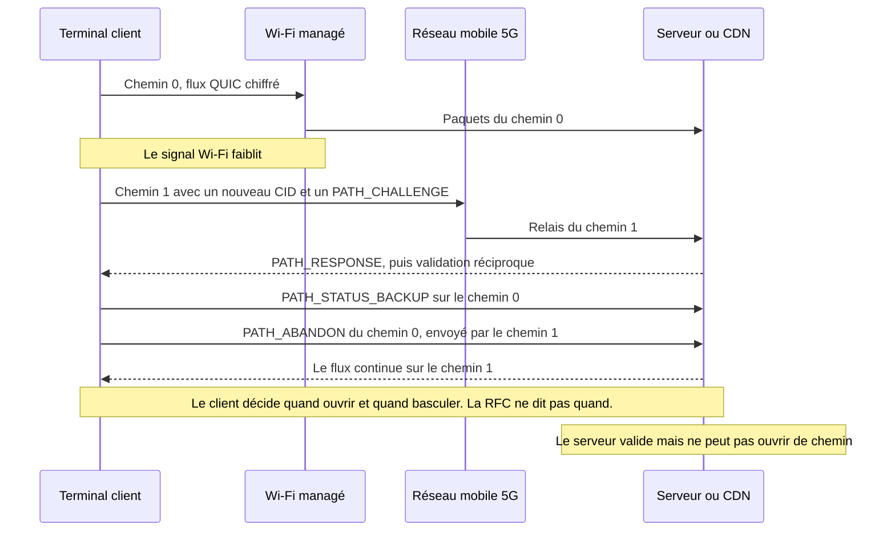

## Neuf ans pour ne plus figer une visio sur le parking

Un client d'hôtel quitte le lobby en pleine visioconférence. Trois pas sur le parking, le Wi-Fi faiblit, le téléphone passe en 5G, et l'image se fige le temps que l'application recolle les morceaux. Rien de dramatique. Sauf quand on multiplie la scène par des centaines de sites (hôtels, résidences étudiantes, magasins, campus) et qu'on est celui qui exploite le Wi-Fi. Dans l'esprit de l'utilisateur, la coupure vient toujours du Wi-Fi.

Le 7 novembre 2026, l'organisme qui normalise les protocoles d'Internet a publié le texte qui vise précisément ce genre de bascule. La RFC 10069 (Request for Comments, la série où paraissent les standards d'Internet) étend QUIC, le protocole de transport chiffré pensé comme alternative à TCP, à plusieurs chemins réseau sur une même connexion. Wi-Fi et cellulaire, lien terrestre et satellite. Premier brouillon en octobre 2017. Adoption par le groupe de travail en 2022. Puis près de 300 tickets et plus de 326 propositions de modification avant d'atteindre le statut de standard.

La tentation va être immédiate : lire ce texte comme l'arrêt de mort des boîtiers d'agrégation de liens propriétaires. Ce n'est pas ce qu'il dit. La RFC normalise la mécanique, pas la décision. Quel chemin ouvrir, quand, et comment y répartir le trafic restent l'affaire de chaque implémentation, et le texte l'écrit noir sur blanc. Pour qui achète du réseau, la valeur de ce standard ne se trouve donc pas dans le standard. Elle se trouve dans ce que vous exigerez par écrit de vos fournisseurs.

## Le bordereau, pas le dispatcher

Imaginez que vous confiez un dossier confidentiel à deux sociétés de coursiers en même temps. Pour que ça tienne, il faut un bordereau par coursier, numéroté séparément. Il faut des accusés de réception qui disent qui a livré quoi. Il faut une façon propre de remercier un coursier qui traîne. La RFC 10069, c'est exactement ce bordereau. Ce qu'elle ne fait pas : décider quel coursier prend quelle enveloppe, ni dénicher un deuxième coursier quand vous n'en avez qu'un. Ça, c'est le travail du dispatcher. Et le dispatcher n'est pas normé.

*Une seule connexion chiffrée, deux itinéraires : la RFC 10069 normalise le bordereau, pas le choix du coursier.*

Le document fait 33 pages et porte six signatures. Y. Liu (Alibaba), Q. De Coninck (UMONS) et M. Kühlewind (Ericsson) en sont les éditeurs, aux côtés d'O. Bonaventure (UCLouvain), C. Huitema (Private Octopus) et Y. Ma (Harvey AI). Approuvé en mars 2026, il paraît en Proposed Standard, le premier échelon de la filière des standards de l'IETF (Internet Engineering Task Force).

Concrètement, le texte se présente comme une extension de QUIC version 1. Elle ne s'active que si les deux extrémités l'annoncent pendant la poignée de main, via un paramètre de transport nommé `initial_max_path_id` (code 0x3e). Si le client ou le serveur ne l'annonce pas, aucun des deux n'a le droit d'utiliser le moindre mécanisme de la RFC. Pas de mode dégradé : c'est tout ou rien, connexion par connexion.

Une fois l'extension active, chaque chemin reçoit un identifiant, le path ID : 0 pour le chemin initial, puis des valeurs croissantes, jamais réutilisées. Chaque chemin dispose surtout de son propre espace de numéros de paquets. C'était l'un des deux grands débats du groupe de travail, avec le lien entre chemins et identifiants de connexion. Le verdict : un compteur par chemin.

Chaque identifiant de connexion (CID, l'étiquette qui permet de reconnaître une connexion QUIC même quand l'adresse IP change) est rattaché à exactement un chemin, et ne peut plus être vide. Comme deux chemins peuvent désormais porter le même numéro de paquet, le path ID entre aussi dans le calcul du nonce, la valeur unique qui accompagne chaque paquet chiffré. Les propriétés de sécurité de QUIC et de TLS, elles, ne bougent pas.

La signalisation suit la même logique. Les accusés de réception deviennent propres à chaque chemin. La fermeture d'un chemin passe obligatoirement par une trame explicite, PATH_ABANDON, même après une période d'inactivité ou des pertes. Deux trames de statut permettent de dire au pair « garde ce chemin en secours » (PATH_STATUS_BACKUP) ou « utilise-le normalement » (PATH_STATUS_AVAILABLE). Toutes ces nouvelles trames voyagent uniquement dans les paquets chiffrés échangés après la poignée de main. Pour un équipement posé sur le trajet, elles sont invisibles.

Dernier choix structurant, et le plus mal connu : seul le client ouvre de nouveaux chemins. La formule est sans ambiguïté, « a QUIC server does not initiate the creation of a path ». Le serveur se contente de valider le chemin proposé : échange défi-réponse, protections anti-amplification habituelles de QUIC, taille de paquet minimale de 1 200 octets vérifiée chemin par chemin. Côté congestion, enfin, chaque chemin garde son propre état. Un lien Wi-Fi et un lien 5G n'ont ni la même capacité ni le même délai.

## Ce que le texte laisse, noir sur blanc

Le passage le plus honnête de la RFC 10069, c'est son résumé. Il annonce lui-même ce qu'il ne fait pas : « This document does not specify address discovery or management, nor how applications using QUIC schedule traffic over multiple paths ». Ni découverte d'adresses, ni ordonnancement. L'introduction enfonce le clou : il n'existe aujourd'hui aucune spécification IETF d'algorithme pour utiliser plusieurs chemins simultanément. La section 5.5 conclut que l'ordonnancement est « une décision locale », fonction des préférences de l'application et de l'implémentation.

Traduction opérationnelle : deux piles parfaitement conformes peuvent se comporter de façon opposée sur le même réseau. L'une n'ouvrira un second chemin qu'en cas de dégradation. L'autre chargera les deux en permanence. Toutes deux pourront afficher « RFC 10069 » sur la fiche produit.

Même les statuts sont des souhaits, pas des ordres. PATH_STATUS_BACKUP exprime une préférence, indépendante pour chaque pair, et le texte précise qu'un pair « might not follow the peer's advertisements ». Si tous les chemins sont marqués en secours, la RFC ne donne aucune indication.

Le texte va plus loin et désigne lui-même son cas d'usage mûr. La bascule entre Wi-Fi et réseau mobile, écrit-il, est un cas bien connu qui n'utilise deux chemins en même temps que temporairement, pour éviter les pauses de transmission. L'usage simultané, lui, « needs more consideration than specified in this document », en particulier quand les données d'un même flux sont réparties sur des chemins aux délais différents. Autrement dit : la continuité, oui. L'agrégation, pas encore.

La RFC fournit un exemple chiffré qui parlera à quiconque a déjà marié lien terrestre et satellite. Un paquet part par le terrestre, 50 ms par sens. Son accusé de réception revient par un satellite géostationnaire, 300 ms par sens. L'émetteur mesure alors 350 ms d'aller-retour (RTT, Round-Trip Time), contre 100 ms en terrestre pur et 600 ms en satellite pur. Selon le chemin qu'empruntent les accusés, le même lien paraît trois fois et demie plus lent qu'il ne l'est. Un ordonnanceur naïf s'y trompera.

Même prudence sur la congestion. Rien ne garantit que deux chemins soient réellement disjoints : ils peuvent très bien se retrouver dans le même goulot d'étranglement plus loin sur le réseau. Dans ce cas, un contrôle de congestion standard appliqué chemin par chemin peut accaparer la bande passante au détriment des flux voisins. La RFC cite comme adaptable LIA (RFC 6356), un algorithme « couplé » qui raisonne sur l'ensemble des chemins. Pour tout nouvel algorithme, elle renvoie aux bonnes pratiques de l'IETF (BCP 133, RFC 9743). Elle n'en impose aucun.

```mermaid
flowchart LR
  subgraph NORME["RFC 10069 : normé"]
    A["initial_max_path_id (0x3e) annoncé par les 2 pairs"]
    B["Path ID + espace de numéros de paquets par chemin"]
    C["PATH_ABANDON et PATH_STATUS_BACKUP / AVAILABLE"]
    D["Contrôle de congestion séparé par chemin"]
    I["Seul le client ouvre un chemin"]
  end
  subgraph HORS["Hors RFC : local à l'implémentation"]
    E["Découverte d'adresses"]
    F["Ordonnancement des paquets"]
    G["Quand ouvrir / fermer un chemin"]
    J["Algorithme de congestion couplé"]
  end
  NORME -->|"laisse à"| HORS
  HORS --> H["À exiger par contrat : terminaux, proxys, CDN"]
```

*Ce que la RFC 10069 fixe, et ce qu'elle laisse explicitement aux implémentations.*

## La promesse est réelle, le bonding reste là

Avant même la RFC, Alibaba a mesuré ce que pouvait apporter un multipath QUIC maison, baptisé XLINK, dans l'application Android de Taobao, sur des vidéos courtes. Le test A/B a porté sur 100 000 participants et plus de 3 millions de lectures en deux semaines. Résultat publié en 2021, face à du QUIC mono-chemin : temps de complétion des requêtes amélioré de plus de 2,3 % en médiane, de plus de 9,4 % au 95e centile et de plus de 19 % au 99e. Le gain se concentre là où l'utilisateur souffre vraiment, dans les pires sessions.

Quatre précautions avant d'en faire un argument commercial. Une seule entreprise. Du mobile. De la vidéo. Et un protocole antérieur à la RFC, mesuré avant que le groupe de travail ne tranche pour un espace de numéros de paquets par chemin. Rien ne permet de transposer ces chiffres au Wi-Fi d'un hôtel ou d'une résidence.

**Analyse de l'auteur.** Ma lecture : la RFC 10069 ne rend pas obsolète, à court terme, l'agrégation de liens propriétaire, ce « bonding » que pratiquent les SD-WAN (réseaux étendus pilotés par logiciel) et les routeurs multi-liens. Trois raisons, toutes tirées du texte.

- **Elle ne couvre que QUIC version 1.** Le trafic TCP, du HTTP/2 chiffré aux applications métier, n'est pas concerné. Le web pourra en profiter via HTTP/3, qui s'appuie sur QUIC, mais c'est une conséquence et non une clause : la RFC ne mentionne ni HTTP/3 ni proxy.
- **Il faut les deux extrémités.** Client et serveur doivent annoncer l'extension. Un seul silencieux, et rien ne s'active.
- **L'agrégation simultanée n'est pas résolue.** Le texte le dit lui-même.

Un bonding au niveau du tunnel protège tout ce qui passe dedans, quel que soit le protocole. Le multipath QUIC protège uniquement les flux QUIC dont les deux bouts jouent le jeu. Ce ne sont pas des concurrents. Ce sont deux couches différentes.

Même confusion à éviter sur le WAN de secours. Le multipath QUIC opère connexion par connexion, de bout en bout, entre un terminal et un serveur. Il ne bascule pas le lien d'un site. Derrière un seul CPE (le boîtier d'accès installé chez le client), un smartphone ne voit qu'un chemin, le Wi-Fi, même si ce boîtier dispose d'une fibre et d'un accès 5G fixe (FWA) en secours. La bascule du site reste l'affaire du routeur ou du SD-WAN. Le multipath QUIC peut lisser la transition des flux QUIC à une seule condition : que le terminal ait lui-même deux chemins distincts, typiquement le Wi-Fi et sa propre carte SIM.

Le monde mobile a déjà avancé, mais sur son propre terrain. La spécification TS 23.501 du 3GPP (l'organisme qui normalise les réseaux mobiles) décrit un aiguillage du trafic entre accès cellulaire et non cellulaire, baptisé ATSSS, qui sait s'appuyer sur le multipath QUIC. Le proxy correspondant loge dans le cœur de réseau mobile, dans la fonction qui achemine les données des abonnés.

Le chantier MASSS de la Release 19, clôturé en septembre 2025 avec Apple comme rapporteur, y ajoute des modes IP et Ethernet, les paquets voyageant comme charges de datagrammes HTTP. Deux nuances. La version consultée (v20.2.0) cite encore le brouillon (draft) de l'IETF, pas la RFC finale. Et ce proxy est une construction 3GPP dont la RFC 10069 ne parle pas : il appartient à l'opérateur mobile, pas à l'opérateur Wi-Fi, sauf offre combinée.

Reste le cas que la RFC présente elle-même comme mûr : la bascule Wi-Fi vers cellulaire sans coupure. Pour notre client sur le parking, c'est exactement la promesse. Mais regardez qui tient le volant.

*Bascule Wi-Fi vers 5G en multipath QUIC : le terminal décide, le réseau d'accès ne voit passer que des paquets chiffrés.*

C'est le client qui ouvre le chemin, choisit le moment et ferme l'ancien. La RFC juge d'ailleurs « généralement préférable » d'ouvrir un nouveau chemin puis d'abandonner l'ancien, plutôt que de migrer un chemin unique. Le serveur valide. Selon ma lecture de la règle de décision locale, il choisit ensuite sur quel chemin ouvert il envoie ses propres données, sans obligation de suivre la préférence du client. L'opérateur Wi-Fi, lui, n'apparaît nulle part dans la décision. Il peut seulement ne pas l'empêcher.

*Deux accès pour un même smartphone, le Wi-Fi de l'établissement et le réseau mobile : c'est le terminal, pas l'opérateur Wi-Fi, qui décide d'ouvrir le second chemin.*

## Côté NOC : un flux, plusieurs visages

Ne pas l'empêcher, c'est déjà un chantier. Vu du réseau d'accès, un terminal multipath peut apparaître avec plusieurs couples adresse-port et plusieurs identifiants de connexion pour un seul échange logique. Les trames de statut et de fermeture étant chiffrées, votre NOC (centre de supervision réseau) ne saura pas qu'un chemin est passé en secours ou a été abandonné. La RFC reconnaît elle-même la complexité d'un mélange de chemins supervisés et non supervisés. Pour l'exploitation, elle renvoie à la RFC 9312, consacrée à la gérabilité de QUIC.

Le hic : la RFC 9312 date de septembre 2022 et ne traite pas le multipath, seulement la migration de connexion. Ses recommandations restent la meilleure base disponible :

- garder l'état NAT (traduction d'adresses) d'un flux QUIC pendant **au moins 2 minutes** (§4.2) ;
- ne pas masquer un changement d'adresse (§4.3) ;
- se méfier du routage sur la seule adresse, qui envoie les paquets au mauvais serveur après un changement d'adresse côté NAT (§4.3) ;
- appliquer QoS et répartition de charge par flux, jamais par paquet (§4.8).

La RFC 10069 ajoute ses propres pièges. Il n'existe pas de délai d'inactivité par chemin, et le texte ne recommande pas d'envoyer des messages de maintien en vie. Si on en envoie, leur rythme doit tenir compte des timeouts des équipements intermédiaires. Un chemin de secours resté silencieux peut donc expirer dans la table NAT d'un pare-feu, et méritera d'être sondé avant de servir.

Côté sécurité, ouvrir ou migrer plusieurs chemins à la fois accroît le risque d'amplification. Le texte conseille donc de garder « petit » le nombre maximal de chemins. Les limites d'usage des clés de chiffrement se comptent sur le total des paquets, tous chemins confondus. Dernier détail utile pour la QoS : un même couple adresse-port peut porter plusieurs chemins, par exemple avec des marquages DiffServ (la priorité inscrite dans l'en-tête IP) différents.

**Analyse de l'auteur.** Avant d'activer ou de bloquer quoi que ce soit, trois réglages méritent une revue : les timeouts UDP et NAT, la QoS par flux, et une télémétrie qui suppose encore qu'un flux égale une adresse. Bloquer l'UDP pour « simplifier » l'exploitation reviendrait à renoncer d'office à une continuité de session que vos clients pourraient obtenir sans boîtier supplémentaire.

## L'appel d'offres, là où se joue la valeur

Premier constat, factuel : personne ne peut aujourd'hui vous dire, sources publiques à l'appui, qui supporte la RFC finale. Le wiki du groupe de travail qui recense les implémentations multipath n'a plus bougé depuis février 2025. Il liste six piles, d'aioquic à picoquic en passant par xquic d'Alibaba, dont une pile Apple décrite comme « currently testing MPQUIC client ». Rien sur la version finale, publiée plus d'un an et demi plus tard.

En janvier 2026, à la conférence FOSDEM, les projets iroh et Quinn ont présenté leur adoption du multipath QUIC, avec leur propre traversée de NAT et leur propre logique de choix de chemin. Le dispatcher, encore une fois, reste maison. Autre point de vigilance : les anciens drafts utilisaient d'autres identifiants de paramètre que la version finale. Rien ne garantit qu'une pile « multipath » pré-RFC dialogue telle quelle avec une pile conforme.

Enfin, la recherche menée pour cet article n'a trouvé aucune documentation publique d'un support en production côté iOS, Android, navigateurs, grands réseaux de diffusion de contenu (CDN) ou fabricants de bornes Wi-Fi. C'est précisément ce trou qu'un contrat doit combler.

**Analyse de l'auteur.** Voici la liste de contrôle que je glisserais dans le prochain appel d'offres. Elle découle directement de ce que la RFC fixe, et de ce qu'elle laisse ouvert.

*Du terminal au CDN, chaque maillon doit prouver son support : la RFC fixe le mécanisme, le contrat fixe le comportement.*

1. **Terminaux et OS.** Support de la RFC 10069 finale, pas d'un draft, avec le paramètre 0x3e effectivement annoncé. Politique d'ouverture de chemins documentée. Comportement Wi-Fi et cellulaire par défaut configurable via le MDM (l'outil de gestion de flotte).
2. **Serveurs, proxys, CDN.** Support côté serveur et côté proxy. Nombre maximal de chemins acceptés, à garder petit comme le conseille la RFC. Comportement derrière les répartiteurs de charge, qui doivent aiguiller sur l'identifiant de connexion plutôt que sur l'adresse. Journalisation par path ID.
3. **Bornes, pare-feux, CPE.** Timeouts NAT UDP d'au moins 2 minutes. Aucun masquage de changement d'adresse. Pas de QoS par paquet. Prise en charge des marquages DiffServ par chemin si vos politiques en utilisent.
4. **Ordonnancement.** Description écrite de l'ordonnanceur et du contrôle de congestion couplé, LIA ou équivalent. Puis des preuves mesurées : bascule sans interruption, équité face aux flux mono-chemin sur un goulot partagé.
5. **Sécurité.** Plafond de chemins, cadence des validations, respect des limites de chiffrement comptées sur l'ensemble des chemins.
6. **Évolutivité.** Engagement d'alignement sur les futurs standards d'ordonnancement et de découverte d'adresses dès leur publication. Des standards qui, la RFC le dit elle-même, n'existent pas aujourd'hui.

La clause 4 est la plus importante, et la plus souvent oubliée. Sans elle, deux offres « conformes RFC 10069 » sont incomparables. L'une protège la session au moment critique. L'autre peut solliciter en permanence le forfait cellulaire de vos terminaux de flotte, sans gain visible pour l'utilisateur. Un fournisseur incapable de décrire son ordonnanceur n'a probablement jamais mesuré son équité. Demandez la mesure.

## Un bon standard, parce qu'il sait ce qu'il ne fait pas

Je ne reproche rien à la RFC 10069. Un texte qui normalise la mécanique, refuse de figer un ordonnanceur pour lequel aucune spécification n'existe, et l'avoue dès son résumé, c'est de l'ingénierie honnête. La revue générale de la révision 18, en décembre 2025, n'a d'ailleurs relevé ni problème majeur ni problème mineur. Le reproche, s'il y en a un, ira plutôt à ceux qui vendront « multipath QUIC » comme une case cochée.

Ma position est simple. Ne démontez pas vos SD-WAN ni vos bascules de site : le multipath QUIC ne les remplace pas. Ne bloquez pas non plus l'UDP par confort d'exploitation : vous priveriez vos clients d'une continuité de session qui ne demande aucun équipement de plus. Préparez le réseau : timeouts, QoS par flux, télémétrie. Et surtout, écrivez les clauses maintenant, avant que les fiches produit ne les écrivent à votre place.

Une norme qui laisse l'ordonnanceur aux implémentations, c'est un contrat dont la clause de performance est restée en blanc. Neuf ans de travail ont produit un excellent bordereau. Le dispatcher, c'est à vous de l'exiger.

_Vues personnelles, pas position Wifirst._

## Sources

1. RFC 10069, Managing Multiple Paths for a QUIC Connection (texte) — https://www.rfc-editor.org/rfc/rfc10069.txt (fiche : https://www.rfc-editor.org/info/rfc10069)
2. IETF Datatracker, rfc10069 — https://datatracker.ietf.org/doc/rfc10069/
3. IETF Datatracker, historique de draft-ietf-quic-multipath — https://datatracker.ietf.org/doc/draft-ietf-quic-multipath/history/
4. IETF Datatracker, write-up du shepherd — https://datatracker.ietf.org/doc/draft-ietf-quic-multipath/writeup/
5. Revue Gen-ART de la révision -18 (2025-12-19) — https://datatracker.ietf.org/doc/review-ietf-quic-multipath-18-genart-lc-shirazipour-2025-12-19/
6. RFC 9312, Manageability of the QUIC Transport Protocol — https://www.rfc-editor.org/rfc/rfc9312.html
7. RFC 9298, Proxying UDP in HTTP — https://www.rfc-editor.org/rfc/rfc9298.html
8. 3GPP TS 23.501 §5.32.6.1 (miroir whatthespec, v20.2.0) — https://whatthespec.net/sos/spec/ts-23501/5.32.6.1
9. 3GPP work item MASSS (Rel-19, ATSSS Phase 4) — https://whatthespec.net/3gpp/wi/1050057-masss
10. Wiki quicwg, implémentations avec support multipath — https://github.com/quicwg/multipath/wiki/QUIC-Implementations-with-multipath-support
11. APNIC Blog, Efficient multipath transport with QUIC for video services (XLINK) — https://blog.apnic.net/2021/12/08/efficient-multipath-transport-with-quic-video-services/
12. arXiv 2210.13663, Single Packet Number Space in Multi-Path QUIC (Alibaba) — https://arxiv.org/abs/2210.13663
13. FOSDEM 2026, Building QUIC Multipath (iroh/Quinn) — https://archive.fosdem.org/2026/schedule/event/XGKCJU-building_quic_multipath/
