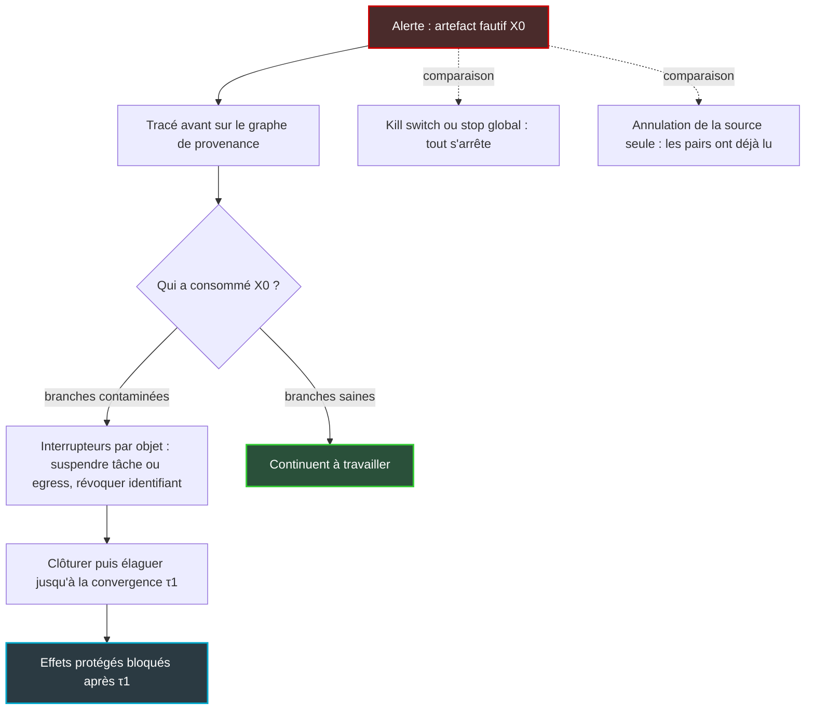

## Le bouton rouge ne rattrape pas ce qui a déjà circulé

Un agent IA qui se trompe ne se trompe jamais seul. Il rédige un plan, un résumé, une recommandation. D'autres agents le lisent, en tirent leurs propres conclusions, puis passent à l'action. Quand l'alarme sonne, l'agent fautif n'est déjà plus le vrai problème. Ses lecteurs, si.

Le 3 novembre, à Barcelone, CrowdStrike a présenté son « AI Kill Switch », une fonction qui met fin en temps réel aux agents jugés non autorisés et empêche leur relance. C'est utile. Une analyste de Gartner, citée par CSO Online, en a pourtant donné la juste mesure : un frein d'urgence, pas un bouton de retour arrière. Il ne défait pas forcément ce qui a déjà eu lieu, qu'il s'agisse de données consultées, de messages envoyés ou de transactions engagées.

Le lendemain, un preprint baptisé Airlock arrivait sur arXiv avec une proposition qui vise exactement ce trou. Ne pas arrêter tout le monde. Retrouver chaque agent qui a consommé la sortie fautive, et ne geler que ceux-là.

Qui est concerné ? Toute DSI qui laisse des agents enchaînés toucher la production. Chez un opérateur qui exploite des centaines de sites, hôtels, résidences étudiantes ou magasins, le scénario n'a rien d'exotique : un ticket corrompu, un agent planificateur qui en tire un plan, des agents d'exécution qui poussent des configurations. La question à poser aux fournisseurs change de nature. Non plus « avez-vous un bouton d'arrêt ? », mais « savez-vous dire, dans la seconde, qui a lu la sortie fautive ? ».

## Une erreur d'agent se propage comme une épidémie

Pour saisir le problème, pensez épidémiologie plutôt qu'informatique. Quand un cas positif est détecté, isoler le seul patient ne sert pas à grand-chose : il a déjà croisé du monde. Confiner toute la ville arrête la contagion, mais aussi tout le reste. La réponse qui marche, c'est le traçage des cas contacts : remonter qui a été exposé, isoler ceux-là, laisser vivre les autres.

Les équipes d'agents IA suivent la même dynamique. Or les outils actuels couvrent surtout les deux extrêmes.

Côté « isoler le patient », il y a l'annulation ciblée. Dans le protocole A2A (Agent2Agent, qui fait dialoguer des agents de fournisseurs différents), l'annulation vise une seule tâche, et la spécification prévient que le succès n'est pas garanti. Dans la partie de la spécification consultée pour cet article, rien n'indique que l'annulation se propage aux agents qui ont déjà consommé le résultat.

Côté « confiner la ville », il y a l'arrêt de tout le workflow. C'est propre. C'est aussi tout le travail sain jeté à la poubelle.

Entre les deux, LangGraph, le framework d'orchestration d'agents de LangChain, propose un « time travel » qui repart d'un point de sauvegarde antérieur. Sa documentation est honnête sur le piège : rejouer ré-exécute les étapes au lieu de relire un cache. Les appels au modèle et aux API sont refaits, avec des résultats potentiellement différents. Si une étape allumait une lampe ou poussait une configuration, elle recommence.

Le chiffre le plus instructif du papier Airlock n'est d'ailleurs pas dans son résumé. Sur sept workflows, au moment d'une alerte tardive, cinq tâches en médiane sont déjà contaminées, soit 48 % de la portée finale de la faute. Mais presque aucun effet évitable n'est encore sorti : un sur 76. Le mal est dans les têtes, pas encore dans le monde. Il sera commis par du travail aval qui n'a pas encore démarré, et qu'un kill switch focalisé sur les actions en file d'attente ne voit pas venir.

L'intuition ne repose pas sur une seule équipe. Le preprint *From Spark to Fire* a montré, sur six frameworks multi-agents, qu'une seule erreur élémentaire semée au départ peut dégénérer en échec généralisé. Il propose une gouvernance par graphe de généalogie des échanges, qui évite l'infection finale dans au moins 89 % des runs. L'OWASP, référence de la sécurité applicative, range d'ailleurs les défaillances en cascade (ASI08) dans son Top 10 des applications agentiques publié en décembre 2025.

## Airlock : des droits qui rétrécissent, un registre de qui a lu quoi

Ces dernières semaines, on a parlé ici de l'endroit où doit vivre le garde-fou d'un agent, puis de l'indépendance de son superviseur. Airlock pose une question plus terre à terre : une fois l'alerte levée, où s'arrête la contamination ? Sa réponse tient en deux étages.

Le premier, baptisé EdgeCitadel, organise les agents en arbre de délégation. Règle d'or : le périmètre d'un sous-agent est borné à la fois par ce qu'on lui a accordé et par le périmètre de son parent. Un enfant ne peut jamais avoir plus de droits que celui qui l'a lancé. Sur chaque site, un démon tient le registre des périmètres, des baux, des échéances et des quotas, au-dessus de NATS JetStream (un bus de messages persistant).

Surtout, EdgeCitadel expose six interrupteurs par objet. Trois suspendent : une tâche, une sortie vers l'extérieur, un événement. Trois révoquent : une autorisation, une admission, un identifiant. Cette granularité change tout. On ne coupe pas un agent, on coupe un geste.

Le second étage est un graphe de provenance : un journal en ajout seul, structuré en graphe orienté sans cycle (DAG), dont chaque arête signifie *ceci dérive de cela*, par la donnée, la session ou l'autorité. Le marquage de contamination (le *taint*) s'y propage en suivant l'ordre chronologique des échanges. Le tracé avant isole les exécutions contaminées et les actions en attente ; le tracé arrière remonte vers la cause racine pour la circonscrire.

Deux niveaux de riposte s'appuient sur ce graphe. La *full quarantine* gèle toutes les branches touchées, sans calcul : simple et robuste. L'*optimized cut* calcule la coupe minimale tenable avant une échéance, selon un protocole « clôturer puis élaguer » (fence-then-prune). Sur le chemin rapide laminaire, la résolution du flot maximal prend entre 0,022 et 0,031 ms (le papier donne 0,098 s en médiane, projection du graphe comprise, sur la grille principale).

Reste un instant clé, que le papier appelle τ1 : la convergence à partir de laquelle le gel est garanti partout. Avant τ1, on espère. Après τ1, on sait. La latence de contrôle est réglée par défaut à 400 ms.

*Le confinement piloté par la provenance : on gèle les lecteurs de l'artefact fautif, pas tout l'essaim.*

*Dans EdgeCitadel, chaque délégation rétrécit le périmètre : un sous-agent n'hérite jamais de plus de droits que son parent.*

## Des lampes, des annonces et un journal qui ne ment pas

Imaginez une maison connectée de quatre pièces pilotée par un essaim d'agents. L'alerte est levée. Et pourtant, les lampes continuent de s'allumer et les annonces vocales de partir.

C'est ce que mesure le volet le plus parlant du papier : 161 runs physiques avec de vrais modèles, sur six déploiements. Qwen 3.8 27B et Gemma 4 31B tournent en local ; GPT 6.1 sol, Gemini 4 et Opus 5.5 passent par API ; un dernier arbre mélange Opus 5.5 en planificateur racine et Qwen 3.8 27B en aval.

Sans confinement, Qwen commet 30 effets protégés erronés après l'alerte quand la faute est injectée à la racine, et autant quand elle l'est localement. Gemma et les API cloud en cumulent 75 sur 20 runs non confinés : 52 lampes, 23 annonces. Avec Airlock, aux deux niveaux, le compteur tombe à zéro sur les six déploiements, sans aucune fuite après τ1. Cette convergence est atteinte en 0,164 s et 0,276 s en médiane pour Qwen selon le point d'injection, entre 0,168 et 0,550 s pour les autres modèles.

Lisez bien le périmètre. Le papier affirme bloquer toutes les actuations fautives *postérieures à l'alerte*, sur son banc principal et ses grilles de maison connectée. Ce sont les effets externes protégés qui sont couverts. Ce n'est pas la preuve que 100 % des fautes sont contenues, et on verra plus bas où le résultat cesse de tenir.

L'audit physique est le détail que je préfère. Les 1 870 changements d'état de lampe observés ont tous été rapprochés d'une écriture journalisée, sans exception. Aucune des 704 commandes retenues par la passerelle n'a allumé quoi que ce soit. Le journal dit ce que le monde physique a fait. Quiconque a passé une nuit à réconcilier des logs avec l'état réel d'un parc mesure ce que ça vaut.

Reste le prix du confinement. Faute injectée à la racine, la quarantaine complète protège les lampes en rendant l'assistant muet : six questions sur six sans réponse. La coupe optimisée en traite correctement cinq sur six par run, sur tous les modèles.

Sur des workflows plus classiques (scénario de contamination par le contenu), le banc système pose le dilemme crûment.

| Contrôle | Runs propres | Travail conservé sans ré-exécution (médiane) |
|---|---|---|
| A2A, annuler l'agent | 12/42 | 94 % |
| A2A, bloquer l'entrée | 0/42 | 100 % |
| A2A, tout annuler | 42/42 | 0 % |
| LangGraph, annuler le run | 18/18 | 0 % |
| LangGraph, time travel | 18/18 | 16 % |
| Airlock, full quarantine | 42/42 | 83 % |
| Airlock, optimized cut | 42/42 | 100 % |

*Source : Airlock, Table 2 (preprint v1, banc des auteurs, contrôles concurrents via adaptateurs écrits par les auteurs).*

Les contrôles qui conservent le travail ne contiennent presque rien. Ceux qui contiennent tout jettent tout. Le time travel ne conserve que 16 % sans ré-exécution parce qu'il refait le reste : 111 tâches relancées et 25 actionnements externes répétés, exactement le piège décrit par la documentation de LangGraph.

En runs appariés, la coupe optimisée conserve en médiane 68 points de travail de plus que le block-and-resume de LangGraph, 96 de plus que son cancel-run et 82 de plus que son time travel. Deux nuances s'imposent. Le papier présente ces contrôles comme exempts de fuite, alors que le block-and-resume n'est propre que sur 6 runs sur 18. Et le texte ne fournit pas d'écart apparié équivalent face à A2A. La formule honnête est donc : jusqu'à +96 points face au cancel-run de LangGraph.

La ligne qui compte le plus est ailleurs, dans la comparaison des stratégies de confinement sur 54 runs. Une simple trace de provenance suivie d'un arrêt ciblé (« Trace & stop ») est déjà propre 54 fois sur 54, avec 94 % du travail conservé. Les stratégies qui n'agissent qu'à la source fuient dès que la contamination a atteint des pairs : 12 runs propres sur 54 pour G-Safeguard, 3 pour le rejet de la source. Arrêter toute l'équipe n'en sauve que 15.

Autrement dit, l'essentiel du gain vient du registre, pas du solveur. La coupe optimisée apporte de la finesse quand la contamination devient dense : sous propagation saturée, elle conserve 100 % du travail contre 54 % pour la quarantaine complète. Elle le paie d'un trafic de contrôle plus que doublé, 26,5 messages par run contre 12.

*Le tracé avant suit le fil de la contamination dans le graphe de provenance et n'isole que le sous-graphe touché.*

## Une grille de lecture d'opérateur réseau

Les gens de réseau auront reconnu le film. Ce qui suit est ma grille de lecture personnelle, pas une équivalence technique.

Face à une panne, le premier réflexe d'un architecte réseau est de penser domaine de panne. AWS l'a formalisé dans son architecture en cellules, qui reprend l'image des cloisons étanches d'un navire : dix cellules, une en panne, 90 % des requêtes épargnées. Les périmètres qui rétrécissent d'EdgeCitadel sont ces cloisons, posées *avant* l'incident, à la manière d'une segmentation par VRF (tables de routage cloisonnées) ou par listes de contrôle d'accès.

Le reste se lit assez naturellement. Le graphe de provenance, c'est la table qui vous dirait quels pairs ont reçu une annonce de route fautive. Geler une branche, c'est filtrer un préfixe ou un pair, pas couper le backbone. Et τ1, c'est le moment où l'on peut affirmer que le filtre est en place partout.

L'histoire du routage offre aussi une mise en garde. Le *route flap damping* de BGP (le protocole qui échange les routes entre opérateurs), décrit par la RFC 2439, pénalise une route à chaque retrait et la supprime au-delà d'un seuil, jusqu'à ce que la pénalité retombe. En théorie, c'était élégant. En pratique, la RFC 7196 a constaté que le mécanisme pénalisait sévèrement les sites bien connectés et que beaucoup d'opérateurs l'avaient désactivé ; elle recommande un seuil de suppression d'au moins 6 000, et 12 000 pour les plus prudents. Un amortisseur trop zélé crée ses propres dégâts. C'est l'assistant muet de la quarantaine complète.

L'analogie a ses limites, et elles sont instructives. Le damping est une heuristique statistique, locale, appliquée à l'émetteur ; Airlock trace de vraies dépendances de données. Surtout, une contamination de LLM est sémantique. Elle ne se compte pas en nombre de flaps : un texte injecté peut sembler parfaitement normal jusqu'à ce qu'un agent aval agisse dessus.

## Avant de lire l'abstract, lisez l'annexe C

Airlock reste un preprint v1 de six jours, signé par une seule équipe et mesuré sur son propre banc. Aucune analyse indépendante n'existe à ce jour. Quatre limites doivent accompagner toute citation.

**Le gros des grilles tourne sans LLM.** Dans les grilles contrôlées, un harnais de 10 500 lignes fait exécuter à des workers déterministes des plans compilés identiques, avec fautes injectées et vérité terrain exacte. Seul le volet maison connectée utilise de vrais modèles. Les contrôles A2A et LangGraph passent par des adaptateurs légers écrits par les auteurs.

**Ni attaquant adaptatif, ni détection.** Le modèle de menace couvre des fautes et des agents défaillants qui ne cherchent pas à contourner Airlock. L'alerte et l'artefact d'origine sont fournis au système. Les détecteurs intégrés font bonne figure (35 fautes sur 36 sur une grille dédiée, en 179 et 199,5 ms médians), mais sur des actions hors périmètre, soit le cas facile. Savoir *quand* déclencher reste le maillon dur.

**L'échelle n'est pas démontrée.** Au-delà d'une dizaine d'agents sur trois hôtes, l'ingestion centralisée des journaux sature. Dans le test d'échelle (22 runs sur 16, 32 et 63 sites logiques), aucun run n'atteint τ1 et un seul reste propre après l'alerte ; à 63 sites, le retard d'ingestion atteint 52,4 à 90,8 s selon le tableau F.1 du papier. Le système a le bon réflexe : il marque les alertes non ingérées comme indéterminées et ne libère aucun verrou. Mais ce qui a été commis avant l'arrivée des journaux ne se rattrape pas.

**La finesse et la trace ont un coût.** La coupe optimisée ne protège que les effets déclarés protégés : sur un des workflows, elle laisse passer 35,6 réponses contaminées par run avec une alerte précoce et 32,6 avec une alerte tardive, contre zéro pour la quarantaine complète. La journalisation ajoute de 165 à 836 ms par micro-transfert entre agents, contre 7 à 50 ms pour A2A-SQLite. L'annexe C chiffre l'écart à 12,2 fois la référence A2A-SQLite par transfert, quand l'hypothèse pré-enregistrée tolérait 3 fois. La durée totale des workflows reste pourtant entre −8,5 % et +8,5 % de celle d'A2A. Et le prototype ne nettoie pas la mémoire des agents.

C'est d'ailleurs l'annexe C qui me rend le papier crédible. Les auteurs y listent leurs hypothèses pré-enregistrées et signalent sans fard celles qui tombent : H1, H2 et H4 non soutenues, la borne de surcoût (H11) dépassée, H12 et H13a en échec. C'est assez rare dans la littérature sur les agents pour être salué. Raison de plus pour prendre le reste au sérieux, sans le surinterpréter.

## Six questions à poser avant de croire à un bouton d'arrêt

Transposons au quotidien d'un centre d'exploitation réseau (NOC). Un agent lit un ticket, un inventaire ou une télémétrie corrompus : donnée périmée, texte injecté. Un planificateur en tire un plan. Des agents aval poussent des configurations vers des contrôleurs Wi-Fi, des serveurs RADIUS (qui authentifient les utilisateurs) ou des équipements sur site, dans des centaines d'hôtels et de résidences. Dans le vocabulaire d'Airlock, le push de configuration est l'effet protégé ; le rapport envoyé à l'équipe est la réponse non protégée.

Au moment de l'alerte, la vraie question d'exploitation est triple : combien de pushes sont déjà partis, lesquels sont encore évitables, quels agents ont lu l'artefact fautif ? Si le constat du papier se confirme hors de son banc, la plupart des effets sont encore évitables à cet instant. Encore faut-il savoir où ils vont naître.

D'où six questions pour tout fournisseur d'orchestration d'agents.

1. Après une alerte, pouvez-vous lister tous les consommateurs d'une sortie donnée, directs et indirects ?
2. Vos interrupteurs agissent-ils par objet (tâche, sortie réseau, identifiant) ou seulement par agent, voire par workflow entier ?
3. Quel délai sépare l'ordre de gel de la *garantie* de gel, l'équivalent du τ1 d'Airlock ?
4. Quand l'ingestion des journaux prend du retard, affichez-vous un état indéterminé explicite, ou un faux sentiment de sécurité ?
5. Les permissions d'un sous-agent sont-elles mécaniquement bornées par celles de son parent ?
6. Votre reprise après incident rejoue-t-elle des effets déjà commis ?

CrowdStrike n'échappe pas à l'exercice. Le blocage est disponible sur sa passerelle IA, et annoncé pour bientôt sur le poste de travail. Selon CSO Online, l'arrêt vise un agent en cours d'exécution sur un hôte ou un groupe d'hôtes, lancé par une personne habilitée et journalisé : une granularité par agent et par machine. Le communiqué ne précise pas qui définit un agent non autorisé, et les sources consultées ne décrivent pas de traçage des consommateurs aval. Absence dans les sources ne veut pas dire absence dans le produit. C'est précisément ce qu'il faut demander.

*Le réflexe d'un centre d'exploitation face à une panne : fermer la cloison du domaine touché, laisser tourner le reste du réseau.*

## Le registre avant le bouton

Je ne dis pas qu'il faut jeter les kill switches. Un frein d'urgence reste indispensable quand un agent part en vrille sous vos yeux. Je dis qu'il ne répond qu'à la moitié de la question, et pas à la plus coûteuse.

La leçon d'Airlock se lit dans ses propres chiffres : la provenance fait l'essentiel du travail. Le solveur de coupe optimale est un raffinement. Le registre de qui a lu quoi est le socle.

Ma position est donc simple. Avant de confier à des agents enchaînés le droit de toucher un parc de contrôleurs ou une base d'abonnés, exigez le registre avant le bouton. Une provenance en ajout seul, interrogeable en ligne et pas seulement en post-mortem. Des droits qui rétrécissent à chaque délégation. Des interrupteurs par geste plutôt que par agent. Un état indéterminé assumé quand les journaux traînent.

Airlock n'est pas un produit à acheter. C'est un preprint, avec des angles morts assumés : pas d'adversaire adaptatif, une détection fournie, une échelle non démontrée. Mais c'est une très bonne spécification de ce qu'il faut exiger.

Dans un réseau, personne n'accepterait un routeur incapable de lister ses voisins. Personne ne devrait accepter un essaim d'agents incapable de lister ses lecteurs.

_Vues personnelles, pas position Wifirst._

## Sources

1. [Airlock, abstract (arXiv 2611.06727)](https://arxiv.org/abs/2611.06727) — papier arXiv, 2026-11-04
2. [Airlock, texte intégral HTML v1](https://arxiv.org/html/2611.06727v1) — papier arXiv, 2026-11-04
3. [A2A Protocol specification](https://a2a-protocol.org/latest/specification/) — spécification, consultée le 2026-11-10 (lecture partielle)
4. [LangGraph, time travel](https://docs.langchain.com/oss/python/langgraph/use-time-travel) — documentation, consultée le 2026-11-10
5. [CrowdStrike, communiqué AI Kill Switch](https://crowdstrike.com/en-us/press-releases/crowdstrike-delivers-ai-security-safety-for-the-enterprise/) — 2026-11-03
6. [CSO Online, CrowdStrike launches AI kill switch](https://www.csoonline.com/article/4244509/crowdstrike-launches-ai-kill-switch-to-shut-down-rogue-agents.html) — 2026-11-04
7. [OWASP Top 10 for Agentic Applications](https://genai.owasp.org/2025/12/09/owasp-top-10-for-agentic-applications-the-benchmark-for-agentic-security-in-the-age-of-autonomous-ai/) — 2025-12-09
8. [From Spark to Fire (arXiv 2603.04474)](https://arxiv.org/abs/2603.04474) — papier arXiv, 2026-03-04 (v2 2026-05-11)
9. [RFC 2439, BGP Route Flap Damping](https://datatracker.ietf.org/doc/html/rfc2439) — IETF
10. [RFC 7196, Making Route Flap Damping Usable](https://datatracker.ietf.org/doc/html/rfc7196) — IETF
11. [AWS Well-Architected, cell-based architecture](https://docs.aws.amazon.com/wellarchitected/latest/reducing-scope-of-impact-with-cell-based-architecture/what-is-a-cell-based-architecture.html) — documentation, consultée le 2026-11-10
