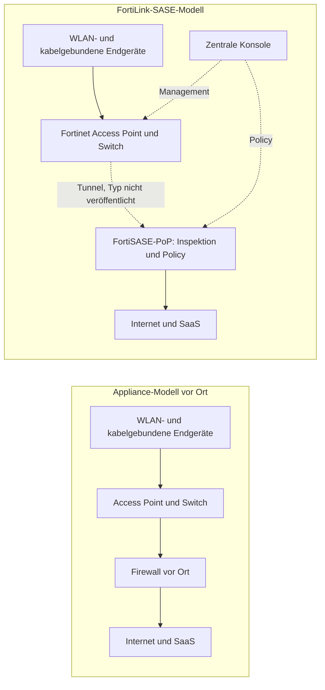
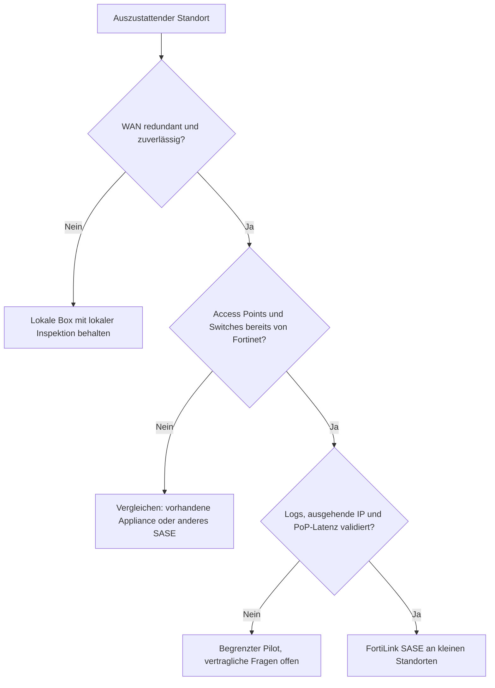

## Ein Netzwerkschrank weniger, eine Frage mehr

Öffnen Sie den Netzwerkschrank einer Boutique in der Innenstadt, einer Bankfiliale oder eines kleinen Hotels. Fast immer finden Sie dasselbe Trio: einen Switch, einen oder zwei WLAN-Access-Points und, zwischen den Kabeln eingeklemmt, eine Firewall. Man musste sie kaufen, lizenzieren, konfigurieren und bei jeder Sicherheitswarnung aktualisieren. An einem Standort ist das eine Randnotiz. An dreihundert Standorten ist es ein Budgetposten, eine Ticket-Schlange und ebenso viele Patches, die man nicht vergessen darf.

Am 27. Oktober 2026 hat Fortinet angekündigt, diese Box verschwinden lassen zu wollen. Der neue Service FortiLink SASE verspricht, kleine Standorte ohne Firewall vor Ort abzusichern. Access Point und Switch schicken den Traffic direkt in die Security-Cloud des Herstellers, sein SASE-Angebot (Secure Access Service Edge, Netzwerksicherheit als Online-Dienst). Filialketten, Bankfilialnetze, Hotellerie, betreute Wohnanlagen: Alle Branchen, die viele kleine Standorte betreiben, sind Zielgruppe.

Das Timing ist kein Zufall. Am selben Tag kündigte HPE seine eigene Konvergenz von WLAN und SASE an. Die Grenze zwischen lokalem Netz und Cloud-Security verschiebt sich, und die IT-Leiter von Multi-Site-Unternehmen werden die Verkaufsargumente in den nächsten Monaten zu hören bekommen.

Meine Lesart passt in einen Satz. Die Firewall ist nicht verschwunden: Sie hat die Adresse gewechselt. Und über einen Umzug verhandelt man. Wohin gehen die Daten, wer hält die Schlüssel, was passiert, wenn die Route unterbrochen ist?

## Der Pförtner hat das Haus verlassen

Um zu verstehen, was sich ändert, stellen Sie sich eine Wohnanlage vor. Das klassische Modell: ein Pförtner in jedem Eingangsbereich. Er kontrolliert, wer hereinkommt, führt das Besucherbuch und kennt die Stammgäste. FortiLink SASE ersetzt all diese Pförtner durch eine zentrale Sicherheitszentrale, die man per Gegensprechanlage erreicht. Eine einzige Dienstanweisung für alle Gebäude, ein einziges Besucherbuch, keine Pförtnerloge mehr, die man unterhalten muss. Aber jeder Besucher wartet nun darauf, dass die Zentrale abhebt. Und wenn die Leitung ausfällt, muss vorher entschieden sein, ob die Tür offen oder geschlossen bleibt.

Eine Standort-Firewall erfüllt drei Aufgaben. Sie verarbeitet den Traffic: Adressumsetzung (NAT), Filterung, Inspektion der Datenflüsse. Sie setzt eine Policy durch: wer darf was, anhand welcher Identität. Und sie erzeugt Logs, das Gedächtnis dessen, was passiert ist. In einer klassischen Appliance leben alle drei im selben Schrank.

Laut der Pressemitteilung von Fortinet [1] werden Traffic-Inspektion, Policy-Durchsetzung und Management in die FortiSASE-Umgebung verlagert. Die Verarbeitung wandert also in einen Point of Presence (PoP), ein Rechenzentrum des Herstellers, in dem der Traffic inspiziert wird, bevor er ins Internet gelangt. Die Policy wandert in eine zentrale Konsole, die auch die kabelgebundenen und drahtlosen Geräte verwaltet. Die Firewall-Funktion gibt es weiterhin, sie wird nur als Service verkauft. Zu den Logs schweigen die Auszüge der Pressemitteilung, die ich lesen konnte.

Das stärkste Argument des Launches betrifft die Dinge im Netz. Drucker, Kameras, Sensoren: Diese Geräte können FortiClient, den Software-Agenten von Fortinet, nicht ausführen. Der Service verspricht, sie zu schützen, ohne Agent pro Gerät und ohne Appliance pro Standort [1][9]. Für einen Gerätepark, in dem die *nicht verwaltbaren* Endgeräte überwiegen, ist das genau das richtige Problem.

Die Idee ist nicht neu. Im August 2023 dehnte Fortinet FortiSASE bereits auf seine FortiAP-Access-Points für Microbranches aus, kleine entfernte Standorte ohne IT-Team [4][8]. Nirav Shah, damals Vice President Products, erklärte gegenüber SDxCentral, der lokale Traffic bleibe auf dem Access Point, solange der Nutzer im Büro sei. Nur der Zugriff nach außen wechsle zur Inspektion in den PoP. Neu ist 2026 also zweierlei: die Switches und der Name.

Der Name zählt. FortiLink bezeichnet historisch den Mechanismus, mit dem eine FortiGate-Firewall die Fortinet-Switches und -Access-Points steuert. Meine Lesart, die Fortinet nicht bestätigt hat: FortiLink SASE wäre genau diese Management-Verbindung, deren Gegenstelle nicht mehr eine lokale FortiGate ist, sondern FortiSASE. Der Name legt das nahe. Der genaue Umfang ist nicht veröffentlicht.

*Vorher / nachher: Die Box verlässt den Standort, die Funktion zieht in die Cloud. Tunneltyp und der Anteil des Traffics, der lokal bleibt, sind für den Service von 2026 nicht veröffentlicht; in der Version von 2023 blieb der interne Traffic auf dem Access Point.*

## Eine Pressemitteilung, die vor allem durch ihr Schweigen spricht

Lesen Sie die Pressemitteilung vom 27. Oktober zweimal. Die zweite Lektüre, die der Auslassungen, ist die aufschlussreichste. Kein Verfügbarkeitsdatum. Kein Preis. Kein Lizenzmodell. Keine Liste kompatibler Geräte: Der Text spricht von *unterstützten* WLAN-Access-Points und Ethernet-Switches, ohne FortiAP oder FortiSwitch auch nur zu nennen. Keine PoP-Karte. Kein Kunde, kein Partner und kein Analyst äußert sich: Die einzige Stimme ist die von Anthony James, Executive Vice President Marketing, der die Erweiterung auf das lokale Netz als einfachere Möglichkeit beschreibt, Nutzer und Geräte zu schützen.

Die Fachpresse hat das selbst angemerkt [9][10]. IT Brief UK stellt klar, dass sein Artikel auf Aussagen des Anbieters beruht, ohne unabhängigen Test und ohne Validierung durch Analysten. Nach meinem Kenntnisstand ist bis heute keine unabhängige Analyse des Launches veröffentlicht worden.

Mangels Besserem bleibt der Blick in die Dokumentation des Vorgängers. Die Release Notes von FortiSASE 7.4.0 beschreiben die Funktion „FortiAP edge“ und ihre Einschränkungen [2]. Ein eigenes FortiSASE-Abonnement pro Access Point. Mindestens FortiAP-Firmware 7.2.4. Eine geschlossene Liste von vierzehn Modellen, registriert im selben FortiCloud-Konto. Und eine Obergrenze von 240 Access Points, die als Edge-Geräte konfigurierbar sind. Die Inbetriebnahme läuft über FortiZTP, das Zero-Touch-Provisioning ohne Eingriff vor Ort, und der Administrationsleitfaden erwähnt ein Captive Portal [3].

Vorsicht: Das sind die Grenzen einer früheren Version, nicht die des Services von Oktober 2026. Nichts sagt, dass sie noch gelten. Aber falls die Obergrenze von 240 Access Points pro Instanz weiterhin bestünde, wäre sie für jeden ein Showstopper, der Tausende davon betreibt. Das ist eine Frage, die man stellen sollte, keine Schlussfolgerung, die man ziehen darf.

*Gestern ein Schrank mit Router, Firewall und Verkabelung; morgen ein Access Point und ein Switch, angebunden an die Cloud. Die Box geht, die Abhängigkeit von der Leitung bleibt.*

## Leader bei SASE, Challenger bei SSE: das Paradox, das alles erhellt

Ich gehe nicht noch einmal auf den SASE-Markt insgesamt ein, den dieser Blog bereits behandelt hat (Konvergenz von SD-WAN und SASE, Magic Quadrant Hybrid Mesh Firewall). Die Analysten haben FortiLink SASE noch nicht bewertet, es erschien nach ihren Reports. Sie beschreiben aber die Plattform, die es trägt.

Im Magic Quadrant for SASE Platforms vom 9. Juli 2025 (Ref. G00821985) führt Gartner Fortinet bei den Leaders, mit mehr als 1.500 aktiven Plattformkunden nach eigener Schätzung [5]. Als Stärken nennt Gartner einen wettbewerbsfähigen Preis und eine große installierte Basis an Branch-Firewalls und SD-WAN (dem softwaregesteuerten Weitverkehrsnetz). Als Schwächen: eine unterdurchschnittlich bewertete Kundenerfahrung. Und ein zweistufiges PoP-Modell, das laut Gartner beim Kauf für Verwirrung sorgen und zu suboptimalen Kaufentscheidungen führen kann, insbesondere bei großen, global aufgestellten Organisationen.

Einen Monat zuvor hatte der Magic Quadrant SSE (Security Service Edge, nur der Cloud-Security-Baustein ohne den Netzwerkteil) Fortinet als Challenger eingestuft, als einzigen in diesem Quadranten [6]. Network World berichtet, Gartner habe die Preise dort angesichts des Funktionsumfangs als sehr wettbewerbsfähig beurteilt, aber nur auf Fortinets eigenen PoPs, nicht auf denen, die bei Google Cloud gehostet werden. Eine weitere Schwäche: Die Logik *FortiOS everywhere*, das hauseigene Betriebssystem in jedem Baustein, schmälert die Attraktivität des Angebots für Kunden, die noch keine Fortinet-Umgebung haben.

Hier Leader, dort Challenger. Das ist kein Widerspruch, das ist eine Signatur. Fortinet ist stark, wo das Netzwerk zählt, und umstrittener bei reiner Cloud-Security. FortiLink SASE passt zu diesem Profil: Es stützt sich auf Fortinets Präsenz im lokalen Netz, um den Kunden in die eigene Cloud zu holen. Das ist meine Analyse, aber sie erklärt, warum dieser Launch von Fortinet kommt und nicht von einem SSE-Spezialisten.

Bleibt die Frage der PoPs, der Kern des Modells. Fortinet beansprucht mehr als 160 Points of Presence [11]. Das ist eine Herstellerzahl, die nichts über ihre geografische Verteilung sagt. 2023 berichtete SDxCentral, Gartner halte diesen Fußabdruck im Vergleich zu anderen Anbietern für geografisch begrenzt [8]. Nimmt man das 2025 bemängelte zweistufige Modell hinzu, drängt sich der Schluss auf: Die Karte, die zählt, ist nicht die Marketingkarte, sondern die Liste der PoPs, die tatsächlich in Ihrem Vertrag enthalten sind.

Der Wind weht dennoch in Fortinets Richtung. Auf einem SASE-Markt, den Gartner 2025 auf rund 15 Milliarden USD schätzt, werden laut Prognose des Hauses bis 2028 die Hälfte der Neuinstallationen auf einer Single-Vendor-Plattform beruhen, gegenüber 30 % im Jahr 2025 [5]. Eine Futurum-Umfrage aus dem ersten Halbjahr 2026 geht in dieselbe Richtung: 40 % der befragten Verantwortlichen für Netzwerksicherheit nennen diese Konsolidierung unter ihren Top-3-Prioritäten [7]. Die Stichprobe ist klein, rund hundert Befragte, aber die Richtung ist eindeutig.

*Wenn die Firewall in einem PoP lebt, wird die Entfernung zum nächsten PoP zu einer Eigenschaft des Standorts, genau wie die Bandbreite der Leitung.*

## Die Wettbewerber verstehen „ohne Box“ unterschiedlich

Alle großen Hersteller verkaufen SASE. Nicht alle stellen dasselbe Gerät an den Eingang des Standorts.

| Hersteller | Dokumentierter Ankerpunkt am Standort | Was das über die Strategie sagt |
|---|---|---|
| Cisco / Meraki | Secure Connect stützt sich auf die SD-WAN-Appliances MX und die Gateways MG; die eingesehene Dokumentation erwähnt die Access Points MR nicht [13] | Der Access Point bleibt hinter einer Box |
| HPE (Aruba, Juniper Mist) | Integration von EdgeConnect (SD-WAN und SSE) in Mist 2026, in Aruba Central im ersten Halbjahr 2027 [7][12] | Einheitliche Konsole, Box bleibt |
| Palo Alto Networks | Prisma SASE mit SD-WAN-Appliances ION vor Ort [5][16] | Der Standort behält eine Box |
| Cato Networks | Der Socket verbindet den Standort mit der Cato-Cloud und bringt eine Firewall für das lokale Netz mit; WLAN nur bei einigen Modellen integriert [14] | Box obligatorisch, lokale Firewall bleibt |
| Zscaler | SIM-Karte für vernetzte Objekte (Zscaler Cellular, angekündigt im Juli 2025) [15]; Übernahme von Airgap Networks im April 2024 angekündigt, um ohne interne Firewall zu segmentieren [18] | Das lokale Netz umgehen, statt sich darin zu verankern |

Den aufschlussreichsten Kontrast liefert HPE, das am selben Tag ankündigte. Laut Fernando Montenegro (Futurum) wird die SASE-Policy von HPE weiterhin im EdgeConnect-Orchestrator verfasst, und ein einheitliches Policy-Modell für WLAN, Firewall und SASE ist in dieser Version nicht enthalten [7]. HPE vereinheitlicht die Konsole, Fortinet streicht die Box. Zwei gegensätzliche Wetten auf denselben Trend.

In der öffentlichen Dokumentation, die ich einsehen konnte, ist Fortinet der einzige der fünf Anbieter, der einen Access Point oder Switch aus dem eigenen Katalog als direkten Ankerpunkt zum SASE präsentiert, ohne Appliance am Standort. Das Fehlen eines Belegs ist kein Beleg für das Fehlen, und die Roadmaps der Konkurrenz können sich schnell ändern. Aber das Alleinstellungsmerkmal ist real.

Ebenso seine Kehrseite. Es existiert nur, weil Fortinet die gesamte Kette beherrscht, vom Access Point bis zur Cloud. Was die Stärke des Angebots ausmacht, ist zugleich sein Riegel.

## Drei Standorte, drei Antworten

Dieser Abschnitt ist Autorenanalyse. Keine öffentliche Datenlage bestätigt oder widerlegt sie bislang: Sie übersetzt die Pressemitteilung in den Alltag eines WLAN-Betreibers, der bei seinen Kunden Tausende von Access Points verwaltet.

**Das Hotel.** Auf dem Papier ist das das Traumterrain. Hunderte Fernseher, Streaming-Sticks und Spielkonsolen, keines davon in der Lage, einen Agenten aufzunehmen. Das Captive Portal steht in der FortiSASE-Dokumentation [3], ein gutes Zeichen. Aber drei Punkte bereiten Ärger.

Erstens die ausgehende IP-Adresse. Die Dokumentation beschreibt sowohl dedizierte öffentliche IPs als auch einen Modus, in dem die IP von mehreren Kunden gemeinsam genutzt wird [17]. Für einen Hotelgast, der seine Streaming-Plattform starten will, ist eine geteilte und falsch geolokalisierte IP ein Anruf an der Rezeption um 23 Uhr. Zweitens die Latenz: Jeder externe Datenfluss macht den Umweg über den PoP, und liegt der nächste in einem anderen Land, spürt es die Videokonferenz des Geschäftsreisenden. Und schließlich der Ausfall der Internetanbindung des Standorts. Bleibt das lokale WLAN nutzbar? Schaltet die Policy in den offenen oder den geschlossenen Modus? Für den neuen Service ist nichts davon dokumentiert.

**Das Studentenwohnheim.** Hier geht es um Volumen und Isolation. Jeder Bewohner erwartet ein eigenes, vom Nachbarn abgeschottetes Netz und verbraucht wie ein ganzer Haushalt: Games, Streaming, Downloads. Wenn dieser gesamte Traffic zu einem PoP hochläuft, wird die abgerechnete Kapazität zur zentralen Frage. Ebenso die der Logs: Wo werden sie gespeichert, wie lange, lassen sie sich in Ihr SIEM exportieren (die Plattform zur Korrelation von Sicherheitsereignissen)? Die Antworten müssen zu Ihren eigenen vertraglichen und regulatorischen Vorgaben passen und sind vor jedem Rollout mit Ihrer Rechtsabteilung zu klären.

**Der Laden.** Das ist der natürlichste Anwendungsfall der Pressemitteilung. Kleine Standorte, Kameras, Zahlungsterminals, Sensoren: keine Box mehr, die man versenden muss, keine Firewall mehr, die man im Lagerraum patchen muss. Der operative Gewinn ist greifbar. Aber der PCI-DSS-Auditor (der Sicherheitsstandard für Zahlungskartendaten) wird wissen wollen, wo die Trennung zwischen Kasse und Gäste-WLAN stattfindet. Lokal, im Switch? Aus der Ferne, im PoP? Die Antwort verändert den Umfang des Audits.

## Der wahre Preis steht im Vertrag

Heute kann man den Firewall-Anbieter wechseln, ohne die Access Points anzufassen, oder die Access Points erneuern, ohne die Firewall anzufassen. Die Schichten sind unabhängig. Mit FortiLink SASE kommen Access Point, Switch, Cloud, Lizenz und Konsole vom selben Anbieter. Auszusteigen heißt, die gesamte Edge des lokalen Netzes zu ersetzen, Standort für Standort.

Das ist ein Mietvertrag mit allem Inklusive: bequem beim Einzug, teuer beim Auszug. Das Box-Modell bindet Kapital und Wartungsaufwand, bewahrt aber die Wahlfreiheit Schicht für Schicht. Das Modell FortiLink SASE macht aus einer Geräteinvestition ein Abonnement und aus dieser Freiheit eine Abhängigkeit. Keines von beiden ist von Natur aus schlecht. Schlecht ist, zu unterschreiben, ohne den Ausstieg beziffert zu haben.

Erinnern wir uns außerdem daran, dass Gartner die Kundenerfahrung von Fortinet als unterdurchschnittlich bewertet [5]. Wenn die Sicherheit von dreihundert Standorten an einem einzigen Hersteller-Support hängt, ist dieses Kriterium nicht mehr zweitrangig.

*Ein integrierter Stack bei einem einzigen Anbieter ist schnell ausgerollt und langsam demontiert. Die Checkliste füllt man vor der Unterschrift aus, nicht danach.*

Vor jeder Unterschrift wären das die Fragen, die ich Fortinet stellen würde:

1. **Hardware**: Welche Modelle von Access Points und Switches, mit welcher Mindest-Firmware? Sind die Switches tatsächlich abgedeckt?
2. **Verfügbarkeit und Preis**: Verfügbarkeitsdatum in Europa, schriftliche Preisliste.
3. **Lizenz**: Pro Access Point, pro Standort oder pro Nutzer? Bleibt das Abonnement pro Access Point aus Version 7.4.0 erhalten?
4. **Obergrenzen**: maximale Anzahl von Access Points und Standorten pro Instanz, Mandantenverwaltung.
5. **PoP**: Liste der im Vertrag enthaltenen PoPs, Land für Land, von Ihren Standorten aus gemessene Latenz, souveräne Option ja oder nein.
6. **Ausfall der Leitung**: Verhalten von Access Point und Switch, wenn das WAN (die Internetanbindung des Standorts) ausfällt, lokaler Traffic bleibt erhalten oder nicht.
7. **Logs und Ausstieg**: Export in ein SIEM, Aufbewahrungsdauer, dedizierte ausgehende IP, schriftlich zugesicherte Reversibilität.

Zur Einordnung der Standorte würde ich einen bewusst konservativen Entscheidungsbaum verwenden.

*Vom Autor vorgeschlagener Entscheidungsbaum: FortiLink SASE geht nur an den Standorten in Produktion, an denen Leitung, Gerätepark und Vertrag validiert wurden.*

## Mein Urteil: ein Werkzeug mehr, keine Doktrin

FortiLink SASE ist eine gute Idee, schlecht dokumentiert. Die gute Idee: anzuerkennen, dass die physische Firewall in einer Microbranch ein teures Glied im Betrieb ist und dass nicht verwaltbare Geräte einen agentenlosen Schutz brauchen. Die schlechte Dokumentation: Bis heute gibt es weder Preis noch Verfügbarkeit, weder Hardwareliste noch PoP-Karte.

Meine Position ist klar. Für kleine, gut angebundene Standorte, die bereits mit Fortinet ausgestattet sind, mit wenigen Gästen und vielen Geräten, ist es ein ernsthafter Kandidat für einen Pilot, sobald die Bedingungen veröffentlicht sind. Kioske, Filialen, kleine Läden: Der Gewinn ist dort klar, das Risiko überschaubar. Für Standorte mit hoher Gästedichte, allen voran Hotels und Wohnheime, ist es kein Ersatz für die lokale Firewall, solange die Antworten zu Latenz, ausgehender IP und Leitungsausfall fehlen.

Ich werde keinen Rollout auf Grundlage einer Pressemitteilung unterschreiben. Ich werde sie aber auch nicht ignorieren: Zusammen mit der HPE-Ankündigung vom selben Tag setzt sie Preis und Stellenwert der Branch-Firewall unter Druck. Auch wenn Sie nicht umsteigen, bringen Sie das Thema in Ihrer nächsten Verhandlung auf den Tisch.

Die Firewall hat die Adresse gewechselt. Bevor Sie einen Nachsendeauftrag stellen, lesen Sie den Mietvertrag.

_Persönliche Ansichten, keine Position von Wifirst._

## Quellen

1. Fortinet, communiqué FortiLink SASE (GlobeNewswire, miroir Wedbush), 27 octobre 2026 — https://investor.wedbush.com/wedbush/article/gnwcq-2026-10-27-fortinet-expands-unified-sase-to-simplify-microbranch-security
2. Fortinet, FortiSASE 7.4.0 Release Notes (FortiAP edge) — https://docs.fortinet.com/document/fortisase/7.4.0/release-notes/969608/
3. Fortinet, FortiSASE Administration Guide, FortiAP edge device (consulté le 10 novembre 2026) — https://docs.fortinet.com/document/fortisase/latest/administration-guide/788213
4. Fortinet, communiqué 2023 relayé par iTWire, 30 août 2023 — https://itwire.com/guest-articles/company-news/fortinet-expands-its-secure-access-service-edge-sase-solution-to-bring-cloud-delivered-enterprise-grade-protection-to-microbranches.html
5. Gartner, Magic Quadrant for SASE Platforms (G00821985), 9 juillet 2025 — https://www.prival.ca/wp-content/uploads/2025/07/Gartner.pdf
6. Network World (Denise Dubie), Gartner Magic Quadrant SSE 2025, 4 juin 2025 — https://www.networkworld.com/article/3997260/genai-controls-and-ztna-architecture-set-sse-vendors-apart.html
7. Futurum (Fernando Montenegro), HPE SASE dans Mist et Aruba Central, 28 octobre 2026 — https://futurumgroup.com/?p=97194
8. SDxCentral (Nancy Liu), Fortinet extends SASE to WLAN, 28 août 2023 — https://www.sdxcentral.com/news/fortinet-extends-sase-to-wlan-for-microbranch-iot-and-ot-security/
9. IT Brief UK (Mara Sugue), 27 octobre 2026 — https://itbrief.co.uk/story/fortinet-launches-fortilink-sase-for-microbranches
10. SecurityBrief Australia (Mara Sugue), 27 octobre 2026 — https://securitybrief.com.au/story/fortinet-launches-fortilink-sase-for-microbranches
11. SecurityBrief US (Melvin Hipolito), 15 juillet 2025 — https://securitybrief.news/story/fortinet-named-sase-leader-by-gartner-eyes-usd-28-5-billion-market
12. cloudnews.tech, HPE unifie SASE, Wi-Fi et réseau filaire, 27 octobre 2026 — https://cloudnews.tech/hpe-unifies-sase-wi-fi-and-wired-networking-with-agentic-ai/
13. Cisco Meraki, Secure Connect Solution Overview — https://documentation.meraki.com/SASE_and_SD-WAN/Cisco_Secure_Connect/Product_Information/Cisco__Secure_Connect_-__Solution_Overview
14. Cato Networks, What are Cato Sockets (mise à jour 22 juin 2026) — https://knowledge.catonetworks.com/docs/what-are-cato-sockets
15. Zscaler, communiqué Zscaler Cellular, 8 juillet 2025 — https://www.zscaler.com/press/zscaler-extends-zero-trust-platform-enable-cellular-communications-iot-ot-simply-sim-card-no
16. Palo Alto Networks, Prisma SD-WAN ION device specifications — https://www.paloaltonetworks.com/resources/datasheets/prisma-sd-wan-instant-on-network-ion-device-specifications
17. Fortinet, FortiSASE Public IP Deployment Guide (IP partagée entre clients) — https://docs2.fortinet.com/document/fortisase/latest/public-ip-deployment-guide/976519/shared-public-ip-address-for-multiple-customers-remote-user-traffic
18. SiliconAngle, Zscaler acquires microsegmentation startup Airgap Networks, 11 avril 2024 — https://siliconangle.com/2024/04/11/zscaler-acquires-microsegmentation-startup-airgap-networks/
