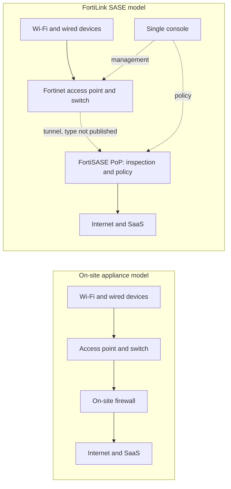
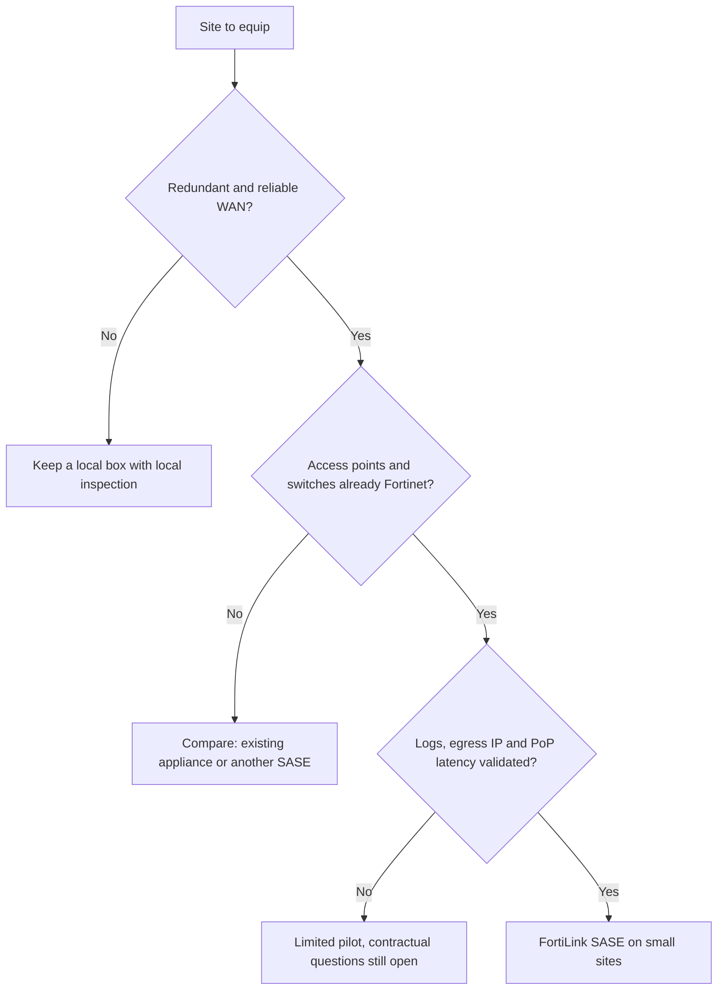

## One less network cabinet, one more question

Open the network cabinet of a downtown shop, a bank branch or a small hotel. You will almost always find the same trio: a switch, one or two Wi-Fi access points and, wedged between the cables, a firewall. Someone had to buy it, license it, configure it, then patch it with every security alert. At one site, that is a detail. Across three hundred sites, it is a budget line, a queue of tickets and as many patches that must not be forgotten.

On October 27, 2026, Fortinet announced its intention to make that box disappear. Its new service, FortiLink SASE, promises to secure small sites with no firewall on premises. The Wi-Fi access point and the switch send traffic straight to the vendor's security cloud, its SASE offering (Secure Access Service Edge, network security delivered as an online service). Retail chains, branch networks, hospitality, managed residences: every business that multiplies small sites is in the target.

The timing is no accident. The same day, HPE announced its own convergence of Wi-Fi and SASE. The boundary between the local network and cloud security is moving, and multi-site IT leaders will get the sales pitch over the coming months.

My reading fits in one sentence. The firewall has not disappeared: it has changed address. And a move is something you negotiate. Where does the data go, who holds the keys, what happens when the route is cut?

## The guard has left the building

To grasp what changes, think of a condominium. The classic model is a guard in every lobby: he screens visitors, keeps the log, knows the regulars. FortiLink SASE replaces all those guards with one central security desk, reached by intercom. One set of instructions for every building, one log, no more guard booths to maintain. But every visitor now waits for the central desk to pick up. And if the line goes down, you must have decided in advance whether the door stays open or closed.

A site firewall plays three roles. It processes traffic: network address translation (NAT), filtering, flow inspection. It enforces a policy: who is entitled to what, based on which identity. And it produces logs, the memory of what happened. In a classic box, all three live in the same cabinet.

According to Fortinet's press release [1], traffic inspection, policy enforcement and management are moved into the FortiSASE environment. Processing therefore goes to a point of presence (PoP), a vendor datacenter where traffic is inspected before reaching the internet. Policy goes to a single console, which also manages wired and wireless equipment. The firewall function still exists, sold as a service. As for logs, the excerpts of the release that I was able to read say nothing about them.

The strongest argument of the launch concerns things. Printers, cameras, sensors: this equipment cannot run FortiClient, Fortinet's software agent. The service promises to protect them with no agent per device and no appliance per site [1][9]. For an estate where *unmanageable* endpoints are the majority, this is exactly the right problem.

The idea is not new. In August 2023, Fortinet was already extending FortiSASE to its FortiAP access points for microbranches, those small remote sites with no IT staff [4][8]. Nirav Shah, then vice president of products, explained to SDxCentral that local traffic stayed on the access point as long as the user stayed in the office. Only outbound access switched to the PoP for inspection. What changes in 2026: the arrival of switches, and the name.

The name matters. FortiLink historically refers to the mechanism by which a FortiGate firewall manages Fortinet switches and access points. My reading, which Fortinet has not confirmed: FortiLink SASE would be that same management link, with its far end becoming FortiSASE instead of a local FortiGate. The name invites it. The exact scope has not been published.

*Before / after: the box leaves the site, the function joins the cloud. The tunnel type and the share of traffic that stays local have not been published for the 2026 service; in the 2023 version, internal traffic stayed on the access point.*

## A press release that speaks mostly through its silences

Read the October 27 press release twice. The second reading, the one that looks for absences, is the most instructive. No availability date. No price. No licensing model. No list of compatible equipment: the text mentions *supported* Wi-Fi access points and Ethernet switches, without even naming FortiAP or FortiSwitch. No PoP map. No customer, partner or analyst speaks: the only voice is that of Anthony James, executive vice president of marketing, who presents the extension to the local network as a simpler way to protect users and devices.

The trade press noticed this itself [9][10]. IT Brief UK states that its article rests on the vendor's statements, with no independent testing or analyst validation. To my knowledge, no independent analysis of the launch has been published to date.

For lack of anything better, we have to look at the documentation of the predecessor. The FortiSASE 7.4.0 release notes describe the "FortiAP edge" feature and its constraints [2]. A separate FortiSASE subscription per access point. FortiAP firmware 7.2.4 at minimum. A closed list of fourteen models, registered on the same FortiCloud account. And a ceiling of 240 access points configurable as edge devices. Onboarding goes through FortiZTP, zero-touch provisioning with no intervention on site, and the administration guide mentions a captive portal [3].

A word of caution: these are the limits of an earlier version, not those of the October 2026 service. Nothing says they still apply. But if the 240-access-point ceiling per instance still held, it would become a blocker for anyone managing thousands. This is a question to ask, not a conclusion to draw.

*Yesterday, a cabinet with router, firewall and cabling; tomorrow, an access point and a switch connected to the cloud. The box leaves, the dependence on the link stays.*

## Leader in SASE, Challenger in SSE: the paradox that explains everything

I won't go back over the SASE market as a whole, already covered on this blog (SD-WAN and SASE convergence, the hybrid mesh firewall Magic Quadrant). The analysts have not yet judged FortiLink SASE, which postdates their reports. They do, however, describe the platform that carries it.

In its Magic Quadrant for SASE Platforms of July 9, 2025 (ref. G00821985), Gartner ranks Fortinet among the Leaders, with more than 1,500 active platform customers according to its estimate [5]. The strengths cited: competitive pricing and a strong installed base of branch firewalls and SD-WAN (the software-defined wide area network). The cautions: a customer experience judged below average. And a two-tier PoP model which, according to Gartner, can create confusion at purchase and lead to suboptimal buying decisions, notably for large global organizations.

A month earlier, the SSE Magic Quadrant (Security Service Edge, the cloud security building block alone, without the networking part) placed Fortinet as a Challenger, alone in that quadrant [6]. Network World reports that Gartner judged pricing very competitive relative to features there, but only on Fortinet's own PoPs, not on those hosted at Google Cloud. Another caution: the *FortiOS everywhere* logic, the in-house operating system present in every building block, limits the appeal of the offering for customers who are not already equipped with Fortinet.

Leader on one side, Challenger on the other. That is not a contradiction, it is a signature. Fortinet is strong where the network matters, more debated on pure cloud security. FortiLink SASE fits that profile: it builds on Fortinet's presence in the local network to bring the customer into its cloud. That is my analysis, but it explains why this launch comes from Fortinet and not from an SSE specialist.

That leaves the question of PoPs, which is the heart of the model. Fortinet claims more than 160 points of presence [11]. That is a vendor figure, and it says nothing about their geographic distribution. In 2023, SDxCentral reported that Gartner judged this footprint geographically limited compared with other vendors [8]. Add the two-tier model flagged in 2025, and the conclusion is unavoidable: the map that matters is not the marketing map, it is the list of PoPs actually included in your contract.

The wind is nonetheless blowing in Fortinet's direction. On a SASE market that Gartner estimates at about 15 billion USD in 2025, the firm forecasts that by 2028, half of new deployments will rely on a single-vendor platform, versus 30% in 2025 [5]. A Futurum survey from the first half of 2026 points the same way: 40% of the network security leaders surveyed place this consolidation in their top 3 priorities [7]. The sample is modest, about a hundred respondents, but the direction is clear.

*When the firewall lives in a PoP, the distance to the nearest PoP becomes a characteristic of the site, just like the throughput of the link.*

## Competitors don't share the same idea of "no box"

All the major vendors sell SASE. Not all of them put the same equipment at the entry point of the site.

| Vendor | Documented anchor point on the site | What it says about the strategy |
|---|---|---|
| Cisco / Meraki | Secure Connect relies on MX SD-WAN appliances and MG gateways; the documentation consulted does not mention MR access points [13] | The access point stays behind a box |
| HPE (Aruba, Juniper Mist) | Integration of EdgeConnect (SD-WAN and SSE) into Mist in 2026, into Aruba Central in the first half of 2027 [7][12] | Unified console, box kept |
| Palo Alto Networks | Prisma SASE with on-site ION SD-WAN appliances [5][16] | The site keeps a box |
| Cato Networks | The Socket connects the site to the Cato cloud and embeds a firewall for the local network; Wi-Fi built in on some models only [14] | Box mandatory, local firewall maintained |
| Zscaler | SIM card for connected things (Zscaler Cellular, announced in July 2025) [15]; acquisition of Airgap Networks announced in April 2024 to segment without an internal firewall [18] | Bypass the local network rather than anchor in it |

The most telling contrast comes from HPE, which announced on the same day. According to Fernando Montenegro (Futurum), HPE's SASE policy is still written in the EdgeConnect orchestrator, and a unified policy model across Wi-Fi, firewall and SASE is not part of this release [7]. HPE unifies the console, Fortinet removes the box. Two opposite bets on the same trend.

In the public documentation I was able to consult, Fortinet is the only one of the five to present an access point or a switch from its catalog as a direct anchor to SASE, with no site appliance. Absence of evidence is not evidence of absence, and competitors' roadmaps can move fast. But the differentiator is real.

So is its flip side. It exists only because Fortinet controls the whole chain, from the access point to the cloud. What makes the offering strong also makes it a lock.

## Three sites, three answers

This section is the author's analysis. No public data validates or refutes it yet: it translates the press release into the daily life of a Wi-Fi operator who manages thousands of access points for its customers.

**The hotel.** On paper, it is the dream terrain. Hundreds of TVs, streaming sticks and game consoles, none able to host an agent. The captive portal appears in the FortiSASE documentation [3], a good sign. But three points cause trouble.

First, the egress IP address. The documentation describes both dedicated public IPs and a mode where the IP is shared among several customers [17]. For a hotel guest who wants to launch their streaming platform, a shared and poorly geolocated IP means a call to the front desk at 11 p.m. Next, latency: every external flow takes the detour through the PoP, and if the nearest one is in another country, the business traveler's video call will feel it. Finally, the failure of the site's internet link. Does the local Wi-Fi remain usable? Does the policy fail open or fail closed? Nothing is documented for the new service.

**The student residence.** Here, the issue is volume and isolation. Each resident expects their own network, partitioned from their neighbor's, and consumes like an entire household: games, streaming, downloads. If all that traffic goes up to a PoP, the billed capacity becomes the central question. So do the logs: where are they stored, for how long, can they be exported to your SIEM (the platform that correlates security events)? The answers must fit your own contractual and regulatory constraints, to be qualified with your legal team before any deployment.

**The shop.** This is the press release's most natural use case. Small sites, cameras, payment terminals, sensors: no more box to ship, no more firewall to patch in a stockroom. The operational gain is tangible. But the PCI DSS auditor (the payment card data security standard) will want to know where the separation between the checkout and the guest Wi-Fi happens. Locally, in the switch? Remotely, in the PoP? The answer changes the scope of the audit.

## The real price is in the contract

Today, you can change firewall vendor without touching the access points, or renew the access points without touching the firewall. The layers are independent. With FortiLink SASE, the access point, the switch, the cloud, the license and the console all come from the same vendor. Getting out means replacing the entire edge of the local network, site by site.

It is an all-inclusive lease: convenient on the way in, expensive on the way out. The box model ties up capital and maintenance, but it preserves freedom of choice layer by layer. The FortiLink SASE model turns a capital expense into a subscription, and that freedom into dependence. Neither is bad by nature. What is bad is signing without having priced the exit.

Remember also that Gartner judges Fortinet's customer experience below average [5]. When the security of three hundred sites depends on a single vendor support team, that criterion stops being secondary.

*A stack integrated at a single vendor deploys fast and comes apart slowly. The checklist gets filled in before signing, not after.*

Before any signature, here are the questions I would put to Fortinet:

1. **Hardware**: which access point and switch models, with what minimum firmware? Are switches really covered?
2. **Availability and pricing**: availability date in Europe, written price grid.
3. **Licensing**: per access point, per site or per user? Is the per-access-point subscription of version 7.4.0 kept?
4. **Ceilings**: maximum number of access points and sites per instance, multi-tenant management.
5. **PoPs**: list of PoPs included in the contract, country by country, latency measured from your sites, sovereign option or not.
6. **Link failure**: behavior of the access point and the switch when the WAN (the site's internet access) goes down, whether local traffic is maintained or not.
7. **Logs and exit**: export to a SIEM, retention period, dedicated egress IP, written reversibility.

To sort sites, I would use a deliberately conservative decision tree.

*Decision tree proposed by the author: FortiLink SASE goes into production only on sites where the link, the equipment and the contract have been validated.*

## My verdict: one more tool, not a doctrine

FortiLink SASE is a good idea that is poorly documented. The good idea: recognizing that in a microbranch, the physical firewall is a link that is costly to operate, and that unmanageable devices need agentless protection. The poor documentation: to date, no price, no availability, no hardware list, no PoP map.

My position is clear. For well-connected small sites already equipped with Fortinet, with few guests and many things, it is a serious candidate to pilot as soon as the conditions are published. Kiosks, branches, small shops: the gain is clear there, the risk contained. For sites with a high density of guests, hotels and residences first among them, it is not a replacement for the local firewall as long as the answers on latency, egress IP and link failure are missing.

I will not sign a deployment on the strength of a press release. Nor will I ignore it: with HPE's announcement the same day, it puts pressure on the price and the place of the branch firewall. Even if you don't switch, put it on the table of your next negotiation.

The firewall has changed address. Before you forward the mail, read the lease.

_Personal views, not Wifirst's position._

## Sources

1. Fortinet, communiqué FortiLink SASE (GlobeNewswire, miroir Wedbush), 27 octobre 2026 — https://investor.wedbush.com/wedbush/article/gnwcq-2026-10-27-fortinet-expands-unified-sase-to-simplify-microbranch-security
2. Fortinet, FortiSASE 7.4.0 Release Notes (FortiAP edge) — https://docs.fortinet.com/document/fortisase/7.4.0/release-notes/969608/
3. Fortinet, FortiSASE Administration Guide, FortiAP edge device (consulté le 10 novembre 2026) — https://docs.fortinet.com/document/fortisase/latest/administration-guide/788213
4. Fortinet, communiqué 2023 relayé par iTWire, 30 août 2023 — https://itwire.com/guest-articles/company-news/fortinet-expands-its-secure-access-service-edge-sase-solution-to-bring-cloud-delivered-enterprise-grade-protection-to-microbranches.html
5. Gartner, Magic Quadrant for SASE Platforms (G00821985), 9 juillet 2025 — https://www.prival.ca/wp-content/uploads/2025/07/Gartner.pdf
6. Network World (Denise Dubie), Gartner Magic Quadrant SSE 2025, 4 juin 2025 — https://www.networkworld.com/article/3997260/genai-controls-and-ztna-architecture-set-sse-vendors-apart.html
7. Futurum (Fernando Montenegro), HPE SASE dans Mist et Aruba Central, 28 octobre 2026 — https://futurumgroup.com/?p=97194
8. SDxCentral (Nancy Liu), Fortinet extends SASE to WLAN, 28 août 2023 — https://www.sdxcentral.com/news/fortinet-extends-sase-to-wlan-for-microbranch-iot-and-ot-security/
9. IT Brief UK (Mara Sugue), 27 octobre 2026 — https://itbrief.co.uk/story/fortinet-launches-fortilink-sase-for-microbranches
10. SecurityBrief Australia (Mara Sugue), 27 octobre 2026 — https://securitybrief.com.au/story/fortinet-launches-fortilink-sase-for-microbranches
11. SecurityBrief US (Melvin Hipolito), 15 juillet 2025 — https://securitybrief.news/story/fortinet-named-sase-leader-by-gartner-eyes-usd-28-5-billion-market
12. cloudnews.tech, HPE unifie SASE, Wi-Fi et réseau filaire, 27 octobre 2026 — https://cloudnews.tech/hpe-unifies-sase-wi-fi-and-wired-networking-with-agentic-ai/
13. Cisco Meraki, Secure Connect Solution Overview — https://documentation.meraki.com/SASE_and_SD-WAN/Cisco_Secure_Connect/Product_Information/Cisco__Secure_Connect_-__Solution_Overview
14. Cato Networks, What are Cato Sockets (mise à jour 22 juin 2026) — https://knowledge.catonetworks.com/docs/what-are-cato-sockets
15. Zscaler, communiqué Zscaler Cellular, 8 juillet 2025 — https://www.zscaler.com/press/zscaler-extends-zero-trust-platform-enable-cellular-communications-iot-ot-simply-sim-card-no
16. Palo Alto Networks, Prisma SD-WAN ION device specifications — https://www.paloaltonetworks.com/resources/datasheets/prisma-sd-wan-instant-on-network-ion-device-specifications
17. Fortinet, FortiSASE Public IP Deployment Guide (IP partagée entre clients) — https://docs2.fortinet.com/document/fortisase/latest/public-ip-deployment-guide/976519/shared-public-ip-address-for-multiple-customers-remote-user-traffic
18. SiliconAngle, Zscaler acquires microsegmentation startup Airgap Networks, 11 avril 2024 — https://siliconangle.com/2024/04/11/zscaler-acquires-microsegmentation-startup-airgap-networks/
