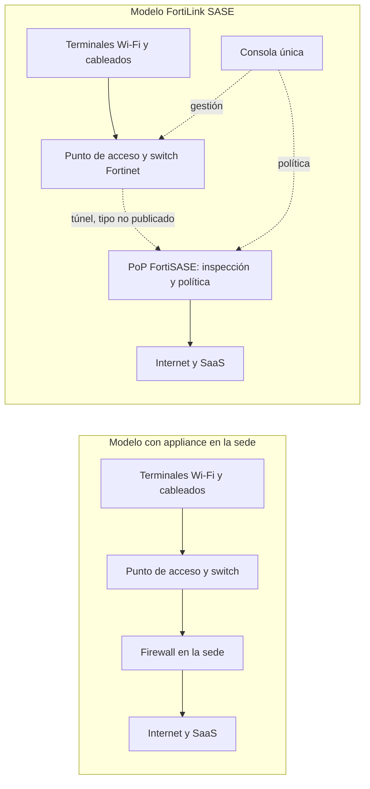
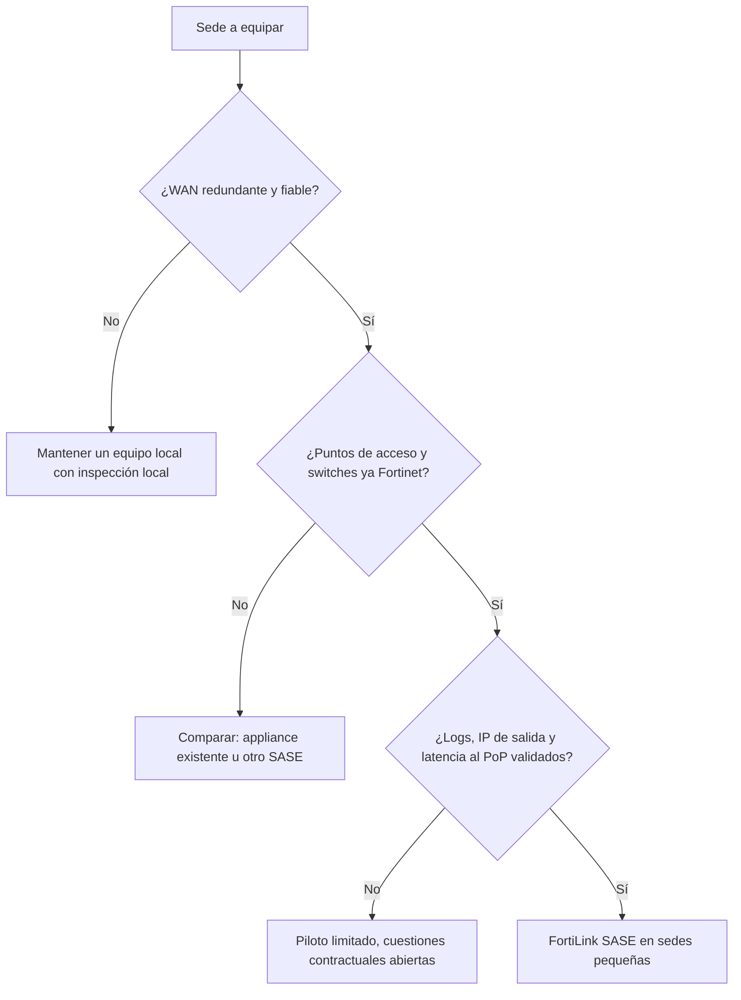

## Un armario de red menos, una pregunta más

Abra el armario de red de una tienda del centro, de una sucursal bancaria o de un pequeño hotel. Casi siempre encontrará el mismo trío: un switch, uno o dos puntos de acceso Wi-Fi y, encajado entre los cables, un firewall. Hubo que comprarlo, licenciarlo, configurarlo y luego actualizarlo con cada alerta de seguridad. En una sede, es un detalle. En trescientas, es una partida presupuestaria, una cola de tickets y otros tantos parches que no se pueden olvidar.

El 27 de octubre de 2026, Fortinet anunció que quiere hacer desaparecer ese equipo. Su nuevo servicio, FortiLink SASE, promete proteger las sedes pequeñas sin firewall in situ. El punto de acceso Wi-Fi y el switch envían el tráfico directamente a la nube de seguridad del fabricante, su oferta SASE (Secure Access Service Edge, la seguridad de red entregada como un servicio en línea). Cadenas de tiendas, redes de sucursales, hotelería, residencias gestionadas: todos los sectores que multiplican las sedes pequeñas están en el punto de mira.

El calendario no es casual. Ese mismo día, HPE anunciaba su propia convergencia entre Wi-Fi y SASE. La frontera entre la red local y la seguridad en la nube se desplaza, y los directores de TI con múltiples sedes recibirán el argumentario en los próximos meses.

Mi lectura cabe en una frase. El firewall no ha desaparecido: ha cambiado de dirección. Y una mudanza se negocia. ¿Adónde van los datos, quién guarda las llaves, qué ocurre cuando se corta la ruta?

## El portero se ha ido del edificio

Para entender qué cambia, piense en una comunidad de vecinos. El modelo clásico es un portero en cada portal: filtra las entradas, lleva el registro, conoce a los habituales. FortiLink SASE sustituye a todos esos porteros por un centro de control de seguridad único, al que se llama por interfono. Una sola consigna para todos los edificios, un registro único, ninguna portería que mantener. Pero ahora cada visitante espera a que el centro conteste. Y si se cae la línea, hay que haber decidido de antemano si la puerta se queda abierta o cerrada.

Un firewall de sede cumple tres funciones. Procesa el tráfico: traducción de direcciones (NAT), filtrado, inspección de flujos. Aplica una política: quién tiene derecho a qué, según qué identidad. Y produce logs, la memoria de lo que ha ocurrido. En un equipo clásico, las tres conviven en el mismo armario.

Según el comunicado de Fortinet [1], la inspección del tráfico, la aplicación de políticas y la gestión se trasladan al entorno FortiSASE. El procesamiento se va, por tanto, a un punto de presencia (PoP), un centro de datos del fabricante donde el tráfico se inspecciona antes de llegar a Internet. La política se va a una consola única, que gestiona también los equipos cableados e inalámbricos. La función de firewall sigue existiendo, vendida como servicio. En cuanto a los logs, los extractos del comunicado que he podido leer no dicen nada.

El argumento más sólido del lanzamiento afecta a los objetos. Impresoras, cámaras, sensores: estos equipos no pueden ejecutar FortiClient, el agente de software de Fortinet. El servicio promete protegerlos sin agente por equipo ni appliance por sede [1][9]. Para un parque donde los terminales *no gestionables* son mayoría, es exactamente el problema correcto.

La idea no es nueva. En agosto de 2023, Fortinet ya extendía FortiSASE a sus puntos de acceso FortiAP para las microbranches, esas pequeñas sedes remotas sin equipo informático [4][8]. Nirav Shah, entonces vicepresidente de producto, explicaba a SDxCentral que el tráfico local se quedaba en el punto de acceso mientras el usuario permaneciera en la oficina. Solo los accesos hacia el exterior se desviaban al PoP para su inspección. Lo que cambia en 2026: la llegada de los switches y el nombre.

El nombre importa. FortiLink designa históricamente el mecanismo por el cual un firewall FortiGate gestiona los switches y los puntos de acceso de Fortinet. Mi lectura, que Fortinet no ha confirmado: FortiLink SASE sería ese mismo enlace de gestión, cuyo extremo pasa a ser FortiSASE en lugar de un FortiGate local. El nombre invita a pensarlo. El alcance exacto, en cambio, no se ha publicado.

*Antes y después: el equipo sale de la sede, la función se va a la nube. El tipo de túnel y la parte del tráfico que sigue siendo local no se han publicado para el servicio de 2026; en la versión de 2023, el tráfico interno se quedaba en el punto de acceso.*

## Un comunicado que habla sobre todo con sus silencios

Lea el comunicado del 27 de octubre dos veces. La segunda lectura, la de las ausencias, es la más instructiva. Ninguna fecha de disponibilidad. Ningún precio. Ningún modelo de licencia. Ninguna lista de equipos compatibles: el texto menciona puntos de acceso Wi-Fi y switches Ethernet *compatibles*, sin siquiera nombrar FortiAP o FortiSwitch. Ningún mapa de PoP. Ningún cliente, socio o analista toma la palabra: la única voz es la de Anthony James, vicepresidente ejecutivo de marketing, que presenta la extensión a la red local como una forma más sencilla de proteger a usuarios y equipos.

La prensa especializada lo ha señalado por sí misma [9][10]. IT Brief UK precisa que su artículo se basa en las declaraciones del proveedor, sin pruebas independientes ni validación de analistas. Que yo sepa, hasta la fecha no se ha publicado ningún análisis independiente del lanzamiento.

A falta de algo mejor, hay que mirar la documentación del antecesor. Las notas de la versión FortiSASE 7.4.0 describen la función «FortiAP edge» y sus restricciones [2]. Una suscripción FortiSASE distinta por punto de acceso. Un firmware FortiAP 7.2.4 como mínimo. Una lista cerrada de catorce modelos, registrados en la misma cuenta FortiCloud. Y un tope de 240 puntos de acceso configurables como equipos de borde. La puesta en servicio pasa por FortiZTP, el aprovisionamiento sin intervención en la sede, y la guía de administración menciona un portal cautivo [3].

Cautela: son los límites de una versión anterior, no los del servicio de octubre de 2026. Nada indica que sigan aplicándose. Pero si el tope de 240 puntos de acceso por instancia siguiera vigente, resultaría bloqueante para quien gestione miles. Es una pregunta que hay que hacer, no una conclusión que sacar.

*Ayer, un armario con router, firewall y cableado; mañana, un punto de acceso y un switch conectados a la nube. El equipo se va, la dependencia del enlace se queda.*

## Líder en SASE, Challenger en SSE: la paradoja que lo explica todo

No vuelvo sobre el mercado SASE en su conjunto, ya tratado en este blog (convergencia SD-WAN y SASE, Magic Quadrant hybrid mesh firewall). Los analistas aún no han evaluado FortiLink SASE, posterior a sus informes. Sí describen, en cambio, la plataforma que lo sustenta.

En su Magic Quadrant for SASE Platforms del 9 de julio de 2025 (ref. G00821985), Gartner clasifica a Fortinet entre los Leaders, con más de 1.500 clientes de plataforma activos según su estimación [5]. Los puntos fuertes citados: un precio competitivo y una sólida base instalada de firewalls de sucursal y de SD-WAN (la red de área extensa gestionada por software). Las reservas: una experiencia de cliente juzgada inferior a la media. Y un modelo de PoP de dos niveles que, según Gartner, puede generar confusión en la compra y llevar a adquisiciones subóptimas, sobre todo en grandes organizaciones globales.

Un mes antes, el Magic Quadrant SSE (Security Service Edge, solo el componente de seguridad en la nube, sin la parte de red) situaba a Fortinet como Challenger, solo en ese cuadrante [6]. Network World informa de que Gartner consideraba los precios muy competitivos en relación con las funciones, pero solo en los PoP propios de Fortinet, no en los alojados en Google Cloud. Otra reserva: la lógica *FortiOS en todas partes*, el sistema operativo propio presente en cada componente, reduce el atractivo de la oferta para los clientes que aún no tienen equipamiento Fortinet.

Líder por un lado, Challenger por el otro. No es una contradicción, es una firma. Fortinet es fuerte donde la red cuenta y más discutido en seguridad cloud pura. FortiLink SASE encaja con ese perfil: se apoya en la presencia de Fortinet en la red local para llevar al cliente a su nube. Es mi análisis, pero explica por qué este lanzamiento viene de Fortinet y no de un especialista en SSE.

Queda la cuestión de los PoP, que es el corazón del modelo. Fortinet afirma tener más de 160 puntos de presencia [11]. Es una cifra del fabricante, que no dice nada de su reparto geográfico. En 2023, SDxCentral informaba de que Gartner consideraba esa huella geográficamente limitada frente a otros fabricantes [8]. Añada el modelo de dos niveles señalado en 2025 y la conclusión se impone: el mapa que cuenta no es el mapa de marketing, es la lista de PoP realmente incluidos en su contrato.

Con todo, el viento sopla a favor de Fortinet. En un mercado SASE que Gartner estima en unos 15.000 millones de USD en 2025, la firma prevé que de aquí a 2028 la mitad de los nuevos despliegues se apoyarán en una plataforma de un único proveedor, frente al 30 % en 2025 [5]. Una encuesta de Futurum del primer semestre de 2026 apunta en la misma dirección: el 40 % de los responsables de seguridad de red encuestados sitúan esta consolidación entre sus tres prioridades principales [7]. La muestra es modesta, un centenar de encuestados, pero la dirección es clara.

*Cuando el firewall vive en un PoP, la distancia al PoP más cercano pasa a ser una característica de la sede, igual que el ancho de banda del enlace.*

## Los competidores no entienden igual el «sin equipo»

Todos los grandes fabricantes venden SASE. No todos colocan el mismo equipo en la entrada de la sede.

| Proveedor | Punto de anclaje documentado en la sede | Lo que dice de la estrategia |
|---|---|---|
| Cisco / Meraki | Secure Connect se apoya en los equipos SD-WAN MX y las pasarelas MG; la documentación consultada no menciona los puntos de acceso MR [13] | El punto de acceso sigue detrás de un equipo |
| HPE (Aruba, Juniper Mist) | Integración de EdgeConnect (SD-WAN y SSE) en Mist en 2026, en Aruba Central en el primer semestre de 2027 [7][12] | Consola unificada, equipo conservado |
| Palo Alto Networks | Prisma SASE con appliances SD-WAN ION en la sede [5][16] | La sede conserva un equipo |
| Cato Networks | El Socket conecta la sede a la nube de Cato e integra un firewall para la red local; Wi-Fi integrado solo en algunos modelos [14] | Equipo obligatorio, firewall local mantenido |
| Zscaler | Tarjeta SIM para objetos conectados (Zscaler Cellular, anunciado en julio de 2025) [15]; adquisición de Airgap Networks anunciada en abril de 2024 para segmentar sin firewall interno [18] | Sortear la red local en lugar de anclarse en ella |

El contraste más elocuente viene de HPE, que anunciaba el mismo día. Según Fernando Montenegro (Futurum), la política SASE de HPE sigue redactándose en el orquestador EdgeConnect, y un modelo de política unificado entre Wi-Fi, firewall y SASE no figura en esta versión [7]. HPE unifica la consola, Fortinet suprime el equipo. Dos apuestas opuestas sobre la misma tendencia.

En la documentación pública que he podido consultar, Fortinet es el único de los cinco que presenta un punto de acceso o un switch de su catálogo como anclaje directo hacia el SASE, sin appliance en la sede. La ausencia de pruebas no es prueba de ausencia, y las hojas de ruta de la competencia pueden cambiar rápido. Pero el factor diferencial es real.

Su contrapartida también. Solo existe porque Fortinet controla toda la cadena, del punto de acceso a la nube. Lo que hace la fuerza de la oferta es también su cerrojo.

## Tres sedes, tres respuestas

Esta sección es análisis del autor. Ningún dato público la valida ni la desmiente todavía: traduce el comunicado al día a día de un operador Wi-Fi que gestiona miles de puntos de acceso en sus clientes.

**El hotel.** Sobre el papel, es el terreno soñado. Cientos de televisores, de dispositivos de streaming y de consolas de juegos, ninguno capaz de alojar un agente. El portal cautivo figura en la documentación de FortiSASE [3], buena señal. Pero hay tres puntos conflictivos.

Primero, la dirección IP de salida. La documentación describe a la vez IP públicas dedicadas y un modo en el que la IP se comparte entre varios clientes [17]. Para un huésped que quiere lanzar su plataforma de streaming, una IP compartida y mal geolocalizada es una llamada a recepción a las 23 h. Segundo, la latencia: cada flujo externo da el rodeo por el PoP, y si el más cercano está en otro país, la videollamada del viajero de negocios lo notará. Por último, la caída del enlace a Internet de la sede. ¿Sigue siendo utilizable el Wi-Fi local? ¿La política pasa a modo abierto o cerrado? No hay nada documentado para el nuevo servicio.

**La residencia de estudiantes.** Aquí el tema es el volumen y el aislamiento. Cada residente espera su propia red, separada de la de su vecino, y consume como un hogar entero: juegos, streaming, descargas. Si todo ese tráfico sube a un PoP, la capacidad facturada pasa a ser la cuestión central. También la de los logs: ¿dónde se almacenan, durante cuánto tiempo, se pueden exportar a su SIEM (la plataforma de correlación de eventos de seguridad)? Las respuestas deben ajustarse a sus propias obligaciones contractuales y normativas, y conviene validarlas con su departamento jurídico antes de cualquier despliegue.

**La tienda.** Es el caso de uso más natural del comunicado. Sedes pequeñas, cámaras, terminales de pago, sensores: ya no hay que enviar un equipo ni parchear un firewall en un almacén. La ganancia operativa es tangible. Pero el auditor de PCI DSS (la norma de seguridad de datos de tarjetas de pago) querrá saber dónde se hace la separación entre la caja y el Wi-Fi de invitados. ¿Localmente, en el switch? ¿A distancia, en el PoP? La respuesta cambia el perímetro de la auditoría.

## El verdadero precio está en el contrato

Hoy se puede cambiar de proveedor de firewall sin tocar los puntos de acceso, o renovar los puntos de acceso sin tocar el firewall. Las capas son independientes. Con FortiLink SASE, el punto de acceso, el switch, la nube, la licencia y la consola vienen del mismo proveedor. Salir es sustituir todo el borde de la red local, sede por sede.

Es un alquiler todo incluido: cómodo a la entrada, caro a la salida. El modelo de equipo inmoviliza capital y exige mantenimiento, pero preserva la libertad de elegir capa por capa. El modelo FortiLink SASE convierte un gasto de equipamiento en una suscripción, y esa libertad en dependencia. Ninguno de los dos es malo por naturaleza. Lo malo es firmar sin haber calculado la salida.

Recordemos también que Gartner juzga la experiencia de cliente de Fortinet inferior a la media [5]. Cuando la seguridad de trescientas sedes depende de un único soporte de fabricante, ese criterio deja de ser secundario.

*Una pila integrada en un solo proveedor se despliega rápido y se desmonta despacio. La checklist se rellena antes de la firma, no después.*

Antes de cualquier firma, estas son las preguntas que yo le haría a Fortinet:

1. **Hardware**: ¿qué modelos de puntos de acceso y de switches, con qué firmware mínimo? ¿Los switches están realmente cubiertos?
2. **Disponibilidad y precio**: fecha de disponibilidad en Europa, tarifa por escrito.
3. **Licencia**: ¿por punto de acceso, por sede o por usuario? ¿Se mantiene la suscripción por punto de acceso de la versión 7.4.0?
4. **Topes**: número máximo de puntos de acceso y de sedes por instancia, gestión multicliente.
5. **PoP**: lista de los PoP incluidos en el contrato, país por país, latencia medida desde sus sedes, opción soberana o no.
6. **Caída del enlace**: comportamiento del punto de acceso y del switch cuando cae el WAN (el acceso a Internet de la sede), si se mantiene o no el tráfico local.
7. **Logs y salida**: exportación a un SIEM, duración de la retención, IP de salida dedicada, reversibilidad por escrito.

Para clasificar las sedes, yo usaría un árbol de decisión deliberadamente conservador.

*Árbol de decisión propuesto por el autor: FortiLink SASE solo entra en producción en las sedes donde el enlace, el parque y el contrato han sido validados.*

## Mi veredicto: una herramienta más, no una doctrina

FortiLink SASE es una buena idea mal documentada. La buena idea: reconocer que, en una microbranch, el firewall físico es un eslabón caro de operar, y que los objetos no gestionables necesitan una protección sin agente. La mala documentación: a día de hoy, ni precio, ni disponibilidad, ni lista de hardware, ni mapa de PoP.

Mi posición es clara. Para las sedes pequeñas bien conectadas, ya equipadas con Fortinet, con pocos invitados y muchos objetos, es un candidato serio para pilotar en cuanto se publiquen las condiciones. Quioscos, sucursales, tiendas pequeñas: la ganancia es neta, el riesgo, acotado. Para las sedes con alta densidad de invitados, hoteles y residencias a la cabeza, no sustituye al firewall local mientras falten las respuestas sobre la latencia, la IP de salida y la caída del enlace.

No firmaré un despliegue basándome en un comunicado. Tampoco lo ignoraré: con el anuncio de HPE el mismo día, presiona el precio y el lugar del firewall de sucursal. Aunque no migre, póngalo sobre la mesa de su próxima negociación.

El firewall ha cambiado de dirección. Antes de reenviar el correo, lea el contrato de alquiler.

_Opiniones personales, no la postura de Wifirst._

## Fuentes

1. Fortinet, communiqué FortiLink SASE (GlobeNewswire, miroir Wedbush), 27 octobre 2026 — https://investor.wedbush.com/wedbush/article/gnwcq-2026-10-27-fortinet-expands-unified-sase-to-simplify-microbranch-security
2. Fortinet, FortiSASE 7.4.0 Release Notes (FortiAP edge) — https://docs.fortinet.com/document/fortisase/7.4.0/release-notes/969608/
3. Fortinet, FortiSASE Administration Guide, FortiAP edge device (consulté le 10 novembre 2026) — https://docs.fortinet.com/document/fortisase/latest/administration-guide/788213
4. Fortinet, communiqué 2023 relayé par iTWire, 30 août 2023 — https://itwire.com/guest-articles/company-news/fortinet-expands-its-secure-access-service-edge-sase-solution-to-bring-cloud-delivered-enterprise-grade-protection-to-microbranches.html
5. Gartner, Magic Quadrant for SASE Platforms (G00821985), 9 juillet 2025 — https://www.prival.ca/wp-content/uploads/2025/07/Gartner.pdf
6. Network World (Denise Dubie), Gartner Magic Quadrant SSE 2025, 4 juin 2025 — https://www.networkworld.com/article/3997260/genai-controls-and-ztna-architecture-set-sse-vendors-apart.html
7. Futurum (Fernando Montenegro), HPE SASE dans Mist et Aruba Central, 28 octobre 2026 — https://futurumgroup.com/?p=97194
8. SDxCentral (Nancy Liu), Fortinet extends SASE to WLAN, 28 août 2023 — https://www.sdxcentral.com/news/fortinet-extends-sase-to-wlan-for-microbranch-iot-and-ot-security/
9. IT Brief UK (Mara Sugue), 27 octobre 2026 — https://itbrief.co.uk/story/fortinet-launches-fortilink-sase-for-microbranches
10. SecurityBrief Australia (Mara Sugue), 27 octobre 2026 — https://securitybrief.com.au/story/fortinet-launches-fortilink-sase-for-microbranches
11. SecurityBrief US (Melvin Hipolito), 15 juillet 2025 — https://securitybrief.news/story/fortinet-named-sase-leader-by-gartner-eyes-usd-28-5-billion-market
12. cloudnews.tech, HPE unifie SASE, Wi-Fi et réseau filaire, 27 octobre 2026 — https://cloudnews.tech/hpe-unifies-sase-wi-fi-and-wired-networking-with-agentic-ai/
13. Cisco Meraki, Secure Connect Solution Overview — https://documentation.meraki.com/SASE_and_SD-WAN/Cisco_Secure_Connect/Product_Information/Cisco__Secure_Connect_-__Solution_Overview
14. Cato Networks, What are Cato Sockets (mise à jour 22 juin 2026) — https://knowledge.catonetworks.com/docs/what-are-cato-sockets
15. Zscaler, communiqué Zscaler Cellular, 8 juillet 2025 — https://www.zscaler.com/press/zscaler-extends-zero-trust-platform-enable-cellular-communications-iot-ot-simply-sim-card-no
16. Palo Alto Networks, Prisma SD-WAN ION device specifications — https://www.paloaltonetworks.com/resources/datasheets/prisma-sd-wan-instant-on-network-ion-device-specifications
17. Fortinet, FortiSASE Public IP Deployment Guide (IP partagée entre clients) — https://docs2.fortinet.com/document/fortisase/latest/public-ip-deployment-guide/976519/shared-public-ip-address-for-multiple-customers-remote-user-traffic
18. SiliconAngle, Zscaler acquires microsegmentation startup Airgap Networks, 11 avril 2024 — https://siliconangle.com/2024/04/11/zscaler-acquires-microsegmentation-startup-airgap-networks/
