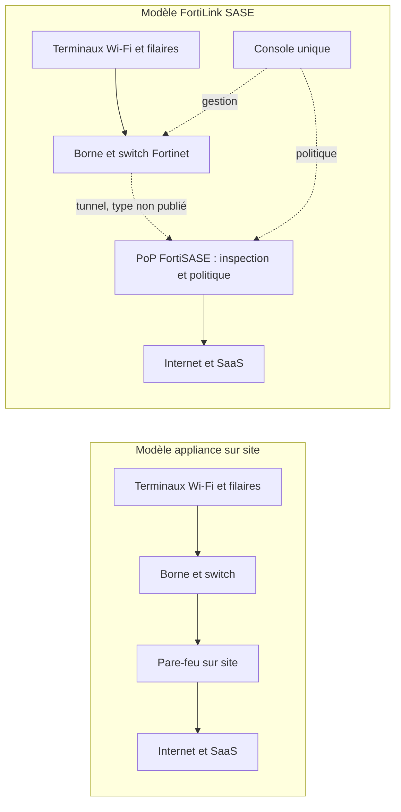
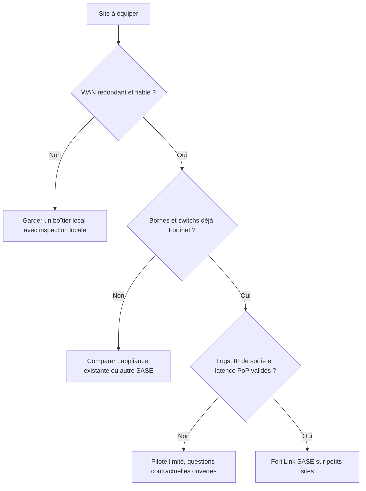

## Une armoire réseau de moins, une question de plus

Ouvrez l'armoire réseau d'une boutique de centre-ville, d'une agence bancaire ou d'un petit hôtel. Vous y trouverez presque toujours le même trio : un switch, une ou deux bornes Wi-Fi et, coincé entre les câbles, un pare-feu. Il a fallu l'acheter, le licencier, le configurer, puis le mettre à jour à chaque alerte de sécurité. Sur un site, c'est un détail. Sur trois cents sites, c'est une ligne budgétaire, une file de tickets et autant de correctifs à ne pas oublier.

Le 27 octobre 2026, Fortinet a annoncé vouloir faire disparaître ce boîtier. Son nouveau service, FortiLink SASE, promet de sécuriser les petits sites sans pare-feu sur place. La borne Wi-Fi et le switch envoient le trafic directement vers le cloud de sécurité de l'éditeur, son offre SASE (Secure Access Service Edge, la sécurité réseau livrée comme un service en ligne). Chaînes de magasins, réseaux d'agences, hôtellerie, résidences gérées : tous les métiers qui multiplient les petits sites sont dans la cible.

Le calendrier n'a rien d'un hasard. Le même jour, HPE annonçait sa propre convergence entre Wi-Fi et SASE. La frontière entre réseau local et sécurité cloud bouge, et les DSI multi-sites recevront l'argumentaire dans les prochains mois.

Ma lecture tient en une phrase. Le pare-feu n'a pas disparu : il a changé d'adresse. Et un déménagement, ça se négocie. Où partent les données, qui garde les clés, que se passe-t-il quand la route est coupée ?

## Le gardien a quitté l'immeuble

Pour saisir ce qui change, pensez à une copropriété. Le modèle classique, c'est un gardien dans chaque hall : il filtre les entrées, tient le registre, connaît les habitués. FortiLink SASE remplace tous ces gardiens par un poste de sécurité central, joint par interphone. Une seule consigne pour tous les immeubles, un registre unique, plus aucune loge à entretenir. Mais chaque visiteur attend désormais que le poste central décroche. Et si la ligne tombe, il faut avoir décidé à l'avance si la porte reste ouverte ou fermée.

Un pare-feu de site remplit trois rôles. Il traite le trafic : traduction d'adresses (NAT), filtrage, inspection des flux. Il applique une politique : qui a droit à quoi, selon quelle identité. Et il produit des journaux, la mémoire de ce qui s'est passé. Dans un boîtier classique, les trois cohabitent dans la même armoire.

Selon le communiqué de Fortinet [1], l'inspection du trafic, l'application des politiques et la gestion sont déplacées dans l'environnement FortiSASE. Le traitement part donc dans un point de présence (PoP), un datacenter de l'éditeur où le trafic est inspecté avant de rejoindre Internet. La politique part dans une console unique, qui gère aussi les équipements filaires et sans fil. La fonction de pare-feu existe toujours, vendue comme un service. Quant aux journaux, les extraits du communiqué que j'ai pu lire n'en disent rien.

L'argument le plus solide du lancement concerne les objets. Imprimantes, caméras, capteurs : ces équipements ne peuvent pas faire tourner FortiClient, l'agent logiciel de Fortinet. Le service promet de les protéger sans agent par équipement ni appliance par site [1][9]. Pour un parc où les terminaux *non gérables* sont majoritaires, c'est exactement le bon problème.

L'idée n'est pas neuve. En août 2023, Fortinet étendait déjà FortiSASE à ses bornes FortiAP pour les microbranches, ces petits sites distants sans équipe informatique [4][8]. Nirav Shah, alors vice-président produits, expliquait à SDxCentral que le trafic local restait sur la borne tant que l'utilisateur restait au bureau. Seuls les accès vers l'extérieur basculaient vers le PoP pour inspection. Ce qui change en 2026 : l'arrivée des switchs, et le nom.

Le nom compte. FortiLink désigne historiquement le mécanisme par lequel un pare-feu FortiGate pilote les switchs et bornes Fortinet. Ma lecture, que Fortinet n'a pas confirmée : FortiLink SASE serait ce même lien de gestion, dont l'extrémité devient FortiSASE au lieu d'un FortiGate local. Le nom y invite. Le périmètre exact, lui, n'est pas publié.

*Avant / après : le boîtier quitte le site, la fonction rejoint le cloud. Le type de tunnel et la part du trafic qui reste locale ne sont pas publiés pour le service 2026 ; dans la version 2023, le trafic interne restait sur la borne.*

## Un communiqué qui parle surtout par ses silences

Lisez le communiqué du 27 octobre deux fois. La seconde lecture, celle des absences, est la plus instructive. Pas de date de disponibilité. Pas de prix. Pas de modèle de licence. Pas de liste des équipements compatibles : le texte évoque des bornes Wi-Fi et des switchs Ethernet *supportés*, sans même nommer FortiAP ou FortiSwitch. Pas de carte des PoP. Aucun client, partenaire ou analyste ne s'exprime : la seule voix est celle d'Anthony James, vice-président exécutif marketing, qui présente l'extension au réseau local comme une manière plus simple de protéger utilisateurs et équipements.

La presse spécialisée l'a relevé elle-même [9][10]. IT Brief UK précise que son article repose sur les déclarations du fournisseur, sans test indépendant ni validation d'analyste. À ma connaissance, aucune analyse indépendante du lancement n'a été publiée à ce jour.

Faute de mieux, il faut regarder la documentation de l'ancêtre. Les notes de version FortiSASE 7.4.0 décrivent la fonction « FortiAP edge » et ses contraintes [2]. Un abonnement FortiSASE distinct par borne. Un firmware FortiAP 7.2.4 au minimum. Une liste fermée de quatorze modèles, enregistrés sur le même compte FortiCloud. Et un plafond de 240 bornes configurables comme équipements de bordure. La mise en service passe par FortiZTP, le provisionnement sans intervention sur site, et le guide d'administration mentionne un portail captif [3].

Prudence : ce sont les limites d'une version antérieure, pas celles du service d'octobre 2026. Rien ne dit qu'elles s'appliquent encore. Mais si le plafond de 240 bornes par instance tenait toujours, il deviendrait bloquant pour quiconque en gère des milliers. C'est une question à poser, pas une conclusion à tirer.

*Hier, une armoire avec routeur, pare-feu et câblage ; demain, une borne et un switch reliés au cloud. Le boîtier part, la dépendance au lien reste.*

## Leader en SASE, Challenger en SSE : le paradoxe qui éclaire tout

Je ne reviens pas sur le marché SASE dans son ensemble, déjà traité sur ce blog (convergence SD-WAN et SASE, Magic Quadrant hybrid mesh firewall). Les analystes n'ont pas encore jugé FortiLink SASE, postérieur à leurs rapports. Ils décrivent en revanche la plateforme qui le porte.

Dans son Magic Quadrant for SASE Platforms du 9 juillet 2025 (réf. G00821985), Gartner classe Fortinet parmi les Leaders, avec plus de 1 500 clients plateforme actifs selon son estimation [5]. Les forces citées : un prix compétitif et une forte base installée de pare-feu de branche et de SD-WAN (le réseau étendu piloté par logiciel). Les réserves : une expérience client jugée inférieure à la moyenne. Et un modèle de PoP à deux niveaux qui, selon Gartner, peut semer la confusion à l'achat et conduire à des achats sous-optimaux, notamment pour les grandes organisations mondiales.

Un mois plus tôt, le Magic Quadrant SSE (Security Service Edge, la seule brique de sécurité cloud, sans la partie réseau) plaçait Fortinet en Challenger, seul dans ce quadrant [6]. Network World rapporte que Gartner y jugeait les prix très compétitifs au regard des fonctions, mais seulement sur les PoP propres à Fortinet, pas sur ceux hébergés chez Google Cloud. Autre réserve : la logique *FortiOS partout*, le système d'exploitation maison présent dans chaque brique, limite l'attrait de l'offre pour les clients qui ne sont pas déjà équipés Fortinet.

Leader d'un côté, Challenger de l'autre. Ce n'est pas une contradiction, c'est une signature. Fortinet est fort là où le réseau compte, plus discuté sur la sécurité cloud pure. FortiLink SASE colle à ce profil : il s'appuie sur la présence de Fortinet dans le réseau local pour faire entrer le client dans son cloud. C'est mon analyse, mais elle explique pourquoi ce lancement vient de Fortinet et pas d'un spécialiste du SSE.

Reste la question des PoP, qui est le cœur du modèle. Fortinet revendique plus de 160 points de présence [11]. C'est un chiffre de l'éditeur, qui ne dit rien de leur répartition géographique. En 2023, SDxCentral rapportait que Gartner jugeait cette empreinte géographiquement limitée face à d'autres éditeurs [8]. Ajoutez le modèle à deux niveaux pointé en 2025, et la conclusion s'impose : la carte qui compte n'est pas la carte marketing, c'est la liste des PoP réellement inclus dans votre contrat.

Le vent souffle pourtant dans le sens de Fortinet. Sur un marché SASE que Gartner estime à environ 15 milliards USD en 2025, le cabinet prévoit que d'ici 2028, la moitié des nouveaux déploiements reposeront sur une plateforme mono-fournisseur, contre 30 % en 2025 [5]. Une enquête Futurum du premier semestre 2026 va dans le même sens : 40 % des responsables sécurité réseau interrogés placent cette consolidation dans leur top 3 des priorités [7]. L'échantillon est modeste, une centaine de répondants, mais la direction est nette.

*Quand le pare-feu vit dans un PoP, la distance au PoP le plus proche devient une caractéristique du site, au même titre que le débit du lien.*

## Les concurrents n'ont pas la même idée du « sans boîtier »

Tous les grands éditeurs vendent du SASE. Tous ne posent pas le même équipement au point d'entrée du site.

| Éditeur | Point d'ancrage documenté sur le site | Ce que ça dit de la stratégie |
|---|---|---|
| Cisco / Meraki | Secure Connect s'appuie sur les boîtiers SD-WAN MX et les passerelles MG ; la documentation consultée ne mentionne pas les bornes MR [13] | La borne reste derrière un boîtier |
| HPE (Aruba, Juniper Mist) | Intégration d'EdgeConnect (SD-WAN et SSE) dans Mist en 2026, dans Aruba Central au premier semestre 2027 [7][12] | Console unifiée, boîtier conservé |
| Palo Alto Networks | Prisma SASE avec des appliances SD-WAN ION sur site [5][16] | Le site garde un boîtier |
| Cato Networks | Le Socket relie le site au cloud Cato et embarque un pare-feu pour le réseau local ; Wi-Fi intégré sur certains modèles seulement [14] | Boîtier obligatoire, pare-feu local maintenu |
| Zscaler | Carte SIM pour objets connectés (Zscaler Cellular, annoncé en juillet 2025) [15] ; acquisition d'Airgap Networks annoncée en avril 2024 pour segmenter sans pare-feu interne [18] | Contourner le réseau local plutôt que s'y ancrer |

Le contraste le plus parlant vient d'HPE, qui annonçait le même jour. Selon Fernando Montenegro (Futurum), la politique SASE d'HPE reste rédigée dans l'orchestrateur EdgeConnect, et un modèle de politique unifié entre Wi-Fi, pare-feu et SASE ne figure pas dans cette version [7]. HPE unifie la console, Fortinet supprime le boîtier. Deux paris opposés sur la même tendance.

Dans la documentation publique que j'ai pu consulter, Fortinet est le seul des cinq à présenter une borne ou un switch de son catalogue comme ancrage direct vers le SASE, sans appliance de site. L'absence de preuve n'est pas une preuve d'absence, et les feuilles de route concurrentes peuvent bouger vite. Mais le différenciateur est réel.

Sa contrepartie aussi. Il n'existe que parce que Fortinet maîtrise toute la chaîne, de la borne au cloud. Ce qui fait la force de l'offre fait aussi son verrou.

## Trois sites, trois réponses

Cette section relève de l'analyse d'auteur. Aucune donnée publique ne la valide ni ne l'infirme encore : elle traduit le communiqué dans le quotidien d'un opérateur Wi-Fi qui gère des milliers de bornes chez ses clients.

**L'hôtel.** Sur le papier, c'est le terrain rêvé. Des centaines de téléviseurs, de clés de streaming et de consoles de jeu, aucune capable d'accueillir un agent. Le portail captif figure dans la documentation FortiSASE [3], bon signe. Mais trois points fâchent.

D'abord, l'adresse IP de sortie. La documentation décrit à la fois des IP publiques dédiées et un mode où l'IP est partagée entre plusieurs clients [17]. Pour un client de l'hôtel qui veut lancer sa plateforme de streaming, une IP partagée et mal géolocalisée, c'est un appel à la réception à 23 heures. Ensuite, la latence : chaque flux externe fait le détour par le PoP, et si le plus proche est dans un autre pays, la visio du voyageur d'affaires le sentira. Enfin, la panne du lien internet du site. Le Wi-Fi local reste-t-il utilisable ? La politique bascule-t-elle en mode ouvert ou fermé ? Rien n'est documenté pour le nouveau service.

**La résidence étudiante.** Ici, le sujet est le volume et l'isolation. Chaque résident attend son propre réseau, cloisonné de celui du voisin, et consomme comme un foyer entier : jeux, streaming, téléchargements. Si tout ce trafic remonte vers un PoP, la capacité facturée devient la question centrale. Celle des journaux aussi : où sont-ils stockés, combien de temps, sont-ils exportables vers votre SIEM (la plateforme de corrélation des événements de sécurité) ? Les réponses doivent coller à vos propres contraintes contractuelles et réglementaires, à qualifier avec votre juridique avant tout déploiement.

**Le magasin.** C'est le cas d'usage le plus naturel du communiqué. Petits sites, caméras, terminaux de paiement, capteurs : plus de boîtier à expédier, plus de pare-feu à patcher dans une réserve. Le gain opérationnel est tangible. Mais l'auditeur PCI DSS (la norme de sécurité des données de cartes de paiement) voudra savoir où se fait la séparation entre la caisse et le Wi-Fi invité. Localement, dans le switch ? À distance, dans le PoP ? La réponse change le périmètre de l'audit.

## Le vrai prix est dans le contrat

Aujourd'hui, on peut changer de fournisseur de pare-feu sans toucher aux bornes, ou renouveler les bornes sans toucher au pare-feu. Les couches sont indépendantes. Avec FortiLink SASE, la borne, le switch, le cloud, la licence et la console viennent du même fournisseur. Sortir, c'est remplacer toute la bordure du réseau local, site par site.

C'est un bail tout compris : pratique à l'entrée, coûteux à la sortie. Le modèle boîtier mobilise du capital et de la maintenance, mais il préserve une liberté de choix couche par couche. Le modèle FortiLink SASE transforme une dépense d'équipement en abonnement, et cette liberté en dépendance. Aucun des deux n'est mauvais par nature. Ce qui est mauvais, c'est de signer sans avoir chiffré la sortie.

Rappelons aussi que Gartner juge l'expérience client de Fortinet inférieure à la moyenne [5]. Quand la sécurité de trois cents sites dépend d'un seul support éditeur, ce critère cesse d'être secondaire.

*Une pile intégrée chez un seul fournisseur se déploie vite et se démonte lentement. La checklist se remplit avant la signature, pas après.*

Avant toute signature, voici les questions que je poserais à Fortinet :

1. **Matériel** : quels modèles de bornes et de switchs, avec quel firmware minimum ? Les switchs sont-ils réellement couverts ?
2. **Disponibilité et prix** : date de disponibilité en Europe, grille tarifaire écrite.
3. **Licence** : par borne, par site ou par utilisateur ? L'abonnement par borne de la version 7.4.0 est-il conservé ?
4. **Plafonds** : nombre maximal de bornes et de sites par instance, gestion multi-clients.
5. **PoP** : liste des PoP inclus au contrat, pays par pays, latence mesurée depuis vos sites, option souveraine ou non.
6. **Panne du lien** : comportement de la borne et du switch quand le WAN (l'accès internet du site) tombe, maintien ou non du trafic local.
7. **Journaux et sortie** : export vers un SIEM, durée de rétention, IP de sortie dédiée, réversibilité écrite.

Pour trier les sites, j'utiliserais un arbre de décision volontairement conservateur.

*Arbre de décision proposé par l'auteur : FortiLink SASE n'entre en production que sur les sites où le lien, le parc et le contrat ont été validés.*

## Mon verdict : un outil de plus, pas une doctrine

FortiLink SASE est une bonne idée mal documentée. La bonne idée : reconnaître que dans une microbranche, le pare-feu physique est un maillon coûteux à opérer, et que les objets non gérables ont besoin d'une protection sans agent. La mauvaise documentation : à ce jour, ni prix, ni disponibilité, ni liste de matériel, ni carte des PoP.

Ma position est nette. Pour les petits sites bien connectés, déjà équipés Fortinet, avec peu d'invités et beaucoup d'objets, c'est un candidat sérieux à piloter dès que les conditions seront publiées. Kiosques, agences, petits magasins : le gain y est net, le risque contenu. Pour les sites à forte densité d'invités, hôtels et résidences en tête, ce n'est pas un remplacement du pare-feu local tant que les réponses sur la latence, l'IP de sortie et la panne du lien manquent.

Je ne signerai pas un déploiement sur la foi d'un communiqué. Je ne l'ignorerai pas non plus : avec l'annonce d'HPE le même jour, il met sous pression le prix et la place du pare-feu de branche. Même si vous ne basculez pas, posez-le sur la table de votre prochaine négociation.

Le pare-feu a changé d'adresse. Avant de faire suivre le courrier, lisez le bail.

_Vues personnelles, pas position Wifirst._

## Sources

1. Fortinet, communiqué FortiLink SASE (GlobeNewswire, miroir Wedbush), 27 octobre 2026 — https://investor.wedbush.com/wedbush/article/gnwcq-2026-10-27-fortinet-expands-unified-sase-to-simplify-microbranch-security
2. Fortinet, FortiSASE 7.4.0 Release Notes (FortiAP edge) — https://docs.fortinet.com/document/fortisase/7.4.0/release-notes/969608/
3. Fortinet, FortiSASE Administration Guide, FortiAP edge device (consulté le 10 novembre 2026) — https://docs.fortinet.com/document/fortisase/latest/administration-guide/788213
4. Fortinet, communiqué 2023 relayé par iTWire, 30 août 2023 — https://itwire.com/guest-articles/company-news/fortinet-expands-its-secure-access-service-edge-sase-solution-to-bring-cloud-delivered-enterprise-grade-protection-to-microbranches.html
5. Gartner, Magic Quadrant for SASE Platforms (G00821985), 9 juillet 2025 — https://www.prival.ca/wp-content/uploads/2025/07/Gartner.pdf
6. Network World (Denise Dubie), Gartner Magic Quadrant SSE 2025, 4 juin 2025 — https://www.networkworld.com/article/3997260/genai-controls-and-ztna-architecture-set-sse-vendors-apart.html
7. Futurum (Fernando Montenegro), HPE SASE dans Mist et Aruba Central, 28 octobre 2026 — https://futurumgroup.com/?p=97194
8. SDxCentral (Nancy Liu), Fortinet extends SASE to WLAN, 28 août 2023 — https://www.sdxcentral.com/news/fortinet-extends-sase-to-wlan-for-microbranch-iot-and-ot-security/
9. IT Brief UK (Mara Sugue), 27 octobre 2026 — https://itbrief.co.uk/story/fortinet-launches-fortilink-sase-for-microbranches
10. SecurityBrief Australia (Mara Sugue), 27 octobre 2026 — https://securitybrief.com.au/story/fortinet-launches-fortilink-sase-for-microbranches
11. SecurityBrief US (Melvin Hipolito), 15 juillet 2025 — https://securitybrief.news/story/fortinet-named-sase-leader-by-gartner-eyes-usd-28-5-billion-market
12. cloudnews.tech, HPE unifie SASE, Wi-Fi et réseau filaire, 27 octobre 2026 — https://cloudnews.tech/hpe-unifies-sase-wi-fi-and-wired-networking-with-agentic-ai/
13. Cisco Meraki, Secure Connect Solution Overview — https://documentation.meraki.com/SASE_and_SD-WAN/Cisco_Secure_Connect/Product_Information/Cisco__Secure_Connect_-__Solution_Overview
14. Cato Networks, What are Cato Sockets (mise à jour 22 juin 2026) — https://knowledge.catonetworks.com/docs/what-are-cato-sockets
15. Zscaler, communiqué Zscaler Cellular, 8 juillet 2025 — https://www.zscaler.com/press/zscaler-extends-zero-trust-platform-enable-cellular-communications-iot-ot-simply-sim-card-no
16. Palo Alto Networks, Prisma SD-WAN ION device specifications — https://www.paloaltonetworks.com/resources/datasheets/prisma-sd-wan-instant-on-network-ion-device-specifications
17. Fortinet, FortiSASE Public IP Deployment Guide (IP partagée entre clients) — https://docs2.fortinet.com/document/fortisase/latest/public-ip-deployment-guide/976519/shared-public-ip-address-for-multiple-customers-remote-user-traffic
18. SiliconAngle, Zscaler acquires microsegmentation startup Airgap Networks, 11 avril 2024 — https://siliconangle.com/2024/04/11/zscaler-acquires-microsegmentation-startup-airgap-networks/
