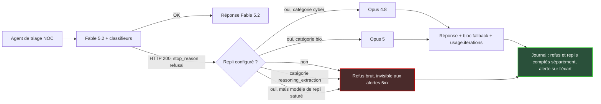
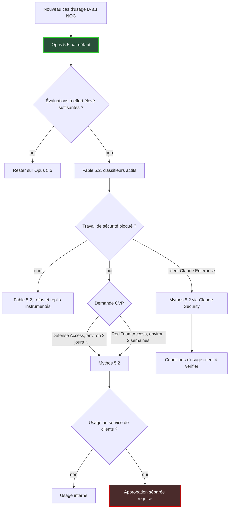

## Trois heures du matin, et une réponse venue d'ailleurs

Imaginons un ingénieur d'astreinte qui colle dans un assistant IA les journaux d'un point d'accès Wi-Fi qui redémarre en boucle. Le site : un hôtel de 400 chambres, dont les clients commencent à appeler la réception. La réponse arrive en quelques secondes, structurée, plausible. Ce qu'il ignore : elle a peut-être été rédigée par un modèle plus ancien que celui que paie son entreprise. Un filtre de sécurité a jugé que son analyse de firmware ressemblait un peu trop à la préparation d'une attaque.

Depuis le 9 novembre, ce scénario n'a plus rien de théorique. Anthropic a lancé Claude Fable 5.2 et Claude Mythos 5.2 : deux noms, un seul modèle, deux régimes d'accès. Le prix par token baisse de 20 %, et beaucoup d'équipes vont migrer sur ce seul argument.

Les premiers concernés sont ceux qui confient des tâches de sécurité à une IA. Les centres d'opérations réseau des opérateurs B2B. Les équipes sécurité de la grande distribution et de l'hôtellerie. Les DSI qui outillent leur support de niveau 2. Leur quotidien (lire des logs, auditer des configurations, trier des vulnérabilités) tombe pile dans la zone que ces filtres surveillent.

Ma thèse tient en deux phrases. Avec Fable et Mythos 5.2, un CTO n'achète plus un modèle : il achète une politique de sécurité qui décide, requête par requête, quel modèle lui répond vraiment. Ce risque, à la fois contractuel et d'observabilité, pèse bien plus lourd que la remise.

## Un seul moteur, deux badges d'accès

L'annonce tient en une phrase : « Claude Fable and Claude Mythos are the same underlying model » [1]. Mêmes poids, mêmes capacités brutes. Ce qui change, c'est l'enveloppe autour.

Fable 5.2 est ouvert à tous. Il embarque des classifieurs, c'est-à-dire des filtres automatiques qui inspectent chaque requête, calibrés sur deux domaines : la cybersécurité et la biologie. Ils bloquent les activités cyber jugées à haut risque (tests d'intrusion, génération d'exploits, recherche de vulnérabilités sur des binaires) et la plupart des tâches de recherche en biologie [1].

Mythos 5.2, lui, est réservé aux organisations vérifiées via les Life Sciences et Cyber Verification Programs d'Anthropic [1]. Côté API, deux identifiants distincts, `claude-fable-5-2` et `claude-mythos-5-2`, pour une seule et même base [2].

Pensez à un immeuble de bureaux. Tout le monde franchit la même porte et monte dans le même ascenseur. Mais c'est votre badge qui décide à quels étages la cabine s'arrête. Et même avec le badge le plus élevé, certaines portes restent verrouillées.

Cette dernière nuance compte. On a pu lire ici ou là que Mythos tournait sans classifieurs ; la documentation primaire dit l'inverse. Le programme de vérification cyber « adjusts only our cyber safeguards », et ses membres « may experience some model refusals and classifier blocks for allowed security work » [5]. Mythos n'est pas un modèle débridé. C'est le même modèle, avec des garde-fous ajustés sur un domaine précis.

La conséquence est inédite dans la courte histoire des LLM (grands modèles de langage). On a toujours comparé les modèles sur leurs scores, leur prix, leur latence. Ici, la capacité effective n'est plus une propriété du modèle. C'est une propriété de l'identité vérifiée de celui qui l'achète.

Les chiffres de performance, eux, viennent tous du vendeur et doivent être lus comme tels. Fable 5.2 atteint 49,1 % sur le benchmark de code FrontierCode 2.0 au niveau d'effort Xhigh, contre 45,5 % pour Opus 5.5 [1]. Mythos 5.2 obtient 89,6 % sur CVE Rediscovery, et Brian Grinstead, chez Mozilla, estime qu'il a « roughly doubled the vulnerability discovery metrics of Mythos 5.1 » [1][9].

Quant aux classifieurs, ils bloqueraient environ 55 % de requêtes en moins qu'avec la version 5.1 (environ 60 % de moins en cyber, 40 % en bio). Mesure interne, réalisée sur claude.ai, Claude Code et Cowork. Pas sur des charges API comme les vôtres [1][9].

## Visible, mais facile à ne pas voir

Prenez un tableau de bord de supervision entièrement vert. Zéro erreur serveur, latence nominale, aucun ticket ouvert. Pendant ce temps, une partie des requêtes de votre agent de triage est servie par un modèle plus ancien, ou purement et simplement refusée. Personne ne s'en aperçoit, parce que techniquement, rien n'a échoué.

*Dans un centre d'opérations réseau, une requête basculée vers un modèle de repli ne déclenche aucune alarme si personne n'a instrumenté le champ qui la signale.*

Voici la mécanique. Quand un classifieur bloque une requête, l'annonce est claire : « When a query is blocked, users will instead receive a response from Opus 4.8 for cybersecurity and Opus 5 for biology » [1]. Chaque refus porte une catégorie : `cyber`, `bio`, `frontier_llm`, `reasoning_extraction` ou `general_harms`. La catégorie `reasoning_extraction` n'a pas de repli recommandé : le refus reste un refus [3].

D'où vient la méfiance ambiante ? De juin dernier. Au lancement de Fable 5, une dégradation réellement silencieuse, sur le domaine dit frontier LLM, a provoqué une levée de boucliers. Anthropic s'est excusé le 11 juin en qualifiant son choix de « the wrong tradeoff », avec cette phrase : « You should have visibility into the safeguards we have in place, and why » [11]. Le repli est devenu visible depuis.

Pour la version 5.2, la documentation API ne laisse pas de place au doute : « Fallbacks are visible either way: the response names the model that served it, and the `fallback` content block marks the handoff » [3]. Côté éditeur, le sujet est traité. Le risque s'est déplacé chez l'intégrateur, et il tient en trois pièges.

**Premier piège : un refus est un succès.** Techniquement, c'est une réponse HTTP 200, donc un succès au sens du protocole. Le refus n'apparaît que dans le corps de la réponse, via le champ `stop_reason` (valeur `refusal`) et une catégorie dans `stop_details`. Vos alertes calées sur les codes 5xx, les erreurs côté serveur, restent muettes. La doc l'écrit noir sur blanc : « monitoring built on error rates or 5xx responses never sees it » [3].

**Deuxième piège : le repli n'est pas activé par défaut.** « API customers must configure the 'Fallback API' themselves », précise la page produit [6]. Le repli côté serveur est encore en bêta. Il s'active par un paramètre (`fallbacks: "default"`) et un en-tête dédié (`server-side-fallback-2026-07-01`), et seulement sur l'API Claude et sur Google Cloud en mode géré par Anthropic [3]. Sur Bedrock (AWS), Foundry (Microsoft) ou ailleurs, la logique de reprise est à écrire vous-même, dans un middleware ou côté client. Sans rien configurer, votre agent reçoit un refus brut.

**Troisième piège : le filet peut céder.** Si le modèle de repli est saturé ou bridé par ses limites de débit, « the fallback attempt is not made and the preceding refusal is returned » [3]. Votre filet de sécurité dépend donc des quotas d'un autre modèle. Celui que personne n'a pensé à dimensionner.

Les signaux existent pourtant. Un bloc `fallback` dans le contenu de la réponse. Le champ `model`, au premier niveau, qui nomme le modèle ayant réellement répondu. Une entrée `fallback_message` dans `usage.iterations` [3]. La doc recommande de suivre refus et replis comme deux métriques distinctes, avec une alerte sur l'écart. Aucun outil générique ne le fera à votre place : il faut extraire ces champs, les stocker, et décider qui se réveille quand la courbe dérive.

*Parcours d'une requête de triage bloquée : sans repli configuré, sur la catégorie `reasoning_extraction` ou quand le modèle de repli sature, l'issue est un refus que des alertes classiques ne verront jamais.*

Visible, donc. Mais seulement pour qui regarde au bon endroit.

## Le NOC, pile dans la zone grise

Pourquoi un opérateur réseau devrait-il s'en inquiéter davantage qu'un éditeur de logiciel RH ? Parce que, vu d'un classifieur, le travail quotidien d'un NOC (centre d'opérations réseau) ressemble furieusement à de la reconnaissance offensive.

Prenez une journée ordinaire. Trier des journaux d'authentification pour isoler une tentative de force brute sur un portail captif. Relire la configuration d'un pare-feu de site avant une mise à jour. Désassembler le firmware d'une caméra connectée qui émet un trafic suspect. Prioriser un lot de vulnérabilités publiées sur les points d'accès d'un constructeur. Rien d'offensif là-dedans.

Pourtant, la documentation le reconnaît elle-même : « Benign cybersecurity work can also trigger this category » [3]. Et la recherche de vulnérabilités sur des binaires figure explicitement parmi les activités bloquées par Fable [1]. Fouiller le firmware de la caméra suspecte, c'est s'en approcher dangereusement.

La porte d'entrée logique est le Cyber Verification Program (CVP), et plus précisément son niveau Defense Access. Il couvre exactement ce périmètre : opérations de sécurité, réponse à incident, analyse de malware, détection, triage de vulnérabilités. La revue est annoncée autour de deux jours [5]. Au-dessus, Red Team Access demande environ deux semaines, et Specialized Access n'affiche pas de délai cible [5].

Les conditions sont sérieuses, et c'est plutôt rassurant. Vérification d'identité, numéro d'enregistrement de l'entreprise, une seule demande par organisation, déposée par un Owner ou un Admin du compte. « Data retention is required for everyone enrolled », et « Our Usage Policy still applies in full » [5]. Une nouvelle demande reste possible après sept jours.

Puis vient la ligne qui devrait faire réagir tout prestataire de services managés. Selon la page support, l'usage externe, c'est-à-dire mettre ces capacités au service de ses propres clients, exige une approbation séparée [5]. Un opérateur qui ferait tourner un agent Mythos pour trier les incidents de ses clients hôteliers ou de ses enseignes de distribution ne relève pas du cas standard. Il doit le demander explicitement, et l'obtenir.

Ce point a une conséquence qu'on sous-estime. Si demain le statut est perdu ou suspendu, la capacité disparaît avec lui. La qualité d'un service vendu à vos clients dépend alors d'une décision administrative prise chez votre fournisseur, sur des critères que vous ne maîtrisez pas.

*Le même modèle derrière deux portes : selon votre statut de vérification, la requête passe tout droit ou part vers un autre modèle, avec un simple marqueur pour signaler le détour.*

Deux précisions pour être complet. Le Life Sciences Verification Program est mentionné dans l'annonce, mais ses critères ne sont pas documentés dans les sources publiques que j'ai pu consulter. Je ne spéculerai pas, et il est de toute façon hors sujet pour un opérateur réseau. Enfin, les clients Claude Enterprise peuvent accéder à Claude Security, qui s'appuie sur Mythos 5.2, même sans adhésion au CVP [1][9]. Pour une équipe sécurité interne, c'est peut-être la voie la plus courte. Pour un service rendu à des tiers, il faudra lire les conditions ligne à ligne.

## Moins 20 % par token : le chiffre qui ne compte pas

Le même modèle, sur le même lot de tâches, peut coûter 3 USD ou plus de 26 USD par tâche. L'écart ne tient pas au prix catalogue. Il tient à un réglage que la plupart des équipes laissent par défaut : le niveau d'effort.

Commençons quand même par le catalogue. Fable 5.2 et Mythos 5.2 sont facturés 8 USD par million de tokens en entrée et 40 USD en sortie, contre 10 et 50 USD pour la génération 5.1 [1][4]. Soit 20 % de baisse. Mais Opus 5.5 reste à 4 et 20 USD : par token, Fable 5.2 coûte deux fois plus cher que le modèle qu'Anthropic recommande lui-même comme point de départ [2][4].

Le vrai levier est ailleurs. Le raisonnement adaptatif de Fable 5.2 est toujours actif, et l'effort par défaut de l'API est `high` [4]. Or Artificial Analysis, analyste indépendant, a mesuré le coût par tâche sur son indice d'intelligence : 3,10 USD en effort Low, 9,08 USD en effort High, soit un rapport de 2,9 [7]. Le chiffre de tête de la page, 26,54 USD, n'est pas étiqueté. S'il correspond bien au niveau Max, comme c'est probable, l'écart grimpe à 8,6 [7]. Face à de tels multiplicateurs, une remise de 20 % sur le token relève de l'arrondi.

| Niveau d'effort (Fable 5.2) | Coût par tâche | Intelligence Index |
|---|---|---|
| Low | 3,10 USD | 54 |
| Medium | non publié | 56 |
| High (défaut de l'API) | 9,08 USD | 62 |
| Xhigh | non publié | 62 |
| Max (probable) | 26,54 USD | 65 |
| Opus 5.5, pour référence | non publié sur la page | 59 |

*Source : Artificial Analysis, novembre 2026 [7]. Le montant de 26,54 USD n'est pas étiqueté sur la page source ; son attribution au niveau Max est une hypothèse.*

Le détail le plus intéressant se cache dans la dernière colonne. En efforts Low et Medium, Fable 5.2 obtient 54 et 56, sous les 59 d'Opus 5.5. Pour faire mieux que le modèle deux fois moins cher au token, il faut monter au moins en High, c'est-à-dire au palier à 9 USD par tâche. Artificial Analysis ne publie pas le coût par tâche d'Opus 5.5 sur cette page : la comparaison directe reste impossible. Et le modèle testé porte la mention `Default Fallback`, ce qui signifie que ses scores incluent les replis [7].

Anthropic défend la lecture inverse. À effort High sur FrontierCode 2.0, Fable 5.2 coûterait environ moitié moins par tâche qu'Opus 5.5, pour un score quasi identique (45,3 % contre 45,5 %), et moins d'un dixième sur HLE (Humanity's Last Exam) en effort Low [8]. Finout, spécialiste FinOps (la gestion financière du cloud), fait le calcul qui s'impose. Avec un token deux fois plus cher, diviser le coût par deux suppose de consommer environ quatre fois moins de tokens, ce que rien de public ne mesure aujourd'hui [8]. En effort High, Fable 5.2 a d'ailleurs produit 85,3 millions de tokens de sortie sur l'indice d'Artificial Analysis, au-dessus de la médiane de 72,8 millions [7]. Ce n'est pas une preuve contraire. Ce n'est pas non plus le profil d'un modèle sobre.

Reste la facture cachée du repli, que personne ne met dans ses tableaux de coûts :

- Un refus survenu avant toute sortie est facturé pour les catégories `bio`, `frontier_llm` et `reasoning_extraction`, mais pas pour `cyber` ni `general_harms` [3].
- Un refus en cours de flux est facturé : l'entrée, plus la sortie déjà transmise [3].
- Le repli est facturé au tarif du modèle qui l'exécute, et le cache doit être réécrit. Un *fallback credit*, matérialisé par un jeton valable cinq minutes, compense cette réécriture [7bis].
- Un refus compte dans vos limites de débit [3].

Dernier coût, le plus insidieux : le raisonnement perdu. Seuls Fable 5.2 et Mythos 5.2 savent relire les blocs de raisonnement produits par Fable 5.2. Lors d'un repli vers Opus 4.8 ou Opus 5, ces blocs sont supprimés pour les tours concernés, non facturés mais perdus [2]. Pour un agent qui enquête sur un incident en plusieurs étapes, c'est l'équivalent d'un collègue qui reprend le dossier en pleine nuit sans les notes de son prédécesseur.

*Une remise de 20 % sur le token pèse peu face à un coût par tâche qui varie du simple au triple, voire bien au-delà, selon le niveau d'effort.*

## Huit lignes à négocier avant de signer

Si l'on achète une politique plutôt qu'un modèle, c'est la politique qu'il faut contractualiser. Voici ce que je mettrais sur la table avant tout usage de production, a fortiori au service de clients.

1. **Traçabilité du repli.** Les champs `model`, le bloc `fallback` et `usage.iterations` doivent être exposés sur toutes les plateformes utilisées, et conservés dans vos journaux. Refus et replis sont suivis comme deux métriques distinctes.
2. **Taux de refus et de repli contractuel.** Publié par catégorie, auditable, assorti d'un seuil et d'un droit de sortie. Aucun taux n'est publié pour la 5.2. Le seul chiffre qui ait circulé, moins de 5 % des sessions pour Fable 5, n'a jamais été vérifié indépendamment [13]. Ajoutez un préavis obligatoire sur toute modification des classifieurs.
3. **Disponibilité du modèle de repli.** Puisque le repli se transforme en refus quand Opus 4.8 ou Opus 5 sature, ses quotas font partie du dimensionnement. Pas d'une note de bas de page.
4. **Rétention et résidence des données.** Fable et Mythos 5.2 imposent 30 jours de rétention, sans ZDR (Zero Data Retention, aucune conservation) sauf autorisation expresse. Sur l'API, une organisation qui n'a pas activé cette rétention reçoit une erreur 400 `invalid_request_error` [2][6]. Votre DPA, l'accord de sous-traitance exigé par le RGPD, doit refléter cette durée et la localisation du traitement (l'inférence limitée aux États-Unis est facturée 1,1 fois le tarif standard) [4]. Pour des journaux Wi-Fi truffés d'identifiants de terminaux, ce n'est pas un détail. Les Enterprise Frontier Safeguards, une supervision exécutée dans l'infrastructure du client et compatible ZDR, existent en bêta privée chez Bridgewater, Salesforce et Stripe [6][9]. À suivre de près.
5. **Périmètre du statut CVP.** Qui, nommément, est membre. Quel niveau. Validation écrite de l'usage externe pour vos clients. Conséquences contractuelles d'une perte ou d'une suspension de statut, sachant qu'une nouvelle demande n'est possible qu'après sept jours.
6. **Clause de suspension réglementaire.** À la mi-juin 2026, un ordre du gouvernement américain visant l'accès des ressortissants étrangers à Fable 5 et Mythos 5 a conduit Anthropic à désactiver ces modèles globalement, plutôt que de filtrer par nationalité [12][13]. Exigez un préavis, des crédits et une bascule garantie vers un modèle équivalent.
7. **Facturation lisible.** Refus facturés selon la catégorie, repli au tarif du modèle exécutant, crédit de cache : tout doit apparaître ligne à ligne. Et le prix de référence, c'est le coût par tâche mesuré sur vos propres évaluations, pas le catalogue.
8. **Réversibilité.** Opus 5.5 reste votre modèle par défaut, vos agents restent portables, et vous intégrez le fait qu'un raisonnement Fable ne se transfère pas vers un autre modèle. Anthropic annonce un retrait de Fable 5.2 « not sooner than November 9, 2027 » [4] : c'est un plancher, pas une promesse de durée.

## Opus 5.5 par défaut, Fable sur preuve

Ma position est nette : ne migrez pas vers Fable 5.2 pour la remise. Anthropic lui-même recommande de commencer par Opus 5.5, qu'il présente comme « our strongest daily driver », et de ne monter vers Fable ou Mythos que si vos évaluations à effort élevé échouent [2][10]. Pour une fois, le conseil du vendeur et l'intérêt de l'acheteur coïncident.

Pour un centre d'opérations réseau, j'ajouterais un ordre de marche. D'abord, instrumenter : refus et replis tracés, mesurés, alertés, avant même le premier appel en production. Ensuite, mesurer le coût par tâche sur vos incidents réels, à plusieurs niveaux d'effort. Puis, seulement si le travail de sécurité bloque, déposer une demande CVP Defense Access. Et ne rien vendre à un client avant d'avoir obtenu l'approbation pour usage externe.

*L'arbre d'accès : Opus 5.5 comme point de départ, Mythos 5.2 comme exception justifiée, et une approbation dédiée dès qu'un client entre dans la boucle.*

Plus largement, Fable et Mythos 5.2 inaugurent un marché où les grilles comparatives auront une colonne de plus. À côté du prix et de la qualité, il faudra renseigner l'identité vérifiée de l'acheteur. La politique de sécurité du fournisseur fait désormais partie du produit, et elle peut évoluer sous vos pieds. Juin l'a montré deux fois : une dégradation non annoncée, puis une coupure réglementaire.

Le CTO qui traite ce sujet comme un problème d'achats et d'observabilité dormira tranquille. Celui qui le traite comme une grille tarifaire découvrira l'écart à trois heures du matin, devant un tableau de bord tout vert.

---

_Vues personnelles, pas position Wifirst._

## Sources

- **[1]** [Anthropic — Introducing Claude Fable 5.2 and Claude Mythos 5.2](https://www.anthropic.com/news/claude-fable-and-mythos-5-2) — annonce officielle, 9 novembre 2026
- **[2]** [Anthropic docs — What's new in Claude Fable 5.2](https://platform.claude.com/docs/en/models/fable-5-2/whats-new-fable-5-2) — documentation (prix, rétention, blocs de raisonnement, disponibilité)
- **[3]** [Anthropic docs — Refusals and fallback](https://platform.claude.com/docs/en/build-with-claude/refusals-and-fallback) — documentation (mécanique du repli, facturation, pièges)
- **[4]** [Anthropic docs — Models overview](https://platform.claude.com/docs/en/models/overview) et [Pricing](https://platform.claude.com/docs/en/about-claude/pricing) — documentation, novembre 2026
- **[5]** [Anthropic Support — Cyber Verification Program](https://support.claude.com/en/articles/14604842) — critères du CVP
- **[6]** [Anthropic — page produit Claude Fable](https://www.anthropic.com/claude/fable) — rétention 30 jours, Enterprise Frontier Safeguards, Fallback API
- **[7]** [Artificial Analysis — Claude Fable 5.2](https://artificialanalysis.ai/models/releases/claude-fable-5-2) et [Claude Fable 5.2 High](https://artificialanalysis.ai/models/claude-fable-5-2-high) — analyste indépendant, novembre 2026
- **[7bis]** [Anthropic docs — Fallback credit](https://platform.claude.com/docs/en/build-with-claude/fallback-credit) — facturation du repli
- **[8]** [Finout — Fable 5.2 and Mythos 5.2: Pricing, Access, and Cost per Task](https://www.finout.io/blog/claude-fable-5.2-and-claude-mythos-5.2) — analyse FinOps, novembre 2026
- **[9]** [Help Net Security — Anthropic Claude Fable and Mythos 5.2 safeguards](https://www.helpnetsecurity.com/2026/11/10/anthropic-claude-fable-and-mythos-5-2-safeguards/) — 10 novembre 2026
- **[10]** [SD Times](https://sdtimes.com/ai/anthropic-introduces-claude-fable-5-2-mythos-5-2/) ; [9to5mac](https://9to5mac.com/2026/11/09/anthropic-upgrades-claude-with-new-fable-5-2-model-details-here/) ; [Constellation Research](https://www.constellationr.com/insights/news/anthropic-releases-mythos-52-fable-52) ; [TestingCatalog](https://www.testingcatalog.com/anthropic-launches-claude-fable-5-2-and-mythos-5-2.md) — couverture presse, 9 novembre 2026
- **[11]** [Decrypt — Anthropic apologizes for Claude Fable 5 secret censorship](https://decrypt.co/370831/anthropic-apologizes-claude-fable-5-secret-censorship) — 11 juin 2026
- **[12]** [Malwarebytes — Claude Fable 5 and Mythos 5 abruptly disabled](https://www.malwarebytes.com/blog/ai/2026/06/claude-fable-5-and-mythos-5-abruptly-disabled-after-us-gov-deems-them-too-clever) — 15 juin 2026
- **[13]** [SoftwareSeni — Anthropic's Two-Tier AI Strategy and the Governance Questions That Follow](https://www.softwareseni.com/anthropics-two-tier-ai-strategy-and-the-governance-questions-that-follow) — analyse gouvernance, 18 juin 2026
