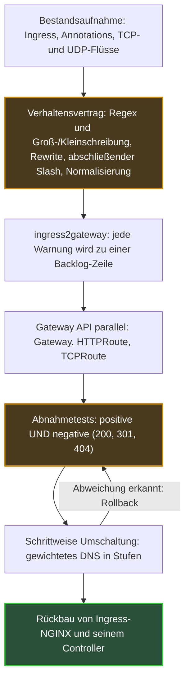

## Der Hausmeister ist gegangen, ohne seine Anweisungen zu hinterlassen

Wenn der Hausmeister eines Mietshauses in Rente geht, merkt man, was er alles getan hat, ohne dass es ihm je jemand aufgetragen hätte. Der Brief an „Dupont“, den er bei „Dupond“ einwarf. Das Paket, das im falschen Treppenhaus lag und das er mit einer beiläufigen Geste weiterreichte. Nichts davon stand irgendwo geschrieben. Alles funktionierte.

Auf den Tag genau vor einem Jahr, am 11. November 2025, kündigten die Verantwortlichen des Kubernetes-Projekts die Einstellung eines der verbreitetsten Hausmeister der Cloud an: Ingress-NGINX. Diese Software nimmt den Webverkehr am Eingang eines Clusters entgegen und leitet ihn an die richtige Anwendung weiter. Ihr Code-Repository ist seit dem 24. März 2026 schreibgeschützt. Bestehende Installationen laufen weiter. Sicherheitskorrekturen wird es keine mehr geben.

Betroffen sind alle Teams, die Dienste aus Kubernetes heraus bereitstellen, von Kundenportalen bis zu internen APIs. Plattformen, die mehrere Kunden auf derselben Infrastruktur betreiben, trifft es härter: Ein Routing-Fehler stört dort nicht nur ein Team, sondern einen Kunden.

Diese Woche findet die KubeCon North America in Salt Lake City statt, mit einer Session zur Zukunft von Gateway API, dem Standard, der Ingress ablöst. Siebeneinhalb Monate nach der Archivierung ist die Dringlichkeit verflogen. Die eigentliche Arbeit beginnt. Und das Schwierigste ist nicht, zu übersetzen, was aufgeschrieben war. Es ist, aufzuschreiben, was es nie war.

## Was die Archivierung sagt – und was nicht

Im August habe ich erzählt, [warum es zu diesem Ausstieg kam und wie die Landschaft der Nachfolger aussieht](https://wifirst-tech-blog.web.app/post?slug=apres-ingress-nginx-cilium-1-20-gateway-api), Cilium 1.20 inklusive. Darauf komme ich nicht zurück. Dieser Text handelt vom Danach: wie man migriert, ohne etwas zu zerbrechen. Und zuerst davon, die genauen Formulierungen noch einmal zu lesen, über die viele Pläne hinweggehen.

Der [Ankündigungsbeitrag](https://kubernetes.io/blog/2025/11/11/ingress-nginx-retirement/) lässt keinen Spielraum: „Best-effort maintenance will continue until March 2026. Afterward, there will be no further releases, no bugfixes, and no updates to resolve any security vulnerabilities that may be discovered.“ Keine neue Version, keine Korrektur, kein Sicherheitspatch. Die Images und die Helm-Charts (die Installationspakete) bleiben dennoch herunterladbar, und Ihre Deployments stoppen nicht von selbst. Genau darin liegt die Falle. Am Stichtag geht nichts kaputt, also zwingt nichts zur Entscheidung.

Drei Klarstellungen vermeiden verbreitete Missverständnisse:

- **Die Ingress-API wird nicht entfernt.** Sie ist eingefroren: keine neuen Funktionen, aber sie bleibt in Kubernetes.
- **Der „NGINX Ingress Controller“ von F5 ist ein anderes Produkt.** Der Kubernetes-Blog spricht ausdrücklich von zwei getrennten Controllern; archiviert ist nur das Community-Projekt.
- **Es gibt keinen Ersatz zum direkten Austausch.** Die [Erklärung des Lenkungsausschusses](https://kubernetes.io/blog/2026/01/29/ingress-nginx-statement/) vom 29. Januar 2026 schreibt es schwarz auf weiß: „None of the available alternatives are direct drop-in replacements.“

Derselbe Text warnt, dass der Verbleib bei Ingress-NGINX „leaves you and your users vulnerable to attack“. Deutlicher geht es nicht.

Ob Sie betroffen sind, klärt ein einziger Befehl, mit Administratorrechten auf dem Cluster:

```bash
kubectl get pods --all-namespaces --selector app.kubernetes.io/name=ingress-nginx
```

Liefert er etwas zurück, sieht das Vorhaben von Anfang bis Ende so aus.


*Die Umschaltsequenz. Die beiden hervorgehobenen Schritte, der Vertrag und die Tests, unterschätzen die meisten Migrationspläne.*

## Fünf Regeln, die nie jemand aufgeschrieben hatte

Zurück zu unserem Hausmeister. Gateway API gleicht eher einem automatischen Sortierzentrum: schnell, berechenbar, prüfbar. Es liefert genau das aus, was auf dem Umschlag steht, nicht mehr und nicht weniger. Jeder Brief, der nur dank des Wohlwollens des alten Hausmeisters ankam, kommt nun mit dem Vermerk „Empfänger unbekannt“ zurück. Im Web hat dieser Vermerk einen Namen: Fehler 404.

Am 27. Februar 2026 hat Steven Jin (Microsoft) im offiziellen Kubernetes-Blog [das Inventar dieser Gefälligkeiten](https://kubernetes.io/blog/2026/02/27/ingress-nginx-before-you-migrate/) erstellt. Ein Satz fasst seinen Beitrag zusammen: „a seemingly correct translation can still cause outages if it does not consider Ingress-NGINX's quirks.“ Anders gesagt: Eine Zeile für Zeile getreue Übersetzung kann einen Ausfall verursachen. Das sind die fünf betroffenen Verhaltensweisen.

| Was Ingress-NGINX stillschweigend tat | Was eine Gateway-API-Implementierung tut | Was Sie aufschreiben müssen |
|---|---|---|
| Reguläre Ausdrücke (Regex) werden als Präfix angewendet, ohne Beachtung der Groß-/Kleinschreibung | Vollständiger Abgleich, abhängig von Groß-/Kleinschreibung (Envoy-basierte Implementierungen: Istio, Envoy Gateway, kgateway) | Explizites Präfix `(?i)` und Suffix `.*`, zum Beispiel `(?i)/Header.*` |
| `use-regex: "true"` gilt für alle Pfade des Hosts, über alle Ingress hinweg | Jede Regel gilt nur für sich selbst | Pfade aufspüren, die nur durch „Ansteckung“ funktionierten |
| `rewrite-target` aktiviert die Regex für den ganzen Host, stillschweigend | Nichts Implizites | Dasselbe Inventar wie in der Zeile darüber |
| Automatische 301-Weiterleitung von `/docs` auf `/docs/` | Keine implizite Weiterleitung: 404 | Expliziter `RequestRedirect`-Filter |
| Normalisierung der URLs (RFC 3986 §6.2: Segmente `.` und `..`, doppelte Slashes) vor dem Routing | Vom Standard nicht festgelegt | Entscheiden, dokumentieren, testen |

Die zweite und die dritte Zeile sind die heimtückischsten, weil ihre Wirkung nicht lokal bleibt. Eine Annotation auf einem einzigen Ingress ändert die Interpretation aller Pfade desselben Hostnamens, auch derjenigen, die ein anderes Team in einer anderen Datei deklariert hat. Die Folge: Ein als `Exact` deklarierter Pfad mit Tippfehler kann jahrelang funktionieren, nur weil ein Nachbar die Regex aktiviert hat. Niemand weiß davon. Am Tag der Migration fällt er aus.

Auf einer gemeinsam genutzten Plattform ist das das Szenario, das mir am meisten Sorge bereitet (*Einschätzung des Autors, keine belegte Feststellung*). Die Migration legt dort nicht nur technische Schulden offen. Sie legt eine Kopplung zwischen Teams offen, die niemand je kartiert hatte.

Der abschließende Slash verdient eine eigene Warnung. Links, Lesezeichen und gedruckte QR-Codes, die auf `/docs` ohne Slash zeigen, enden in einer 404, es sei denn, jemand hat daran gedacht, die Weiterleitung zu schreiben.


*Der alte Controller korrigierte Adressen stillschweigend. Eine getreue Übersetzung der Manifeste bringt die Sackgassen wieder zum Vorschein.*

## ingress2gateway 1.0: ein Übersetzer, kein Notar

Der naheliegende Reflex ist, nach dem Werkzeug zu suchen, das die Umwandlung erledigt. Es existiert, und es ist ernstzunehmend. [ingress2gateway](https://kubernetes.io/blog/2026/03/20/ingress2gateway-1-0-release), das offizielle Tool des Projekts, ist am 20. März 2026 in Version 1.0 erschienen. Es übersetzt nun mehr als 30 Ingress-NGINX-Annotations, zuvor waren es 3. Vor allem haben die Autoren es mit Integrationstests auf echten Clustern validiert und dabei das Verhalten von Ingress-NGINX mit dem mehrerer Gateway-API-Controller verglichen.

Dieselben Autoren, Beka Modebadze (Google) und Steven Jin (Microsoft), weigern sich dennoch, es als Zauberstab zu präsentieren: „Migration is not a 'one-click' affair.“ Das Tool versteht sich als „a migration assistant, not a one-shot replacement“. Das offizielle Beispiel des Beitrags zeigt, warum:

- `configuration-snippet`, womit sich rohe NGINX-Konfiguration einschleusen ließ, wird nicht übersetzt und löst eine Warnung aus;
- `proxy-body-size`, das die Größe von Anfragen begrenzt, hat im Standard keine Entsprechung;
- die verschiedenen Timeouts werden bestenfalls auf ein einziges `timeouts.request` reduziert;
- eine Regex wie `(?i)/users/(\d+).*` wird zwar erzeugt, muss aber noch gehärtet werden;
- das Tool fügt einen Listener auf Port 80 mit einer 308-Weiterleitung auf HTTPS hinzu. Eine vernünftige Entscheidung, aber eine Entscheidung.

Meine Lesart: Die WARN- und INFO-Meldungen des Tools sind kein Rauschen, das man herausfiltert. Sie sind Ihr Migrations-Backlog, bereits ausformuliert. Jede Warnung entspricht einer Architekturentscheidung, die der alte Controller an Ihrer Stelle getroffen hat, oft ohne dass Sie es wussten.

Ein letzter, subtilerer Punkt. Zum Zeitpunkt, an dem ich schreibe, listet die [Projektseite](https://github.com/kubernetes-sigs/ingress2gateway) neun lesbare Quellen und sechs Ausgabeformate auf. Das Standardformat erzeugt reines Gateway API; die anderen (Envoy Gateway, kgateway, agentgateway …) ergänzen controllerspezifische Erweiterungen. Praktisch, aber nicht portabel. Prüfen Sie das erzeugte YAML bei jeder neuen Version des Tools erneut.

## Den Vertrag aufschreiben, den der alte Controller stillschweigend durchsetzte

Google, ein Anbieter, dessen Ingenieure zum Projekt beitragen, [stellt Gateway API](https://opensource.googleblog.com/2026/02/the-end-of-an-era-transitioning-away-from-ingress-nginx.html) als „Ingress 2.0“ vor. Das Etikett ist bequem, verdeckt aber das Wesentliche. Der eigentliche Bruch ist nicht funktional, sondern organisatorisch. Gateway API teilt die Verantwortung für eingehenden Verkehr auf drei Rollen auf, wo Ingress alles in dasselbe Objekt packte:

- der **Infrastrukturanbieter** deklariert eine GatewayClass, also den verfügbaren Controller-Typ;
- der **Cluster-Betreiber** deployt ein Gateway: Einstiegspunkte, Ports, Zertifikate;
- der **Anwendungsentwickler** schreibt seine Routen (HTTPRoute) und hängt sie am Gateway ein.

Das Gateway entscheidet, wer sich anhängen darf. Das ListenerSet, mit Version 1.5 von Gateway API vom 27. Februar 2026 in Standard übergegangen, führt diese Logik weiter, indem es Listener an Teams delegiert; die Mechanik habe ich im Augustartikel beschrieben.

Das Element, das ich für das wichtigste halte, ist unauffälliger: das ReferenceGrant, in derselben Version auf v1 gehoben. Es ist eine ausdrückliche Einwilligung. Eine Route in einem Namespace (dem logischen Abteil eines Clusters) darf nur dann auf einen Service in einem anderen Namespace zeigen, wenn dieser es ihr erlaubt. Ohne diese Erlaubnis bleibt die Route blockiert, mit dem Status `ResolvedRefs: False`. Der [Migrationsleitfaden von Datadog](https://www.datadoghq.com/blog/migrate-to-gateway-api.md), eine Anbieterquelle, zählt diesen Fall zu den häufigsten Fallstricken. Ingress konnte nicht ausdrücken, wer worauf zeigen darf. Gateway API zwingt dazu, es aufzuschreiben.


*Drei Rollen, drei Schlüsselbunde: Infrastruktur, Cluster und Anwendung, verbunden durch ausdrückliche Freigaben zwischen Namespaces.*

Zweiter unterschätzter Fortschritt: Verkehr, der kein Web ist. Ingress-NGINX behandelte TCP und UDP über einen Seitenmechanismus, zwei ConfigMaps (Kubernetes-Konfigurationsdateien) namens `tcp-services` und `udp-services`, deren Verarbeitung sich von Controller zu Controller unterscheidet. Mit [Gateway API v1.6](https://kubernetes.io/blog/2026/08/03/gateway-api-v1-6-release/), veröffentlicht am 30. Juni 2026, werden TCPRoute und UDPRoute zu Standard. Die anvisierten Einsatzfelder umfassen Datenbanken, DNS, VoIP, Online-Gaming und IoT-Telemetrie. *Einschätzung des Autors*: Für einen Netzbetreiber ist das der konkreteste Fortschritt des Jahres, weil diese Datenflüsse endlich ein portables Pendant finden.

Eine Falle am Rande: Wer die Standard-Definitionen aus v1.5 über experimentelle TLSRoutes (v1alpha2 oder v1alpha3) installiert, macht Letztere unbrauchbar. Migrieren Sie diese zuerst auf v1.

Bleibt alles, was der Standard nicht abdeckt. Hier entscheidet sich die Portabilität. Ich sortiere jede Funktion in drei Spalten:

1. **Im Standard**: Weiterleitungen, Rewrites, CORS-Filter (die Kontrolle von domänenübergreifenden Aufrufen, Standard seit v1.5), Verschlüsselung zu den Backends über BackendTLSPolicy.
2. **Controller-Erweiterung**: Rate Limiting, maximale Anfragegröße, externe Autorisierung je nach Implementierung. Diese Funktionen laufen über Ressourcen, die jedem Anbieter eigen sind (die CRDs, Custom Resource Definitions), und sind nicht portabel.
3. **Neu zu entwerfen**: alles, was in einem NGINX-Konfigurations-Snippet lebte.

Jede Zeile der zweiten Spalte kommt in das im August erwähnte Register der Ausnahmen, mit einem Verantwortlichen und einem Prüfdatum. Dieses Register, die Routen pro Rolle und die Testsuite bilden zusammen den Vertrag. Nicht weniger.

## Die Umschaltung: ein Mischhahn, kein Schalter

Eine Dusche dreht man nicht mit einem Ruck von kalt auf heiß. Man dreht den Mischer Stufe für Stufe, prüft die Temperatur und bleibt bereit, zurückzudrehen. Die Umschaltung auf Gateway API steuert man genauso. Der Beitrag zu ingress2gateway und der Leitfaden von Datadog (sieben Schritte, keine gemessene Zahl) stimmen in der Methode überein. Ich ergänze eine Rangfolge.

**Zuerst die Referenz.** Messen Sie, bevor Sie irgendetwas anfassen, das aktuelle Verhalten: Latenzen, Rückgabecodes, Volumen pro Host. Ohne Baseline lässt sich nicht sagen, ob die neue Kette besser, gleich oder schlechter ist.

**Dann der Vertrag in Form von Tests.** Schreiben Sie für jeden Host die URLs auf, die mit 200 antworten müssen, die, die mit 301 oder 308 weiterleiten müssen, und die, die mit 404 antworten müssen. Negative Tests zählen so viel wie positive. Führen Sie sie zuerst gegen Ingress-NGINX aus: Wenn sie auf dem alten Controller bestehen, beschreiben sie die Realität. Dann werden sie zur Spezifikation des neuen.

**Danach der Parallelbetrieb.** Der Gateway-API-Controller wird neben dem Bestehenden deployt, nie an dessen Stelle. Prüfen Sie, dass jede Route die Bedingungen `Accepted` und `ResolvedRefs` auf wahr anzeigt. Spielen Sie anschließend die Testsuite erneut ab, ergänzt durch synthetischen Verkehr oder Traffic Mirroring, also eine Kopie des realen Verkehrs, die ohne Auswirkung auf Kunden mitgeschickt wird.

**Schließlich die schrittweise Umschaltung.** Gewichtetes DNS, Load Balancer oder Traffic Splitting: Man verschiebt einen kleinen Anteil, beobachtet, erhöht. Verkürzen Sie die DNS-Cache-Dauer (die TTL) lange vorher, sonst bleibt Ihr Rollback in den Caches gefangen. Der Rückbau des Ingress und des alten Controllers kommt zuletzt, wenn die Kennzahlen wieder auf ihrer Baseline liegen.


*Den Verkehr stufenweise von einer Spur auf die andere schalten, mit einem Rollback, das stets in Reichweite bleibt.*

Zwei Ergänzungen. Mit einem Service Mesh empfiehlt Buoyant, Hersteller von Linkerd, auf den Kubernetes-Service zu zielen statt auf die Pods, da der Controller sonst das Load Balancing des Mesh umgeht. Und die Rollentrennung verlangt, die Zugriffsrechte (RBAC, die rollenbasierte Zugriffskontrolle) zwischen Infrastruktur, Betrieb und Entwicklung zu überprüfen. Meiner Meinung nach ist das der politischste Teil des Vorhabens.

## Gardener, oder das Recht, nicht sofort zu landen

All das setzt voraus, dass Gateway API das richtige Ziel ist. Am Stichtag stimmt das nicht immer. Das ehrlichste Gegenbeispiel kommt vom Open-Source-Projekt Gardener, das Flotten von Kubernetes-Clustern verwaltet.

Am 29. April 2026 [beschrieb](https://gardener.cloud/blog/2026/04/04-29-ingress-nginx-retirement-how-gardener-migrated-to-istio/) Johannes Scheerer dort eine Migration auf die nativen Istio-APIs statt auf Gateway API. Hauptgrund: Der Standard bot noch keine externe Autorisierung, also die Möglichkeit, die Zugriffsentscheidung an einen Drittdienst zu delegieren. Ingress-NGINX bleibt sogar für bestimmte Erweiterungen deployt, per Konfiguration abschaltbar. Verfolgt wird das öffentlich, im GitHub-Issue #13448.

Die Grauzone ist nicht verschwunden. Cilium 1.20 liefert zwar seit Ende Juli eine ExternalAuth-Funktion, doch sie beruht auf einem Erweiterungsvorschlag für den Standard (GEP-1494), der upstream noch experimentell ist. Portable externe Autorisierung bleibt ein Versprechen, keine Errungenschaft.

Meine Position: Gateway API als Zielvertrag, mit ausdrücklichen und datierten Ausnahmen. Gardener hat nicht unrecht. Das Projekt hat dokumentiert, warum es vom Standard abweicht und wo es das Thema verfolgt. Genau das ist die richtige Praxis. Das eigentliche Risiko ist nicht, eine proprietäre API zu wählen. Es ist, Annotation für Annotation dorthin abzurutschen, ohne je aufzuschreiben, warum.

Dieselbe Überlegung gilt für das, was kommt. Die Inference Extension, eine Ausprägung von Gateway API für KI-Inferenzverkehr, übernimmt dieses Modell: Ihre Ressource [InferencePool](https://gateway-api-inference-extension.sigs.k8s.io/api-types/inferencepool/) ist seit v1.0.0 der Extension stabil, die unabhängig von Gateway API versioniert wird. Istio [kündigte](https://www.cncf.io/announcements/2026/03/25/istio-brings-future-ready-service-mesh-to-the-ai-era-with-new-ambient-multicluster-gateway-api-inference-extension-and-more/) dafür schon im März, auf der KubeCon Europe, Beta-Unterstützung an; Ende Oktober habe ich [im Zusammenhang mit llm-d](https://wifirst-tech-blog.web.app/post?slug=llm-d-1-0-5-a-10x-moins-cher-a-prouver-sur-vos-traces) darüber geschrieben.

In Salt Lake City meldet die Presse im Programm einen der Inferenz gewidmeten Tag mit Sessions zu dieser Extension, und Nir Rozenbaum (NVIDIA) gibt an, dort die Arbeiten der AI-Gateway-Arbeitsgruppe vorzustellen. Die Update-Session zu Gateway API, gehalten vom Maintainer Norwin Schnyder, verspricht in ihrer Zusammenfassung Roadmap und Neuigkeiten. Zum Zeitpunkt, an dem ich schreibe, sind weder Folien noch ein Bericht öffentlich: Mehr sage ich dazu nicht.

*Einschätzung des Autors*: Heute auf Gateway API zu migrieren heißt auch, das Vokabular zu übernehmen, in dem der KI-Verkehr morgen geroutet wird. Auf eine proprietäre API zu migrieren heißt, sich der Gefahr auszusetzen, zweimal migrieren zu müssen.

## Was Sie vom nächsten Controller verlangen sollten

Ein Vorhaben misst sich auch daran, was man von den Anbietern fordert. Hier meine Liste, ohne Präferenz zwischen Implementierungen.

1. **Ein Konformitätsbericht pro Version von Gateway API.** Die veröffentlichten Listen sind Momentaufnahmen. Bei Erscheinen von v1.6 standen sechs Implementierungen mit vollständiger Konformität darin: Agentgateway, Airlock Microgateway, GKE Gateway, kgateway, NGINX Gateway Fabric und Traefik Proxy. Das Fehlen von Istio, Envoy Gateway oder Cilium bedeutete lediglich, dass zu diesem Zeitpunkt kein Bericht eingereicht worden war. Fordern Sie den Bericht an, schließen Sie nichts daraus.
2. **Ein ingress2gateway-Emitter**, oder zumindest eine werkzeuggestützte, getestete und wiederholbare Übersetzung.
3. **Eine öffentliche Liste der Policies**, eingeteilt in Standard und Erweiterung, um das Register der Ausnahmen zu füttern.
4. **TCPRoute und UDPRoute in v1**, wenn Ihre Datenflüsse nicht auf das Web beschränkt sind.
5. **Auf Ihrer Seite eine Suite von Abnahmetests**, versioniert zusammen mit den Routen und bei jeder Änderung neu abgespielt. Kein Anbieter wird sie für Sie liefern.

Ein Wort zum Edge, also zu den kleinen Clustern, die möglichst nah an den Standorten installiert sind, ausdrücklich als *Einschätzung des Autors, ohne öffentliche Quelle* gekennzeichnet. Die einzige gesicherte Tatsache: Gateway API verlangt nur Kubernetes 1.30 oder neuer und lässt sich ohne Update des Clusters installieren. Bei Edge-Clustern, die über viele Standorte verteilt sind, ist meine Hypothese, dass es weniger auf die Wahl des Controllers ankommt als auf die Reproduzierbarkeit des Vertrags: dasselbe Testset, überall bei jedem Deployment erneut abgespielt. Das ist eine Überzeugung, kein Erfahrungsbericht.

Ingress-NGINX erweist uns einen letzten Dienst. Es zwingt uns, aufzuschreiben, was unsere Plattformen wirklich tun. Die Teams, die die Migration als Übersetzung behandeln, entdecken ihre impliziten Regeln in Produktion, eine 404 nach der anderen. Die anderen kommen mit etwas heraus, das sie nie hatten: der Spezifikation ihrer eigenen Eingangstür.

_Persönliche Ansichten, keine Position von Wifirst._

## Quellen

1. Kubernetes Blog — Ingress NGINX Retirement: What You Need to Know (2025-11-11) — https://kubernetes.io/blog/2025/11/11/ingress-nginx-retirement/
2. Kubernetes Blog — Ingress NGINX: Statement from the Steering and SRC (2026-01-29) — https://kubernetes.io/blog/2026/01/29/ingress-nginx-statement/
3. GitHub — kubernetes/ingress-nginx (Repository archiviert am 2026-03-24) — https://github.com/kubernetes/ingress-nginx
4. Kubernetes Blog — Before You Migrate: Five Surprising Ingress-NGINX Behaviors (2026-02-27) — https://kubernetes.io/blog/2026/02/27/ingress-nginx-before-you-migrate/
5. Kubernetes Blog — Announcing Ingress2Gateway 1.0 (2026-03-20) — https://kubernetes.io/blog/2026/03/20/ingress2gateway-1-0-release
6. Kubernetes Blog — Gateway API v1.5: Moving features to Stable (release du 2026-02-27) — https://kubernetes.io/blog/2026/04/21/gateway-api-v1-5/
7. Kubernetes Blog — Gateway API v1.6: TCPRoute and UDPRoute Graduate to Standard (release du 2026-06-30) — https://kubernetes.io/blog/2026/08/03/gateway-api-v1-6-release/
8. Isovalent (Anbieter) — Cilium 1.20 (2026-07-30) — https://isovalent.com/blog/post/cilium-1-20/
9. Google Open Source Blog (Anbieter) — The End of an Era: Transitioning Away from Ingress NGINX (2026-02-12) — https://opensource.googleblog.com/2026/02/the-end-of-an-era-transitioning-away-from-ingress-nginx.html
10. Datadog (Anbieter) — Ingress NGINX is EOL: practical guide to Gateway API (2026-04-08) — https://www.datadoghq.com/blog/migrate-to-gateway-api.md
11. Gardener — Ingress-NGINX retirement: how Gardener migrated to Istio (2026-04-29) — https://gardener.cloud/blog/2026/04/04-29-ingress-nginx-retirement-how-gardener-migrated-to-istio/
12. CNCF — Istio brings future-ready service mesh to the AI era (2026-03-25, KubeCon EU) — https://www.cncf.io/announcements/2026/03/25/istio-brings-future-ready-service-mesh-to-the-ai-era-with-new-ambient-multicluster-gateway-api-inference-extension-and-more/
13. GitHub — kubernetes-sigs/ingress2gateway — https://github.com/kubernetes-sigs/ingress2gateway
14. Gateway API Inference Extension — InferencePool — https://gateway-api-inference-extension.sigs.k8s.io/api-types/inferencepool/
15. Sessionize — Gateway API Project Update (N. Schnyder) — https://sessionize.com/s/snorwin/gateway-api-project-update-building-the-future-of-/182904 ; New Traffic, New Rules (N. Rozenbaum) — https://sessionize.com/s/nir-rozenbaum/new-traffic-new-rules-standardizing-ai-aware-netwo/183266
16. TechTimes — CNCF's KubeCon NA 2026 Opens in Salt Lake City (2026-11-09) — https://www.techtimes.com/articles/330289/20261109/cncfs-kubecon-north-america-2026-opens-salt-lake-city-why-kubernetes-cannot-tell-which-ai-agent.htm
17. Buoyant (Anbieter) — Community ingress-nginx retired: how to plan your migration (2026-07-27) — https://buoyant.io/blog/community-ingress-nginx-retired-how-to-plan-your-migration
