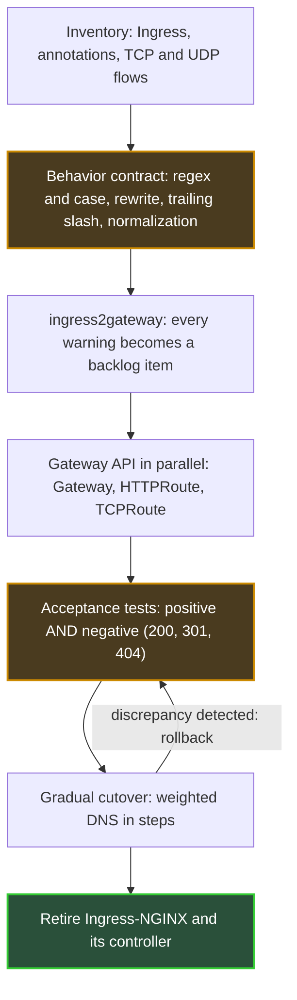

## The Concierge Left Without Leaving Instructions

When the concierge of an apartment building retires, you discover everything he did that nobody ever asked him to do. The letter addressed to "Smith" that he slipped into "Smyth's" mailbox. The parcel left at the wrong staircase that he quietly carried over. Nothing was written down. Everything worked.

One year ago to the day, on November 11, 2025, the Kubernetes project maintainers announced the retirement of one of the most widespread concierges in the cloud: Ingress-NGINX. This software receives web traffic at the entrance of a cluster and routes it to the right application. Its code repository has been read-only since March 24, 2026. Existing installations still run. No security fix will ever come again.

Every team that exposes services from Kubernetes is affected, from customer portals to internal APIs. Platforms that host several customers on the same infrastructure are affected even more: a routing error there doesn't just inconvenience one team, it hits a customer.

This week, KubeCon North America is taking place in Salt Lake City, with a session on the future of Gateway API, the standard that succeeds Ingress. Seven and a half months after the archival, the urgency has passed. The real work begins. And the hardest part isn't translating what was written. It's writing down what wasn't.

## What the Archival Says, and What It Doesn't

In August I told the story of [why this retirement happened and what the landscape of replacements looks like](https://wifirst-tech-blog.web.app/post?slug=apres-ingress-nginx-cilium-1-20-gateway-api), Cilium 1.20 included. I won't go back over it. This piece is about what comes next: how to migrate without breaking things. And first, how to reread the exact terms, which many plans skim over.

The [announcement post](https://kubernetes.io/blog/2025/11/11/ingress-nginx-retirement/) leaves no wiggle room: "Best-effort maintenance will continue until March 2026. Afterward, there will be no further releases, no bugfixes, and no updates to resolve any security vulnerabilities that may be discovered." No new version, no fix, no security patch. Yet the images and Helm charts (the installation packages) remain downloadable, and your deployments won't stop on their own. That's the whole trap. Nothing breaks on D-day, so nothing forces the decision.

Three clarifications prevent common misreadings:

- **The Ingress API is not being removed.** It is frozen: no new features, but it stays in Kubernetes.
- **F5's "NGINX Ingress Controller" is a different product.** The Kubernetes blog does talk about two distinct controllers; only the community project is archived.
- **There is no turnkey replacement.** The [Steering Committee statement](https://kubernetes.io/blog/2026/01/29/ingress-nginx-statement/) of January 29, 2026 spells it out in black and white: "None of the available alternatives are direct drop-in replacements."

The same text warns that staying on Ingress-NGINX "leaves you and your users vulnerable to attack". It doesn't get any clearer than that.

To find out whether you're affected, one command is enough, with admin rights on the cluster:

```bash
kubectl get pods --all-namespaces --selector app.kubernetes.io/name=ingress-nginx
```

If it returns anything, here is the project from end to end.


*The cutover sequence. The two highlighted steps, the contract and the tests, are the ones most migration plans underestimate.*

## Five Rules Nobody Ever Wrote Down

Back to our concierge. Gateway API is more like an automated sorting center: fast, predictable, auditable. It delivers exactly what is written on the envelope, no more, no less. Any letter that only reached its destination thanks to the old concierge's goodwill now comes back stamped "addressee unknown". On the web, that stamp has a name: a 404 error.

On February 27, 2026, Steven Jin (Microsoft) published [the inventory of those acts of goodwill](https://kubernetes.io/blog/2026/02/27/ingress-nginx-before-you-migrate/) on the official Kubernetes blog. One sentence sums up his post: "a seemingly correct translation can still cause outages if it does not consider Ingress-NGINX's quirks." In other words, a faithful line-by-line translation can cause an outage. Here are the five behaviors at fault.

| What Ingress-NGINX did without saying so | What a Gateway API implementation does | What you need to write |
|---|---|---|
| Regular expressions (regex) applied as prefixes, case-insensitive | Full-match, case-sensitive matching (Envoy-based implementations: Istio, Envoy Gateway, kgateway) | Explicit `(?i)` prefix and `.*` suffix, for example `(?i)/Header.*` |
| `use-regex: "true"` applies to every path of the host, across all Ingress objects | Each rule applies only to itself | Find the paths that only worked by contagion |
| `rewrite-target` silently enables regex for the whole host | Nothing implicit | Same inventory as the previous row |
| Automatic 301 redirect from `/docs` to `/docs/` | No implicit redirect: 404 | Explicit `RequestRedirect` filter |
| URL normalization (RFC 3986 §6.2: `.` and `..` segments, doubled slashes) before routing | Not configured by the standard | Decide, document, test |

The second and third rows are the most pernicious, because their effects don't stay local. An annotation set on a single Ingress changes how every path under the same hostname is interpreted, including those another team declared in a different file. The result: a path declared `Exact` with a typo can work for years, simply because a neighbor enabled regex. Nobody knows. On migration day, it falls over.

On a shared platform, this is the scenario that worries me most (*author's analysis, not a sourced finding*). There, the migration doesn't just reveal technical debt. It reveals a coupling between teams that nobody had mapped.

The trailing slash deserves a warning of its own. Links, bookmarks, and printed QR codes that point to `/docs` without a slash will end up as 404s, unless someone thought to write the redirect.


*The old controller fixed addresses silently. A faithful translation of the manifests brings the dead ends back.*

## ingress2gateway 1.0: A Translator, Not a Notary

The natural reflex is to look for the tool that will do the conversion. It exists, and it's serious. [ingress2gateway](https://kubernetes.io/blog/2026/03/20/ingress2gateway-1-0-release), the project's official tool, reached version 1.0 on March 20, 2026. It now translates more than 30 Ingress-NGINX annotations, up from 3 before. Above all, its authors validated it with integration tests on real clusters, comparing Ingress-NGINX's behavior with that of several Gateway API controllers.

Yet those same authors, Beka Modebadze (Google) and Steven Jin (Microsoft), refuse to present it as a magic wand: "Migration is not a 'one-click' affair." The tool sees itself as "a migration assistant, not a one-shot replacement". The post's official example shows why:

- `configuration-snippet`, which allowed injecting raw NGINX configuration, is not translated and triggers a warning;
- `proxy-body-size`, which caps request size, has no equivalent in the standard;
- the various timeouts are reduced, at best, to a single `timeouts.request`;
- a regex such as `(?i)/users/(\d+).*` is generated correctly, but still needs hardening;
- the tool adds a listener on port 80 with a 308 redirect to HTTPS. A reasonable choice, but a choice.

My reading: the tool's WARN and INFO messages are not noise to filter out. They are your migration backlog, already written. Each warning corresponds to an architecture decision the old controller made for you, often without your knowing.

One last, subtler point. As I write this, the [project page](https://github.com/kubernetes-sigs/ingress2gateway) lists nine readable sources and six output formats. The standard format produces pure Gateway API; the others (Envoy Gateway, kgateway, agentgateway…) add controller-specific extensions on top. Convenient, but not portable. Review the generated YAML with every new release of the tool.

## Writing the Contract the Old Controller Enforced in Silence

Google, a vendor whose engineers contribute to the project, [presents Gateway API](https://opensource.googleblog.com/2026/02/the-end-of-an-era-transitioning-away-from-ingress-nginx.html) as "Ingress 2.0". The label is handy, but it hides the essential point. The real break isn't functional, it's organizational. Gateway API splits responsibility for inbound traffic into three roles, where Ingress put everything in a single object:

- the **infrastructure provider** declares a GatewayClass, that is, the type of controller available;
- the **cluster operator** deploys a Gateway: entry points, ports, certificates;
- the **application developer** writes their routes (HTTPRoute) and attaches them to the Gateway.

The Gateway decides who is allowed to attach to it. ListenerSet, promoted to Standard in Gateway API version 1.5, released on February 27, 2026, extends this logic by delegating listeners to teams; I detailed the mechanics in the August article.

The piece I consider most important is a quieter one: ReferenceGrant, promoted to v1 in the same release. It is explicit consent. A route located in one namespace (the logical compartment of a cluster) can only target a service in another namespace if that namespace allows it. Without that authorization, the route stays blocked with a `ResolvedRefs: False` status. [Datadog's migration guide](https://www.datadoghq.com/blog/migrate-to-gateway-api.md), a vendor source, lists this case among the most frequent pitfalls. Ingress had no way to express who is allowed to point at what. Gateway API forces you to write it down.


*Three roles, three sets of keys: infrastructure, cluster, and application, linked by explicit authorizations between namespaces.*

Second underrated advance: traffic that isn't web traffic. Ingress-NGINX handled TCP and UDP through a side mechanism, two ConfigMaps (Kubernetes configuration files) named `tcp-services` and `udp-services`, whose handling varies from one controller to another. With [Gateway API v1.6](https://kubernetes.io/blog/2026/08/03/gateway-api-v1-6-release/), released on June 30, 2026, TCPRoute and UDPRoute graduate to Standard. Targeted use cases include databases, DNS, VoIP, online gaming, and IoT telemetry. *Author's analysis*: for a network operator, this is the most concrete advance of the year, because these flows finally get a portable equivalent.

One pitfall along the way: installing the v1.5 Standard definitions on top of experimental TLSRoutes (v1alpha2 or v1alpha3) makes the latter unusable. Migrate them to v1 first.

That leaves everything the standard doesn't cover. This is where portability is won or lost. I sort each feature into three columns:

1. **In the standard**: redirects, rewrites, the CORS filter (cross-domain call control, Standard since v1.5), encryption to backends via BackendTLSPolicy.
2. **Controller extension**: rate limiting, maximum request size, external authorization depending on the implementation. These features go through vendor-specific resources (CRDs, for Custom Resource Definitions) that are not portable.
3. **To be redesigned**: everything that lived in an NGINX configuration snippet.

Every row in the second column joins the exemptions register I mentioned in August, with an owner and a review date. This register, the routes by role, and the test suite together form the contract. Nothing less.

## The Cutover: A Shower Valve, Not a Switch

You don't take a shower from cold to hot in one sharp snap. You turn the mixing valve notch by notch, check the temperature, and stay ready to turn it back. The move to Gateway API should be run the same way. The ingress2gateway post and the Datadog guide (seven steps, no measured figures) converge on the method. I add an order of priority.

**First, the baseline.** Before touching anything, measure current behavior: latencies, return codes, volumes per host. Without a baseline, there's no way to say whether the new chain does better, the same, or worse.

**Next, the contract as tests.** For each host, write the URLs that must return 200, those that must redirect with a 301 or 308, and those that must return 404. Negative tests matter as much as positive ones. Run them against Ingress-NGINX first: if they pass on the old controller, they describe reality. They then become the specification for the new one.

**Then the parallel run.** The Gateway API controller is deployed alongside the existing one, never in its place. Check that every route shows the `Accepted` and `ResolvedRefs` conditions as true. Then replay the test suite, supplemented with synthetic traffic or mirrored traffic, that is, a copy of real traffic sent with no customer impact.

**Finally, the gradual cutover.** Weighted DNS, load balancer, or traffic splitting: move a small fraction, observe, increase. Lower the DNS cache duration (the TTL) well beforehand, or your rollback will be held hostage by the caches. Removing the Ingress and the old controller comes last, once the indicators are back at their baseline.


*Shifting traffic notch by notch, from one lane to the other, with a rollback always within reach.*

Two clarifications. With a service mesh, Buoyant, the vendor behind Linkerd, recommends targeting the Kubernetes Service rather than the pods, otherwise the controller bypasses the mesh's load balancing. And the separation of roles requires revisiting access rights (RBAC, role-based access control) across infrastructure, operations, and development. In my opinion, this is the most political part of the project.

## Gardener, or the Right Not to Land Right Away

Everything above assumes Gateway API is the right destination. That isn't always true on D-day. The most honest counterexample comes from the open source project Gardener, which manages fleets of Kubernetes clusters.

On April 29, 2026, Johannes Scheerer [described](https://gardener.cloud/blog/2026/04/04-29-ingress-nginx-retirement-how-gardener-migrated-to-istio/) a migration to Istio's native APIs rather than to Gateway API. The main reason: the standard didn't yet offer external authorization, that is, the ability to delegate the access decision to a third-party service. Ingress-NGINX even remains deployed for certain extensions, and can be disabled through configuration. Tracking happens in public, in GitHub issue #13448.

The gray area hasn't disappeared. Cilium 1.20 has shipped an ExternalAuth feature since late July, but it is based on a standard enhancement proposal (GEP-1494) that is still experimental upstream. Portable external authorization remains a promise, not an achievement.

My position: Gateway API as the target contract, with explicit, dated exemptions. Gardener isn't wrong. It documented why it departed from the standard, and where it tracks the issue. That is exactly the right practice. The real risk isn't choosing a proprietary API. It's drifting toward one annotation after annotation, without ever writing down why.

The same reasoning applies to what comes next. The Inference Extension, a flavor of Gateway API for AI inference traffic, reuses this model: its [InferencePool](https://gateway-api-inference-extension.sigs.k8s.io/api-types/inferencepool/) resource has been stable since the extension's v1.0.0, versioned independently of Gateway API. Istio [announced beta support](https://www.cncf.io/announcements/2026/03/25/istio-brings-future-ready-service-mesh-to-the-ai-era-with-new-ambient-multicluster-gateway-api-inference-extension-and-more/) back in March, at KubeCon Europe; I covered it in late October [in the piece on llm-d](https://wifirst-tech-blog.web.app/post?slug=llm-d-1-0-5-a-10x-moins-cher-a-prouver-sur-vos-traces).

In Salt Lake City, the press reports a day dedicated to inference on the program, with sessions on this extension, and Nir Rozenbaum (NVIDIA) says he is presenting the work of the AI Gateway working group there. The Gateway API update session, led by maintainer Norwin Schnyder, promises roadmap and new features in its abstract. No slides or write-up are public as I write this: I won't say more.

*Author's analysis*: migrating to Gateway API today also means adopting the vocabulary in which AI traffic will be routed tomorrow. Migrating to a proprietary API means exposing yourself to migrating twice.

## What to Demand from Your Next Controller

A project is also judged by what you ask of vendors. Here is my list, with no preference among implementations.

1. **A conformance report for each Gateway API version.** Published lists are snapshots. When v1.6 shipped, six implementations were listed with full conformance: Agentgateway, Airlock Microgateway, GKE Gateway, kgateway, NGINX Gateway Fabric, and Traefik Proxy. The absence of Istio, Envoy Gateway, or Cilium only meant that no report had been submitted at that date. Ask for the report, don't infer anything.
2. **An ingress2gateway emitter**, or failing that, a tooled, tested, and replayable translation.
3. **A public list of policies**, sorted between standard and extension, to feed the exemptions register.
4. **TCPRoute and UDPRoute in v1**, if your flows aren't limited to the web.
5. **On your side, an acceptance test suite** versioned with the routes and replayed on every change. No vendor will ship it for you.

A word on the edge, those small clusters installed closest to the sites, clearly flagged as *author's analysis, no public source*. The only established fact: Gateway API requires only Kubernetes 1.30 or newer, and installs without a cluster upgrade. On edge clusters spread across many sites, my hypothesis is that the challenge will be less the choice of controller than the reproducibility of the contract: the same set of tests, replayed everywhere, at every deployment. It is a conviction, not field experience.

Ingress-NGINX does us one last favor. It forces us to write down what our platforms actually do. Teams that treat the migration as a translation will discover their implicit rules in production, one 404 at a time. The others will come out of it with something they never had: the specification of their own front door.

_Personal views, not Wifirst's position._

## Sources

1. Kubernetes Blog — Ingress NGINX Retirement: What You Need to Know (2025-11-11) — https://kubernetes.io/blog/2025/11/11/ingress-nginx-retirement/
2. Kubernetes Blog — Ingress NGINX: Statement from the Steering and SRC (2026-01-29) — https://kubernetes.io/blog/2026/01/29/ingress-nginx-statement/
3. GitHub — kubernetes/ingress-nginx (repository archived on 2026-03-24) — https://github.com/kubernetes/ingress-nginx
4. Kubernetes Blog — Before You Migrate: Five Surprising Ingress-NGINX Behaviors (2026-02-27) — https://kubernetes.io/blog/2026/02/27/ingress-nginx-before-you-migrate/
5. Kubernetes Blog — Announcing Ingress2Gateway 1.0 (2026-03-20) — https://kubernetes.io/blog/2026/03/20/ingress2gateway-1-0-release
6. Kubernetes Blog — Gateway API v1.5: Moving features to Stable (released 2026-02-27) — https://kubernetes.io/blog/2026/04/21/gateway-api-v1-5/
7. Kubernetes Blog — Gateway API v1.6: TCPRoute and UDPRoute Graduate to Standard (released 2026-06-30) — https://kubernetes.io/blog/2026/08/03/gateway-api-v1-6-release/
8. Isovalent (vendor) — Cilium 1.20 (2026-07-30) — https://isovalent.com/blog/post/cilium-1-20/
9. Google Open Source Blog (vendor) — The End of an Era: Transitioning Away from Ingress NGINX (2026-02-12) — https://opensource.googleblog.com/2026/02/the-end-of-an-era-transitioning-away-from-ingress-nginx.html
10. Datadog (vendor) — Ingress NGINX is EOL: practical guide to Gateway API (2026-04-08) — https://www.datadoghq.com/blog/migrate-to-gateway-api.md
11. Gardener — Ingress-NGINX retirement: how Gardener migrated to Istio (2026-04-29) — https://gardener.cloud/blog/2026/04/04-29-ingress-nginx-retirement-how-gardener-migrated-to-istio/
12. CNCF — Istio brings future-ready service mesh to the AI era (2026-03-25, KubeCon EU) — https://www.cncf.io/announcements/2026/03/25/istio-brings-future-ready-service-mesh-to-the-ai-era-with-new-ambient-multicluster-gateway-api-inference-extension-and-more/
13. GitHub — kubernetes-sigs/ingress2gateway — https://github.com/kubernetes-sigs/ingress2gateway
14. Gateway API Inference Extension — InferencePool — https://gateway-api-inference-extension.sigs.k8s.io/api-types/inferencepool/
15. Sessionize — Gateway API Project Update (N. Schnyder) — https://sessionize.com/s/snorwin/gateway-api-project-update-building-the-future-of-/182904 ; New Traffic, New Rules (N. Rozenbaum) — https://sessionize.com/s/nir-rozenbaum/new-traffic-new-rules-standardizing-ai-aware-netwo/183266
16. TechTimes — CNCF's KubeCon NA 2026 Opens in Salt Lake City (2026-11-09) — https://www.techtimes.com/articles/330289/20261109/cncfs-kubecon-north-america-2026-opens-salt-lake-city-why-kubernetes-cannot-tell-which-ai-agent.htm
17. Buoyant (vendor) — Community ingress-nginx retired: how to plan your migration (2026-07-27) — https://buoyant.io/blog/community-ingress-nginx-retired-how-to-plan-your-migration
