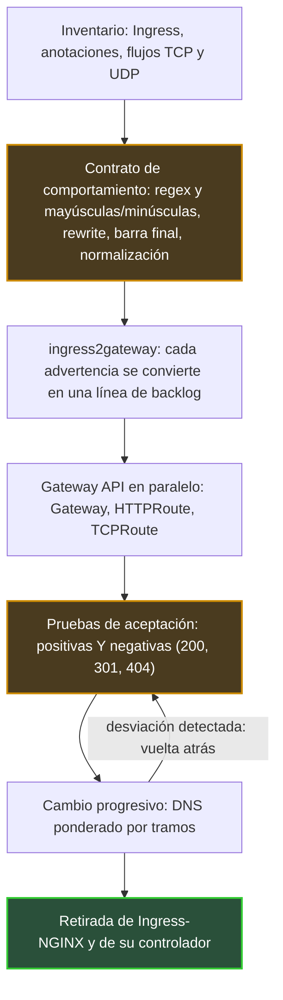

## El conserje se fue sin dejar instrucciones

Cuando el conserje de un edificio se jubila, descubrimos todo lo que hacía sin que nadie se lo hubiera pedido. La carta dirigida a «Dupont» que metía en el buzón de «Dupond». El paquete dejado en la escalera equivocada que reenviaba con un gesto. Nada estaba escrito. Todo funcionaba.

Hace un año exacto, el 11 de noviembre de 2025, los responsables del proyecto Kubernetes anunciaban la jubilación de uno de los conserjes más extendidos de la nube: Ingress-NGINX. Este software recibe el tráfico web a la entrada de un clúster y lo dirige a la aplicación correcta. Su repositorio de código está en modo de solo lectura desde el 24 de marzo de 2026. Las instalaciones existentes siguen funcionando. No llegará ya ningún parche de seguridad.

Todos los equipos que exponen servicios desde Kubernetes están afectados, desde los portales de clientes hasta las API internas. Las plataformas que alojan a varios clientes sobre una misma infraestructura lo están todavía más: allí, un error de enrutamiento no molesta solo a un equipo, afecta a un cliente.

Esta semana se celebra KubeCon North America en Salt Lake City, con una sesión dedicada al futuro de Gateway API, el estándar que sucede a Ingress. Siete meses y medio después del archivado, la urgencia ha pasado. Ahora empieza la obra. Y lo más difícil no es traducir lo que estaba escrito. Es escribir lo que no lo estaba.

## Lo que dice el archivado y lo que no dice

En agosto conté [por qué llegó este retiro y cómo es el panorama de sustitutos](https://wifirst-tech-blog.web.app/post?slug=apres-ingress-nginx-cilium-1-20-gateway-api), Cilium 1.20 incluido. No vuelvo sobre ello. Este texto trata de lo que viene después: cómo migrar sin romper nada. Y, para empezar, releer los términos exactos, que muchos planes pasan por alto.

El [anuncio oficial](https://kubernetes.io/blog/2025/11/11/ingress-nginx-retirement/) no deja margen: «Best-effort maintenance will continue until March 2026. Afterward, there will be no further releases, no bugfixes, and no updates to resolve any security vulnerabilities that may be discovered.» Ni versión nueva, ni corrección, ni parche de seguridad. Sin embargo, las imágenes y los charts de Helm (los paquetes de instalación) siguen siendo descargables, y sus despliegues no se detienen por sí solos. Ahí está toda la trampa. Nada se rompe el día D, así que nada obliga a decidir.

Tres precisiones evitan malentendidos frecuentes:

- **La API Ingress no se elimina.** Está congelada: ninguna funcionalidad nueva, pero sigue en Kubernetes.
- **El «NGINX Ingress Controller» del proveedor F5 es otro producto.** El blog de Kubernetes habla efectivamente de dos controladores distintos; solo el proyecto comunitario está archivado.
- **No existe un sustituto llave en mano.** La [declaración del comité directivo](https://kubernetes.io/blog/2026/01/29/ingress-nginx-statement/) del 29 de enero de 2026 lo deja negro sobre blanco: «None of the available alternatives are direct drop-in replacements.»

El mismo texto advierte de que seguir con Ingress-NGINX «leaves you and your users vulnerable to attack». No se puede ser más claro.

Para saber si le afecta, basta un comando, con permisos de administrador en el clúster:

```bash
kubectl get pods --all-namespaces --selector app.kubernetes.io/name=ingress-nginx
```

Si devuelve algo, este es el proyecto de principio a fin.


*La secuencia del cambio de tráfico. Las dos etapas resaltadas, el contrato y las pruebas, son las que la mayoría de los planes de migración subestiman.*

## Cinco reglas que nadie había escrito

Volvamos a nuestro conserje. Gateway API se parece más a un centro de clasificación automático: rápido, predecible, auditable. Entrega exactamente lo que dice el sobre, ni más ni menos. Toda carta que solo llegaba a su destino gracias a la benevolencia del antiguo conserje vuelve ahora con la mención «destinatario desconocido». En la web, esa mención tiene nombre: error 404.

El 27 de febrero de 2026, Steven Jin (Microsoft) publicó en el blog oficial de Kubernetes [el inventario de esas benevolencias](https://kubernetes.io/blog/2026/02/27/ingress-nginx-before-you-migrate/). Una frase resume su artículo: «a seemingly correct translation can still cause outages if it does not consider Ingress-NGINX's quirks.» Dicho de otro modo, una traducción fiel línea a línea puede provocar una caída. Estos son los cinco comportamientos en cuestión.

| Lo que Ingress-NGINX hacía sin decirlo | Lo que hace una implementación de Gateway API | Lo que hay que escribir |
|---|---|---|
| Expresiones regulares (regex) aplicadas por prefijo, sin distinguir mayúsculas de minúsculas | Coincidencia completa y sensible a mayúsculas y minúsculas (implementaciones basadas en Envoy: Istio, Envoy Gateway, kgateway) | Prefijo `(?i)` y sufijo `.*` explícitos, por ejemplo `(?i)/Header.*` |
| `use-regex: "true"` vale para todas las rutas del host, de todos los Ingress | Cada regla se aplica solo a sí misma | Localizar las rutas que solo funcionaban por contagio |
| `rewrite-target` activa la regex para todo el host, en silencio | Nada implícito | El mismo inventario que la fila anterior |
| Redirección 301 automática de `/docs` a `/docs/` | Ninguna redirección implícita: 404 | Filtro `RequestRedirect` explícito |
| Normalización de las URL (RFC 3986 §6.2: segmentos `.` y `..`, barras duplicadas) antes del enrutamiento | No configurada por el estándar | Decidir, documentar, probar |

Las filas segunda y tercera son las más perniciosas, porque sus efectos no se quedan en lo local. Una anotación puesta en un solo Ingress cambia la interpretación de todas las rutas del mismo nombre de host, incluidas las que otro equipo declaró en otro archivo. Resultado: una ruta declarada `Exact` con una errata puede funcionar durante años simplemente porque un vecino activó la regex. Nadie lo sabe. El día de la migración, se cae.

En una plataforma compartida, este es el escenario que más me preocupa (*análisis del autor, no un hecho con fuente*). La migración no solo revela deuda técnica. Revela un acoplamiento entre equipos que nadie había cartografiado.

La barra final merece una advertencia aparte. Los enlaces, los marcadores y los códigos QR impresos que apuntan a `/docs` sin barra acabarán en un 404, salvo que alguien haya pensado en escribir la redirección.


*El antiguo controlador corregía las direcciones en silencio. Una traducción fiel de los manifiestos hace reaparecer los callejones sin salida.*

## ingress2gateway 1.0: un traductor, no un notario

El reflejo natural es buscar la herramienta que haga la conversión. Existe, y es seria. [ingress2gateway](https://kubernetes.io/blog/2026/03/20/ingress2gateway-1-0-release), la herramienta oficial del proyecto, llegó a la versión 1.0 el 20 de marzo de 2026. Ahora traduce más de 30 anotaciones de Ingress-NGINX, frente a 3 antes. Y, sobre todo, sus autores la han validado con pruebas de integración en clústeres reales, comparando el comportamiento de Ingress-NGINX con el de varios controladores de Gateway API.

Esos mismos autores, Beka Modebadze (Google) y Steven Jin (Microsoft), se niegan sin embargo a presentarla como una varita mágica: «Migration is not a 'one-click' affair.» La herramienta se define como «a migration assistant, not a one-shot replacement». El ejemplo oficial del artículo muestra por qué:

- `configuration-snippet`, que permitía inyectar configuración NGINX en bruto, no se traduce y genera una advertencia;
- `proxy-body-size`, que limita el tamaño de las peticiones, no tiene equivalente en el estándar;
- los distintos tiempos de espera se reducen, en el mejor de los casos, a un único `timeouts.request`;
- una regex como `(?i)/users/(\d+).*` se genera correctamente, pero hay que endurecerla;
- la herramienta añade un punto de escucha en el puerto 80 con una redirección 308 a HTTPS. Una decisión razonable, pero una decisión.

Mi lectura: los mensajes WARN e INFO de la herramienta no son ruido que filtrar. Son su backlog de migración, ya redactado. Cada advertencia corresponde a una decisión de arquitectura que el antiguo controlador tomaba por usted, a menudo sin que lo supiera.

Un último punto, más sutil. En el momento en que escribo, la [página del proyecto](https://github.com/kubernetes-sigs/ingress2gateway) lista nueve fuentes legibles y seis formatos de salida. El formato estándar produce Gateway API puro; los demás (Envoy Gateway, kgateway, agentgateway…) añaden las extensiones propias de cada controlador. Práctico, pero no portable. Revise el YAML generado con cada nueva versión de la herramienta.

## Escribir el contrato que el antiguo controlador aplicaba en silencio

Google, proveedor cuyos ingenieros contribuyen al proyecto, [presenta Gateway API](https://opensource.googleblog.com/2026/02/the-end-of-an-era-transitioning-away-from-ingress-nginx.html) como un «Ingress 2.0». La etiqueta es cómoda, pero oculta lo esencial. La verdadera ruptura no es funcional, es organizativa. Gateway API divide la responsabilidad del tráfico entrante en tres roles, mientras que Ingress lo metía todo en el mismo objeto:

- el **proveedor de infraestructura** declara una GatewayClass, es decir, el tipo de controlador disponible;
- el **operador del clúster** despliega un Gateway: puntos de entrada, puertos, certificados;
- el **desarrollador de la aplicación** escribe sus rutas (HTTPRoute) y las asocia al Gateway.

Es el Gateway quien decide quién tiene derecho a asociarse a él. El ListenerSet, que pasó a Standard con la versión 1.5 de Gateway API publicada el 27 de febrero de 2026, prolonga esta lógica delegando puntos de escucha en los equipos; detallé su mecánica en el artículo de agosto.

La pieza que considero más importante es más discreta: el ReferenceGrant, que pasó a v1 en la misma versión. Es un consentimiento explícito. Una ruta situada en un espacio de nombres (namespace, el compartimento lógico de un clúster) solo puede apuntar a un servicio de otro espacio de nombres si este último se lo autoriza. Sin esa autorización, la ruta queda bloqueada con un estado `ResolvedRefs: False`. La [guía de migración de Datadog](https://www.datadoghq.com/blog/migrate-to-gateway-api.md), fuente de un proveedor, clasifica este caso entre las trampas más frecuentes. Ingress no sabía expresar quién tiene derecho a apuntar a qué. Gateway API obliga a escribirlo.


*Tres roles, tres juegos de llaves: la infraestructura, el clúster y la aplicación, unidos por autorizaciones explícitas entre espacios de nombres.*

Segundo avance subestimado: el tráfico que no es web. Ingress-NGINX gestionaba TCP y UDP mediante un mecanismo lateral, dos ConfigMaps (archivos de configuración de Kubernetes) llamados `tcp-services` y `udp-services`, cuyo tratamiento varía de un controlador a otro. Con [Gateway API v1.6](https://kubernetes.io/blog/2026/08/03/gateway-api-v1-6-release/), publicada el 30 de junio de 2026, TCPRoute y UDPRoute pasan a Standard. Los usos previstos incluyen bases de datos, DNS, VoIP, juegos en línea y telemetría IoT. *Análisis del autor*: para un operador de red, es el avance más concreto del año, porque esos flujos encuentran por fin un equivalente portable.

Una trampa de paso: instalar las definiciones Standard de la v1.5 encima de TLSRoute experimentales (v1alpha2 o v1alpha3) deja inutilizables estas últimas. Migre primero a v1.

Queda todo lo que el estándar no cubre. Ahí se juega la portabilidad. Yo clasifico cada función en tres columnas:

1. **En el estándar**: redirecciones, reescrituras, filtro CORS (el control de las llamadas entre dominios, Standard desde v1.5), cifrado hacia los backends mediante BackendTLSPolicy.
2. **Extensión del controlador**: limitación de tasa, tamaño máximo de las peticiones, autorización externa según la implementación. Estas funciones pasan por recursos propios de cada proveedor (los CRD, Custom Resource Definitions), no portables.
3. **A rediseñar**: todo lo que vivía en un snippet de configuración NGINX.

Cada línea de la segunda columna se incorpora al registro de excepciones mencionado en agosto, con un responsable y una fecha de revisión. Ese registro, las rutas por rol y la batería de pruebas forman juntos el contrato. Nada menos.

## El cambio de tráfico: un grifo mezclador, no un interruptor

Nadie pasa la ducha del agua fría a la caliente de golpe. Se gira el grifo mezclador por tramos, se comprueba la temperatura, se está listo para volver atrás. El cambio a Gateway API se maneja de la misma forma. El artículo de ingress2gateway y la guía de Datadog (siete etapas, ninguna cifra medida) convergen en el método. Yo le añado un orden de prioridad.

**Primero, la referencia.** Antes de tocar nada, mida el comportamiento actual: latencias, códigos de respuesta, volúmenes por host. Sin una línea base, es imposible decir si la nueva cadena rinde mejor, igual o peor.

**Después, el contrato en forma de pruebas.** Para cada host, escriba las URL que deben responder 200, las que deben redirigir con 301 o 308 y las que deben responder 404. Las pruebas negativas cuentan tanto como las positivas. Ejecútelas primero contra Ingress-NGINX: si pasan en el antiguo controlador, describen la realidad. Se convierten entonces en la especificación del nuevo.

**Luego, el paralelo.** El controlador de Gateway API se despliega junto al existente, nunca en su lugar. Compruebe que cada ruta muestra las condiciones `Accepted` y `ResolvedRefs` en verdadero. Después, vuelva a ejecutar la batería de pruebas, completada con tráfico sintético o tráfico espejo, es decir, una copia del tráfico real enviada sin impacto para el cliente.

**Por último, el cambio progresivo.** DNS ponderado, balanceador de carga o reparto de tráfico: se mueve una pequeña fracción, se observa, se aumenta. Reduzca la duración de la caché DNS (el TTL) con mucha antelación; de lo contrario, su vuelta atrás quedará prisionera de las cachés. La retirada del Ingress y del antiguo controlador llega al final, cuando los indicadores hayan vuelto a su línea base.


*Cambiar el tráfico por tramos, de una vía a otra, con la vuelta atrás siempre al alcance de la mano.*

Dos precisiones. Con una malla de servicios (service mesh), Buoyant, proveedor de Linkerd, recomienda apuntar al Service de Kubernetes en lugar de a los pods; si no, el controlador se salta el balanceo de la malla. Y la separación de roles obliga a revisar los permisos de acceso (RBAC, el control de acceso por roles) entre infraestructura, operaciones y desarrollo. En mi opinión, es la parte más política del proyecto.

## Gardener, o el derecho a no aterrizar de inmediato

Todo lo anterior supone que Gateway API es el destino correcto. No siempre es así el día D. El contraejemplo más honesto viene del proyecto de código abierto Gardener, que gestiona flotas de clústeres de Kubernetes.

El 29 de abril de 2026, Johannes Scheerer [describía](https://gardener.cloud/blog/2026/04/04-29-ingress-nginx-retirement-how-gardener-migrated-to-istio/) allí una migración a las API nativas de Istio en lugar de a Gateway API. Motivo principal: el estándar aún no ofrecía autorización externa, es decir, la posibilidad de delegar la decisión de acceso en un servicio de terceros. Ingress-NGINX sigue incluso desplegado para ciertas extensiones, y se puede desactivar por configuración. El seguimiento se hace públicamente, en la issue de GitHub #13448.

La zona gris no ha desaparecido. Cilium 1.20 incorpora desde finales de julio una función ExternalAuth, pero basada en una propuesta de evolución del estándar (GEP-1494) todavía experimental en upstream. La autorización externa portable sigue siendo una promesa, no una realidad consolidada.

Mi posición: Gateway API como contrato objetivo, con excepciones explícitas y fechadas. Gardener no se equivoca. Documentó por qué se apartaba del estándar y dónde sigue el asunto. Es exactamente la buena práctica. El verdadero riesgo no es elegir una API propietaria. Es deslizarse hacia ella anotación a anotación, sin escribir nunca por qué.

El mismo razonamiento vale para lo que viene. La Inference Extension, variante de Gateway API para el tráfico de inferencia de IA, reutiliza este modelo: su recurso [InferencePool](https://gateway-api-inference-extension.sigs.k8s.io/api-types/inferencepool/) es estable desde la v1.0.0 de la extensión, versionada de forma independiente de Gateway API. Istio [anunciaba un soporte beta](https://www.cncf.io/announcements/2026/03/25/istio-brings-future-ready-service-mesh-to-the-ai-era-with-new-ambient-multicluster-gateway-api-inference-extension-and-more/) ya en marzo, en KubeCon Europe; hablé de ello a finales de octubre [a propósito de llm-d](https://wifirst-tech-blog.web.app/post?slug=llm-d-1-0-5-a-10x-moins-cher-a-prouver-sur-vos-traces).

En Salt Lake City, la prensa señala en el programa una jornada dedicada a la inferencia, con sesiones sobre esta extensión, y Nir Rozenbaum (NVIDIA) indica que presentará allí los trabajos del grupo de trabajo AI Gateway. La sesión de actualización de Gateway API, a cargo del mantenedor Norwin Schnyder, promete en su resumen hoja de ruta y novedades. No hay material ni crónica públicos a la hora en que escribo: no diré más.

*Análisis del autor*: migrar hoy a Gateway API es también adoptar el vocabulario en el que se enrutará mañana el tráfico de IA. Migrar a una API propietaria es exponerse a migrar dos veces.

## Qué exigir al próximo controlador

Un proyecto también se juzga por lo que se exige a los proveedores. Esta es mi lista, sin preferencia entre implementaciones.

1. **Un informe de conformidad por versión de Gateway API.** Las listas publicadas son fotografías. A la salida de v1.6, seis implementaciones figuraban con conformidad completa: Agentgateway, Airlock Microgateway, GKE Gateway, kgateway, NGINX Gateway Fabric y Traefik Proxy. La ausencia de Istio, Envoy Gateway o Cilium significaba solo que no se había presentado ningún informe en esa fecha. Pida el informe, no deduzca nada.
2. **Un emisor de ingress2gateway**, o en su defecto una traducción asistida por herramientas, probada y repetible.
3. **Una lista pública de políticas**, clasificadas entre estándar y extensión, para alimentar el registro de excepciones.
4. **TCPRoute y UDPRoute en v1**, si sus flujos no se limitan a la web.
5. **Por su parte, una batería de pruebas de aceptación** versionada junto con las rutas y ejecutada de nuevo en cada cambio. Ningún proveedor se la entregará hecha.

Unas palabras sobre el edge, esos pequeños clústeres instalados lo más cerca posible de los sitios, señalado claramente como un *análisis del autor, sin fuente pública*. El único hecho establecido: Gateway API solo requiere Kubernetes 1.30 o posterior, y se instala sin actualizar el clúster. En clústeres de periferia repartidos en numerosos sitios, mi hipótesis es que la cuestión será menos la elección del controlador que la reproducibilidad del contrato: el mismo juego de pruebas, repetido en todas partes, en cada despliegue. Es una convicción, no una experiencia vivida.

Ingress-NGINX nos presta un último servicio. Nos obliga a escribir lo que nuestras plataformas hacen realmente. Los equipos que traten la migración como una traducción descubrirán sus reglas implícitas en producción, un 404 tras otro. Los demás saldrán con algo que nunca habían tenido: la especificación de su propia puerta de entrada.

_Opiniones personales, no la posición de Wifirst._

## Fuentes

1. Kubernetes Blog — Ingress NGINX Retirement: What You Need to Know (2025-11-11) — https://kubernetes.io/blog/2025/11/11/ingress-nginx-retirement/
2. Kubernetes Blog — Ingress NGINX: Statement from the Steering and SRC (2026-01-29) — https://kubernetes.io/blog/2026/01/29/ingress-nginx-statement/
3. GitHub — kubernetes/ingress-nginx (repositorio archivado el 2026-03-24) — https://github.com/kubernetes/ingress-nginx
4. Kubernetes Blog — Before You Migrate: Five Surprising Ingress-NGINX Behaviors (2026-02-27) — https://kubernetes.io/blog/2026/02/27/ingress-nginx-before-you-migrate/
5. Kubernetes Blog — Announcing Ingress2Gateway 1.0 (2026-03-20) — https://kubernetes.io/blog/2026/03/20/ingress2gateway-1-0-release
6. Kubernetes Blog — Gateway API v1.5: Moving features to Stable (release du 2026-02-27) — https://kubernetes.io/blog/2026/04/21/gateway-api-v1-5/
7. Kubernetes Blog — Gateway API v1.6: TCPRoute and UDPRoute Graduate to Standard (release du 2026-06-30) — https://kubernetes.io/blog/2026/08/03/gateway-api-v1-6-release/
8. Isovalent (proveedor) — Cilium 1.20 (2026-07-30) — https://isovalent.com/blog/post/cilium-1-20/
9. Google Open Source Blog (proveedor) — The End of an Era: Transitioning Away from Ingress NGINX (2026-02-12) — https://opensource.googleblog.com/2026/02/the-end-of-an-era-transitioning-away-from-ingress-nginx.html
10. Datadog (proveedor) — Ingress NGINX is EOL: practical guide to Gateway API (2026-04-08) — https://www.datadoghq.com/blog/migrate-to-gateway-api.md
11. Gardener — Ingress-NGINX retirement: how Gardener migrated to Istio (2026-04-29) — https://gardener.cloud/blog/2026/04/04-29-ingress-nginx-retirement-how-gardener-migrated-to-istio/
12. CNCF — Istio brings future-ready service mesh to the AI era (2026-03-25, KubeCon EU) — https://www.cncf.io/announcements/2026/03/25/istio-brings-future-ready-service-mesh-to-the-ai-era-with-new-ambient-multicluster-gateway-api-inference-extension-and-more/
13. GitHub — kubernetes-sigs/ingress2gateway — https://github.com/kubernetes-sigs/ingress2gateway
14. Gateway API Inference Extension — InferencePool — https://gateway-api-inference-extension.sigs.k8s.io/api-types/inferencepool/
15. Sessionize — Gateway API Project Update (N. Schnyder) — https://sessionize.com/s/snorwin/gateway-api-project-update-building-the-future-of-/182904 ; New Traffic, New Rules (N. Rozenbaum) — https://sessionize.com/s/nir-rozenbaum/new-traffic-new-rules-standardizing-ai-aware-netwo/183266
16. TechTimes — CNCF's KubeCon NA 2026 Opens in Salt Lake City (2026-11-09) — https://www.techtimes.com/articles/330289/20261109/cncfs-kubecon-north-america-2026-opens-salt-lake-city-why-kubernetes-cannot-tell-which-ai-agent.htm
17. Buoyant (proveedor) — Community ingress-nginx retired: how to plan your migration (2026-07-27) — https://buoyant.io/blog/community-ingress-nginx-retired-how-to-plan-your-migration
