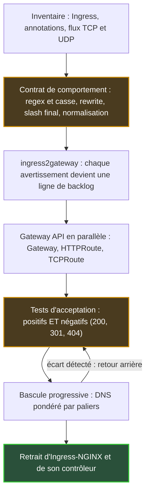

## Le concierge est parti sans laisser ses consignes

Quand le concierge d'un immeuble part à la retraite, on découvre tout ce qu'il faisait sans qu'on le lui ait jamais demandé. La lettre adressée à « Dupont » qu'il glissait chez « Dupond ». Le colis déposé au mauvais escalier qu'il faisait suivre d'un geste. Rien n'était écrit. Tout fonctionnait.

Il y a un an jour pour jour, le 11 novembre 2025, les responsables du projet Kubernetes annonçaient la retraite de l'un des concierges les plus répandus du cloud : Ingress-NGINX. Ce logiciel reçoit le trafic web à l'entrée d'un cluster et l'aiguille vers la bonne application. Son dépôt de code est en lecture seule depuis le 24 mars 2026. Les installations existantes tournent toujours. Plus aucun correctif de sécurité ne viendra.

Toutes les équipes qui exposent des services depuis Kubernetes sont concernées, des portails clients aux API internes. Les plateformes qui hébergent plusieurs clients sur une même infrastructure le sont davantage : une erreur de routage n'y gêne pas seulement une équipe, elle touche un client.

Cette semaine, KubeCon North America se tient à Salt Lake City, avec au programme une session consacrée à l'avenir de Gateway API, le standard qui succède à Ingress. Sept mois et demi après l'archivage, l'urgence est passée. Le chantier commence. Et le plus dur n'est pas de traduire ce qui était écrit. C'est d'écrire ce qui ne l'était pas.

## Ce que l'archivage dit, et ce qu'il ne dit pas

J'ai raconté en août [pourquoi ce retrait est arrivé et à quoi ressemble le paysage des remplaçants](https://wifirst-tech-blog.web.app/post?slug=apres-ingress-nginx-cilium-1-20-gateway-api), Cilium 1.20 compris. Je n'y reviens pas. Ce texte traite de la suite : comment migrer sans casser. Et d'abord, relire les termes exacts, que beaucoup de plans survolent.

Le [billet d'annonce](https://kubernetes.io/blog/2025/11/11/ingress-nginx-retirement/) ne laisse aucune marge : « Best-effort maintenance will continue until March 2026. Afterward, there will be no further releases, no bugfixes, and no updates to resolve any security vulnerabilities that may be discovered. » Ni nouvelle version, ni correctif, ni patch de sécurité. Les images et les charts Helm (les paquets d'installation) restent pourtant téléchargeables, et vos déploiements ne s'arrêtent pas d'eux-mêmes. C'est tout le piège. Rien ne casse le jour J, donc rien ne force la décision.

Trois précisions évitent des contresens fréquents :

- **L'API Ingress n'est pas supprimée.** Elle est gelée : aucune fonctionnalité nouvelle, mais elle reste dans Kubernetes.
- **Le « NGINX Ingress Controller » de l'éditeur F5 est un autre produit.** Le blog Kubernetes parle bien de deux contrôleurs distincts ; seul le projet communautaire est archivé.
- **Il n'existe pas de remplaçant clé en main.** La [déclaration du comité de pilotage](https://kubernetes.io/blog/2026/01/29/ingress-nginx-statement/) du 29 janvier 2026 l'écrit noir sur blanc : « None of the available alternatives are direct drop-in replacements. »

Le même texte prévient que rester sur Ingress-NGINX « leaves you and your users vulnerable to attack ». On ne peut pas être plus clair.

Pour savoir si vous êtes concerné, une commande suffit, avec des droits d'administration sur le cluster :

```bash
kubectl get pods --all-namespaces --selector app.kubernetes.io/name=ingress-nginx
```

Si elle renvoie quelque chose, voici le chantier de bout en bout.


*La séquence de bascule. Les deux étapes mises en évidence, le contrat et les tests, sont celles que la plupart des plans de migration sous-estiment.*

## Cinq règles que personne n'avait écrites

Revenons à notre concierge. Gateway API ressemble plutôt à un centre de tri automatique : rapide, prévisible, auditable. Il livre exactement ce qui est écrit sur l'enveloppe, ni plus ni moins. Toute lettre qui n'arrivait à destination que grâce à la bienveillance de l'ancien concierge revient désormais avec la mention « destinataire inconnu ». Sur le web, cette mention porte un nom : erreur 404.

Le 27 février 2026, Steven Jin (Microsoft) a dressé sur le blog officiel de Kubernetes [l'inventaire de ces bienveillances](https://kubernetes.io/blog/2026/02/27/ingress-nginx-before-you-migrate/). Une phrase résume son billet : « a seemingly correct translation can still cause outages if it does not consider Ingress-NGINX's quirks. » Autrement dit, une traduction fidèle ligne à ligne peut provoquer une panne. Voici les cinq comportements en cause.

| Ce qu'Ingress-NGINX faisait sans le dire | Ce que fait une implémentation Gateway API | Ce qu'il faut écrire |
|---|---|---|
| Expressions régulières (regex) appliquées par préfixe, sans tenir compte de la casse | Correspondance complète et sensible à la casse (implémentations basées sur Envoy : Istio, Envoy Gateway, kgateway) | Préfixe `(?i)` et suffixe `.*` explicites, par exemple `(?i)/Header.*` |
| `use-regex: "true"` vaut pour tous les chemins de l'hôte, tous Ingress confondus | Chaque règle ne s'applique qu'à elle-même | Repérer les chemins qui ne fonctionnaient que par contagion |
| `rewrite-target` active la regex pour tout l'hôte, en silence | Rien d'implicite | Même inventaire que la ligne précédente |
| Redirection 301 automatique de `/docs` vers `/docs/` | Aucune redirection implicite : 404 | Filtre `RequestRedirect` explicite |
| Normalisation des URL (RFC 3986 §6.2 : segments `.` et `..`, slashs doublés) avant le routage | Non configurée par le standard | Décider, documenter, tester |

Les deuxième et troisième lignes sont les plus pernicieuses, parce que leurs effets ne restent pas locaux. Une annotation posée sur un seul Ingress change l'interprétation de tous les chemins du même nom d'hôte, y compris ceux qu'une autre équipe a déclarés dans un autre fichier. Résultat : un chemin déclaré `Exact` avec une faute de frappe peut fonctionner depuis des années, simplement parce qu'un voisin a activé la regex. Personne ne le sait. Le jour de la migration, il tombe.

Sur une plateforme partagée, c'est le scénario qui m'inquiète le plus (*analyse d'auteur, pas constat sourcé*). La migration n'y révèle pas seulement une dette technique. Elle révèle un couplage entre équipes que personne n'avait cartographié.

Le slash final mérite un avertissement à part. Les liens, les favoris et les QR codes imprimés qui visent `/docs` sans slash finiront en 404, sauf si quelqu'un a pensé à écrire la redirection.


*L'ancien contrôleur corrigeait les adresses en silence. Une traduction fidèle des manifestes fait réapparaître les impasses.*

## ingress2gateway 1.0 : un traducteur, pas un notaire

Le réflexe naturel consiste à chercher l'outil qui fera la conversion. Il existe, et il est sérieux. [ingress2gateway](https://kubernetes.io/blog/2026/03/20/ingress2gateway-1-0-release), l'outil officiel du projet, est passé en version 1.0 le 20 mars 2026. Il traduit désormais plus de 30 annotations Ingress-NGINX, contre 3 auparavant. Surtout, ses auteurs l'ont validé par des tests d'intégration sur de vrais clusters, en comparant le comportement d'Ingress-NGINX à celui de plusieurs contrôleurs Gateway API.

Ces mêmes auteurs, Beka Modebadze (Google) et Steven Jin (Microsoft), refusent pourtant de le présenter comme une baguette magique : « Migration is not a 'one-click' affair. » L'outil se veut « a migration assistant, not a one-shot replacement ». L'exemple officiel du billet montre pourquoi :

- `configuration-snippet`, qui permettait d'injecter de la configuration NGINX brute, n'est pas traduit et déclenche un avertissement ;
- `proxy-body-size`, qui plafonne la taille des requêtes, n'a pas d'équivalent dans le standard ;
- les différents délais d'expiration sont ramenés, au mieux, à un unique `timeouts.request` ;
- une regex comme `(?i)/users/(\d+).*` est bien générée, mais reste à durcir ;
- l'outil ajoute un point d'écoute sur le port 80 avec une redirection 308 vers HTTPS. Un choix raisonnable, mais un choix.

Ma lecture : les messages WARN et INFO de l'outil ne sont pas du bruit à filtrer. C'est votre backlog de migration, déjà rédigé. Chaque avertissement correspond à une décision d'architecture que l'ancien contrôleur prenait à votre place, souvent sans que vous le sachiez.

Dernier point, plus subtil. À la date où j'écris, la [page du projet](https://github.com/kubernetes-sigs/ingress2gateway) liste neuf sources lisibles et six formats de sortie. Le format standard produit du Gateway API pur ; les autres (Envoy Gateway, kgateway, agentgateway…) y ajoutent les extensions propres à un contrôleur. Pratique, mais pas portable. Relisez le YAML généré à chaque nouvelle version de l'outil.

## Écrire le contrat que l'ancien contrôleur appliquait en silence

Google, éditeur dont des ingénieurs contribuent au projet, [présente Gateway API](https://opensource.googleblog.com/2026/02/the-end-of-an-era-transitioning-away-from-ingress-nginx.html) comme un « Ingress 2.0 ». L'étiquette est commode, mais elle masque l'essentiel. La vraie rupture n'est pas fonctionnelle, elle est organisationnelle. Gateway API découpe la responsabilité du trafic entrant en trois rôles, là où Ingress mettait tout dans le même objet :

- le **fournisseur d'infrastructure** déclare une GatewayClass, c'est-à-dire le type de contrôleur disponible ;
- l'**opérateur du cluster** déploie un Gateway : points d'entrée, ports, certificats ;
- le **développeur d'application** écrit ses routes (HTTPRoute) et les rattache au Gateway.

C'est le Gateway qui décide qui a le droit de s'y rattacher. Le ListenerSet, passé en Standard avec la version 1.5 de Gateway API publiée le 27 février 2026, prolonge cette logique en déléguant des points d'écoute à des équipes ; j'en détaillais la mécanique dans l'article d'août.

La pièce que je juge la plus importante est plus discrète : le ReferenceGrant, passé en v1 dans la même version. C'est un consentement explicite. Une route située dans un espace de noms (namespace, le compartiment logique d'un cluster) ne peut viser un service d'un autre espace de noms que si ce dernier l'y autorise. Sans cette autorisation, la route reste bloquée avec un statut `ResolvedRefs: False`. Le [guide de migration de Datadog](https://www.datadoghq.com/blog/migrate-to-gateway-api.md), source d'éditeur, classe ce cas parmi les pièges les plus fréquents. Ingress ne savait pas exprimer qui a le droit de pointer vers quoi. Gateway API oblige à l'écrire.


*Trois rôles, trois jeux de clés : l'infrastructure, le cluster et l'application, reliés par des autorisations explicites entre espaces de noms.*

Deuxième avancée sous-estimée : le trafic qui n'est pas du web. Ingress-NGINX gérait TCP et UDP par un mécanisme latéral, deux ConfigMaps (fichiers de configuration Kubernetes) nommées `tcp-services` et `udp-services`, dont le traitement varie d'un contrôleur à l'autre. Avec [Gateway API v1.6](https://kubernetes.io/blog/2026/08/03/gateway-api-v1-6-release/), publiée le 30 juin 2026, TCPRoute et UDPRoute passent en Standard. Les usages visés incluent bases de données, DNS, VoIP, jeu en ligne et télémétrie IoT. *Analyse d'auteur* : pour un opérateur réseau, c'est l'avancée la plus concrète de l'année, parce que ces flux trouvent enfin un équivalent portable.

Un piège au passage : installer les définitions Standard de la v1.5 par-dessus des TLSRoute expérimentales (v1alpha2 ou v1alpha3) rend ces dernières inutilisables. Migrez-les vers v1 d'abord.

Reste tout ce que le standard ne couvre pas. C'est là que se joue la portabilité. Je trie chaque fonction en trois colonnes :

1. **Dans le standard** : redirections, réécritures, filtre CORS (le contrôle des appels entre domaines, Standard depuis v1.5), chiffrement vers les backends via BackendTLSPolicy.
2. **Extension du contrôleur** : limitation de débit, taille maximale des requêtes, autorisation externe selon l'implémentation. Ces fonctions passent par des ressources propres à chaque éditeur (les CRD, pour Custom Resource Definitions), non portables.
3. **À redessiner** : tout ce qui vivait dans un snippet de configuration NGINX.

Chaque ligne de la deuxième colonne rejoint le registre de dérogations évoqué en août, avec un propriétaire et une date de revue. Ce registre, les routes par rôle et la suite de tests forment ensemble le contrat. Rien de moins.

## La bascule : un mitigeur, pas un interrupteur

On ne passe pas une douche de l'eau froide à l'eau chaude d'un coup sec. On tourne le mitigeur par crans, on vérifie la température, on reste prêt à revenir en arrière. La bascule vers Gateway API se pilote de la même façon. Le billet d'ingress2gateway et le guide de Datadog (sept étapes, aucun chiffre mesuré) convergent sur la méthode. J'y ajoute un ordre de priorité.

**D'abord, la référence.** Avant de toucher quoi que ce soit, mesurez le comportement actuel : latences, codes de retour, volumes par hôte. Sans ligne de base, impossible de dire si la nouvelle chaîne fait mieux, pareil ou pire.

**Ensuite, le contrat sous forme de tests.** Pour chaque hôte, écrivez les URL qui doivent répondre 200, celles qui doivent rediriger en 301 ou 308, et celles qui doivent répondre 404. Les tests négatifs comptent autant que les positifs. Exécutez-les d'abord contre Ingress-NGINX : s'ils passent sur l'ancien contrôleur, ils décrivent la réalité. Ils deviennent alors la spécification du nouveau.

**Puis le parallèle.** Le contrôleur Gateway API se déploie à côté de l'existant, jamais à sa place. Vérifiez que chaque route affiche les conditions `Accepted` et `ResolvedRefs` à vrai. Rejouez ensuite la suite de tests, complétée par du trafic synthétique ou du trafic miroir, c'est-à-dire une copie du trafic réel envoyée sans impact client.

**Enfin, la bascule progressive.** DNS pondéré, répartiteur de charge ou partage de trafic : on déplace une petite fraction, on observe, on augmente. Réduisez la durée de cache DNS (le TTL) bien avant, sinon votre retour arrière restera prisonnier des caches. Le retrait de l'Ingress et de l'ancien contrôleur vient en dernier, une fois les indicateurs revenus à leur ligne de base.


*Basculer le trafic par crans, d'une voie à l'autre, avec un retour arrière toujours à portée de main.*

Deux précisions. Avec un maillage de services (service mesh), Buoyant, éditeur de Linkerd, recommande de viser le Service Kubernetes plutôt que les pods, faute de quoi le contrôleur contourne l'équilibrage du maillage. Et la séparation des rôles impose de revoir les droits d'accès (RBAC, le contrôle d'accès par rôle) entre infrastructure, exploitation et développement. À mon avis, c'est le volet le plus politique du chantier.

## Gardener, ou le droit de ne pas atterrir tout de suite

Tout ce qui précède suppose que Gateway API est la bonne destination. Ce n'est pas toujours vrai le jour J. Le contre-exemple le plus honnête vient du projet open source Gardener, qui gère des flottes de clusters Kubernetes.

Le 29 avril 2026, Johannes Scheerer y [décrivait](https://gardener.cloud/blog/2026/04/04-29-ingress-nginx-retirement-how-gardener-migrated-to-istio/) une migration vers les API natives d'Istio plutôt que vers Gateway API. Raison principale : le standard n'offrait pas encore d'autorisation externe, c'est-à-dire la possibilité de déléguer la décision d'accès à un service tiers. Ingress-NGINX reste même déployé pour certaines extensions, désactivable par configuration. Le suivi se fait publiquement, dans l'issue GitHub #13448.

La zone grise n'a pas disparu. Cilium 1.20 livre bien depuis fin juillet une fonction ExternalAuth, mais fondée sur une proposition d'évolution du standard (GEP-1494) encore expérimentale en amont. L'autorisation externe portable reste une promesse, pas un acquis.

Ma position : Gateway API comme contrat cible, avec des dérogations explicites et datées. Gardener n'a pas tort. Il a documenté pourquoi il s'écartait du standard, et où il suit le sujet. C'est exactement la bonne pratique. Le vrai risque n'est pas de choisir une API propriétaire. C'est de glisser vers elle annotation après annotation, sans jamais écrire pourquoi.

Le même raisonnement vaut pour la suite. L'Inference Extension, déclinaison de Gateway API pour le trafic d'inférence IA, réutilise ce modèle : sa ressource [InferencePool](https://gateway-api-inference-extension.sigs.k8s.io/api-types/inferencepool/) est stable depuis la v1.0.0 de l'extension, versionnée indépendamment de Gateway API. Istio en [annonçait un support bêta](https://www.cncf.io/announcements/2026/03/25/istio-brings-future-ready-service-mesh-to-the-ai-era-with-new-ambient-multicluster-gateway-api-inference-extension-and-more/) dès mars, à KubeCon Europe ; j'en parlais fin octobre [à propos de llm-d](https://wifirst-tech-blog.web.app/post?slug=llm-d-1-0-5-a-10x-moins-cher-a-prouver-sur-vos-traces).

À Salt Lake City, la presse signale au programme une journée dédiée à l'inférence, avec des sessions sur cette extension, et Nir Rozenbaum (NVIDIA) indique y présenter les travaux du groupe de travail AI Gateway. La session de mise à jour de Gateway API, animée par le mainteneur Norwin Schnyder, promet dans son résumé feuille de route et nouveautés. Aucun support ni compte rendu n'est public à l'heure où j'écris : je n'en dirai pas plus.

*Analyse d'auteur* : migrer vers Gateway API aujourd'hui, c'est aussi adopter le vocabulaire dans lequel le trafic IA sera routé demain. Migrer vers une API propriétaire, c'est s'exposer à migrer deux fois.

## Ce qu'il faut exiger du prochain contrôleur

Un chantier se juge aussi à ce qu'on demande aux éditeurs. Voici ma liste, sans préférence entre implémentations.

1. **Un rapport de conformité par version de Gateway API.** Les listes publiées sont des photographies. À la sortie de v1.6, six implémentations figuraient en conformité complète : Agentgateway, Airlock Microgateway, GKE Gateway, kgateway, NGINX Gateway Fabric et Traefik Proxy. L'absence d'Istio, d'Envoy Gateway ou de Cilium signifiait seulement qu'aucun rapport n'avait été soumis à cette date. Demandez le rapport, ne déduisez rien.
2. **Un émetteur ingress2gateway**, ou à défaut une traduction outillée, testée et rejouable.
3. **Une liste publique des politiques**, classées entre standard et extension, pour nourrir le registre de dérogations.
4. **TCPRoute et UDPRoute en v1**, si vos flux ne se limitent pas au web.
5. **Côté maison, une suite de tests d'acceptation** versionnée avec les routes et rejouée à chaque changement. Aucun éditeur ne la livrera à votre place.

Un mot sur l'edge, ces petits clusters installés au plus près des sites, signalé clairement comme une *analyse d'auteur, sans source publique*. Le seul fait établi : Gateway API ne demande que Kubernetes 1.30 ou plus récent, et s'installe sans mise à jour du cluster. Sur des clusters de périphérie répartis sur de nombreux sites, mon hypothèse est que l'enjeu sera moins le choix du contrôleur que la reproductibilité du contrat : le même jeu de tests, rejoué partout, à chaque déploiement. C'est une conviction, pas un retour d'expérience.

Ingress-NGINX nous rend un dernier service. Il nous oblige à écrire ce que nos plateformes font vraiment. Les équipes qui traiteront la migration comme une traduction découvriront leurs règles implicites en production, une 404 à la fois. Les autres en sortiront avec quelque chose qu'elles n'avaient jamais eu : la spécification de leur propre porte d'entrée.

_Vues personnelles, pas position Wifirst._

## Sources

1. Kubernetes Blog — Ingress NGINX Retirement: What You Need to Know (2025-11-11) — https://kubernetes.io/blog/2025/11/11/ingress-nginx-retirement/
2. Kubernetes Blog — Ingress NGINX: Statement from the Steering and SRC (2026-01-29) — https://kubernetes.io/blog/2026/01/29/ingress-nginx-statement/
3. GitHub — kubernetes/ingress-nginx (dépôt archivé le 2026-03-24) — https://github.com/kubernetes/ingress-nginx
4. Kubernetes Blog — Before You Migrate: Five Surprising Ingress-NGINX Behaviors (2026-02-27) — https://kubernetes.io/blog/2026/02/27/ingress-nginx-before-you-migrate/
5. Kubernetes Blog — Announcing Ingress2Gateway 1.0 (2026-03-20) — https://kubernetes.io/blog/2026/03/20/ingress2gateway-1-0-release
6. Kubernetes Blog — Gateway API v1.5: Moving features to Stable (release du 2026-02-27) — https://kubernetes.io/blog/2026/04/21/gateway-api-v1-5/
7. Kubernetes Blog — Gateway API v1.6: TCPRoute and UDPRoute Graduate to Standard (release du 2026-06-30) — https://kubernetes.io/blog/2026/08/03/gateway-api-v1-6-release/
8. Isovalent (éditeur) — Cilium 1.20 (2026-07-30) — https://isovalent.com/blog/post/cilium-1-20/
9. Google Open Source Blog (éditeur) — The End of an Era: Transitioning Away from Ingress NGINX (2026-02-12) — https://opensource.googleblog.com/2026/02/the-end-of-an-era-transitioning-away-from-ingress-nginx.html
10. Datadog (éditeur) — Ingress NGINX is EOL: practical guide to Gateway API (2026-04-08) — https://www.datadoghq.com/blog/migrate-to-gateway-api.md
11. Gardener — Ingress-NGINX retirement: how Gardener migrated to Istio (2026-04-29) — https://gardener.cloud/blog/2026/04/04-29-ingress-nginx-retirement-how-gardener-migrated-to-istio/
12. CNCF — Istio brings future-ready service mesh to the AI era (2026-03-25, KubeCon EU) — https://www.cncf.io/announcements/2026/03/25/istio-brings-future-ready-service-mesh-to-the-ai-era-with-new-ambient-multicluster-gateway-api-inference-extension-and-more/
13. GitHub — kubernetes-sigs/ingress2gateway — https://github.com/kubernetes-sigs/ingress2gateway
14. Gateway API Inference Extension — InferencePool — https://gateway-api-inference-extension.sigs.k8s.io/api-types/inferencepool/
15. Sessionize — Gateway API Project Update (N. Schnyder) — https://sessionize.com/s/snorwin/gateway-api-project-update-building-the-future-of-/182904 ; New Traffic, New Rules (N. Rozenbaum) — https://sessionize.com/s/nir-rozenbaum/new-traffic-new-rules-standardizing-ai-aware-netwo/183266
16. TechTimes — CNCF's KubeCon NA 2026 Opens in Salt Lake City (2026-11-09) — https://www.techtimes.com/articles/330289/20261109/cncfs-kubecon-north-america-2026-opens-salt-lake-city-why-kubernetes-cannot-tell-which-ai-agent.htm
17. Buoyant (éditeur) — Community ingress-nginx retired: how to plan your migration (2026-07-27) — https://buoyant.io/blog/community-ingress-nginx-retired-how-to-plan-your-migration
