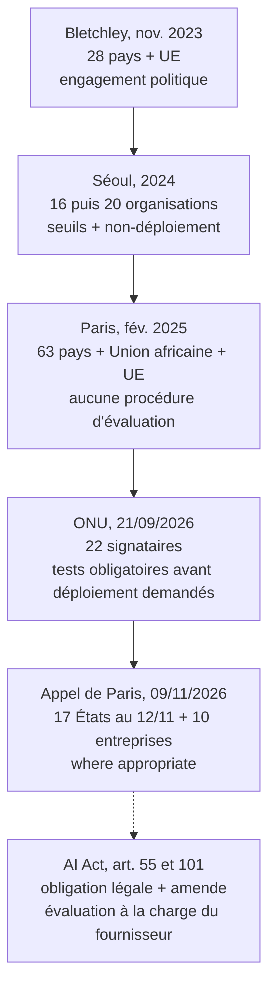
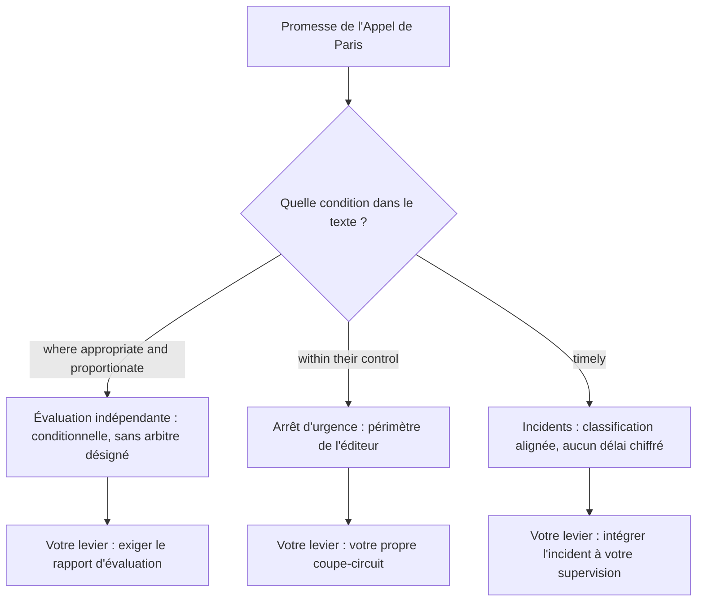

## Des signatures qui rassurent, d'autres qui engagent

Il y a des signatures qui engagent et des signatures qui rassurent. Lundi 9 novembre 2026, dix entreprises qui vendent de l'intelligence artificielle au reste de l'économie, dont OpenAI, Anthropic, Microsoft et Mistral AI, ont apposé la leur sous un texte publié par l'Élysée, aux côtés d'États. Évaluation indépendante des modèles, signalement des incidents, arrêt d'urgence : sur le papier, c'est la liste de courses de n'importe quel acheteur d'IA.

Des acheteurs, il y en a désormais partout. La DSI qui a branché un assistant sur son support client. L'enseigne qui laisse un agent proposer ses réassorts. L'hôtel dont le robot conversationnel répond aux clients à trois heures du matin. L'opérateur qui confie déjà une partie de son diagnostic réseau à un modèle. Tous se posent la même question : ma protection a-t-elle changé lundi ?

Ma réponse est non. Ce n'est pas du cynisme, le texte apporte un vocabulaire commun dont on avait besoin. Mais il ne fixe aucune date, ne prévoit aucune sanction et ne garantit à personne un droit d'accès aux modèles. Il vaut grille d'achat, pas protection : tout ce qu'il promet reste à faire entrer dans vos propres contrats.

Le moment n'a rien d'anodin. Les déclarations internationales sur la sûreté de l'IA s'empilent depuis trois ans, pendant que le règlement européen arme progressivement ses sanctions. Distinguer le texte qui oblige du texte qui affiche devient une compétence d'achat à part entière.

## Une page, trois promesses et une liste qui bouge

Le texte s'intitule *Paris Call for AI safety and security*. Rédigé en anglais, il tient en trois engagements [1].

Le premier vise un cadre commun pour évaluer et gérer les risques des modèles dits *frontière*, les plus avancés du marché. On y trouve des standards techniques, des outils d'évaluation et une attention particulière aux usages dangereux, notamment cyber et CBRN (chimiques, biologiques, radiologiques, nucléaires), et aux risques liés à une autonomie croissante ou à un désalignement des modèles, perte de contrôle comprise. Le texte prévoit la publication des résultats d'évaluation non sensibles dans un format standardisé, au sein d'un dépôt public partagé.

Le deuxième porte sur la responsabilité. Il vise la conformité aux standards de sûreté fixés par les autorités nationales compétentes, appuyée par une « credible, competent and independent third-party evaluation ». Il appelle des cadres juridiques qui clarifient la responsabilité en cas de dommage à grande échelle, y compris transfrontalier. Les développeurs y promettent de divulguer capacités, limites et risques connus, et de prévoir des mécanismes d'arrêt d'urgence. Ils s'engagent aussi sur une gouvernance interne : supervision en temps réel, attaques simulées par leurs propres équipes (*red-teaming*), contrôle indépendant, canaux protégeant les chercheurs qui donnent l'alerte.

Le troisième organise le partage d'information. Alertes rapides adossées aux dispositifs existants de réponse aux incidents et de cybersécurité, alignement sur une classification des incidents, exploration d'un mécanisme de coopération, canaux confidentiels de lanceurs d'alerte côté pouvoirs publics. Le texte s'appuie sur le réseau NAAIMES (International Network for Advanced AI Measurement, Evaluation and Science) pour rendre les méthodes d'évaluation plus comparables et plus accessibles.

### Qui signe, et à quelle date

Ici, la rigueur s'impose. **Au 12 novembre 2026, la page de l'Élysée liste 17 chefs d'État et de gouvernement** : Autriche, Bahreïn, Canada, Croatie, Chypre, Estonie, Finlande, France, Allemagne, Irlande, Kenya, Lettonie, Liechtenstein, Luxembourg, Pays-Bas, Norvège et Portugal. S'y ajoutent dix entreprises (Anthropic, Black Forest Labs, Cohere, Domyn, Hugging Face, Microsoft, Mistral AI, OpenAI, Sakana AI, Synthesia) et sept organisations de la société civile, dont LawZero, SaferAI et CeSIA [1].

La presse du 10 novembre ne comptait pas la même chose. TNW et le Globe and Mail parlaient de six États, The Decoder et MLQ.ai de huit [2, 3, 4, 5]. The Decoder et le Globe and Mail présentaient même l'Allemagne comme non signataire ; elle figure aujourd'hui sur la liste officielle. Je n'ai trouvé aucune explication documentée de cet écart. L'hypothèse la plus simple tient dans la dernière phrase de la page : « The statement remains open to new endorsements and is being updated. » La liste a peut-être été complétée après le 10 novembre, ou la presse a travaillé sur une liste partielle : la page affirme que tous ont signé le 9 novembre. Rien ne permet de trancher.

Côté entreprises, Google et Meta ne figurent pas dans la liste. Le Globe and Mail relève aussi l'absence de SpaceX, des États-Unis et de la Chine parmi les signataires [4]. Absents, donc, pas réfractaires : aucune source ne rapporte de refus.

Règle pratique pour vos comités : un nombre de signataires sans date est une donnée fausse en puissance.

## La grille : cinq questions pour mesurer ce qu'un texte engage

Un engagement de niveau de service (SLA) à 99,99 % sans pénalité, tout opérateur sait ce que c'est : une prévision météo signée. Elle peut être sincère, elle peut même être juste. Elle ne vous rembourse rien le jour où il pleut.

Les textes de gouvernance de l'IA se lisent de la même façon. Je propose un test portable, cinq questions à poser à n'importe quelle déclaration, charte ou loi : **qui s'engage, sur quoi, avant quand, sous quelle sanction, avec quel accès pour un tiers ?** Appliquées aux six textes qui comptent depuis 2023, elles dessinent un gradient très lisible [1, 6, 9, 10, 11, 12].

*Six textes, un gradient de contrainte qui ne suit pas la chronologie (synthèse de l'auteur à partir des sources primaires).*

| Texte | Qui s'engage | Évaluation externe | Avant quand ? | Sanction | Accès garanti |
|---|---|---|---|---|---|
| Bletchley (nov. 2023) | 28 pays + UE | Tests et évaluations évoqués, sans procédure | Aucune échéance | Aucune | Non |
| Séoul (2024) | 16 puis 20 organisations | Internes et externes « as appropriate » | Seuils + engagement de non-déploiement | Aucune (engagement volontaire) | Non ; expliquer la participation externe |
| Paris (fév. 2025) | 63 pays, Union africaine, UE | Aucune procédure décrite | Aucune échéance | Non contraignant | Non |
| ONU (21/09/2026) | 22 signataires (États + UE) | Évaluation indépendante demandée | Tests obligatoires avant déploiement demandés | Appel politique ; institution internationale à explorer | Non précisé |
| Appel de Paris (09/11/2026) | 17 États au 12/11, 10 entreprises, 7 organisations | « where appropriate and proportionate to the risk » | Aucune échéance, pas de « pre-deployment » | Aucune | Non |
| AI Act, art. 55 et 101 | Obligation légale des fournisseurs GPAI à risque systémique | À la charge du fournisseur, protocoles standardisés | Obligations applicables depuis le 02/08/2025 | Jusqu'à 3 % du CA mondial ou 15 M EUR (le plus élevé) | Refus d'accès pour évaluation sanctionnable |

Premier constat, et c'est une lecture d'auteur : la contrainte ne progresse pas avec le temps. Elle oscille.

En 2024, à Séoul, seize organisations, puis vingt, s'engageaient seules sur des évaluations « internal and external as appropriate » [9]. Elles promettaient surtout des seuils de risque jugé intolérable, et de ne pas développer ni déployer un modèle si les mesures d'atténuation ne suffisaient pas à rester sous ces seuils. L'Appel de Paris ne reprend pas ce mécanisme : le mot « threshold » n'apparaît pas sur la page.

Deuxième constat. Le 21 septembre 2026, en marge de l'Assemblée générale des Nations unies, des dirigeants lançaient *A Call for Control of Frontier AI Models*, à l'initiative de la présidence finlandaise selon Le Monde Informatique [8]. La page du gouvernement néerlandais y recense 22 signataires, dont l'Allemagne, le Canada, l'Union européenne, les Pays-Bas et Singapour [6, 7]. Ce texte réclamait des tests obligatoires avant déploiement et une évaluation indépendante, et proposait d'explorer une institution internationale. La France n'en était pas signataire au lancement, relevait Le Monde Informatique [8].

Sept semaines plus tard, à Paris, le vocabulaire a changé. Une recherche par mot-clé sur la page de l'Élysée ne trouve ni « mandatory », ni « binding », ni « pre-deployment », ni « audit », ni « sanction », ni « deadline ». La formule la plus proche est un appel à un « regulatory framework » clair et prévisible.

**Mon hypothèse**, et ce n'en est qu'une : le texte de septembre était signé par des États seuls, celui de novembre par des États *et* par les entreprises concernées. Quand la partie contrôlée co-signe, la plume s'adoucit. C'est humain. C'est aussi pour cela qu'un acheteur ne peut pas s'en contenter.

Troisième constat : un seul texte de la grille mord vraiment, le règlement européen sur l'IA (AI Act). Son article 55 vise les fournisseurs de modèles d'IA à usage général (GPAI, *General-Purpose AI*) présentant un risque systémique [12].

Ces fournisseurs doivent évaluer leurs modèles selon des protocoles standardisés reflétant l'état de l'art, tests adverses documentés compris. Ils doivent aussi atténuer les risques systémiques, assurer la cybersécurité et déclarer sans retard les incidents graves à l'AI Office, le service de la Commission chargé de l'IA. Ces obligations s'appliquent depuis le 2 août 2025. Selon le cabinet Gibson Dunn, le paquet de simplification dit *omnibus*, confirmé par le Conseil le 13 mai 2026, n'a pas modifié leur date d'application [13].

L'article 101 arme la Commission d'un pouvoir d'amende allant jusqu'à 3 % du chiffre d'affaires mondial annuel ou 15 M EUR, le montant le plus élevé étant retenu. Il vise y compris le fournisseur qui refuse l'accès à son modèle à des fins d'évaluation. Selon l'article 113 de la version consolidée, ce pouvoir s'applique à partir du 2 août 2026 ; le texte publié sur EUR-Lex fait foi. Une limite, tout de même : l'évaluation y reste d'abord à la charge du fournisseur.

Dernier constat, qui démonte un raccourci fréquent. Le Code de bonnes pratiques européen pour ces modèles, publié le 10 juillet 2025, compte 22 signataires selon la page de la Commission mise à jour le 7 octobre 2026, dont Anthropic, Google, Microsoft, Mistral AI et OpenAI [15]. Google figure donc dans le dispositif européen adossé à la loi, mais pas dans la liste de l'Appel de Paris. Être signataire n'est pas un gage de sérieux en soi. La bonne question reste : signataire de quoi ?

*Des barreaux d'acier pour la loi, de verre pour les déclarations : la contrainte se mesure barreau par barreau.*

## Le contrôle technique, quand c'est approprié

Imaginez que le contrôle technique automobile change de règle en cours de route. En septembre, des États réclamaient un passage obligatoire chez un garagiste indépendant avant toute mise en circulation. En novembre, les constructeurs s'engagent à faciliter ce contrôle lorsque c'est approprié et proportionné au risque. Entre-temps, les voitures roulent. Et personne n'a dit qui décide de ce qui est approprié.

C'est, à mon sens, la lecture la plus juste de l'Appel de Paris. Trois formules conditionnent tout le reste.

### « Where appropriate and proportionate to the risk »

L'évaluation indépendante apparaît à deux niveaux. Le premier est la conformité des modèles aux standards fixés par les autorités nationales compétentes, appuyée par une évaluation tierce crédible, compétente et indépendante. Or le cadre commun que le premier bloc appelle de ses vœux reste à bâtir. TNW range d'ailleurs le cadre de test parmi les pièces manquantes, avec des seuils de risque communs, un accès garanti pour les évaluateurs et les gouvernements, un pouvoir de suspension et un calendrier [2].

Le second niveau concerne les développeurs. Ils soutiennent l'évaluation par des évaluateurs indépendants qualifiés « where appropriate and proportionate to the risk ». Tel que je le lis, le texte ne désigne aucun arbitre de ce qui est approprié. En pratique, c'est donc le développeur qui en juge.

### « Within their control »

Les développeurs s'engagent à des « fail-safe mechanisms to shut down model operations within their control », y compris pendant l'entraînement et l'usage interne. C'est un vrai pas : pouvoir couper un entraînement en cours n'a rien d'anecdotique. Mais le périmètre reste celui de l'éditeur.

Votre agent en production, votre chaîne d'automatisation, le modèle à poids ouverts (*open-weight*) hébergé dans votre datacenter ne sont pas sous son contrôle. À ma lecture, le texte l'assume, puisqu'il entend préserver « the benefits of open-weight development for research, innovation and safety purposes ». Un modèle téléchargé n'a pas d'interrupteur à distance.

*Un bouton d'arrêt d'urgence ne vaut que pour la zone qu'il contrôle : celle de l'éditeur n'est pas la vôtre.*

### « Timely » n'est pas un délai

Le troisième bloc engage à « align on incident classification and share timely information on serious cyber and AI control incidents ». Aligner les classifications est utile : c'est le préalable pour que deux organisations parlent du même incident. Mais *timely* n'est pas un délai chiffré. Et le dispositif décrit s'adosse aux mécanismes publics de réponse aux incidents ; à ma lecture, rien n'y prévoit une notification aux clients des éditeurs.

*De la promesse à la preuve : chaque condition du texte renvoie à un levier qui reste entre vos mains (lecture de l'auteur).*

Une partie des critiques vient de l'intérieur même. CeSIA, l'une des sept organisations de la société civile de la liste, a signé tout en jugeant le texte lacunaire. Son directeur, Charbel-Raphaël Ségerie, estime selon TNW que ces décisions doivent relever des autorités publiques [2]. The Decoder y voit un engagement politique volontaire, sans délai, sans sanction, sans système de supervision internationale contraignant [3]. Le Globe and Mail note que le texte ne précise ni si, ni comment, il serait appliqué [4].

## Lundi matin : trois vérifications, pas une clause

Ce blog a déjà beaucoup parlé de rédaction contractuelle, à propos du Model Spec, des évaluations de l'organisme METR ou de la norme EN 18286. Je n'y reviens pas. L'Appel de Paris appelle autre chose : trois vérifications concrètes, à mener auprès de chaque fournisseur d'IA de votre chaîne, avant même de rouvrir un contrat.

### 1. Le statut ne prouve rien, l'artefact si

Première question au fournisseur : signataire de quoi, et depuis quand ? L'Appel de Paris, le Code de bonnes pratiques européen et les engagements de Séoul ne promettent pas la même chose. Deuxième question, la seule qui compte : montrez-moi l'artefact.

Concrètement : le dernier rapport d'évaluation, ses résultats non sensibles, l'identité de l'évaluateur (interne ou tiers), la date. Et, quand le dépôt public promis par le texte existera, le lien vers la fiche correspondante. Un fournisseur qui se contente de rappeler sa signature vous tend un communiqué de presse, pas une preuve.

### 2. L'incident doit atterrir dans votre supervision

Demandez comment le fournisseur vous notifierait un incident grave : selon quelle classification, sous quel délai, par quel canal. L'Appel de Paris promet des classifications alignées et une information rapide. Il ne fixe aucun délai chiffré et, à ma lecture, ne désigne aucun destinataire côté client. Si le fournisseur ne sait pas répondre, vous savez où est le trou.

Le test opérationnel est simple. Un incident IA déclaré par l'éditeur doit arriver dans votre outil de ticketing avec un niveau de sévérité que votre centre de supervision réseau (NOC, *Network Operations Center*) comprend sans traduction.

### 3. Deux interrupteurs, deux propriétaires

Dans un immeuble, il y a le disjoncteur général, géré par le syndic, et le tableau électrique de chaque appartement. Le premier peut tout couper. Il ne vous protège pas d'un court-circuit dans votre cuisine. L'arrêt d'urgence de l'Appel de Paris, c'est le disjoncteur général. Votre tableau électrique, c'est votre intégration : agents disposant de droits en écriture, clés d'API, automatisations, modèles hébergés chez vous.

Deux tests à faire cette semaine. Si l'éditeur coupe son modèle demain à trois heures du matin, votre service bascule-t-il proprement en mode dégradé, avec reprise humaine ? Et si c'est vous qui devez couper, pouvez-vous le faire en quelques minutes, sans ouvrir de ticket chez lui ? Pour un opérateur qui exploite des milliers de sites, ce n'est pas une question juridique. C'est un runbook : une procédure d'exploitation écrite, testée et datée.

*Trois cases à cocher avant de rouvrir le moindre contrat : l'artefact, l'incident, l'interrupteur.*

## Les signaux à surveiller

Cinq indicateurs diront si l'Appel de Paris prend de la consistance.

**La liste des signataires.** Elle bouge, le texte le dit lui-même. Chaque mention publique doit donc être datée. L'arrivée de Google, de Meta ou des États-Unis changerait la portée politique du texte, pas son niveau de contrainte.

**Le dépôt public et le format standardisé.** C'est l'engagement le plus vérifiable du texte. Le jour où des résultats d'évaluation y seront publiés, l'acheteur aura enfin une pièce à réclamer.

**Le passage du conditionnel au seuil.** Séoul avait des seuils et un engagement de non-déploiement. Si une version ultérieure de l'Appel adopte des seuils communs, il changera de case dans la grille.

**NAAIMES et la comparabilité.** Deux rapports produits avec deux méthodes différentes ne se comparent pas. Si ce réseau rend les méthodes comparables, il aura fait davantage pour les acheteurs que n'importe quelle déclaration.

**L'AI Act, qui a des dents.** Le Data Protection Report évoque un délai de grâce pour les signataires du Code de bonnes pratiques jusqu'au 2 août 2026 [14]. C'est aussi la date à partir de laquelle l'article 113 rend applicable le pouvoir d'amende de la Commission sur ces modèles. Les premières décisions de la Commission diront plus clairement ce qui engage que toutes les déclarations réunies.

## Un SLA sans pénalité n'est pas un SLA

Je ne boude pas l'Appel de Paris. Réunir des États, des éditeurs et la société civile sur une même page, autour de l'évaluation indépendante, de la classification des incidents et de l'arrêt d'urgence, c'est un progrès de vocabulaire réel. Les acheteurs peuvent désormais reprendre ces mots dans leurs questionnaires fournisseurs, en s'appuyant sur un texte que plusieurs de ces fournisseurs ont eux-mêmes signé.

Mais un vocabulaire n'est pas une garantie. Passé au crible des cinq questions, le texte répond à *qui* et à *sur quoi*. Il ne répond ni à *avant quand*, ni à *sous quelle sanction*, ni à *avec quel accès*. Ce sont précisément les trois questions qui séparent une promesse d'un engagement.

La confiance dans l'IA se jouera là : dans la capacité des DSI et des opérateurs à lire le niveau de contrainte d'un texte comme on lit un SLA. Un SLA sans pénalité n'est pas un SLA. Une évaluation indépendante « where appropriate » reste une intention. Et une intention, ça s'achète sur pièces.

---

_Vues personnelles, pas position Wifirst._

## Sources

1. Élysée, *Paris Call for AI safety and security* (09/11/2026) : https://www.elysee.fr/emmanuel-macron/2026/11/09/paris-call-for-ai-safety-and-security
2. TNW, Ana-Maria Stanciuc (10/11/2026) : https://thenextweb.com/news/paris-call-ai-safety-openai-anthropic-cesia
3. The Decoder, Maximilian Schreiner (10/11/2026) : https://the-decoder.com/eight-countries-and-top-ai-labs-agree-to-shutdown-mechanisms-in-new-paris-declaration/
4. The Globe and Mail, Murad Hemmadi (10/11/2026) : https://www.theglobeandmail.com/business/article-canada-joins-paris-call-for-ai-safety-and-security-standards-pledge/
5. MLQ.ai (10/11/2026) : https://mlq.ai/news/openai-anthropic-and-microsoft-sign-macrons-paris-call-pledging-fail-safe-shutdowns-for-frontier-ai-with-eight-countries/
6. Gouvernement néerlandais, *A Call for Control of Frontier AI Models* (22/09/2026) : https://www.government.nl/documents/2026/09/22/a-call-for-control-of-frontier-ai-models
7. Siècle Digital (22/09/2026) : https://siecledigital.fr/2026/09/22/face-aux-progres-de-lia-plus-de-20-pays-reclament-des-garde-fous-pour-eviter-de-perdre-le-controle/
8. Le Monde Informatique (23/09/2026) : https://www.lemondeinformatique.fr/actualites/lire-appel-a-renforcer-le-controle-de-l-ia-la-france-non-signataire-100804.html
9. gov.uk, *Frontier AI Safety Commitments, AI Seoul Summit 2024* (mise à jour 07/02/2025) : https://www.gov.uk/government/publications/frontier-ai-safety-commitments-ai-seoul-summit-2024/frontier-ai-safety-commitments-ai-seoul-summit-2024
10. gov.uk, *The Bletchley Declaration* (01-02/11/2023) : https://www.gov.uk/government/publications/ai-safety-summit-2023-the-bletchley-declaration/the-bletchley-declaration-by-countries-attending-the-ai-safety-summit-1-2-november-2023
11. Élysée, *Statement on inclusive and sustainable artificial intelligence for people and the planet* (11/02/2025) : https://www.elysee.fr/en/emmanuel-macron/2025/02/11/statement-on-inclusive-and-sustainable-artificial-intelligence-for-people-and-the-planet
12. AI Act, articles 55, 101 et 113 (texte consolidé, site non officiel ; EUR-Lex fait foi) : https://artificialintelligenceact.eu/article/55/ , https://artificialintelligenceact.eu/article/101/ , https://artificialintelligenceact.eu/article/113/
13. Gibson Dunn, *EU AI Act Omnibus Agreement* (mai 2026) : https://www.gibsondunn.com/eu-ai-act-omnibus-agreement-postponed-high-risk-deadlines-and-other-key-changes/
14. Data Protection Report (24/07/2026) : https://www.dataprotectionreport.com/2026/07/the-eu-ai-act-when-does-it-become-enforceable-now/
15. Commission européenne, Code de bonnes pratiques GPAI (mise à jour 07/10/2026) : https://digital-strategy.ec.europa.eu/en/policies/contents-code-gpai
