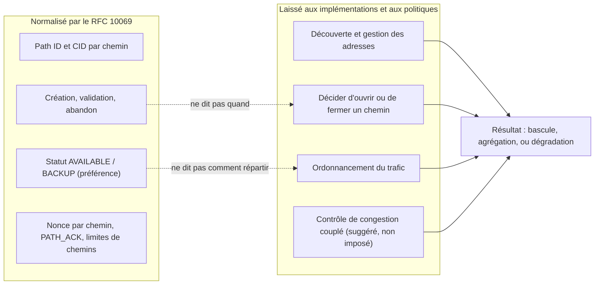
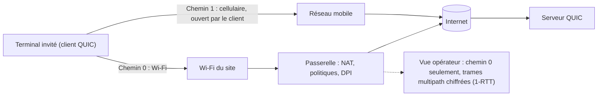

## Le hall d'hôtel, ce trou noir de la visio

Un client sort de sa chambre d'hôtel en pleine visioconférence, traverse le hall et pousse la porte tournante. Quelque part entre le comptoir et le trottoir, son téléphone lâche le Wi-Fi et se rabat sur le réseau mobile. L'image se fige. Le son hache. Parfois, l'appel tombe. Pour lui, c'est « le Wi-Fi de l'hôtel qui marche mal ». Pour nous, c'est un ticket de support.

Tous ceux qui exploitent du Wi-Fi en hôtellerie, en résidence étudiante ou sur un campus connaissent ce moment. Ils savent aussi qu'une bonne partie du problème leur échappe : c'est le terminal qui décide quand changer de route, et c'est l'application qui survit, ou non, au changement.

Le 7 novembre 2026, l'IETF (l'organisme qui écrit les standards d'Internet) a publié le RFC 10069, intitulé « Managing Multiple Paths for a QUIC Connection » [1][2]. Il permet à une connexion QUIC, le protocole de transport sur lequel repose HTTP/3, d'emprunter plusieurs chemins réseau à la fois. Il aura fallu quatre ans et neuf mois entre le premier brouillon du groupe de travail et la publication [3].

Les plaquettes commerciales vont vite traduire ça en « Wi-Fi et 5G agrégés ». Le texte ne promet rien de tel. Les mots anglais *throughput* (débit) et *jitter* (gigue) n'y apparaissent pas une seule fois. C'est précisément ce qui rend ce RFC intéressant, et ce qui oblige à le lire de près avant d'en attendre quoi que ce soit.

## Des routes balisées, pas de GPS

Pensez à un réseau routier. Le RFC 10069 livre les bretelles d'accès, la signalisation et le code de la route : comment ouvrir une nouvelle voie, comment vérifier qu'elle mène bien à destination, comment la fermer proprement. Il ne livre pas le GPS qui décide, à chaque seconde, quelle voie emprunter. Ce GPS, que le jargon appelle l'ordonnanceur (*scheduler*), reste l'affaire de chaque implémentation.

Le document est une norme à part entière : catégorie Standards Track, « Proposed Standard » selon le suivi en ligne de l'IETF. Approuvé le 18 mars 2026, il a ensuite patienté environ sept mois et demi dans la file de publication [3]. Ses six auteurs viennent d'Alibaba, d'Ericsson, de Harvey AI, de Private Octopus, de l'Université de Mons et de l'UCLouvain. Voici, concrètement, ce qu'ils ont normalisé.

**Une négociation tout ou rien.** Au moment de la poignée de main, chaque pair annonce combien de chemins il accepte, via le paramètre de transport `initial_max_path_id` (code 0x3e). Si l'un des deux ne l'annonce pas, la règle est sèche : les deux « MUST NOT use any frame or mechanism defined in this document ». Pas de multipath bricolé d'un seul côté.

**Un chemin, c'est un numéro.** L'unité de base est le *path ID*, un identifiant de chemin. Le chemin initial porte le numéro 0 ; les suivants croissent et ne sont jamais réutilisés. Chaque chemin dispose de ses propres identifiants de connexion (*connection IDs*, ou CID) et de son propre espace de numéros de paquets. Même le chiffrement s'adapte : la valeur unique exigée pour chiffrer chaque paquet (le *nonce*) combine le path ID et le numéro de paquet.

Détail qui compte : un chemin n'est pas une paire d'adresses. Le RFC autorise plusieurs path IDs sur un même 4-tuple, c'est-à-dire les mêmes adresses et les mêmes ports, à la source comme à la destination. Exemple cité par le texte : porter des marquages de qualité de service DiffServ différents.

**Le client ouvre, le serveur valide.** Le texte est explicite : « this extension only enables clients to open a new path ». Le serveur, lui, vérifie que la nouvelle adresse répond vraiment, par un échange PATH_CHALLENGE / PATH_RESPONSE sur le chemin lui-même, et que ce chemin accepte des paquets de 1 200 octets. Il reste soumis aux limites anti-amplification. Si la validation échoue, le path ID est consommé et le chemin doit être fermé explicitement.

**Un statut, pas un ordre.** Un pair peut déclarer un chemin AVAILABLE (utilisable) ou BACKUP (de secours). Nuance capitale : chacun émet ces indications pour son propre compte, et l'autre « might not follow ». Un chemin BACKUP ne devrait recevoir aucun trafic si un autre chemin est disponible et utilisable. Et si tous sont en BACKUP ? « No guidance is provided. » C'est un signal de préférence, pas un ordonnanceur.

**Une fermeture obligatoire.** Inactivité, pertes, manque de ressources : quelle que soit la raison, l'abandon d'un chemin passe par une trame PATH_ABANDON, et le pair répond par la sienne. Le RFC prévoit même un code d'erreur PATH_UNSTABLE_OR_POOR, illustré par des « frequent handover events during high-speed mobility » ou un « weak wireless signal ». Ici, le sans-fil apparaît comme une cause d'abandon, pas comme une promesse.

| Trame | Code | Rôle |
|---|---|---|
| PATH_ACK | 0x3e-0x3f | Acquitter les paquets d'un chemin donné |
| PATH_ABANDON | 0x3e75 | Fermer explicitement un chemin |
| PATH_STATUS_BACKUP | 0x3e76 | Déclarer un chemin de secours |
| PATH_STATUS_AVAILABLE | 0x3e77 | Déclarer un chemin utilisable |
| PATH_NEW_CONNECTION_ID, PATH_RETIRE_CONNECTION_ID | 0x3e78, 0x3e79 | Fournir ou retirer des CID pour un chemin |
| MAX_PATH_ID, PATHS_BLOCKED, PATH_CIDS_BLOCKED | 0x3e7a, 0x3e7b, 0x3e7c | Relever la limite de chemins, signaler un blocage |

Toutes ces trames ne circulent que dans les paquets dits 1-RTT, ceux qui suivent la poignée de main et dont le contenu est chiffré. Retenez ce point : il reviendra quand on parlera de ce que voit le réseau.

*Un identifiant par chemin, des compteurs par chemin, une fermeture explicite : le RFC 10069 normalise le cycle de vie des chemins, pas leur usage.*

## Ce que le texte laisse dehors, noir sur blanc

Le résumé du RFC pose le périmètre dès ses premières lignes : « This document does not specify address discovery or management, nor how applications using QUIC schedule traffic over multiple paths. » La section 3 enfonce le clou : le document ne dit pas « when a client decides to initiate or close a path or how multiple open paths are used for sending ».

Trois décisions restent donc hors norme. Découvrir les adresses disponibles. Décider d'ouvrir ou de fermer un chemin. Répartir le trafic entre les chemins ouverts. Sur ce dernier point, le texte est d'une franchise rare : « There are currently no IETF specifications that define scheduling algorithms for simultaneously (i.e., concurrently) using multiple paths. » L'ordonnancement y est décrit comme « a local decision based on the preferences of the application and the implementation ».

Ce n'est pas un oubli. D'après le rapport du *shepherd* (le membre du groupe de travail qui accompagne le document jusqu'à son approbation), environ 300 issues et 326 pull requests ont été traitées depuis l'adoption du draft en 2022 [4]. Les débats les plus durs ont porté sur la tuyauterie : un espace de numéros de paquets unique ou un par chemin, le lien entre identifiants de connexion et path IDs. Le reste a été écarté sciemment : « research topics were kept out of scope ».

Le cas d'usage que le RFC met en avant est la bascule entre Wi-Fi et réseau mobile. Et il prend soin d'en borner la portée :

> « while failover between Wi-Fi and mobile networks is a well-known multipath use case, it only temporarily uses two paths at the same time to avoid transmission pauses. Simultaneous path usage generally, however, needs more consideration than specified in this document to avoid negative performance impacts, e.g., when stream data is distributed over multiple paths with different delays. »

Le scénario du hall d'hôtel, oui. L'agrégation permanente de deux liens, pas sans « more consideration ».

Pourquoi tant de prudence ? Imaginez un déménagement réparti entre deux camions, l'un sur l'autoroute, l'autre sur la nationale. Si les meubles doivent être montés dans l'ordre, vous attendez le camion le plus lent avant de visser la première étagère. Le RFC dit exactement cela : quand un même flux est réparti sur plusieurs chemins, « data delivery will experience the maximum delay of all used paths due to in-order delivery ». Deux routes ne font pas un trajet plus court.

Le texte évoque bien un éventail d'ordonnancements possibles, allant « from support for failover to simultaneous use of the aggregated capacity across all open paths ». Mais c'est une plage de ce qu'une implémentation pourrait faire, pas une capacité livrée par la norme. Le comptage dans le texte brut est sans appel : « jitter », « throughput », « cellular » et « 5G » n'y figurent jamais. « Wi-Fi » et la racine « aggregat- » n'y apparaissent qu'une fois chacun, dans les deux citations ci-dessus.

*Le partage des rôles : le RFC normalise le cycle de vie des chemins, les implémentations décident de tout ce qui fait la performance.*

Même logique pour le contrôle de congestion. Chaque chemin a son propre état, mais deux chemins peuvent partager le même goulot d'étranglement. Le RFC avertit qu'un contrôle standard « could result in an unfair distribution of the bandwidth », la connexion multipath raflant plus que sa part face aux connexions classiques. Il note que l'algorithme couplé de Multipath TCP (LIA, RFC 6356) « can immediately be adapted » [12] et renvoie aux recommandations de l'IETF en la matière (BCP 133, RFC 9743). Il n'impose rien.

Même la mesure du temps d'aller-retour (RTT) devient piégeuse, car un acquittement peut revenir par un autre chemin que les données. L'exemple chiffré du RFC parle de lui-même : un lien terrestre à 50 ms par sens, un lien satellite géostationnaire à 300 ms par sens. Selon les combinaisons, le RTT mesuré vaut 100, 350 ou 600 ms. Bon courage à l'ordonnanceur naïf.

*Le cas d'usage que le RFC 10069 met en avant : la bascule entre Wi-Fi et réseau mobile, où deux chemins ne coexistent que le temps d'éviter une coupure.*

## Les seuls chiffres publiés viennent d'Alibaba

Si la norme ne promet rien, d'où viennent les promesses ? Pour l'essentiel, d'un article présenté à SIGCOMM 2021, la grande conférence académique du réseau [7]. Il décrit XLINK, un système d'Alibaba dont deux des auteurs, Y. Ma et Y. Liu, signent aussi le RFC 10069.

Sur le papier, les résultats sont solides. Mesurés sur plus de 3 millions de lectures de vidéos dans l'application Taobao sous Android, face à QUIC mono-chemin, ils affichent au 99e percentile une amélioration de 19 à 50 % du temps de complétion des requêtes de segments vidéo, et de 32 % de la latence de première image. Le taux de *rebuffering* (les pauses de chargement) s'améliore de 23 à 67 %. Le tout pour 2,1 % de trafic redondant.

Trois précautions s'imposent. D'abord, ces gains viennent d'un ordonnanceur et d'une logique de ré-injection pilotés par la qualité d'expérience vidéo, propres à XLINK. Pas du RFC 10069, qui n'existait pas. Ensuite, le contexte est celui d'un seul éditeur, en mobilité Wi-Fi/LTE. Enfin, le rapport du shepherd décrit le déploiement d'Alibaba, avec prudence, comme « primarily a self-interop deployment » [4] : Alibaba y parle surtout à Alibaba.

Le contre-exemple est plus instructif encore. Dans un billet publié en décembre 2021 sur le blog de l'APNIC (le registre Internet de la zone Asie-Pacifique), la même équipe décrit son test A/B : 100 000 participants, plus de 3 millions de lectures, deux semaines [8]. Elle y rapporte qu'un ordonnanceur par défaut, celui qui privilégie le chemin au RTT minimal, pouvait se montrer 28 % plus lent au 99e percentile que le mono-chemin sur le meilleur chemin. Le billet ne détaille pas les conditions de cette mesure.

Même famille de protocole, deux ordonnanceurs, deux résultats de signe opposé. C'est toute la thèse de cet article : la norme ouvre la porte, la politique décide de ce qu'on trouve derrière. Et je n'ai trouvé ni mesure indépendante, ni étude d'analyste sur le sujet. Les seuls chiffres que j'ai pu lire viennent d'un acteur qui a co-écrit la norme.

## MPTCP avait fait un autre pari

Le réflexe naturel consiste à comparer avec Multipath TCP (MPTCP), dont la version 1 est normalisée par le RFC 8684 depuis mars 2020 [5] et prise en charge par le noyau Linux, avec un gestionnaire de chemins noyau ou en espace utilisateur [9]. Précision d'honnêteté : cette comparaison est la mienne. Le RFC 10069 ne se positionne pas face à MPTCP, qu'il ne croise qu'au détour du contrôle de congestion.

| Dimension | MPTCP v1 (RFC 8684) | Multipath QUIC (RFC 10069) |
|---|---|---|
| Ce qu'est un chemin | Un sous-flux TCP, défini par un 4-tuple | Un path ID, plusieurs possibles sur un même 4-tuple |
| Où vit la signalisation | Options TCP, conçues pour rester transparentes aux applications | Trames chiffrées ; QUIC tourne en espace utilisateur, la décision est largement applicative |
| Annonce d'adresses | Dans la norme (ADD_ADDR, REMOVE_ADDR) | Hors norme, travail séparé en cours |
| Qui ouvre un chemin | Chacun des deux hôtes peut initier un sous-flux | Le client uniquement |
| Secours et priorité | Drapeau backup, option MP_PRIO | PATH_STATUS_BACKUP / AVAILABLE, émis par chaque pair |
| Pair non compatible | Repli vers TCP simple prévu par la norme | Aucun mécanisme du RFC utilisé ; un repli de QUIC vers TCP reste une affaire applicative |
| Ordonnanceur | Pas de section dédiée (le mot « scheduler » est absent) | Explicitement laissé à l'implémentation |

Ma lecture : MPTCP embarque l'annonce d'adresses dans la norme, Multipath QUIC choisit de la déléguer. La découverte d'adresses fait l'objet d'un travail séparé, draft-ietf-quic-address-discovery, dont la dernière révision (-01, qui définit une trame OBSERVED_ADDRESS) date du 15 août 2026 [11]. C'est toujours un brouillon à ce jour. Dans les deux cas, la politique (quand ouvrir, quand préférer, comment répartir) relève de l'implémentation. Je ne conclus pas que l'un fait mieux que l'autre : rien de ce que j'ai lu ne le démontre.

*Deux paris d'architecture : MPTCP inscrit l'annonce d'adresses dans le protocole, Multipath QUIC la délègue et chiffre sa signalisation de chemins.*

## Vu depuis le plafond d'un couloir d'hôtel

Changeons de point de vue. Ce qui suit est mon analyse d'opérateur Wi-Fi, déduite du RFC 10069 et du RFC 9312, le document informatif de l'IETF sur la gestion opérationnelle de QUIC [6]. Ce sont des lectures d'auteur, pas des affirmations de la norme.

**Nous ne sommes pas un endpoint.** Le multipath se négocie de bout en bout, entre le terminal de l'invité et le serveur. C'est le terminal, en tant que client QUIC, qui ouvre le second chemin, typiquement par son interface cellulaire. Le réseau Wi-Fi ne voit, au mieux, qu'un des chemins. Il n'y a rien à « activer » chez nous.

**Nos politiques ne couvrent qu'une moitié.** Quotas, QoS, portail captif, journalisation : tout ce qui s'applique par client ou par flux ne vaut que pour le chemin Wi-Fi. Le trafic du chemin cellulaire y échappe. Ce n'est ni bon ni mauvais en soi. C'est une question de gouvernance que chaque DSI d'hôtel ou de campus devra se poser si les terminaux adoptent ce mécanisme en masse.

**Notre seul vrai levier : ne pas casser le flux.** Le RFC 9312 recommande de ne pas brider l'UDP paquet par paquet, mais plutôt flux par flux. Il prévient aussi qu'un blocage fondé sur un hachage du 5-tuple « increases the risk of black-holing an active connection when the address changes ». De son côté, le RFC 10069 rappelle que les délais d'expiration des NAT et autres équipements intermédiaires peuvent tuer un chemin resté muet, tout en déconseillant par défaut les keep-alives par chemin. Traduction : UDP sortant ouvert, timeouts NAT raisonnables, aucune règle qui suppose qu'une connexion garde ses adresses.

**Notre visibilité recule encore.** Les trames multipath ne voyagent que dans les paquets 1-RTT, donc chiffrés. Le paramètre de transport du client reste lisible dans le premier paquet de la poignée de main (le paquet *Initial*). Mais selon le RFC 9312, « the reply from the server cannot be observed, so observers on the network cannot know which parameters are actually in use ». Un équipement d'inspection profonde (DPI) ne peut donc pas savoir de façon fiable si le multipath est actif. Le RFC 10069 précise même que des changements de clés simultanés ne devraient pas rendre l'activité de chemins différents « linkable by an observer ».

*Lecture d'auteur : le terminal ouvre le second chemin hors du réseau Wi-Fi ; la passerelle ne voit qu'une moitié de la connexion, et pas ce qui s'y négocie.*

**Le WAN 5G de secours n'est pas du multipath.** Quand la passerelle d'un site bascule sur un lien 4G/5G de secours, le serveur voit simplement changer l'adresse publique d'un terminal qui n'a qu'une interface. Pour QUIC, c'est un *rebinding* ou une migration, qui ne change pas le path ID. Le RFC 10069 ne remplace donc pas un WAN de secours. Il ne concernerait la passerelle que si elle devenait elle-même un endpoint QUIC sur deux chemins distincts, hypothèse que le RFC ne traite pas.

**Côté serveurs, deux réflexes.** Chaque chemin ayant ses propres CID, un répartiteur de charge qui route par CID devra garder tous ceux d'une connexion sur le même backend (inférence de ma part : le RFC ne parle pas de load balancers). Et si vous opérez des serveurs QUIC, appliquez la section 7 : « keep the maximum number of paths small », rythmer les validations, n'allouer des ressources qu'après validation. Le RFC note honnêtement qu'un attaquant obtiendrait le même effet d'amplification en ouvrant plusieurs connexions classiques.

## Les questions à poser avant d'y croire

L'écosystème, lui, reste à prouver. Le wiki du groupe de travail recense aioquic (Ericsson), quiche via un fork au niveau du draft 12, XQUIC d'Alibaba (drafts 09 et 10), picoquic et Rask, un développement interne d'Ericsson [10]. Mais ce wiki date : sa dernière information datée remonte à octobre 2024.

Surtout, ses codes de paramètres sont ceux des drafts, comme 0x0f739bbc1b666d0c pour le draft 12, quand le RFC publie 0x3e. Mon analyse : ces piles devront migrer vers les codes définitifs pour interopérer avec une implémentation conforme. Et je n'ai pas pu vérifier qu'un système d'exploitation, un navigateur ou un serveur web grand public implémente le RFC 10069 à ce jour.

Ce que je demanderais à un fournisseur de serveurs, de CDN ou de SDK applicatif qui revendique le multipath :

- **Quelle version ?** Le RFC final, avec `initial_max_path_id` au code 0x3e, ou un draft ?
- **Quel ordonnanceur ?** Bascule seule ou usage simultané, mesuré où, comparé à quoi ?
- **Quel contrôle de congestion ?** Couplé ou non, et lequel ?
- **Quelles limites ?** Nombre maximal de chemins, rythme des validations.
- **Quel comportement quand tous les chemins sont en BACKUP ?** Précisément là où le RFC ne donne « no guidance ».

Et ce que je vérifierais chez nous : UDP/443 sortant ouvert, aucun bridage UDP paquet par paquet, des timeouts NAT UDP revus à la lumière de ces usages, aucune règle de sécurité ou de QoS sensible à un changement de 5-tuple.

## Une norme honnête, un marché à surveiller

Ma position est simple : le RFC 10069 est une bonne norme précisément parce qu'il refuse de promettre. Il normalise ce qui doit l'être pour que deux implémentations se comprennent (identifiants, cycle de vie des chemins, chiffrement, signaux de préférence) et laisse le reste à ceux qui auront les données pour bien faire. C'est un plan de contrôle des chemins. Pas un moteur de performance.

La conséquence est désagréable pour le marketing. La valeur ne viendra pas de la norme, mais des systèmes d'exploitation, des applications et des serveurs qui l'implémenteront, et des politiques qu'ils choisiront. XLINK montre qu'un ordonnanceur bien conçu peut faire gagner gros. Le même retour d'expérience montre qu'un ordonnanceur par défaut peut faire perdre. Le jour où l'on vous vendra « le Wi-Fi et la 5G agrégés grâce au RFC 10069 », demandez quel ordonnanceur, mesuré où, contre quoi.

Pour un opérateur Wi-Fi, le travail n'est pas d'activer le multipath : nous ne le pouvons pas. Il est de ne pas le casser, et d'accepter qu'une partie du trafic de nos invités puisse emprunter une route que nous ne voyons pas. Trois signaux à suivre dans les mois qui viennent : l'avancée du draft sur la découverte d'adresses, la migration des piles vers les codes définitifs, et ce que fera le 3GPP (l'organisme qui normalise les réseaux mobiles). Le shepherd fait état d'un « strong interest » du 3GPP, mais je n'ai pas pu vérifier de contenu normatif de son côté. Une piste, pas un fait.

Le hall d'hôtel reste un trou noir. Le RFC 10069 donne aux terminaux et aux serveurs une grammaire commune pour le traverser. Reste à savoir qui l'utilisera, et pour dire quoi.

---

_Vues personnelles, pas position Wifirst._

## Sources

1. RFC 10069, « Managing Multiple Paths for a QUIC Connection », IETF, Standards Track, novembre 2026 — https://www.rfc-editor.org/rfc/rfc10069.html (texte brut : https://www.rfc-editor.org/rfc/rfc10069.txt)
2. Datatracker IETF, fiche du RFC 10069 (publication le 7 novembre 2026) — https://datatracker.ietf.org/doc/rfc10069/
3. Datatracker IETF, historique de draft-ietf-quic-multipath — https://datatracker.ietf.org/doc/draft-ietf-quic-multipath/history/
4. Shepherd write-up de draft-ietf-quic-multipath — https://datatracker.ietf.org/doc/draft-ietf-quic-multipath/shepherdwriteup/
5. RFC 8684, « TCP Extensions for Multipath Operation with Multiple Addresses » (MPTCP v1), mars 2020 — https://www.rfc-editor.org/rfc/rfc8684.html
6. RFC 9312, « Manageability of the QUIC Transport Protocol », septembre 2022 — https://www.rfc-editor.org/rfc/rfc9312.html
7. XLINK, SIGCOMM 2021 (Alibaba) — https://conferences.sigcomm.org/sigcomm/2021/files/papers/3452296.3472893.pdf
8. Blog APNIC, billet de l'équipe Alibaba sur le multipath QUIC pour la vidéo, 8 décembre 2021 — https://blog.apnic.net/2021/12/08/efficient-multipath-transport-with-quic-video-services/
9. Documentation du noyau Linux, MPTCP — https://docs.kernel.org/networking/mptcp.html
10. Wiki quicwg/multipath, implémentations avec support multipath — https://github.com/quicwg/multipath/wiki/QUIC-Implementations-with-multipath-support
11. Datatracker IETF, historique de draft-ietf-quic-address-discovery — https://datatracker.ietf.org/doc/draft-ietf-quic-address-discovery/history/
12. RFC 6356, « Coupled Congestion Control for Multipath Transport Protocols », octobre 2011 — https://www.rfc-editor.org/rfc/rfc6356.html
