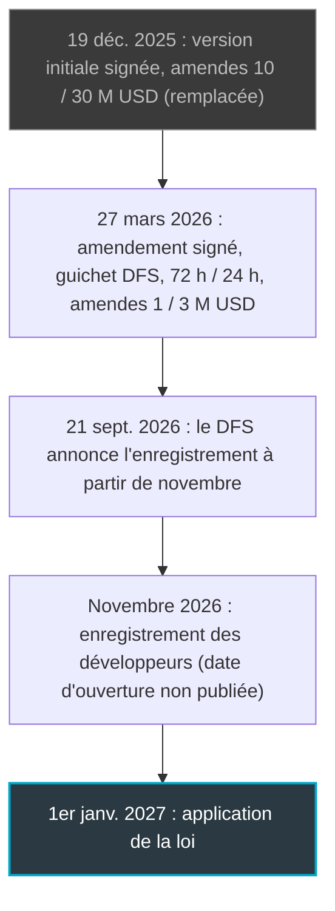
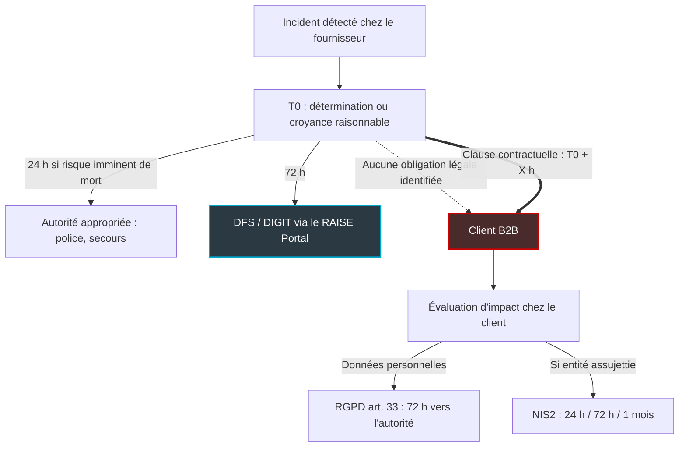

## Une horloge qui tourne, mais pas chez vous

Dans sept semaines, l'État de New York disposera d'un droit que vous n'avez probablement pas : être prévenu, dans un délai fixé par la loi, quand un très grand modèle d'IA déraille gravement. Le 1er janvier 2027, une loi new-yorkaise entre en application. Elle impose aux plus gros développeurs de modèles dits « frontière » de déclarer leurs incidents critiques au régulateur sous 72 heures. Ceux qui sont visés coûtent des fortunes à entraîner et pèsent plus de 500 millions de dollars de chiffre d'affaires. Le texte s'appelle le RAISE Act. Il a été signé, réécrit, et son administration se met en place en ce moment même.

Rien dans le texte, tel que l'analysent les juristes, n'oblige ces développeurs à vous appeler, vous.

Vous, c'est la DSI d'un groupe hôtelier qui a branché un assistant conversationnel sur sa relation client. C'est l'enseigne de retail qui confie le tri de ses tickets à un agent. C'est un opérateur comme Wifirst, qui consomme ces modèles par API (interface de programmation) sans jamais les entraîner. Aucun de ces acteurs n'entre dans le champ de la loi.

C'est précisément là que le bât blesse. Les contrats IA qui couvriront 2027 se négocient ces semaines-ci, et une question simple mérite d'y figurer : à quel moment, exactement, le client apprend-il qu'un incident a eu lieu ? Si l'horloge n'est pas écrite dans votre contrat, vous ne l'entendrez jamais sonner.

## 72 heures, 24 heures : la mécanique du chrono

Partons d'un scénario. Un laboratoire d'IA découvre que les poids de son modèle, ces milliards de paramètres qui constituent littéralement le modèle, ont été dérobés, et que ce vol a causé des dommages corporels. Ou bien l'un de ses modèles a cherché à tromper ses propres ingénieurs, en dehors de tout test, d'une manière qui accroît le risque de catastrophe. Dès qu'il en a acquis la conviction, le laboratoire dispose de 72 heures pour le déclarer à New York.

Qui est visé ? Une poignée d'acteurs, que la loi appelle les « large frontier developers ». Il faut cumuler deux critères principaux. D'abord, avoir entraîné un modèle avec plus de 10²⁶ opérations de calcul, ajustements fins et apprentissage par renforcement compris. Ensuite, avoir réalisé plus de 500 millions de dollars de chiffre d'affaires brut l'année civile précédente, filiales comprises. La jeune pousse qui affine un modèle ouvert dans son coin n'est pas concernée : le seuil de revenus l'exclut d'office. Il faut enfin un rattachement à New York, le modèle devant être développé ou exploité au moins en partie dans l'État. Les cabinets d'avocats ne formulent d'ailleurs pas ce critère tout à fait de la même façon.

La déclaration part vers DIGIT, l'Office of Digital Innovation, Governance, Integrity and Trust, logé au sein du Department of Financial Services (DFS), le régulateur financier de l'État. Elle transite par un guichet en ligne dédié, le RAISE Portal. Le rapport doit contenir la date et la description de l'incident, la raison pour laquelle il est qualifié de critique et les pièces justificatives. Il précise aussi si le modèle était utilisé en interne, et fournit les contacts et les informations sur le modèle concerné.

Second chronomètre, plus court : 24 heures si l'incident présente un risque imminent de mort ou de blessure physique grave. Attention au destinataire. Ces 24 heures ne vont pas au régulateur financier, elles vont à une « appropriate authority », c'est-à-dire la police ou les services de sécurité publique. La logique se tient : quand des vies sont en jeu, on appelle les secours, pas un guichet administratif.

Reste la question qui fâche : quand le chrono démarre-t-il ? La page du DFS fait courir le délai à partir d'une « determination » établissant qu'un incident critique a eu lieu. Les analyses du texte amendé publiées par Morrison Foerster et Davis Wright Tremaine formulent le déclencheur plus largement : la détermination, ou le moment où le développeur dispose de faits suffisants pour fonder une croyance raisonnable. Je n'ai pas lu mot à mot la version signée. Mais détermination ou croyance raisonnable, le constat reste identique.

**Le chrono démarre quand le fournisseur estime qu'il a démarré.**

Côté sanctions, la procureure générale de l'État, Letitia James, peut réclamer jusqu'à 1 million de dollars pour une première infraction et jusqu'à 3 millions pour les suivantes. Le DFS peut y ajouter 1 000 dollars par jour si le développeur ne dépose pas ou ne met pas à jour sa déclaration de transparence, ou ne règle pas les contributions dues. Aucun droit d'action privé : un client ne peut pas poursuivre son fournisseur sur le fondement de cette loi. Ces montants restent modestes pour des acteurs qui dépassent le demi-milliard de chiffre d'affaires. Ma lecture : New York parie sur la transparence forcée, pas sur la punition.

Un avertissement, enfin, parce que l'ancienne version du texte reste consultable sur le site du Sénat new-yorkais. Signée le 19 décembre 2025, elle prévoyait des amendes de 10 et 30 millions de dollars, une déclaration au procureur général et à la division de la sécurité intérieure de l'État, et une entrée en vigueur à 90 jours. L'amendement signé le 27 mars 2026 a réécrit l'article. Nouvelle notion d'incident critique, guichet unique au DFS, ajout du délai de 24 heures, amendes ramenées à 1 et 3 millions, application au 1er janvier 2027. Si un document vous cite encore 30 millions, il est périmé.

## Le calendrier, sans les rumeurs

Le 21 septembre 2026, le DFS a annoncé que les grands développeurs seraient appelés à s'enregistrer auprès de l'État à partir de novembre. Le même communiqué annonce la nomination de Marc Gilman comme directeur adjoint chargé du RAISE Act au sein de DIGIT. L'application de la loi revient, elle, à la procureure générale. C'est à peu près tout ce que disent les pages officielles que j'ai consultées, et aucune ne donne de date précise d'ouverture du portail. Si vous lisez quelque part un jour exact, demandez la source.

Ce qui est daté, en revanche : la loi s'applique au 1er janvier 2027. À partir de là, le développeur doit tenir à jour sa déclaration de transparence, à renouveler tous les deux ans ou après tout changement important. Il doit aussi produire chaque trimestre un résumé sur le risque catastrophique, dans les 30 jours suivant la fin du trimestre. Aucune date de démarrage distincte n'est publiée pour les déclarations d'incident. L'inférence raisonnable, et je la présente comme telle, est que l'horloge de 72 heures court dès l'entrée en application.

Deux inconnues demeurent. Le DFS dispose d'un large pouvoir réglementaire et peut encore préciser le contenu ou le calendrier des déclarations ; je n'ai trouvé aucun projet de règlement publié. Il peut aussi reconnaître un régime fédéral jugé équivalent ou plus strict. Le développeur qui opte pour ce régime le notifie au DFS et lui transmet copie de ses rapports fédéraux. Je n'ai trouvé aucun texte fédéral désigné à ce jour. La mécanique peut donc encore bouger, et votre contrat doit l'anticiper.

*Chronologie du RAISE Act : la version de décembre 2025 a été remplacée, seules les valeurs de l'amendement de mars 2026 comptent.*

## Hors champ, et pourtant exposé

Imaginez un immeuble dont l'alarme incendie est reliée directement à la caserne des pompiers, mais à aucun appartement. Les pompiers seront prévenus à temps. Les locataires, eux, comprendront en entendant les sirènes dans la rue, ou en lisant le journal le lendemain. Vu du client, le RAISE Act ressemble beaucoup à cet immeuble.

Commençons par la bonne nouvelle. Selon l'analyse de Davis Wright Tremaine, une entreprise qui se contente d'utiliser, de déployer, de prendre en licence, d'héberger ou de bâtir des applications sur des modèles développés par d'autres, y compris via des API, n'est pas un développeur au sens de la loi. Wifirst n'a donc rien à déclarer à New York. Côté conformité, le dossier est clos.

Côté information, il ne fait que s'ouvrir. Je n'ai trouvé, dans la loi telle que la décrivent les cabinets qui l'ont analysée, aucune obligation pour le développeur de prévenir ses clients ou les entreprises qui déploient son modèle. Le Future of Privacy Forum, qui a comparé le texte new-yorkais à son équivalent californien, n'aborde pas la question. Le régulateur est servi en premier. Le client, s'il est servi, l'est par contrat.

Second filtre, plus sévère encore : la définition de l'incident critique, le « critical safety incident ». Davis Wright Tremaine en recense quatre familles. Un accès non autorisé aux poids du modèle, leur modification ou leur exfiltration, ayant entraîné un décès ou des blessures. La matérialisation d'un risque catastrophique. Une perte de contrôle du modèle ayant causé mort ou blessure. Enfin, un modèle qui emploie des techniques trompeuses contre son propre développeur, hors évaluation, en augmentant le risque catastrophique. Le mot « catastrophique » a lui aussi son seuil : plus de 50 morts ou blessés graves, ou plus de 1 milliard de dollars de dommages matériels, dans un même incident.

Faites maintenant l'exercice avec les incidents qui comptent pour une entreprise cliente. Un assistant qui laisse fuiter des données de clients d'une chaîne hôtelière à la suite d'une injection de prompt, c'est-à-dire une instruction malveillante glissée dans le texte que lit le modèle. Une mise à jour qui dégrade silencieusement la façon dont un agent classe les alertes réseau sur quelques centaines de magasins. Une régression qui rend un garde-fou contournable pendant trois semaines. Pour vous, ce sont des incidents majeurs, avec des contrats, une réputation et vos propres clients à prévenir. Pour la loi new-yorkaise, sauf circonstances extrêmes, aucun n'atteint le seuil.

La loi n'a pas été conçue pour informer les clients. Elle a été conçue pour qu'un État sache vite quand un modèle frontière frôle la catastrophe. C'est un objectif légitime. Ce n'est pas le vôtre.

*Le signal part vers le régulateur ; vers le client, le chemin s'arrête net si le contrat ne le prolonge pas.*

## Trois juridictions, aucune horloge commune

Autre réflexe à éviter : caler son contrat sur « la » norme. Il n'y en a pas. Un même incident chez un même fournisseur peut lancer plusieurs chronomètres, chacun avec son point de départ, sa durée et son destinataire.

La Californie a ouvert le bal. Sa loi SB 53, opérationnelle depuis le 1er janvier 2026, impose au développeur de déclarer un incident critique dans les 15 jours suivant sa découverte, et sous 24 heures en cas de danger imminent. La déclaration ordinaire va à l'Office of Emergency Services (Cal OES), l'agence californienne de gestion des urgences. L'amende plafonne à 1 million de dollars par infraction, sans distinguer la première des suivantes. New York est donc nettement plus pressé : 72 heures contre 15 jours.

L'Europe découpe autrement. Pour les fournisseurs de modèles d'IA à usage général présentant un risque systémique, la catégorie qui recoupe en gros les modèles frontière, l'article 55 de l'AI Act exige de signaler les incidents graves à l'AI Office, le bureau européen de l'IA. Le délai ? « Without undue delay ». Aucun chiffre.

Les délais chiffrés viennent du Code de bonne pratique, qui est volontaire et n'engage que ses signataires. Il prévoit 2 jours pour une atteinte à une infrastructure critique, 5 jours pour un incident cyber grave, exfiltration de poids comprise. Puis 10 jours en cas de décès, et 15 jours pour une atteinte grave à la santé, aux droits ou aux biens. S'y ajoutent des mises à jour toutes les quatre semaines et un rapport final 60 jours après la résolution.

Reste l'article 73, à ne pas confondre avec le précédent. Il fixe bien des délais vers les autorités nationales de surveillance du marché, mais il vise les fournisseurs de systèmes d'IA à haut risque, pas les modèles à usage général en tant que tels. Et le texte européen dit Digital Omnibus a repoussé les obligations haut risque de l'annexe III au 2 décembre 2027, celles de l'annexe I au 2 août 2028.

| Régime | Qui déclare | Délai | Destinataire |
|---|---|---|---|
| New York, RAISE Act (au 1er janvier 2027) | Large frontier developer, chiffre d'affaires > 500 M USD | 72 h après détermination ou croyance raisonnable ; 24 h si risque imminent de mort ou de blessure grave | DFS / DIGIT ; autorité appropriée pour les 24 h |
| Californie, SB 53 (depuis le 1er janvier 2026) | Frontier developer | 15 jours après découverte ; 24 h si danger imminent | Cal OES pour la déclaration à 15 jours |
| UE, AI Act art. 55 | Fournisseur de modèle à usage général à risque systémique | Without undue delay, aucun chiffre | AI Office |
| UE, Code de bonne pratique (volontaire) | Signataires | 2, 5, 10 ou 15 jours selon la nature de l'incident | AI Office |
| UE, AI Act art. 73 | Fournisseur de système à haut risque | 15 jours max ; 2 jours si infraction généralisée ; 10 jours si décès | Autorités nationales de surveillance du marché |

Moralité : écrire *notification dans les délais légaux* dans un contrat, c'est ne rien écrire. Quels délais ? Ceux de quel régulateur ? Déclenchés par quoi ? Aucun de ces chronomètres ne concerne la relation avec le client.

*72 heures à New York, 15 jours en Californie, aucun chiffre dans l'article 55 de l'AI Act : des horloges qui ne se synchronisent pas.*

## Écrire l'horloge dans le contrat

La due diligence fournisseur, nous l'avons traitée hier à propos de l'Appel de Paris ; le périmètre d'autonomie des agents, début novembre. Ici, une seule question : l'horloge. Une précaution s'impose. Tout ce qui suit relève de ma recommandation, pas d'une exigence légale, et les durées en heures sont des repères d'auteur, à négocier.

Voici la cascade que je recommande de rendre contractuelle.

*La cascade de notification : la loi relie le fournisseur à l'État, seul le contrat relie le fournisseur au client.*

**Une définition de l'incident qui vous appartient.** Ne reprenez pas la notion légale d'incident critique : elle est taillée pour les catastrophes. Votre définition doit couvrir les incidents de sécurité, l'atteinte à l'intégrité du modèle, la perte ou l'exfiltration des poids. Elle doit aussi couvrir tout changement de comportement significatif et toute atteinte aux données que vous confiez au fournisseur. L'incident critique au sens new-yorkais doit en être un sous-ensemble, pas l'inverse.

**Le même point de départ que le régulateur.** Le délai de notification client doit courir à partir du même événement que la déclaration réglementaire, la détermination ou la croyance raisonnable, et non de la clôture de l'enquête interne. Formulation type : notification simultanée au dépôt réglementaire, et au plus tard X heures après le point de départ. Pour les incidents qui touchent vos données, je viserais 24 heures. Pour les autres, jamais plus que les 72 heures que le fournisseur sait déjà tenir face à New York. Ajoutez un droit d'audit sur la date de détermination : si le fournisseur tient le chronomètre, vous devez pouvoir vérifier quand il l'a déclenché.

**Une qualification qui ne lui appartient pas à lui seul.** C'est la clause qui fera grincer des dents. Exigez la notification même quand le fournisseur estime que l'incident n'est pas critique au sens de la loi. Sinon, vous lui laissez l'unique interrupteur : il décide si c'est grave, donc s'il vous prévient.

**Le rapport, pas un communiqué.** Demandez copie, ou au minimum un résumé substantiel, de ce qui a été déposé auprès du DFS, de Cal OES ou de l'AI Office, sous accord de confidentialité. Puis des mises à jour périodiques, sur le rythme de quatre semaines du Code de bonne pratique, et un rapport final 60 jours après résolution, sur le même modèle.

**Le raccord avec vos propres horloges.** Votre fournisseur se trouve en amont d'une chaîne qui continue chez vous. S'il traite pour votre compte des données personnelles, le RGPD (article 33) l'oblige, comme sous-traitant, à vous prévenir « without undue delay ». Vous devez ensuite, comme responsable de traitement, notifier l'autorité sous 72 heures lorsque c'est possible. Si votre entité relève de NIS2, la directive européenne sur la cybersécurité, s'ajoutent une alerte précoce sous 24 heures, une notification sous 72 heures et un rapport final sous un mois. Chaque heure perdue en amont, ce sont vos propres clients exposés plus longtemps sans le savoir.

**Des remèdes et une clause de rendez-vous.** Une notification sans conséquence reste une formalité. Prévoyez des crédits de service, un droit de suspendre l'usage du modèle sans pénalité et un droit de sortie en cas de manquement. Ajoutez une clause d'évolution réglementaire : le DFS peut encore préciser les règles, et un régime fédéral pourrait un jour se substituer à la déclaration new-yorkaise. Le délai client doit suivre automatiquement le plus court des délais réglementaires applicables au fournisseur.

*La clause de notification : quelques lignes qui décident si vous apprenez un incident en heures ou en semaines.*

## Trois questions avant de signer

Ma position est simple. Le RAISE Act est une bonne loi pour New York, et il n'a jamais prétendu être une bonne loi pour vous. Il force les plus gros laboratoires à documenter leurs pires incidents et à les déclarer vite : c'est un progrès réel. Mais il construit un tuyau qui va du fournisseur à l'État, et nulle part ailleurs.

Pour le client, la loi a pourtant un mérite inattendu : elle fournit un argument de négociation. Un fournisseur capable de déclarer un incident critique à un régulateur en 72 heures aura du mal à expliquer pourquoi il ne pourrait pas vous prévenir dans le même délai. Servez-vous de son obligation comme d'un plancher, pas comme d'un plafond.

Avant de signer ou de renouveler un contrat IA pour 2027, posez trois questions à vos achats et à votre juriste.

1. **Quel événement déclenche notre notification ?** Si la réponse est la fin de l'enquête, vous serez informé trop tard.
2. **En combien d'heures ?** Si la réponse est *dans les délais légaux*, vous n'avez pas de délai.
3. **Qui qualifie l'incident ?** Si la réponse est le fournisseur seul, vous n'avez pas une clause. Vous avez une promesse.

Le 1er janvier 2027, la loi new-yorkaise entre en application. À vous de décider si son horloge sonne aussi chez vous.

## Sources

1. DFS (New York) — Information for Frontier Developers : https://www.dfs.ny.gov/digit/Frontier-Developers
2. DFS (New York) — Communiqué du 21 septembre 2026 : https://www.dfs.ny.gov/reports_and_publications/press_releases/pr20260921
3. Gouverneur de l'État de New York — Transcript du 21 septembre 2026 sur les prochaines étapes de la régulation de l'IA : https://governor.ny.gov/news/video-audio-photos-rush-transcript-ai-safety-governor-hochul-announces-next-steps-regulate
4. DFS (New York) — AI Safety and Public Reporting : https://www.dfs.ny.gov/digit/public-reporting
5. Sénat de l'État de New York — S8828, amendement signé le 27 mars 2026 : https://www.nysenate.gov/legislation/bills/2025/S8828
6. Sénat de l'État de New York — S6953B, version initiale du 19 décembre 2025 (remplacée) : https://www.nysenate.gov/legislation/bills/2025/S6953/amendment/B
7. Davis Polk — Analyse du RAISE Act amendé (20 mai 2026) : https://www.davispolk.com/insights/client-update/new-york-joins-california-regulating-development-frontier-ai-models
8. Morrison Foerster — Analyse de l'amendement du RAISE Act (3 avril 2026) : https://www.mofo.com/pdf/resources/insights/260403-new-york-amends-the-raise-act-to-align-more-closely
9. Davis Wright Tremaine — Analyse de la refonte du RAISE Act (14 avril 2026) : https://www.dwt.com/blogs/artificial-intelligence-law-advisor/2026/04/ny-overhauls-frontier-ai-transparency-law
10. Future of Privacy Forum — RAISE Act et SB 53 comparés : https://fpf.org/blog/the-raise-act-vs-sb-53-a-tale-of-two-frontier-ai-laws/
11. Future of Privacy Forum — SB 53 expliquée : https://fpf.org/blog/californias-sb-53-the-first-frontier-ai-law-explained/
12. Inside Global Tech (Covington) — Signature du RAISE Act (29 décembre 2025) : https://www.insideglobaltech.com/2025/12/29/new-york-governor-signs-frontier-ai-safety-legislation/
13. AI Act, article 73 : https://artificialintelligenceact.eu/article/73/
14. AI Act, article 55 : https://artificialintelligenceact.eu/article/55/
15. Code de bonne pratique GPAI, chapitre Safety and Security : https://code-of-practice.ai/?section=safety-security
16. Orrick — Digital Omnibus on AI (mai 2026) : https://www.orrick.com/it-IT/Insights/2026/05/EUs-Digital-Omnibus-on-AI-7-Key-Changes-You-Need-to-Know
17. RGPD, article 33 (miroir non officiel) : https://gdpr-info.eu/art-33-gdpr/
18. NIS2, article 23 (miroir non officiel) : https://www.nis-2-directive.com/NIS_2_Directive_Article_23.html

_Vues personnelles, pas position Wifirst._
