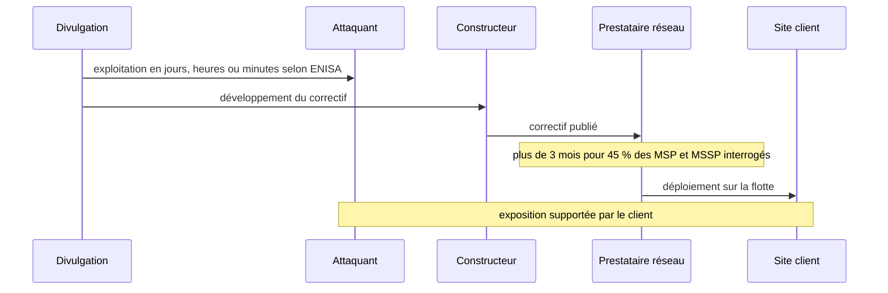
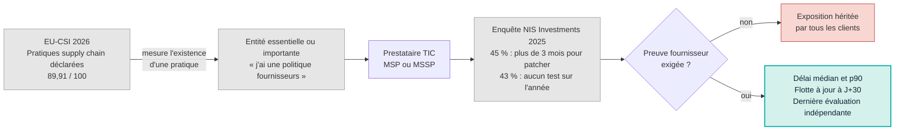

## Une très bonne note, et une ligne qu'on lit trop vite

Le 10 novembre, l'Europe a reçu son bulletin de cybersécurité, et une case y brille presque trop : 89,91 sur 100. C'est la note que l'agence européenne de cybersécurité (ENISA) attribue aux pratiques de gestion des fournisseurs chez les organisations régulées. Vingt-cinq États membres sur vingt-sept atteignent le niveau le plus élevé de l'échelle.

Quelques pages plus loin, le même rapport cite une statistique moins photogénique. Parmi les prestataires informatiques interrogés, ceux qui exploitent réseaux, serveurs et sécurité pour plusieurs clients à la fois, 45 % déclarent avoir mis plus de trois mois à appliquer un correctif critique sur des systèmes critiques.

Les deux chiffres ne se contredisent pas. Ils ne mesurent pas la même chose. Le premier dit que les organisations ont des pratiques vis-à-vis de leurs fournisseurs. Le second dit à quelle vitesse ces fournisseurs referment une porte restée ouverte.

Pour le DSI d'une chaîne hôtelière, d'une enseigne ou d'un réseau de résidences étudiantes, l'écart n'a rien d'académique. C'est lui qui fixe combien de temps une faille connue reste exploitable sur ses sites. La question devient pressante : la directive NIS2 (le cadre européen qui étend les obligations de cybersécurité à un large éventail de secteurs) pousse chaque entité régulée à interroger ses sous-traitants, au moment où le délai entre publication et exploitation d'une faille s'effondre.

Ma position tient en une phrase : le questionnaire de conformité ne suffit plus, il faut des preuves datées. Lu attentivement, le rapport ENISA le dit presque lui-même.

## Ce que compte vraiment le 89,91

Imaginez qu'on évalue la sécurité incendie d'un immeuble en comptant les extincteurs accrochés aux murs. Un extincteur par étage : 100 sur 100. Personne n'a regardé la date de la dernière révision sur l'étiquette. L'immeuble est-il protégé ? Peut-être. Le score ne le dit pas.

C'est, à peu de chose près, la construction de l'indicateur qui fait les titres. Le document publié le 10 novembre est le [*2026 Report on the State of Cybersecurity in the Union*](https://www.enisa.europa.eu/publications/2026-report-on-the-state-of-cybersecurity-in-the-union), deuxième édition du rapport biennal exigé par l'article 18 de NIS2. Il a été adopté par ENISA avec la Commission et le groupe de coopération NIS, puis présenté au Parlement européen. Il couvre la période de juillet 2024 à juillet 2026 et s'appuie sur un indice composite, l'EU Cybersecurity Index (EU-CSI), qui agrège une série d'indicateurs notés sur 100.

La moyenne européenne s'établit à 71,53. Vingt-deux États sont classés « mature » (de 60 à 79,99), deux « advanced » (80 et plus), trois « established » (de 40 à 59,99), aucun en dessous. Les cinq meilleurs affichent 79,86 de moyenne, les cinq derniers 60,45.

Maintenant, la définition. Selon l'annexe du rapport, l'indicateur des pratiques de gestion de la chaîne d'approvisionnement vaut 100 lorsque toutes les entités interrogées disposent de pratiques spécifiques en la matière. C'est un indicateur de présence, alimenté par les réponses des entités interrogées. Il ne dit rien de la qualité de ces pratiques, encore moins de la vitesse à laquelle les fournisseurs corrigent. La note méthodologique de l'édition précédente (mars 2024, cadre depuis révisé) allait dans le même sens : elle mesurait la part d'entités dotées d'une politique de gestion du risque tiers. ENISA ne survend d'ailleurs pas son chiffre et écrit qu'une amélioration reste possible, vu l'importance du sujet.

Deux précautions de lecture, que les reprises de presse ont parfois sautées. D'abord, la fraîcheur. Les données de l'indice ont été collectées fin 2025, celles de l'enquête citée plus bas entre mai et août 2025 : ce qu'on lit en novembre 2026 décrit une situation déclarée dix à dix-huit mois plus tôt. Ensuite, la comparabilité. Le cadre de l'indice a été révisé et ENISA précise que les scores 2026 ne se comparent pas à ceux de 2024. Les titres sur une Europe « qui s'améliore » ne peuvent donc pas s'appuyer sur la moyenne.

| Indicateur EU-CSI 2026 | Score sur 100 |
|---|---|
| Pratiques de gestion de la chaîne d'approvisionnement (entités) | 89,91 |
| Divulgation coordonnée des vulnérabilités | 79,80 |
| Signalement d'incidents | 71,06 |
| Supervision des entités | 68,33 |
| Équipes nationales de réponse aux incidents (CSIRT) | 54,76 |
| Partage d'information entre entités | 26,30 |

*Extrait des indicateurs EU-CSI 2026 (rapport ENISA, annexe). Moyenne UE : 71,53.*

Le tableau raconte une histoire. Le score le plus flatteur porte sur une pratique déclarée. Le plus bas, 26,30, porte sur le partage d'information entre entités, c'est-à-dire la circulation de signaux et de preuves entre pairs : vingt-trois États y sont au niveau « developing », quatre au niveau « foundation ». Entre les deux, l'indicateur des CSIRT nationaux (54,76) repose lui aussi sur une auto-évaluation complétée par une revue par les pairs, et ENISA y relève une maturité faible ou non évaluée dans plusieurs États. On déclare beaucoup. On partage peu.

*Constructeur, prestataire, sites clients : dans une chaîne de réseau managé, un seul lien lent suffit à faire attendre tous les sites en aval.*

## Le maillon lent, nommé par ENISA elle-même

Un prestataire de services gérés ne corrige pas un client. Il corrige tous ses clients, au même rythme, avec les mêmes outils. S'il est rapide, tout le monde en profite. S'il est lent, la lenteur se propage d'un coup à toutes les organisations qui en dépendent, et qui, chacune de leur côté, ont coché la case « politique fournisseurs » dans leur questionnaire.

C'est exactement le point que fait le rapport dans sa section consacrée à la chaîne d'approvisionnement. Il vise le secteur de la gestion des services TIC (technologies de l'information et de la communication), qui regroupe les fournisseurs de services gérés (MSP) et de sécurité gérée (MSSP) travaillant pour de multiples clients. Dans ce secteur, 43 % des entités interrogées n'ont mené aucun test ni évaluation de cybersécurité sur l'année. Et 45 % ont mis plus de trois mois à appliquer des correctifs critiques sur des systèmes critiques. ENISA en tire une conclusion sans détour : toutes les entités qui dépendent de ces prestataires subissent une exposition significative.

Ces chiffres ne sortent pas de l'indice. Ils viennent d'une enquête distincte, [*NIS Investments 2025*](https://www.enisa.europa.eu/sites/default/files/2026-02/NIS%20Investments%202025%20-%20Main%20report.pdf), publiée par ENISA en décembre 2025. Sa méthode mérite d'être connue avant de brandir le 45 %. L'agence a interrogé par téléphone 1 080 professionnels, surtout des directeurs des opérations, des systèmes d'information, des risques et de la sécurité, dans les 27 États membres, entre mai et août 2025. L'échantillon compte 83 % de grandes entreprises. La taille du sous-échantillon MSP et MSSP n'est pas publiée dans le rapport principal. Et tout est déclaratif.

Ce 45 % n'est donc pas une mesure de terrain. Il serait abusif d'en tirer que *45 % des MSP européens* patchent en plus de trois mois. C'est ce que les prestataires interrogés disent d'eux-mêmes, ce qui, pour un aveu, est déjà beaucoup.

Ce qui rend le chiffre parlant, c'est la comparaison interne. Sur l'ensemble des organisations interrogées, 28 % dépassent les trois mois et 63 % mettent un mois ou plus. Les prestataires, censés apporter de la cadence à leurs clients, font nettement moins bien que la moyenne des organisations interrogées.

La même enquête contient d'autres signaux qui dessinent le décalage. 90 % des organisations déclarent mettre en œuvre des contrôles sur leur chaîne d'approvisionnement. Pourtant, 37 % désignent la gestion du risque fournisseur comme l'exigence NIS2 la plus difficile à appliquer. La chaîne d'approvisionnement est aussi leur deuxième préoccupation (47 %), juste derrière le rançongiciel (55 %).

Du côté des États, le rapport constate que la sécurité de la chaîne d'approvisionnement reste faiblement couverte par les stratégies nationales, comparée aux autres domaines. Un 89,91 chez les entités, une exécution nationale en retrait, 37 % d'organisations qui jugent le sujet le plus dur : la tension n'est pas un procès que je fais au rapport. Elle est dans le rapport.

*D'un côté, une pile de formulaires signés. De l'autre, quelques grammes de données mesurées. La conformité fournisseur pèse encore surtout du premier côté.*

## Trois mois, quand l'exploitation se compte en heures

Un trimestre pour patcher, sur le papier, ressemble à un rythme d'exploitation raisonnable. C'est le rythme d'un comité de changement mensuel, d'une fenêtre de maintenance négociée, d'un test sur site pilote avant généralisation. Le problème, c'est que l'attaquant ne suit pas ce calendrier.

Le rapport le dit sans ambages. ENISA qualifie le niveau de menace sur la période de « substantiel ». Elle constate que des vulnérabilités sont exploitées dans les jours, parfois les heures ou les minutes qui suivent leur divulgation, en s'appuyant notamment sur le centre national de cybersécurité néerlandais. Les modèles d'IA les plus avancés ramènent la découverte de failles de quelques jours à quelques heures. Cette découverte industrialisée produit des signalements plus vite que beaucoup d'organisations ne savent les trier, les valider et les corriger.

D'où la phrase qui, à mes yeux, résume le document entier : le tri rapide, la priorisation, la divulgation coordonnée et la remédiation deviennent des goulets d'étranglement plus critiques que la découverte elle-même. Trouver la faille n'est plus le problème. La refermer à temps, si.

*La fenêtre d'exposition : entre la divulgation et le déploiement sur site, le délai du prestataire peut devenir le maillon dominant.*

ENISA ajoute deux nuances utiles. D'abord, le correctif autonome peut lui-même casser des systèmes : la vitesse sans contrôle n'est pas une réponse. Ensuite, les petites organisations auront plus de mal à suivre. Or ces petites organisations, ce sont précisément l'hôtel indépendant, le magasin franchisé, la résidence sans équipe sécurité, qui délèguent souvent tout à un prestataire. Leur vitesse de correction, c'est la sienne.

Pendant ce temps, l'amont accélère. Côté divulgation coordonnée, le nombre d'États déclarant ne pas avoir de politique nationale, ou être encore en train d'en définir une, est passé de 17 en 2024 à 7 en 2026. Au moins une reprise de presse a inversé ce chiffre : c'est bien le nombre d'États *sans* politique qui baisse. Nuance importante, la mise en œuvre active ne concerne que 15 États, contre 10 en 2024. L'adoption formelle avance plus vite que l'opérationnel.

Surtout, depuis le 11 septembre 2026, le Cyber Resilience Act (CRA, le règlement européen sur la sécurité des produits numériques) impose aux fabricants de produits comportant des éléments numériques de signaler les vulnérabilités activement exploitées et les incidents graves affectant la sécurité de leurs produits via une plateforme unique de signalement. Son application complète suivra le 11 décembre 2027. L'information sur les failles va donc circuler plus vite chez les constructeurs et les autorités. Si le prestataire reste au trimestre, le goulet se déplace chez lui. Exactement là où le 89,91 ne regarde pas.

## La preuve dans les deux sens

*En gris, ce qui se déclare. En couleur, ce qui se mesure : la question qui manque dans la plupart des questionnaires fournisseurs.*

Un opérateur de réseau occupe ici une position inconfortable, donc instructive : il est à la fois client et fournisseur. Chez Wifirst, nous achetons des bornes à des constructeurs, des plateformes de gestion dans le cloud, des briques logicielles livrées par les fabricants de puces. Et nous exploitons ces réseaux pour des hôtels, des enseignes, des entreprises et des résidences étudiantes. Dès qu'un de ces clients relève de NIS2, il doit interroger ses fournisseurs. Donc nous.

Je laisse aux juristes la question de savoir si notre propre activité entre, au sens de NIS2, dans la gestion de services TIC. Elle est intéressante, mais secondaire pour le sujet du jour : les questions arriveront de l'aval, et nous devons les poser à l'amont.

Le cadre pousse dans ce sens, même si NIS2 n'est toujours pas transposée par tous les États membres deux ans après l'échéance d'octobre 2024. Son article 21 demande de traiter la sécurité de la chaîne d'approvisionnement, relations avec les fournisseurs directs comprises, en tenant compte des vulnérabilités propres à chacun et de la qualité de leurs pratiques. Selon les analyses juridiques publiées, le règlement d'exécution (UE) 2024/2690, qui vise directement les fournisseurs de services gérés, détaille ce qu'un contrat fournisseur doit couvrir, gestion des vulnérabilités et droits d'audit compris.

Mais aucun de ces textes ne dit comment prouver. Les recommandations supply chain du rapport s'adressent d'ailleurs aux États membres, pas aux entreprises : capacité nationale d'évaluation des risques, priorité aux investissements des entités régulées, mise en œuvre opérationnelle des politiques de divulgation, interopérabilité des bases de vulnérabilités européennes. Rien n'y impose une preuve fournisseur. Ce qui suit est mon raisonnement, pas celui d'ENISA.

Un signal de direction, toutefois. Le rapport recommande aux États membres d'exiger des opérateurs d'infrastructures critiques qu'ils attestent, lors de leurs audits annuels, de bases Zero Trust (un modèle où aucun accès n'est présumé fiable par défaut) et de capacités de réponse aux incidents. C'est une recommandation, pas une obligation, et pour un périmètre restreint. Mais le verbe a changé : on ne parle plus d'avoir, on parle d'attester.

Il y a aussi une raison pragmatique d'aller plus loin que les textes. Dans l'enquête NIS Investments, 70 % des organisations citent la conformité réglementaire comme premier moteur de leurs investissements de sécurité. La forme de la preuve suivra donc la forme de la question. Si la question reste « avez-vous une politique de gestion des correctifs ? », on obtiendra des politiques.

Ma proposition, que j'assume comme une position d'auteur et non comme une exigence réglementaire : remplacer cette question par trois mesures datées.

1. **Le délai médian et le p90 de correction des vulnérabilités critiques, en jours.** La médiane dit le rythme normal. Le p90, le délai sous lequel passent 90 % des correctifs, dit ce qui arrive aux cas difficiles : bornes anciennes, sites isolés, firmware capricieux. C'est dans cette queue que se logent les mauvaises surprises.
2. **La part de la flotte à jour trente jours après la publication d'un correctif critique.** Un chiffre, une date, un périmètre.
3. **La date de la dernière évaluation de sécurité indépendante.** Pas « nous faisons des audits », mais le mois exact et le nom du tiers qui l'a réalisée.

En amont, la même logique s'applique aux constructeurs : délai de correction inscrit au contrat, nomenclature logicielle (SBOM, la liste des composants embarqués dans un firmware), historique des avis de sécurité publiés, preuve que les correctifs ont été testés. Un fournisseur incapable de produire ces éléments n'est pas forcément mauvais. Il est simplement invérifiable.

Ces mesures ont leurs limites, et je préfère les nommer. Un délai médian se maquille, un périmètre de flotte se redéfinit, une évaluation indépendante peut être complaisante. Mais une mesure contestable se discute, se recoupe, s'améliore. Une case cochée, non.

*Sur le mur d'un centre d'exploitation, un correctif se lit comme une date. C'est cette date que les clients devraient demander.*

## La date sur l'étiquette

Revenons aux extincteurs. Le 89,91 d'ENISA n'est pas faux. Il dit quelque chose de vrai et d'important : la grande majorité des organisations interrogées déclare traiter ses fournisseurs comme une partie de sa surface d'attaque. Ce n'était pas acquis.

Mais un indicateur de présence a une limite naturelle : il plafonne. Quand tout le monde a un extincteur, compter les extincteurs n'apprend plus rien. La prochaine marche, c'est la date sur l'étiquette.

L'ironie, c'est que le rapport illustre lui-même le problème. Ses données datent de fin 2025 pour l'indice et de l'été 2025 pour l'enquête. Un instantané biennal, déclaratif, publié avec près d'un an de décalage : c'est exactement le format qu'on reproche aux questionnaires fournisseurs. Le régulateur n'a pas d'autre outil à l'échelle de vingt-sept pays. Entre un client et son prestataire, on peut faire mieux, et chaque mois.

Je prends donc le pari inverse de la conformité par formulaire. Les prestataires réseau qui publieront leurs délais de correction, médiane et queue comprises, prendront de l'avance, parce que leurs clients régulés pourront remplir leur propre dossier avec autre chose que des déclarations. Les autres continueront à répondre « oui » à la question « avez-vous une politique ? ».

Avec des délais d'exploitation qui se comptent parfois en heures, ce oui pèsera de moins en moins lourd. Un prestataire lent ne rend pas un client vulnérable. Il les rend tous vulnérables, en même temps.

_Vues personnelles, pas position Wifirst._

## Sources

1. ENISA, *2026 Report on the State of Cybersecurity in the Union* (rapport complet), 10 novembre 2026 : https://www.enisa.europa.eu/sites/default/files/2026-11/2026%20Report%20on%20the%20State%20of%20Cybersecurity%20in%20the%20Union%20-%20FINAL.pdf
2. ENISA, *Art. 18 Condensed* (version condensée), novembre 2026 : https://www.enisa.europa.eu/sites/default/files/2026-11/ENISA_Art18_2026_Condensed.pdf
3. ENISA, page « State of cybersecurity in the EU » et page de publication : https://www.enisa.europa.eu/topics/state-of-cybersecurity-in-the-eu et https://www.enisa.europa.eu/publications/2026-report-on-the-state-of-cybersecurity-in-the-union
4. ENISA, *NIS Investments 2025* (rapport principal), décembre 2025 : https://www.enisa.europa.eu/sites/default/files/2026-02/NIS%20Investments%202025%20-%20Main%20report.pdf
5. ENISA, *EU Cybersecurity Index, Framework and methodological note v1.0* (mars 2024, cadre de l'édition précédente) : https://www.enisa.europa.eu/sites/default/files/2024-12/eu_csi_methodological_note_v1-0.pdf
6. Help Net Security, « EU cyber scores look healthy, but 45% of surveyed IT providers take months to patch », 11 novembre 2026 : https://www.helpnetsecurity.com/2026/11/11/eu-enisa-cybersecurity-report/
7. Eunews, « European cybersecurity is improving but gaps remain in coordination and crisis management », 10 novembre 2026 : https://www.eunews.it/en/2026/11/10/european-cybersecurity-is-improving-but-gaps-remain-in-coordination-and-crisis-management/
8. DLA Piper, « NIS2 Directive explained, part 3: supply chain security », décembre 2025 : https://www.dlapiper.com/en-eu/insights/publications/2025/12/nis2-directive-explained-part-3-supply-chain-security
9. Cyberday, « Requirement 5.1.4 : Supply chain contractual security obligations » (analyse secondaire du règlement 2024/2690) : https://www.cyberday.ai/requirement/nis2-guide-5-1-4-supply-chain-contractual-security-obligations
