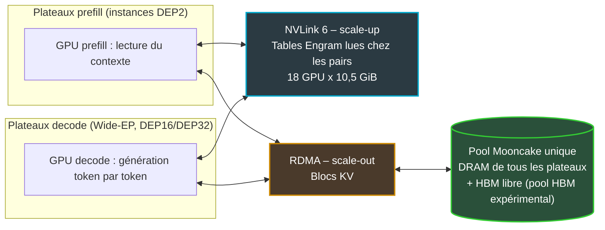
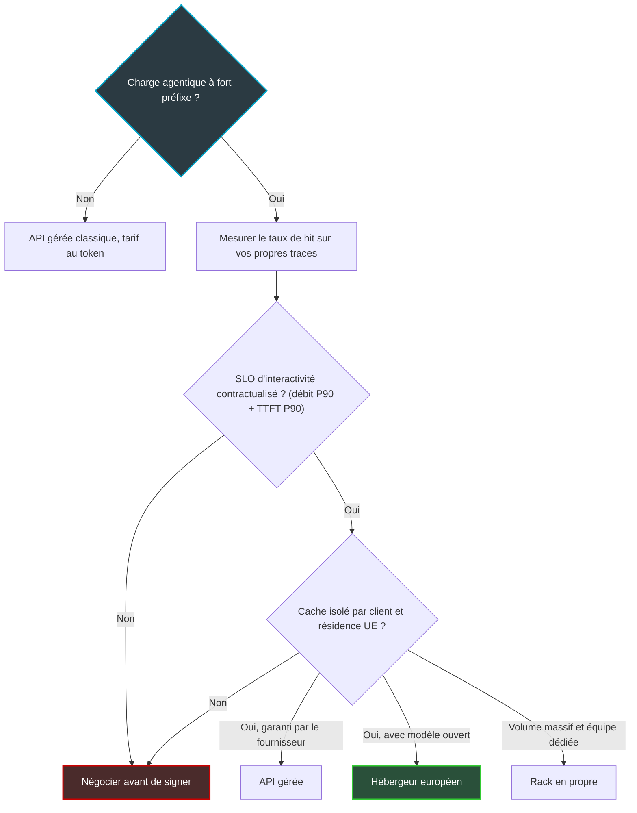

## Un agent qui relit tout son dossier à chaque tour

Un vendredi soir, le Wi-Fi d'un hôtel de deux cents chambres tombe au troisième étage. Dans un centre de supervision réseau qui s'est mis à l'IA, le premier à ouvrir le dossier n'est plus forcément le technicien d'astreinte. C'est un agent logiciel. Il lit l'historique du site, la configuration des bornes, les derniers incidents. Il interroge un outil, lit la réponse, en interroge un autre. Et à chaque tour, il renvoie au modèle la quasi-totalité de ce qu'il lui a déjà envoyé.

Cette répétition n'a rien d'une figure de style. Dans le banc d'essai agentique publié en octobre par Artificial Analysis, chaque requête reprend 97 % des tokens d'entrée de la précédente [6]. Le coût de l'IA agentique glisse : on paie de moins en moins pour que la machine réfléchisse, et de plus en plus pour qu'elle se souvienne.

C'est sous cet angle qu'il faut lire le chiffre publié le 12 novembre par l'équipe du moteur d'inférence open source vLLM et la société Inferact : un rack NVIDIA Vera Rubin qui ferait « 58x » mieux que la génération précédente sur le modèle DeepSeek-V4.1-Flash [1]. Chiffre annoncé par l'éditeur, non reproduit, base de comparaison non documentée. Ce genre de chiffre a vocation à circuler vite dans les présentations commerciales.

Pour ceux qui, comme nous, achètent de l'IA plutôt qu'ils ne construisent des datacenters, l'intérêt est ailleurs. Ce résultat n'est pas d'abord une victoire de la puce. C'est une victoire de la topologie mémoire. Et ça, ça se négocie dans un contrat.

## 58x : un chiffre d'éditeur, et ce qu'il compte vraiment

Commençons par la citation exacte. Le billet est intitulé « 58x Throughput vs. GB300 NVL72 at 387 tokens/s ». Sur un rack Vera Rubin NVL72, vLLM revendique « 1.7M tokens/s per GPU while each user gets 387 tokens/s, 58x GB300 NVL72 », mesuré avec AgentX, le banc d'essai agentique du cabinet SemiAnalysis [1]. Le GB300 NVL72, c'est le rack de la génération précédente, dite Blackwell Ultra.

Qui parle compte autant que ce qui est dit. Le travail a été mené par Inferact avec l'équipe vLLM : un éditeur de moteur, qui a donc un produit à faire valoir. C'est une publication d'éditeur, pas un résultat audité. À ce jour, aucun résultat AgentX indépendant, non soumis par NVIDIA ou vLLM, n'a été publié pour ce modèle sur Vera Rubin.

Ensuite, ce qui est compté. La légende de la figure principale est explicite : le débit additionne les tokens d'entrée servis depuis le cache, les tokens d'entrée recalculés et les tokens de sortie [1]. Ce n'est pas un débit de génération.

Prenez un traducteur dont on mesurerait la productivité en comptant chaque page sortie de son bureau, y compris celles qu'il a simplement photocopiées d'une traduction de la semaine précédente. Le compteur est juste. Il ne dit pas combien de pages ont été traduites. Sur une charge agentique où l'essentiel du contexte est repris d'un tour à l'autre, la photocopieuse pèse lourd dans le total.

Puis ce qui manque. Le billet ne précise ni la ligne de base GB300, ni la concurrence, ni la longueur de contexte, ni la métrique exacte du 58x. La figure affiche deux onglets, « raw » et « power-normalized », sans valeurs dans le texte. Rien n'indique que les 1,7 M tokens/s par GPU et les 387 tokens/s par utilisateur correspondent au même point de fonctionnement. Même les percentiles flottent : pour un utilisateur seul, 1 810 tokens/s au P90 (le 90e percentile) dans le résumé, 1 844 au P50 (la médiane) dans le corps du texte [1].

### Mon contrôle de coin de table

La même équipe a publié le 23 octobre sa ligne de base sur GB300 : 954 000 tokens/s par GPU, à 196 tokens/s par utilisateur au P90 [2]. Divisons. C'est mon calcul, pas le leur : 1,7 M divisé par 954 000 donne environ 1,8x en débit brut. Et ce, à interactivité différente : 387 contre 196 tokens/s par utilisateur.

Pour arriver à 58x, il faut donc soit comparer les deux racks à une interactivité élevée, là où le GB300 s'effondre, soit changer de métrique, par exemple le débit par mégawatt. Les deux options sont légitimes. Aucune n'est documentée dans le billet.

Remettons ce chiffre dans son paysage. Voici ce que d'autres arbitres ont publié depuis l'été sur Rubin face au GB300 :

| Source | Modèle | Point de mesure | Ratio publié |
|---|---|---|---|
| Artificial Analysis [6] | DeepSeek V4.1 Flash | Au pic, débit par MW | 1,45x |
| Artificial Analysis [6] | DeepSeek V4.1 Flash | Au pic, débit par GPU | 2,3x |
| Artificial Analysis [6] | DeepSeek V4.1 Flash | Vers 580 tokens/s par utilisateur, par MW / par GPU | ~5,4x / ~18x |
| SemiAnalysis [5] | DeepSeek V4 Pro | 170 TPS, débit par TCO face à GB300 + SGLang | 5,56x |
| SemiAnalysis [5] | DeepSeek V4 Pro | 170 TPS, débit par TCO face à GB300 + TRTLLM | ~67x |
| NVIDIA [7] | DeepSeek V4 Pro | 160 tokens/s par utilisateur, débit par MW | jusqu'à 30x |
| vLLM / Inferact [1] | DeepSeek V4.1 Flash | Non documenté | 58x |

*Ratios non comparables entre eux : modèles, moteurs, métriques et points d'interactivité diffèrent. TPS = tokens par seconde ; TCO = coût total de possession.*

Chaque ligne a ses réserves. Chez Artificial Analysis, NVIDIA a plafonné les réponses Rubin à 2 048 tokens de sortie (16 384 pour les autres résultats), et la puissance mesurée ne couvre que GPU et mémoire [6]. Le 67x de SemiAnalysis, obtenu sur logiciel pré-release, ne vaut que face au moteur TRTLLM [5]. NVIDIA mesure lui-même, et sa promesse de coût par million de tokens est passée de 35x à 45x lors d'une mise à jour le 15 septembre [7].

Le point à retenir : de 1,45x à 67x, le même rack change d'ordre de grandeur selon le point d'interactivité retenu et le moteur pris comme référence. Le logiciel, lui, bouge plus vite que le silicium. Sur GB300 seul, vLLM a gagné 5,3x sous contrainte de 150 TPS et 1,9x à faible concurrence, en trois semaines depuis le jour de sortie du modèle [4]. Tout « Nx » publié embarque ces progrès dans sa ligne de base, ou les oublie.

Mon conseil : ne mettez pas 58x dans un business case. Mettez-y la question qu'il pose.

## Un rack, deux réseaux

Pensez à une brigade de cuisine un soir de rush. Le GPU est le cuisinier. Sa mémoire ultra-rapide, la HBM (High Bandwidth Memory, empilée contre la puce), est son plan de travail. Les clients sont des habitués : chaque commande ressemble à 97 % à la précédente. Si le cuisinier doit tout redécouper à chaque fois, sa vitesse au couteau ne sert à rien. Ce qui compte, c'est l'endroit où sont rangées les préparations, et le nombre de pas pour aller les chercher.

Dans un modèle de langage, ces préparations s'appellent le cache KV (pour key-value) : la trace de ce que le modèle a déjà lu, conservée pour ne pas la recalculer. Toute l'ingénierie du billet vLLM consiste à décider où ranger ce cache, et par quel chemin le servir.

Le premier choix est désormais classique. On sépare la lecture du contexte, le prefill, de la génération mot à mot, le decode, sur des GPU différents : c'est la désagrégation P/D.

Le prefill tourne sur des instances de deux GPU (DEP2). Le decode étale les « experts » spécialisés du modèle sur 16 ou 32 GPU : c'est le Wide-EP, un parallélisme d'experts très large [1]. Au passage, le gain d'environ 25 % annoncé sur les noyaux de calcul du decode a été simulé sur un nœud de quatre GPU, pas mesuré sur le rack.

Mais le cœur du billet est ailleurs. Il tient en deux chemins.

**Premier chemin : NVLink, le réseau interne du rack.** Le modèle embarque deux grandes tables de mémoire, dites Engram, de 94,4 GiB chacune. Jusqu'ici, chaque instance DEP2 en gardait une copie complète en mémoire hôte, soit environ 378 GiB par plateau. Désormais, les tables sont découpées en tranches de 10,5 GiB posées sur 18 GPU, et lues chez les voisins « over NVL72's NVLink, not RDMA » [1]. Retour en cuisine : chaque poste avait son exemplaire du livre de recettes ; le livre est maintenant découpé en dix-huit chapitres, et on lit par-dessus l'épaule du collègue. La mémoire hôte libérée accueille les préfixes vivants d'environ 1 500 sessions supplémentaires.

**Second chemin : RDMA, le réseau entre plateaux.** Un magasin de cache unique, baptisé Mooncake, couvre la DRAM (la mémoire vive classique) de tous les plateaux prefill et decode. Les blocs KV y sont servis « in DRAM and spare HBM, loaded over RDMA » [1]. Le RDMA désigne l'accès direct à la mémoire d'une machine distante, sans solliciter son processeur. Détail important : le pool en HBM est explicitement qualifié de « still experimental ».

*Deux réseaux, deux usages : les tables du modèle sur le scale-up NVLink, la mémoire des conversations sur le scale-out RDMA. D'après vLLM / Inferact, 12 novembre 2026.*

Le matériel suit : jusqu'à 288 Go de HBM4 par GPU et un NVLink 6 à 3 600 GB/s, valeurs pic fournies par NVIDIA [9]. Face au GB200, vLLM compte jusqu'à 2,4x de bande passante mémoire, tout en parlant d'un « very early look » [3]. NVIDIA résume : « Distributed KV-caching extends memory across the scale-up GPU domain » [7].

La leçon n'est pourtant pas dans ces pics. Elle est dans l'arbitrage. Les tables du modèle voyagent sur le réseau interne au rack, la mémoire des conversations sur le réseau entre machines. C'est l'arbitrage que nous faisons tous les jours entre un cœur de réseau de campus et un lien WAN : ce qui reste local, ce qui voyage, à quel coût.

NVIDIA vend NVLink 6 avec « 10x higher packet rates and 3x lower latency than off-the-shelf Ethernet » [8], comparaison maison sans base précisée. Peu importe le slogan : la topologie décide quel octet va où. Un opérateur réseau a donc toute légitimité pour demander à son fournisseur d'IA où vit son cache, et avec quel taux de réussite sous charge.

*Dans un rack d'inférence, deux étages d'interconnexion cohabitent : un réseau interne très rapide entre GPU, et un réseau entre plateaux qui alimente un pool de mémoire partagé.*

## Le taux de hit, l'indicateur oublié des appels d'offres

Quatre points de taux de réussite du cache en plus, et l'attente avant le premier mot de la réponse est divisée par sept.

C'est le résultat le plus parlant du billet. À 4 800 requêtes simultanées sur trois instances DEP2, le pool partagé fait passer le taux de hit de préfixe, c'est-à-dire la part du contexte retrouvée en cache, de 91,8 % à 96,1 %. Le nombre de requêtes servies augmente de 68 %. Et le TTFT médian (time to first token, le délai avant le premier token de la réponse) tombe de 29,8 s à 4,2 s [1].

| Indicateur | Avant pool partagé | Après | Conditions |
|---|---|---|---|
| Taux de hit de préfixe | 91,8 % | 96,1 % | 4 800 requêtes simultanées, 3 instances DEP2 (mesuré) |
| Requêtes servies | référence | +68 % | idem |
| TTFT P50 | 29,8 s | 4,2 s | idem |
| GPU inactifs alors que des requêtes attendent | 10,3 % du temps | 1,3 % du temps | 12 instances DEP2 (simulé) |
| TTFT P90 | 0,98 s | 0,38 s | 12 instances DEP2 (simulé) |

*Source : vLLM / Inferact, 12 novembre 2026 [1]. Les deux dernières lignes sont issues d'une simulation.*

Pourquoi un si petit écart produit-il un tel effet ? Regardez l'envers du chiffre. Le taux d'échec du cache passe de 8,2 % à 3,9 % : le travail à refaire est divisé par deux, selon mon calcul. Sur une charge où presque tout est relecture, ce sont ces échecs qui saturent le prefill et font exploser la file d'attente. Le billet rapporte d'ailleurs un hit de préfixe de 96,5 à 97 % même à très forte concurrence.

Méfiance toutefois. Un taux de hit n'est pas une constante physique. Il dépend de l'affinité de session, c'est-à-dire la capacité à renvoyer chaque conversation là où dort son cache, et de la forme de la charge. Le test d'Artificial Analysis répète 97 % des tokens d'entrée : un cas favorable au cache, par construction [6]. SemiAnalysis rappelle aussi que la performance dépend de la place disponible pour stocker ce cache, et que les rafales de sous-agents créent des accès en rafale [5].

Chez nous, un agent de supervision qui relit la configuration d'un site a toutes les chances de coller à ce profil. Un agent de support qui traite des milliers de conversations courtes et indépendantes, beaucoup moins. Je ne connais pas le taux de hit de nos agents. Personne ne le connaît sans l'avoir mesuré.

*Le cache comme ressource partagée : chaque bloc réutilisé est du calcul évité, chaque échec renvoie le travail au prefill.*

## Acheter de l'interactivité, pas des tokens

Nous n'achèterons pas de rack Vera Rubin. Nous achetons des tokens à des fournisseurs qui, eux, en achèteront. Le billet vLLM reste précieux pour une raison simple : il montre ce qu'il faut exiger d'eux. Trois décisions, qui tiennent même si le 58x ne tient pas.

### Le contrat : un objectif d'interactivité et une définition du token

Le tarif au token devient une unité trompeuse dès lors qu'un « token » peut sortir du cache. Premier réflexe : faire écrire noir sur blanc si les tokens en cache sont comptés, facturés, et à quel prix. Et ne jamais comparer un débit AgentX, qui inclut le cache, à un prix d'API par token de sortie.

Second réflexe : contractualiser un SLO (objectif de niveau de service) d'interactivité, soit un débit par utilisateur et un TTFT au P90, mesurés de bout en bout. Puis, dès que possible, un coût par ticket clos plutôt que par million de tokens.

Quelques ordres de grandeur pour cadrer la discussion. La ligne de base GB300 de vLLM affiche 954 000 tokens/s par GPU, et vLLM la valorise à 38,96 USD par GPU-heure aux tarifs API off-peak de DeepSeek [2]. Ce n'est pas un coût d'infrastructure : c'est ce que rapporterait ce débit s'il était facturé au tarif public. Côté coût réel, SemiAnalysis cite plus de 8,5 USD de l'heure par puce Rubin, contre 5 USD pour une puce Blackwell Ultra NVL72, en location sur trois ans aux prix de juillet 2026 [5].

Mettons ces chiffres côte à côte, et c'est encore mon calcul : le loyer horaire est environ 1,7 fois plus élevé, pour un gain de débit brut de l'ordre de 1,8x. Si l'on s'en tenait au débit maximal, l'économie bougerait peu. L'avantage se concentre aux hauts niveaux d'interactivité, ce que corrobore Artificial Analysis : 1,45x par mégawatt au pic, environ 5,4x vers 580 tokens/s par utilisateur [6]. Conclusion pratique : achetez un point d'interactivité, pas un débit de crête.

### La latence : le goulot a changé de place

À 387 tokens/s par utilisateur, une réponse de 500 tokens arrive en un peu plus d'une seconde (calcul d'auteur). La génération cesse d'être le facteur limitant. Dans une boucle d'agent, le temps part ailleurs : dans les appels d'outils, comme interroger le contrôleur Wi-Fi, l'outil de ticketing ou la supervision, et dans l'aller-retour réseau vers le fournisseur. NVIDIA précise d'ailleurs que ses chiffres ne reflètent pas les performances de son processeur Vera sur les appels d'outils [7].

La conséquence est presque vexante. Aucun rack, si rapide soit-il, ne corrigera une API interne qui met deux secondes à répondre. Le seul chiffre qui compte se mesure sur notre trafic réel d'agents de supervision et de support : la preuve est dans vos traces, pas dans le benchmark du voisin, comme nous le défendions déjà à propos de llm-d.

### La souveraineté : le cache est une donnée client

Voici le point que les benchmarks ne traitent jamais. Le pool KV contient les préfixes de sessions vivantes. Pour un opérateur, ce serait la configuration d'un site hôtelier, le contenu d'un ticket, parfois des données personnelles glissées dans une description d'incident. Ce n'est pas du texte en clair, mais c'est une représentation dérivée de données client. Elle doit être traitée comme telle.

Et il y a une tension de fond. Tout le gain du billet vient du partage : un pool unique, à l'échelle du rack, accessible à tous les plateaux. Plus le pool est partagé, plus il est efficace. Plus il est partagé, plus la question de l'isolation devient sérieuse.

Les clauses à poser sont simples à énoncer : isolation du cache entre locataires, lieu de résidence, durée de rétention, effacement sur demande et en fin de contrat. Le modèle ouvert est un levier de négociation. DeepSeek est publié sous licence MIT selon SemiAnalysis [5], ce qui permet de changer d'hébergeur sans changer de modèle.

Côté infrastructure européenne, Nebius a annoncé en janvier une offre Vera Rubin NVL72 aux États-Unis et en Europe à partir du second semestre 2026 [10], sans que nous ayons trouvé de confirmation de mise en service à ce jour, et Nscale annonce un déploiement en 2027, d'abord au Royaume-Uni et en Norvège, pour de la capacité adossée à Microsoft [11]. Ce sont des annonces, sans confirmation de mise en service ni d'accès pour un client de notre taille. À confirmer sur pièces avant de bâtir une stratégie dessus.

*Arbre de décision pour qui achète de l'inférence agentique : la mesure et le contrat avant le choix d'infrastructure.*

*Côté opérateur, la question n'est pas d'avoir le rack, mais de savoir où vit la mémoire des agents qui supervisent le réseau.*

## Ce que je ne conclus pas

Je ne conclus pas qu'il faut un rack Vera Rubin. Je ne conclus pas non plus que le 58x est faux. Il est simplement invérifiable en l'état, et vraisemblablement obtenu à un point d'interactivité où la génération précédente décroche. Je ne promets aucun gain à personne.

Ce que je retiens vaut mieux qu'un multiplicateur. L'inférence agentique est devenue un problème de topologie mémoire : où se trouve le cache, sur quel réseau il voyage, combien de fois il sert avant d'être évincé. Les fournisseurs capables de répondre à ces trois questions vaudront plus que ceux qui afficheront le meilleur ratio.

D'où le protocole que je recommande, en quatre étapes :

1. **Rejouer cent traces réelles** d'agents de supervision et de support, anonymisées, chez deux ou trois fournisseurs.
2. **Mesurer le taux de hit de préfixe effectif**, sous une concurrence réaliste, pas en mono-utilisateur.
3. **Relever le TTFT et le débit par utilisateur au P90**, de bout en bout, depuis notre propre réseau.
4. **Calculer le coût par ticket résolu**, et lui seul, pour comparer les offres.

Le 58x vieillira mal, comme tous les multiplicateurs de lancement. La question qu'il soulève vieillira bien : où vit la mémoire de nos agents, et qui d'autre y a accès ? L'inférence est devenue une affaire de topologie. La topologie, c'est notre métier.

_Vues personnelles, pas position Wifirst._

## Sources

1. [vLLM / Inferact — DeepSeek-V4.1-Flash sur Vera Rubin NVL72 (12 novembre 2026)](https://vllm.ai/blog/2026-11-12-deepseek-v41-flash-vera-rubin)
2. [vLLM — DeepSeek-V4.1-Flash, P/D et Wide-EP sur GB300 NVL72 (23 octobre 2026)](https://vllm.ai/blog/2026-10-23-deepseek-v41-flash-pd-wide-ep)
3. [vLLM — Support de Vera Rubin NVL72, aperçu (9 octobre 2026)](https://vllm.ai/blog/2026-10-09-vera-rubin-preview)
4. [vLLM — DeepSeek-V4.1-Flash, 5x depuis le jour 0 (7 octobre 2026)](https://vllm.ai/blog/2026-10-07-deepseek-v41-flash)
5. [SemiAnalysis — Vera Rubin NVL72 agentic inference (14 septembre 2026)](https://newsletter.semianalysis.com/p/vera-rubin-nvl72-agentic-inference)
6. [Artificial Analysis — AA-AgentPerf, Vera Rubin NVL72 (15 octobre 2026)](https://artificialanalysis.ai/articles/vera-rubin-nvl72-agentperf)
7. [NVIDIA Blog — Up to 30x More Work Per Watt (24 août 2026, mis à jour le 15 septembre 2026)](https://blogs.nvidia.com/blog/vera-rubin-nvl72-efficiency-ai-agents)
8. [NVIDIA Developer Blog — Agentic AI performance per watt (24 août 2026)](https://developer.nvidia.com/blog/nvidia-vera-rubin-and-blackwell-set-a-new-standard-for-agentic-ai-performance-per-watt/)
9. [Jon Peddie Research — Rubin makes inference a rack problem (22 juillet 2026)](https://www.jonpeddie.com/news/rubin-makes-inference-a-rack-probem/)
10. [Nebius — Vera Rubin NVL72 aux États-Unis et en Europe à partir du S2 2026 (6 janvier 2026)](https://nebius.com/newsroom/nebius-to-offer-nvidia-vera-rubin-nvl-72-in-us-and-europe-from-h2-2026)
11. [Nscale — Nscale to Deploy NVIDIA Vera Rubin Platform in 2027 (16 mars 2026)](https://www.nscale.com/press-releases/nscale-nvidia-vera-rubin)
