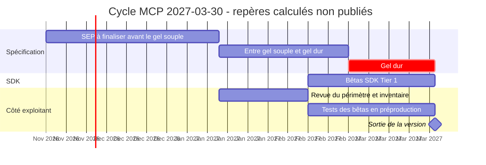
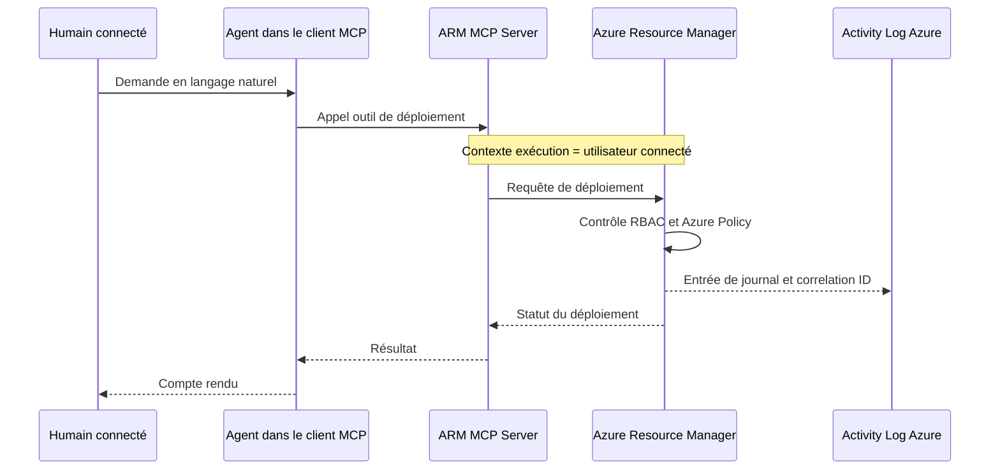

## Quand, et sous quel nom ?

Avant d'autoriser un changement en production, un comité de changement pose toujours deux questions. Quand ? Et sous quel nom ? La première fixe la fenêtre, la seconde désigne le responsable. Tant que les changements étaient poussés à la main par des ingénieurs, les deux réponses tenaient sur une ligne de ticket.

Les agents d'IA bousculent cet équilibre. Ils lisent la télémétrie, ouvrent des tickets, préparent des déploiements et commencent à écrire en production. Pour un opérateur de réseaux hébergés qui gère des centaines de sites (hôtels, magasins, résidences étudiantes), comme pour une DSI multi-sites, la question a cessé d'être théorique.

En une semaine, mi-novembre, les deux questions ont reçu des réponses de nature opposée. Le 11 novembre, les mainteneurs du Model Context Protocol (MCP, le standard ouvert qui permet à un agent de se brancher sur des outils et des sources de données) ont annoncé un rythme fixe : une version tous les six mois, prochaine échéance le 30 mars 2027. Dans la foulée, à l'occasion d'Ignite 2026, Microsoft a élargi ce que son serveur MCP pour Azure sait modifier. Or ce serveur exécute chaque opération sous l'identité de l'humain connecté.

Le « quand » devient prévisible. Le « sous quel nom » reste celui de la personne qui a lancé l'agent. Ma position : gouverner la version par le calendrier, le rayon d'action par les droits d'accès, et ne pas attendre que le protocole règle l'identité à notre place.

## Un train qui part à l'heure, avec ou sans vous

Pensez à un horaire ferroviaire plutôt qu'à une date de livraison logicielle. Le train part à l'heure affichée. Si votre valise n'est pas bouclée, vous prendrez le suivant : le train, lui, n'attend personne. C'est exactement la logique de [SEP-3398](https://modelcontextprotocol.io/seps/3398-release-cycle-updates).

Les SEP sont les propositions formelles d'évolution de MCP. Celle-ci, intitulée « Release Cycle Updates », est de type Process : elle ne touche pas au protocole, elle organise sa fabrication. Rédigée par Kurtis Van Gent et acceptée le 14 octobre 2026, elle formalise une décision prise lors du Core Maintainer Day de MCPCon Europe. Le [billet d'annonce](https://blog.modelcontextprotocol.io/posts/mcp-release-cycle/) est signé des deux Lead Maintainers, Den Delimarsky et David Soria Parra, et Luca Chang rejoint l'équipe comme Release Manager.

La règle : une version de la spécification tous les six mois, « generally » le dernier mardi de mars et de septembre. Prochaine cible le 2027-03-30, puis le 2027-09-28 selon la frise du billet. Le « generally » n'est pas décoratif, puisque les release managers confirment chaque date. Derrière, une mécanique : chaque cycle dure huit mois et chevauche le suivant de deux mois. Les jalons se comptent en mois avant la sortie. Revue par les Core Maintainers à 6, gel souple (soft freeze) à 2,5, bêtas des SDK de premier rang (Tier 1) à 1,5, gel dur (hard freeze) à 1.

Le gel souple est le jalon qui compte pour un exploitant. À ce stade, chaque SEP embarqué doit être Final et mergé : texte de spécification, schéma, changelog, implémentation de référence, tests de conformité. Le texte est sans appel : « Acceptance alone does not meet the cutoff. » Ce qui n'est pas prêt glisse au cycle suivant, car « the release date does not move to accommodate unfinished proposals ».

Le gel dur ferme la porte. Seuls passent alors les correctifs de sécurité critiques et les défauts bloquants de correction ou d'interopérabilité, sur vote de l'ensemble des Core Maintainers. Un SDK en retard ? L'écart est documenté, la date ne bouge pas. Premier effet visible : la version attendue en décembre 2026 glisse au 30 mars 2027, et la dernière release reste celle du 28 juillet 2026.

*Repères calculés à partir des offsets en mois de SEP-3398 : seules les dates publiées par les release managers feront foi.*

Qui tient la montre ? MCP figure parmi les projets fondateurs de l'Agentic AI Foundation (AAIF), créée sous l'égide de la Linux Foundation en décembre 2025, mais le communiqué de création ne dit rien de la cadence. Les documents du projet attribuent la décision aux Core Maintainers, des individus et non des sièges d'entreprise. Un SEP passe à la majorité absolue des électeurs éligibles, par vote enregistré de sept jours. Avec deux Leads et six Core Maintainers listés sur la page de gouvernance (liste susceptible d'évoluer), mon calcul donne cinq voix pour faire passer une proposition. Un cercle restreint, et nominatif.

Ce que l'annonce précise elle-même : SEP-3398 ne modifie ni les messages ni la négociation de version. Il rend le rythme prévisible. Il ne protège de rien. Un horaire fiable n'a jamais servi de ceinture de sécurité.

*Deux horloges à ne pas confondre : celle du protocole, rythmée par des gels datés, et celle de l'identité, qui passe de l'humain à l'agent.*

## Le vrai chantier a commencé en juillet

Si la cadence ne coûte rien, la version courante, elle, coûte. La [spécification 2026-07-28](https://modelcontextprotocol.io/specification/2026-07-28/changelog), toujours « Current » à la mi-novembre, aligne 9 changements majeurs, 12 mineurs et 4 entrées de dépréciation. Les deux plus lourds tiennent en une ligne : plus de session, plus de poignée de main d'ouverture.

Jusqu'ici, un échange MCP ressemblait à un appel téléphonique. On décroche, on se présente, et la conversation garde le contexte tant qu'on ne raccroche pas. Avec la version de juillet, c'est un courrier recommandé : chaque lettre porte elle-même la version et les capacités de l'expéditeur, et n'importe quel guichet peut la traiter.

Traduit en spécification, l'identifiant de session `Mcp-Session-Id` disparaît (SEP-2567), et la poignée de main `initialize` avec lui (SEP-2575). Chaque requête déclare sa version dans un champ de métadonnées, `_meta`, et le serveur accepte ou refuse chaque requête indépendamment. Pour connaître ses capacités, un client appelle `server/discover`, devenu obligatoire.

Le ménage continue. Le `ping` disparaît, tout comme la reprise des flux SSE (Server-Sent Events, le canal par lequel le serveur pousse ses notifications). Les Tasks, ces opérations longues que l'on interroge jusqu'à leur terme, quittent le cœur du protocole pour une extension dédiée (SEP-2663).

Le guide de préparation de Stacklok, rédigé sur la release candidate figée le 21 mai, résume la conséquence : « Any request can land on any server instance ». Bonne nouvelle pour la haute disponibilité derrière un répartiteur de charge. Mauvaise nouvelle pour tout serveur MCP maison qui gardait de l'état en mémoire ou comptait sur l'affinité de session. Autre avertissement : les implémentations « modern-only » et « legacy-only » n'interopèrent pas automatiquement, et un proxy de traduction ne convient qu'à des « well-defined patterns ».

Un changement mineur devrait réjouir les centres de supervision. Le contexte de trace OpenTelemetry (`traceparent` et ses champs associés) voyage désormais dans `_meta` (SEP-414). Une action d'agent peut ainsi se rattacher à une trace distribuée, de bout en bout.

Autre ajout discret : les en-têtes `Mcp-Method` et `Mcp-Name` deviennent requis (SEP-2243). À mon sens, une aubaine pour qui journalise au niveau d'une passerelle.

Le coût de migration, c'est donc juillet qui le facture. Le nouveau calendrier se contente d'annoncer la date de la prochaine facture.

## Une clé prêtée ouvre toutes les portes du prêteur

Imaginez un ingénieur qui détient le rôle Contributor sur une quarantaine de groupes de ressources Azure. Il demande à son agent d'aligner la configuration de tous les environnements de recette. L'agent n'a aucun droit propre : il a exactement ceux de l'ingénieur. Quarante groupes de ressources, donc, et chaque modification inscrite au nom de l'humain.

C'est le modèle de l'Azure Resource Manager MCP Server (ARM est la couche de gestion des ressources d'Azure), et il n'a rien de neuf. La public preview, [annoncée le 7 mai 2026](https://techcommunity.microsoft.com/blog/azuregovernanceandmanagementblog/introducing-the-azure-resource-manager-mcp-server/4517521), l'écrivait déjà : « All operations run in the context of your signed-in user ». Au lancement, ce serveur distant offrait six outils. Trois interrogeaient Azure Resource Graph, l'inventaire requêtable d'Azure ; trois créaient, suivaient et annulaient un déploiement de gabarit.

Le catalogue de 24 preuves de concept publié le 19 juin précise la doctrine : « no shared credential, no over-privileged service principal », le service principal étant l'identité applicative d'Azure. Les scénarios en lecture demandent les rôles Reader et Resource Graph Reader ; ceux qui déploient exigent en plus Contributor sur les groupes de ressources ciblés. Azure Policy s'applique à l'identique, et chaque déploiement de gabarit laisse un correlation ID et une entrée dans le journal d'activité.

Ce qui change mi-novembre, c'est la surface d'écriture. Le billet Ignite 2026 ajoute notamment :

- `create_or_update_resource` et `create_or_update_resource_group`, pour créer ou modifier directement une ressource ;
- `execute_resource_action`, pour les opérations de type POST ;
- des outils de coûts, et des Skills expérimentaux désactivés par défaut.

Le billet renforce aussi `whatif_deployment`, déjà présent, qui simule un déploiement avant de l'appliquer.

On passe de « je pousse un gabarit » à « je modifie une ressource ». Le billet ne dit pas un mot de l'identité, du RBAC ou du statut du produit. Dernière confirmation explicite de la preview : mai 2026, plus la mention « During this preview » du README GitHub. Aucune disponibilité générale n'est annoncée dans les sources que j'ai lues. Même les noms d'outils varient selon la version de la preview (`create_template_deployment` en mai, `create_deployment` dans le README).

Je trouve ce choix d'identité sobre, et même sain. Pas de secret partagé, pas de compte de service surpuissant, des politiques qui s'appliquent sans exception, une trace par déploiement. Mais chaque outil ajouté rend le revers plus visible : le rayon d'action de l'humain s'étend à tout ce qu'un agent peut enchaîner. Notre ingénieur n'utilise peut-être ses droits que sur trois groupes de ressources dans une semaine normale. Son agent n'a pas cette retenue.

*La chaîne d'écriture telle que Microsoft la décrit : l'agent agit dans le contexte de l'utilisateur connecté, borné par le RBAC et Azure Policy, tracé par le journal d'activité.*

Trois questions à séparer. Qui est l'identité d'exécution ? L'humain. Qu'est-ce qui limite ? Le RBAC (contrôle d'accès par rôle), Azure Policy et le périmètre des groupes de ressources. Qu'est-ce qui prouve ? Le journal d'activité et le correlation ID.

Le maillon faible est le troisième. Un journal qui attribue l'action à l'humain ne dit pas forcément « c'est l'agent ». Le README mentionne bien un identifiant d'application propre au serveur MCP, qu'une Azure Policy peut cibler pour refuser les déploiements passant par lui. L'appel est donc reconnaissable par une politique. Que le journal d'activité distingue un geste humain direct d'un geste délégué à l'agent, en revanche, je ne l'ai vu vérifié nulle part.

Et le protocole ? La spécification 2026-07-28 encadre sérieusement l'autorisation. Elle s'appuie sur OAuth 2.1 et rend obligatoire le paramètre `resource` (RFC 8707), pour qu'un jeton soit émis à destination d'un serveur précis. Le serveur doit publier ses métadonnées de ressource protégée (RFC 9728), vérifier que le jeton lui est bien destiné, et n'a le droit ni d'accepter ni de relayer un jeton émis pour un autre.

L'extension Enterprise-Managed Authorization, au statut Stable, va plus loin. Le fournisseur d'identité de l'entreprise (IdP) y évalue des politiques d'administration au moment de l'échange de jeton (RFC 8693), et le jeton d'accès reste restreint au serveur MCP visé. Mais le texte pose lui-même sa limite : l'IdP ne voit que l'émission du jeton, pas le trafic MCP, et l'extension ne définit aucune exigence d'audit. Le protocole fabrique une clé bien adressée. Il ne tient pas le registre des portes ouvertes.

## Du cloud au contrôleur Wi-Fi, la même équation

Rien de tout cela n'est propre au cloud. Transposons, à titre d'hypothèse de travail.

Si vous exposez un outil de provisioning de sites ou un contrôleur Wi-Fi via MCP en adoptant le modèle « l'agent hérite des droits de l'humain », le périmètre d'écriture de l'agent devient celui du compte de l'ingénieur. Chez un client multi-établissements (chaîne hôtelière, enseigne de cent magasins, gestionnaire de résidences étudiantes), ce compte peut couvrir tous les sites. L'agent aussi. Le motif est d'ailleurs familier : créer un déploiement, suivre son statut, l'annuler, c'est la forme exacte d'un gabarit de configuration poussé sur un parc de bornes.

*La clé reste dans la main de l'opérateur humain ; le fil qui la relie au bras robotisé est précisément ce qu'il faudra savoir auditer.*

La question de gouvernance est simple à poser, difficile à trancher : sous quelle identité l'agent d'un opérateur agit-il sur le périmètre d'un client ? Celle de l'ingénieur d'astreinte ? Celle d'un rôle dédié à ce client ? Le protocole fournit des briques, le jeton à audience restreinte et l'autorisation pilotée par l'IdP. Il ne fournit pas l'audit.

L'audit, c'est à l'exploitant de le construire, en croisant trois fils : le journal d'activité de chaque système cible, l'identifiant de corrélation de chaque changement, la trace OpenTelemetry propagée dans `_meta` depuis l'agent. Sans session protocolaire, n'importe quelle instance de serveur peut répondre. C'est la trace, et non plus la connexion, qui recoud l'histoire d'une action.

## Faire du calendrier un outil de change management

Revenons à l'horloge du protocole, parce qu'elle devient enfin exploitable. Voici ce que je mettrais à l'agenda d'un comité de changement.

**Épingler la version MCP par environnement**, comme on épingle un noyau LTS (à support long terme). Un point « version MCP » tous les six mois, calé sur mars et septembre, transforme une surprise en échéance.

**Lire le périmètre à la mi-janvier.** Mes repères sont calculés à partir des offsets du SEP, ils ne sont publiés nulle part : gel souple vers la mi-janvier 2027, bêtas des SDK Tier 1 vers la mi-février, gel dur vers la fin février, sortie le 30 mars. À la mi-janvier, on sait ce qui entre. On peut donc préparer sa migration avant la sortie plutôt que la subir après. Le calendrier publié par les release managers fera foi.

**Inventorier les dépréciations dès maintenant.** Roots, Sampling et Logging (trois fonctionnalités historiques du protocole), ainsi que Dynamic Client Registration (DCR, l'enregistrement automatique des clients OAuth) sont dépréciés depuis la version 2026-07-28. Leur retrait n'est possible qu'à partir de la première révision publiée à compter du 28 juillet 2027. Le transport HTTP+SSE suit sa propre règle : trois mois après le passage de la politique de cycle de vie (SEP-2596) au statut Final. Aucune fonctionnalité n'a été retirée à ce jour.

Ma déduction, à prendre comme telle : avec la cadence annoncée, la release de mars 2027 ne peut rien retirer de cette liste, et septembre 2027 devient la première fenêtre possible. « Earliest » ne veut pas dire « certain », la décision revenant aux Core Maintainers lors de la préparation de la release. La politique prévoit douze mois minimum entre dépréciation et retrait, ramenés à 90 jours en cas de risque de sécurité actif. Et comme le rappelle Stacklok, cette fenêtre ne couvre que ce qui est marqué Deprecated : « not a blanket one-year guarantee ». Les remplaçants documentés sont connus : Client ID Metadata Documents, OpenTelemetry, Streamable HTTP.

*Certaines voies s'éteignent, d'autres atteignent la ligne d'arrivée : l'inventaire des dépréciations se fait maintenant, pas la veille du retrait.*

**Mettre le tier du SDK dans vos contrats.** Un SDK Tier 1 doit réussir 100 % des tests de conformité applicables, livrer les nouveautés avant la sortie d'une version, trier un ticket sous deux jours ouvrés et corriger un bug critique sous sept jours. Un Tier 2 se contente de 80 %, de six mois pour les nouveautés et de deux semaines pour un bug critique. Un Tier 3 ne s'engage sur rien. Au 15 novembre, TypeScript, Python, C#, Go, Rust et Ruby sont Tier 1 ; Java est Tier 2 ; Swift, PHP et Kotlin sont Tier 3. La page des SDK le dit sans détour : « SDKs adopt new protocol revisions on their own schedules ».

Conséquence arithmétique, que les textes n'écrivent pas tels quels : avec une version tous les six mois et un engagement « within 6 months », un SDK Tier 2 peut rester durablement une version en retard. Exigez donc par écrit de vos fournisseurs la révision de spécification supportée, le tier du SDK, le préavis de dépréciation et le support de la révision précédente (N-1). Redoublez de vigilance si l'intégration passe par Java, PHP, Kotlin ou Swift.

**Cloisonner les écritures d'agent.** Faites tourner l'agent sous un compte ou un rôle dédié, au périmètre étroit, plutôt que sous le compte nominatif complet de l'ingénieur. Le catalogue de Microsoft recommande lui-même de conditionner chaque écriture à un verbe explicite, à une confirmation et à un drapeau de gel global. Pour la supervision et le confinement en cours d'exécution, je renvoie à notre récent billet sur le kill switch.

## Une montre ne signe pas

MCP a appris à tenir une montre, et je ne le dis pas avec ironie. Un protocole dont la date ne bouge plus se gouverne comme n'importe quelle dépendance critique : un planning, des gels, des préavis. C'est le signal de maturité que ses exploitants attendaient.

Mais une montre ne signe pas. Le jour où un agent modifiera la configuration de cent sites, c'est le nom d'un humain qui apparaîtra dans le journal. Et rien dans le protocole n'oblige quiconque à pouvoir dire si le geste venait de lui ou de son agent.

Je ne crois pas qu'il faille attendre une identité d'agent normalisée pour avancer. Les briques existent : jeton restreint à un serveur, politiques évaluées par l'IdP, trace OpenTelemetry, identifiant de corrélation. Ce qui manque, c'est la discipline de l'exploitant. Des comptes étroits pour les agents, des revues calées sur mars et septembre, un audit construit chez soi.

Le calendrier dit quand. À nous de décider sous quel nom, et jusqu'où.

## Sources

1. [Blog MCP, « A More Predictable Release Cycle for MCP » (11 novembre 2026)](https://blog.modelcontextprotocol.io/posts/mcp-release-cycle/)
2. [SEP-3398, « Release Cycle Updates » (acceptée le 14 octobre 2026)](https://modelcontextprotocol.io/seps/3398-release-cycle-updates)
3. [Spécification MCP 2026-07-28, Key Changes](https://modelcontextprotocol.io/specification/2026-07-28/changelog)
4. [Feature Lifecycle and Deprecation (SEP-2596)](https://modelcontextprotocol.io/community/feature-lifecycle)
5. [Registre des fonctionnalités dépréciées, spécification 2026-07-28](https://modelcontextprotocol.io/specification/2026-07-28/deprecated)
6. [SDK Tiers (SEP-1730)](https://modelcontextprotocol.io/community/sdk-tiers)
7. [Liste des SDK MCP et de leurs tiers](https://modelcontextprotocol.io/docs/sdk)
8. [Guide de versioning MCP](https://modelcontextprotocol.io/docs/learn/versioning)
9. [Autorisation, spécification 2026-07-28](https://modelcontextprotocol.io/specification/2026-07-28/basic/authorization)
10. [Extension Enterprise-Managed Authorization (ext-auth)](https://github.com/modelcontextprotocol/ext-auth)
11. [Gouvernance du projet MCP](https://modelcontextprotocol.io/community/governance)
12. [Linux Foundation, création de l'Agentic AI Foundation (9 décembre 2025)](https://www.linuxfoundation.org/press/linux-foundation-announces-the-formation-of-the-agentic-ai-foundation)
13. [Microsoft, « Introducing the Azure Resource Manager MCP Server » (7 mai 2026)](https://techcommunity.microsoft.com/blog/azuregovernanceandmanagementblog/introducing-the-azure-resource-manager-mcp-server/4517521)
14. [Microsoft, « ARM MCP Server: a catalog of 24 PoCs » (19 juin 2026)](https://techcommunity.microsoft.com/blog/azuregovernanceandmanagementblog/arm-mcp-server-a-catalog-of-24-pocs/4519069)
15. [Microsoft, « What's new in the Azure Resource Manager MCP server at Ignite 2026 » (mi-novembre 2026)](https://techcommunity.microsoft.com/blog/azuregovernanceandmanagementblog/what%E2%80%99s-new-in-the-azure-resource-manager-mcp-server-at-ignite-2026/4571824)
16. [GitHub, Azure/Azure-Resource-Manager-MCP (README)](https://github.com/Azure/Azure-Resource-Manager-MCP)
17. [Stacklok, Enterprise Readiness Guide for the July 2026 MCP Spec Update](https://stacklok.com/resources/enterprise-readiness-guide-for-the-july-2026-mcp-spec-update/)

---

_Vues personnelles, pas position Wifirst._
