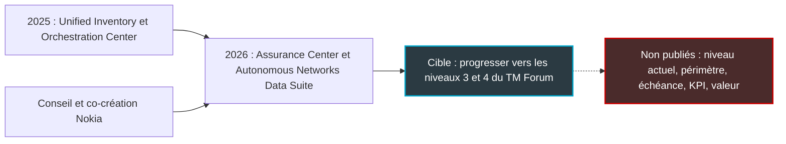
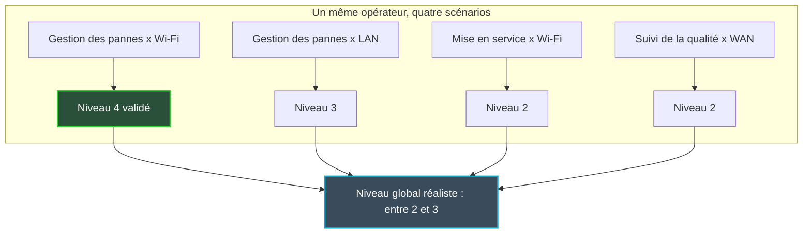
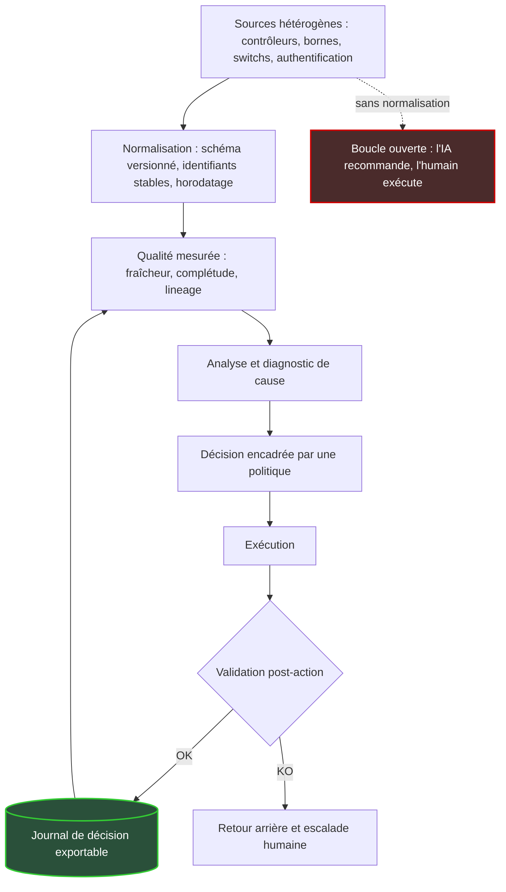

## Une promesse d'autonomie, et pas un seul chiffre

Imaginez un réseau qui voit venir la panne, en trouve la cause et la corrige avant que le premier client ne s'en aperçoive. C'est l'horizon que s'est fixé One New Zealand, l'opérateur néo-zélandais, en étendant son partenariat avec Nokia le 11 novembre. L'annonce aligne deux briques logicielles, deux citations de dirigeants et une ambition : progresser vers les niveaux 3 et 4 de l'échelle d'autonomie du TM Forum, l'association qui fixe les référentiels de l'industrie télécom.

Elle ne contient aucun chiffre. Pas de niveau actuel, pas d'échéance, pas d'indicateur de performance.

Ce n'est pas un sujet néo-zélandais. Chaînes hôtelières, enseignes de retail, gestionnaires de résidences étudiantes, DSI de groupes multi-sites : tous recevront dans les mois qui viennent des offres promettant un réseau qui se répare seul. Le vocabulaire est prêt. Les preuves le sont beaucoup moins, et c'est à l'acheteur de les réclamer.

Ma position tient en trois phrases. « Vers le niveau 4 » décrit une direction, pas un niveau. Ce qui transforme cette direction en résultat, ce n'est pas la quantité d'intelligence artificielle embarquée, mais la qualité des données que remontent les équipements. Et la seule façon de le vérifier, c'est d'écrire trois mesures dans le contrat.

## Ce que dit l'annonce, et ce qu'elle tait

Commençons par ce qui est écrit, d'après trois reprises intégrales du communiqué [1]. One NZ va déployer deux produits Nokia. Le premier, Assurance Center, est la brique d'assurance de service : elle détecte les dégradations et doit permettre d'agir avant l'impact client. Le second, Autonomous Networks Data Suite, est la couche de données qui doit rendre l'information réseau exploitable par les algorithmes. Nokia y ajoute de la co-création en R&D et du conseil. Le tout s'appuie sur deux investissements réalisés en 2025 : un inventaire unifié (Unified Inventory) et une plateforme d'orchestration (Orchestration Center).

Le communiqué insiste sur les interfaces ouvertes et les options de déploiement sur site. One NZ garde le contrôle de ses données, de ses modèles et de son environnement d'exploitation. Nokia revendique une approche « glass-box » : une boîte vitrée plutôt qu'une boîte noire, où les décisions et leur gouvernance restent visibles.

Le discours des dirigeants est mesuré. « L'ambition des réseaux autonomes n'est plus simplement d'automatiser davantage de tâches », explique Shkumbin Hamiti, responsable des réseaux autonomes chez Nokia (citations traduites de l'anglais). Sharina Nisha, CTO de One NZ, prévient qu'« intégrer davantage d'autonomie dans notre réseau est un voyage », et présente l'accord comme « la prochaine étape de la transformation que nous avons déjà engagée ».

Soyons justes : le séquencement est le bon. D'abord savoir ce qu'on possède (l'inventaire) et pouvoir agir dessus (l'orchestration). Ensuite voir et décider (la donnée, l'assurance). George Glass, CTO du TM Forum, décrit très bien l'erreur inverse : « Si vous conservez votre existant et commencez simplement à poser des agents par-dessus, vous n'atteindrez pas le niveau 4 » [4]. One NZ ne fait pas ça.

Reste ce qui manque, et la liste est longue. Le niveau actuel de One NZ. Le périmètre visé : quels domaines, quels processus. L'échéance. Les indicateurs de performance (KPI). La valeur du contrat. Converge Digest fait le même constat : ce sont « des cibles, pas des certifications », sans valeur ni calendrier divulgués [2].

Ce silence n'a rien d'obligatoire. En juin, Nokia revendiquait pour les opérateurs utilisant sa pile autonome des taux d'automatisation supérieurs à 90 %, des interruptions de service sous la minute par an et jusqu'à 50 % d'incidents clients en moins [10]. Tech Times notait que ces chiffres venaient de Nokia, sans vérification indépendante ni confrontation à une certification TM Forum. Mais ils existaient. Je ne reproche rien à One NZ, qui a peut-être des indicateurs en interne. Je constate que le communiqué n'en publie aucun. C'est précisément la question à poser.

*La trajectoire One NZ et Nokia telle que la décrit le communiqué : les briques sont nommées, la cible aussi, les mesures non.*

## « Vers le niveau 4 », c'est quel niveau ?

L'échelle du TM Forum va de L0 (tout manuel) à L5 (autonomie complète), et je l'ai détaillée [à propos de T-Mobile](/post?slug=tmobile-dynamic-cx-level4-autonome-msp-wifi). Retenez une chose : au niveau 4, la machine perçoit, analyse, décide et exécute, mais l'intention reste partagée avec les humains. Seul le niveau 5 fixe ses propres objectifs [5].

Le piège est ailleurs. Un niveau d'autonomie ressemble moins à une note globale qu'à un permis de conduire par catégorie. On peut avoir le droit de piloter une moto sans l'avoir pour un poids lourd. Le TM Forum raisonne de la même manière : le niveau s'évalue par scénario, c'est-à-dire un flux d'opération (traiter les pannes, mettre en service, suivre la qualité) croisé avec un domaine réseau [5]. Pas par opérateur. Pour la méthode d'évaluation détaillée, la référence est le livre blanc IG1392 du TM Forum [13], que je cite sans avoir pu le lire en intégralité.

George Glass l'a dit sans détour en mai : « Ce n'est pas le niveau 4 sur tout le réseau ; c'est pour un scénario ou une technologie donnés, au sein d'un domaine » [4]. Il situe la moyenne de l'industrie « probablement entre 1,5 et 2,1, de façon réaliste », et note que les certifications délivrées tournent plutôt autour des « hauts 1, bas 2 ».

Le TM Forum a annoncé en juin 40 validations attribuées à 17 opérateurs [5]. Lisez bien : une validation porte sur un scénario, pas sur un opérateur. Celui qui a fait valider deux scénarios au niveau 4 peut rester, sur l'ensemble de son réseau, entre le niveau 2 et le niveau 3.

*Exemple fictif : un scénario validé au niveau 4 ne fait pas un réseau de niveau 4.*

### Des chiffres qui ne mesurent pas la même chose

Les études de maturité semblent se contredire. En réalité, elles ne comptent pas la même chose.

| Chiffre | Source | Ce qui est mesuré | Échantillon |
|---|---|---|---|
| 79 % des opérateurs au niveau 0 ou 1 | Accenture, janvier 2026 [7] | L'opérateur entier, selon ses dirigeants | Environ 250 dirigeants |
| 20 % au niveau 4 ou 5 « dans certains domaines » | Bain et TM Forum, août 2025 [8] | Des domaines choisis, pas le réseau entier | 22 dirigeants |
| Entre 1,5 et 2,1 | George Glass, CTO du TM Forum, mai 2026 [4] | La moyenne de l'industrie | Estimation d'expert |
| 40 validations pour 17 opérateurs | TM Forum, juin 2026 [5] | Des scénarios validés, pas des opérateurs | Validations formelles |
| 4 % au niveau 4 | Tribune Nokia, août 2025, attribuée au TM Forum [9] | Une auto-déclaration des opérateurs | Non précisé, non recoupé |

D'une source à l'autre, les chiffres cités pour le niveau 4 (ou plus) varient de 4 % à 20 %. Ce n'est pas une contradiction, c'est une différence d'unité : Accenture parle d'opérateurs entiers, Bain de domaines, le TM Forum de scénarios validés, la tribune Nokia d'auto-déclarations. Même piège pour 2030 : 81 % des opérateurs visent le niveau 4 ou plus selon le TM Forum [5], quand 22 % seulement l'attendent selon Accenture [7]. Viser et attendre, ce n'est pas la même question.

> **D'où vient le « 4 % » ?** En cherchant un chiffre pour situer l'annonce, on tombe vite sur celui-ci : 4 % des opérateurs seraient au niveau 4. Il ne figure pas dans le communiqué One NZ et Nokia, qui ne contient aucune statistique. Il vient d'une tribune publiée par RCR Wireless le 7 août 2025, signée Rodrigo Brito, responsable mondial des applications de réseaux autonomes chez Nokia [9]. L'auteur l'attribue au « dernier rapport de benchmark régional du TM Forum » : 31 % des opérateurs au niveau 2, 17 % au niveau 3, 4 % au niveau 4. Le total fait 52 %, et le reste n'est pas expliqué. Je n'ai pas pu recouper ce rapport à la source. Un chiffre porté par un fournisseur, vieux de quinze mois, sans source primaire accessible : je ne bâtis rien dessus.

*Un niveau d'autonomie s'allume scénario par scénario, rarement sur tout le réseau à la fois.*

## La boucle fermée tient sur un schéma de données

Un thermostat ne régule rien si la moitié de ses sondes mesurent en Celsius, l'autre en Fahrenheit, et qu'une troisième renvoie la température d'hier. Il ne régule même pas mal : il régule au hasard. Une boucle fermée de réseau (le système détecte, décide, agit puis vérifie, sans humain dans la chaîne) n'est rien d'autre qu'un thermostat géant.

La définition du niveau 4 citée par Analysys Mason le dit en creux : « la capacité à effectuer des prédictions auto-ajustées et des mises en œuvre réseau sur la base de données temps réel » [6]. Le mot qui porte tout, c'est « données ». Pas « IA ». Je ne parle pas ici de l'inventaire, savoir ce qu'on possède, [traité dans un précédent billet](/post?slug=aiops-inventaire-reseau-barrieres-operateur-manage). Je parle du flux : ce que les équipements disent de leur état, en continu, et dans quelle langue.

Les opérateurs le savent. Dans le benchmark 2026 du TM Forum (125 répondants issus de 80 entreprises), 61 % jugent la qualité des données « très difficile » pour déployer des réseaux autonomes : c'est le premier défi cité côté données [3]. Les silos de données sont jugés très difficiles par 45 % des répondants, assez difficiles par 45 % d'autres. Chez Accenture, 47 % des opérateurs pointent des plateformes héritées qui limitent l'interopérabilité [7].

Le diagnostic n'est pas neuf. Dès 2023, Analysys Mason écrivait que les architectures de données des opérateurs « n'ont pas été conçues pour fournir l'analytique temps réel indispensable aux workflows de réseau autonome », et pointait l'absence de modèles de données standard à l'échelle de l'industrie [6]. L'article a trois ans, mais le benchmark 2026 suggère que le chantier reste ouvert. L'intégrateur Persistent Systems réclame, pour passer du niveau 3 au niveau 4, un modèle de données opérationnel unique que les domaines radio, cœur et transport lisent et écrivent [11]. C'est l'avis d'un prestataire, pas une norme. Il vise pourtant le bon endroit.

Nokia le sait, et c'est à son crédit : le produit porte la donnée dans son nom. D'après les descriptions publiques du produit (je n'ai pas pu lire les pages Nokia directement), la Data Suite repose sur un catalogue de *data products* télécom prêts à l'emploi, du lineage (la traçabilité de l'origine de chaque donnée), des contrôles de politique et des adaptateurs multi-constructeurs. Promesses de fournisseur, à ce stade. Lors de l'annonce avec Microsoft en septembre, la boucle fermée figurait parmi les cas d'usage, sans explication du mécanisme ni mention explicite d'un modèle de données [12]. Le communiqué One NZ ne dit pas davantage quel schéma la Data Suite impose, ni comment la qualité est mesurée. Ce n'est pas un reproche. C'est la question.

*Sans normalisation ni qualité mesurée, la boucle reste ouverte : l'IA recommande, l'humain exécute.*

## Trois mesures à écrire dans le contrat

Si la donnée conditionne la boucle, la boucle se juge à ses résultats. Je propose trois mesures. Elles ne viennent ni du TM Forum ni de Nokia : c'est ma grille d'acheteur, à adapter à chaque scénario.

| Mesure | Ce qu'elle compte | Ce qu'il faut exiger | Preuve attendue |
|---|---|---|---|
| MTTR ventilé | Temps de détection et de rétablissement, séparés entre incidents traités par l'humain et par la boucle, scénario par scénario | Une baseline mesurée avant déploiement et une fenêtre de comparaison fixée d'avance, par exemple 90 jours | Export brut des tickets et des événements horodatés |
| Taux d'actions auto-validées | Part des actions exécutées automatiquement **et** confirmées par un contrôle après coup | Suivi conjoint des retours arrière, des faux positifs et des annulations humaines | Journal de validation par action |
| Traçabilité exportable | Pour chaque décision : données d'entrée, version du modèle ou de la règle, politique, action, résultat | Format ouvert, rétention définie, stockage hors de la plateforme qui agit | Échantillon de décisions audité au hasard |

**Le MTTR ventilé.** Le temps moyen de rétablissement (MTTR, pour *mean time to restore*) global ne prouve rien. Il peut baisser parce qu'on a renforcé l'équipe, parce que la saison a été calme, ou parce que les incidents ont changé de nature. Il faut deux colonnes, l'humain et la boucle, et une ligne par scénario. Sans baseline mesurée avant le déploiement, chacun choisira après coup la période qui l'arrange.

**Le taux d'actions auto-validées.** Un taux d'automatisation compte ce que la machine a fait. Un taux d'actions auto-validées compte ce qu'elle a bien fait : la part des actions exécutées seules et confirmées ensuite par un contrôle (état attendu atteint, aucune régression). Il se lit avec trois compagnons : le taux de rollback (retour à l'état antérieur), le taux de faux positifs et le taux d'override, c'est-à-dire de décisions annulées par un humain. Persistent Systems propose un override inférieur à 3 %, qu'il décrit comme « le signal empirique que la confiance opérationnelle est établie, et pas seulement proclamée » [11]. Le seuil se discute selon le scénario. L'idée, non.

**La traçabilité exportable.** Chaque décision doit laisser une trace complète, lisible par un humain, et stockée [hors de la plateforme qui agit](/post?slug=agents-effacent-leurs-traces-audit-hors-hote). Analysys Mason fait des pistes d'audit, de l'observabilité et de l'explicabilité une condition de l'autonomie, et rappelle qu'une supervision humaine restera nécessaire dans certains scénarios [6]. La « glass-box » de Nokia doit devenir un journal que l'acheteur extrait, pas une vitrine qu'il consulte.

*Chaque décision automatique doit laisser une trace complète et exportable : données d'entrée, version, action, validation.*

Ces trois mesures reposent sur des préconditions de données, à contractualiser elles aussi : un schéma documenté et versionné, une fraîcheur mesurée de bout en bout, de l'équipement à la décision, un taux de complétude, un lineage, un droit d'export intégral. Les interfaces ouvertes et les options sur site du communiqué One NZ vont dans ce sens. Mais une promesse de communiqué n'engage personne tant qu'elle n'est pas devenue une clause.

## Wi-Fi multi-sites : la donnée d'abord, la boucle ensuite

Transposons à un terrain que je connais : les réseaux Wi-Fi et LAN multi-sites des hôtels, des magasins, des bureaux et des résidences étudiantes. Ce qui suit est une recommandation d'architecte, pas un retour d'expérience.

Sur ces réseaux, l'hétérogénéité est la règle. Contrôleurs et bornes de plusieurs constructeurs cohabitent, parfois au sein d'un même parc. Un même événement, un terminal qui se déconnecte, n'aura ni le même nom, ni le même horodatage, ni le même identifiant d'équipement d'un constructeur à l'autre. Brancher une remédiation automatique là-dessus, c'est relier le thermostat à des sondes mal étalonnées.

Avant la moindre action automatique, je poserais quatre prérequis. Des identifiants stables pour le site, l'équipement et le SSID (le nom du réseau Wi-Fi diffusé). Un horodatage cohérent sur toutes les sources. Des événements d'association, d'itinérance et d'authentification 802.1X (le contrôle d'accès par identifiants) décrits dans un schéma commun. Et une qualité de donnée mesurée, jamais supposée.

Ensuite seulement vient la séquence :

1. **Normaliser et mesurer.** Tant que fraîcheur et complétude ne sont pas suivies, pas de boucle.
2. **Recommander sous validation humaine.** La machine propose, le centre de supervision (NOC) tranche, et l'on mesure l'écart entre les deux.
3. **Automatiser le réversible à faible rayon d'impact.** Changer le canal radio d'une borne, ajuster sa puissance d'émission : des actions qu'on annule en une minute, sur un seul site.
4. **Élargir scénario par scénario**, quand le taux d'override reste bas sur une période longue.

*Des flux multi-constructeurs ramenés à un format unique : le prérequis de toute remédiation automatique.*

Dernier point, le plus inconfortable : un opérateur qui exige cette grille de ses fournisseurs doit se l'appliquer à lui-même. Sinon, il réclame des preuves qu'il serait incapable de produire.

## Huit questions à poser à tout fournisseur « niveau 4 »

1. Sur quels scénarios porte la cible, et à quel niveau se situe chacun aujourd'hui ?
2. Qui évalue ce niveau : vous, une validation TM Forum, un auditeur tiers ?
3. Le schéma de télémétrie est-il documenté, versionné, publié ? Qui le fait évoluer ?
4. Comment mesurez-vous la fraîcheur, la complétude et le lineage des données ?
5. À quel seuil de dégradation de la donnée la boucle se désactive-t-elle d'elle-même ?
6. Quelle baseline de MTTR avant déploiement, et sur quelle fenêtre la comparez-vous ?
7. Quels taux d'actions auto-validées, de rollback, de faux positifs et d'override, et calculés par qui ?
8. Puis-je exporter chaque décision, avec ses entrées et sa version de modèle, dans un format ouvert, et la conserver si je change de fournisseur ?

La cinquième est, à mes yeux, la plus révélatrice. Une boucle qui ne sait pas s'arrêter quand ses capteurs mentent n'est pas autonome. Elle est aveugle.

## Une direction n'est pas un livrable

One NZ et Nokia font les choses dans le bon ordre : l'inventaire et l'orchestration d'abord, la donnée et l'assurance ensuite. La trajectoire a l'air sérieuse. Mais un communiqué ne dit pas si la boucle ferme. Ce n'est pas son rôle. C'est celui du contrat.

Mon pronostic : d'ici deux ans, « niveau 4 » figurera dans toutes les plaquettes commerciales et ne vaudra plus rien sans le scénario, la baseline et le journal qui l'accompagnent. Les acheteurs qui auront écrit ces trois mesures dans leurs contrats sauront ce qu'ils ont payé. Les autres auront acheté une direction.

---

_Vues personnelles, pas position Wifirst._

## Sources

1. **Nokia / GlobeNewswire**, communiqué sur l'extension du partenariat entre One New Zealand et Nokia (réseaux autonomes), 11 novembre 2026. Reprises intégrales : https://via.ritzau.dk/pressemeddelelse/15283688/nokia-oyj?publisherId=90446 ; https://www.inderes.se/en/releases/one-new-zealand-expands-nokia-partnership-to-accelerate-its-autonomous-networks-transformation ; https://www.stocktitan.net/news/NOK/one-new-zealand-expands-nokia-partnership-to-accelerate-its-7agx8xwjmbzq.html. URL officielle : https://www.nokia.com/newsroom/one-new-zealand-expands-nokia-partnership-to-accelerate-its-autonomous-networks-transformation/
2. **Converge Digest**, One New Zealand et Nokia, réseaux autonomes et assurance, novembre 2026 : https://convergedigest.com/one-new-zealand-nokia-autonomous-networks-ai-assurance/
3. **TM Forum Inform** (Bushaus et Webb), benchmark Autonomous Networks, 125 répondants dans 80 entreprises, 15 avril 2026 : https://inform.tmforum.org/features-and-opinion/how-telcos-worldwide-are-implementing-an/
4. **RCR Wireless** (James Blackman), entretien avec George Glass, CTO du TM Forum, 19 mai 2026 : https://rcrwireless.com/20260519/carriers/road-to-level-4-point-solutions-wall-to-wall-autonomy-tm-forum
5. **TelecomsTechNews**, « Level 4 autonomous networks explained », 17 août 2026 : https://www.telecomstechnews.com/news/level-4-autonomous-networks-explained/
6. **Analysys Mason** : Adaora Okeleke, 28 novembre 2023, https://analysysmason.com/research/content/articles/csps-autonomous-networks-rma14 ; Adaora Okeleke, prédictions 2026, 8 décembre 2025, https://www.analysysmason.com/about-us/news/predictions-2026/prediction-agentic-ai-autonomy/ ; Dennisa Nichiforov, 6 novembre 2024, https://www.analysysmason.com/research/content/articles/l4-autonomous-networks-rma07/
7. **Fierce Network** (Masha Abarinova), étude Accenture sur la maturité des réseaux autonomes, 4 mars 2026 : https://www.fierce-network.com/broadband/accenture-79-telcos-still-level-01-autonomous-networks-maturity
8. **Bain et TM Forum**, état des lieux des réseaux autonomes chez les opérateurs, 22 dirigeants interrogés, 27 août 2025 : https://www.bain.com/es-ar/insights/accelerating-autonomous-networks-a-reality-check-for-telcos/
9. **RCR Wireless**, tribune de Rodrigo Brito (Nokia), 7 août 2025 : https://www.rcrwireless.com/20250807/automation/the-race-to-level-4
10. **Tech Times**, Nokia et AWS, chiffres fournisseur non vérifiés de façon indépendante, 24 juin 2026 : https://www.techtimes.com/articles/319022/20260624/nokia-moves-full-telecom-operations-stack-aws-targeting-level-4-network-autonomy.htm
11. **Persistent Systems**, passage du niveau 3 au niveau 4, seuils proposés par l'intégrateur, 6 août 2026 : https://www.persistent.com/blogs/the-last-mile-of-trust-why-moving-from-l3-to-l4-autonomy-is-telecoms-hardest-transformation/
12. **TelecomTV**, Nokia et Microsoft, socle de données unifié, 17 septembre 2026 : https://www.telecomtv.com/content/ai/nokia-accelerates-network-automation-through-agentic-unified-data-foundation-with-microsoft-56271/
13. **TM Forum**, IG1392 Autonomous Networks Levels Evaluation Whitepaper v1.0.0 (référence normative) : https://www.tmforum.org/resources/standard/ig1392-autonomous-networks-levels-evaluation-whitepaper-v1-0-0
