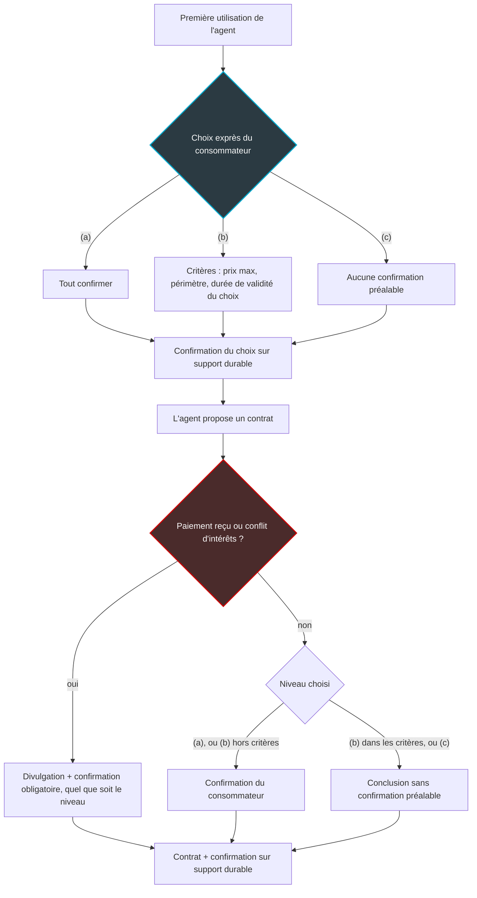
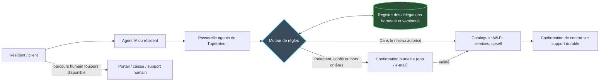

## Qui a vraiment dit oui ?

Dimanche, 22 heures, dans une résidence étudiante. Un nouvel arrivant ouvre l'application du bâtiment et écrit à l'assistant : « trouve-moi un forfait internet plus rapide et souscris-le ». Quelques secondes plus tard, c'est fait. Le contrat est conclu, le paiement est parti.

Question simple, réponse beaucoup moins : qui a dit oui ? L'étudiant, qui a exprimé une envie ? L'agent, qui a choisi l'offre ? Ou l'entreprise qui a conçu l'agent, et qui touche peut-être une commission sur l'offre retenue ?

La scène n'a rien de futuriste. Résidences, hôtels, enseignes, gestionnaires de campus : tous ceux qui exploitent un parcours client numérique sont en train d'y greffer des assistants capables de réserver, d'acheter ou de souscrire. Le 11 novembre 2026, la Commission européenne a posé sa réponse sur la table. Le Digital Fairness Act (DFA) est une proposition de règlement destinée à remplacer la directive de 2005 sur les pratiques commerciales déloyales. Son article 26 fait quelque chose de neuf : il ne réglemente pas ce que l'agent achète, il réglemente la longueur de la laisse qu'on lui donne.

En apparence, c'est un détail juridique. En réalité, c'est un objet d'architecture. Ceux qui le traiteront comme un simple écran de consentement le paieront deux fois : une fois pour le construire, une fois pour le reconstruire.

## Un cadran à trois crans

Pensez à la carte bancaire que vous confiez à un proche avant de partir en voyage. Trois arrangements sont possibles. Soit il vous appelle avant chaque achat. Soit il dispose d'un plafond, d'une liste de magasins autorisés et d'une date au-delà de laquelle l'arrangement expire. Soit c'est carte blanche.

C'est, à peu de chose près, la mécanique de l'article 26. Il vise tout professionnel qui met à la disposition des consommateurs un « système automatisé » capable de conclure et d'exécuter des contrats pour leur compte, avec lui-même ou avec d'autres professionnels. L'article 3(21) définit ce système largement : un logiciel qui agit et prend des décisions produisant des effets juridiques pour son utilisateur, sans intervention humaine. Et le considérant 77 ferme une porte de sortie tentante. Une supervision humaine n'enlève pas la qualité de système automatisé.

À la première utilisation, le consommateur doit choisir expressément entre trois options. Le texte ne les nomme pas, il les numérote. Les étiquettes ci-dessous sont les miennes.

- **(a) « Tout confirmer »** : chaque contrat proposé par l'agent doit être confirmé avant que le consommateur ne soit lié.
- **(b) « Délégation encadrée »** : le consommateur ne confirme que certains contrats et trace lui-même la frontière, avec des critères qui incluent un prix maximal et une limite de temps. Attention au contresens : cette limite porte sur la durée d'applicabilité du choix, pas sur la durée du contrat. Le considérant 78 suggère d'autres critères : plafond de valeur, restriction à certains professionnels, ou à ceux qui offrent un droit de rétractation ou des garanties.
- **(c) « Carte blanche »** : aucune confirmation avant d'être lié.

Ma lecture du niveau (b), qui guide le schéma plus bas : ce qui entre dans les critères peut être conclu sans le consommateur, le reste lui remonte pour confirmation.

Autour de ce choix, le texte pose des garde-fous. Les outils de réglage doivent être « easily accessible, understandable and effective », et le consommateur peut changer d'avis « at any time » (26(1)). Le professionnel lui envoie une confirmation de son choix « on a durable medium », un support qu'il peut conserver (26(3)). En niveaux (a) et (b), l'agent fournit en outre un socle d'informations précontractuelles emprunté à la directive 2011/83/UE sur les droits des consommateurs (26(4)(a)).

Enfin, selon le considérant 78, passer par un agent « does not imply any waiver of consumer rights », même quand le consommateur ne pré-approuve rien. La carte blanche ne vaut pas renonciation. Seule exclusion : les services financiers (26(10)).

*Trois crans de délégation : validation humaine systématique, porte conditionnelle bornée par un plafond et une horloge, ou porte grande ouverte.*

## La carte blanche s'arrête là où commence la commission

Reprenons la carte bancaire confiée à un proche, et ajoutons une règle. Si un commerçant lui verse quoi que ce soit pour qu'il achète chez lui, il doit vous appeler. Toujours, quel que soit l'arrangement de départ.

C'est l'article 26(4)(b), et c'est à mes yeux la disposition la plus structurante du texte. L'agent doit divulguer tout paiement reçu pour proposer un contrat, ainsi que tout conflit d'intérêts avec le professionnel concerné. Il doit alors exiger la confirmation du consommateur « independently of the choice expressed ». Le considérant 78 cite deux exemples parlants : la suggestion sponsorisée, et la mise en avant des produits d'un professionnel (« preferencing of that trader's products »).

Traduit en langage produit : dès qu'un intérêt commercial entre en jeu, le niveau choisi par le consommateur est suspendu, offre par offre. La règle de la commission passe avant le cadran.

*Ma lecture de l'article 26 : la règle « paiement ou conflit d'intérêts » est évaluée avant le niveau de délégation choisi.*

Pour quiconque monétise des services annexes, c'est une question de modèle économique avant d'être une question de conformité. Prenez un concierge IA déployé dans un hôtel ou une résidence. Il propose un débit supérieur, une offre de streaming partenaire, un transfert vers l'aéroport. À ma lecture, chaque offre qui rapporte une commission au fournisseur de l'agent réclamera une confirmation explicite, y compris chez le client qui a tout délégué. Le cas de l'assistant qui pousse les produits de sa propre enseigne est moins net : le cabinet William Fry estime que la règle semble pouvoir s'y appliquer, sans que ce soit tranché. Je ne parierais pas une architecture sur la réponse inverse.

L'hôtellerie se pose déjà la question. Une tribune publiée cet été sur Hospitality Net constatait qu'aucune structure de commission ne s'est encore stabilisée pour les réservations exécutées par des agents. Trois modèles s'y affrontent : les agences de voyage en ligne intégrées aux chats, les agrégateurs exposés via MCP (Model Context Protocol, le standard qui permet à un agent d'appeler des outils externes) et les serveurs MCP propriétaires des hôtels. C'est l'avis d'un contributeur, pas une mesure de marché. Mais l'article 26(4)(b) va peser dans ce match : chaque commission se paiera désormais en clics de confirmation.

Ma position : c'est une bonne règle. Un agent qui touche une commission sans le dire, c'est un vendeur déguisé en conseiller. Le texte ne l'interdit pas, il l'oblige à lever la main. Ceux qui rendront cette transparence élégante, avec une confirmation courte qui dit pourquoi elle est demandée, en feront un argument de confiance. Les autres la vivront comme un impôt sur la conversion.

## Un état réglementé, pas une pop-up

Voici la thèse que je défends, et c'est une analyse d'auteur, pas une lecture officielle. Le niveau de délégation ne doit pas être conçu comme un écran qu'on affiche une fois puis qu'on oublie. Il ressemble bien plus à une règle d'accès dans un système de gestion des identités : un objet qui a un titulaire, un périmètre, une date d'expiration, un historique et une procédure de révocation.

Chaque exigence de l'article 26 devient alors une propriété du système :

- **Un état par utilisateur et par agent**, horodaté et versionné. Le consommateur pouvant changer d'avis à tout moment, il faut prouver quel niveau était actif au moment de chaque contrat.
- **Une preuve de choix** envoyée sur support durable (26(3)), rattachée à la version exacte de l'état qu'elle confirme.
- **Un schéma structuré pour le niveau (b)** : plafond de prix, contreparties autorisées, date de fin de validité du choix. Un critère en texte libre est inexécutable par une machine et invérifiable par un auditeur.
- **Une révocation immédiate**, propagée à toutes les sessions d'agent en cours.
- **Un ordre d'évaluation figé** : d'abord « paiement ou conflit ? », ensuite seulement le niveau choisi.

Ce dernier point appelle un composant dédié : un moteur de règles (policy engine) placé entre l'agent du résident et le catalogue de services. Pas une consigne glissée dans le prompt de l'agent. Un composant déterministe, côté opérateur, qui décide et qui journalise.

*Architecture cible (analyse d'auteur) : le moteur de règles arbitre chaque proposition de l'agent et journalise la délégation active au moment du contrat.*

La ligne en pointillés n'est pas décorative. L'article 26(9) interdit de concevoir une interface qui oblige le consommateur à passer par un agent pour accéder à un service ou conclure. À l'inverse, rien dans le texte n'oblige un professionnel à accepter les agents tiers. Le parcours humain complet reste donc dû, d'autant que l'article 25 garantit, lorsque le professionnel propose un service client en ligne après la conclusion du contrat, l'accès à un interlocuteur humain sur demande quand les autres moyens ne sont pas efficaces. Exposer une interface aux agents reste un choix. Et quand les deux côtés de la transaction sont automatisés, l'article 27 autorise une information précontractuelle en format lisible par machine uniquement, mais maintient la confirmation sur support durable.

L'industrie a déjà commencé à outiller ce raisonnement. Le protocole AP2, présenté par Google en septembre 2025 pour les paiements initiés par des agents, formalise des « Intent Mandates » : des mandats d'intention signés cryptographiquement, qui portent des plafonds de prix et des conditions de timing, avec un flux « human present » et un flux « human not present ». Le niveau (b) en est conceptuellement très proche. Je ne dis pas qu'AP2 rend conforme. Je dis que le modèle mental existe et qu'il serait absurde de le réinventer.

Le reste de l'article 26 complète la tuyauterie. L'identification et l'authentification peuvent (« may ») s'appuyer sur l'European Business Wallet ou sur le portefeuille européen d'identité numérique (26(5)-(6)) : c'est facultatif, mais cohérent pour authentifier à la fois un agent et son mandant. L'agent transmet au cocontractant les coordonnées nécessaires à l'exécution (26(7)), sous réserve du consentement prévu par le RGPD selon le considérant 80. Le professionnel, enfin, confirme le contrat sur support durable (26(8)).

*Entre le smartphone du résident et le catalogue de services, une couche de règles qui laisse une trace d'audit à chaque décision.*

## Trois acteurs autour d'un agent : qui est le professionnel ?

En B2B2C (une entreprise qui sert les clients finaux d'une autre entreprise), la chaîne est rarement courte. Un fournisseur d'agent, un opérateur ou un intégrateur qui le déploie, un hôtel ou une résidence qui le met entre les mains de ses clients, des marchands tiers au bout du catalogue. Qui est le « trader » visé par l'article 26 ?

Ce qui suit est mon analyse, pas un avis juridique, et elle doit être validée par des juristes. Un opérateur qui fournit lui-même un assistant ou un concierge aux résidents « met à disposition » un agent : il me semble dans le champ. Le cas de l'opérateur qui n'est « que » l'infrastructure d'un hôtel est plus ouvert. Mais l'article 3(2) range parmi les professionnels « anyone acting in the name of or on behalf of a trader ». Je ne compterais pas sur le statut de simple tuyau comme porte de sortie.

Deux articles rendent la chaîne contractuelle sensible. L'article 36 donne au professionnel tenu responsable d'une pratique commerciale en ligne déloyale un droit de recours contre toute personne avec laquelle il entretient une relation commerciale et dont l'acte ou l'omission a contribué à cette responsabilité. L'article 29 interdit toute conduite qui compromet le respect du chapitre III, qu'elle soit « contractual, commercial, technical » ou fondée sur le design. En clair : on ne se débarrassera pas de la conformité par une clause, ni par un choix d'architecture. Les contrats entre opérateur, hôtelier et fournisseur d'agent devront dire qui tient le registre des délégations, qui envoie les confirmations et qui répond de quoi.

Reste une question que le DFA ne tranche pas : qui supporte le préjudice quand l'agent se trompe ? L'article 2(2) laisse intact le droit des contrats (validité, formation, effets). La réponse viendra donc du droit national, comme le relève William Fry. Le même cabinet note que l'article 10 vise les interfaces qui trompent le consommateur, pas celles qui manipulent l'agent. C'est sa lecture, mais elle désigne un angle mort réel. Une page marchande écrite pour influencer un agent ressemble furieusement à une injection de prompt, cette instruction cachée qui détourne un modèle. Meilleure parade : un moteur de règles qui vérifie lui-même les critères, au lieu de faire confiance au raisonnement de l'agent.

## L'horloge tourne : abonnements, interfaces, sanctions

### Les abonnements, l'autre moitié du sujet

L'article 26 capte la lumière. Pour quiconque vend du Wi-Fi ou des services récurrents en ligne, les articles 20 à 23 sont pourtant tout aussi concrets.

- **Essai gratuit (art. 20)** : rappel sur support durable avant la fin de l'essai. Sans accord exprès avant cette échéance, le consommateur n'est pas lié par le contrat payant.
- **Reconduction tacite des contrats d'au moins six mois (art. 21)** : rappel entre un mois et quatorze jours avant. À défaut, résiliation gratuite et sans préavis. Après une reconduction à durée indéterminée, résiliation à tout moment avec un mois de préavis au plus.
- **Contrats de moins de six mois (art. 22)** : rappel au plus tard une semaine avant la reconduction qui fait atteindre six mois, ou avant la dixième reconduction, selon la première éventualité.
- **Résiliation en ligne (art. 23)** : une fonction libellée « terminate the contract here » (ou une formulation équivalente non ambiguë), suivie d'une fonction « confirm the contract termination ».

L'agent souscrit en une seconde ; le texte s'assure que le client peut se désengager en deux étapes. C'est la bonne symétrie.

*Le cadenas et l'horloge d'un côté, les abonnements oubliés qui partent en fumée de l'autre : la balance que cherche à rétablir le texte.*

### Les dark patterns, écran de délégation compris

L'article 10 interdit de manière générale les « dark patterns », ces interfaces conçues pour tromper ou manipuler. L'Annexe I y ajoute dix pratiques réputées déloyales en toutes circonstances (points 53 à 62), liste que la Commission peut modifier par acte délégué. Plusieurs visent directement les parcours d'upsell : l'option par défaut qu'il faut rejeter ou le consentement présumé à un paiement supplémentaire (55), le prix ou le renouvellement automatique moins visibles que le reste (60), les étapes disproportionnées pour refuser, retirer ou modifier un choix (62).

Ma lecture, que le texte ne formule pas : l'écran de choix du niveau de délégation est une interface comme une autre. Pré-sélectionner la carte blanche, présenter « tout confirmer » comme le mauvais choix (56) ou redemander à chaque session un choix déjà fait (58), c'est s'exposer.

### Sanctions : lire le 6 % correctement

Les chiffres circulent déjà, souvent de travers. Les États membres fixent eux-mêmes les sanctions (35(1)). Lors d'une action coordonnée entre autorités nationales au titre du règlement CPC (Consumer Protection Cooperation), le plafond de l'amende doit pouvoir atteindre au moins 4 % du chiffre d'affaires annuel réalisé dans les États membres concernés. Si ce chiffre est inconnu, ce plafond doit pouvoir atteindre au moins 2 millions d'euros (35(3)-(4)).

Le fameux 6 % existe bien, mais il a un propriétaire. L'article 35(6) permet à la Commission d'infliger des amendes allant jusqu'à 6 % du chiffre d'affaires annuel mondial, pour les infractions qu'elle instruit elle-même dans le cadre du règlement CPC révisé. L'article 30(4) limite ces pouvoirs directs aux « widespread infringements with a Union dimension ». Résumer le DFA à « 6 % pour toute infraction » est donc faux.

### Calendrier : une proposition, pas une loi

Le texte, référencé COM(2026) 1100 final, suit la procédure législative ordinaire (dossier 2026/0356 (COD)). Il arrive accompagné d'une directive de simplification (COM(2026) 1110 final) et d'une révision du règlement CPC (COM(2026) 1120 final). Parlement et Conseil vont l'amender. Une fois publié au Journal officiel, il entrerait en vigueur vingt jours plus tard et s'appliquerait douze mois après (art. 40). Ce délai figure entre crochets dans la proposition : c'est une valeur proposée, pas acquise. Personne ne connaît aujourd'hui la date d'application.

## Codez la capacité, pas l'article

Le texte va bouger. Les trois niveaux seront peut-être reformulés, les critères du niveau (b) précisés, la règle sur les commissions élargie ou resserrée, et le délai d'application est encore entre crochets. Coder l'article 26 en dur aujourd'hui serait une erreur. Ne rien faire en serait une autre.

Ce qu'il faut construire maintenant, c'est la capacité. Un registre des délégations horodaté et versionné. Un moteur de règles configurable qui évalue toujours les intérêts commerciaux avant le niveau choisi. Une chaîne de preuves sur support durable. Un parcours humain qui ne dépend jamais de l'agent. Aucune de ces briques n'est exotique : ce sont celles qu'on attendrait de toute façon d'un système qui achète au nom de quelqu'un d'autre.

Mon pari : d'ici l'application du texte, la confiance deviendra le premier critère de choix d'un agent d'achat, devant sa vitesse. Les opérateurs capables de prouver, à la ligne de log près, ce que leur résident avait autorisé ce dimanche soir auront un avantage commercial, pas seulement un dossier de conformité propre. Ceux qui auront collé une pop-up devant un modèle de langage reconstruiront tout.

Qui a dit oui ? La réponse existera. Elle sera dans vos journaux, ou nulle part.

_Vues personnelles, pas position Wifirst._

## Sources

1. [Commission européenne — Proposition de règlement « Digital Fairness Act », COM(2026) 1100 final (texte intégral)](https://commission.europa.eu/document/download/0575d59f-554f-4a9e-b54b-e6b717175809_en?filename=Proposal%20for%20a%20Digital%20Fairness%20Act_0.pdf)
2. [Commission européenne — Annexes à la proposition de Digital Fairness Act](https://commission.europa.eu/document/download/a0539d90-2758-48e5-9010-1e856030d166_en?filename=Annexes%20to%20the%20Proposal%20for%20a%20Digital%20Fairness%20Act.pdf)
3. [Commission européenne — Page « Digital Fairness Act »](https://commission.europa.eu/law/law-topic/consumer-protection-law/digital-fairness-act_en)
4. [EuropaWire — Reproduction du communiqué IP/26/2407 de la Commission](https://news.europawire.eu/european-commission-proposes-digital-fairness-act-and-stronger-eu-consumer-law-enforcement/eu-press-release/2026/11/12/15/28/04/187330/)
5. [Pinsent Masons (Out-Law) — AI agents, dark patterns and the Digital Fairness Act](https://www.pinsentmasons.com/out-law/news/ai-agents-dark-patterns-digital-fairness-act)
6. [William Fry — Digital Fairness Act targets AI agents](https://www.williamfry.com/knowledge/digital-fairness-act-targets-ai-agents/)
7. [A&O Shearman — Digital Fairness Act: the European Commission's proposal](https://www.aoshearman.com/en/insights/ao-shearman-on-data/digital-fairness-act-the-european-commissions-proposal)
8. [Lewis Silkin — European Commission publishes long-awaited Digital Fairness Act](https://www.lewissilkin.com/insights/2026/11/11/european-commission-publishes-long-awaited-digital-fairness-act-102o9b5)
9. [PPC Land — EU's Digital Fairness Act would let Brussels fine firms up to 6 % of turnover](https://ppc.land/eus-digital-fairness-act-would-let-brussels-fine-firms-up-to-6-of-turnover/)
10. [Osborne Clarke — Proposed EU Digital Fairness Act targets addictive design, dark patterns and unfair practices](https://www.osborneclarke.com/insights/proposed-eu-digital-fairness-act-targets-addictive-design-dark-patterns-and-unfair)
11. [Freshfields — Digital Fairness Act: the EU's new consumer protection rulebook takes shape](https://www.freshfields.com/en/our-thinking/briefings/2026/11/digital-fairness-act-the-eus-new-consumer-protection-rulebook-takes-shape)
12. [Tech Policy Press — Assessing the EU Digital Fairness Act and its promise of consumer protection](https://techpolicy.press/assessing-the-eu-digital-fairness-act-and-its-promise-of-consumer-protection)
13. [Euronews — EU targets subscription traps, addictive design and hidden fees with new digital rules](https://www.euronews.com/2026/11/11/eu-targets-subscription-traps-addictive-design-and-hidden-fees-with-new-digital-rules)
14. [PYMNTS — EU draft law links AI shopping agents' autonomy to commercial incentives](https://www.pymnts.com/news/artificial-intelligence/2026/eu-draft-law-links-ai-shopping-agents-autonomy-to-commercial-incentives/)
15. [Google Cloud Blog — Announcing the AP2 protocol](https://cloud.google.com/blog/products/ai-machine-learning/announcing-agents-to-payments-ap2-protocol)
16. [Hospitality Net — The Agentic Booking Question No One Has Answered: Who Gets the Commission?](https://www.hospitalitynet.org/opinion/4133767/the-agentic-booking-question-no-one-has-answered-who-gets-the-commission)
17. [Kasia Szczesna (Behavioral Insight) — AI agents and the Digital Fairness Act](https://behavioralinsight.substack.com/p/ai-agents-and-the-digital-fairness)
