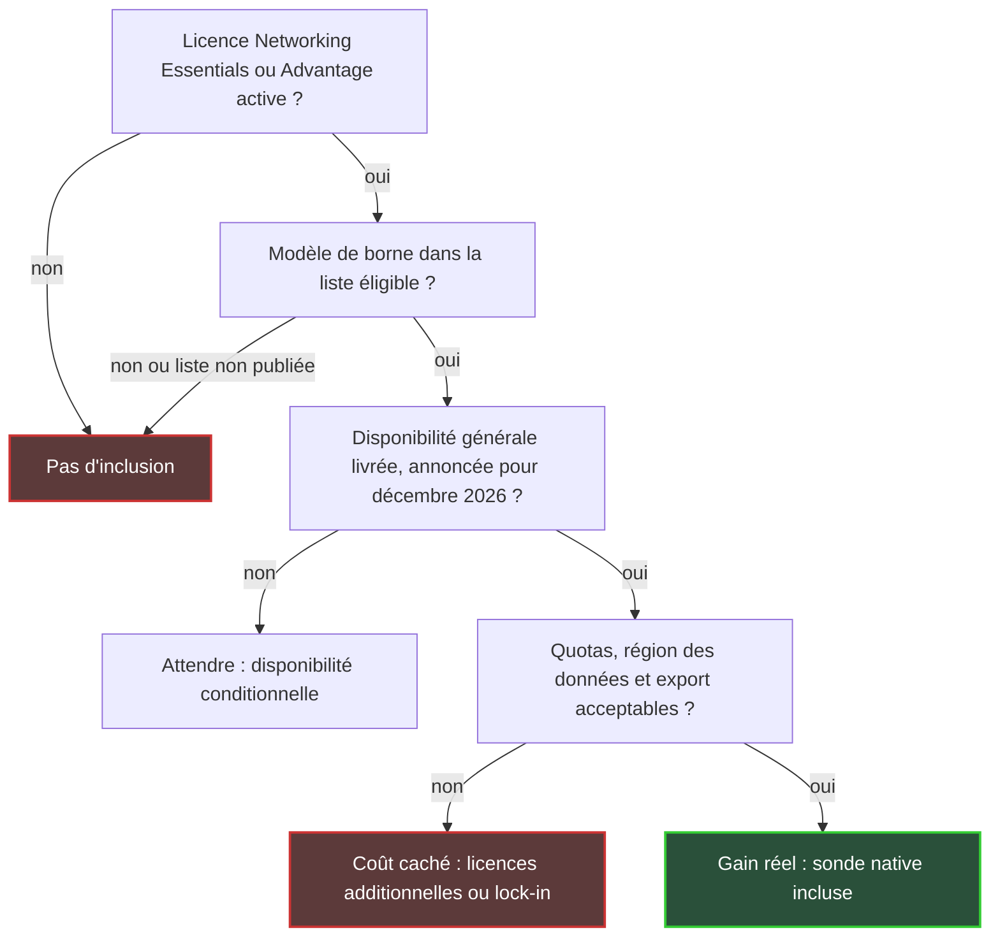
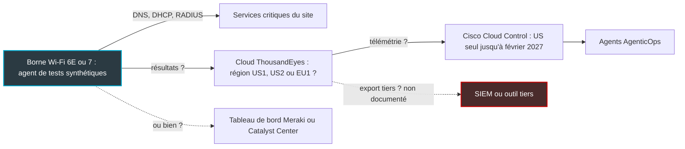

## Le Wi-Fi ne marche pas. Oui, mais lequel ?

Il est 22 h 40 dans un hôtel de 180 chambres, et un client appelle la réception pour signaler que le Wi-Fi ne marche pas. Le réceptionniste n'a aucun moyen de savoir si le problème vient de la borne fixée au plafond du couloir, du serveur qui vérifie les identifiants de connexion ou de la liaison internet du bâtiment. Il ouvre un ticket. Quelqu'un, quelque part, devra deviner.

Multipliez la scène par quelques milliers de sites (hôtels, magasins, résidences étudiantes) et vous obtenez le quotidien de tous ceux qui exploitent du Wi-Fi pour le compte de tiers. Chaque minute passée à chercher le coupable se paie : un ticket, parfois un déplacement de technicien, et de plus en plus souvent une pénalité. Les clients finaux ne se contentent plus de niveaux de service promis. Ils les veulent mesurés.

C'est dans ce contexte que Cisco a annoncé fin octobre une décision qui mérite qu'on s'y arrête. Ses bornes Wi-Fi 6E et Wi-Fi 7 vont embarquer un agent de mesure signé ThousandEyes, sa filiale spécialisée dans la supervision de la performance réseau, sans surcoût pour les clients disposant des bonnes licences. Livraison attendue en décembre.

Sur le papier, c'est une excellente nouvelle. Dans un contrat, le mot gratuit est rarement le dernier mot. Reste à séparer ce qui est acquis de ce qui ne l'est pas encore, puis à poser la seule question qui compte vraiment au moment de signer : à qui appartient la mesure ?

## Ce qui a été annoncé, et ce qui manque à l'appel

Commençons par ce que ça change. Si la promesse est tenue, chaque borne Cisco récente devient sa propre sonde. Elle teste en continu les services dont dépend une connexion (résolution de noms, attribution d'adresse, authentification) et fait remonter les résultats sans qu'on ait posé le moindre boîtier supplémentaire.

La chronologie, ensuite, parce qu'elle a souvent été mal restituée. L'annonce initiale date du Cisco Partner Summit de Vancouver, le 26 octobre 2026 [4]. Network World [8], Techzine [5] et StorageReview [6] la relaient dans les quarante-huit heures. Le sujet est re-confirmé à Cisco Live Melbourne, les 9 et 10 novembre.

Cisco y accompagne l'annonce d'une fiche consacrée à AgenticOps, son nom maison pour les opérations réseau pilotées par des agents d'intelligence artificielle, mise à jour le 9 novembre [2]. C'est cette fiche, et elle seule parmi les documents Cisco consultés, qui affiche une date de disponibilité générale (GA, pour General Availability) : décembre 2026. iTWire rapporte le même horizon pour la simplification des licences et du déploiement [7].

La formule commerciale tient en une ligne, que Zeus Kerravala restitue dans Network World : l'intégration se fait « at no extra cost for customers with eligible Networking Essentials and Advantage licenses » [1]. Le communiqué du Partner Summit va dans le même sens : rien de plus à acheter, à déployer ou à configurer. Mais il conserve la réserve juridique habituelle des annonces Cisco, selon laquelle la fonction arrivera si et quand elle sera disponible [4].

Maintenant, ce qui manque. La liste est longue.

- **Les modèles.** Le blog de Grant Shirk parle de toutes les bornes Wi-Fi 6E et Wi-Fi 7 [3]. Techzine évoque des modèles sélectionnés, non nommés [5]. La fiche produit mentionne des bornes prises en charge [2]. Trois formulations, zéro liste.
- **Les licences.** Le communiqué et la presse citent Essentials et Advantage. La légende photo du blog Cisco ne mentionne que Networking Essentials [3].
- **Les volumes.** Nombre de tests, fréquence, nombre de cibles, durée de conservation : rien n'est publié.
- **La destination des données.** Ni la région de stockage, ni la console qui reçoit les résultats ne sont documentées.
- **La réversibilité.** Peut-on désactiver les tests ? Que devient l'historique quand la licence expire ? Silence.

Une précision de méthode, enfin. Je n'ai trouvé aucune analyse indépendante sur le sujet, ni cabinet d'analystes, ni régulateur. Ce qui suit repose sur les sources primaires de Cisco et sur la presse spécialisée. Ce n'est pas disqualifiant. C'est une limite à garder en tête.

## Le client mystère dans le faux plafond

Pour mesurer la portée technique de l'annonce, il faut revenir à ce qu'est un test synthétique. Pensez au client mystère d'une enseigne de distribution. Il ne vient pas acheter, il vient mesurer : il chronomètre l'attente en caisse, note l'accueil, repart, et revient la semaine suivante.

Un test synthétique fait exactement la même chose pour le réseau. Un faux client demande une adresse, résout un nom, s'authentifie, et note chaque temps de réponse. Surtout, il le fait à 4 h du matin, quand aucun vrai client n'est là pour se plaindre.

Jusqu'ici, ce client mystère avait un coût physique. Il fallait installer un capteur dédié ou un mini-PC sur chaque site, l'alimenter, le brancher, le maintenir, le remplacer quand il lâchait. Sur trois sites, c'est un détail. Sur trois mille, c'est un projet, avec son budget, son stock et sa logistique.

Ce que décrit Cisco change l'équation. D'après le blog de Grant Shirk, à la mise sous tension d'une nouvelle borne, la plateforme provisionne automatiquement l'agent, découvre les services critiques du site et déploie les tests, sans étape manuelle [3]. La fiche produit précise le périmètre : DNS, DHCP (le service qui distribue les adresses IP) et RADIUS (le serveur qui valide les identifiants avant d'ouvrir l'accès) [2]. StorageReview insiste sur le caractère permanent de l'agent : les tests tournent en tâche de fond, y compris en l'absence d'utilisateurs [6].

*Chaque borne devient sa propre sonde : les tests partent du plafond vers les services critiques du site, sans boîtier supplémentaire.*

Deux nuances, qui comptent. D'abord, seul le composant de tests synthétiques tourne dans la borne, pas la plateforme ThousandEyes complète, précise Techzine [5]. La sonde embarquée n'est donc pas l'équivalent de l'abonnement ThousandEyes que vos équipes utilisent peut-être déjà ailleurs. Ensuite, la maturité reste inégale dans la famille AgenticOps : sur le même blog, Experience Metrics est en bêta et Agentic Actions en disponibilité contrôlée [3].

Reste le pourquoi. Pourquoi Cisco offre-t-il ce qu'il facturait ? Kerravala livre sa lecture dans Network World : les données d'assurance produites par chaque nouvelle borne constituent la télémétrie dont les agents AgenticOps ont besoin [1]. Dans le même article, Jeff Schultz, de Cisco, reconnaît que ThousandEyes a jusqu'ici été difficile à licencier et à déployer [1]. L'aveu est rare. Il éclaire la manœuvre.

**Mon analyse :** je partage la lecture de Kerravala, et je la pousse un cran plus loin. Un agent d'IA chargé de diagnostiquer ou de corriger un réseau ne vaut que par les données qu'il reçoit. En faisant de la mesure un réflexe de la borne, Cisco ne distribue pas seulement un outil. Il s'assure que le carburant de ses agents coule en continu, dans ses propres tuyaux. Cette gratuité-là ressemble moins à un cadeau qu'à une sécurisation d'approvisionnement.

## Gratuit, à quatre conditions près

Le mot gratuit, dans cette annonce, est suspendu à au moins quatre conditions cumulatives.

La première est la licence. Il faut un abonnement Networking Essentials ou Advantage actif et éligible. Or le terme éligible n'est défini nulle part. Et le lien avec la nomenclature Wireless Essentials et Wireless Advantage de l'abonnement réseau Cisco n'est pas documenté pour cette fonction.

La deuxième est le modèle. Tant que la liste n'est pas publiée, impossible de savoir si les bornes Wi-Fi 6E posées l'an dernier sont concernées, ou seulement les générations les plus récentes.

La troisième est la date. Une seule fiche Cisco porte la mention décembre 2026, tandis que le communiqué officiel s'abrite derrière sa clause de disponibilité conditionnelle. Une date sur une fiche produit n'est pas un engagement contractuel.

La quatrième, la plus sournoise, est le volume. Et l'histoire récente de Cisco est instructive. Sur ses commutateurs Catalyst 9300 et 9400 équipés d'une licence DNA Advantage, le constructeur permet déjà d'obtenir des unités de consommation ThousandEyes, les *units* du jargon maison.

La démarche est décrite dans un guide de réquisition mis à jour le 1er octobre 2026 : passage par les portails de gestion de licences de Cisco, licences non expirées exigées [10]. Le guide ne précise ni le volume mensuel, ni les règles d'expiration.

**Mon analyse :** ce précédent suggère que l'inclusion dans les bornes pourrait suivre un modèle à quotas plutôt qu'un usage illimité. C'est une hypothèse, pas un fait, et rien dans les documents publiés pour le Wi-Fi ne la confirme. Mais c'est exactement le genre d'hypothèse qu'on lève par écrit avant de signer. Pas après.

*Schéma d'analyse : quatre conditions cumulatives séparent l'annonce du gain réel, et chacune doit être confirmée par écrit.*

## À qui appartient la mesure ?

Prenez un constructeur automobile qui installerait gratuitement une boîte noire dans chaque véhicule de votre flotte de location. Le diagnostic devient instantané, les pannes sont anticipées, vos mécaniciens gagnent des heures. Mais les données remontent chez le constructeur, dans son format, sur ses serveurs. Et le jour où vous changez de marque, l'historique de votre flotte reste au garage.

C'est, à mes yeux, la vraie question d'achat, et elle porte un nom : le lock-in, cet enfermement propriétaire qui rend chaque changement de fournisseur plus coûteux que le précédent. Si la télémétrie active devient une fonction par défaut de la borne, il ne s'agit plus de savoir si l'on dispose d'observabilité. Il s'agit de savoir qui possède la télémétrie, sous quelle licence, et où partent les données.

Sur ce dernier point, la documentation ThousandEyes est très claire, et c'est justement ce qui doit retenir l'attention. La plateforme fonctionne sur trois régions : US1 en Californie, US2 dans l'Ohio, EU1 à Francfort [9]. La résidence des données dépend de la région de l'organisation, c'est-à-dire du compte client, et non de l'emplacement physique des agents.

Une organisation vit dans une seule région. En changer revient à basculer vers la nouvelle région comme s'il s'agissait d'une nouvelle organisation : seules les métadonnées suivent, et l'historique reste dans la région d'origine. Les agents d'entreprise, eux, sont rattachés à la région de leur organisation [9].

Traduction opérationnelle, sous réserve : si les résultats des bornes atterrissent dans une organisation ThousandEyes, ce que Cisco n'a pas documenté, une borne installée à Lyon peut parfaitement envoyer ses mesures en Californie. Il suffit que l'organisation ait été créée là-bas. Et corriger l'erreur après coup coûte l'historique.

Deuxième couche d'incertitude : Cloud Control, la plateforme cloud de gestion de Cisco. Selon Network World, elle tourne aujourd'hui sur une infrastructure exclusivement américaine. L'Australie, l'Union européenne et le Royaume-Uni sont prévus en février 2027, puis le Japon, l'Inde et le Canada en mai [1]. iTWire situe la disponibilité générale américaine au 25 août 2026 et annonce pour février 2027 une instance à Sydney, présentée comme souveraine, tout en notant que la question du traitement des données reste ouverte [7].

Or, à ce jour, aucune source primaire ne dit où atterrissent les résultats des tests embarqués : dans une organisation ThousandEyes, dans Cloud Control, dans le tableau de bord Meraki ou dans Catalyst Center.

*Schéma d'analyse sur une architecture générique : les points d'interrogation signalent ce que Cisco n'a pas documenté publiquement.*

**Mon analyse :** pour un opérateur français, ce flou n'a rien d'un détail de conformité. Des résultats de tests synthétiques ne contiennent a priori pas de données d'utilisateurs. Mais ils décrivent finement l'infrastructure d'un client : ses serveurs d'authentification, ses résolveurs, ses heures de charge, ses pannes. Pour un hôtel ou une enseigne, c'est une cartographie sensible. Et le RGPD (règlement général sur la protection des données) impose de toute façon de savoir qui est responsable de traitement, qui est sous-traitant, où sont stockées les données et combien de temps elles vivent. Tant que la région n'est pas contractuelle, ces cases restent vides.

L'autre face du lock-in, c'est l'export. Une API ou un flux de données vers votre SIEM (l'outil qui centralise et corrèle les journaux de sécurité) ou vers votre propre supervision fait-il partie de l'offre incluse ? Aucun document ne le dit. Une mesure qu'on ne peut pas extraire n'est pas une donnée à vous. C'est une vue qu'on vous prête.

*Trois régions, une seule par organisation : là où le compte est créé, l'historique reste.*

## Sur un parc de milliers de sites, le bilan est double

Ce qui suit relève de l'analyse d'auteur, nourrie par l'exploitation de parcs multi-sites plutôt que par une source publiée.

Côté gains, le compte est vite fait. Sur les sites équipés de bornes éligibles, plus besoin de capteurs dédiés : c'est du matériel, de l'installation et du stock en moins. La question qui ouvre chaque incident (la borne, l'authentification ou le lien internet ?) trouve plus vite sa réponse. Le MTTR (temps moyen de rétablissement) baisse en conséquence. Et comme la mesure tourne la nuit, on peut voir une dégradation avant le premier client du matin.

Côté risques, trois points méritent qu'on s'y arrête.

Le premier est la preuve. Quand un hôtel conteste une pénalité de SLA (engagement de niveau de service), la mesure qui fait foi doit être incontestable. Si elle sort de l'outil du constructeur des bornes, hébergée dans son cloud, l'opérateur défend son service avec les chiffres d'un tiers qui est aussi son fournisseur. La télémétrie du constructeur est un excellent outil de diagnostic. C'est un très mauvais juge de paix.

Le deuxième est l'hétérogénéité. Un opérateur exploite rarement un parc mono-constructeur : rachats, héritages, choix imposés par les clients. Les sites Cisco éligibles auraient leur sonde native, les autres non. On se retrouve avec deux référentiels de mesure et des tableaux de bord de SLA qui ne se comparent plus.

Le troisième est la dépendance à la licence. La sonde vit aussi longtemps que l'abonnement éligible. Ce qui se passe à l'expiration, ou lors d'un passage à un niveau inférieur, n'est documenté nulle part.

Faut-il alors garder les capteurs dédiés ? Je me garde de tout classement, faute de source indépendante comparant les approches. Une différence de nature mérite toutefois d'être notée. Un capteur dédié se connecte en Wi-Fi comme le ferait un terminal, et mesure donc aussi le lien radio. Les documents publiés par Cisco ne disent pas si l'agent embarqué le fait. Les deux outils ne répondent donc pas forcément à la même question.

*D'un côté, la sonde offerte. De l'autre, la licence, le calendrier et le cloud qui viennent avec.*

## Verdict : prenez la sonde, négociez la donnée

Je ne crierai pas au piège. Mettre la mesure active dans la borne est la bonne direction, et Cisco corrige là une douleur qu'il reconnaît lui-même. Pour qui exploite des milliers de sites, supprimer une couche de matériel dédié n'a rien d'anodin.

Mais le gratuit annoncé est conditionnel. L'écart entre l'annonce et les conditions réelles, c'est précisément l'espace de négociation. Voici les six questions que je poserais, par écrit, avant de signer :

1. **Modèles.** La liste contractuelle des bornes et versions logicielles éligibles, et le sort de celles déjà installées.
2. **Volumes.** Les quotas de tests, la fréquence, le nombre de cibles, ce qui se passe au dépassement et le tarif au-delà.
3. **Données.** La région de stockage, les rôles de responsable de traitement et de sous-traitant, la durée de conservation, la procédure de suppression. Pour un opérateur européen, une organisation en EU1 se négocie au premier jour, pas au trentième mois.
4. **Export.** Une API ou un flux vers un SIEM ou un outil tiers, inclus dans l'offre ou facturé à part.
5. **Réversibilité.** La désactivation des tests, les effets d'une expiration ou d'un passage à une licence inférieure, la récupération de l'historique.
6. **Date.** Un engagement sur la disponibilité générale, et un recours si la fonction n'est pas livrée.

Ma règle, et c'est une position personnelle : la sonde du constructeur sert au diagnostic et à la baisse du temps de rétablissement. Tout ce qui fait foi devant le client final passe en revanche par une couche de mesure exportée dans vos propres outils, sous votre contrôle.

Mon pari, enfin. D'ici deux ans, la plupart des bornes professionnelles se testeront elles-mêmes, et la sonde ne sera plus un argument de vente. Ce jour-là, l'avantage n'ira pas à celui qui mesure. Il ira à celui qui garde la main sur la mesure.

La sonde est gratuite. La laisse, elle, se négocie.

---

_Vues personnelles, pas position Wifirst._

## Sources

1. [Network World, Zeus Kerravala : Cisco Live Melbourne, AI agents will break today's enterprise network and Cisco wants to rebuild it (10 novembre 2026)](https://www.networkworld.com/article/4247022/cisco-live-melbourne-ai-agents-will-break-todays-enterprise-network-and-cisco-wants-to-rebuild-it.html)
2. [Cisco : Wireless AgenticOps at a Glance (mise à jour 9 novembre 2026)](https://www.cisco.com/c/en/us/products/collateral/networking/wireless/agenticops-aag.html)
3. [Cisco Blogs, Grant Shirk : annonces Wireless AgenticOps (9 novembre 2026)](https://blogs.cisco.com/?p=499936)
4. [Cisco Newsroom : communiqué du Partner Summit 2026 (26 octobre 2026)](https://newsroom.cisco.com/c/r/newsroom/en/us/a/y2026/m10/cisco-expands-partner-opportunity-with-new-cisco-360-program-updates-high-yield-customer-experience-offerings-and-ai-ready-innovations.html)
5. [Techzine, Sander Almekinders : Cisco extends ThousandEyes deeper into the network to build trust (27 octobre 2026)](https://www.techzine.eu/blogs/applications/145331/cisco-extends-thousandeyes-deeper-into-the-network-to-build-trust/)
6. [StorageReview, Harold Fritts : Cisco IQ, partenaires, Model Foundry, Live Protect et Wi-Fi 7 (26 octobre 2026)](https://www.storagereview.com/news/cisco-iq-general-availability-partners-model-foundry-live-protect-wifi-7)
7. [iTWire, David M Williams : Cisco targets February launch for Sydney Cloud Control instance (10 novembre 2026)](https://itwire.com/business-it-news/networking/cisco-targets-february-launch-for-sydney-cloud-control-instance)
8. [Network World, Michael Cooney : Cisco taps AI partners to modernize IT operations and fortify network security (27 octobre 2026)](https://www.networkworld.com/article/4240556/cisco-taps-ai-partners-to-modernize-it-operations-and-fortify-network-security.html)
9. [ThousandEyes Docs : Multi-Region Cloud Support](https://docs.thousandeyes.com/product-documentation/user-management/user-activity/thousandeyes-multi-region-cloud-support)
10. [Cisco : guide de réquisition des units ThousandEyes pour Catalyst 9000 (mise à jour 1er octobre 2026)](https://www.cisco.com/c/en/us/products/collateral/switches/catalyst-9000/nb-06-cat-9k-og-cte-en.html)
