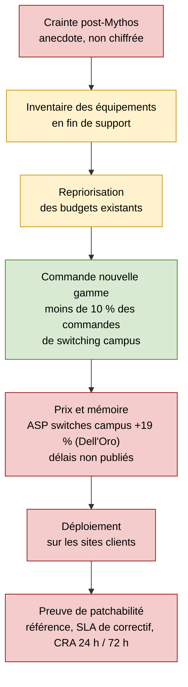

## 18,5 milliards de dollars et une question laissée sans réponse

Dix-huit milliards et demi de dollars de chiffre d'affaires en un trimestre, 24 % de plus qu'un an plus tôt, et une prévision annuelle relevée. Le 12 novembre, Cisco a publié des résultats qui nourrissent un récit tentant : après des années de report, les entreprises remplaceraient enfin le réseau de leurs bâtiments, des switches de baie aux bornes Wi-Fi vissées au plafond.

Pour quiconque exploite des réseaux sur des centaines ou des milliers de sites (hôtels, résidences étudiantes, enseignes, entreprises multi-sites), ce récit appelle des décisions très concrètes. Faut-il avancer les remplacements ? Réserver du stock ? Rouvrir les plans d'amortissement ?

Face aux analystes, le PDG Chuck Robbins a même glissé un exemple qui nous vise directement. En Europe, des fournisseurs de services parlent de mettre à niveau les équipements qu'ils installent chez leurs clients dans le cadre de services managés : les CPE (customer premises equipment). Le contexte de l'échange : l'« opportunité post-Mythos », du nom de Claude Mythos, le modèle de cybersécurité d'Anthropic, et la crainte que des IA offensives trouvent les failles des vieux équipements plus vite qu'on ne les corrige.

Je ne crois pas que ces chiffres disent ce qu'on leur fait dire. Ils mesurent des commandes de produits neufs, financées en repriorisant des budgets existants, à des prix en hausse. Ils ne disent pas combien de parcs sont renouvelés. Encore moins combien sont patchables.

## Trois chiffres, trois périmètres

Commençons par une image. Un marché automobile peut afficher 14 % d'immatriculations en plus sans que l'âge moyen des voitures en circulation ne bouge d'un mois. Les ventes de l'année mesurent un flux ; le parc roulant est un stock. Les résultats de Cisco parlent de flux. Encore faut-il vérifier ce que chaque chiffre recouvre.

Premier chiffre, le plus repris : les commandes campus en hausse de 14 % sur un an. Les [slides de résultats](https://s21.q4cdn.com/812015656/files/doc_earnings/2027/q1/presentation/Q1-27-Earnings-Slides.pdf) en précisent le périmètre : switching, wireless et routing réunis, autrement dit tout le réseau d'un bâtiment ou d'un site. Le détail publié reste partiel. Les commandes wireless progressent de plus de 20 %, le Wi-Fi 7 représente plus de 60 % des commandes de points d'accès, et les switches multigigabit (mGig, dimensionnés pour alimenter ces bornes) sont plus souvent vendus avec. Le switching seul n'est pas chiffré : Cisco se contente d'un « double-digit ».

Piège numérique au passage. Les commandes de produits progressent de 21 % au total, et de 14 % hors hyperscalers, les géants du cloud. Ce second +14 % est identique au chiffre campus. Deux mesures distinctes, même valeur : l'une découpe par famille de produits, l'autre par type de client. Les confondre fausse toute la lecture.

Deuxième chiffre : les +47 % de commandes « service providers et cloud ». Ce segment inclut les hyperscalers. Pour les seuls opérateurs télécoms, Cisco donne environ +20 %, après +24 % un an plus tôt : une croissance solide, mais qui décélère. Côté géographie, la zone EMEA (Europe, Moyen-Orient, Afrique) affiche +12 %, la plus faible des trois régions, derrière les Amériques (+18 %) et l'Asie-Pacifique (+57 %). Aucun chiffre ne porte sur les CPE de services managés.

Troisième chiffre, souvent mal relayé : les 9 milliards de dollars. Ce n'est pas un montant de commandes. C'est une prévision de chiffre d'affaires d'infrastructure IA pour l'exercice 2027, relevée depuis environ 7,5 milliards, et limitée aux hyperscalers. La note de bas de slide exclut explicitement les néoclouds, les clouds souverains et les entreprises. Pour le réseau d'un hôtel, c'est hors sujet.

Le récit du renouvellement suit une chaîne logique, de la peur jusqu'à la preuve de correctif. Le problème, c'est que Cisco ne chiffre qu'un seul de ses maillons.

*La chaîne du renouvellement : en vert, le seul maillon chiffré par Cisco ; en jaune, ce qui est évoqué sans mesure ; en rouge, ce que Cisco ne publie pas ou qui reste anecdotique.*

## « Moins de 10 % » : un flux, pas un stock

Le chiffre qui a le plus circulé après l'appel tient en trois mots : moins de 10 %. Interrogé par Ben Reitzes (Melius), Chuck Robbins a répondu, selon [Network World](https://www.networkworld.com/article/4248551/cisco-forecasts-9-billion-in-ai-infrastructure-revenue-in-fy27.html) : « We're still in the very early stages, less than 10% on the transition. » Lu vite, cela ressemble à un taux de renouvellement. Un dixième du parc remplacé, neuf dixièmes à venir : de quoi faire rêver n'importe quel directeur commercial.

Ce n'est pas ce que dit Cisco. La slide de résultats est précise : les nouveaux produits représentent moins de 10 % des commandes de switching campus. Sur [SiliconANGLE](https://siliconangle.com/?p=854158), l'analyste Zeus Kerravala (ZK Research) rapporte un chiffre plus fin, attribué à Robbins : 9 % du switching campus vendu dans le trimestre venait de la nouvelle gamme. C'est une part de flux de commandes, sur un seul segment. Rien sur le parc installé. Rien sur les bornes Wi-Fi. Rien sur les routeurs.

Lisons-le à l'envers, c'est plus instructif. Si moins d'une commande de switching campus sur dix porte sur la nouvelle gamme, plus de neuf sur dix portent sur des gammes antérieures. Ce trimestre encore, l'essentiel des switches commandés n'appartient donc pas à la dernière génération. Ils resteront en service des années, avec les capacités logicielles de leur génération, pas celles de la suivante. On y reviendra : c'est là que le sujet devient sérieux.

Robbins ne cache pas ce décalage. Dans ses [remarques préparées](https://s21.q4cdn.com/812015656/files/doc_earnings/2027/q1/transcript/Q1FY27-Prepared-Remarks.pdf), il affirme que la nouvelle gamme monte en charge plus vite que les lancements précédents, tout en reconnaissant : « we believe we are still very early in this refresh cycle ». Cisco évalue d'ailleurs à plus de 100 milliards de dollars l'opportunité totale de renouvellement réseau. Attention au vocabulaire : c'est un marché adressable estimé, pas un carnet de commandes.

*Moins de 10 % : la part de la nouvelle gamme dans les commandes de switching campus du trimestre, pas la part du parc déjà renouvelée.*

## Mythos et CPE européens : de l'attente à l'anecdote

En août, la direction de Cisco attendait la vague. En novembre, elle dit commencer à l'entendre. Entre les deux, aucun chiffre.

Retour au 12 août, lors de la présentation des résultats annuels. Selon [GovInfoSecurity](https://www.govinfosecurity.com/cisco-sees-ai-fueling-network-upgrade-supercycle-a-32540), Robbins décrivait des clients qui partent du principe « we don't have a choice », puis cherchent comment financer le remplacement. Ce financement passait, disait-il, par une repriorisation au sein des budgets existants. Il évoquait aussi un « Mythos effect » imminent que tous anticipaient, tout en admettant ne pas en avoir encore vu beaucoup d'impact direct.

Trois mois plus tard, le ton a glissé. D'après les retranscriptions automatiques de l'appel du 12 novembre (sans accès au replay audio, je les lis avec prudence), Robbins dit commencer à entendre des clients attribuer des commandes à des effets très précoces de Mythos. Puis vient l'exemple européen, en réponse à Tal Liani (Bank of America), que Network World cite ainsi : « We heard it in Europe as an example, with service providers relative to the managed services CPE ». La retranscription machine ajoute qu'il s'agirait de CPE que ces fournisseurs doivent mettre à niveau pour leurs clients.

Regardons ce que contient cette phrase, et surtout ce qu'elle ne contient pas. Pas de chiffre. Pas d'opérateur nommé. Pas de produit. Même le mot sécurité en est absent : le lien avec Mythos vient du contexte de l'échange, centré sur l'opportunité post-Mythos. Quant au périmètre des « CPE de services managés » selon Cisco, il n'est pas défini. Y voir des routeurs d'agence ou des boîtiers SD-WAN (réseau étendu piloté par logiciel) est une inférence raisonnable. Mais c'est la nôtre, pas celle de Cisco.

Un autre passage de la retranscription mérite l'attention : en substance, les clients veulent aller vite, mais ils veulent bien faire. Autrement dit, ils prennent le temps de l'architecture. Une commande passée en novembre n'est pas un équipement installé en décembre. Et un équipement installé n'est pas encore un équipement corrigé.

*Dans un couloir d'hôtel, le renouvellement se fait borne par borne, longtemps après la signature du bon de commande.*

Dernière confusion à dissiper. Les 9 et 10 novembre, Cisco a [annoncé](https://newsroom.cisco.com/content/r/newsroom/en/us/a/y2026/m11/cisco-unveils-frontier-ai-red-teaming-and-agent-observability-to-secure-the-agentic-enterprise.html) intégrer Claude Mythos dans Cisco AI Defense. Le périmètre est précis : le red teaming adaptatif, c'est-à-dire des attaques simulées, contre des applications et des agents IA. Pas l'audit de vos équipements réseau. Et l'offre est annoncée « coming soon for select enterprises », donc pas encore disponible pour tous.

Le suivi des vulnérabilités d'équipements relève d'un autre produit, Cisco IQ, pour lequel Cisco revendique une visibilité sur 23 millions d'équipements et un suivi ramené « from days to minutes ». Affirmation du constructeur, non auditée. Quant à Hypershield, évoqué dans le Q&A (retranscription automatique) pour segmenter le trafic entre machines d'un même réseau, c'est un outil de segmentation. Pas un outil de correctif de CPE.

## Live Protect, un vigile pour les immeubles neufs

Imaginez un immeuble dont la serrure d'entrée vient d'être déclarée défaillante. Le serrurier passera dans trois semaines. En attendant, vous postez un vigile devant la porte. Il ne répare rien : il bloque ceux qui tenteraient d'exploiter la faille. C'est exactement le rôle des « shields » de Cisco Live Protect, des contrôles compensatoires qui neutralisent une vulnérabilité en attendant le correctif, sans jamais le remplacer.

L'idée est bonne. Son périmètre l'est moins. Dans ses remarques préparées, Cisco dit avoir étendu Live Protect à une plus grande partie de son portefeuille campus. Les points d'accès Wi-Fi 7 apparaissent dans la même phrase, mais au titre de la résistance aux futurs ordinateurs quantiques, pas de Live Protect.

La [documentation Meraki](https://documentation.meraki.com/Platform_Management/Dashboard_Administration/Operate_and_Maintain/How-Tos/Cisco_Live_Protect_Configuration_Guide) raconte une histoire plus modeste. Une fonction en accès anticipé, en bêta, limitée à deux familles de switches (C9350 et C9550) gérées depuis le cloud, sous une version logicielle précise (IOS XE 26.2.1). Aucun point d'accès n'y est mentionné.

Le paradoxe saute aux yeux. L'outillage de mitigation vit sur la nouvelle gamme, celle-là même qui pèse moins de 10 % des commandes de switching. Le vigile garde les immeubles neufs. Les anciens, ceux dont les serrures vieillissent, n'en ont pas.

Pour un acheteur, « avez-vous un mécanisme de mitigation ? » ne suffit donc plus. La vraie question : sur quels équipements de mon parc réel ?

Le cadre réglementaire la rend pressante. Depuis le 11 septembre 2026, les obligations de notification du Cyber Resilience Act (CRA, le règlement européen sur la cybersécurité des produits numériques) s'appliquent via la plateforme unique de l'ENISA, l'agence européenne de cybersécurité. Le rythme est serré : alerte sous 24 heures, notification sous 72 heures, rapport final 14 jours après la disponibilité d'une mesure corrective. Ces obligations couvrent aussi les produits mis sur le marché avant le 11 décembre 2027, donc des équipements déjà en parc. L'amende peut atteindre 15 M€ ou 2,5 % du chiffre d'affaires mondial. Nous avons détaillé le 14 novembre ce que l'indice ENISA dit de la preuve de patch côté fournisseurs ; je n'y reviens pas.

## La facture arrive avant le correctif

Reste l'argent. Sur ce point, les chiffres de Cisco sont plus bavards qu'il n'y paraît.

La marge brute produit non-GAAP (hors éléments non récurrents) recule de 350 points de base, à 63,7 %. Cisco l'explique par un mix plus orienté matériel et par des coûts de mémoire élevés, partiellement compensés par des gains de productivité et des hausses de prix. Relisez la fin de la phrase : des hausses de prix. Elles ne suffisent pas à protéger la marge du constructeur, mais elles atterrissent bien sur la facture du client.

[Dell'Oro](https://www.delloro.com/newsroom/market-prices-skyrocket-driving-campus-switch-market-to-growth-in-2q-2026/) confirme la tendance à l'échelle du marché. Au deuxième trimestre 2026, le prix de vente moyen (ASP) des switches campus a bondi de 19 %. Tous les fournisseurs hors Chine l'ont augmenté sur un an. Et le cabinet s'attend à ce que les pénuries de mémoire pèsent sur le marché pendant une bonne partie de 2027.

Côté approvisionnement, le discours de Cisco se veut rassurant. Selon les retranscriptions et [Fierce Network](https://www.fierce-network.com/broadband/cisco-posts-strongest-revenue-growth-15-years-ai-demand-fuels-networking-rebound), le directeur financier Mark Patterson ne voit pas de difficulté d'offre majeure ; le point le plus tendu reste les optiques. Cisco s'appuie sur des contrats long terme et sur un nouvel accord pluriannuel pour la mémoire, qui gonfle ses engagements d'achat anticipés.

Ce qui manque est plus parlant. Cisco ne publie aucun délai de livraison, ni dans ses remarques préparées ni dans l'échange avec les analystes. Ce silence ne signifie pas qu'il n'y a pas de délai. Il signifie qu'on ne le connaît pas. Un constructeur qui sécurise sa mémoire par contrat pluriannuel protège ses approvisionnements ; il ne garantit pas pour autant votre allocation au prix d'aujourd'hui.

Pour un opérateur qui porte les équipements dans un abonnement, la mécanique est simple et désagréable. Le matériel installé chez le client est amorti sur la durée du contrat. Si sa fin de support (LDOS, last day of support) tombe avant la fin de l'amortissement, le remplacement sort du plan : c'est du capex imprévu, à un coût unitaire plus élevé que celui du matériel remplacé. Encore faut-il distinguer deux portefeuilles : celui de l'hôtel ou de la résidence, qui finance parfois une partie de l'installation, et celui de l'opérateur, qui amortit le reste.

*Mémoire tendue, optiques sous pression : la vanne se resserre en amont, la facture arrive en aval.*

## Acheter des références, pas un cycle

Je ne renouvellerai pas un parc parce qu'un constructeur annonce que le cycle démarre. Je le renouvellerai parce qu'une référence précise atteint sa fin de support à une date connue, et que son fournisseur ne s'engage pas sur un délai de correctif acceptable d'ici là. C'est moins exaltant qu'un supercycle. C'est nettement plus défendable devant un comité d'investissement.

Concrètement, voici ce qu'il faut exiger, référence par référence (SKU, l'identifiant produit au catalogue) :

| Exigence | La question précise à poser |
|---|---|
| Fin de vente et fin de support | Quelles dates pour chaque référence installée, et quel préavis contractuel si elles avancent ? |
| Délai de correctif | Quel délai maximal entre la publication d'une vulnérabilité critique et le correctif, engagé par écrit ? |
| Mitigation | Live Protect ou équivalent : sur quels switches, quels points d'accès, quelle version, bêta ou disponibilité générale ? |
| Conformité CRA | Quels engagements de notification à 24 h et 72 h, y compris pour le matériel déjà déployé ? |
| Prix et allocation | Quelle durée de validité du prix, quelle clause de révision, quelles quantités réservées ? |

Le dernier point est le plus urgent. Le renouvellement post-Mythos est aujourd'hui une anecdote européenne racontée sans chiffre. S'il se généralise, tout le monde voudra les mêmes équipements au même moment, sur un marché où la mémoire restera tendue une bonne partie de 2027. Le moment de verrouiller prix et allocation, c'est avant que l'anecdote ne devienne une statistique.

Encore faut-il lire les bons signaux. Pour un opérateur européen, ce sont les quelque +20 % des telcos, en décélération, et les +12 % de l'EMEA, pas les +47 % gonflés par les hyperscalers. Et la sécurité n'est pas le seul ressort. Gartner, cité par Fierce Network, relie la croissance campus à la défense face à l'IA et au trafic « non humain », qui pousse à remplacer switches, points d'accès et sécurité réseau. Kerravala, qui parle d'un « Mythos moment », évoque aussi des renouvellements motivés par la bande passante. Le Wi-Fi 7, au moins, se mesure : plus de 60 % des commandes de bornes. La peur, elle, ne se mesure pas encore.

## Un carnet de commandes n'est pas un inventaire

Cisco a livré un excellent trimestre, et rien dans cette lecture ne le conteste. Les commandes campus montent, le Wi-Fi 7 domine les commandes de bornes, la nouvelle gamme accélère. Mais une commande n'est pas une preuve de patch.

Le chiffre qui compte pour un exploitant de réseaux multi-sites n'est pas dans les slides. C'est la date de fin de support de chaque référence de son parc, mise en regard du délai de correctif que son fournisseur accepte de signer. Aucun constructeur ne publiera ce chiffre spontanément. Il faut aller le chercher, contrat par contrat.

Les « moins de 10 % » de Cisco ne mesurent pas l'avancement de votre renouvellement. Ils signalent, au mieux, qu'il reste du temps pour le négocier. Ce temps-là ne durera pas.

---

_Vues personnelles, pas position Wifirst._

## Sources

1. [Cisco — Q1 FY27 Prepared Remarks (12/11/2026)](https://s21.q4cdn.com/812015656/files/doc_earnings/2027/q1/transcript/Q1FY27-Prepared-Remarks.pdf)
2. [Cisco — Q1 FY27 Earnings Slides (12/11/2026)](https://s21.q4cdn.com/812015656/files/doc_earnings/2027/q1/presentation/Q1-27-Earnings-Slides.pdf)
3. [Cisco Investor Relations — communiqué de résultats Q1 FY27 (12/11/2026)](https://investor.cisco.com/news/news-details/2026/CISCO-REPORTS-FIRST-QUARTER-EARNINGS/default.aspx)
4. [Network World (Michael Cooney) — prévision de revenu IA FY27 et Q&A (13/11/2026)](https://www.networkworld.com/article/4248551/cisco-forecasts-9-billion-in-ai-infrastructure-revenue-in-fy27.html)
5. Retranscriptions automatiques de l'appel du 12/11/2026 (tierces, erreurs possibles) : [Equibles](https://equibles.com/stocks/csco/calls/2027-q1) ; [gloom.sh](https://gloom.sh/stocks/csco/transcripts/q1-2027)
6. [SiliconANGLE (Zeus Kerravala, ZK Research) — analyse des résultats (12/11/2026)](https://siliconangle.com/?p=854158)
7. [Constellation Research (Larry Dignan) — résultats Q1 et perspectives FY27 (12/11/2026)](https://www.constellationr.com/insights/news/cisco-delivers-strong-q1-raises-outlook-fiscal-2027)
8. [Fierce Network (Elizabeth Coyne) — résultats, offre, mémoire, telcos (13/11/2026)](https://www.fierce-network.com/broadband/cisco-posts-strongest-revenue-growth-15-years-ai-demand-fuels-networking-rebound)
9. [GovInfoSecurity (Novinson, Wang) — appel du T4 FY26 (13/08/2026)](https://www.govinfosecurity.com/cisco-sees-ai-fueling-network-upgrade-supercycle-a-32540)
10. [Cisco Newsroom — AI Defense, red teaming et Claude Mythos (9-10/11/2026)](https://newsroom.cisco.com/content/r/newsroom/en/us/a/y2026/m11/cisco-unveils-frontier-ai-red-teaming-and-agent-observability-to-secure-the-agentic-enterprise.html)
11. [Dell'Oro Group — marché des switches campus, 2Q 2026 (08/09/2026)](https://www.delloro.com/newsroom/market-prices-skyrocket-driving-campus-switch-market-to-growth-in-2q-2026/)
12. [Meraki documentation — Cisco Live Protect Configuration Guide (non datée)](https://documentation.meraki.com/Platform_Management/Dashboard_Administration/Operate_and_Maintain/How-Tos/Cisco_Live_Protect_Configuration_Guide)
13. [Jones Day — obligations de notification du CRA (juillet 2026)](https://www.jonesday.com/de/insights/2026/07/eu-cyber-resilience-act-24hour-reporting-duties-start-september-11-2026) ; [ENISA — Single Reporting Platform du CRA](https://www.enisa.europa.eu/cra-srp/)
