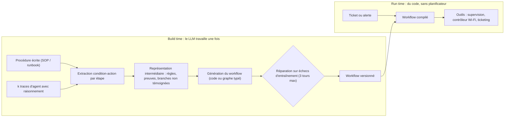
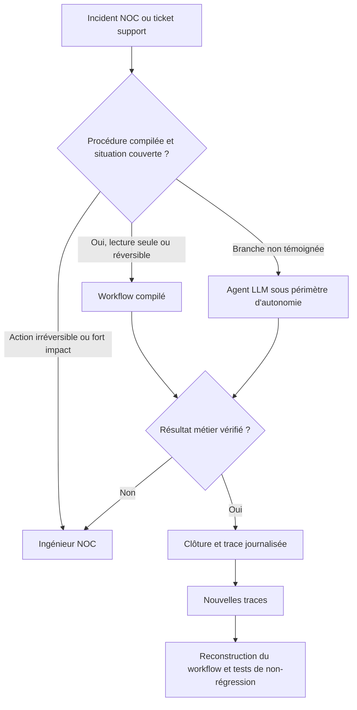

## Chambre 214, ou le prix de la délibération

Pas de Wi-Fi dans la chambre 214. Dans un hôtel, c'est le ticket le plus banal qui soit, et le technicien de support connaît la suite par cœur : vérifier que la borne du couloir répond, vérifier que l'appareil s'authentifie, réenregistrer la télé si besoin, clore. Il ne réfléchit plus. Il applique.

Confiez ce même ticket à un agent IA, c'est-à-dire un grand modèle de langage (LLM) branché sur vos outils, et le film change. L'agent relit la procédure, la réinterprète, choisit l'étape suivante, appelle un outil, puis se remet à délibérer. À chaque ticket. Sur un benchmark télécom de référence, cela représente en moyenne une douzaine d'appels de planification et près de trois minutes par tâche, pour redécouvrir ce que la procédure écrite disait déjà.

Pour un opérateur qui exploite des milliers de bornes en hôtellerie, en résidences et en entreprise, comme pour une DSI qui pousse ses premiers agents en production, l'addition se lit ticket par ticket. Coût d'inférence, latence, et surtout une logique de décision qu'on ne peut ni relire, ni versionner, ni tester.

Le 10 novembre, des chercheurs d'Amazon et de Columbia University ont mis en ligne ReTrace, un article de recherche encore non relu par les pairs (un préprint). Sa proposition : payer le LLM une seule fois, à la construction, puis exécuter du code. L'idée est juste. Les chiffres, lus jusqu'aux annexes, sont plus nuancés que l'abstract. Et la question utile pour un CTO n'est pas de savoir s'il faut remplacer l'agent, mais quelles procédures méritent d'être compilées.

## Du classeur ouvert au réflexe : ce que fait ReTrace

Pensez à un nouvel arrivant au support. La première semaine, il garde le classeur de procédures ouvert à côté du clavier et relit chaque étape avant de cliquer. Au bout d'un mois, il ne l'ouvre plus : la procédure est devenue un réflexe. L'agent LLM d'aujourd'hui reste éternellement dans sa première semaine. ReTrace essaie de le faire passer directement au deuxième mois.

Les développeurs reconnaîtront une autre image. L'agent classique est un interpréteur, qui relit le source à chaque exécution. ReTrace est un compilateur : on paie l'analyse une fois, à la construction (le *build time*), puis on exécute un artefact qui ne délibère plus (le *run time*).

La méthode part de deux ingrédients. Une procédure écrite en langage naturel, que le papier appelle SOP (*standard operating procedure*) et que l'exploitation appelle runbook. Et quelques traces d'un agent qui l'a déjà appliquée : raisonnement, outil appelé, paramètres, résultat. En production, le papier n'en utilise que trois par procédure.

La construction se déroule ensuite en quatre temps :

1. **Extraire.** Pour chaque étape des traces, un LLM identifie la condition qui justifiait l'action, l'outil utilisé et l'origine de chaque paramètre (donnée du ticket, résultat antérieur, constante).
2. **Agréger.** Le tout devient une représentation intermédiaire : des règles condition-action ordonnées, plus un test de fin de tâche. Les alternatives prévues par la procédure, mais jamais empruntées dans les traces, sont marquées *non témoignées*.
3. **Générer.** Un LLM produit le workflow, en Python pour les benchmarks publics, en graphe typé pour la plateforme d'entreprise. Un contrôle vérifie que le code se charge et ne contient aucun appel de planification.
4. **Réparer**, en option : jusqu'à trois tours de correction sur les échecs observés avec les entrées d'entraînement.

Ensuite, plus de LLM. Le ticket entre, le code s'exécute, les outils sont appelés dans l'ordre que fixent les règles.

*Le pipeline ReTrace : tout le raisonnement est concentré à la construction. Les outils côté exécution sont illustratifs, transposés au contexte d'un opérateur réseau.*

Le détail qui me plaît le plus, en tant qu'exploitant, c'est ce marquage des branches non témoignées. Il revient à dire honnêtement : cette partie de la procédure, je ne l'ai jamais vue s'exécuter. C'est précisément l'information dont un ingénieur a besoin pour décider où poser un garde-fou. Un agent, lui, ne vous signale jamais qu'il improvise.

*Compiler un agent, c'est figer en un chemin lisible ce que ses traces ont réellement parcouru, et signaler tout le reste.*

## Les chiffres, lus jusqu'aux annexes

Sur le papier, la promesse tient en une ligne : 170 secondes ramenées à 1,3. Un facteur 130. Avant de l'imprimer sur un slide de comité de direction, regardez d'où il vient.

Il vient de τ²-Bench, un benchmark académique mis en ligne en juin 2025 et publié à ICML 2026, qui simule un service client télécom. Ses outils sont simulés. Les 1,3 seconde de ReTrace ne contiennent donc aucune latence d'outil réelle, et les 170 secondes de l'agent ne sont pas décomposées entre planification et appels d'outils. Surtout, τ²-Bench est conçu pour un contrôle partagé : l'agent et l'utilisateur agissent tous deux sur le même état, et les performances chutent nettement quand l'agent doit guider l'humain. ReTrace n'est évalué qu'en mode solo, c'est-à-dire sans la partie la plus difficile.

À périmètre égal, le succès passe de 80,6 % pour l'agent à 75,8 % pour ReTrace. Moins 4,8 points. En partant de workflows bâtis sur deux traces seulement, trois tours de réparation font grimper le score de 66,7 % à 81,2 %. On se rapproche de l'agent, sans parité démontrée : l'écart est trop ténu pour conclure. Quant à une génération plus naïve, à partir de quelques exemples (*few-shot*), elle atteint déjà 70,6 %, et l'avance de ReTrace sur elle n'est pas significative.

| Terrain | ReTrace | Agent LLM | Ce qu'il faut lire |
|---|---|---|---|
| τ²-Bench, télécom, mode solo, outils simulés | 75,8 % en 1,3 s | 80,6 % en 170 s | Moins 4,8 points ; latence sans outil réel |
| SOP-Bench, 8 domaines | 80,6 % sans réparation ; 87,8 % avec réparation, en 0,40 s | 85,5 % en 46,6 s | Sans réparation, sous l'agent ; les 87,8 % exploitent les étiquettes d'entraînement |
| Production, 79 procédures | 93,8 % de complétion, environ 0,096 USD par tâche | 96,8 %, environ 0,127 USD | Moins 3,0 points, non concluant ; coût moins 24 % |

Sur SOP-Bench, un benchmark conçu chez Amazon à partir de procédures rédigées par des experts métier, ReTrace sans réparation fait 80,6 %. C'est moins que la génération *few-shot* (83,6 %) et moins que l'agent (85,5 %). Les 87,8 % avec réparation, en 0,40 seconde contre 46,6 pour l'agent, s'appuient sur les étiquettes des données d'entraînement : ils ne sont pas comparables aux méthodes qui n'en disposent pas. Et sur une même procédure, le résultat varie jusqu'à 50 points selon l'échantillon de traces.

Reste la production : 79 procédures d'une plateforme d'entreprise non publique, échantillonnées selon l'usage client et classées en trois niveaux de complexité. La complétion passe de 96,8 % pour l'agent à 93,8 % pour ReTrace. Moins 3 points, avec un intervalle de confiance à 95 % qui court d'environ moins 8 à plus 1. Il inclut zéro : l'écart n'est pas concluant. Le coût moyen par tâche, lui, baisse de 24 %.

Encore faut-il savoir ce que mesure cette complétion. C'est un drapeau posé par la plateforme, pas une vérification du résultat métier, et les auteurs reconnaissent qu'il peut surestimer le succès. Ils relèvent 184 exécutions de l'agent marquées réussies alors qu'un champ signalait l'objectif comme non atteint, et 454 sans aucun champ de résultat. Les 96,8 % de l'agent sont donc eux-mêmes fragiles. Les auteurs suggèrent un audit humain. Je ferais pareil.

### Le paradoxe de la latence

Le chiffre le plus instructif du papier n'est pas dans l'abstract. En production, ReTrace est plus lent en moyenne que l'agent qu'il remplace. Pas parce que son code rame : parce qu'il fait le travail.

La médiane baisse bien, de 68 à 37 secondes. Mais la moyenne monte, de 153 à 163 secondes. En cause, 20 procédures d'automatisation web où un appel réussi prend environ 270 secondes en médiane, quand un appel raté revient en quelques secondes. Or ReTrace réussit 86,6 % de ses appels web, l'agent seulement 27,3 %. Sur 8 de ces 20 procédures, l'agent n'a réussi aucun appel web et se retrouve pourtant marqué complété. Hors procédures web, ReTrace descend à 58 secondes contre 92 pour l'agent.

Moralité : un agent rapide peut simplement être un agent qui échoue vite, sous un drapeau vert. Vrai pour ReTrace, vrai pour tout système agentique que vous mettrez en production.

*D'un côté, un agent qui délibère à chaque ticket ; de l'autre, un enchaînement figé qui passe un point de contrôle. Encore faut-il que le contrôle mesure le bon résultat.*

## Le cran le plus radical d'une pente déjà connue

Figer ce qu'un agent a appris n'a rien de neuf. Ce qui varie d'un travail à l'autre, c'est la place laissée au LLM au moment de l'exécution. ReTrace pousse le curseur au bout.

Le cadre date de décembre 2024. Dans son guide sur la conception d'agents, Anthropic distingue les workflows, qui suivent des chemins de code prédéfinis, des agents, où le modèle décide lui-même de la marche à suivre. Les seconds échangent latence et coût contre performance, et le guide conseille de commencer par la solution la plus simple. ReTrace automatise le passage du second régime au premier.

| Approche | Rôle du LLM à l'exécution | Repère |
|---|---|---|
| LLMCompiler (Berkeley, ICML 2024) | Génère un plan à chaque requête, exécuté en parallèle | Jusqu'à 3,7 fois plus rapide et 6,7 fois moins cher que ReAct |
| Agentic Plan Caching (NeurIPS 2025) | Un modèle léger adapte des gabarits de plan tirés des logs | Environ 50 % de coût et 27 % de latence en moins, 96,6 % de la précision optimale |
| Agent Workflow Memory (ICML 2025) | Orchestre toujours, avec des workflows mis en mémoire | 82,3 % sur τ²-Bench, en 89,8 s |
| TraceCompiler (préprint, août 2026) | Très réduit : workflow majoritairement déterministe | 34 appels observés ramenés à 11 sur un cas Venmo |
| ReTrace (préprint, novembre 2026) | Aucun | 75,8 % sur τ²-Bench, en 1,3 s |

ReAct, pour mémoire, désigne la boucle classique où l'agent alterne raisonnement et action. Le cas d'Agent Workflow Memory est parlant. Mesuré dans le tableau même de ReTrace, il fait mieux que l'agent de référence, mais avec environ 26 appels au modèle par exécution. La mémoire aide la qualité. Elle ne règle pas la facture.

Le parent le plus proche est TraceCompiler, signé par un chercheur de l'EPFL et un autre de Binome Technologies. Il ne lie deux appels que si la valeur transmise est traçable sans ambiguïté. Surtout, il refuse de compiler un effet de bord irréversible et sous-déterminé : c'est exactement l'esprit des branches non témoignées. Il ne mesure pas, en revanche, son coût de compilation.

Ces travaux sont indépendants de ReTrace. Ils donnent du contexte, aucun ne le réplique.

Mon analyse : ReTrace est le cran le plus radical de cette pente, donc le plus exposé. Sans planificateur à l'exécution, plus personne n'improvise quand le réel sort du script. Les quelques points de succès qui manquent, de 3 à 5 selon le terrain et pas toujours significatifs, sont le prix de ce silence.

## Chez un opérateur Wi-Fi, ce qui se compile et ce qui ne se compile pas

Ce qui suit relève de mon analyse, pas du papier. ReTrace ne contient aucune procédure réseau, et rien ne garantit que ses chiffres se transposent à un centre de supervision réseau (NOC).

Le critère tient en trois mots : stable, répétitif, volumineux. Chez un opérateur de Wi-Fi managé, trois familles cochent les cases.

- **Les runbooks NOC de niveau 1.** Borne hors ligne, client qui ne s'authentifie pas (via 802.1X, l'authentification par identifiants d'entreprise, ou via portail captif), saturation de canal, contrôleur en alerte. L'arbre de décision est connu, et on peut démarrer avec des outils de supervision en lecture seule.
- **Le support hospitality et résidences.** La chambre 214, la réinitialisation d'un accès, l'enregistrement d'une console ou d'une TV. Volume énorme, procédure écrite, engagement de niveau de service (SLA) serré.
- **Les opérations répétitives.** Vérification post-déploiement, collecte de preuves pour un ticket, tri et enrichissement d'alertes.

À l'inverse, je ne compilerais ni le diagnostic ouvert, ni l'incident inédit. Ni les actions irréversibles ou à fort rayon d'impact, comme un changement de configuration poussé sur un parc ou la coupure d'un site. Ni le dialogue où il faut guider un client pas à pas : c'est précisément le mode de τ²-Bench que ReTrace n'a pas évalué.

Côté économie, les auteurs estiment le coût de construction à 2,32 USD, pour une économie mesurée de 0,031 USD par tâche. Point mort : environ 75 exécutions. Attention, ce coût de construction est une estimation tirée de τ²-Bench, pas une mesure en entreprise, où le modèle de construction est plus cher. Si l'ordre de grandeur tient, un runbook qui tourne des centaines de fois par mois s'amortit en quelques jours.

Mais soyons lucides : moins 24 % par tâche, ce n'est pas un ordre de grandeur. À mon sens, le vrai levier est ailleurs, dans la lisibilité. Un workflow compilé se relit, se versionne, se teste et se rejoue. La représentation intermédiaire, avec ses règles adossées à des preuves et ses branches non témoignées, devient un artefact de revue qu'on peut montrer à un ingénieur, à un auditeur ou à un client. Essayez de faire la même chose avec les délibérations d'un agent.

*Schéma d'auteur, non issu du papier : du code pour le connu, l'agent pour l'imprévu, l'humain pour l'irréversible.*

La règle structurante de ce routeur est simple : une branche non témoignée déclenche une escalade, jamais une improvisation. Le workflow compilé n'a pas le droit de deviner. Face à une situation que ses traces n'ont jamais vue, il passe la main à un agent sous périmètre d'autonomie, ou directement à un humain si l'action ne se rattrape pas. Et chaque clôture alimente les traces de la prochaine reconstruction.

*Dans un couloir d'hôtel, chaque borne relève d'un runbook stable : le genre de procédure, écrite et répétée des centaines de fois, qui se prête à la compilation.*

## Ce que j'exigerais avant de compiler un seul runbook

Six conditions. Aucune n'est exotique, toutes découlent des limites que le papier documente lui-même.

**Mesurer le résultat métier, pas le drapeau.** Rejouer une centaine de tickets historiques et vérifier que la borne est réellement remontée, que la TV est réellement connectée. Mesurer par branche, auditer un échantillon à la main.

**Couvrir les branches au lieu de tirer au sort.** Dans ReTrace, les traces sont choisies aléatoirement, sans couverture des branches. D'où cette variance de 50 points sur une procédure. Choisir des traces qui couvrent chaque chemin connu coûte peu.

**Journaliser le raisonnement des agents.** Sans raisonnement dans les traces, la complétion de ReTrace en production tombe de 93,8 % à 85,0 %, pour un coût et une durée quasi identiques. L'observabilité de vos agents devient la matière première de la compilation.

**Commencer par le simple.** La complétion de ReTrace décroît avec la complexité, de 96,3 % sur les procédures simples à 89,2 % sur les plus complexes, quand l'agent reste entre 95,4 % et 98,5 %. Les premiers runbooks à compiler sont les plus plats.

**Relire les règles avant de les déployer.** Les contrôles vérifient que le code se charge, pas que les conditions sont justes. Un raisonnement erroné dans une seule trace peut devenir une fausse règle, exécutée fidèlement mille fois.

**Traiter le workflow comme du code.** Versionnage, tests de non-régression, intégration continue, plan de reconstruction. Le papier ne teste que de nouvelles entrées sur les mêmes procédures, jamais une procédure modifiée ni un outil qui change. Le jour où le contrôleur Wi-Fi change d'API, on reconstruit et on reteste.

## Compiler le stable, garder l'agent pour l'imprévu

Mon avis : ReTrace a raison sur le fond, et son abstract en promet plus que ses annexes. La direction, le LLM à la construction et du code à l'exécution, est la bonne pour la vingtaine de runbooks qui tournent mille fois par mois. Elle transforme une dépense récurrente en investissement ponctuel, et une boîte noire en artefact relisible.

Mais regardons ce qu'on a vraiment entre les mains. Un préprint d'une semaine, sans relecture par les pairs. Aucune couverture presse ni analyste, seulement des agrégateurs qui reprennent l'abstract. Aucun résultat répliqué par un tiers. Des chiffres de production mesurés sur une plateforme non publique, avec une métrique que les auteurs jugent eux-mêmes optimiste. Et une chaîne de modèles issue d'un seul fournisseur : Sonnet 4.6, Sonnet 4.0 et Opus 4.8, tous chez Anthropic.

Donc pas de grand soir. Un pilote sur deux ou trois runbooks en lecture seule, mesuré sur le résultat métier, derrière un routeur qui escalade dès que la situation sort du connu. Si les chiffres tiennent sur vos propres traces, on élargit. Sinon, on aura au minimum gagné des runbooks enfin écrits proprement, avec leurs branches explicites.

Un agent qui délibère à chaque ticket n'est pas un signe d'intelligence. C'est souvent le signe qu'on n'a pas encore codifié ce qu'on sait déjà.

_Vues personnelles, pas position Wifirst._

## Sources

1. ReTrace: Distilling Tool-Using Agents into Planner-Free Workflows, page arXiv (préprint, 2026-11-10) — https://arxiv.org/abs/2611.14492
2. ReTrace, version HTML v1 (tables, annexes, limites) — https://arxiv.org/html/2611.14492v1
3. τ²-Bench, Barres et al. (2025-06-09, ICML 2026) — https://arxiv.org/abs/2506.07982 et https://proceedings.mlr.press/v306/barres26a.html
4. SOP-Bench, Nandi et al. (2025-06-09, v2 2026-02-23) — https://arxiv.org/abs/2506.08119
5. Agent Workflow Memory, Wang et al. (2024-09-11, ICML 2025) — https://arxiv.org/abs/2409.07429
6. TraceCompiler, El Yadouni et Li (2026-08-03) — https://arxiv.org/abs/2608.02680
7. Agentic Plan Caching, Zhang et al. (NeurIPS 2025, v2 janvier 2026) — https://arxiv.org/abs/2506.14852
8. LLMCompiler, Kim et al. (2023-12, ICML 2024) — https://arxiv.org/abs/2312.04511
9. Anthropic, Building effective agents (2024-12-19) — https://www.anthropic.com/engineering/building-effective-agents
