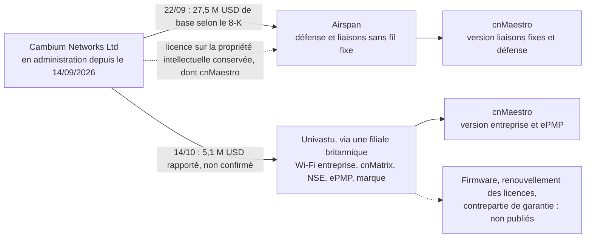
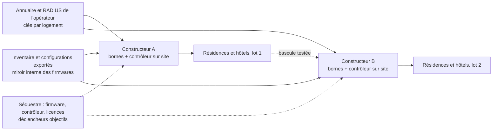

## Treize mois de signaux, puis la chute

Treize mois. C'est le temps écoulé entre le jour où Cambium Networks a reconnu, en août 2025, que ses comptes 2022 et 2023 n'étaient pas fiables, et la mise sous administration de sa filiale britannique, le 14 septembre 2026. Entre les deux : un directeur financier qui part, une radiation du Nasdaq, un doute officiel sur la capacité de l'entreprise à poursuivre son activité. La fin, elle, va très vite. Trois jours avant l'administration, 260 salariés, plus de la moitié des effectifs mondiaux, perdent leur poste sans indemnités. Huit jours après, la vente par morceaux commence.

Dans les résidences et les hôtels équipés de ses bornes, environ 2 000 propriétés avant la chute selon l'entreprise, le Wi-Fi n'a pas coupé. Les points d'accès transportent toujours le trafic. Ce qui vacille est invisible pour le résident : la console de supervision hébergée dans le cloud, les licences, les mises à jour, la garantie. Et, selon l'architecture choisie, les clés Wi-Fi personnelles attribuées à chaque logement.

Ce texte n'est pas une alerte sur le parc français. Les chiffres disponibles sont américains, et je n'ai trouvé aucune source publique mesurant l'exposition de Cambium en France ou en Europe. C'est un cas d'école, documenté jusqu'au dépôt réglementaire, qui illustre une règle simple : quand un constructeur tombe, le matériel survit, la gestion meurt d'abord. Pour qui exploite des centaines de sites sur un même fournisseur, la survie se négocie donc avant la chute. Dans le contrat, et dans l'architecture.

## Une entreprise vendue en pièces détachées

Pour savoir qui doit encore quelque chose aux clients, il faut suivre les morceaux.

Le 14 septembre 2026, Cambium Networks Ltd, filiale britannique détenue indirectement à 100 % par la maison mère américaine, entre en administration, la procédure collective de droit anglais, confiée ici à quatre administrateurs du cabinet RSM UK. Le formulaire 8-K, la déclaration d'événement important que les sociétés cotées aux États-Unis déposent auprès de leur régulateur boursier, la SEC, ne laisse aucune ambiguïté. Les administrateurs chercheront à vendre le reste des actifs. Les actionnaires doivent s'attendre à tout perdre [1].

**Airspan, 22 septembre.** Le premier repreneur prend l'activité défense et les lignes de liaison sans fil fixe (gammes PMP, PTP, cnWave, cnReach et leurs outils), avec 135 salariés [1][2]. Le communiqué d'Airspan ne donne pas de prix. Le 8-K, si : 27,5 M USD en numéraire, plus un complément plafonné à 7,5 M USD et une retenue de 2,5 M USD. Aucune borne Wi-Fi dans ce lot.

**Univastu, 14 octobre.** Un groupe indien coté, via une filiale britannique, achève le rachat de ce qui concerne les résidences et les hôtels : les points d'accès Wi-Fi d'entreprise, les switches cnMatrix, les pare-feux NSE, la gamme radio ePMP, la marque et la console de gestion cnMaestro [3][8]. Cambium devient une filiale autonome d'un acteur que Light Reading décrit comme venu de l'infrastructure civile, sans historique dans le sans-fil [7]. Sa solidité dans ce nouveau métier est, à ce stade, inconnue. Un prix de 5,1 M USD circule : Light Reading le tire d'une communication réglementaire d'Univastu que je n'ai pas pu vérifier, et aucun communiqué d'entreprise ne le reprend [7][8]. Les deux montants n'ont donc pas le même statut.

Le cas le plus instructif est celui de cnMaestro. Airspan l'a d'abord cité dans son périmètre, mais le 8-K parle d'une licence sur une propriété intellectuelle conservée par la filiale, pas d'une cession [1][2]. Univastu, de son côté, annonce l'avoir acquis [3]. Selon le directeur général de Cambium, Morgan Kurk, interrogé par Channel Dive, la console est désormais scindée en deux versions aux feuilles de route distinctes, chaque équipement étant redirigé automatiquement vers le bon cloud [8]. Ma lecture : cnMaestro n'a pas été vendu à un seul acquéreur. Deux sociétés tiennent chacune une version, et les garanties de support qui les lient ne sont pas publiques.

## Quatre plans, quatre vitesses de panne

Une image aide à comprendre ce qui se joue. Acheter une flotte de bornes gérées, c'est un peu acheter une voiture dont le tableau de bord, le carnet d'entretien et le double des clés restent chez le concessionnaire. Le jour où il ferme, la voiture roule encore. Mais plus personne ne vous dit ce qui clignote, la révision devient un problème, et refaire une clé tourne au projet.

Un parc Wi-Fi géré repose sur quatre plans. Cambium montre qu'ils ne cassent pas au même rythme.

**Le plan de données, c'est-à-dire les bornes.** C'est le plus robuste : les radios installées continuent à transporter le trafic [14][15]. Le risque est ailleurs, dans le remplacement. Le 21 septembre, Cambium annonçait l'arrêt de la production de ses points d'accès Wi-Fi, de ses pare-feux et de ses switches [9]. Le repreneur visait ensuite une reprise des expéditions la semaine du 8 novembre et un nouveau stock au plus tard le 30 novembre. Ce sont des dates de vendeur, que je n'ai pas pu confirmer de façon indépendante [4].

**Le plan de gestion, la console.** Le même 21 septembre, la console cloud n'était plus promise que jusqu'au 1er octobre au minimum, avec un possible abandon des équipements Enterprise ensuite. Le repli conseillé, installer cnMaestro sur ses propres serveurs, ne fonctionnait qu'avec une licence d'essai de 90 jours [9]. Le 6 novembre, revirement : la FAQ du repreneur indique que le cloud continue de fonctionner et que l'arrêt prévu fin octobre ne s'applique plus [4]. Tant mieux. Mais pour un exploitant, ces six semaines signifient préparer une bascule d'urgence sur la foi d'un calendrier qui change sans préavis. La date ne lui appartient plus.

**Le plan de licences, les droits d'usage.** C'est le plus fragile sur le plan contractuel. Les abonnements cnMaestro X prépayés sont honorés, mais les conditions de renouvellement restent en chantier. La version installée sur site tourne sur des essais de 90 jours renouvelables sur ticket, en attendant une offre payante ; seule la version Essentials reste sans abonnement. Quant aux clés de licence des bornes Xirrus, gamme rachetée en 2019, leur procédure de génération était toujours en cours de confirmation au 6 novembre [4][10].

**Le plan d'identité, les clés par logement.** En résidence, chaque logement reçoit souvent sa propre clé Wi-Fi sur un réseau commun. Selon la marque, cela s'appelle DPSK, PPSK ou une variante : une clé partagée classique (PSK, pour Pre-Shared Key) déclinée individuellement. Si ces clés sont générées et stockées dans le moteur propriétaire du constructeur, changer de fournisseur impose de les renouveler chez tous les résidents. Ce plan ne casse pas. Il enferme.

Deux trous traversent ces quatre plans. Le firmware, d'abord : ni l'annonce du 15 octobre ni la FAQ ne publient de politique pour les lignes Enterprise [3][4][15], donc aucun engagement public sur les correctifs de sécurité. La garantie, ensuite. Cambium dit honorer les contrats de support et les retours sous garantie déjà ouverts, avec des délais possiblement plus longs [4]. Mais après une vente d'actifs orchestrée par des administrateurs, qui est juridiquement la contrepartie de ces engagements ? Aucune source publique ne le dit.

*Quatre plans de dépendance : les bornes tiennent, la gestion et les licences se fissurent en premier.*

## Les comptes du fournisseur sont un indicateur de production

Aucun des signaux qui ont précédé la chute n'aurait été détecté en laboratoire. Aucun ne figurait dans une grille de notation technique. Tous étaient publics.

| Date | Signal public | Ce qu'un acheteur aurait pu déclencher (avis d'auteur) |
|---|---|---|
| Août 2025 | Comptes 2022, 2023 et six trimestres suivants déclarés non fiables ; avertissement du Nasdaq [9][10] | Revue fournisseur formelle |
| Sept. 2025 | Départ du directeur financier [11] | Gel des extensions mono-constructeur |
| Déc. 2025 à mars 2026 | Délai conditionnel du Nasdaq (3/12), radiation décidée (25/03), cotation suspendue (27/03), titre ensuite hors cote [5][6] | Qualification d'un second constructeur |
| Mai 2026 | Doute substantiel sur la continuité d'exploitation dans le rapport annuel [6][9] | Export des configurations et firmwares, test du mode local |
| 10 au 14 sept. 2026 | Intention de nommer un administrateur (relayée par la presse, non vérifiée au registre britannique), 260 postes supprimés soit 53,6 % des effectifs, administration [1][9] | Exécution du plan de bascule |

Les chiffres racontent la même histoire, sous réserve de leur provenance. Un résumé du rapport du premier trimestre 2026, publié par un agrégateur qui se présente lui-même comme généré par IA, donne un chiffre d'affaires de 44,6 M USD, en hausse de 32 % sur un an. Dans le même temps : 5,9 M USD de trésorerie, 66,4 M USD de dette intégralement classée à court terme et des covenants bancaires (les ratios financiers promis aux prêteurs) violés [16]. Je ne les ai pas recoupés avec le document déposé à la SEC ; prenez-les comme un ordre de grandeur. Maravedis évoque de son côté une capitalisation d'environ 40 M USD pour quelque 170 M USD de chiffre d'affaires sur douze mois [11]. La leçon tient malgré ces réserves. Une croissance du chiffre d'affaires ne protège de rien quand la trésorerie dit l'inverse.

Les causes sont plus anciennes. ABI Research cite des commandes anticipées en 2021 suivies d'un recul de 11,6 % du chiffre d'affaires en 2022, un surstock de bornes Wi-Fi 6E devenues obsolètes (la bande des 6 GHz restant limitée hors des États-Unis), une intégration tardive de Xirrus, une R&D plus faible que celle des concurrents et des problèmes de reporting [10].

Ma position : la santé financière d'un constructeur stratégique est un indicateur de production, au même titre que la disponibilité d'un contrôleur. Un doute sur la continuité d'exploitation dans un rapport annuel mérite le traitement d'une vulnérabilité critique : un ticket, un responsable, une échéance. Trop souvent, cette information dort aux achats ou à la finance pendant que l'équipe réseau valide des firmwares.

*Treize mois de signaux publics, puis un démantèlement en plusieurs lots : la chronologie était lisible bien avant l'administration.*

## Signer la survie avant la chute

Après la défaillance, le client n'a plus de levier. Les administrateurs travaillent pour les créanciers, pas pour le parc installé. cnMaestro le démontre : la console n'est jamais tombée en séquestre, ce sont les administrateurs qui ont arbitré entre cession et licence [1][3]. Ce qui suit se négocie donc à la signature, quand le fournisseur a encore envie de vendre.

**Un séquestre qui s'ouvre vraiment.** Le séquestre logiciel (escrow) consiste à déposer le code chez un tiers, qui le remet au client sous conditions. La pratique juridique converge sur deux points [21]. Les déclencheurs doivent être objectifs : insolvabilité, cessation d'activité, abandon du produit, défaut de support. Et le dépôt doit permettre de reconstruire, donc inclure chaîne de compilation, dépendances et documentation, avec une vérification technique. Un séquestre qui ne s'ouvre que sur décision de justice, c'est un extincteur sous scellés.

Je pousse ensuite le raisonnement, et je le présente comme une extrapolation personnelle, faute d'avoir trouvé une source qui la traite : étendre ce dépôt au firmware des bornes, au contrôleur installable sur site et au serveur de licences, mécanisme de génération des clés compris.

**Un mode dégradé écrit noir sur blanc.** Bornes et contrôleur local fonctionnent sans cloud et sans licence active, pour une durée chiffrée. Dans le contrat, pas dans la fiche produit.

**Un droit d'export permanent.** Configurations, inventaire et images de firmware récupérables à tout moment par une interface documentée, et pas seulement le jour du départ.

**Une clause de cession.** Si l'activité est vendue, garantie et support suivent l'actif, avec une contrepartie nommée. C'est exactement la question restée sans réponse chez Cambium.

**La preuve de conformité au Cyber Resilience Act.** Le règlement européen 2024/2847 (CRA), en vigueur depuis le 10 décembre 2024, impose depuis le 11 septembre 2026 de signaler vulnérabilités et incidents, y compris pour les produits déjà sur le marché. L'essentiel des autres obligations s'appliquera le 11 décembre 2027 [20]. Le 11 septembre 2026, c'est aussi le jour où Cambium supprimait 260 postes. Exigez par écrit la durée de support sécurité que le fournisseur déclare.

**Un droit d'information financière.** Notification obligatoire en cas d'avertissement boursier, de doute sur la continuité d'exploitation ou de bris de covenant, assortie d'un droit d'audit.

Une réserve qui compte : les clauses permettant de résilier un contrat parce que le cocontractant devient insolvable sont encadrées, en droit britannique comme dans l'Union européenne. Faites valider la rédaction par un juriste.

## La clé par logement appartient à l'opérateur

Le contrat limite les dégâts. L'architecture les évite.

Laisser les clés par logement dans le moteur du constructeur, c'est confier au serrurier le passe de tout l'immeuble, puis découvrir un matin qu'il a fermé boutique. Première règle : sortir l'identité de la borne. Les clés de chaque logement doivent être générées, stockées et révoquées dans un serveur d'authentification RADIUS et un annuaire qui appartiennent à l'opérateur. Encore faut-il que chaque constructeur sache interroger ce serveur externe pour ses clés individuelles. À vérifier en recette, pas sur une fiche produit.

Quatre briques complètent le dispositif :

- un contrôleur installé sur site ou hybride, capable de piloter le parc si le cloud disparaît ;
- un inventaire et des configurations exportés en continu, avec un miroir interne des firmwares validés ;
- une double source qualifiée : au moins deux constructeurs en production sur un même type de site, pas un second fournisseur sur le papier ;
- des tests de bascule réguliers, parce qu'un plan de reprise jamais joué n'existe pas.

ABI Research recommande une migration progressive plutôt qu'un remplacement intégral [10]. Je partage cet avis. La double source se construit au fil des renouvellements, site par site, pas dans l'urgence d'une administration.

### Le passage au 6 GHz, une fenêtre à saisir

Le calendrier technique offre justement une occasion. Sur la bande des 6 GHz, WPA3, la troisième génération de sécurité Wi-Fi, est obligatoire. Cisco précise que seuls WPA3 ou Enhanced Open (le mode ouvert chiffré) y sont admis, sans mode de transition [18].

Meraki indique que WPA3 est requis pour MLO (Multi-Link Operation, l'usage simultané de plusieurs bandes) et pour les débits propres au Wi-Fi 7 [19]. RUCKUS nuance : l'exigence tiendrait à la bande, pas à la génération [22]. Je n'ai pas relu les documents de certification de la Wi-Fi Alliance ; retenez la direction plus que le détail.

Le point décisif est ailleurs. WPA3 ne prévoit pas nativement plusieurs clés sur un même réseau. Les mécanismes de clés par logement sont des extensions propriétaires, et la Wi-Fi Alliance travaillerait à une approche standardisée, sans calendrier connu [13]. Chaque promesse de clé individuelle sous WPA3 est donc une garantie de constructeur, pas un standard. Puisque le passage au 6 GHz impose de toute façon de reprendre la configuration de sécurité, c'est le meilleur moment pour placer ces clés sous le contrôle de l'opérateur.

*Des clés par logement détenues par l'opérateur et servies à deux constructeurs : la double source commence par l'identité.*

## Qui reste debout ? Un critère, pas une liste de courses

Après une défaillance, le réflexe est de demander qui remplace. La source publique la plus fournie est un billet du cabinet Maravedis, qui vend ses études et déclare des relations commerciales avec certains constructeurs, dont Calix [12]. Son périmètre est américain : il estime ce marché des équipements et logiciels Wi-Fi gérés pour logements collectifs à 527 M USD en 2026. Avant sa chute, Cambium équipait trois des dix prestataires managés profilés par le cabinet [11].

L'intérêt du billet tient à une question posée à chaque constructeur : que reste-t-il sans cloud ni licence ? Voici les réponses déclarées, telles que rapportées. Rien n'a été testé.

| Constructeur | Déclaration rapportée par Maravedis (non testée) |
|---|---|
| EnGenius | Fonctionnement local si la licence expire |
| Zyxel | Mode autonome possible sans la console cloud Nebula |
| Grandstream | Consoles cloud et sur site gratuites ; 1 000 à 2 500 clés individuelles par borne sous WPA3 |
| TP-Link Omada | Contrôleur sur site gratuit ; jusqu'à 4 000 clés individuelles avec RADIUS externe |
| Calix SmartMDU | Gestion cloud uniquement, sans repli sur site ; comptes audités de société cotée |
| Cisco Meraki | Fonctionnement des équipements lié à un abonnement actif |
| RUCKUS (Belden) | Positionné hôtellerie, éducation, santé ; matériel 2 à 3 fois plus cher selon des prestataires |

Deux enseignements. La défaillance n'est pas seulement financière : quatre États américains supplémentaires ont poursuivi TP-Link Systems en octobre, et la FCC, le régulateur américain des télécoms, a refusé d'autoriser quatre produits. Ces actions visent des routeurs grand public, pas la gamme Omada, selon le même billet [12]. Ensuite, la consolidation change aussi la contrepartie : Belden a bouclé le rachat de RUCKUS le 1er juillet 2026, pour environ 1,85 Md USD [17].

Reste l'option ouverte. Toujours selon Maravedis, près de 400 000 bornes certifiées TIP OpenWiFi, le firmware ouvert porté par le Telecom Infra Project, seraient déployées dans le monde [12]. À mes yeux, un firmware ouvert est la forme la plus aboutie de séquestre, à condition que le matériel reste supporté.

## Acheter un constructeur, c'est acheter sa capacité à survivre

Les bornes Cambium n'ont pas cessé de fonctionner. C'est l'entreprise qui a échoué, et c'est précisément le risque que nos grilles d'achat ne mesurent pas.

Avant de signer ou de renouveler avec un constructeur Wi-Fi, huit questions :

1. Bornes et contrôleur fonctionnent-ils sans cloud ni licence active, pour une durée écrite au contrat ?
2. Puis-je exporter dès aujourd'hui configurations, inventaire et firmwares ?
3. Les clés par logement vivent-elles dans mon système ou dans le sien ?
4. Le séquestre couvre-t-il firmware, contrôleur, licences et chaîne de compilation, avec des déclencheurs objectifs ?
5. Qui honore la garantie si l'activité est vendue ?
6. Quelle durée de support sécurité le fournisseur déclare-t-il au titre du CRA ?
7. Qui, chez moi, lit les comptes de ce fournisseur, et à qui transmet-il l'alerte ?
8. Ai-je un second constructeur en production, et quand ai-je testé la bascule pour la dernière fois ?

Si plus de trois réponses vous échappent, votre parc n'est pas plus solide que le bilan de votre fournisseur. Le matériel survit au constructeur. Tout le reste se négocie avant la chute, jamais après.

_Vues personnelles, pas position Wifirst._

## Sources

1. [SEC, Form 8-K, Cambium Networks Corp, 22/09/2026](https://www.sec.gov/Archives/edgar/data/0001738177/000119312526405403/cmbmf-20260922.htm)
2. [Airspan, communiqué de reprise des lignes fixed wireless de Cambium, 22-23/09/2026](https://airspan.com/news/airspan-acquires-fixed-wireless-product-lines-from-cambium-networks/)
3. [Cambium Networks, annonce du rachat par Univastu, 15/10/2026, mise à jour 27/10/2026](https://www.cambiumnetworks.com/blog/announcement-univastu-acquisition-of-cambium-networks-epmp-enterprise-and-cnmaestro/)
4. [Cambium Networks, FAQ Univastu, mise à jour 06/11/2026](https://www.cambiumnetworks.com/univastu-acquisition-of-cambium-networks-faq/)
5. [Cambium Networks, communiqué de radiation du Nasdaq (PR Newswire via Placera), 26/03/2026](https://www.placera.se/pressmeddelanden/cambium-networks-cambium-networks-announces-nasdaq-delisting-20260326)
6. [Light Reading, Airspan swoops in to rescue Cambium Networks, 22/09/2026](https://www.lightreading.com/wireless/airspan-swoops-in-to-rescue-cambium-networks)
7. [Light Reading, Univastu India scoops up what's left of Cambium, 19/10/2026](https://lightreading.com/fixed-wireless-access/univastu-india-scoops-up-what-s-left-of-cambium-for-5-1m)
8. [Channel Dive, Cambium split cloud management platform, 19/10/2026](https://www.channeldive.com/news/cambium-split-cloud-management-platform-univastu-acquisition/833402/)
9. [The Register, Simon Sharwood, 21/09/2026](https://www.theregister.com/a/5297647)
10. [ABI Research, Andrew Spivey, Collapse of Cambium Networks, 10/11/2026](https://www.abiresearch.com/market-research/insight/7788687-collapse-of-cambium-networks-should-come-a)
11. [Maravedis / RCR Wireless, When the vendor disappears, 17/09/2026](https://rcrwireless.com/20260917/analyst-angle/when-the-vendor-disappears-what-cambium-collapse-means-for-mdus-analyst-angle)
12. [Maravedis / RCR Wireless, Who's left: the MDU Wi-Fi vendor landscape after Cambium, 17/11/2026](https://rcrwireless.com/20261117/analyst-angle/whos-left-the-mdu-wi-fi-vendor-landscape-after-cambium-analyst-angle)
13. [Maravedis / RCR Wireless, WPA3 in MDUs, 09/09/2025](https://rcrwireless.com/20250909/analyst-angle/wpa3-in-mdus)
14. [CloudSwitched, Cambium Networks administration et cnMaestro, 22/09/2026](https://www.cloudswitched.com/news/cambium-networks-administration-cnmaestro-2026)
15. [Radwin (concurrent), FAQ administration Cambium pour partenaires et FAI, 21/10/2026](https://www.radwin.com/blog/articles-3/cambium-networks-administration-faq-for-partners-isps-119)
16. [Panabee, résumé Q1 2026 de Cambium Networks (agrégateur généré par IA, à recouper avec le 10-Q)](https://www.panabee.com/news/cambium-networks-earnings-q1-2026-report)
17. [SDxCentral, Belden closes RUCKUS deal, juillet 2026](https://www.sdxcentral.com/news/belden-closes-185b-ruckus-deal-in-full-stack-networking-pivot/)
18. [Cisco, Migrate to Wi-Fi 7 and 6 GHz (Catalyst 9800)](https://www.cisco.com/c/en/us/support/docs/wireless/catalyst-9800-series-wireless-controllers/223061-migrate-to-wi-fi-7-and-6ghz.html)
19. [Cisco Meraki, WPA3 Encryption and Configuration Guide](https://documentation.meraki.com/MR/Encryption_and_Authentication/WPA3_Encryption_and_Configuration_Guide)
20. Cyber Resilience Act, obligations de signalement : [Travers Smith](https://www.traverssmith.com/knowledge/knowledge-container/the-eu-cyber-resilience-acts-vulnerability-and-incident-reporting-requirements-are-now-live/) ; [McCann FitzGerald](https://www.mccannfitzgerald.com/knowledge/data-privacy-and-cyber-risk/cyber-resilience-act-reporting-obligations-apply-from-11-september-2026)
21. Séquestre logiciel, pratiques contractuelles : [Maddocks](https://www.maddocks.com.au/insights/technology-procurement-refresher-software-escrow) ; [Vaquill](https://www.vaquill.ai/clauses/source-code-escrow) ; [Sprintlaw UK](https://sprintlaw.co.uk/articles/software-escrow-protect-your-business-if-a-supplier-fails/)
22. [RUCKUS Networks, Wi-Fi 7 and security: what you need to know](https://www.ruckusnetworks.com/blog/2023/wi-fi-7-and-security-what-you-need-to-know/)
