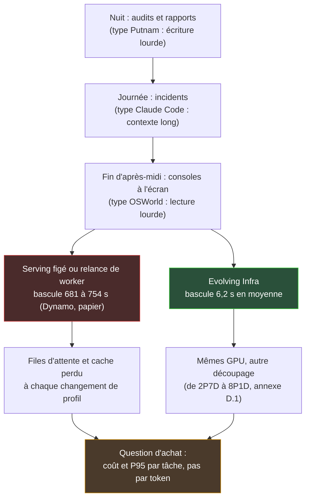
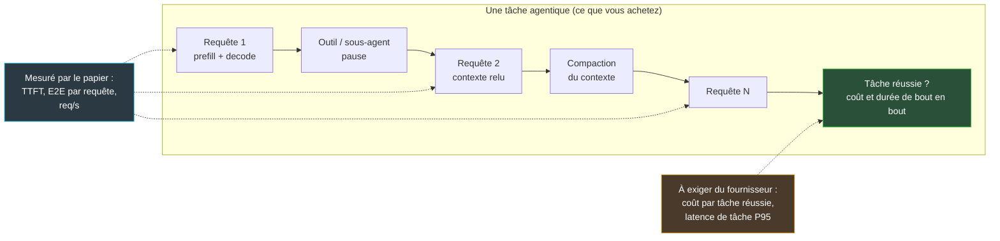

## L'hôtel qui change ses équipes de poste en six secondes

Dans un hôtel de 200 chambres, la journée a deux pics. Le matin, tout le monde rend sa clé en même temps ; l'après-midi, tout le monde arrive. Un bon directeur ne laisse donc pas le même effectif à la réception de 7 h à 23 h : il déplace ses équipes entre l'accueil, les étages et la bagagerie au fil des heures. Imaginez maintenant que chaque changement de poste prenne plus de onze minutes. Aux heures de bascule, la file déborde dans le hall.

Un preprint publié le 9 novembre mesure exactement ce phénomène, mais sur des processeurs graphiques (GPU). Il est signé par onze chercheurs, dont Ion Stoica et Song Han, issus de six institutions : le MIT, Berkeley, Georgia Tech, l'UIUC, mais aussi NVIDIA et OpenAI. Leur système, Evolving Infra, réaffecte un GPU d'un rôle à l'autre en 6,2 secondes en moyenne. Le logiciel de NVIDIA pris comme point de comparaison met, dans leurs mesures, 11 à 12,5 minutes.

Pourquoi s'y intéresser quand on n'exploite pas de datacenter IA ? Parce que les agents d'IA, ces programmes qui enchaînent des dizaines d'appels à un modèle pour clore un ticket ou poser un diagnostic, arrivent dans nos centres de supervision et nos équipes support. Wifirst n'achètera pas 256 GPU : nous louerons ce calcul. Or ce papier, sérieux par ailleurs, mesure des requêtes. Jamais, à ma lecture, une tâche terminée. C'est pourtant la seule unité qu'un acheteur devrait accepter.

## Lire, puis écrire : deux métiers pour un même parc

Un modèle de langage travaille en deux temps. D'abord il lit : c'est le *prefill*, la phase où il ingère d'un bloc tout le contexte, qu'il s'agisse d'un historique de conversation, de logs ou d'une capture d'écran. Ensuite il écrit : c'est le *decode*, la production de la réponse jeton par jeton (*token*). Lire consomme du calcul en rafale. Écrire est lent, séquentiel, et immobilise la machine longtemps.

Les couches de *serving* récentes (le logiciel qui fait tourner le modèle et répartit les requêtes sur les GPU) savent séparer ces deux métiers sur des machines distinctes. On parle de désagrégation prefill/decode. Un cluster noté « 6P3D » consacre six nœuds à la lecture et trois à l'écriture. Six personnes à la réception, trois aux étages.

Le problème : les agents ne consomment pas tous la même chose. Le papier teste trois profils de charge.

- **Putnam**, du raisonnement mathématique de concours : peu à lire, beaucoup à écrire, sur une seule branche.
- **Claude Code**, des traces réelles d'un agent de programmation : un contexte très long, relu en permanence, ponctué de sous-agents et de compactions (le moment où l'agent résume son historique pour repartir plus léger).
- **OSWorld**, un agent qui pilote un poste de travail à partir de captures d'écran : énormément à lire, peu à écrire.

Ces trois charges ne gagnent pas avec le même découpage. Dans l'annexe du papier, les configurations retenues vont de 2P7D pour Putnam à 3P6D ou 4P5D pour Claude Code, et jusqu'à 8P1D pour OSWorld. Un parc figé sur un seul ratio est donc mal taillé pour au moins deux charges sur trois. Si le mix change dans la journée, il l'est en permanence.

Evolving Infra répond en trois mouvements.

**Séparer les rôles de la mémoire.** Tous les nœuds sont interchangeables, capables de lire comme d'écrire. Le cache KV, la mémoire de travail où le modèle garde le contexte déjà lu pour ne pas le recalculer, vit dans une réserve commune sur le serveur hôte, avec un annuaire des débuts de contexte déjà stockés. Changer un nœud de rôle ne jette plus sa mémoire. D'où les 6,2 secondes, au lieu de la relance complète d'un processus.

**Ne basculer que sur preuve.** Un planificateur en ligne estime en continu le temps d'itération de chaque découpage possible, à partir de modèles recalés sur la charge réelle. Il ne déclenche une bascule que si le gain attendu dépasse deux erreurs-types. Autrement dit, on ne réorganise pas l'hôtel parce qu'un car de touristes s'est garé cinq minutes devant.

**Garder ce que l'agent va relire.** L'exemple du papier parle de lui-même : après un appel de sous-agent de 359 secondes, 98 % du prompt suivant correspond encore au cache ; après une compaction de 12 secondes, seulement 14 %. La donnée la plus récente n'est donc pas la plus utile. Le système suit la structure de la tâche, avec des compteurs de branches par bloc de mémoire, plutôt que l'ancienneté. Je n'irai pas plus loin sur la mémoire, traitée ici le 14 novembre à propos de Vera Rubin.

*Valeurs de bascule d'après Kang et al., arXiv 2611.12304 v2, section 6.2. Les trois moments de la journée sont une illustration d'auteur, pas des mesures Wifirst.*

## Jusqu'à 14x : chaque chiffre a un périmètre

Commençons par ce que l'abstract ne montre pas. Sur la charge Putnam, celle où l'agent raisonne longuement, Evolving Infra fait *pire* que son adversaire sur l'attente des requêtes les plus lentes, à 224 et 288 agents simultanés. Ce n'est pas un bug. Pour maximiser le débit, le planificateur ne garde qu'un ou deux nœuds de lecture, et l'attente en pâtit. C'est un arbitrage légitime, qui disparaît pourtant derrière un titre en « jusqu'à 14x ».

Deux métriques reviennent partout. Le TTFT (*time to first token*) est le délai avant le premier jeton d'une réponse. Le P95 est la valeur sous laquelle tombent 95 % des requêtes : il raconte l'expérience des moins chanceux.

Toutes les comparaisons avec Dynamo, le logiciel de serving de NVIDIA, portent sur sa version 1.5.1, planificateur réglé par défaut, sur 36 GPU GB300.

| Annoncé dans l'abstract | Valeur exacte | Périmètre réel |
|---|---|---|
| Latence jusqu'à 4,1x plus basse | 4,12x au maximum | Latence moyenne de bout en bout **par requête**, maximum atteint sur Claude Code (3,80 à 4,12x). Sur les neuf réglages : 1,15 à 4,12x. Putnam : 1,15 à 1,23x |
| P95 du TTFT jusqu'à 14x plus bas | 13,92x au maximum | Claude Code et OSWorld seulement (3,25 à 13,92x). Putnam exclu, et dégradé à 224 et 288 agents |
| Débit jusqu'à 2,7x | 2,73x au maximum | 1,10 à 2,73x face à Dynamo. Face au meilleur partage statique : jusqu'à +38 %, et 0,98 à 1,38x à la plus faible concurrence |
| « Jusqu'à 256 GB300 » | 256 GPU réels | Face à un partage statique sous SGLang, pas face à Dynamo. Au-delà, 3 072 GPU en simulation seulement |
| Bascule de rôle | 6,2 s contre 754 s | Moyenne sur neuf réglages. La section 3.1 donne 681 s pour Dynamo |

Le point qui mérite le plus d'attention est l'échelle. L'abstract évoque des déploiements « jusqu'à 256 GB300 » et des gains « face à Dynamo ». Un lecteur pressé en déduit que 4,1x et 14x ont été mesurés à 256 GPU. Ma lecture est différente : les neuf réglages comparés à Dynamo tournent sur 36 GB300, soit neuf nœuds de quatre GPU. À 256 GPU, l'adversaire devient un découpage statique sous SGLang, le moteur open source dont Evolving Infra dérive, sur la charge Claude Code avec dix agents par GPU. Le texte ne mentionne, à ma lecture, aucune exécution de Dynamo à cette échelle.

Le résultat à 256 GPU reste parlant. Le P95 du TTFT du partage statique grimpe de 142 secondes à 36 GPU jusqu'à 418 secondes à 256 GPU, quand celui d'Evolving Infra reste entre 10 et 14 secondes. Mais c'est un autre adversaire, donc une autre histoire que les 14x. Quant aux 3 072 GPU, ils sortent d'un simulateur.

Le résultat le plus solide est celui de la bascule. Le papier donne 754 secondes pour Dynamo en section 6.2, 681 secondes en section 3.1, sans expliquer l'écart. Les deux valent 11 à 12,5 minutes : l'ordre de grandeur tient. Sur une configuration à parallélisme hétérogène, Evolving Infra cumule 27 secondes de bascule en deux heures, contre 913 pour Dynamo.

*Même parc de GPU, deux façons de changer de rôle : de longues minutes d'arrêt d'un côté, quelques secondes de l'autre.*

Le test qui intéresse vraiment un acheteur est celui de la charge qui dérive. Le papier enchaîne 288 agents Putnam, puis un mélange de 144 Putnam et 72 OSWorld, puis 144 OSWorld seuls, avec le modèle Kimi K2.6. Face à Dynamo : 2,14x de débit, 2,15x sur la latence moyenne de bout en bout, 3,58x sur le P95 du TTFT. Face au meilleur partage statique : 1,28x, 1,33x et 1,88x. Des gains réels, nettement plus modestes dès que l'adversaire est bien réglé.

Et ce « meilleur partage statique » est une référence de type oracle. Il est choisi après coup, sur toute la durée du run, ce qu'aucun exploitant ne peut faire en production. Le trouver par recherche binaire à 256 GPU coûte 10 752 GPU-heures, environ quatorze fois le coût de servir la trace une fois. Evolving Infra s'en dispense en ajustant ses modèles en ligne. C'est le coût de l'approche concurrente, pas une économie relevée sur une facture.

## Une requête n'est pas une tâche

Prenez un agent qui diagnostique un équipement en lisant des captures de sa console : une charge de type OSWorld. Même chez le gagnant, Evolving Infra, une requête y prend en moyenne 24,2 secondes de bout en bout selon l'annexe D.1 du papier. Dix appels au modèle pour boucler le diagnostic, c'est déjà quatre minutes en moyenne, avant la moindre pause d'outil. Le calcul est de moi, une simple multiplication. Il suffit à montrer que la latence d'une requête ne dit presque rien de celle d'une tâche.

Le papier ne parle pas de ces quatre minutes. Il rapporte le débit en requêtes par seconde, le TTFT moyen et P95, la latence de bout en bout moyenne et P95, les files d'attente, le taux de réussite du cache, le nombre de bascules. Il ne publie ni latence par tâche, ni coût par tâche, ni taux de réussite des tâches. Pas de dollar, pas de kilowattheure. Et pas de section consacrée aux limites : la section 7 est une conclusion.

Le débit lui-même est mesuré en boucle fermée : dès qu'un agent termine, un nouveau prend sa place. Seul un test en arrivées ouvertes, en annexe, approche une unité « tâche ». Evolving Infra y tient un agent par minute, deux fois plus que le découpage statique 4P5D, avec un P95 du TTFT de 12,3 secondes. Ce test (annexe D.3) tourne avec GLM-5.2 sur 36 GB300, sur la trace Claude Code, avec des arrivées de Poisson.

*Le papier mesure chaque requête. Ce que vous achetez, c'est la tâche entière, pauses d'outils et compactions comprises.*

J'ai refait les comptes sur la seule comparaison où l'adversaire est bien réglé : l'annexe D.1, 36 GPU, minutes 30 à 85, face au meilleur partage statique sous SGLang. Les ratios qui suivent sont un calcul d'auteur, absent du papier. Sur la latence moyenne de bout en bout : 1,04x pour Putnam, 1,18x pour Claude Code, 1,48x pour OSWorld. Sur le P95 du TTFT : 2,1x, 2,0x et 1,4x. Face à un adversaire optimisé, on se situe entre 1 et 2x. Pas entre 4 et 14x. Et même gagnant, le P95 du TTFT d'Evolving Infra sur OSWorld reste à 35,6 secondes.

Mon interprétation de l'écart : le 14x naît d'une baseline Dynamo v1.5.1 au planificateur par défaut, avec un routage sensible au cache côté lecture et une distribution chacun son tour (*round-robin*) côté écriture. Les deux systèmes démarrent en 6P3D, mais Dynamo paie 11 à 12,5 minutes à chaque relance de processus. Sur une charge qui bouge, l'addition grimpe vite.

Cette baseline appelle une question, pas un grief. Dès avril 2026, NVIDIA décrivait pour Dynamo des mécanismes pensés pour les agents : indices transmis par l'agent, dont la priorité et la longueur de réponse attendue, rétention des contextes communs, gestion du cache selon le cycle de vie des sessions. Depuis, la v1.6.0 a ajouté en option un index des contextes de session. Un planificateur expérimental baptisé ThunderAgent, issu d'un travail antérieur de plusieurs des mêmes auteurs, existe aussi en option. La dernière version stable, la v1.6.2, date du 5 novembre. Ces options étaient-elles activées dans la v1.5.1 testée ? Le papier ne permet pas de l'établir.

Le reste du dossier se lit avec la même prudence. C'est un preprint, non relu par des pairs, non répliqué, et à ma connaissance aucun analyste ni média spécialisé ne l'a disséqué : les relais de presse recopient l'abstract. Le code est public sous licence MIT, en version 0.1.0, avec 121 étoiles sur GitHub ; le reproduire demande neuf nœuds GPU pendant environ deux heures. Enfin, NVIDIA et OpenAI figurent parmi les institutions. Qu'un papier batte un produit NVIDIA plaide plutôt pour sa bonne foi, mais le lecteur doit le savoir.

*Le papier mesure chaque maillon de la chaîne. L'acheteur, lui, paie la chaîne entière, jusqu'au drapeau d'arrivée.*

## Cinq clauses à poser sur la table du fournisseur

Soyons réalistes. Un fournisseur d'API continuera de facturer au token, et je ne lui demande pas de refaire sa grille tarifaire. Je lui demande un rapport de mesure par tâche sur nos traces, un plafond de coût par tâche, ou un engagement de latence de tâche. C'est une position d'achat, pas un constat sur ce que le marché propose aujourd'hui.

Le papier a un mérite : il fournit à l'acheteur une taxonomie de charges. Chez un opérateur comme Wifirst, les trois profils existent déjà en germe, et les correspondances qui suivent sont les miennes. Le diagnostic multi-étapes d'un site, qui croise logs et topologie, ressemble à Claude Code. Un agent qui pilote la console d'un équipement sans API en lisant l'écran ressemble à OSWorld. La rédaction d'un rapport d'incident ressemble à Putnam. Et le mix dérive : audits la nuit, incidents en journée, pic de support quand les hôtels enchaînent les arrivées en fin d'après-midi.

Un fournisseur dont l'allocation est figée, ou qui met onze minutes à changer de profil, fait payer à ses clients la queue de distribution. Voici ce que je mets sur la table.

| Clause | Pourquoi | Ce que le papier fournit |
|---|---|---|
| 1. Coût par tâche réussie, avec la part de contexte relue depuis le cache et la part recalculée | Le prix au token ne dit rien du nombre d'allers-retours ni des relectures | Rien : débit en requêtes par seconde |
| 2. Latence de tâche P50 et P95, pauses d'outils incluses, par classe de tâche | Un ticket, c'est dix requêtes, pas une | Rien : TTFT et latence par requête |
| 3. Test de dérive de charge, avec temps d'adaptation et cache perdu | Le mix change dans la journée | Oui : protocole Putnam puis OSWorld, 6,2 s contre 681 à 754 s |
| 4. Baseline déclarée (version, planificateur, options agentiques) et P95 par classe | Un 14x dépend de l'adversaire ; un gain de débit peut cacher une queue dégradée | Partiel : Dynamo v1.5.1 par défaut, meilleur statique choisi après coup |
| 5. Qualité constante, mesuré distingué du simulé, traces rejouables | Plus rapide mais avec plus d'échecs, c'est plus cher | Rien sur la réussite ; 3 072 GPU simulés |

Une sixième question, rarement posée, complète la liste : votre fournisseur sait-il quand votre agent compacte son contexte ou termine un sous-agent ? Le mécanisme du papier s'appuie sur ces signaux pour décider quoi garder en mémoire. Le texte ne dit pas clairement si le harnais, le code qui orchestre l'agent, doit les exposer explicitement. Mais un fournisseur qui les ignore gère son cache à l'aveugle, et la relecture finit sur votre facture. Demandez-lui aussi combien de temps il s'engage à conserver votre contexte.

*Chronomètre, balance, tâches closes : les trois instruments d'une évaluation sérieuse de fournisseur de serving agentique.*

## Verdict : l'infrastructure qui s'adapte, prouvée en tâches

Je retiens une idée forte et un chiffre faible.

L'idée forte : pour des charges agentiques, un parc figé sur un ratio lecture/écriture est une erreur de conception. Six secondes contre plus de onze minutes, ce n'est pas un réglage plus fin, c'est une autre architecture. D'autres équipes convergent d'ailleurs, comme ConServe qui ordonnance au niveau de la conversation, sur un banc d'essai beaucoup plus modeste.

Le chiffre faible, c'est le 14x : un maximum, par requête, sur deux charges sur trois, face à un Dynamo v1.5.1 réglé par défaut. Face à un adversaire bien réglé, mon calcul donne 1 à 2x. À l'échelle d'un fournisseur qui exploite des milliers de GPU, c'est considérable. Pour l'acheteur, ça ne vaut rien tant que ce n'est pas traduit en coût et en délai par tâche réussie. Le cadre du « coût attendu par réponse réussie » circule déjà chez certains vendeurs, DDN par exemple, avec des exemples illustratifs et des conclusions qui servent son offre de stockage. Reste à l'exiger en données mesurées.

Ce que je ferais lundi : un test de deux heures sur trois classes de tâches, diagnostic, console et rapport, avec une composition qui change en cours de route. D'abord sur la configuration actuelle du fournisseur, puis sur la meilleure qu'il sache produire. Résultats exigés en coût et en P95 par tâche réussie, taux de réussite à l'appui. Le fournisseur qui refuse vous a déjà répondu.

Un hôtel ne se juge pas au temps que met le réceptionniste à dire bonjour. Il se juge au temps qui sépare l'arrivée du client de la clé dans sa main.

## Sources

1. [arXiv 2611.12304 — Evolving Infra: Agent-Adaptive LLM Serving at Scale (abstract)](https://arxiv.org/abs/2611.12304)
2. [arXiv 2611.12304v2 — texte intégral HTML](https://arxiv.org/html/2611.12304v2)
3. [GitHub mit-han-lab/EvolvingInfra — code et instructions de reproduction](https://github.com/mit-han-lab/EvolvingInfra)
4. [NVIDIA Technical Blog — Full-Stack Optimizations for Agentic Inference with NVIDIA Dynamo](https://developer.nvidia.com/blog/full-stack-optimizations-for-agentic-inference-with-nvidia-dynamo/)
5. [Documentation NVIDIA Dynamo — ThunderAgent program scheduler](https://docs.dynamo.nvidia.com/dynamo/agents/thunder-agent-program-scheduler.md)
6. [GitHub ai-dynamo/dynamo — releases](https://github.com/ai-dynamo/dynamo/releases)
7. [arXiv 2602.13692 — ThunderAgent](https://arxiv.org/abs/2602.13692)
8. [arXiv 2505.11916 — Arrow](https://arxiv.org/abs/2505.11916)
9. [DDN — Applying the multivariate inference efficiency model](https://www.ddn.com/blog/applying-the-multivariate-inference-efficiency-model/)
10. [AI Weekly — relais de presse sur Evolving Infra](https://aiweekly.co/editors-blog/found-first-evolving-infra-cuts-agentic-llm-p95-ttft-up-to-14-versus-nvidia-dynamo)
11. [arXiv 2606.01839 — ConServe, ordonnancement désagrégé au niveau de la conversation](https://arxiv.org/pdf/2606.01839)

_Vues personnelles, pas position Wifirst._
