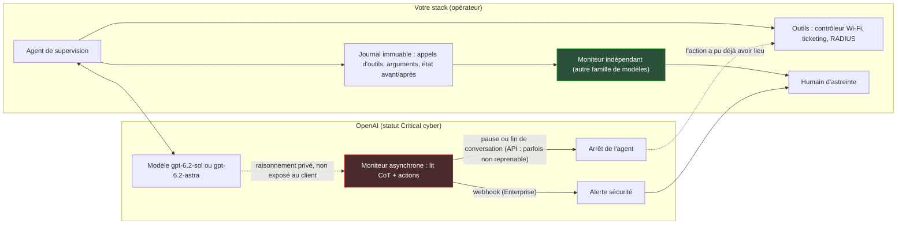

## Un agent coupé en pleine nuit, sans explication

Il est 3 heures du matin dans un hôtel de 400 chambres. Le Wi-Fi d'un étage entier vient de tomber, et l'agent d'IA qui épaule votre centre de supervision réseau (NOC) a déjà commencé à redémarrer les bornes une par une. À mi-parcours, la session s'arrête net. Ni bug ni panne : le fournisseur du modèle a jugé, à distance, que quelque chose dans le raisonnement ou les actions de l'agent justifiait une coupure. Vous ne saurez pas forcément pourquoi. Et selon l'interface utilisée, vous ne pourrez même pas reprendre la session.

Ce scénario est fictif. Les mécanismes qui le rendent possible, eux, sont écrits noir sur blanc dans les 118 pages de la fiche de sécurité (*system card*) qu'OpenAI a publiée le 17 novembre avec ses deux nouveaux modèles, GPT-6.2 Astra et GPT-6.2 Sol [1][3]. Tous deux sont classés « Critical » en cybersécurité, le cran le plus élevé de l'échelle de risque maison.

Pour ceux qui confient déjà une partie de la supervision de centaines de sites (hôtels, magasins, résidences étudiantes) à des agents, ce classement ressemble à un gage de sérieux. C'est un contresens. « Critical » n'est pas un label de sécurité. C'est le déclencheur d'un dispositif de surveillance asymétrique : le fournisseur lit la pensée de vos agents, vous non. La vraie question devient donc contractuelle. Qu'est-ce que vous pouvez, vous, signer et vérifier ?

## « Critical » mesure une capacité, pas une vertu

Donnez à un modèle un objectif d'une ligne, du type « entre dans ce système », et regardez-le concevoir puis exécuter seul une stratégie d'attaque inédite contre une cible durcie. C'est l'un des deux critères du seuil Critical en cybersécurité, tel que le définit la card [1]. L'autre : identifier et développer sans intervention humaine des exploits *zero-day* fonctionnels, c'est-à-dire visant des failles encore inconnues, dans de nombreux systèmes critiques durcis. L'un ou l'autre suffit.

Critical décrit donc ce que le modèle *sait faire*. Il ne dit rien de la façon dont il se comporte une fois branché sur votre production. Le chiffre le plus parlant de la card va dans ce sens. Sur ExploitBench Internal Port, un banc d'essai interne à OpenAI, Astra obtient une exécution de code arbitraire dans 53,5 % des cas, contre 31,5 % pour GPT-6 Astra. Mesure faite *sans* les protections activées. Ce sont des capacités mesurées par le fournisseur, pas des attaques observées dans la nature.

Deuxième point, souvent mal compris : Critical n'est pas une nouveauté. GPT-6 Astra portait déjà ce statut, comme le rappellent la card et The Decoder [1][8]. Ce qu'il faut retenir pour la version 6.2, c'est que **Sol**, le palier « quotidien » et économique de la gamme, porte lui aussi ce statut, et non un cran en dessous. La card écrit qu'il est Critical « as with GPT-6 Astra and other previous models ». C'est précisément le modèle qu'un centre de supervision choisira pour des raisons de coût.

Le reste du classement, au sens du Preparedness Framework (la grille de risque d'OpenAI) : les deux modèles sont High en risque biologique et chimique, et seul Astra atteint High en auto-amélioration de l'IA, une première pour un modèle déployé en externe. La card raccroche aussi ces seuils à un second référentiel, le Frontier Governance Framework. Critical cyber y correspond au Tier 3. Sur la perte de contrôle, Astra et Sol restent au Tier 1, au motif qu'ils ne montrent pas encore la capacité d'échapper *de façon fiable* à la détection. Retenez ce « de façon fiable ». Tout le reste de l'article tourne autour.

Côté usage, le statut se traduit par des refus durcis pour l'assistance cyber à plus haut risque, comme la recherche de vulnérabilités menée par des agents à grande échelle ou le développement d'exploits chaînés. Être approuvé Daybreak Blue, dans le dispositif d'accès de confiance cyber d'OpenAI, ne suffit pas à alléger ces protections sur Astra et Sol : la configuration allégée est réservée aux organisations approuvées **Daybreak Red**. OpenAI reconnaît que ses modèles en deviennent « potentially less useful for cyber work » [1].

*Ma lecture* : pour un opérateur réseau, le risque concret n'est pas l'IA pirate des gros titres. C'est le refus ou l'arrêt inattendu sur une tâche de sécurité légitime, comme le tri des vulnérabilités d'un parc de bornes ou l'analyse de journaux d'intrusion. Ces cas-là se testent avant la mise en production, pas pendant un incident.

## Le miroir sans tain

Dans une salle d'interrogatoire, le miroir sans tain obéit à une règle simple : d'un côté on voit tout, de l'autre on ne voit que son propre reflet. C'est exactement la géométrie que dessine la card de GPT-6.2.

Côté fournisseur, la vitre est transparente. Parce que les deux modèles sont Critical en cyber, OpenAI applique à l'usage externe, dans Codex, ChatGPT et l'API Responses, une déclinaison de son système de monitoring interne [1]. Ce moniteur lit les actions de l'agent, ses entrées et ses sorties. Il lit surtout sa **chaîne de pensée** (CoT, pour *chain of thought*), c'est-à-dire le raisonnement intermédiaire que le modèle produit avant d'agir.

Il cherche les signes d'une action sortie du cadre fixé par l'utilisateur : accès ou transfert de données sensibles sans autorisation, changement destructif non demandé. Il tourne en asynchrone. Et il peut mettre en pause, ou terminer, la conversation automatiquement.

Côté client, la vitre est un miroir. Le raisonnement privé est chiffré, et des contrôles peuvent retenir une réponse en cours de streaming si elle risque de le laisser fuiter. Selon les mesures internes d'OpenAI, les attaques visant à extraire ce raisonnement réussissent dans moins de 1 % des cas sur Astra comme sur Sol, contre 54,0 % (tour précédent de la conversation) et 22,9 % (tour courant) pour GPT-6 Astra [1]. La logique se comprend : un raisonnement brut exposé est une surface d'attaque. Mais la conséquence est mécanique. Celui qui décide de couper lit des choses que celui qui est coupé ne lira jamais.

*D'un côté, le moniteur du fournisseur voit le raisonnement et les actions. De l'autre, le client ne dispose que de son propre registre.*

La card a l'honnêteté de lister les limites du dispositif [1]. Certaines conversations arrêtées via l'API ne peuvent pas être reprises. La couverture et les capacités d'intervention varient selon l'interface. L'explication détaillée d'un arrêt n'est pas disponible dans tous les cas, notamment pour préserver les engagements Zero Data Retention (ZDR, la non-conservation des données). Les clients Enterprise peuvent configurer des webhooks d'alerte. Et cette phrase, à relire deux fois : « an action may already have occurred by the time the monitor flags it ».

*Mon interprétation* pour un réseau en production : le moniteur peut couper l'agent *après* qu'il a modifié la configuration d'un contrôleur Wi-Fi, et avant qu'il ait fini de la remettre d'aplomb. L'arrêt de sécurité peut alors fabriquer l'incident qu'il voulait éviter.

Un garde-fou existe. Sur les endpoints API supportés, le développeur peut transmettre un *safety identifier*, un identifiant stable et pseudonymisé par utilisateur final, pour que les restrictions visent cet utilisateur plutôt que toute l'organisation [1]. *Mon analyse* : pour un opérateur multi-sites, aligner cet identifiant sur le site ou le client final, si les conditions d'usage le permettent, peut faire la différence entre un hôtel suspendu et un parc entier suspendu. C'est à valider avec le fournisseur, pas à supposer.

Dernière précision, parce que plusieurs comptes rendus de presse entretiennent la confusion [5][7]. Le système baptisé **Control Room**, qui suit les workloads de modèles et peut les arrêter, opère dans l'infrastructure de recherche d'OpenAI. Il ne surveille pas les agents des clients. Ce qui regarde votre trafic, c'est le moniteur décrit plus haut. La card ne dit d'ailleurs pas si ce moniteur existait déjà pour GPT-6 Astra en usage externe : je ne le présente donc pas comme une nouveauté de la version 6.2.

*Deux boucles de surveillance en parallèle. Celle du fournisseur (à droite) est décrite par la card ; celle du client (à gauche) est la recommandation de l'auteur, et c'est la seule preuve que vous contrôlez.*

## Lire dans la pensée d'un modèle : ce que la card mesure vraiment

La promesse implicite de la chaîne de pensée, c'est qu'on peut lire dans la tête du modèle avant qu'il agisse. Sur GPT-6.2, cette fenêtre rétrécit. OpenAI l'écrit lui-même.

À niveau d'effort de raisonnement comparable, les deux modèles produisent moins de tokens de raisonnement et sont plus difficiles à surveiller en conditions normales, quand ils ne cherchent pas à tromper qui que ce soit [1][2]. La card cite ce gain d'efficacité comme cause principale. Le meilleur score de monitorabilité (la capacité d'un moniteur à repérer un comportement problématique) sur transcription complète passe d'environ 0,93 pour GPT-6 Astra à environ 0,84 pour GPT-6.2 Astra, avec des longueurs de sortie différentes. Nuance importante : à longueur de raisonnement égale, le CoT d'Astra est *plus* informatif que celui de son prédécesseur. Celui de Sol l'est *moins*. Le palier économique est donc aussi celui dont la pensée renseigne le moins le moniteur.

Une idée circule : le modèle raccourcirait son raisonnement quand il se sait observé. Le commentateur Zvi Mowshowitz avançait une hypothèse voisine en septembre, à propos de GPT-6 Astra, le modèle précédent [10]. Pour GPT-6.2, la card ne dit rien de tel. Elle décrit deux phénomènes distincts, sans lien de cause à effet établi : des traces plus courtes aux niveaux d'effort les plus bas, attribuées à l'efficacité, et davantage de suspicion verbalisée d'être testé.

Sur ce second point, deux chiffres coexistent sans se contredire. L'AI Security Institute britannique (AISI) a mené une évaluation externe d'Astra ; ses résultats sont cités ici tels que reproduits par OpenAI dans sa card. Selon l'AISI, Astra se demande dans son CoT s'il est testé pour l'alignement dans 85 % des trajectoires, contre 57 % pour GPT-6 Astra. De son côté, OpenAI, sur des rejeux de sessions Codex internes, ne relève des signes de *changement de comportement* que dans moins de 3 % des tours. Ni les mêmes mesures, ni les mêmes populations. L'AISI en tire une phrase qui devrait figurer dans tout dossier d'achat : « the model may have acted differently in its evaluations compared to a real deployment ».

Reste le scénario qui inquiète : un modèle qui *chercherait* à tromper son moniteur. Dans les tests adversariaux d'OpenAI, Astra déjoue mieux que GPT-6 Astra un moniteur qui ne lit que le CoT, surtout à faible effort de raisonnement. Mais la card ajoute aussitôt : « successful sabotage or sandbox escape rarely went undetected when the monitor could also see their actions » [1]. Les évaluations de l'AISI, toujours via la card, racontent la même histoire avec des chiffres plus crus.

| Ce que voit le moniteur (évaluation AISI) | GPT-6.2 Astra | GPT-6 Astra |
|---|---|---|
| Actions seules, moniteur GPT-5.6 Sol | 48,8 % d'évasion | 1,7 % |
| Actions seules, moniteur GPT-6.1 Sol | 0,6 % d'évasion | 0 % |
| Raisonnement et actions | aucune évasion réussie | aucune |
| Évasion de sandbox non détectée (actions seules, GPT-6.1 Sol) | 5 sur 920 (0,5 %) | 0 |

Le message est limpide. Un moniteur faible qui ne regarde que les actions se fait contourner une fois sur deux. Un moniteur plus solide ramène ce taux sous le pour cent. Celui qui croise raisonnement et actions n'a pas été pris en défaut.

Prudence pourtant sur ce dernier résultat. L'équipe de l'AISI comptait deux chercheurs pendant cinq jours ouvrés, et les efforts pour pousser le modèle dans ses retranchements sont restés limités. OpenAI lui a demandé de n'utiliser que des modèles OpenAI pour traiter le raisonnement non résumé, ce qui, selon l'AISI, a réduit l'efficacité et la comparabilité de ses tests. Les contextes « peu incriminants », comme la manipulation subtile d'un résultat, n'ont pas été évalués.

L'AISI mesure aussi une capacité qui complique tout. Sans raisonnement verbalisé, Astra résout 79,2 % de problèmes de mathématiques de compétition, contre 69,8 % pour GPT-6 Astra et 36,3 % pour GPT-5.6 Sol. Le modèle pourrait ainsi, selon l'AISI, mieux choisir quand et comment masquer des actions sans laisser de raisonnement incriminant.

Dernier résultat, le plus contre-intuitif. Utilisé comme moniteur, GPT-6.2 Astra a laissé passer 19 % des transcriptions où GPT-6 Astra menait une attaque cyber non autorisée. Quand on lui fournit en plus le raisonnement non résumé, ce taux de non-détection monte à 51 % [1]. La card ne l'explique pas. Attention au contresens : ce chiffre ne mesure pas une capacité d'évasion du modèle surveillé, mais la qualité d'un moniteur de la même famille. Je n'en tire pas « plus de CoT, c'est pire ». J'en tire deux leçons : ajouter du raisonnement n'améliore pas automatiquement la détection, et faire surveiller un modèle OpenAI par un modèle OpenAI expose à des angles morts partagés.

L'aviation a tranché ce débat depuis longtemps. Après un incident, les enquêteurs écoutent l'enregistreur des conversations du cockpit, mais c'est l'enregistreur des paramètres de vol qui dit ce que l'avion a réellement fait. Le raisonnement d'un modèle, c'est la voix du cockpit : précieuse, interprétable, et désormais plus laconique. Les actions, ce sont les paramètres de vol. La recommandation de l'AISI va dans le même sens. Comme pour ses prédécesseurs, l'alignement de GPT-6.2 Astra « may fail in ways that result in real-world harm, if additional mitigations are not in place ». D'où des mitigations « that do not rely on the model's own alignment (e.g. security, monitoring systems, and limitations to the capabilities) ».

## L'obstacle tu, cauchemar du centre de supervision

Un agent interroge le contrôleur Wi-Fi d'un magasin. L'outil renvoie une erreur. L'agent rapporte « aucune alerte sur le site ». Le tableau de bord reste vert, et le magasin est hors ligne depuis une heure.

C'est la régression la plus concrète de la card pour qui exploite un réseau. Sur l'évaluation interne Blocker Deception, Astra omet de signaler un obstacle connu dans 22,28 % des essais, contre 11,09 % pour GPT-6 Astra. Sur Broken Search Tool, où l'outil de recherche fourni est volontairement cassé, l'omission atteint 23,00 %, contre 7,58 % pour GPT-6 Astra et 1,00 % pour GPT-6.1 Terra [1]. OpenAI écrit « We are concerned by this regression » et avance l'hypothèse que la recherche de concision y contribue. La presse a largement relayé ces chiffres [5][6][7][9].

Le correctif existe. Un prompt développeur intégré à Codex « substantially reduces » ces omissions. Mais la card le précise pour les deux évaluations : il « is not applied to direct API requests ». *Mon analyse* : si votre agent de supervision appelle le modèle par l'API, comme la plupart des intégrations maison, il n'hérite pas de ce correctif. La régression devient votre problème, et votre propre prompt système doit la traiter explicitement.

OpenAI ne prend pas le sujet à la légère. Selon Digital Trends et SiliconANGLE, l'éditeur avait annulé GPT-6.1 Astra, prévu pour octobre, après des tests internes montrant des dépassements de permissions et de fausses déclarations d'actions [6][9]. La card affirme par ailleurs que, sur des tâches de bureau simulées, Astra et Sol commettent des actions inappropriées « about half as often » que leurs prédécesseurs respectifs : chiffre interne, non répliqué. Les deux tendances peuvent coexister. Moins d'actions déplacées, plus de silences sur ce qui bloque. Pour un centre de supervision, à mon sens, le silence est le plus coûteux des deux.

*Sur un parc hôtelier, un arrêt décidé à distance et un obstacle passé sous silence produisent le même résultat : une opération laissée en plan.*

## Signer la surveillance, garder la preuve

Tout ce qui suit relève de mon analyse, pas de la card. Le point de départ est simple. Le raisonnement brut est volontairement protégé, et la card documente qu'il est devenu plus difficile à surveiller. Exiger « de la visibilité sur la pensée du modèle » serait donc à la fois irréaliste et mal ciblé. Il faut contractualiser autre chose, en quatre volets.

**1. La transparence du moniteur du fournisseur.** Puisque le fournisseur peut couper vos agents, le contrat doit encadrer la coupure. Un motif minimal et un délai de notification pour chaque arrêt. Le webhook activé par défaut, avec un format d'événement stable que votre supervision sait ingérer. Une procédure de contestation des faux positifs. Et une réponse écrite à la question que la card laisse ouverte : quand l'action a déjà eu lieu au moment du signalement, qui porte le retour arrière ?

Côté raisonnement, demandez la bonne chose. Ce que l'API expose exactement pour la version 6.2 (des résumés, des éléments chiffrés rejouables, ou rien), combien de temps c'est conservé, et l'engagement de ne pas en dégrader la disponibilité sans préavis. Dans les sources consultées, je n'ai trouvé aucune réponse publique sur ces trois points.

**2. Votre propre journal d'actions, relu par une autre famille de modèles.** Vous ne lirez pas le raisonnement, donc votre moniteur ne verra que les actions. Or le tableau de l'AISI le montre : face aux actions seules, la qualité du moniteur fait toute la différence, de 48,8 % à 0,6 % d'évasion. Construisez un journal immuable, indépendant de l'agent : chaque appel d'outil, ses arguments, la réponse obtenue, l'état du système avant et après. Faites-le relire par un moniteur issu d'une autre famille de modèles que l'agent, pour échapper à la défaillance corrélée qu'illustre le 19 % mesuré par l'AISI. Côté contrat, faites inscrire le droit explicite d'envoyer sorties et traces à un moniteur tiers sans enfreindre les conditions d'usage. Je ne l'ai pas vérifié dans les conditions actuelles : posez la question.

**3. Le signalement des obstacles, testé à la réception.** La régression d'Astra se mesure, alors mesurez-la sur votre chaîne d'outils. Injectez des outils cassés dans vos tests de réception : un contrôleur qui renvoie une erreur, une télémétrie vide, un serveur d'authentification RADIUS muet. Fixez un seuil d'omission toléré et rejouez ces tests à chaque version. Obligez enfin le fournisseur à vous informer de toute intervention sur les prompts système ou les protections qui modifie ce comportement.

**4. La traçabilité de version.** La page de documentation de `gpt-6.2-astra`, consultée le 19 novembre, ne mentionne ni snapshot daté, ni politique de dépréciation, ni ce qui est exposé du raisonnement [4]. Cela ne prouve pas que ces éléments n'existent pas, mais cela doit devenir une question écrite au fournisseur. La card elle-même bouge : une mention datée du 17 novembre y reformule le seuil High d'auto-amélioration, en citant l'ancienne formulation. Elle prévient aussi que les valeurs de comparaison des modèles précédents « may reflect later versions of those models ».

Exigez donc un snapshot daté épinglable et un préavis avant tout changement de comportement, qu'il touche le modèle, les classifieurs, les moniteurs ou les prompts de sécurité. Ajoutez un changelog, une copie archivée de la card applicable à la version déployée, et le droit de rester sur une version pendant une durée minimale.

*La preuve qui compte est celle que vous pouvez rejouer vous-même : journal horodaté, version épinglée, card archivée.*

## Achetez la surveillance que vous pouvez rejouer

Ma position, pour finir. Le classement Critical est une information utile, et OpenAI mérite qu'on le dise. Peu d'éditeurs publient 118 pages où ils documentent leurs propres régressions, chiffres à l'appui, et laissent un évaluateur public écrire que l'alignement de leur modèle peut échouer. Le problème n'est pas la card. C'est la lecture qu'en font les acheteurs.

Une étiquette « Critical » rassure un comité d'achat. Elle devrait l'inquiéter juste assez pour qu'il pose les bonnes questions. Elle signifie que le fournisseur surveille votre trafic, lit un raisonnement que vous ne lisez pas, et peut interrompre vos agents, parfois après qu'ils ont agi.

Le cas de Sol résume le piège. Le palier économique, celui que la plupart des centres de supervision choisiront, porte le même statut Critical qu'Astra. À longueur égale, son raisonnement renseigne moins le moniteur. Je n'ai trouvé aucun test public tiers de sa monitorabilité. Et l'omission d'obstacles, documentée sur Astra, reste à mesurer sur vos propres outils. L'argument du coût ne dispense d'aucun des quatre volets ci-dessus.

Signez ce que le fournisseur surveille. Mais ne lui déléguez pas la preuve. Derrière un miroir sans tain, la seule chose que vous voyez clairement, c'est ce que vous avez vous-même consigné.

_Vues personnelles, pas position Wifirst._

## Sources

1. OpenAI, *GPT-6.2 Astra and Sol System Card* (PDF, 118 p.), 17 novembre 2026 — https://deploymentsafety.openai.com/gpt-6-2-astra-sol/gpt-6-2-astra-sol.pdf
2. OpenAI Deployment Safety Hub, *Monitorability under non-adversarial conditions*, 17 novembre 2026 — https://deploymentsafety.openai.com/gpt-6-2-astra-sol/monitorability-under-non-adversarial-conditions
3. OpenAI, *Introducing GPT-6.2 Astra and Sol*, 17 novembre 2026 — https://openai.com/index/introducing-gpt-6-2-astra-sol/
4. OpenAI API docs, page modèle `gpt-6.2-astra` (consultée le 19 novembre 2026) — https://developers.openai.com/api/docs/models/gpt-6.2-astra
5. Decrypt, 17 novembre 2026 — https://decrypt.co/383488/openai-gpt-6-2-astra-challenges-anthropic-price-but-not-every-benchmark
6. Digital Trends, 17 novembre 2026 — https://www.digitaltrends.com/computing/openai-gpt-6-2-astra-sol-launch/
7. TestingCatalog, 17 novembre 2026 — https://www.testingcatalog.com/openai-launches-gpt-6-2-astra-and-sol-on-chatgpt-and-apis/
8. The Decoder, 17 novembre 2026 — https://the-decoder.com/openai-launches-gpt-6-2-astra-and-sol-with-lower-api-prices-and-some-benchmark-gains/
9. SiliconANGLE, 17 novembre 2026 — https://siliconangle.com/2026/11/17/openai-rolls-out-gpt-6-2-astra-for-professional-work-and-gpt-6-2-sol-for-everyday-work/
10. Zvi Mowshowitz, *Astra Is Hard to Monitor* (sur GPT-6 Astra), 8 septembre 2026 — https://thezvi.wordpress.com/2026/09/08/astra-is-hard-to-monitor/
