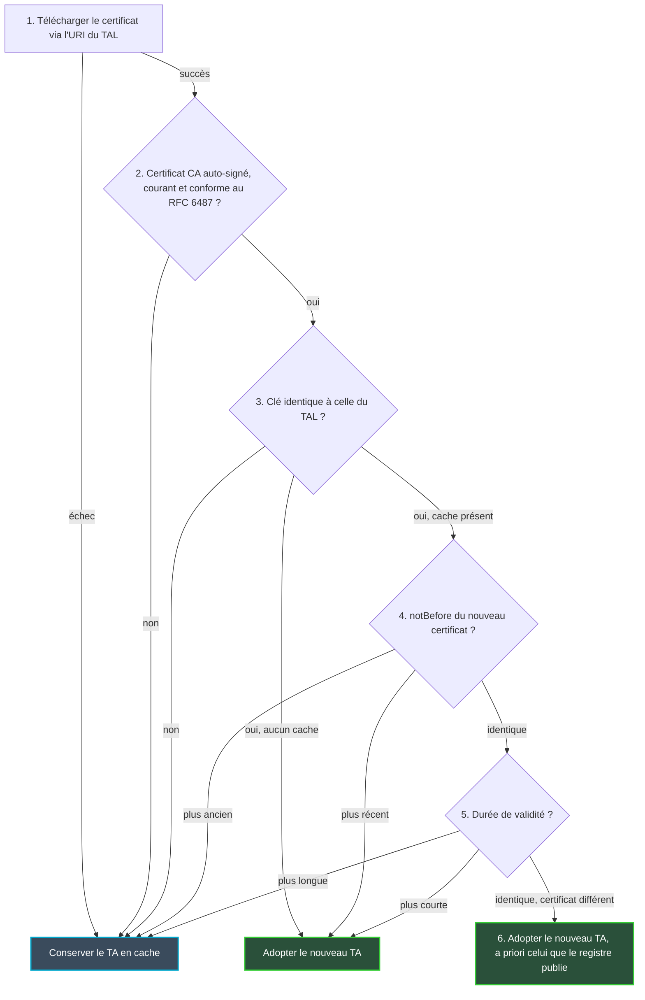
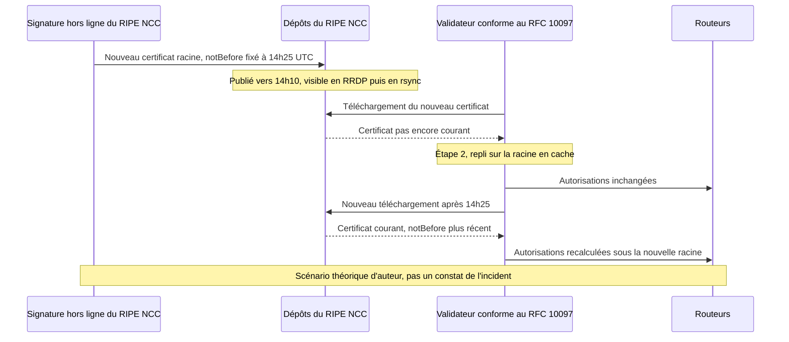

## Un quart d'heure d'avance

Mercredi 18 novembre, un peu après 14 heures en temps universel, une horloge réglée trop en avance a suffi à priver de leurs papiers d'identité toutes les adresses Internet certifiées par le registre européen. Ce registre, le RIPE NCC, distribue les adresses IP en Europe, au Moyen-Orient et dans une partie de l'Asie centrale. Son horloge a daté un nouveau certificat d'un quart d'heure dans le futur. Pendant une dizaine de minutes selon le statut du registre (une quinzaine d'après la chronologie de son post-mortem), les logiciels qui vérifient qu'un réseau a le droit d'annoncer une plage d'adresses ont tenu tout son arbre de certification pour invalide.

Personne n'a été piraté, aucune panne n'a été confirmée. Mais les réseaux qui filtrent leurs routes ont mécaniquement perdu, le temps de l'incident, une partie de leur protection contre le détournement de trafic.

Le même jour, l'organisme qui normalise les protocoles d'Internet publiait un nouveau standard, le RFC 10097. Son sujet : ce certificat tout en haut de la chaîne, et la manière de choisir entre deux versions concurrentes. La date est une coïncidence. Le sujet, lui, est exactement le même.

Qui est concerné ? Tous ceux qui annoncent leurs adresses sur Internet ou filtrent celles des autres : fournisseurs d'accès, hébergeurs, opérateurs B2B aux centaines de sites raccordés, grands comptes dotés de leur propre réseau. Pourquoi maintenant ? Parce que le RFC transforme la pratique de quelques logiciels en obligation pour tous, et parce que les certificats racine raccourcissent : celui du RIPE NCC, relevé ce matin, expire dans trois mois. Ma thèse : ce standard est une assurance bon marché, mais il ne se configure pas. Il s'audite.

## Cinq notaires, et aucun moyen de les désavouer

### Le cadastre signé d'Internet

Le routage entre opérateurs repose sur BGP (Border Gateway Protocol), un protocole qui fonctionne largement à la confiance. Quand un réseau annonce « ces adresses sont chez moi », ses voisins le croient et relaient. Une annonce erronée ou malveillante peut ainsi aspirer le trafic destiné à quelqu'un d'autre.

La RPKI (Resource Public Key Infrastructure) corrige cette naïveté. Pensez-la comme un cadastre signé : pour chaque bloc d'adresses, le titulaire publie une autorisation, un ROA (Route Origin Authorization), qui désigne le réseau habilité à l'annoncer. Le cadastre grossit vite : 344 209 ROA fin 2025, contre 280 692 un an plus tôt, soit 23 % de plus [20].

L'autre moitié du système s'appelle ROV (Route Origin Validation, RFC 6811). Un logiciel validateur télécharge le cadastre, vérifie les signatures et transmet aux routeurs la liste des autorisations valides. Chaque annonce reçue est alors classée valide, invalide, ou « not found » quand rien ne la couvre. Les opérateurs qui filtrent rejettent les invalides. Le mouvement gagne les grands transitaires : Sparkle (AS6762) rejette les annonces invalides depuis février 2026, et Bell Canada comme Deutsche Telekom sont cités parmi ceux qui ont suivi [19].

Tout cadastre a besoin de notaires. La RPKI en compte cinq, les registres régionaux d'adresses : AFRINIC pour l'Afrique, APNIC pour l'Asie-Pacifique, ARIN pour l'Amérique du Nord, LACNIC pour l'Amérique latine et les Caraïbes, le RIPE NCC pour l'Europe. Chacun publie un certificat racine, son ancre de confiance (trust anchor, ou TA), dont descend tout ce qu'il certifie. Si la racine tombe, l'arbre entier tombe avec elle.

Pour trouver ces racines, le validateur dispose d'un petit fichier, le TAL (Trust Anchor Locator), défini par le RFC 8630. Il contient une ou plusieurs adresses où télécharger le certificat, en rsync ou en HTTPS, et la clé publique que ce certificat doit porter [3]. Détail qui va compter : le téléchargement n'a pas besoin d'un canal authentifié, puisque la sécurité vient de la comparaison de clé. Un attaquant placé sur le chemin ne peut donc pas fabriquer de faux certificat. Le RFC 8630 admet en revanche qu'il peut empêcher le validateur d'apprendre qu'une version plus récente existe.


*Le validateur trie, le routeur applique : toute la chaîne repose sur un certificat racine que personne, au-dessus, ne peut révoquer.*

### Une racine qu'on ne peut pas révoquer

Imaginez un validateur qui redémarre. Entre lui et le serveur du registre, un équipement malveillant, ou simplement un cache réseau trop zélé, lui sert le certificat racine du RIPE NCC émis en 2017. La signature est correcte. La clé correspond au TAL. L'expiration est fixée à 2117 [8]. Sans garde-fou supplémentaire, rien ne permet de le refuser.

Où est le mal, puisque ce certificat est authentique ? Une racine n'est pas figée. Les registres la réémettent périodiquement, avec la même clé, pour ajuster sa validité, ses pointeurs vers les dépôts de données (le champ SIA, Subject Information Access), ses politiques de certification ou la liste des ressources couvertes [1]. Ces réémissions sont transparentes pour les validateurs ; changer de clé relève d'un autre mécanisme, le RFC 9691 [17]. Rejouer l'ancien certificat, c'est renvoyer le validateur dans un état du monde révolu.

Et cet ancien certificat, personne ne peut l'annuler. Dans une infrastructure à clés publiques classique, un certificat obsolète finit sur une liste de révocation (CRL, Certificate Revocation List) signée par l'autorité du dessus. Une racine n'a personne au-dessus d'elle. Aucune CRL ne la couvre [1]. Ajoutez des durées de validité pouvant aller « jusqu'à un siècle », écrit le RFC, et vous obtenez des certificats périmés dans les faits, mais valides pour l'éternité aux yeux d'un algorithme.

Le risque n'avait rien de théorique. En juin 2024, Job Snijders, l'un des développeurs de rpki-client, relevait que deux anciens certificats racine restaient valides, donc rejouables : l'un d'ARIN, expirant en octobre 2025, l'autre d'AFRINIC, expirant le 20 décembre 2026 [8]. Le second court encore pour un mois.

## Le testament le plus récent fait foi

En droit des successions, quand on retrouve plusieurs testaments authentiques écrits de la même main, c'est en principe le plus récent qui l'emporte. Personne n'a besoin d'aller « révoquer » les précédents. La date tranche. Le RFC 10097 transpose ce principe à la racine de la RPKI.

Le texte établit un ordre de préférence entre les versions d'un même certificat racine [1]. D'abord, la plus récemment émise, d'après sa date de début de validité (le champ notBefore). À date égale, celle dont la validité est la plus courte. À dates de début et de fin identiques, l'exemplaire téléchargé en dernier. Ni numéro de série, ni manifeste, ni liste de révocation n'entrent dans le calcul. Une date, une durée, une clé et la fraîcheur du téléchargement suffisent. Cet ordre s'insère dans une procédure en six étapes qui met à jour la section 3 du RFC 8630.


*La procédure du RFC 10097 : au moindre doute, le validateur garde la racine qu'il a déjà en cache.*

Le changement décisif tient en deux mots. La procédure de récupération de la racine, que le RFC 8630 formulait en SHOULD, passe en MUST [1]. Dans le vocabulaire de l'IETF (Internet Engineering Task Force), c'est la différence entre une bonne pratique et une condition de conformité.

Le RFC n'invente rien pour autant : il grave dans le marbre ce que rpki-client fait depuis sa version 9.1, en 2024 [5]. Premier brouillon le 19 juin 2024, adoption par le groupe de travail SIDROPS en novembre suivant, approbation le 22 juin 2026, publication le 18 novembre en Standards Track, au statut de Proposed Standard [2]. Il est signé par Job Snijders et deux coauteurs, l'un issu d'OpenBSD, l'autre du RIPE NCC. Le registre dont l'horloge déraillait le jour même.

Ce que le RFC ne couvre pas mérite autant d'attention. Sa section sécurité promet d'empêcher l'acceptation d'un ancien certificat lorsque le validateur dispose d'autre matériel de certificat [1]. Traduction : lorsqu'il a une mémoire. Trois angles morts en découlent, le premier relevant de ma lecture du texte :

- **Le démarrage à froid.** Sans cache, l'étape 3 commande d'adopter le certificat reçu. Un validateur neuf ou réinstallé reste donc exposé au rejeu.
- **Le gel.** Un attaquant sur le chemin peut toujours bloquer les mises à jour, comme le notait déjà le RFC 8630 [3].
- **L'adversaire omniprésent.** Le texte n'aborde pas le cas où l'attaquant contrôle tout le matériel disponible [1].

Conséquence pratique, et c'est une inférence de ma part : le cache des certificats racine devient un composant de sécurité. Un validateur en conteneur sans volume persistant perd sa mémoire du « plus récent » à chaque redémarrage. Il retombe alors dans le premier angle mort, sans que personne ne s'en aperçoive.


*Deux certificats authentiques, une seule clé : la date d'émission désigne le bon, à condition que le validateur se souvienne de l'ancien.*

## Qui applique déjà la règle ? Inventaire sans complaisance

Un standard ne vaut que par ses implémentations. Voici ce que j'ai pu établir à partir des notes de version et des dépôts publics, en séparant ce qui est documenté de ce qui ne l'est pas.

| Validateur | Documenté | Non documenté |
|---|---|---|
| rpki-client (OpenBSD) | Départage depuis la 9.1 (2024), refus programmé des racines trop longues depuis la 9.4 [5][6] ; dernière version 9.9, août 2026 | Rien de notable sur ce point |
| rpki-prover | PR #218 fusionnée le 3 septembre 2024 : repli sur le cache et « une version » du départage [4][10] | La release qui l'embarque |
| Routinator (NLnet Labs) | 0.15.1 : pas de démarrage optimiste sans racine stockée ; 0.15.3 : seule une racine valide est stockée ; dernière version 0.16.1, 9 novembre 2026 [11] | Aucune entrée de changelog sur un départage par date et durée |
| Fort (NICMx) | Vérification de l'auto-signature de la racine en 1.6.3 [13] | Aucune mention de départage ni de rejeu |
| OctoRPKI (Cloudflare) | Dépôt archivé le 9 juin 2024, migration recommandée vers rpki-client [14] | Rien à attendre |

Une absence de mention ne prouve pas une absence de comportement. Je n'affirme pas que Routinator ou Fort laissent passer un rejeu. J'affirme que je n'ai trouvé nulle part la preuve qu'ils appliquent la règle du RFC 10097. Pour un exploitant, la nuance est mince : ce qui n'est pas documenté se teste.

Routinator illustre d'ailleurs l'esprit du texte par un autre biais. Avant la version 0.15.3, un certificat racine récupéré en HTTPS pouvait entrer dans le cache sans validation, et écraser le dernier certificat connu comme bon (CVE-2026-72755, sévérité faible, score CVSS de 3,8, corrigée le 26 octobre) [12]. Autre mécanisme, même philosophie : le dernier bon certificat est un actif à protéger.

## Le revers : le plus récent gagne, même quand il se trompe

Revenons au 18 novembre, chronomètre en main. Selon le post-mortem du RIPE NCC, la machine hors ligne qui signe la racine avait une horloge en avance, faute d'une recalibration manuelle [15]. Le nouveau certificat a été publié à 14:10:02 UTC, visible dans le dépôt RRDP (la synchronisation par HTTPS) à 14:10:36, puis en rsync à 14:11:10. Sa validité ne commençait qu'à 14:25:43. Dans l'intervalle, toujours selon le registre, des validateurs ont traité tout l'arbre du RIPE NCC comme invalide, et les annonces couvertes sont retombées en « not found ». Aucune panne n'a été confirmée. Le registre annonce une revue de sa procédure de signature.

Vient ensuite une hypothèse, à prendre comme telle. L'étape 2 du RFC 10097 exige un certificat « courant », et un certificat dont la validité commence dans un quart d'heure ne l'est pas. Un validateur conforme aurait donc dû l'écarter et rester sur sa copie en cache, à condition d'en avoir une encore valide. Le post-mortem décrit pourtant des validateurs qui ont basculé. Soit certains n'appliquent pas encore ce comportement, soit le récit simplifie. Je ne sais pas lesquels ont été touchés, ni dans quelles versions, et je me garderai de le deviner.


*Lecture d'auteur : ce qu'aurait dû faire, le 18 novembre, un validateur appliquant le RFC 10097 et disposant d'une racine encore valide en cache.*

Le principe a un second revers, moins visible. Un certificat daté dans le futur est rattrapé par l'étape 2. Mais un certificat bien daté et mal rempli, avec de mauvais pointeurs ou un mauvais périmètre de ressources, sera adopté par tous les validateurs conformes. Pour ceux-là, republier l'ancien ne servira à rien : plus ancien, il perdra le départage. Seule issue, une nouvelle réémission, encore plus récente. Avec le RFC 10097, la racine ne connaît plus le rollback, seulement le roll-forward. C'est ma déduction, pas une phrase du RFC. Mais elle déplace le risque du réseau vers la salle des clés des registres.

Ce glissement pèse d'autant plus que les réémissions se multiplient. En décembre 2024, Job Snijders a proposé sur la liste SIDROPS une feuille de route en trois temps : le départage, le refus programmé des racines à très longue durée de vie, puis leur réémission par les registres [7]. Le calendrier prévoit de refuser les racines de plus de quinze ans après le 2 février 2026, puis celles de plus de trois ans à partir du 3 mars 2027. rpki-client l'a intégré dès sa version 9.4, en le présentant comme un renfort contre le rejeu [6][9]. Voici l'état des racines relevé ce 19 novembre au matin [21].

| Registre | Début de validité | Fin de validité | Durée |
|---|---|---|---|
| RIPE NCC | 18 nov. 2026 | 18 févr. 2027 | environ 3 mois |
| APNIC | 26 févr. 2026 | 26 févr. 2028 | 2 ans |
| ARIN | 25 août 2026 | 27 nov. 2028 | environ 2 ans et 3 mois |
| AFRINIC | 30 mars 2020 | 28 mars 2030 | 10 ans |
| LACNIC | non mesuré | non mesuré | non mesuré |

*Relevé par téléchargement direct des certificats et lecture avec openssl. Pour LACNIC, l'adresse testée a renvoyé une page web au lieu d'un certificat.*

Trois constats. D'abord, le RIPE NCC tourne désormais sur une racine de trois mois, et je n'ai trouvé aucune explication publique à ce choix. Ensuite, des réémissions plus fréquentes multiplient les occasions d'erreur de procédure : à mon sens, le départage devient le filet de chacune d'elles. Le registre avait d'ailleurs déjà connu un accroc le 7 janvier, quand une opération de base de données avait vidé ses dépôts pendant environ neuf minutes [16]. Enfin, la racine d'AFRINIC affiche toujours dix ans de validité. Comment rpki-client la traitera-t-il le 3 mars 2027 ? Tout dépend du critère exact implémenté, durée totale ou échéance. Je ne l'ai pas vérifié dans le code et je n'ai consulté aucune communication d'AFRINIC à ce sujet. À surveiller si vous tournez sous rpki-client.

## Lundi matin : la liste de contrôle


*Une chute brutale du nombre d'autorisations validées, puis le retour à la normale : le genre de courbe qu'il faut savoir lire en quelques minutes.*

Le RFC 10097 n'ajoute aucune option à activer. Il se vérifie. Voici ce que je ferais lundi matin ; les points sourcés renvoient aux références, les autres relèvent de la pratique d'exploitation.

1. **Inventorier.** Quel validateur, quelle version, quels TAL, sur quelle infrastructure ? Sur un parc hérité, la réponse surprend souvent.
2. **rpki-client** : 9.1 minimum pour le départage, 9.4 ou plus pour le refus des racines trop longues, et le 3 mars 2027 dans l'agenda [5][6].
3. **Routinator** : 0.15.3 minimum, pour ne plus écraser le dernier bon certificat [11]. Ne présumez pas du départage RFC 10097 : testez-le, ou interrogez NLnet Labs.
4. **Fort** : rien de documenté sur le sujet [13], donc test en laboratoire ou question aux mainteneurs. **OctoRPKI** : migrez, le projet est archivé [14].
5. **Persister le cache.** Un volume persistant sous Docker ou Kubernetes pour le répertoire des racines. Un validateur amnésique perd la protection du RFC à chaque redémarrage.
6. **Surveiller ce qui compte** : l'expiration des cinq racines, tout changement de date d'émission, une chute brutale du nombre de VRP (Validated ROA Payloads, les autorisations transmises aux routeurs), la durée pendant laquelle une racine est jugée invalide.
7. **Garder le fail-open.** Ne rejetez pas les « not found ». Selon ma lecture, c'est ce qui explique qu'aucune panne n'ait été confirmée le 18 novembre : un réseau qui ne filtre que les invalides a perdu sa protection une dizaine de minutes, pas sa connectivité. Un réseau qui rejetterait tout ce qui n'est pas valide aurait perdu l'essentiel des routes de la région.
8. **Tester le rejeu en laboratoire.** Servez à un validateur de test le certificat courant via un TAL local (même clé, adresse locale), puis remplacez-le par une version plus ancienne : il doit conserver la plus récente.
9. **Lire les post-mortems** des registres et suivre la liste SIDROPS.

Pour le point 6, trois commandes suffisent à relever les dates d'une racine à partir de son TAL :

```bash
# Repérer l'URI HTTPS déclarée dans le TAL
grep '^https://' /chemin/vers/ripe-ncc.tal

# Télécharger le certificat racine (format DER) et lire ses dates
curl -sS -o ta.cer "URI_HTTPS_DU_TAL"
openssl x509 -inform DER -in ta.cer -noout -serial -dates
```

## Une assurance bon marché, pas un oreiller

Je tiens le RFC 10097 pour un bon texte. Court, déterministe, sans dépendance nouvelle, il ferme une porte que chacun savait entrouverte et codifie ce qu'un validateur majeur pratiquait déjà. C'est ce qu'on attend d'un standard : transformer la bonne idée d'un implémenteur en obligation pour tous.

Mais il faut savoir ce qu'il achète. Il protège un validateur qui a de la mémoire contre un attaquant qui ne contrôle pas tout. Il ne protège ni le validateur amnésique, ni l'exploitant qui ignore la version qu'il fait tourner, ni personne contre une erreur de registre. Le risque glisse vers deux endroits très terre à terre : la salle des clés des cinq registres, et le cahier d'exploitation de chaque opérateur.

Côté registres, j'aimerais que les cinq annoncent à l'avance leurs réémissions de racine, avec une fenêtre et un canal d'alerte dédié. Avec des racines de trois mois, ce n'est plus un luxe. La même équipe d'auteurs prépare d'ailleurs la suite : un brouillon qui permet à chaque validateur de restreindre localement les ressources qu'une racine a le droit de signer [18].

Côté opérateurs, la ligne est simple. Dans la RPKI, la racine ne se révoque pas, elle se remplace. Le RFC 10097 garantit qu'on ne revient plus en arrière. À vous de savoir, à la minute près, quand elle avance.

_Vues personnelles, pas position Wifirst._

## Sources

1. RFC 10097, « Tiebreaking RPKI Trust Anchors », Standards Track, publié le 18 novembre 2026 — https://www.rfc-editor.org/rfc/rfc10097.txt
2. IETF Datatracker, draft-ietf-sidrops-rpki-ta-tiebreaker, statut et historique (18 novembre 2026) — https://datatracker.ietf.org/doc/draft-ietf-sidrops-rpki-ta-tiebreaker/ et https://datatracker.ietf.org/doc/draft-ietf-sidrops-rpki-ta-tiebreaker/history/
3. RFC 8630, Resource Public Key Infrastructure (RPKI) Trust Anchor Locator, août 2019 — https://www.rfc-editor.org/rfc/rfc8630.html
4. draft-ietf-sidrops-rpki-ta-tiebreaker-06, annexe « Implementation status », juin 2026 — https://www.ietf.org/archive/id/draft-ietf-sidrops-rpki-ta-tiebreaker-06.txt
5. Notes de version rpki-client 9.1 (2024) — https://ftp.fr.openbsd.org/pub/OpenBSD/rpki-client/rpki-client-9.1.txt
6. Notes de version rpki-client 9.4 — https://ftp.fau.de/openbsd/rpki-client/rpki-client-9.4.txt
7. Job Snijders, feuille de route pour des trust anchors à durée de vie courte, liste SIDROPS, 18 décembre 2024 — https://mailarchive.ietf.org/arch/msg/sidrops/-Y5NfXnGfDbeGOCAFj5xHgU90Zo/
8. Job Snijders, état des trust anchors des registres, liste SIDROPS, 24 juin 2024 — https://mailarchive.ietf.org/arch/msg/sidrops/NxzvSFH0sPXEmyfOS99cLApFKqM
9. Commit OpenBSD planifiant le refus des trust anchors à longue durée de vie, 18 décembre 2024 — https://go.mail-archive.com/source-changes@openbsd.org/msg152192.html
10. rpki-prover, PR #218, fusionnée le 3 septembre 2024 — https://github.com/lolepezy/rpki-prover/pull/218
11. Routinator, Changelog (0.16.1 du 9 novembre 2026) — https://raw.githubusercontent.com/NLnetLabs/routinator/main/Changelog.md
12. CVE-2026-72755, OpenCVE et avis NLnet Labs, 26 octobre 2026 — https://app.opencve.io/cve/CVE-2026-72755 et https://www.nlnetlabs.nl/downloads/routinator/CVE-2026-72755.txt
13. Fort validator, page des releases — https://github.com/NICMx/FORT-validator/releases
14. cloudflare/cfrpki (OctoRPKI), dépôt archivé le 9 juin 2024 — https://github.com/cloudflare/cfrpki
15. RIPE NCC, statut et post-mortem de l'incident du 18 novembre 2026 — https://status.ripe.net/incidents/z04tkkl8m3ws
16. RIPE NCC, incident du 7 janvier 2026 — https://status.ripe.net/incidents/q5cxm8f9s7db
17. Tom Harrison, « How RFC 9691 improves key rollover in RPKI trust anchors », APNIC Blog, 4 juillet 2025 — https://blog.apnic.net/2025/07/04/how-rfc-9691-improves-key-rollover-in-rpki-trust-anchors/
18. draft-ietf-sidrops-constraining-rpki-trust-anchors-02, 16 septembre 2026 — https://www.ietf.org/archive/id/draft-ietf-sidrops-constraining-rpki-trust-anchors-02.html
19. IPinfo, adoption de la RPKI et du ROV — https://ipinfo.io/blog/rpki-adoption-ip-data
20. Bilan RPKI 2025, APNIC Blog (20 février 2026) et liste NANOG (22 janvier 2026) — https://blog.apnic.net/2026/02/20/rpkis-2025-year-in-review/ et https://seclists.org/nanog/2026/Jan/120
21. Relevé direct des certificats racine des registres (téléchargement via les URI des TAL, lecture avec openssl x509), 19 novembre 2026
