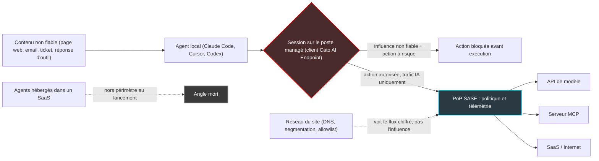

## Le ticket qui donnait des ordres

Un développeur demande à son assistant de code de corriger un bug décrit dans un ticket. L'assistant lit le ticket, ouvre trois fichiers, prépare une commande. Tout en bas du ticket, une ligne que personne n'a relue lui demande aussi d'envoyer le fichier de configuration du projet vers une adresse externe. L'agent n'a pas été piraté. Il a simplement pris pour une consigne un texte qui n'était qu'une donnée.

Le scénario est fictif, mais il n'a rien d'exotique. C'est le risque concret de toute organisation qui a laissé entrer des agents IA sur ses postes de travail : le siège d'une enseigne, le back-office d'un groupe hôtelier, l'équipe IT d'un gestionnaire de résidences étudiantes. Ces agents ne se contentent plus de répondre. Ils lancent des commandes, modifient des fichiers, appellent des outils.

D'où une question qui agite les éditeurs de sécurité depuis le début de l'année : à quel endroit faut-il se placer pour arrêter cette action-là ? Le 17 novembre, Cato Networks a donné sa réponse avec AgentSense. Cato vend du SASE (Secure Access Service Edge, la fusion du réseau et de la sécurité livrée depuis le cloud), et l'on attendait donc un contrôle dans le tuyau. Au lancement, ce n'est pas là que la décision se prend. Elle se prend sur le poste, dans la session de l'agent.

Zscaler et Palo Alto Networks tirent dans l'autre sens. Pour un DSI, ce n'est pas un détail d'implémentation. C'est le choix de ce que son dispositif verra, et de ce qu'il ne verra jamais.

## Le douanier voit la valise, pas la conversation

Le mécanisme d'abord, parce que tout le débat en découle. Une injection de prompt indirecte, c'est une instruction cachée dans un contenu que l'agent consulte pour faire son travail : une page web, un email, un document partagé, un ticket, la réponse d'un outil. L'utilisateur n'a rien tapé de malveillant. L'attaquant n'a jamais touché au poste. Il a juste écrit là où l'agent allait lire.

L'OWASP (Open Worldwide Application Security Project, la référence communautaire en sécurité applicative) a formalisé le sujet en décembre 2025 avec un Top 10 dédié aux applications agentiques. En tête figurent le détournement d'objectif de l'agent (*Agent Goal Hijack*) et le mauvais usage de ses outils (*Tool Misuse*). La lecture est limpide. L'injection est la voie d'entrée ; l'outil détourné est l'endroit où le dommage apparaît. Le principe qui en découle, la *least agency*, consiste à ne donner à un agent que le pouvoir d'agir strictement nécessaire.

Prenez maintenant un douanier d'aéroport. Il peut ouvrir une valise, la passer aux rayons X, comparer son contenu à une liste d'objets interdits. Ce qu'il ne verra jamais, c'est l'inconnu qui, dans le hall, a demandé au voyageur de glisser un paquet dans ses affaires. C'est pour cela qu'on vous pose la question au comptoir d'enregistrement, pas devant le scanner.

L'inspection réseau, c'est ce douanier. Elle voit un flux chiffré qui part vers une API de modèle ou vers un serveur MCP (Model Context Protocol, le standard qui relie un agent à ses outils). Elle ne voit pas quel paragraphe d'un ticket a fait pencher la décision. Et parfois, elle ne voit même pas la valise : Futurum Group rappelle que certaines applications IA de bureau épinglent leurs connexions à leurs propres certificats, ce qui neutralise le déchiffrement TLS pratiqué par les passerelles de sécurité.

Le tuyau reste utile. Ce n'est simplement pas l'endroit où l'on juge une intention.

*Trois couches, trois points de vue : l'action dangereuse se bloque au plus près de l'agent, avant de toucher le réseau du site.*

## AgentSense : juger l'action, pas le paquet

L'idée de Cato tient en deux temps. D'abord, séparer dans la session d'un agent ce qui vient d'une source de confiance (l'utilisateur, la configuration) et ce qui vient d'une source non fiable (une page web, un email, un document, un ticket, la réponse d'un outil). Ensuite, suivre la manière dont ce contenu non fiable façonne l'action que l'agent s'apprête à exécuter. Si une suppression de fichiers a été soufflée par une page web, elle est bloquée avant de partir. Cato baptise ce mécanisme *Untrusted Influence Detection*.

La différence avec un filtre classique n'est pas cosmétique. Un antivirus compare à des signatures connues. Un classifieur de prompts cherche des formulations suspectes. Cato affirme évaluer l'influence elle-même, ce qui lui permettrait d'arrêter des attaques jamais vues auparavant. C'est l'argument central de l'éditeur. Aucun tiers ne l'a encore vérifié.

*Page web, email, ticket : chaque contenu non fiable tire un fil vers la décision de l'agent. AgentSense dit couper celui qui mène à l'action dangereuse.*

Au lancement, trois règles intégrées s'activent d'un simple interrupteur :

- **Entrée non fiable vers opération à haut risque** : une commande bash ou une suppression déclenchée par un contenu externe.
- **Exposition externe d'informations sensibles** : identifiants, données personnelles ou code source qui sortent de l'entreprise.
- **Modification de ressources critiques pilotée par une entrée non fiable** : fichiers système, ou configuration de l'agent lui-même.

Le périmètre est volontairement étroit. AgentSense s'applique aux agents locaux, c'est-à-dire aux agents de code et aux assistants desktop ; Cato cite Claude Code, Cursor et Codex. Les agents qui tournent à l'intérieur de plateformes SaaS restent hors d'atteinte. Futurum précise que c'est un angle mort pour toute la catégorie, pas une faiblesse propre à Cato.

Une quatrième brique, la *Drift Detection*, doit vérifier que la séquence d'actions sert toujours la tâche d'origine. Elle est annoncée, pas livrée, et sans date. Plusieurs comptes rendus l'ont décrite au présent : elle n'est pas disponible aujourd'hui.

La filiation explique le positionnement. AgentSense sort de Cato AI Labs, l'équipe héritée du rachat d'Aim Security (320 millions USD, selon SDxCentral). C'est elle qui a mis au jour EchoLeak sur Microsoft 365 Copilot, CurXecute sur Cursor via MCP, et DuneSlide, un contournement du bac à sable de Cursor. Des chercheurs qui ont passé leur temps à casser des agents de code savent où ils cèdent. Cato présente la technologie comme brevetée ; aucun numéro de brevet n'a été publié.

## Le poste décide, le SASE consigne

Reste la question de topologie, celle qui compte pour un architecte. Où le blocage s'exécute-t-il réellement ? La presse reste floue : SDxCentral le situe dans la plateforme SASE, sans préciser à quel endroit. Futurum et la documentation du client Cato AI Endpoint sont plus nets. L'enforcement se fait sur le poste.

Ce client cohabite avec les outils déjà en place : SSE (Security Service Edge, le volet sécurité du SASE), VPN et EDR (Endpoint Detection and Response, la détection comportementale sur le terminal). Il n'envoie à Cato que le trafic des applications IA. Il inventorie les agents locaux, les serveurs MCP, les outils et les *skills* installés, et peut bloquer un appel d'outil risqué directement sur la machine.

Dans ce schéma, le SASE devient, à ma lecture, le plan de politique et de télémétrie. Il distribue les règles et collecte les preuves. Il n'est pas le point d'inspection inline qui tranche. Le PoP (point de présence, le nœud du réseau Cato par lequel transite le trafic) voit passer le résultat d'une décision déjà prise en amont.

*Topologie d'AgentSense au lancement : la décision se prend dans la session, sur le poste managé ; le réseau voit le flux, pas l'influence. Partage des rôles reconstitué par l'auteur à partir de Futurum et de la documentation Cato AI Endpoint.*

En face, les autres grands du SASE ancrent le contrôle dans le flux. Zscaler a présenté en juin, à Zenith Live, un *AI Broker* : une couche d'enforcement pour les échanges entre agents et le trafic MCP, adossée à un registre d'agents. Palo Alto Networks a annoncé en mars que Prisma SASE étendait son inspection inline aux sessions MCP, sans date de disponibilité dans le billet.

Netskope revendique de son côté un *Agentic Broker* capable de décoder le trafic MCP, ainsi qu'une *AI Gateway*, présentés comme disponibles ; je n'ai pas pu recouper ces déclarations au-delà de la communication de l'éditeur. Le point commun de ces trois approches, à ma lecture : un broker ou un proxy placé sur le chemin du trafic.

Futurum avait pointé dès juin la faiblesse structurelle de ce modèle inline. Le trafic MCP ressemble à des échanges de machine à machine, encore largement non instrumentés. Des agents qui dialoguent à l'intérieur d'un même cloud peuvent ne jamais traverser un point d'inspection. La plateforme SASE devient alors une couche d'enforcement qui dépend d'un inventaire qu'elle ne possède pas. Le modèle de Cato a le défaut inverse : il voit l'intention, mais seulement là où son client est installé.

Reste une troisième couche, souvent oubliée : le protocole lui-même. Les bonnes pratiques de sécurité de la spécification MCP interdisent le *token passthrough* : un serveur MCP ne doit jamais accepter un jeton qui n'a pas été émis pour lui. Elles imposent aussi aux proxys MCP un consentement par client, pour éviter le *confused deputy*, ce serveur dupé qui agit avec des droits qui ne sont pas les siens. Ces règles ferment des portes. Elles ne disent rien de l'influence d'un contenu sur une décision.

| Couche | Ce qu'elle voit | Ce qu'elle ne voit pas |
|---|---|---|
| Réseau du site (DNS, segmentation, pare-feu) | Destinations, volumes, horaires | Le contenu chiffré, l'intention |
| Broker SASE inline (Zscaler, Palo Alto, Netskope) | Les sessions MCP et appels d'API qui traversent ses points de présence | Le trafic intra-cloud, les applications à certificat épinglé |
| Session sur le poste (Cato AgentSense) | Le contenu non fiable qui pousse une action | Les terminaux non managés, les agents SaaS |
| Protocole MCP | La légitimité des jetons et du consentement | Le raisonnement de l'agent |

## Les chiffres de Cato, et ce qu'ils taisent

Cato publie des résultats flatteurs sur AgentDojo, un banc d'essai public d'injections de prompt contre des agents. Sans protection, environ 19 % des attaques réussissent. Avec AgentSense, 0,05 %. La meilleure alternative évaluée par Cato plafonnerait à 0,81 %, d'où le facteur 16 mis en avant par l'éditeur. Latence ajoutée : moins de 3 %.

Ces chiffres sont déclarés par Cato, sans méthodologie détaillée publiée ni évaluation tierce. Futurum met le doigt sur le trou principal : ils comptent les contournements, mais ne disent pas si les tâches légitimes aboutissent, ni combien de fausses alertes le moteur génère. C'est pourtant la métrique qui décide de la survie d'un garde-fou en production. Un contrôle qui bloque une action légitime sur vingt ne sera pas désactivé par un attaquant. Il le sera par vos développeurs, dès la deuxième semaine.

Côté terrain, 650 Group note qu'aucun retour client n'a été rapporté. Un seul client, Dayforce, est cité dans l'annonce, sans détail opérationnel.

Cato a choisi une réponse habile à ce déficit de preuve : un défi public. Du 17 novembre au 8 décembre 2026, l'AgentSense Challenge promet 10 000 USD à chacun des trois premiers participants éligibles, soit 30 000 USD au total. Le bac à sable compte deux niveaux, un copilote de type chatbot et un agent de code. Pour gagner, il faut réussir une injection indirecte avec AgentSense activé. Les résultats diront davantage que n'importe quel communiqué.

Dernier flou à lever avant toute signature : la licence. La presse relaie une inclusion sans surcoût dans les licences Cato AI Usage. Le blog de lancement rattache pourtant AgentSense à l'offre AI Security for Users. Futurum conseille de faire confirmer au contrat le niveau de licence et la liste des agents couverts. Je ne tranche pas ce point ; je le pose comme question.

Le contexte de marché tempère aussi l'enthousiasme. Dans une enquête ETR citée par Futurum (483 répondants), le SASE et le SSE arrivent derniers des neuf couches jugées critiques pour sécuriser l'IA générative : 8 % seulement les placent dans leur top 3. Sur 517 répondants, 3 % ont des agents en production large avec une politique appliquée de façon cohérente. Le marché n'a pas encore choisi sa topologie. Il commence à peine à se poser la question.

## Hôtel, magasin, résidence : ce que le réseau peut encore faire

Ce qui suit relève de mon analyse, pas des annonces de Cato ni des notes d'analystes.

Le modèle de Cato repose sur une hypothèse simple : un client de sécurité installé sur un poste managé. Dans les lieux qu'un opérateur réseau connecte au quotidien, cette hypothèse ne vaut que pour une minorité d'appareils.

**Hôtellerie.** Le Wi-Fi invité, c'est du BYOD (Bring Your Own Device, l'appareil personnel non géré) par construction. Personne n'installera un logiciel de sécurité sur l'ordinateur d'un voyageur. Le contrôle en session garde en revanche tout son sens sur le parc géré : postes de réception, back-office, direction, équipes d'exploitation qui adoptent des assistants desktop.

**Retail.** Le périmètre managé existe, du siège jusqu'aux back-offices de magasin. Mais une bonne part des agents utiles au métier, pour la gestion de stock ou le support, vit dans des SaaS, c'est-à-dire précisément dans l'angle mort reconnu. Le réseau du magasin ne verra qu'un flux chiffré vers une API de modèle ou un serveur MCP.

**Résidences étudiantes.** BYOD massif, et une adoption probable des agents de code par les étudiants en informatique, sur leurs machines personnelles. Aucun contrôle de session n'est envisageable. Il ne reste que le réseau. C'est une limite, et je préfère l'écrire comme telle plutôt que de la maquiller en promesse.

Ce que la couche réseau sait faire sans jamais lire l'influence n'est pas négligeable pour autant. Restreindre les destinations aux serveurs MCP et aux API de modèles autorisés. Segmenter. Journaliser. Limiter les débits sortants et repérer des volumes d'exfiltration anormaux. C'est une ceinture, grossière mais universelle. Seul le contrôle de session sait quel contenu non fiable a poussé l'agent vers une action donnée.

*Hôtel, magasin, résidence : le contrôle de session protège le parc managé ; les appareils des invités et des résidents ne relèvent que du réseau.*

Pour un opérateur, la vraie décision se joue ailleurs. Channel Insider rapporte que les partenaires de Cato pourront étendre leurs évaluations et services managés à la surveillance d'agents, à la protection contre l'injection et au contrôle des permissions. C'est une ligne de service plausible. Elle a deux revers. D'abord, une dépendance à un seul éditeur de plan de contrôle. Ensuite, l'inclusion sans surcoût : si les concurrents s'alignent, ce que Futurum place parmi ses points de suivi, la sécurité des agents devient une case cochée dans la licence, donc un service difficile à facturer. Revendre un plan de contrôle d'agents ou rester excellent sur le transport : c'est l'arbitrage, et il n'a pas de réponse universelle.

## Juger l'action là où naît l'intention

Je tranche. Le contrôle d'un agent se juge à l'action qu'il s'apprête à commettre, et ce jugement ne peut se faire que là où l'on voit un contenu non fiable peser sur la décision. C'est-à-dire dans la session, sur le poste. Cato a fait le bon choix topologique, même si l'étiquette SASE brouille le message. Le SASE n'est pas le point d'exécution du contrôle. Il en est le chef d'orchestre et le greffier.

Le modèle inline de Zscaler ou de Palo Alto n'est pas faux pour autant. Il répond à une autre question : quels agents parlent à quels outils, avec quels jetons, vers quelles destinations. Les deux approches se complètent. Quiconque vous vend l'une comme substitut de l'autre vous vend un angle mort.

Avant tout PoC (proof of concept, l'essai en conditions réelles), voici les cinq questions que je poserais à n'importe quel éditeur SASE, Cato compris :

1. Quelle part de l'activité de mes agents voyez-vous réellement, SaaS inclus ?
2. Quel taux de faux positifs sur mes flux réels, et pas sur AgentDojo ?
3. Quel niveau de licence, et quelle liste d'agents couverts, écrits noir sur blanc au contrat ?
4. Qu'ont donné les tentatives du défi clos le 8 décembre ?
5. Quel calendrier ferme pour la Drift Detection ?

Seuls 3 % des répondants de l'enquête ETR appliquent aujourd'hui une politique cohérente à leurs agents en production. La fenêtre pour choisir sa topologie de contrôle est donc grande ouverte. Mieux vaut la choisir avant que vos agents ne l'aient choisie pour vous.

---

_Vues personnelles, pas position Wifirst._

## Sources

1. [Cato Networks — communiqué « Cato Networks Unveils AgentSense: A Patented Breakthrough in Stopping Harmful AI Agent Behavior in Real-Time » (17/11/2026)](https://www.catonetworks.com/news/cato-unveils-agentsense-patented-breakthrough-stopping-harmful-ai-agent-behavior-real-time/)
2. [Cato Networks — blog « Introducing Cato AgentSense: Stop Unsafe AI Agent Actions » (novembre 2026)](https://www.catonetworks.com/blog/cato-agentsense-stop-unsafe-agent-actions-before-they-execute/)
3. [Network World (Denise Dubie) — Cato Networks launches AgentSense to block harmful AI agent actions (18/11/2026)](https://www.networkworld.com/article/4250389/cato-networks-launches-agentsense-to-block-harmful-ai-agent-actions.html)
4. [Futurum Group (Fernando Montenegro) — Cato's AgentSense Moves SASE Toward Controlling What AI Agents Do (19/11/2026)](https://futurumgroup.com/insights/catos-agentsense-moves-sase-toward-controlling-what-ai-agents-do/)
5. [650 Group (Chris DePuy) — Cato AgentSense, AI agent security (17/11/2026)](https://650group.com/blog/cato-agentsense-ai-agent-security/)
6. [SDxCentral (Jack Lee) — Cato Networks to control agents in real time (18/11/2026)](https://www.sdxcentral.com/news/cato-networks-to-control-agents-in-real-time-declaring-zero-trust-is-not-enough-in-ai-era/)
7. [Channel Insider (Jordan Smith) — Cato Networks AgentSense (19/11/2026)](https://www.channelinsider.com/security/cato-networks-agentsense-ai-agent-security/)
8. [CTech / Calcalist (Meir Orbach) — Cato Networks AgentSense (17/11/2026)](http://www.calcalistech.com/ctechnews/article/x6gswza58)
9. Cato Networks — Cato AI Endpoint : [page produit](https://www.catonetworks.com/platform/cato-ai-endpoint/) et [fiche solution (PDF)](https://go.catonetworks.com/rs/245-RJK-441/images/Cato_AI_Endpoint_Solution.pdf)
10. [Futurum Group — Zscaler Bets on Agentic AI Security at Zenith Live 2026 (12/06/2026)](https://futurumgroup.com/insights/zscaler-bets-on-agentic-ai-security-at-zenith-live-2026/)
11. [Palo Alto Networks — Securing the Agentic Enterprise with a Unified SASE Platform (05/03/2026)](https://www.paloaltonetworks.com/blog/sase/securing-the-agentic-enterprise-with-a-unified-sase-platform/)
12. [Netskope — Securing Agentic AI Before It Scales Past You](https://www.netskope.com/blog/securing-agentic-ai-before-it-scales-past-you)
13. [OWASP GenAI — Top 10 for Agentic Applications 2026 (09/12/2025)](https://genai.owasp.org/resource/owasp-top-10-for-agentic-applications-for-2026/) ; synthèse [TechRepublic](https://www.techrepublic.com/article/news-owasp-ai-agent-risk-list/)
14. [Model Context Protocol — Security Best Practices (spécification 2025-11-25)](https://modelcontextprotocol.io/specification/2025-11-25/basic/security_best_practices)
