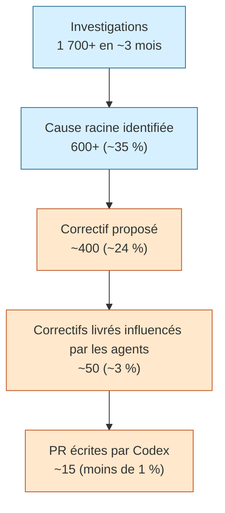
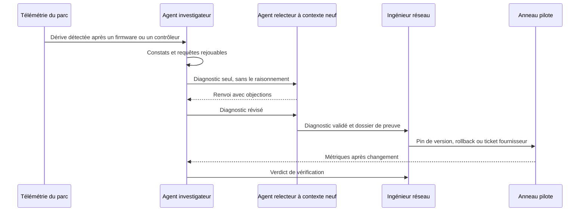

## Le chiffre qui manque à toutes les démos d'agents

Quinze. C'est à peu près le nombre de correctifs livrés dont le code a été écrit par un agent d'IA, en un peu plus de trois mois, dans le dispositif qu'OpenAI utilise pour garder ChatGPT rapide. Quinze, pour plus de 1 700 enquêtes ouvertes sur des ralentissements. Ce n'est pas un échec. C'est une photographie honnête de l'état réel de l'automatisation des opérations, loin des démonstrations sur scène.

Le dispositif s'appelle Performance Factory. [VentureBeat l'a révélé le 19 novembre](https://venturebeat.com/orchestration/exclusive-openai-reveals-performance-factory-a-codex-powered-software-optimization-system-that-keeps-chatgpt-fast), en exclusivité et avec l'accès d'OpenAI. Tous les volumes cités ici sont donc des chiffres selon VentureBeat, qui relaie OpenAI : aucune mesure indépendante ne les confirme à ce jour.

Pourquoi s'y attarder ? Parce que chaque DSI, chaque directeur d'exploitation, chaque opérateur qui gère des milliers de sites (hôtels, enseignes, résidences étudiantes) entend en ce moment la même promesse : des agents qui détectent, diagnostiquent et réparent seuls. Or OpenAI possède son code, ses serveurs, ses modèles et son propre agent de programmation, Codex. Si quelqu'un devait boucler la boucle complète, c'était lui. Il publie pourtant un entonnoir où le diagnostic passe à l'échelle, et la réparation beaucoup moins.

Ma lecture tient en une phrase. Le modèle à copier n'est pas l'agent autonome : c'est la contre-expertise systématique, suivie d'un humain qui garde la main sur le déploiement.

## Une usine à enquêtes, pas un génie en boîte

Le nom est bien choisi. Performance Factory n'est pas un agent unique lâché dans la production : c'est une chaîne de montage. Chaque régression de performance devient une tâche qui avance le long d'un workflow prédéfini, en six postes : alerte, investigation, cause racine, modification de code, revue, vérification. L'agent ne saute pas d'étape.

Sous le capot, selon VentureBeat, qui relaie OpenAI, quatre briques suffisent. Un service de tâches tient l'état de chaque enquête. Une boucle de répartition distribue le travail aux agents. Une API interne exécute Codex dans le cloud, avec des permissions maîtrisées et des actions tracées. Enfin, des abonnements à des événements externes permettent de suspendre une tâche, par exemple jusqu'à ce qu'un ingénieur réponde sur une proposition de modification de code (une pull request, ou PR).

Le détail le plus malin est ailleurs. Les fiches de tâches ne stockent pas la télémétrie brute, mais des constats, les requêtes qui ont permis de les établir et les métriques retenues. Un agent qui reprend l'enquête peut donc rejouer les requêtes au lieu de croire son prédécesseur sur parole. C'est la différence entre un procès-verbal et un carton d'archives. Le premier se vérifie. Le second s'empile.

L'outillage suit la même logique. VentureBeat, qui relaie OpenAI, compte plus de 30 outils spécialisés, ainsi qu'une compétence Codex baptisée `perf-forensics` (la « médecine légale » de la performance) qui encode les procédures d'investigation. Le savoir-faire des ingénieurs performance est écrit, versionné, rejouable. Il ne dépend pas de l'humeur du modèle.

Dernier étage, celui qu'on oublie toujours : l'agent qui surveille les agents. Chaque jour, un agent lit les journaux des autres pour repérer les échecs récurrents d'outils ou de permissions. OpenAI rejoue aussi le système sur des incidents passés (des backtests) et évalue séparément la lisibilité des synthèses pour un humain. Un diagnostic juste mais illisible ne sert à rien à 3 heures du matin.

Le terrain de jeu, lui, avait été décrit dès août par Martin Spier, responsable de la performance de ChatGPT, lors de la conférence QCon AI de Boston ([retranscrite par InfoQ](https://www.infoq.com/presentations/openai-performance-engineering-agentic-coding), [résumée par ZenML](https://www.zenml.io/llmops-database/scaling-performance-engineering-for-chatgpt-at-hyperscale)). L'essentiel des problèmes se joue en processeur, mémoire et entrées-sorties autour de l'inférence : récupération des données, sérialisation, découpage du texte en tokens, assemblage du contexte envoyé au modèle. De la plomberie, donc. Précisément le terrain où un agent bien outillé a ses chances.

## L'entonnoir : le légiste est prêt, le chirurgien pas encore

Voici les volumes, toujours selon VentureBeat, qui relaie OpenAI. Plus de 1 700 investigations en un peu plus de trois mois, soit de l'ordre de 17 par jour d'après mon calcul. Une cause racine identifiée dans plus de 600 cas. Environ 400 enquêtes menées jusqu'à un correctif proposé. Environ 50 correctifs livrés influencés par les agents, ou concordant avec leurs suggestions. Et parmi eux, une quinzaine de PR écrites par Codex.

OpenAI ne publie aucun pourcentage. Ceux du schéma ci-dessous sont les miens, rapportés à la base de 1 700 investigations : des ordres de grandeur, pas des statistiques officielles.

*Volumes selon VentureBeat, qui relaie OpenAI. Pourcentages calculés par l'auteur sur la base de 1 700 investigations, à lire comme des ordres de grandeur. En bleu, le diagnostic ; en orange, la remédiation, où l'humain reprend la main.*

Lecture rapide : environ un tiers des enquêtes aboutit à une cause racine, un quart environ à un correctif proposé, autour de 3 % à un correctif livré influencé par un agent, et moins de 1 % à du code écrit par Codex. Rapporté aux seuls correctifs livrés, Codex en signe à peu près 30 %. Rapporté aux correctifs proposés, environ 4 %. Toujours mes calculs, toujours des ordres de grandeur.

Deux précautions de lecture. D'abord, ce n'est pas une cohorte suivie de bout en bout : des enquêtes sont encore ouvertes, certaines régressions se règlent par un changement de configuration ou un retour arrière (rollback) sans toucher au code, d'autres n'appellent aucun correctif. Ensuite, la notion de correctif « influencé » reste floue. Elle mêle ce que l'agent a produit et ce qu'un ingénieur a fait en suivant sa piste.

Ces réserves posées, la forme de l'entonnoir parle d'elle-même, et OpenAI ne la maquille pas. Selon VentureBeat, l'entreprise juge ses résultats de remédiation automatique en deçà de ses ambitions (« short of its ambitions »). Codex s'en sort quand la cause est nette et le correctif contenu, par exemple une sérialisation redondante à supprimer. Dès que la réparation touche l'architecture, ça coince. Certains correctifs proposés étaient trop complexes ; d'autres introduisaient des bugs, comme des données périmées servies par un cache.

L'image à garder est médicale. Codex est devenu un légiste convaincant : il examine, recoupe, rédige un rapport solide. Il n'est pas encore chirurgien. Ouvrir, décider quoi couper et assumer les complications reste un métier d'humain. OpenAI a d'ailleurs bâti une suite d'évaluation de ses workflows pour progresser sur ce point. L'écart est connu, et il se mesure.

## La contre-expertise à contexte neuf, la vraie trouvaille

Les agents d'OpenAI avaient un défaut que tout chef d'exploitation connaît chez ses juniors : ils s'arrêtaient à la première explication plausible. Un pic de latence coïncide avec un déploiement ? Coupable trouvé, dossier clos.

La parade tient en une idée. Une seconde session Codex, séparée et à contexte neuf, reçoit chaque diagnostic et le conteste : trous dans le raisonnement, explications alternatives, preuves manquantes. Elle n'a pas suivi l'enquête, donc elle n'en partage pas les œillères. C'est une contre-expertise au sens médical : le second médecin lit le dossier, pas les certitudes du premier.

Selon VentureBeat, qui relaie OpenAI, ce relecteur renvoie aujourd'hui environ 25 % des diagnostics. Au début, il en renvoyait beaucoup plus, et ces renvois ont servi à réécrire les instructions de l'enquêteur. Le même mécanisme s'applique aux correctifs proposés.

*Deux salles, deux contextes : l'enquêteur produit un diagnostic, le relecteur repart d'une page blanche pour le contester.*

C'est, à mon sens, la meilleure idée du dispositif et la plus facile à copier. Elle a pourtant trois limites qu'il faut regarder en face.

La première : le relecteur est le même modèle. Le contexte neuf retire l'ancrage sur le raisonnement de l'enquêteur, pas les biais inscrits dans les poids. Deux experts sortis de la même école se trompent souvent de la même façon, et des [travaux de 2025 sur les erreurs corrélées entre grands modèles de langage](https://arxiv.org/pdf/2506.07962) explorent précisément ce phénomène.

La deuxième : 25 % de renvois mesure un désaccord, pas une justesse. Aucun taux de faux positifs ou de faux négatifs n'est publié, ni la précision des diagnostics, ni le gain de latence obtenu. On sait combien de fois les deux agents se contredisent. On ignore combien de fois ils tombent d'accord sur une erreur.

La troisième : la recherche reste mince. Un [preprint mono-auteur sur la relecture à contexte croisé](https://arxiv.org/abs/2603.12123) mesurait un score F1 (qui combine précision et rappel) de 28,6 % pour une relecture en session neuve, contre 21,7 % pour une seconde relecture dans la même session. Mais dans sa version révisée du 1er octobre, l'avantage sur une relecture unique dans la session (27,1 %) ou sur un sous-agent (23,8 %) n'est plus significatif. Sur une tâche différente, de surcroît. Un indice, pas une preuve.

Ma recommandation : copiez le pattern, mais durcissez-le. Quand c'est possible, confiez la relecture à un modèle d'une autre famille. Et mesurez la justesse, pas seulement le volume de renvois.

Reste le garde-fou le plus important : l'humain. Chez OpenAI, les ingénieurs relisent et fusionnent tous les correctifs, puis un autre agent vérifie après déploiement que le problème a disparu. En août, Martin Spier citait une règle de cinq relecteurs humains par PR ouverte par l'IA, en précisant qu'il ne fallait pas ajouter de friction qui annule les gains de vitesse. OpenAI explore l'idée de déployer sans approbation certains correctifs à faible risque. C'est une direction, pas une réalité : Spier expliquait alors qu'il faut beaucoup de bonnes pratiques en place avant de faire confiance à un agent pour déployer en production sans supervision, et qu'on peut déjà aller presque au bout du chemin sans cela.

## Chez un opérateur Wi-Fi, le correctif s'appelle rarement une PR

Transposons. Les régressions d'un opérateur réseau ont la même forme que celles de ChatGPT : un changement poussé à grande échelle, puis une dérive qui s'installe. Une nouvelle version de firmware sur les bornes ou les switches. Une mise à jour du contrôleur. Un réajustement automatique des canaux par le RRM (Radio Resource Management, la fonction qui répartit canaux et puissances entre bornes). Ou une configuration propagée sur des centaines de sites en une nuit.

Le signal aussi se ressemble. Pas de latence d'API ici, mais des clients qui décrochent plus souvent, une itinérance (roaming) qui se dégrade d'une borne à l'autre, des temps de réponse DHCP, DNS ou RADIUS (le serveur qui authentifie les utilisateurs) qui s'allongent après une nouvelle version. La question reste celle d'OpenAI : qu'est-ce qui a changé entre la version d'avant et celle d'après ?

Ce qui se transpose tel quel, c'est l'ossature de l'usine :

- **des fiches d'investigation** faites de constats et de requêtes rejouables, sans télémétrie brute. Cela règle au passage volumétrie, coût et RGPD : les données personnelles des clients d'un hôtel n'ont rien à faire dans le dossier d'un agent ;
- **un workflow à étapes explicites** : alerte, hypothèse, cause, remédiation, revue, vérification ;
- **un runbook versionné** qui encode la procédure d'investigation, notre équivalent de `perf-forensics` ;
- **une contre-expertise systématique** avant qu'un humain lise le diagnostic ;
- **un agent de contrôle** qui traque les échecs d'outils et de permissions des autres agents.

Ce qui ne se transpose pas, c'est la dernière marche. OpenAI possède son code et ses déploiements. Un opérateur Wi-Fi dépend des firmwares et des contrôleurs de ses fournisseurs. La remédiation n'y prend presque jamais la forme d'une PR : c'est figer une version, revenir à la précédente, ou ouvrir un ticket chez le constructeur.

Cette contrainte déplace la cible de l'automatisation. Ce qu'un agent peut industrialiser, c'est le diagnostic et surtout le dossier de preuve : comparaison avant-après, sites touchés et sites épargnés, requêtes que n'importe qui peut rejouer. Un dossier opposable au fournisseur fait gagner des jours dans une escalade. La décision, elle, reste humaine.

*Transposition chez un opérateur Wi-Fi : l'agent enquête et documente, un relecteur à contexte neuf conteste, l'ingénieur décide, l'anneau pilote confirme.*

Notez où se trouve l'humain dans ce schéma. Pas au début, là où l'agent va plus vite que lui. Au moment précis où un changement touche le parc. C'est l'inverse de ce que montrent la plupart des démos, où l'humain regarde l'agent enquêter puis le laisse appliquer sa solution.

*Figer, revenir en arrière ou escalader chez le constructeur : l'agent fournit le dossier, l'ingénieur garde la main sur l'interrupteur.*

## Sans anneau pilote, l'agent explique n'importe quoi

Les mineurs descendaient un canari dans la galerie : s'il cessait de chanter, tout le monde remontait. Le déploiement « canary » applique la même idée au logiciel. C'est le socle sans lequel tout ce qui précède s'effondre.

Les prérequis listés par Martin Spier forment une checklist de maturité qui dépasse largement le sujet des agents : tests et bancs d'essai fiables, observabilité sans angle mort, contrats explicites entre composants, documentation écrite, mesure continue des performances, déploiements progressifs. Et surtout des boucles de retour qui se comptent en minutes. Un signal qui arrive au bout de 12 heures n'a, selon lui, qu'une utilité limitée.

Côté opérateur, cela veut dire un parc pilote représentatif par typologie de site : un hôtel urbain dense, une résidence étudiante, un magasin, un plateau de bureaux. Puis un déploiement par anneaux, du pilote vers le reste du parc. Le [Google SRE Workbook](https://sre.google/workbook/canarying-releases/), manuel de référence en fiabilité des services, décrit la mécanique. Une version partielle est comparée à un groupe de contrôle sur un petit nombre d'indicateurs de service, avec rollback ou escalade humaine en cas d'écart. Le même guide met en garde contre les simples comparaisons avant-après, faussées par les variations d'usage dans le temps (un déploiement du lundi comparé au week-end, par exemple). Un lundi de rentrée dans une résidence étudiante ne ressemble à aucun autre lundi.

Sans ce socle, l'agent devient dangereux précisément parce qu'il est convaincant. Il trouvera toujours une explication. Imaginez un hôtel dont le roaming se dégrade la semaine d'une mise à jour firmware, qui est aussi celle d'un congrès remplissant l'établissement. Le firmware est le suspect idéal. Il est peut-être innocent. Seul un groupe de contrôle permet de trancher.

L'autre piège est le correctif qui déplace le problème. Le cache périmé d'OpenAI a ses cousins chez nous : un retour à l'ancien firmware qui règle le roaming mais rouvre une faille corrigée dans la version suivante ; un réglage radio qui soulage un site et en dégrade un voisin. La vérification après changement n'est pas une formalité. C'est la moitié du travail.

*Une version fissurée, un cache périmé sous la loupe : le correctif qui règle un problème peut en ouvrir un autre deux versions plus loin.*

## Cinq chiffres à exiger avant de signer

Que vous construisiez en interne ou que vous achetiez une plateforme d'« agentic ops » à un éditeur, posez ces cinq questions. Un interlocuteur incapable d'y répondre vous vend une démo, pas un système.

1. **Quel est votre entonnoir ?** Investigations, causes racines, correctifs proposés, correctifs livrés, sur une période donnée et avec des définitions écrites. C'est exactement ce qu'OpenAI a accepté de montrer.
2. **Quel taux de diagnostics la revue renvoie-t-elle ?** Un taux proche de zéro signifie que le relecteur ne relit rien. Un taux qui ne baisse jamais, que l'enquêteur n'apprend pas.
3. **Quelle part des correctifs a régressé ?** Combien de changements recommandés par l'agent ont été annulés, ou ont ouvert un nouvel incident.
4. **Quel délai entre le changement et sa vérification ?** Des minutes, des heures, une semaine : la réponse en dit long sur la maturité de votre observabilité.
5. **Quelle part des actions s'exécute sans humain ?** Au démarrage, la seule bonne réponse est zéro.

## Mesurez l'entonnoir, pas la démo

OpenAI rend un service au marché en publiant un entonnoir plutôt qu'une vidéo. Il montre ce qui marche : un diagnostic industrialisé, adossé à des requêtes rejouables, à une procédure écrite et à une contre-expertise qui force l'agent à dépasser sa première intuition. Il montre aussi ce qui ne marche pas encore : la réparation, dès qu'elle sort du correctif simple et contenu.

Ma position est nette. Le diagnostic assisté par agents est mûr pour la production, chez nous comme ailleurs, à condition de l'encadrer comme OpenAI l'a fait. La remédiation autonome ne l'est pas. Ni chez OpenAI, qui maîtrise tout son code. Ni a fortiori chez un opérateur dont les équipements tournent sur le firmware de quelqu'un d'autre. Le déploiement sans humain viendra peut-être pour une classe étroite de changements à faible risque. On en reparlera le jour où l'on mesurera le taux de correctifs régressifs aussi bien qu'on compte les enquêtes.

Une quinzaine de PR pour 1 700 enquêtes, ce n'est pas un aveu d'échec. C'est l'un des rares chiffres honnêtes publiés sur le sujet. Exigez le même de vos fournisseurs, et de vos propres équipes.

_Vues personnelles, pas position Wifirst._

## Sources

1. OpenAI, « How OpenAI Performance Factory keeps ChatGPT fast », 19 novembre 2026 : https://openai.com/index/how-openai-performance-factory-keeps-chatgpt-fast/ (page non consultée par l'auteur : accès refusé)
2. VentureBeat (Ben Dickson), « Exclusive: OpenAI reveals Performance Factory », 19 novembre 2026 : https://venturebeat.com/orchestration/exclusive-openai-reveals-performance-factory-a-codex-powered-software-optimization-system-that-keeps-chatgpt-fast
3. InfoQ, « Keeping ChatGPT Fast as AI Development Accelerates », Martin Spier, QCon AI Boston, 8 août 2026 : https://www.infoq.com/presentations/openai-performance-engineering-agentic-coding
4. ZenML LLMOps Database, « Scaling Performance Engineering for ChatGPT at Hyperscale » : https://www.zenml.io/llmops-database/scaling-performance-engineering-for-chatgpt-at-hyperscale
5. T.-E. Song, « Cross-Context Review », arXiv 2603.12123 (v2 du 1er octobre 2026) : https://arxiv.org/abs/2603.12123
6. Google SRE Workbook, « Canarying Releases » : https://sre.google/workbook/canarying-releases/
7. « Correlated Errors in LLMs », arXiv 2506.07962, 2025 : https://arxiv.org/pdf/2506.07962
