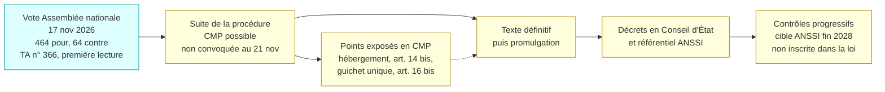
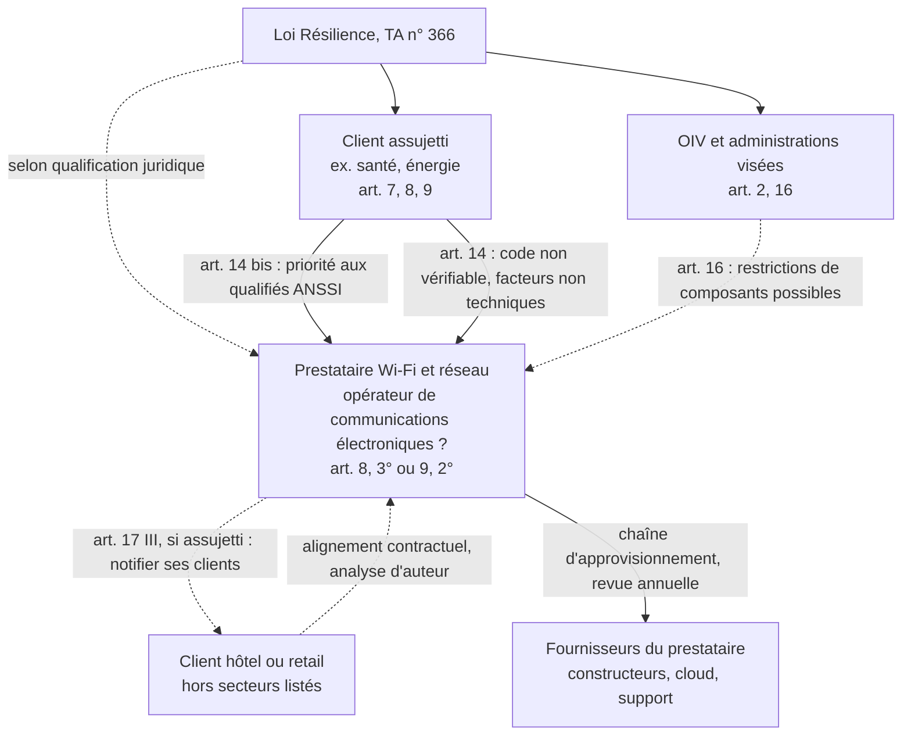

## 464 voix, et le plus lourd n'est pas là où on l'attendait

Mardi 17 novembre, vers 17h30, 464 députés ont voté pour et 64 contre [4][8]. L'Assemblée nationale venait enfin d'adopter, en première lecture, le projet de loi Résilience, qui transpose en droit français la directive européenne NIS 2 sur la sécurité des réseaux et des systèmes d'information. Le score a des airs de consensus. Il masque un texte réécrit en séance sur plusieurs points, parfois à quelques voix près, et parfois contre l'avis du gouvernement [6].

L'enjeu change d'échelle. Environ 15 000 entités seront concernées selon les rapporteurs, 18 000 à 20 000 selon la ministre, contre 500 à 600 sous la première directive [7][8]. Hôpitaux, énergéticiens, opérateurs télécoms, administrations. Et, dans leur sillage, tous ceux qui branchent des équipements sur leurs systèmes d'information : hébergeurs, intégrateurs, opérateurs qui déploient le Wi-Fi d'une clinique, d'une chaîne hôtelière ou d'un réseau de magasins.

La surprise n'est pas dans le socle de sécurité hérité de Bruxelles. Elle est dans la couche de souveraineté que les députés ont posée par-dessus : priorité aux prestataires qualifiés, hébergement à l'abri des lois étrangères, examen obligatoire du logiciel qu'on ne peut pas auditer. La clause d'hébergement est passée à 36 voix contre 29 [6]. Le 10 octobre, j'expliquais ici pourquoi il ne fallait pas attendre le vote pour préparer sa preuve fournisseur [11]. Le vote a eu lieu. Reste à lire ce que dit vraiment le texte, et ce qu'il ne dit pas encore.

## Un gué à trois sortes de pierres

Pour traverser une rivière à gué, on ne pose pas le pied sur chaque pierre avec la même confiance. Certaines sont scellées dans le lit. D'autres bougent dès qu'on s'appuie dessus. Les dernières flottent encore dans la brume : on devine leur forme, sans savoir si elles porteront. Le texte voté le 17 novembre se traverse de la même façon, et le premier travail consiste à trier les pierres.

Les pierres scellées, d'abord. Le texte adopté porte le numéro TA n° 366, « modifié par l'Assemblée nationale en première lecture », en procédure accélérée, à l'issue du scrutin public n° 9916 (16 abstentions) [1][2][5]. Une précision de méthode s'impose. Au 21 novembre, il n'en existe qu'une version provisoire : la page de l'Assemblée affiche « Document non encore publié », et seule la « petite loi » fera foi [1]. Les numéros d'article que je cite ici sont ceux de cette version. Ils peuvent encore glisser.

Les pierres qui bougent, ensuite. Une première lecture n'est pas une adoption définitive. Députés et sénateurs peuvent encore se retrouver en commission mixte paritaire (CMP), l'instance chargée de concilier les versions des deux chambres. Au 21 novembre, aucune CMP n'est convoquée ni datée dans les sources que j'ai consultées, et le dossier législatif n'en mentionne aucune [2]. Rien d'automatique : le Premier ministre « peut » la réunir, rappelle Next [8]. Si elle se tient, elle pourra encore modifier périmètre et obligations [5]. Plusieurs acteurs, dont Éric Bothorel selon le JDN, y voient déjà l'occasion de « corriger » certaines dispositions adoptées « dans une forme d'élan », dont l'hébergement non soumis aux lois extraterritoriales [6].

Les pierres dans la brume, enfin. Le texte renvoie à de nombreux décrets en Conseil d'État, notamment pour les objectifs de sécurité et le référentiel de l'article 14, l'article 15 ou certaines dispositions de l'article 17 [1]. Ce référentiel, l'ANSSI (Agence nationale de la sécurité des systèmes d'information) en a déjà publié une version de travail, le ReCyF [10][11]. Surtout, le texte ne contient aucune date d'application pour sa partie NIS 2. La seule entrée en vigueur datée, à l'article 62, concerne le titre III : les adaptations au règlement européen DORA (Digital Operational Resilience Act), propre au secteur financier. La formule d'une « entrée en vigueur au lendemain de la promulgation », lue ici ou là, ne figure dans le texte que pour ce titre-là, pas pour les obligations de cybersécurité qui nous occupent ici [1][9].

*Seul le vote est acquis. La suite de la procédure, les décrets et le calendrier de contrôle restent ouverts, et aucun n'est daté.*

Faute de date dans la loi, il faut regarder ailleurs, avec prudence. Des amendements qui fixaient un délai de mise en conformité de deux ou trois ans après décret ont été rejetés, selon ActuIA [7]. L'ANSSI viserait une conformité de toutes les entités fin 2028, par contrôles progressifs, d'après des propos ministériels et de l'Agence rapportés par le JDN et ActuIA [6][7]. C'est un objectif de régulateur, pas une échéance législative. En cas de manquement, une injonction de l'ANSSI fixerait un délai de mise en conformité compris, en principe, entre un et douze mois [6][7]. Au bout du chemin, les sanctions reprennent celles de la directive : jusqu'à 10 M€ ou 2 % du chiffre d'affaires mondial pour les entités essentielles, 7 M€ ou 1,4 % pour les importantes. L'État et les collectivités sont exonérés d'amende [6].

*Le vote a posé les premières pierres. La CMP, les décrets et le calendrier de contrôle forment les suivantes, encore dans la brume.*

## La loi vise le client, c'est le prestataire qui bouge

Au billard, on touche rarement la boule qu'on veut envoyer au fond. On frappe la blanche, et c'est elle qui transmet le choc. Pour un opérateur de réseau, la loi Résilience fonctionne souvent ainsi. Elle vise ses clients, et c'est lui qui encaisse le mouvement. Encore faut-il savoir quelle boule est frappée, et par quel article.

Le texte distingue en pratique trois populations. C'est le nœud du sujet pour un acteur comme Wifirst.

Les clients assujettis forment la première. L'article 7 dresse la liste des secteurs ; les articles 8 et 9 fixent qui y devient entité essentielle ou importante [1]. Pour ces clients, de la santé à l'énergie, trois articles changent la donne : le 14 sur les mesures de sécurité, le 14 bis sur le choix des prestataires, le 17 sur les incidents. Le secteur des denrées alimentaires figure dans la liste. L'hôtellerie et le commerce de détail n'apparaissent dans aucune.

La deuxième population, ce sont les OIV (opérateurs d'importance vitale) et certaines administrations, visés par des dispositions propres aux articles 2 et 16. C'est là que se logent les mesures les plus dures sur les composants. J'y reviens plus bas.

La troisième, c'est le prestataire lui-même. L'article 8, 3° range parmi les entités essentielles les opérateurs de communications électroniques qui emploient au moins 50 personnes, ou dont le chiffre d'affaires annuel et le total du bilan excèdent chacun 10 M€. L'article 9, 2° fait des autres des entités importantes [1]. Un opérateur Wi-Fi entre-t-il dans cette case ? Cela dépend des services qu'il fournit réellement. C'est une qualification juridique, pas un ressenti d'ingénieur, et je ne la tranche pas ici.

Un mot sur une catégorie que beaucoup attendaient : les fournisseurs de services gérés, qui exploitent tout ou partie du système d'information de leurs clients. Dans ma lecture du texte adopté, ils ne sont pas nommés comme catégorie dans les dispositions applicables aux opérateurs ; l'expression n'apparaît que dans la définition du représentant des entités établies hors de l'Union (art. 6, 5°) [1]. Aucune source de presse consultée ne les mentionne. Autre signal, que je donne sous réserve : le régime prévu en commission pour ces fournisseurs, qui les renvoyait au règlement d'exécution européen 2024/2690 plutôt qu'au référentiel national [3], ne figure plus dans le texte adopté. Suppression en séance ? C'est ma lecture, que je n'ai pas pu confirmer par le compte rendu des débats. Ce règlement européen reste de toute façon d'application directe pour les fournisseurs qu'il vise.

Pour un hôtel, une enseigne ou une résidence, le texte voté confirme ce que j'écrivais en octobre à partir de la directive : l'effet passera par le contrat, pas par la loi [11]. Un groupe qui exerce aussi dans un secteur listé, un client de santé qui répercute ses exigences, un acheteur public qui applique les critères de la stratégie nationale : la contrainte peut entrer par ces trois portes. C'est mon analyse, une hypothèse argumentée, pas une tendance de marché mesurée.

*Trois populations visées, une direction de propagation : vers le prestataire, puis vers ses propres fournisseurs. En pointillés, ce qui dépend d'une qualification juridique, d'un futur décret ou du seul contrat.*

## Quatre dispositions qui changent la conversation commerciale

Imaginez l'acheteur d'un établissement de santé assujetti qui renouvelle le réseau de ses sites, une fois la loi promulguée. Si le texte reste en l'état, sa première question ne sera plus *qui est le moins cher ?*, ni même *qui est le plus fiable ?*. Ce sera : *qui est qualifié, où sont mes données, et comment je sors si ça tourne mal ?* Quatre dispositions du texte voté portent cette bascule.

### Priorité aux prestataires qualifiés

C'est l'article 14 bis, ajouté par les députés [1]. Les entités « mentionnées au présent titre », le titre II, « recourent en priorité » à des prestataires qui cochent trois cases pour externaliser leurs services TIC (technologies de l'information et de la communication). Premier critère : détenir une qualification de l'ANSSI pour la prestation concernée. Deuxième : être assujetti en France à l'impôt sur les sociétés, sauf s'il s'agit d'un opérateur interne au même groupe. Troisième : n'avoir subi aucune sanction administrative définitive pour manquement grave à l'article 32 du règlement général sur la protection des données (RGPD). Si aucun prestataire ne répond aux critères, l'entité peut en retenir un autre. Il lui faut alors une autorisation expresse de l'ANSSI et une démonstration documentée de l'absence d'offre.

Le JDN y voit, selon ses termes, « une préférence pour des prestataires qualifiés par l'ANSSI et imposés en France », issue d'un amendement du groupe GDR (Gauche démocrate et républicaine) [6]. ActuIA la range parmi les dispositions qui peuvent tomber en CMP [7]. Retenons le mot exact. Priorité, pas interdiction.

Ce mécanisme s'articule avec d'autres articles, moins commentés et, à mon sens, plus durables. Lors d'un contrôle, une entité peut se prévaloir du recours à des prestataires qualifiés pour démontrer qu'elle atteint tout ou partie de ses objectifs (art. 14, dernier alinéa). Un label de confiance approuvé par l'ANSSI vaut présomption de conformité « jusqu'à preuve du contraire » (art. 15). L'Agence doit enfin veiller à des processus de qualification « objectifs, transparents et non discriminatoires », accessibles aux logiciels libres et aux PME innovantes (art. 16) [1]. Mon analyse : la qualification devient à la fois un argument commercial et une pièce à conviction.

Reste une question que je ne sais pas trancher, et je préfère le dire. L'article 14 bis parle d'une qualification « pour la prestation concernée ». Existe-t-il une qualification de l'ANSSI applicable à un service de Wi-Fi managé ? Je ne l'ai pas vérifié, et c'est un point à instruire avant toute promesse commerciale. Si la réponse est non, c'est la dérogation pour absence d'offre qui jouerait. L'ANSSI deviendrait alors, à la lettre du texte, le passage obligé de chaque exception.

### Des solutions « immunes », votées à 36 contre 29

Commençons par la conséquence. À la lettre du texte, un client soumis à l'article 14, dont la console de supervision réseau tourne chez un fournisseur exposé à une législation étrangère à portée extraterritoriale, devrait revoir cette dépendance si l'alinéa survit. Le texte tient en une phrase : « Les entités mentionnées au premier alinéa doivent avoir recours à des solutions techniques immunes de toute législation étrangère ayant des effets extraterritoriaux » [1].

Trois remarques. D'abord, l'amendement, porté par le groupe LFI (La France insoumise) selon le JDN, a été adopté par 36 voix contre 29, contre l'avis du gouvernement [6]. C'est un vote d'amendement en séance, avec peu de présents, à ne pas confondre avec les 464 voix du vote final. Ensuite, le JDN le présente comme visant les entités essentielles. La lettre du texte renvoie pourtant aux entités du premier alinéa de l'article 14 : les essentielles et les importantes, plus certaines administrations. L'écart change l'échelle du sujet. Enfin, selon le cabinet HLC, l'exigence va au-delà de NIS 2 et reprend un critère jusque-là cantonné au référentiel cloud SecNumCloud [9].

Le gouvernement s'y est opposé, comme à la déclaration unique dont je parle plus bas [6]. ActuIA estime que l'alinéa peut tomber en CMP, et conseille d'attendre celle-ci avant de toucher aux contrats d'hébergement [7]. Je partage ce conseil, avec une nuance. Attendre pour signer, oui. Attendre pour savoir où sont hébergées vos briques critiques, non.

*Du client assujetti au prestataire, puis du prestataire à ses propres fournisseurs : chaque maillon hérite d'une question sur le suivant.*

### Le code qu'on ne peut pas auditer

Le micrologiciel d'une borne, le contrôleur qui pilote des centaines de points d'accès, la console de supervision : dans un réseau d'entreprise, une large part du logiciel qui fait tourner l'infrastructure est fermée. Le texte voté ne l'interdit pas. Il oblige à la regarder en face.

L'article 14, 1° vise le choix d'une solution logicielle « dont le code source n'est pas accessible ou vérifiable » et qui concerne un système d'information critique [1]. Ce choix doit faire l'objet d'une analyse de risques spécifique et documentée, présentée aux organes de direction. Elle évalue la dépendance au fournisseur, les limites que ce code fermé impose aux audits de sécurité, et les stratégies de réversibilité à brève échéance. Le JDN parle d'« apply or explain » [6] ; le texte, lui, n'emploie pas cette formule.

À mon sens, c'est la disposition la plus structurante sur la durée. Elle ne bannit rien. Elle fait signer la dépendance par la direction, et cela change la nature de la discussion entre un DSI, son comité exécutif et ses fournisseurs. Un verrouillage technologique qu'on assume par écrit ne se négocie plus de la même manière qu'un verrouillage qu'on découvre le jour où l'on veut partir.

### Fournisseurs lointains, composants et interrupteur à distance

Deuxième étage : les fournisseurs eux-mêmes. Le chapeau de l'article 14 demande que les mesures de sécurité tiennent compte des facteurs de risque non techniques liés aux fournisseurs et prestataires directs [1]. Le texte cite leur soumission, ou celle des sociétés qui les contrôlent au sens de l'article L. 233-3 du code de commerce, à des législations d'États hors Union « permettant un accès non consenti aux données ou aux systèmes d'information ». Il cite aussi le lieu de traitement des données et celui d'où le support technique est fourni. Le 2° impose une politique de sécurité de la chaîne d'approvisionnement, fondée sur l'identification des fournisseurs et de leur criticité, réexaminée au moins une fois par an. Le 4° vise l'interopérabilité et la portabilité des données.

Traduction pour un opérateur Wi-Fi, et c'est mon analyse : l'audit fournisseur ne s'arrête plus à la fiche technique. Qui contrôle le constructeur des bornes ? Où tourne le contrôleur cloud ? Depuis quel pays répond le support de troisième niveau ? Le JDN rattache à cet article une liste plus imagée, « influence d'un pays tiers, portes dérobées, verrouillage technologique et coupure à distance » [6]. Prudence : ces mots sont ceux de la presse. L'article 14 que j'ai lu ne contient ni « porte dérobée » ni « kill switch ».

Ce fameux « kill switch », justement : un produit en service, désactivé ou bridé à distance. Le JDN le rattache à l'article 14 [6]. Dans le texte adopté que j'ai lu, il figure ailleurs : à l'article 5 bis, 5° nonies, dans le volet de la stratégie nationale consacré aux marchés publics [1]. La politique d'exigences de cybersécurité applicable aux produits et services TIC achetés par la commande publique doit y inclure la prise en compte des facteurs de risque non techniques et « des mécanismes susceptibles de permettre la désactivation, l'interruption ou la restriction à distance du fonctionnement d'un produit ou service ». C'est un contenu de stratégie et d'achat public, pas une obligation directe pour les entités. Mon pronostic : pour qui répond à des appels d'offres publics, la question arrivera quand même sur la table.

Dernier étage, les composants, la disposition la plus souvent mal résumée. À l'article 14, les mesures « peuvent prendre en compte » le risque lié à l'origine des produits et composants, lorsque le fabricant est contrôlé, directement ou indirectement, par un gouvernement, une autorité publique ou une force armée d'un pays tiers. Les interdictions possibles, elles, sont à l'article 16, et ne concernent que les OIV et certaines administrations. Leurs exigences spécifiques « peuvent inclure des restrictions ou des interdictions concernant certains composants ou produits » identifiés, après évaluation des risques, comme à risque élevé pour la sécurité nationale [1]. Le JDN y voit un amendement Bothorel inspiré du modèle allemand [6]. Côté achats, l'article 2 demande aux OIV de prendre en compte les liens capitalistiques, l'exposition à des législations extraterritoriales, la localisation et, « le cas échéant », des clauses de réversibilité.

Résumé honnête : une faculté réglementaire, réservée aux systèmes les plus sensibles. Personne ne peut écrire aujourd'hui que tel fabricant de bornes sera banni des réseaux français. Ceux qui l'affirment vendent quelque chose.

## Incident : un guichet, deux directions

Un vendredi soir, un contrôleur compromis coupe le Wi-Fi d'une quarantaine de sites d'un client hospitalier. Hypothèse d'école. L'horloge réglementaire, elle, est bien réelle : l'article 17, II prévoit une notification initiale sous 24 heures, une notification intermédiaire sous 72 heures et un rapport final au plus tard un mois après la notification intermédiaire [1].

La nouveauté votée tient au guichet. L'article 17, V permet d'adresser à l'ANSSI, par la même voie, la notification prévue par l'article 33 du RGPD. L'Agence la transmet sans délai à la CNIL (Commission nationale de l'informatique et des libertés), et la notification est réputée faite à la date de réception. Les délais sont « considérés comme satisfaits » si la déclaration est faite à temps « au guichet unique de déclaration ». Pour une équipe d'astreinte, c'est un formulaire de moins au pire moment. Le gouvernement s'y est pourtant opposé, jugeant le dispositif « juridiquement impossible » en l'état du droit européen, selon le JDN [6]. Disposition à surveiller en CMP, donc. Je regretterais sa disparition.

La seconde direction est moins commentée. C'est pourtant celle qui touche le plus directement un prestataire. L'article 17, III oblige les entités essentielles et importantes à notifier « sans retard injustifié » aux destinataires de leurs services les incidents importants ayant un impact direct, ainsi que les mesures ou corrections à appliquer face à une vulnérabilité importante [1]. Aucune des sources de presse que j'ai lues ne s'y arrête.

Mon analyse, en deux cas. Si le client est assujetti et le prestataire non, l'alerte du prestataire alimente l'horloge de 24 heures du client : la contrainte remonte par le contrat. Si le prestataire est lui-même assujetti, ce qui reste à qualifier, c'est lui qui doit prévenir ses clients. Y compris des hôtels ou des magasins qui ne relèvent d'aucun secteur listé. La loi atteindrait alors ces secteurs par ricochet, à travers l'obligation de leur fournisseur.

Reste le chiffrement. L'article 16 bis, qui interdisait d'imposer des dispositifs affaiblissant le chiffrement comme des clés maîtresses, a été supprimé par 69 voix contre 37 [6]. Selon LCP, le gouvernement s'est engagé à ne pas réintroduire de telle mesure d'ici la fin de la session [4]. Le Sénat pourrait tenter de le rétablir en CMP [7]. L'enjeu a déjà été discuté ici ; je n'y reviens pas.

Pour s'y retrouver, voici le tableau de bord tel que je le lis au 21 novembre.

| Disposition | Article (TA n° 366, version provisoire) | Statut au 21 novembre |
|---|---|---|
| Déclaration d'incident 24 h, 72 h, 1 mois | art. 17, II | Voté |
| Guichet unique ANSSI-CNIL | art. 17, V | Voté, contesté par le gouvernement |
| Notification des destinataires des services | art. 17, III | Voté |
| Priorité aux prestataires qualifiés ANSSI | art. 14 bis | Voté, peut tomber en CMP selon ActuIA |
| Solutions techniques immunes des lois extraterritoriales | art. 14 | Voté à 36 contre 29, peut tomber en CMP |
| Analyse de risques sur logiciel au code non vérifiable | art. 14, 1° | Voté |
| Facteurs de risque non techniques, revue annuelle des fournisseurs | art. 14, chapeau et 2° | Voté |
| Désactivation ou interruption à distance | art. 5 bis, 5° nonies | Voté, volet stratégie et commande publique |
| Restrictions ou interdictions de composants | art. 16 (OIV, administrations) | Faculté, renvoyée au réglementaire |
| Protection du chiffrement | art. 16 bis | Supprimé, peut revenir en CMP |

*Tous les numéros d'article sont ceux du texte adopté provisoire et peuvent évoluer d'ici la publication de la « petite loi ».*

## Ce que je ferais lundi matin

Ce qui suit est une opinion de praticien, pas une doctrine. La ministre du Numérique, Anne Le Hénanff, conseille de ne pas attendre la promulgation pour démarrer la conformité [6]. L'ANSSI dit la même chose autrement : les futures entités essentielles et importantes sont « invitées à s'engager dès à présent dans une démarche de sécurisation cohérente avec NIS 2 » [10]. Je suis d'accord sur le fond. Mais commencer ne veut pas dire promettre.

1. **Cartographier les dépendances capitalistiques et juridictionnelles**, pas seulement techniques. Pour chaque brique critique (bornes, contrôleurs, plateformes cloud, outils de supervision, support), noter qui contrôle le fournisseur, à quelle législation il est soumis, où sont traitées les données, d'où vient le support. C'est exactement la grille du chapeau de l'article 14. Elle complète la cartographie des interconnexions, elle ne la remplace pas.
2. **Documenter chaque choix de logiciel non auditable**, avec son plan de réversibilité à brève échéance. Une page par brique suffit pour commencer : pourquoi ce choix, quelle dépendance, quelle porte de sortie. Si l'on est soi-même assujetti, ce document finira devant la direction. Sinon, c'est le client qui le demandera.
3. **Qualifier juridiquement le statut d'opérateur de communications électroniques**, avec les juristes. Entité essentielle, importante ou hors champ : tout le reste en découle, y compris l'obligation de notifier ses propres clients.
4. **Instruire la question de la qualification ANSSI** applicable à la prestation. Existe-t-elle ? Est-elle atteignable, et à quel coût ? Que faudrait-il démontrer pour la dérogation ? Mieux vaut le savoir avant le premier appel d'offres qui la cite.
5. **Ne pas contractualiser de « conformité Résilience » avant la CMP.** Promettre la conformité à un texte qui peut encore perdre son alinéa hébergement ou son article 14 bis, c'est signer un chèque en blanc. Promettre de la transparence et un dossier tenu à jour, oui.

*Qui contrôle le fournisseur, où sont traitées les données, d'où vient le support : la cartographie juridictionnelle complète la cartographie technique.*

## Un texte de rapport de force, pas encore un texte de référence

Le gouvernement défend une transposition fidèle, « sans surtransposition ». Selon le JDN, la ministre estime que la cybersécurité n'est pas la souveraineté [6]. Les députés ont pourtant voté, à plusieurs reprises et parfois de quelques voix, des dispositions qui mêlent les deux. Ce texte est un texte de rapport de force. Parier sur le maintien intégral de sa couche souveraineté serait imprudent. Parier sur sa disparition le serait tout autant.

Mon analyse : le vrai risque de moyen terme n'est pas la CMP, ce sont les décrets. Tout ce qui est écrit au mode possible, « peut », « peuvent prendre en compte », « peuvent inclure », se jouera en Conseil d'État, loin des projecteurs. Le référentiel définitif, la portée réelle des restrictions de composants, le poids de la qualification comme preuve : rien de cela n'a été figé par le vote du 17 novembre.

Sur le fond, je ne partage pas tout à fait la ligne gouvernementale. Pour un opérateur de réseau, la frontière entre cybersécurité et souveraineté est plus mince qu'il n'y paraît. Un micrologiciel qu'on ne peut pas auditer, un support opéré depuis une autre juridiction, un équipement qu'un tiers peut brider à distance : ce sont, à la fois, des questions de sécurité et des questions de dépendance. Le texte voté a le mérite de les poser ensemble, même si sa rédaction reste à stabiliser.

La ministre parle d'« un véritable changement de paradigme en matière de cybersécurité pour les entreprises, en imposant leur sécurisation » [4]. Le changement est réel. Sa forme finale ne l'est pas encore. Entre les deux, il y a un travail qui sert quel que soit le résultat de la CMP : savoir de qui l'on dépend, sous quelle loi, et comment on en sortirait. Ce travail-là, aucun amendement ne le rendra inutile.

_Vues personnelles, pas position Wifirst._

## Sources

1. Assemblée nationale, texte adopté n° 366 (version provisoire), 17 novembre 2026 — https://www.assemblee-nationale.fr/dyn/17/textes/l17t0366_texte-adopte-provisoire (version « séance » : https://www.assemblee-nationale.fr/dyn/17/textes/l17t0366_texte-adopte-seance)
2. Assemblée nationale, dossier législatif du projet de loi relatif à la résilience des infrastructures critiques et au renforcement de la cybersécurité — https://www.assemblee-nationale.fr/dyn/17/dossiers/DLR5L17N50731
3. Assemblée nationale, texte de commission n° 1779 (10 septembre 2025) — https://www.assemblee-nationale.fr/dyn/17/textes/l17b1779_texte-adopte-commission.pdf
4. LCP, « L'Assemblée nationale approuve le projet de loi renforçant la cybersécurité » (17 novembre 2026) — https://lcp.fr/actualites/l-assemblee-nationale-approuve-le-projet-de-loi-renforcant-la-cybersecurite-445246
5. Leto, « NIS 2 : l'Assemblée adopte la loi Résilience par 464 voix contre 64 » (17 novembre 2026) — https://www.leto.legal/news/nis-2-loi-resilience-adoptee-assemblee-464-voix-17-novembre-2026
6. Journal du Net, « NIS2 : l'Assemblée adopte enfin la transposition, et la réécrit contre l'avis du gouvernement » (13 novembre 2026) — https://www.journaldunet.com/cybersecurite/1557881-nis2-l-assemblee-adopte-enfin-la-transposition-et-la-reecrit-contre-l-avis-du-gouvernement/
7. ActuIA, « NIS 2 avant le vote du 17 novembre : ce qui est acquis et ce qui peut tomber » — https://www.actuia.com/actualite/nis-2-avant-le-vote-du-17-novembre-ce-qui-est-acquis-et-ce-qui-peut-tomber/
8. Next, « Dernière ligne droite pour le PJL Résilience… » (17 novembre 2026) — https://next.ink/268104/derniere-ligne-droite-pour-le-pjl-resilience-qui-passe-le-vote-solennel-a-lassemblee/
9. HLC, « NIS 2 : vote de la loi Résilience » (17 novembre 2026) — https://hlc.com/fr/publications/nis-2-vote-de-la-loi-resilience
10. ANSSI, « La directive NIS 2 » — https://cyber.gouv.fr/reglementation/cybersecurite-systemes-dinformation/directives-nis-nis2-et-dispositif-saiv/directive-nis-2/
11. Wifirst Tech Blog, article du 10 octobre 2026 sur la déprogrammation de la loi Résilience, le ReCyF et la preuve fournisseur : https://wifirst-tech-blog.web.app/post?slug=loi-resilience-deprogrammee-recyf-preuve-fournisseur
