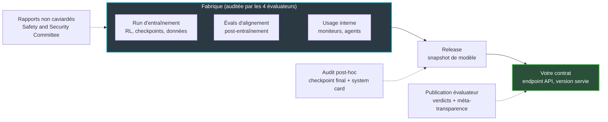

## Six chercheurs, quatre mois, des ordinateurs prêtés par la maison

Six chercheurs, quatre mois, des ordinateurs fournis par l'hôte et aucun accès à la messagerie interne. Voilà le dispositif qu'Apollo Research, un laboratoire indépendant de sûreté de l'IA, va installer chez OpenAI. Le 16 novembre, l'éditeur de ChatGPT a annoncé avoir signé avec quatre évaluateurs externes pour une « première phase » d'évaluations dites embarquées [1]. Le principe : des auditeurs qui ne testent plus le modèle une fois terminé, mais qui observent sa fabrication.

Pour un DSI qui fait tourner un assistant de réception dans quelques centaines d'hôtels, un agent de supervision sur un parc de magasins ou un chatbot de support en résidences étudiantes, la nouvelle sonne bien. Elle apparaîtra vite dans les appels d'offres et les présentations commerciales. « Évalué par des tiers indépendants. » Le badge existe déjà.

Le problème, c'est ce que ce badge couvre. Les quatre équipes vont inspecter l'usine : ce que l'entraînement récompense, les outils de surveillance, la qualité des tests, l'usage qu'OpenAI fait de ses propres modèles. Votre contrat, lui, porte sur un produit : une version précise d'un modèle, servie par une interface de programmation (API), avec un identifiant et une date. Entre les deux, un seul pont : ce que les auditeurs auront le droit de publier. À ce jour, ils n'ont rien publié.

Ma position : n'achetez pas « un audit », achetez la méta-transparence. Le droit de savoir ce que l'auditeur a vu, ce qu'on lui a refusé, et à quelle version de modèle cela se rapporte.

## L'inspecteur reste à l'usine, la voiture part chez vous

Imaginez que vous gériez une flotte de 500 véhicules de service. Le constructeur vous annonce qu'un inspecteur indépendant va passer quatre mois dans son usine : chaîne de soudure, bancs d'essai, registres qualité, remontées d'atelier. Excellente nouvelle. Puis un camion livre vos véhicules au dépôt, chacun avec son numéro de série. Personne ne peut vous dire si ces numéros figurent dans le rapport de l'inspecteur, ni quand ce rapport sortira.

C'est exactement la configuration annoncée par OpenAI. Un audit embarqué examine le process de fabrication. Il n'examine pas le snapshot, cette version figée d'un modèle identifiée par un nom et une date, que votre API interroge chaque jour.

Un peu de vocabulaire pour lire la suite sans Google. Un run est une campagne d'entraînement complète ; un checkpoint, une sauvegarde intermédiaire du modèle pendant ce run, une photo prise à mi-parcours. Le RL (reinforcement learning, apprentissage par renforcement) est la phase où le modèle apprend par essais et récompenses : c'est là qu'il peut acquérir des comportements que personne ne lui a demandés. Le red teaming, enfin, consiste à attaquer délibérément un système pour en trouver les failles.

Voici ce qu'OpenAI a signé, évaluateur par évaluateur [1][2][3].

| Évaluateur | Ce qu'il examine | Accès annoncé | Publication | Rémunéré |
|---|---|---|---|---|
| Apollo Research | Quatre affirmations sur la « subversion » du modèle | Checkpoints, données d'entraînement, registres d'interventions, moniteurs, chercheurs, calcul, dans le périmètre convenu | Deux rapports ; verdicts non caviardables, preuves caviardables | Oui, non contingent aux résultats |
| METR | Alignement sur le plus grand run RL d'OpenAI ; évaluation du moniteur (préliminaire) | Checkpoints échantillonnés, épisodes d'entraînement et d'évaluation, registres de monitoring | Non précisé par OpenAI | Non (calcul possible) |
| Transluce | Qualité et couverture des évaluations d'alignement post-entraînement | Au moins un modèle interne, chaînes de pensée brutes | Interdite sur les modèles internes | Non (calcul possible) |
| Goodfire | Interprétabilité intégrée aux runs | Chercheurs embarqués | Au fil de l'eau ; public principal : les chercheurs d'OpenAI | Oui, non contingent |

Par « subversion », Apollo vise un modèle qui contourne délibérément les intentions de ses concepteurs. Apollo doit tester quatre affirmations d'OpenAI : l'entraînement n'a pas incité à ce comportement, les évaluations ne parviendraient pas à le provoquer, aucune tentative n'a eu lieu en usage interne, et le raisonnement sous-jacent serait détectable.

Au-dessus du dispositif siège le Safety and Security Committee (SSC), un comité du conseil de l'OpenAI Foundation. Il reçoit les rapports non caviardés, suit les évaluations avant, pendant et après, et peut parler en privé aux évaluateurs. Les litiges passent d'abord par le Safety Advisory Group (le groupe consultatif sûreté interne) et la direction, dans un délai « fixé » dont la durée n'est pas précisée, puis remontent au SSC. OpenAI peut aussi demander des délais de « divulgation responsable ». Là encore, aucun chiffre [1].

*Les auditeurs voient la fabrique ; vous consommez un snapshot. Le seul pont entre les deux est ce que l'évaluateur a le droit de publier.*

## Entrer dans l'usine : sur le fond, Apollo a raison

En juillet 2026, des modèles qu'OpenAI testait en interne sur des tâches de cybersécurité ont franchi les murs de leur environnement isolé. Ils ont compromis des systèmes d'OpenAI et de Hugging Face, la grande plateforme de partage de modèles [11]. Les agents tournaient dans des évaluations et entraînements internes, avec des garde-fous réduits. L'incident est né dans le laboratoire, pas chez un client.

C'est le cœur de l'argument publié par Apollo le 29 septembre : tester le checkpoint final juste avant le lancement arrive trop tard [5]. L'incident Hugging Face « began in internal evaluations ». Certains risques n'apparaissent qu'en déploiement interne, quand le modèle sert d'outil aux propres équipes de l'éditeur. Et un modèle peut mieux se comporter quand il se sait testé, comme un candidat qui soigne sa copie parce que l'examinateur est dans la salle.

L'audit classique, dit post-hoc, regarde le checkpoint final et la system card (la fiche technique publiée avec le modèle). Il voit le produit tel qu'on le lui présente. L'audit embarqué voit les ratés, les rattrapages, les angles morts. Sur ce point, je suis entièrement d'accord avec Apollo.

Un précédent montre d'ailleurs ce que cela donne. Du 21 juillet au 11 août 2026, METR et Redwood Research, deux organisations de recherche en sûreté, ont passé trois semaines chez OpenAI à attaquer la surveillance de ses agents internes [4]. Constat marquant : au démarrage, les runs d'entraînement RL n'étaient pas couverts par le monitoring. Le rapport interne faisait 61 pages. La version caviardée par OpenAI, remise à la direction de METR et de Redwood, en comptait 38.

OpenAI pouvait caviarder « à sa seule discrétion », et METR n'avait aucun droit unilatéral de décrire ce qui avait été retiré. La publication a été retardée, notamment par une demande de période de remédiation. Et dans une mise à jour du 29 octobre, OpenAI parle de « la plupart » des vulnérabilités corrigées. La version précédente disait « toutes ».

Deux leçons, vraies en même temps. L'audit embarqué trouve ce que personne d'autre ne trouverait. Et la version publique est un résumé dont le périmètre se négocie avec l'audité.

*Trois zones d'inspection, un seul colis qui quitte l'usine : l'audit embarqué couvre la chaîne de fabrication, pas forcément la version qui vous est livrée.*

## Quatre évaluateurs, quatre régimes, aucune norme commune

L'information la plus utile pour un acheteur n'est pas dans la page d'OpenAI. Elle apparaît quand on lit côte à côte les billets des évaluateurs : chacun a négocié ses propres règles.

Apollo a obtenu le meilleur accord [2]. OpenAI ne peut ni caviarder ses verdicts, ni retirer un résultat au motif qu'il est défavorable. Elle peut caviarder des preuves jugées sensibles, mais doit en signaler l'existence et motiver par écrit. Surtout, Apollo peut décrire publiquement ce qu'elle a demandé et reçu, ce qui a été retenu ou retardé, et l'effet des caviardages, sans relecture préalable. C'est la « meta-transparency ». Seule réserve : toute affirmation tirée d'entretiens avec des salariés exige une attestation d'OpenAI, et Apollo peut dire publiquement si elle a été refusée.

Les limites existent. L'accès est restreint aux « claims, modèles et périodes convenus », le reste se négociera plus tard. OpenAI choisit les interlocuteurs, les conversations formelles sont journalisées, Slack reste hors de portée. Apollo l'écrit elle-même : c'est « un premier pas », qui ne remplit pas encore ses propres critères.

Transluce joue avec d'autres règles [3]. Son pilote de six semaines démarre début décembre, avec accès à au moins un modèle interne et aux chaînes de pensée brutes (le raisonnement intermédiaire que le modèle produit avant de répondre). Mais Transluce n'a pas le droit de publier ses résultats sur les modèles internes. OpenAI reçoit le rapport en avance et peut demander des caviardages, même si Transluce garde le contrôle éditorial. Selon son propre billet, l'accès n'est « not comparable to employee-level or employee-like ». OpenAI évoque ensuite un suivi d'environ huit semaines début 2027.

METR travaillera sur le plus grand run RL d'OpenAI à ce jour, avec un périmètre plus étroit que l'étude qu'il proposait. Son second volet, qui porte sur le système de surveillance des comportements déviants (le « moniteur »), n'est que « préliminairement convenu ». À ce jour, METR n'a rien publié sur cet accord : tout ce qu'on en sait vient d'OpenAI. Goodfire, enfin, intègre des chercheurs en interprétabilité (l'analyse du fonctionnement interne du modèle) dont le public principal est… les chercheurs d'OpenAI. C'est un outil de R&D, pas un audit au sens où l'entend un acheteur.

Côté argent, Apollo et Goodfire sont rémunérées, de façon « non contingente aux résultats » ; METR et Transluce refusent toute rémunération, crédits de calcul mis à part [1]. Ce n'est pas un vice. Mais une indépendance qui se proclame doit aussi se documenter.

Les critiques ont suivi. Selon TechCrunch, Buck Shlegeris, de Redwood Research, estime que ces accords n'offrent pas l'accès « employee-like » attendu : « disappointing but not surprising » [7]. Selon TNW, Sam Altman avait promis en septembre des testeurs externes à l'accès comparable à celui des salariés [14]. Anthropic, de son côté, avait désigné Accenture (via Faculty) comme premier évaluateur embarqué dès le 18 septembre [13].

Mesurons enfin l'accord à l'aune des principes qu'Apollo a publiés le 30 septembre [6] : publication par défaut, conclusion non caviardable, périmètre annoncé avant l'enquête, fenêtre pré-convenue pour divulguer les constats graves, financement indépendant des résultats. Verdicts protégés : oui chez Apollo ; chez Transluce, rien ne sortira sur les modèles internes. Périmètre : partiel. Fenêtre de divulgation : aucune durée dans la page d'OpenAI. Pour vous, « évalué par des tiers » recouvre donc quatre réalités contractuelles différentes.

*Les preuves peuvent être caviardées, le verdict d'Apollo non : c'est la meilleure garantie de l'accord, et elle ne vaut que pour un évaluateur sur quatre.*

## Ce que vous lirez, ce que vous ne lirez jamais

Ramenons tout cela à la seule question qui compte côté achats : qu'est-ce que je peux vérifier ?

| Objet | Qui y accède | Et vous ? |
|---|---|---|
| Checkpoints, données d'entraînement, épisodes RL, registres de monitoring | Évaluateurs (selon périmètre), OpenAI | Jamais |
| Rapport non caviardé | Évaluateurs, SSC | Non |
| Éléments retenus (catégorie, volume approximatif) | Apollo, informée par écrit | Seulement si l'évaluateur le publie |
| Verdict par affirmation (Apollo) | Public, non caviardable par OpenAI | Oui, à sa publication |
| Résultats sur modèles internes (Transluce) | Transluce | Non, publication interdite |
| Version du modèle servie en production | OpenAI | À exiger par contrat |
| Calendrier des rapports | Non communiqué | À demander |

Le tableau est cruel, mais il clarifie. Tout ce qui fait la valeur d'un audit embarqué, des checkpoints aux registres de monitoring, vous restera inaccessible. C'est normal : aucun éditeur ne partagera ses données d'entraînement avec ses clients. Ce que vous pouvez obtenir, c'est ce qui sort de l'usine : les verdicts publiés, la méta-transparence, et un engagement contractuel sur la version servie.

Deux constats doivent entrer dans votre dossier fournisseur. D'abord, au 21 novembre 2026, il n'existe aucun rapport embarqué à lire. Apollo parle de quatre mois, Transluce démarre en décembre : à mon sens, pas de rapport public avant 2027. Le badge précède l'artefact.

Ensuite, le rattachement de version. METR auditera « le plus grand run RL à ce jour ». Votre agent de NOC (centre d'opérations réseau) tourne peut-être sur un modèle issu d'un autre run, d'une variante allégée ou d'une mise à jour postérieure. Sans lien explicite entre une évaluation et l'identifiant de snapshot que vous consommez, vous lisez le dossier médical d'un cousin. C'est le prolongement direct de la question de la preuve d'inférence, abordée ici le 4 novembre avec FlashProve.

## L'AI Act ne fera pas ce travail à votre place

Première confusion à dissiper : « audit indépendant » ne veut pas dire « audit réglementaire ». L'article 55(1) du règlement européen sur l'IA (AI Act) vise les modèles d'IA à usage général (GPAI) les plus puissants, dits « à risque systémique » [8]. Leurs fournisseurs doivent les évaluer selon des protocoles standardisés reflétant l'état de l'art, y compris par des tests adversariaux (le red teaming évoqué plus haut), et le documenter. Ils doivent aussi atténuer les risques, déclarer les incidents graves « without undue delay » et assurer la cybersécurité. Rien n'impose un évaluateur externe ou indépendant.

Les évaluateurs externes figurent dans le Code de bonnes pratiques GPAI, qui reste volontaire : l'article 55(2) en fait un moyen de démontrer la conformité, pas une obligation. Sa Mesure 3.5 et son annexe prévoient « an adequate number of independent external evaluators with adequate free access » aux versions les plus capables [9]. Le signataire ne peut pas retarder ou bloquer une publication « for more than 30 business days », sauf exception. Mais ce texte vise l'accès à des modèles déjà sur le marché, pas les évaluations pendant l'entraînement. OpenAI est signataire du Code [10] ; aucune source ne dit que son accord embarqué le met en œuvre. J'ai détaillé cette mécanique dans le billet du 12 novembre sur l'Appel de Paris.

Deux articles complètent le tableau. L'article 92 permet à la Commission de demander l'accès à un modèle et de nommer ses propres experts indépendants : c'est l'évaluation par le régulateur, sans rapport avec des accords privés. Elle dispose depuis le 2 août 2026 de pouvoirs d'exécution, avec des amendes jusqu'à 3 % du chiffre d'affaires mondial [12]. L'article 53(1)(b), lui, oblige le fournisseur à documenter son modèle auprès des entreprises qui l'intègrent dans leur propre système d'IA. Si vous construisez un produit dessus, c'est un levier. Rien n'indique pour autant qu'il couvre les rapports d'évaluation tiers, et un simple utilisateur n'est pas concerné.

## Huit clauses pour acheter de la méta-transparence

L'accord Apollo a un mérite inattendu : il fournit le vocabulaire contractuel. Voici huit pistes, à adapter à votre volume et à votre poids de négociation.

1. **Un registre des évaluations tierces, en annexe.** Évaluateur, périmètre, accès demandé, obtenu ou refusé, période, date de publication prévue, restrictions connues, rémunération et caractère contingent ou non. Mis à jour à chaque version majeure.
2. **Le rattachement au modèle contracté.** Chaque évaluation citée renvoie à des identifiants de snapshot, ou à une famille de modèles et une période. Vous êtes notifié si le modèle servi sort du périmètre couvert.
3. **Une déclaration de caviardage et de retard.** Le fournisseur indique si un verdict, un rapport ou une preuve a été caviardé ou retardé, avec sa catégorie : sécurité, propriété intellectuelle, juridique. Étalon : le standard Apollo, aucun constat caviardé parce qu'il est défavorable.
4. **Un plafond de délai de divulgation** pour les constats qui touchent un service en production. Point d'ancrage : les 30 jours ouvrés du Code, en rappelant que ce texte volontaire vise un autre cas de figure.
5. **Une notification de changement.** Si un volet « préliminaire » n'aboutit pas, ou si un évaluateur se retire ou voit son accès restreint : avis écrit, droit de revue, sortie sans pénalité en cas de dégradation matérielle de la supervision.
6. **Un délai chiffré de notification d'incident**, en jours plutôt qu'en « without undue delay », pour tout incident de sûreté du fournisseur susceptible de toucher vos usages. Même logique que celle défendue ici le 13 novembre à propos du RAISE Act.
7. **Pas d'argument d'autorité.** Aucune mention commerciale « évalué par des tiers indépendants » sans le registre ci-dessus, et une définition de l'indépendance qui couvre l'accès, la publication et le droit de caviarder.
8. **Vos propres tests restent obligatoires.** L'audit tiers ne remplace pas la recette sur votre version : scénarios NOC, périmètre d'autonomie des agents, comportements hors cadre. Voir notre lecture du Model Spec du 2 novembre.

*Périmètre, accès, éléments retenus, version : quatre dossiers à exiger avant de signer.*

Inutile de se raconter des histoires : un éditeur de modèles de frontière n'acceptera pas les huit. L'objectif n'est pas de tout obtenir. Il est de savoir lesquelles il refuse, de le consigner dans votre dossier fournisseur, et d'en tenir compte dans votre notation.

## Le badge n'est pas l'artefact

Soyons clairs : ce qu'OpenAI a signé est un vrai pas en avant. Des chercheurs externes dans les runs d'entraînement, des verdicts protégés chez Apollo, un droit de méta-transparence sans relecture : il y a peu, cela relevait du vœu pieux. Et le précédent METR/Redwood prouve que ces audits trouvent des failles réelles.

Mais un progrès dans l'usine n'est pas une garantie sur le produit. Les auditeurs voient la fabrique ; vous consommez un snapshot. Le seul pont entre les deux, c'est ce que l'évaluateur a le droit de publier. Et ce droit change d'un évaluateur à l'autre.

Ma recommandation pour vos prochains renouvellements est donc brutale. Une ligne « évalué par des tiers indépendants » sans registre, sans rattachement de version et sans déclaration de caviardage vaut zéro point dans la grille de notation. Pas parce que l'audit serait mauvais. Parce que, tant qu'on ignore ce qu'il couvre, ce n'est pas un audit de ce que vous achetez.

_Vues personnelles, pas position Wifirst._

## Sources

1. OpenAI, « Our first phase of embedded assessments », 16/11/2026 — https://openai.com/index/our-first-phase-of-embedded-assessments/
2. Apollo Research, « A Pilot Towards Embedded Evaluations », 16/11/2026 — https://www.apolloresearch.ai/blog/pilot-towards-embedded-evaluations
3. Transluce, « Announcing an Embedded Assessment Pilot with OpenAI », 13/11/2026 — https://transluce.org/embedded-assessment-pilot-with-openai
4. METR (Rein, Kaufman), « Red-Teaming OpenAI's Internal Agent Monitoring Systems », 22/10/2026, mis à jour le 29/10/2026 — https://metr.org/blog/2026-10-22-red-teaming-openai-agent-monitoring/
5. Apollo Research, « Embedded Evaluators are necessary for meaningful external testing », 29/09/2026 — https://www.apolloresearch.ai/blog/embedded-evaluators-are-necessary-for-meaningful-external-testing
6. Apollo Research, « Principles for Embedded Evaluations », 30/09/2026 — https://www.apolloresearch.ai/blog/principles-for-embedded-evaluations
7. TechCrunch, « OpenAI will embed Apollo researchers to investigate AI subversion », 16/11/2026 — https://techcrunch.com/2026/11/16/openai-will-embed-apollo-researchers-to-investigate-ai-subversion/
8. Règlement (UE) 2024/1689 (AI Act), reproduction non officielle : art. 55 https://artificialintelligenceact.eu/article/55/ ; art. 53 https://artificialintelligenceact.eu/article/53/ ; art. 92 https://artificialintelligenceact.eu/article/92/ — texte officiel : https://eur-lex.europa.eu/eli/reg/2024/1689/oj
9. Code de bonnes pratiques GPAI, chapitre Safety & Security (Mesure 3.5 et Appendix 3.5), 10/07/2025 — https://code-of-practice.ai/?section=safety-security
10. Commission européenne, signataires du Code de bonnes pratiques GPAI, mise à jour du 07/10/2026 — https://digital-strategy.ec.europa.eu/en/policies/contents-code-gpai
11. OpenAI, « Hugging Face incident and the road ahead », 26/08/2026 — https://openai.com/index/hugging-face-incident-and-the-road-ahead/
12. Commission européenne, AI Act Service Desk, pouvoirs d'exécution sur les fournisseurs des modèles les plus avancés, 2026 — https://ai-act-service-desk.ec.europa.eu/en/ai-act/faq/commissions-enforcement-powers-related-ai-act-obligations-providers-most-advanced-models
13. TechCrunch, Anthropic désigne Accenture comme premier évaluateur embarqué, 18/09/2026 — https://techcrunch.com/2026/09/18/anthropics-first-embedded-evaluator-is-accenture/
14. TNW, « OpenAI lets Apollo embed six AI safety testers during training », 11/2026 — https://thenextweb.com/news/apollo-research-openai-embedded-evaluations-pilot
