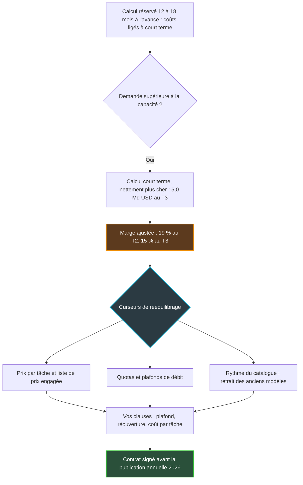
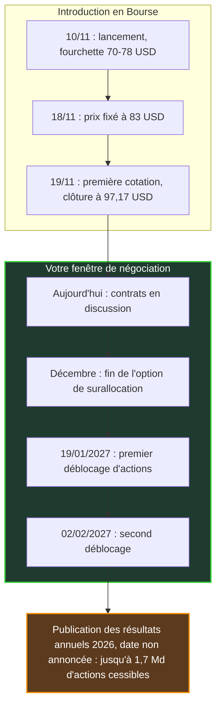

## Le prix de votre IA se discute désormais en public

Quatre-vingt-trois dollars. C'est le prix fixé mercredi 18 novembre pour l'introduction en Bourse d'Anthropic, l'éditeur des modèles Claude. Le lendemain, à l'ouverture du Nasdaq, l'action s'échangeait déjà à 111,50 dollars. Elle a terminé sa première séance à 97,17 dollars, en hausse de 17,1 %, un jour où l'indice reculait de 2,2 %.

Les pages finance ont parlé de levée record. Pour des milliers d'entreprises, l'événement est d'une autre nature. Une chaîne hôtelière qui fait tourner sa conciergerie sur Claude, une enseigne qui a confié une partie de son support magasin à un agent, une DSI qui a câblé ses outils internes sur l'API : aucune n'est actionnaire. Toutes sont clientes. Et leur fournisseur vient de changer de juge.

Jusqu'ici, Anthropic rendait des comptes à quelques fonds et à ses partenaires cloud. Depuis le 19 novembre, il les rend au marché, chaque trimestre, chiffres à l'appui. Le prix par tâche, les quotas d'usage et la durée de vie des modèles que vous consommez deviennent des variables d'ajustement d'une marge publique.

Ce n'est pas une mauvaise nouvelle en soi. Mais cela déplace la négociation et lui fixe une échéance : la première publication de résultats annuels de la société, dont la date n'est pas encore annoncée. D'ici là, l'acheteur dispose d'une fenêtre. Après, il négociera face à un fournisseur dont chaque concession se lira dans un communiqué.

## Le risque de défaillance n'est plus la question

Commençons par ce que la cotation règle. L'offre a porté sur 980 millions d'actions ordinaires, vendues à 83 USD sous le symbole ANT, au-dessus de la fourchette de 70 à 78 USD affichée au lancement de la tournée des investisseurs, le 10 novembre. Le volume a lui aussi été relevé : le plan initial portait sur 825 millions de titres. Le produit brut atteint 81,34 Md USD, dont environ 1,95 Md revient aux actionnaires vendeurs. La société, elle, touche 78,84 Md USD avant frais ([prospectus final 424B4](https://www.sec.gov/Archives/edgar/data/2130357/000162828026074944/anthropicpbc-424b4.htm)).

S'y ajoute un placement privé de 26 Md USD en actions sans droit de vote, au même prix. Les souscripteurs s'appellent AMD, Broadcom, Google, Micron, Microsoft, NVIDIA et TSMC Partners. Le détail vaut un arrêt : des acteurs de la chaîne des puces, de la mémoire et du calcul dont dépend Anthropic viennent d'entrer à son capital. Le prospectus estime le produit net total pour la société à environ 104,8 Md USD, et jusqu'à 117 Md si les banques exercent en totalité leur option de surallocation, qui leur permet d'acheter jusqu'à 147 millions d'actions supplémentaires pendant 30 jours.

Ces montants s'ajoutent aux 146,6 Md USD de liquidités dont Anthropic disposait au 30 septembre, ligne de crédit comprise. La valorisation ressort à environ 1 500 milliards de dollars entièrement diluée au prix d'introduction, autour de 1 100 milliards hors dilution, et entre 1 300 et 1 800 milliards selon la base retenue après la première séance. Quant à la perte nette de 104,0 Md USD sur neuf mois qui fait les titres, elle provient à hauteur de 94,3 Md de la réévaluation d'instruments financiers, sans le moindre décaissement. L'exploitation a, elle, dégagé 6,6 Md USD de trésorerie sur la période.

Nous avons déjà lu ce dossier sous l'angle de la solvabilité et de la dépendance, en septembre puis fin octobre. La conclusion tient, et la levée la renforce : à horizon de deux ans, ce fournisseur ne disparaîtra pas.

La question devient autre. Une société cotée n'arbitre plus seulement entre croissance et survie. Elle arbitre, en public, entre trois choses que vous lui achetez : le prix, la capacité et le catalogue. Et le prospectus montre que cet arbitrage a déjà commencé.

## De 19 % à 15 % : le trimestre qui raconte tout

Pour comprendre la suite, pensez à un fournisseur d'électricité. Il a signé des années à l'avance des contrats de production à prix fixe, calibrés sur la consommation qu'il anticipait. Arrive une vague de froid. Ses clients consomment bien plus que prévu et, pour les servir, il doit acheter des mégawattheures sur le marché de gros, au prix de la pointe. Son chiffre d'affaires grimpe. Sa marge se tasse.

C'est, presque trait pour trait, le troisième trimestre d'Anthropic.

Le chiffre d'affaires (CA) passe de 11,6 Md USD au deuxième trimestre (T2) à environ 17,0 Md au troisième (T3), soit +46 % en trois mois. Le résultat d'exploitation ajusté, un indicateur maison hors normes comptables américaines, progresse en valeur, de 2,2 à 2,5 Md USD. Mais rapporté au CA, il recule : la marge ajustée tombe de 19 % à 15 %. En normes comptables strictes, le résultat d'exploitation bascule même de +974 M USD à -567 M USD.

La cause est écrite noir sur blanc. Anthropic réserve sa capacité de calcul 12 à 18 mois à l'avance, si bien qu'à court terme ses coûts sont figés. Quand la demande dépasse la capacité réservée, la société achète du calcul sur des engagements courts, que le prospectus décrit comme nettement plus cher que ses contrats pluriannuels. Ce calcul d'urgence a coûté 5,0 Md USD au seul T3, sur 6,5 Md pour les neuf premiers mois de l'année. C'est à lui que la société attribue le recul de sa marge ajustée.

L'ensemble des charges de calcul et d'infrastructure atteint 9,9 Md USD au T3, soit 58 % du CA, contre 48 % au T2. Attention au périmètre : ce ratio inclut le calcul de recherche et d'entraînement, pas seulement celui qui sert vos requêtes. Il ne se compare pas aux ratios de « coût de service » qui circulent dans la presse.

*Au troisième trimestre, le calcul acheté en urgence a grimpé plus vite que le chiffre d'affaires, et la marge ajustée a perdu quatre points.*

Ce périmètre réconcilie deux lectures en apparence contradictoires. Le prospectus ne publie aucune ligne de marge brute. Des analystes ([MostlyMetrics](https://www.mostlymetrics.com/p/anthropic-ipo-s1-breakdown), [ExplainX](https://explainx.ai/blog/anthropic-s-1-gross-margin-85-percent-serving-compute-vs-all-compute-2026)) en reconstituent une, implicite, d'environ 85 %, à partir du coût des revenus de la note 8. Leur calcul exclut l'entraînement, l'usage gratuit et les frais de distribution : ce n'est pas un chiffre publié par la société. L'image d'ensemble reste cohérente. Servir un client existant est très rentable. Ce qui coûte cher, c'est le calcul de croissance, et plus encore celui qu'on achète dans l'urgence.

Derrière, le carnet de commandes a encore grossi : 900,9 Md USD d'engagements d'achat et de baux, tous fournisseurs confondus, quasi intégralement en calcul et infrastructure. Environ 451,6 Md tombent avant fin 2030, dont 70,7 Md dans les douze mois. Près de 186,2 Md restent soumis à des droits de résiliation ou à des conditions suspensives. Et 150 à 175 Md d'accords sans montant fixe n'y figurent même pas.

Ce carnet dit une chose simple : la capacité de 2027 est déjà commandée. Si la demande continue de courir plus vite, le calcul d'urgence restera un poste lourd. Si elle ralentit, ce sont les engagements fixes qui pèseront. Dans les deux cas, la marge trimestrielle bouge, et c'est désormais elle que le marché regarde.

*De la capacité achetée trop tôt à la marge qui recule : la chaîne que le prospectus décrit, et l'endroit où l'acheteur peut intervenir.*

## Trois curseurs, et aucune hausse annoncée

Soyons précis, parce que c'est ici que beaucoup d'analyses dérapent : le prospectus n'annonce aucune hausse de prix. Sur le prix unitaire, il documente même l'inverse. Entre le T2 et le T3, les baisses de prix liées aux nouvelles versions et les remises contractuelles ont amputé le CA d'environ 600 M USD, soit près de 3,5 % du chiffre du trimestre selon mon calcul. Un an plus tôt, l'effet équivalent entre T3 et T4 2025 plafonnait autour de 70 M USD. Quant aux dernières générations de modèles, elles ont réduit le coût par tâche de 25 à 40 % selon la gamme, « tout en préservant nos marges » (traduction), précise la société, avec jusqu'à 45 % de baisse pour le code et les usages agentiques complexes.

Les analystes cités par [CIO.com](https://www.cio.com/article/4181090/what-anthropic-and-openai-ipos-spell-for-cios-ai-budgets.html) en juin, qui annonçaient hausses de prix et facturation moins lisible, avaient donc tort ? Pas si vite. Le prix catalogue n'est qu'un des réglages disponibles.

Imaginez une table de mixage à trois curseurs. Le premier règle le prix par tâche. Le deuxième, la capacité qu'on vous laisse consommer. Le troisième, la durée de vie des modèles. Pour rééquilibrer le son, l'ingénieur n'a pas besoin de toucher au premier, celui que toute la salle entend. Il peut jouer sur les deux autres, et le public ne s'en apercevra qu'au morceau suivant.

Les trois curseurs sont nommés dans le prospectus.

**Le prix, et surtout son unité.** La société se réserve de faire évoluer ses structures tarifaires : baisser ses prix, proposer des durées d'engagement plus courtes, ou passer à une tarification au résultat ou à la tâche. Elle précise que ses offres agentiques sont « structurellement plus gourmandes en calcul ». Traduction : un token (l'unité de texte facturée) moins cher ne garantit pas une facture plus légère si l'agent en consomme bien davantage pour boucler le même travail. En parallèle, un nombre croissant de grands comptes signent des contrats annuels ou pluriannuels non résiliables, avec un minimum de dépense, en échange d'une « committed price list ». Le prix se stabilise. C'est le volume qui se verrouille.

**La capacité.** Anthropic rappelle avoir déjà modifié, et pouvoir modifier encore, ses limites d'usage, ses plafonds de débit (les *rate limits*) et les capacités offertes. Pour une société dont 79 % du revenu des neuf premiers mois vient de la consommation, c'est le levier le plus discret. Un quota resserré aux heures de pointe ne figure dans aucune grille tarifaire. Il épargne pourtant précisément ce calcul d'urgence qui a fait reculer la marge.

**Le catalogue.** Les modèles sortis au cours des six derniers mois représentent plus de 80 % du CA du T3. Le prospectus évoque la possibilité de dépréciations accélérées, tout en notant que des considérations de sécurité peuvent aussi retarder certains retraits. Retirer une ancienne version libère du calcul et pousse les clients vers les modèles les plus efficaces. [Forrester](https://www.forrester.com/blogs/anthropic-is-public-make-its-economics-work-for-you/) le résume sans détour : « Expect faster model turnover, not stability. »

*Prix, capacité, catalogue : trois curseurs nommés par le prospectus, dont un seul figure sur la grille tarifaire.*

Ma lecture : la marge publiée devient le thermostat de votre contrat. Quand elle se tasse, ce n'est pas forcément la grille de prix qui bouge en premier. Ce sont les quotas, le rythme des dépréciations et les conditions des contrats engagés. C'est moins visible qu'une hausse. C'est aussi beaucoup plus difficile à contester quand le contrat n'en dit rien.

## La fenêtre : d'ici au premier bilan annuel

Pourquoi parler d'échéance ? Parce que le calendrier boursier en fabrique une. Le prospectus organise la sortie progressive des actionnaires historiques par une période de blocage (le *lock-up*) échelonnée. Premier déblocage le 19 janvier 2027, deuxième le 2 février. Ensuite, jusqu'à environ 1,7 milliard d'actions deviennent cessibles le deuxième jour de bourse suivant la publication des résultats annuels 2026, avant d'autres tranches indexées sur les deux premiers trimestres 2027.

La date de cette publication annuelle n'est pas annoncée. Son statut, lui, est clair : ce sera le premier grand rendez-vous de marché de la société, celui où une masse d'actions pourra changer de mains au vu des chiffres. Je ne prête aucune intention à la direction. Je constate qu'aucun dirigeant ne souhaite présenter ce jour-là une marge qui continue de reculer.

*Le calendrier du lock-up fait de la première publication annuelle un événement de marché. La fenêtre de l'acheteur se referme avec elle.*

Pour l'acheteur, cela dessine une fenêtre. Anthropic doit démontrer au marché qu'il sait faire croître la consommation sans sacrifier sa marge. Forrester l'a formulé le jour même de la cotation : « Anthropic needs your workloads nearly as much as you need its intelligence, but it must grow consumption without sacrificing margins. » Un engagement pluriannuel signé dans les semaines qui viennent, c'est du revenu visible à présenter. Vous détenez quelque chose que votre fournisseur veut montrer. C'est un levier, et il a une date de péremption.

L'objection classique : pourquoi s'engager maintenant, alors que le coût par tâche baisse à chaque génération ? Parce que les deux ne s'opposent pas. Un contrat bien écrit capte les baisses futures par une clause de réouverture, tout en figeant ce qui risque de bouger : quotas, préavis, durée de support. Attendre, c'est négocier après le premier communiqué annuel, face à un fournisseur dont chaque remise sera lue par les analystes comme une pression sur la marge.

## Des clauses qui lisent les comptes trimestriels

La grille de base (préavis, plafonds, disponibilité, données) figure dans notre article de septembre, je ne la refais pas. Ce que la cotation apporte, c'est la possibilité d'adosser le contrat à des événements publics et datés. Six ajouts me semblent prioritaires.

| Clause | Ce qu'elle prévoit | Ce qu'elle neutralise |
|---|---|---|
| Plafond de hausse, préavis calé sur les publications | Toute évolution de prix ou de quota est plafonnée sur l'année, avec un préavis qui court au-delà de la publication trimestrielle suivante | Le rattrapage de marge au lendemain d'un trimestre décevant |
| Coût par tâche terminée | Un prix par unité métier, avec une définition contractuelle de « terminée » | La dérive du nombre de tokens par tâche avec les agents |
| Quotas et plafonds de débit garantis | Un volume réservé, pointes comprises, et des crédits de service en cas de bridage | Le resserrement discret de la capacité |
| Support minimal par version, avec équivalence | Une durée de disponibilité garantie, et un successeur qui doit passer votre jeu de tests | Les dépréciations accélérées et les régressions de comportement |
| Report des minimums non consommés | Le reliquat d'engagement glisse sur la période suivante | La perte sèche quand l'usage décolle moins vite que prévu |
| Réouverture de prix | Renégociation si le prix de marché par tâche s'écarte d'un seuil défini, benchmarks à l'appui | Le prix engagé devenu hors marché en deux générations de modèles |

Deux de ces lignes méritent un mot. La facturation au coût par tâche terminée, que Forrester recommande aussi, ne vaut que par sa définition. « Terminée » doit être écrit noir sur blanc : un ticket clos sans escalade humaine, une conversation résolue sans réouverture dans un délai fixé. Sans définition, c'est le fournisseur qui mesure.

La clause d'équivalence protège, elle, contre le risque le plus sous-estimé. Un successeur officiellement « meilleur » peut casser vos prompts, vos formats de sortie ou vos garde-fous. Votre jeu de tests doit devenir une annexe contractuelle, pas un fichier qui dort dans un dépôt Git.

*Entre la cotation et la première publication annuelle, une fenêtre s'ouvre pour signer des clauses adossées au calendrier financier du fournisseur.*

Forrester insiste sur un second fournisseur de frontière crédible et note que les engagements cloud existants donnent du levier quand on achète via une place de marché ; je partage les deux. Le prospectus rappelle d'ailleurs que les grands clouds (les *hyperscalers*) ont visibilité sur ses prix et conditions commerciales. Le canal d'achat n'est jamais neutre. Enfin, la meilleure clause reste celle qu'aucun avenant ne peut retirer : une architecture qui permet de changer de modèle sans tout réécrire, sujet détaillé fin octobre.

## Sur le terrain : l'hôtel, le magasin, la résidence

Pour qui sert l'hôtellerie, le retail, l'entreprise et les résidences étudiantes, la traduction est très concrète. Personne, chez ces clients, ne raisonne en tokens. Un directeur d'hôtel compte des conversations de conciergerie traitées. Un responsable support compte des tickets résolus. Une équipe d'exploitation réseau compte des diagnostics menés à terme sur un site qui décroche. C'est dans ces unités qu'il faut écrire le contrat : ce sont elles que l'on sait mesurer, et elles que le métier accepte de payer.

Deuxième sujet, la saisonnalité. Le prospectus signale des creux d'usage l'été et en fin d'année, et prévient que résultat et marge ajustés fluctueront au gré des grosses livraisons de calcul. Or l'hôtellerie vit ses pics précisément l'été et pendant les fêtes. Le retail a ses soldes et son Black Friday, les résidences étudiantes leur rentrée de septembre. Avec une facturation à la consommation, ces pointes se lisent sur deux tableaux à la fois : la facture et les quotas.

Il y a là un argument de négociation sous-exploité. Une partie de votre pointe tombe dans le creux de votre fournisseur. Des quotas garantis en juillet-août ou en décembre devraient donc lui coûter moins cher à accorder que des quotas en pleine période de tension. Encore faut-il les demander par écrit, avec une définition de la pointe et un crédit si le bridage intervient malgré tout.

Dernier point, organisationnel. Le suivi d'un fournisseur d'IA stratégique ne relève plus du seul CTO. Quatre fois par an, quelqu'un, aux achats ou à la finance, doit lire le communiqué avec une seule question en tête : qu'est-ce qui, dans ces chiffres, se retrouvera dans ma facture ou dans mes quotas d'ici deux trimestres ?

## Plus lisible, plus pressé

La cotation d'Anthropic est une bonne nouvelle pour les acheteurs, à condition de la lire correctement. Le fournisseur n'a jamais été aussi transparent. Coûts de calcul, engagements, baisses de prix, remises : tout est désormais publié, trimestre après trimestre. Aucun acheteur d'IA n'avait disposé d'une telle visibilité sur un laboratoire de frontière.

Mais transparent ne veut pas dire stable. Un fournisseur coté est aussi un fournisseur pressé, qui doit faire croître la consommation tout en défendant une marge que tout le monde regarde. Le prospectus montre déjà où se logeront les ajustements quand cette marge se tasse. Il nomme les quotas, le rythme du catalogue et les termes des contrats engagés, bien plus que le prix affiché.

Ma position est simple. Le contrat se joue maintenant, avant le premier bilan annuel, pas après. Vous ne contrôlerez jamais le thermostat de votre fournisseur. Vous pouvez en revanche fixer, noir sur blanc, la plage dans laquelle il a le droit de bouger.

_Vues personnelles, pas position Wifirst._

## Sources

1. SEC EDGAR — Anthropic, PBC, prospectus final 424B4 (19/11/2026) — https://www.sec.gov/Archives/edgar/data/2130357/000162828026074944/anthropicpbc-424b4.htm
2. SEC EDGAR — Anthropic, PBC, S-1/A n°1 (02/11/2026) — https://www.sec.gov/Archives/edgar/data/2130357/000162828026068676/anthropicpbc-sx1ax1.htm
3. SEC EDGAR — Anthropic, PBC, S-1/A n°2 (10/11/2026) — https://www.sec.gov/Archives/edgar/data/2130357/000162828026072484/anthropicpbc-sx1ax2.htm
4. Anthropic — « Anthropic prices initial public offering » (18/11/2026) — https://www.anthropic.com/news/anthropic-prices-initial-public-offering
5. Let's Data Science — Anthropic reportedly prices IPO at 83 USD per share (18/11/2026) — https://letsdatascience.com/news/anthropic-reportedly-prices-ipo-at-83-per-share-0b1e0822
6. TNW — Anthropic IPO prices at 83 USD a share (18/11/2026) — https://thenextweb.com/news/anthropic-ipo-prices-83-share-1-5-trillion-record-raise
7. Al Jazeera — Anthropic starts trading in the US after blockbuster IPO (19/11/2026) — https://www.aljazeera.com/economy/2026/11/19/anthropic-starts-trading-in-the-us-after-blockbuster-ipo
8. TechRepublic — Anthropic IPO: Nasdaq trading debut (19/11/2026) — https://www.techrepublic.com/article/news-anthropic-ipo-nasdaq-trading-debut/
9. GovInfoSecurity — Anthropic makes history with record-breaking AI IPO (19/11/2026) — https://www.govinfosecurity.com/anthropic-makes-history-record-breaking-ai-ipo-a-33438
10. FourWeekMBA — Anthropic closes day one at 97,17 USD (19/11/2026) — https://fourweekmba.com/ai-anthropic-closes-day-one-at-97-17-up-17-from-83-ipo/
11. TradingKey — What we learned from Anthropic's amended IPO filing (11/11/2026) — https://www.tradingkey.com/analysis/stocks/us-stocks/262300134-here-what-learned-anthropic-amended-ipo-filing-tradingkey
12. MostlyMetrics — Anthropic IPO S-1 breakdown — https://www.mostlymetrics.com/p/anthropic-ipo-s1-breakdown
13. ExplainX — Anthropic S-1 gross margin: serving compute vs all compute (nov. 2026) — https://explainx.ai/blog/anthropic-s-1-gross-margin-85-percent-serving-compute-vs-all-compute-2026
14. Forrester — Anthropic is public: make its economics work for you (19/11/2026) — https://www.forrester.com/blogs/anthropic-is-public-make-its-economics-work-for-you/
15. CIO.com — What Anthropic and OpenAI IPOs spell for CIOs' AI budgets (04/06/2026) — https://www.cio.com/article/4181090/what-anthropic-and-openai-ipos-spell-for-cios-ai-budgets.html
