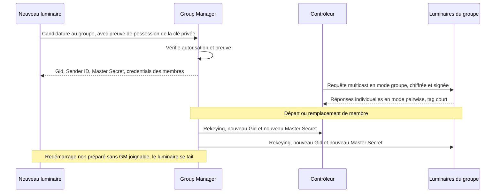
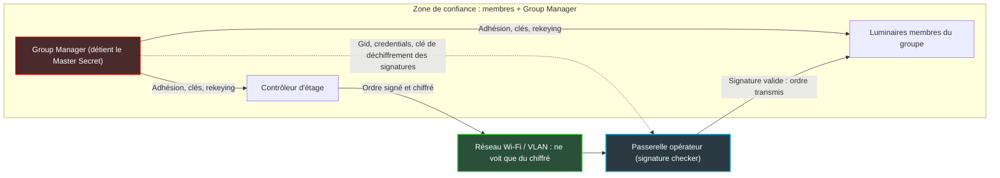

## Un ordre, quarante plafonniers

Vingt-deux heures dans un hôtel de 300 chambres. Depuis la réception, un seul ordre part sur le réseau, et les quarante plafonniers du couloir du troisième étage passent ensemble en éclairage de nuit. Personne ne le remarque, et c'est exactement le but. Derrière ce geste banal se cache pourtant une question que peu de directions informatiques se posent : qui d'autre aurait pu envoyer cet ordre ?

Pendant plus de dix ans, le protocole conçu par l'IETF (l'organisme qui normalise les protocoles d'Internet) pour ces petits objets n'a eu aucune réponse standard à cette question dès qu'un message s'adressait à un groupe plutôt qu'à un appareil isolé. Le sujet concerne au premier chef ceux qui exploitent l'infrastructure de bâtiments par centaines : hôtels, résidences étudiantes, plateaux de bureaux, magasins. Éclairage, chauffage, mises à jour de capteurs : tout ce qui se pilote en grappe.

En novembre 2026, l'IETF a publié un nouveau standard, la RFC 10021, baptisé Group OSCORE. Il comble enfin ce trou. Mais il ne fait pas disparaître la confiance : il la concentre dans une pièce unique du système, le Group Manager. La bonne question n'est donc plus « est-ce chiffré ? ». C'est « qui tient le trousseau ? ».

## Le haut-parleur que la sécurité IoT ne savait pas protéger

Pour comprendre le trou, il faut descendre dans la tuyauterie. Capteurs sur pile, luminaires, vannes de chauffage : pour cette famille d'objets contraints, le protocole de référence de l'IETF s'appelle CoAP (Constrained Application Protocol), standardisé en juin 2014 dans la [RFC 7252](https://www.rfc-editor.org/rfc/rfc7252.txt). C'est en quelque sorte le HTTP des petits objets : mêmes verbes, même logique de ressources, mais sur UDP et avec des messages de quelques dizaines d'octets. Et CoAP sait faire ce que HTTP ne sait pas : adresser une requête à tout un groupe d'appareils d'un coup, en multicast IP.

Le problème tient dans une phrase de la RFC 7252 elle-même. Son paragraphe 8.1 explique que les messages multicast ne peuvent voyager qu'en UDP simple, pas en DTLS (la déclinaison de TLS pour UDP), et conclut que « the security modes defined for CoAP in this document are not applicable to multicast ». Autrement dit, la sécurité standard du protocole s'arrête là où commence le groupe.

La raison est presque mécanique. DTLS repose sur une poignée de main entre deux parties qui négocient leurs clés. C'est une ligne téléphonique privée qu'on établit avec un interlocuteur. Le multicast, lui, ressemble à une annonce au haut-parleur dans un hall de gare. On ne négocie pas une ligne privée avec quarante auditeurs à la fois. La RFC 10021 le confirme, et précise que DTLS et Group OSCORE ne se combinent qu'en unicast (§13.10).

La première brique de la solution est arrivée en juillet 2019 avec OSCORE (Object Security for Constrained RESTful Environments, [RFC 8613](https://www.rfc-editor.org/rfc/rfc8613.txt)). Le changement de logique est net : au lieu de blinder le tuyau, on scelle le message. C'est la différence entre un fourgon blindé et une enveloppe cachetée à la cire. L'enveloppe peut transiter par dix proxys ou passerelles sans que personne ne puisse la lire ni la modifier. OSCORE s'appuie pour cela sur COSE, le format compact de chiffrement et de signature que l'IETF a conçu pour ces objets.

Mais OSCORE ne protège qu'une conversation à deux. Dès 2019, la RFC 8613 renvoyait explicitement le cas du groupe vers un brouillon séparé, alors en version -04. Il aura donc fallu plus de sept ans pour en faire un standard, porté par des auteurs de RISE (l'institut de recherche suédois) et d'Ericsson. Group OSCORE arrive en tandem avec la [RFC 10020](https://www.rfc-editor.org/info/rfc10020), « Group Communication for CoAP », publiée le même mois : elle remplace l'ancienne RFC 7390 et confie précisément sa sécurité à Group OSCORE.

## Comment un groupe se forme, vit et se reforme

Group OSCORE reprend l'enveloppe scellée d'OSCORE, sa dérivation de clés et sa compression d'en-têtes. Il ajoute ce qui manquait : une notion de groupe, avec des membres, un identifiant et un secret partagé. Et il introduit un personnage nouveau, au centre de tout : le Group Manager, ou GM.

Prenons un luminaire neuf, tout juste posé au plafond. Pour rejoindre le groupe de l'étage, il s'adresse au GM, qui vérifie deux choses (§12.1) : que le candidat possède bien la clé privée qu'il revendique, et qu'il est autorisé à entrer. Si tout est en ordre, le GM lui attribue un identifiant d'émetteur unique, le Sender ID.

Il lui transmet ensuite trois éléments. L'identifiant du groupe (Gid). Le Master Secret, dont dérivent toutes les clés. Et les credentials des autres membres, c'est-à-dire leurs clés publiques et leurs identités.

Le GM est aussi celui qui fait le ménage. À chaque départ d'un membre, la RFC ne laisse aucune marge : il doit « rekey the group without undue delay » (§12.2), c'est-à-dire renouveler le matériel cryptographique de tout le groupe sans délai injustifié. Même chose à l'arrivée d'un nouveau membre, si l'on veut l'empêcher de déchiffrer le trafic antérieur. L'annexe D recense au total douze responsabilités pour ce rôle, de la création des groupes à la politique d'autorisation en passant par le dépôt des credentials.

*Cycle de vie d'un groupe Group OSCORE : adhésion, ordre multicast signé, réponses pairwise, rekeying au départ d'un membre, silence en cas de redémarrage sans GM joignable.*

Un détail compte plus qu'il n'y paraît : la RFC précise que le GM n'a pas besoin d'être membre du groupe (§1.1). Il peut vivre ailleurs, dans un cloud, un local technique ou chez un prestataire. Cette liberté d'architecture est précisément ce qui rend la question « qui l'opère ? » si lourde de conséquences.

*Un trousseau central, des dizaines d'objets : chaque départ de membre impose de révoquer et de redistribuer les clés de tout le groupe.*

## Signer pour quarante, répondre en tête-à-tête

Une fois le groupe constitué, Group OSCORE offre deux manières de protéger un message. Elles n'ont ni le même coût ni les mêmes garanties.

Le **mode groupe** est fait pour le haut-parleur. L'émetteur chiffre le message avec la clé du groupe, puis le signe avec sa propre clé privée, sous forme de contre-signature COSE (RFC 9338). Chaque luminaire peut ainsi vérifier qui a envoyé l'ordre, et pas seulement qu'il vient « de quelqu'un du groupe ». Une passerelle intermédiaire peut même vérifier cette signature au passage. Nous y reviendrons.

Le **mode pairwise** est fait pour le tête-à-tête. Deux membres dérivent une clé symétrique commune à partir de leurs clés publiques respectives, via un échange Diffie-Hellman dit statique-statique qui ne demande aucun aller-retour réseau. Leurs messages portent alors un simple tag d'intégrité court, sans signature. La combinaison typique est élégante : la requête part en mode groupe vers les quarante luminaires, chacun répond en mode pairwise. On économise quarante signatures au retour.

Pourquoi ne pas se contenter du chiffrement de groupe, qui apporte déjà de l'intégrité ? Parce que cette intégrité-là prouve seulement l'appartenance au groupe, pas l'identité de l'émetteur : n'importe quel membre peut dériver la clé d'émission d'un autre (§13.1). Un luminaire compromis pourrait donc se faire passer pour le contrôleur. Seule la signature ferme cette porte.

Cette garantie a un prix, et la RFC le chiffre (§4.3) sur un exemple volontairement minimal : 6 octets de contenu utile, un tag de 8 octets, une signature de 64 octets. Une requête en mode groupe pèse alors 96 octets avant compression, 85 après. La même en mode pairwise : 29 octets, puis 21. Après compression, la signature représente à elle seule les trois quarts du message (64 octets sur 85). Ce sont des exemples théoriques, pas des mesures terrain. Mais sur un lien radio très contraint comme 6LoWPAN (IPv6 sur réseaux radio basse consommation), l'ordre de grandeur suffit à orienter une architecture.

Côté cryptographie, le socle obligatoire est du classique éprouvé : AES-CCM pour le chiffrement authentifié, des courbes elliptiques standard (Ed25519 ou P-256) pour la signature et l'accord de clés. Rien d'exotique. Les maths ne sont pas le maillon faible de ce standard.

*Une requête signée pour tout le groupe, des réponses courtes en tête-à-tête : la contre-signature de 64 octets pèse lourd sur les liens contraints.*

## Le Group Manager voit tout, et tout dépend de lui

C'est ici que « de bout en bout » mérite une lecture en petits caractères. Le GM connaît le Master Secret, que la RFC demande de garder secret entre les membres et lui (§13.11). Par construction, il peut donc déchiffrer tout le trafic du groupe. La RFC l'assume (§13.1) : la confidentialité vaut au niveau du groupe, face à un tiers extérieur, pas face aux membres ni face au GM. « De bout en bout » signifie ici : entre les membres, plus le gardien du trousseau.

Revenons à l'hôtel. Group OSCORE, c'est remplacer des portes sans serrure par de vraies serrures. Le progrès est indiscutable. Mais il existe désormais un passe-partout, et la sécurité de tout l'établissement dépend de la personne qui le garde, de l'endroit où elle le range et de la vitesse à laquelle elle change les barillets quand un employé s'en va.

Deuxième nuance : la RFC impose d'adopter un schéma de gestion des clés pour la révocation et le renouvellement, c'est un MUST (§13.4). Mais elle ne le standardise pas. Elle renvoie, à titre informatif, vers un brouillon du groupe de travail ACE (Authentication and Authorization for Constrained Environments) qui décrit un schéma simple, et prévient que les grands groupes dynamiques pourront exiger des mécanismes plus scalables.

Or ce brouillon n'est pas encore une RFC. Au 22 novembre 2026, il attend dans la file de l'éditeur des RFC, à l'état « Blocked: Final Approval Pending », dans sa révision -21 du 14 mars 2026. La [RFC 9594](https://www.rfc-editor.org/rfc/rfc9594.html), publiée en septembre 2024, couvre bien le provisioning de clés de groupe via ACE, mais le profil propre à Group OSCORE est un document distinct. Traduction : la façon dont l'appareil d'un fabricant A rejoint un groupe géré par le GM d'un fabricant B n'est pas encore figée dans une RFC. Ce n'est pas un défaut du standard. C'est un point de vigilance pour qui signe un contrat aujourd'hui.

Troisième nuance, la plus opérationnelle : la disponibilité. Imaginez une micro-coupure de courant sur l'étage. Les quarante luminaires redémarrent sans avoir pu sauvegarder leur contexte d'émission, ce que la RFC appelle un redémarrage non préparé. Elle est alors stricte (§2.6.1.1) : l'appareil ne doit plus protéger de nouveaux messages avec l'ancien contexte et doit récupérer de nouveaux paramètres auprès du GM. S'il n'y parvient pas, il ne doit plus ni envoyer ni accepter de messages du groupe, faute de pouvoir détecter les rejeux. Le couloir devient sourd.

La RFC décrit elle-même l'attaque qui en découle (§13.4.1) : couper le chemin vers le GM, par un faux DNS ou un lien sectionné, puis provoquer un redémarrage par une brève coupure d'alimentation. Aucune clé à casser pour réduire un étage au silence. Pour un parc d'éclairage ou de gestion technique du bâtiment exposé aux aléas du secteur, la disponibilité du GM cesse d'être un détail d'architecture. Elle devient un engagement de niveau de service.

Dernier point, les transitions (§13.5). Pendant un rekeying, émetteurs et destinataires peuvent être brièvement désalignés. La RFC laisse à l'application le choix de conserver ou non les anciens contextes, mais prévient qu'un ancien membre compromis pourrait en abuser : une politique prudente ne les garde pas. Sur un grand groupe, l'opération peut en outre prendre du temps.

*Lien coupé vers le Group Manager, micro-coupure de courant : les luminaires qui redémarrent doivent se taire tant qu'ils n'ont pas récupéré de nouvelles clés.*

## Qui tient le trousseau ? Trois modèles, un parti pris

Ce qui suit relève de mon analyse, pas du texte de la RFC. Le standard décrit ce que fait un GM. Il ne dit pas qui doit l'opérer. Trois modèles se dessinent.

**Le GM opéré par l'exploitant de l'infrastructure**, en plateforme centrale, au même titre qu'une PKI (infrastructure à clés publiques) ou un fournisseur d'identité. On y gagne un point unique d'audit, une astreinte 24/7 et une politique d'adhésion homogène sur des centaines de sites. On y perd en dispersion du risque : ce GM devient un actif aussi sensible qu'une autorité de certification, et sa joignabilité depuis chaque site conditionne la reprise après coupure.

**Le GM fourni par le fabricant ou l'intégrateur** du système bâtiment. C'est le chemin de moindre résistance, tout arrive pré-intégré. C'est aussi celui qui soulève le plus de questions. Le fabricant détient alors le Master Secret de vos groupes, donc la capacité technique de lire leur trafic. Et le jour où vous changez de prestataire, rien dans la RFC ne règle la réversibilité des clés.

**Le GM local, un par site.** Autonomie maximale : une coupure du lien WAN n'empêche pas un étage de redémarrer. Mais on multiplie les GM par le nombre de sites, avec autant de sauvegardes, de correctifs et d'audits. La RFC signale elle-même (§13.6) le risque de collision d'identifiants de groupe entre des GM qui ne se coordonnent pas.

Mon parti pris : le GM est une fonction de plateforme. Il doit être opéré par celui qui exploite déjà l'identité et la supervision du parc, avec une instance au plus près des sites pour que la reprise après une coupure ne dépende pas du WAN. Concrètement, le premier modèle, avec une dose du troisième pour la résilience. Le modèle fabricant n'est acceptable qu'assorti d'une clause de réversibilité des clés et d'un journal d'audit accessible au client.

Reste une subtilité qui intéresse directement l'opérateur réseau, même s'il ne garde pas le trousseau. Transporter les paquets et détenir la confiance du groupe sont deux métiers distincts. La RFC prévoit justement un rôle intermédiaire, le signature checker (§7.5, §12.3). Cette entité semi-fiable, typiquement une passerelle, obtient du GM l'identifiant de groupe courant, les credentials des membres et une clé dédiée au déchiffrement des signatures. Elle peut alors vérifier qu'un ordre vient bien du contrôleur légitime et rejeter les faux, sans jamais lire le contenu.

C'est un douanier qui contrôle le tampon sur l'enveloppe sans avoir le droit de l'ouvrir. Selon la RFC (§13.1), il ne peut pas casser l'authentification de la source. Il casse seulement la « group privacy » à son niveau : il sait qui parle. Pour un opérateur, c'est une façon de filtrer en bordure sans entrer dans la zone de confiance de la confidentialité.

*Zones de confiance : le Group Manager et les membres partagent le secret, la passerelle opérateur vérifie les signatures sans pouvoir lire les messages.*

L'annexe B de la RFC liste ses propres cas d'usage : contrôle d'éclairage, où des événements espacés de moins de 200 ms sont perçus comme simultanés ; pilotage intégré du bâtiment, où quelques secondes de délai restent acceptables ; mises à jour de firmware en multicast ; mise en service ; alertes d'urgence. Transposés à nos verticales, et c'est une hypothèse éditoriale qu'aucune source n'établit, cela donne les scènes d'éclairage en hôtellerie. Ou les parcs denses des résidences étudiantes, où chaque remplacement de matériel déclenche un rekeying. Ou encore les mises à jour groupées de capteurs et d'étiquettes en tertiaire et en retail.

## Un bon standard, pas encore un écosystème

Soyons lucides sur la maturité. Le rapport de suivi rédigé à l'IETF avant publication cite deux implémentations ayant interopéré sur les versions les plus récentes du brouillon : Californium, en Java, et aiocoap, en Python. Au moins trois autres ont été testées sur des versions antérieures. Aucune donnée d'adoption industrielle n'est publique.

Côté grands écosystèmes, la RFC ne mentionne ni Matter, le standard de la maison connectée, ni Thread, le réseau maillé basse consommation, ni LwM2M, un protocole de gestion d'objets connectés. Matter dispose de son propre mécanisme de clés de groupe. Thread chiffre au niveau de la couche liaison, avec une clé réseau partagée. LwM2M a bien intégré OSCORE selon les sources secondaires disponibles, mais rien n'y indique une extension au groupe. Aucune source consultée n'établit que l'un d'eux adoptera Group OSCORE. Méfiez-vous de qui vous le présentera comme acquis.

Avant de signer pour un système bâtiment qui promet du « multicast chiffré », cinq questions suffisent à séparer le sérieux du cosmétique :

- Où vit le GM, et comment est-il authentifié, sauvegardé et audité ?
- Que se passe-t-il quand un étage perd le secteur et que le GM est injoignable ?
- Qui peut évincer un membre, et en combien de temps ?
- Quel schéma de rekeying au-delà de quelques dizaines de membres ?
- Quel protocole d'adhésion, tant que le profil ACE n'est pas une RFC ?

Mon verdict est net. Group OSCORE est la bonne réponse à un vrai trou, et le choix de sceller le message plutôt que le tuyau est le bon. Mais il déplace le problème plus qu'il ne le résout : de la radio vers l'exploitation. Un multicast chiffré dont personne ne sait dire qui opère le Group Manager n'est chiffré qu'en apparence. La cryptographie est réglée. Le travail d'exploitation, lui, commence.

## Sources

1. RFC 10021, « Group Object Security for Constrained RESTful Environments (Group OSCORE) », IETF, novembre 2026 — https://www.rfc-editor.org/rfc/rfc10021.html
2. RFC Editor, page d'information RFC 10021 — https://www.rfc-editor.org/info/rfc10021
3. RFC 10020, « Group Communication for CoAP », IETF, novembre 2026 — https://www.rfc-editor.org/info/rfc10020
4. RFC 8613, « Object Security for Constrained RESTful Environments (OSCORE) », juillet 2019 — https://www.rfc-editor.org/rfc/rfc8613.txt
5. RFC 7252, « The Constrained Application Protocol (CoAP) », juin 2014 — https://www.rfc-editor.org/rfc/rfc7252.txt
6. RFC 9594, « Key Provisioning for Group Communication Using ACE », septembre 2024 — https://www.rfc-editor.org/rfc/rfc9594.html
7. IETF Datatracker, draft-ietf-ace-key-groupcomm-oscore (révision -21, mars 2026) — https://datatracker.ietf.org/doc/draft-ietf-ace-key-groupcomm-oscore/
8. IETF Datatracker, write-up de draft-ietf-core-oscore-groupcomm — https://datatracker.ietf.org/doc/draft-ietf-core-oscore-groupcomm/writeup/
9. Nordic Semiconductor, Matter Group Communication — https://nrfconnectdocs.nordicsemi.com/addons/ncs-matter/latest/matter/overview/group_communication.html
10. Wikipedia, OMA LwM2M — https://en.wikipedia.org/wiki/OMA_LWM2M
11. Thread Group, Thread Security white paper — https://www.threadgroup.org/Portals/0/Documents/thread_security_white_paper.pdf ; Silicon Labs, OpenThread Security — https://docs.silabs.com/openthread/2.7.1/thread-fundamentals/09-security

_Vues personnelles, pas position Wifirst._
