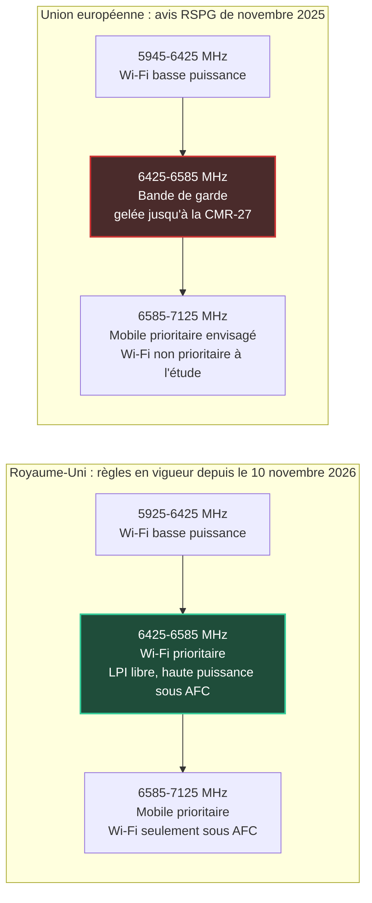
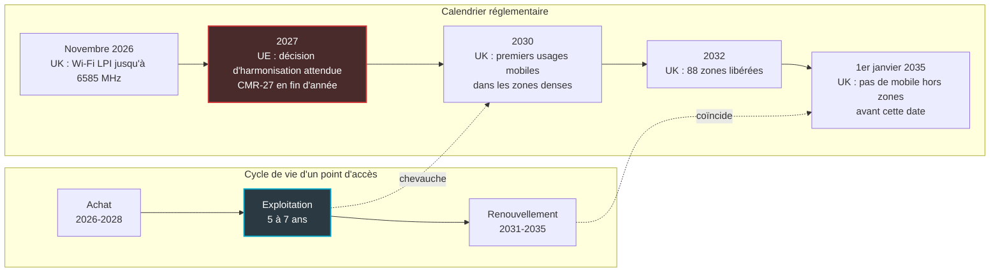

## Un pari de sept ans vissé au plafond

Un point d'accès Wi-Fi fixé cet hiver au plafond d'une chambre d'hôtel y sera très probablement encore en 2032. C'est la réalité comptable de notre métier : un équipement réseau d'intérieur s'amortit sur cinq à sept ans, et personne ne remonte sur l'escabeau tant qu'il fonctionne. Hôteliers, gestionnaires de résidences étudiantes, enseignes de retail, établissements de santé : tous ceux qui lancent aujourd'hui un appel d'offres Wi-Fi 7 (la génération actuelle de la norme) achètent, souvent sans le savoir, un pari sur l'état du spectre radio au début des années 2030.

Ce pari vient de changer de cote. Le 17 novembre 2026, Ofcom, le régulateur britannique des télécoms, a publié la dernière pièce en date d'un dispositif qui partage le haut de la bande 6 GHz entre le Wi-Fi et les réseaux mobiles. Une semaine plus tôt, le 10 novembre, le Wi-Fi britannique avait déjà gagné 160 MHz de fréquences supplémentaires. Sur le continent, l'Europe garde exactement la même tranche sous scellés, au moins jusqu'à fin 2027.

Deux régulateurs voisins, deux lectures opposées de la même ressource. Pour qui rédige un cahier des charges Wi-Fi en France, la question devient très concrète : faut-il payer dès maintenant pour des fréquences qui n'existent pas encore chez nous ?

Ma réponse est non. Ces 160 MHz sont un bonus de capacité, pas une base de dimensionnement. Reste à savoir quoi exiger de ses fournisseurs pour le jour où Bruxelles tranchera.

## Le spectre, c'est du foncier

Pour comprendre ce qui se joue, regardez le spectre radio comme un plan cadastral. Chaque bande de fréquences est un terrain. Certains sont constructibles par tous, sans permis : c'est le régime du Wi-Fi, qui fonctionne sans licence. D'autres sont des lots vendus aux enchères à des opérateurs mobiles, qui y bâtissent leurs réseaux en exclusivité.

La bande 6 GHz représente 1 200 MHz de terrain, de 5925 à 7125 MHz. En France comme dans le reste de l'Union européenne, la partie basse est déjà viabilisée pour le Wi-Fi : 480 MHz entre 5945 et 6425 MHz, là où tournent aujourd'hui les déploiements Wi-Fi 6E et Wi-Fi 7 en intérieur. La partie haute, de 6425 à 7125 MHz, est le terrain disputé. Les opérateurs mobiles la convoitent pour leurs futures générations de réseaux. L'industrie du Wi-Fi la veut pour multiplier les canaux larges.

Aux États-Unis, la querelle est tranchée depuis 2020. La [FCC](https://docs.fcc.gov/public/attachments/fcc-20-51a1.pdf) (Federal Communications Commission, le régulateur américain) a ouvert les 1 200 MHz au Wi-Fi sans licence, sans place pour le mobile. Les points d'accès basse puissance en intérieur y exploitent toute la bande ; la haute puissance, elle, est limitée à 850 MHz sous coordination automatique.

Ofcom a choisi une troisième voie : le lotissement partagé. Il l'a construit en quatre temps, ce qui explique pourquoi tant de commentaires mélangent les dates.

- **9 janvier 2026** : décision de principe de partager 6425-7125 MHz entre Wi-Fi et mobile, avec des licences mobiles attribuées par zones plutôt qu'à l'échelle nationale.
- **20 juillet 2026** : découpage de la bande. Le Wi-Fi devient prioritaire sur 6425-6585 MHz (160 MHz), le mobile sur 6585-7125 MHz (540 MHz).
- **30 octobre 2026** : publication des règlements d'application, pris le 27 octobre et entrés en vigueur le **10 novembre 2026**.
- **17 novembre 2026** : calendrier du mobile, avec 88 zones urbaines denses, 156 liaisons fixes à déplacer et l'horizon 2035 pour le reste du territoire.

Sur les 160 MHz réservés au Wi-Fi, les règles reprennent celles de la bande basse. En intérieur, le mode LPI (Low Power Indoor, de l'ordre de 250 mW de puissance rayonnée) fonctionne librement, sans licence ni coordination. Pour l'extérieur ou la haute puissance (*standard power*), il faut passer par l'AFC (Automated Frequency Coordination). Le principe : une base de données en ligne indique à chaque point d'accès, selon sa position, les fréquences qu'il peut utiliser sans brouiller les autres occupants.

Au-dessus de 6585 MHz, changement de régime. Le mode LPI y est interdit. Le Wi-Fi n'y entre qu'en haute puissance, sous AFC, sans aucune priorité face au mobile. Retenez cette frontière à 6585 MHz : tout le raisonnement d'achat qui suit en découle.

*Une même bande, plusieurs régimes : le 6 GHz se découpe désormais en lots aux règles distinctes, qui ne sont pas les mêmes des deux côtés de la Manche.*

## Le mobile arrive, mais en ville et pas avant 2030

Prenez un hôtel situé dans l'un des centres urbains les plus denses du Royaume-Uni. Des antennes mobiles pourraient y exploiter le haut de la bande 6 GHz dès 2030. Le même hôtel à la campagne ne devrait pas en voir avant 2035. C'est, en substance, ce que fixe la décision du 17 novembre.

Le régulateur y adopte les 88 zones à haute densité proposées lors de sa consultation d'avril 2026. D'après [ISPreview](https://www.ispreview.co.uk/index.php/2026/11/ofcom-updates-on-release-of-upper-6ghz-band-for-uk-mobile-and-wi-fi.html) et les éléments publiés par Ofcom, ces zones doivent être entièrement libérées pour le mobile en 2032, avec des premiers usages possibles dès 2030. Hors de ces zones, Ofcom ne prévoit pas d'autoriser le mobile avant le 1er janvier 2035 et dit attendre davantage d'éléments pour se prononcer. L'attribution des licences mobiles est visée pour 2029-2030, selon la presse spécialisée.

Pourquoi deux ans d'écart entre 2030 et 2032 ? Parce que le terrain a déjà des locataires. Selon le texte de consultation, environ 500 liaisons fixes point à point occupent la bande : ces faisceaux hertziens qui relient deux antennes en ligne droite. Ofcom en juge 156 incompatibles avec le mobile dans les zones denses, contre 206 dans sa consultation du printemps. Il lance leur procédure de révocation et cesse d'accorder de nouvelles licences incompatibles dans ces zones. Ailleurs, la bande reste ouverte aux liaisons fixes. Le cabinet de conformité [Entirety](https://www.entirety.biz/uk-upper-6-ghz-spectrum-framework-2026/) précise que ces 156 licences ne sont pas encore révoquées.

C'est ici qu'apparaît la date de février 2032, largement reprise outre-Manche. Dans les extraits d'Ofcom que j'ai pu consulter, il est question de 2032. ISPreview, Entirety et LexisNexis avancent février 2032 une fois la libération des liaisons terminée ; je n'ai pas pu confirmer ce mois dans le texte primaire. D'un côté, Entirety anticipe des décisions finales de révocation en février 2027, après les observations des titulaires début janvier. De l'autre, le cabinet [Bratby Law](https://bratby.law/upper-6-ghz-fixed-links-clearance/) explique, dans son analyse du texte de consultation, que les licences de liaisons fixes prévoient un préavis de cinq ans. Il s'agit d'une clause des licences, pas d'un minimum légal, et le titulaire supporte seul le coût de sa migration. Entirety fait courir ce préavis à partir de la décision finale. Février 2027 plus cinq ans : février 2032, le mois retenu par la presse spécialisée et les analyses juridiques. C'est un calcul cohérent, mais je n'ai pas pu le vérifier dans le texte du régulateur. Je m'en tiens à 2032.

Deux autres occupants sont ménagés. La tranche 7110-7125 MHz est retirée de la plupart des usages PMSE (Programme Making and Special Events, les liaisons audio et vidéo des tournages et grands événements). La radioastronomie reste protégée entre 6650 et 6675,2 MHz, autour de six sites actifs.

*88 zones urbaines denses : c'est là, et seulement là, que le mobile haute puissance pourra s'installer au Royaume-Uni avant 2035.*

Pour un exploitant de sites intérieurs présent outre-Manche, ma lecture est la suivante : l'exposition se mesure site par site, pas à l'échelle du parc. Un hôtel de gare situé dans une zone dense doit planifier une coexistence à partir de 2030-2032. Un hôtel de campagne garde le haut de la bande comme levier Wi-Fi au moins jusqu'en 2035. Et même en zone dense, le mobile s'installera au-dessus de 6585 MHz, là où le Wi-Fi intérieur basse puissance n'a de toute façon pas le droit d'aller. La coexistence touchera d'abord les usages Wi-Fi sous AFC, pas le cœur du réseau indoor.

## Paris n'est pas Londres

Ofcom statue pour le Royaume-Uni, et pour lui seul. Pour un acheteur français, l'horizon réglementaire se décide ailleurs : à l'échelle mondiale au sein de l'UIT (Union internationale des télécommunications), puis à Bruxelles, puis à l'ARCEP.

Le décor mondial a été planté fin 2023 à la CMR-23, la Conférence mondiale des radiocommunications. D'après le [document de consultation de l'ARCEP](https://www.arcep.fr/uploads/tx_gspublication/consultation-frequences-2030_oct2025.pdf), la bande 6425-7125 MHz y a été identifiée pour le service mobile dans la Région 1, qui englobe l'Europe. Cette identification n'impose rien. Elle laisse simplement ouverte l'option d'une harmonisation mobile sur le continent.

Le signal européen le plus net date du 12 novembre 2025 : l'[avis du RSPG](https://radio-spectrum-policy-group.ec.europa.eu/document/download/3301c2fd-7bff-4ecf-bfcd-cfb572a5972f_en?filename=RSPG25-031final-RSPG-Opinion-Upper_6GHz_band.pdf) (Radio Spectrum Policy Group, l'instance des États membres qui conseille la Commission européenne sur le spectre) sur l'avenir de la bande haute. Sur la partie supérieure, Londres et Bruxelles convergent : 6585-7125 MHz irait en priorité au mobile. Sur les 160 MHz du bas, tout diverge. Là où Ofcom vient d'ouvrir 6425-6585 MHz au Wi-Fi, le RSPG en fait une bande de garde jusqu'à la CMR-27. Les États membres n'y autorisent ni le mobile ni le Wi-Fi.

Pour reprendre l'image du cadastre : Londres a tracé les lots et délivré les permis, Bruxelles a posé une palissade autour du terrain en attendant l'issue d'un autre chantier.

Ce chantier, c'est la bande voisine 7125-7250 MHz, inscrite à l'ordre du jour de la CMR-27 fin 2027. Le RSPG lie explicitement les deux dossiers. Si la conférence identifie 7125-7250 MHz pour le mobile, il voit de solides raisons de donner 6425-6585 MHz au Wi-Fi à titre prioritaire. Dans le cas contraire, la balance penche vers le mobile. L'avis demande aussi à la CEPT (Conférence européenne des administrations des postes et télécommunications) d'étudier un accès Wi-Fi non prioritaire dans la partie mobile, dont la faisabilité n'est pas établie.

Le RSPG ne voit pas de besoin immédiat significatif tant que la bande basse n'est pas saturée, mais réclame une direction claire bien avant 2030. La Wi-Fi Alliance, rapportait alors [TelecomTV](https://www.telecomtv.com/content/5g/mobile-fends-off-wi-fi-challenge-for-upper-6-ghz-band-in-europe-54300/), s'est dite très déçue.

Côté calendrier, l'ARCEP indiquait en octobre 2025 qu'une décision d'harmonisation de la Commission était attendue en 2027. Je n'ai trouvé aucune décision de l'ARCEP sur le haut de la bande à ce jour. Sa consultation de l'automne 2025 interrogeait le marché sur l'intérêt de ces fréquences pour le mobile. Elle rappelait aussi qu'elles servent aujourd'hui aux faisceaux hertziens et aux liaisons montantes vers les satellites. Le site britannique [BroadbandSwitch](https://broadbandswitch.uk/insights/ofcom-6ghz-wifi-10-november-2026/) résume l'écart : 660 MHz de Wi-Fi basse puissance au Royaume-Uni, contre 480 MHz dans l'Union européenne.

*La même tranche de 160 MHz, deux destins : ouverte au Wi-Fi à Londres, gelée à Bruxelles jusqu'à la CMR-27.*

## 160 MHz de gagnés, pas 700

Sur le papier, le Wi-Fi britannique peut désormais accéder à 700 MHz supplémentaires. En pratique, un point d'accès intérieur n'en verra que 160. Et pas tout de suite.

Premier frein, le logiciel. Les équipements ne gagnent pas les nouveaux canaux tout seuls : il faut une mise à jour de firmware qui reconnaisse la nouvelle plage britannique. Au 4 novembre, BroadbandSwitch ne recensait aucune annonce de constructeur en ce sens.

Second frein, la coordination. L'AFC fonctionne comme une tour de contrôle : chaque point d'accès en haute puissance doit s'y réenregistrer toutes les 24 heures pour conserver ses fréquences. Pas de tour, pas de décollage. Or Ofcom devait ouvrir les candidatures des futurs opérateurs d'AFC le 1er septembre 2026, et aucun fournisseur enregistré n'apparaissait au 4 novembre, toujours selon BroadbandSwitch. La haute puissance reste donc théorique, sur les 160 MHz comme au-dessus.

La suite de cette section relève de mon analyse, pas d'une position des régulateurs.

Au-dessus de 6585 MHz, il ne reste au Wi-Fi que la haute puissance sous AFC, sans priorité, avec l'obligation de s'effacer devant le mobile. Ce régime peut convenir à un parvis ou à un stade. Il ne convient pas à une résidence de 400 studios où chaque point d'accès doit garder des canaux stables, soir après soir. Un appel d'offres indoor ne devrait donc rien payer de plus pour un support de la partie 6585-7125 MHz.

Le vrai gain tient dans les 160 MHz du bas, et il se compte en canaux. Mon calcul, sous réserve du plan de canaux exact de la norme Wi-Fi 7 (IEEE 802.11be) : la bande européenne de 480 MHz loge trois canaux de 160 MHz sans chevauchement, ou six canaux de 80 MHz. Étendue jusqu'à 6585 MHz, la plage utilisable atteint 640 MHz. Cela donne quatre canaux de 160 MHz, huit de 80 MHz, et deux canaux de 320 MHz au lieu d'un seul.

Les plaquettes commerciales mettront en avant ce second canal de 320 MHz. Dans un hôtel de 200 chambres, c'est un argument de salon professionnel : un canal aussi large est rarement exploitable quand des dizaines de points d'accès s'entendent à travers les cloisons et les dalles. Ce qui compte, c'est la réutilisation. Deux canaux de 80 MHz en plus, c'est un tiers de marge supplémentaire pour séparer les étages et les chambres voisines. Moins spectaculaire, mais c'est ce qui fait la qualité de service un samedi soir de forte affluence.

## Deux calendriers qui se percutent

Posez les deux calendriers l'un sur l'autre et le problème saute aux yeux. Un point d'accès acheté entre 2026 et 2028, amorti sur cinq à sept ans, sera renouvelé entre 2031 et 2035. C'est précisément la fenêtre où tout se joue : décision européenne attendue en 2027, CMR-27 en fin d'année, premiers usages mobiles britanniques en 2030, zones denses libérées en 2032, reste du territoire britannique pas avant 2035.

*Cycle d'achat contre calendrier radio : les échéances britanniques de 2030 et 2035 tombent en pleine durée de vie du parc.*

Autrement dit, le matériel que vous signez cette année vivra sous des règles qui n'existent pas encore. La réponse n'est pas d'attendre, ni de surpayer une promesse. Elle consiste à acheter de la flexibilité et à la faire écrire noir sur blanc.

Voici ce que je mettrais dans un cahier des charges Wi-Fi 7 rédigé en France aujourd'hui. Ce sont mes recommandations d'acheteur, pas une exigence réglementaire.

1. **Une radio 6 GHz qui couvre physiquement 5925-7125 MHz**, avec un profil pays modifiable par firmware. Sur le principe, cela ne devrait rien coûter : le marché américain utilise déjà toute la bande depuis 2020.
2. **Un client AFC intégré au firmware**, sans matériel dédié, pour ne pas fermer la porte à la haute puissance si l'Europe l'ouvre un jour.
3. **Un engagement écrit de mise à jour du domaine réglementaire** sur toute la durée d'amortissement. C'est là que se loge la vraie valeur : une bande ouverte sans firmware à jour ne sert à rien, et le Royaume-Uni en a fait la démonstration début novembre.
4. **Aucun supplément pour la bande haute.** Ni pour un support 6585-7125 MHz en intérieur, ni pour un Wi-Fi 8 (la génération suivante, en cours de normalisation) vendu sur la promesse de ces fréquences.

Reste l'AFC, que je traite comme une dépendance contractuelle à part entière. Un point d'accès en haute puissance dépend d'un service cloud tiers qu'il doit interroger chaque jour. Qui opère ce service ? Avec quel engagement de disponibilité ? Et que fait le point d'accès si la base ne répond plus ? Ces trois questions doivent figurer dans le contrat, pas dans la foire aux questions du constructeur.

Pour les secteurs régulés comme la santé, rien ne bouge à court terme. L'architecture reste bâtie sur 5945-6425 MHz et sur le 5 GHz. Les 160 MHz supplémentaires seront un bonus non critique le jour où ils arriveront, jamais un prérequis pour un service de soins.

*Un point d'accès acheté en 2026 sera renouvelé entre 2031 et 2035 : exactement la fenêtre où se joue le partage du 6 GHz haut.*

## Dimensionner sur 480 MHz, négocier le reste

Je crois qu'Ofcom a fait le choix le plus pragmatique d'Europe : le Wi-Fi tout de suite, là où il sert déjà ; le mobile là où la densité le justifie ; un calendrier lisible jusqu'en 2035. L'Union européenne, elle, gèle 160 MHz pendant au moins deux ans en attendant l'issue d'une négociation mondiale. On peut comprendre la prudence. Mais ce sont les réseaux intérieurs, hôtels, résidences, commerces, qui en paient le prix en canaux.

Un acheteur français ne choisit pas son régulateur, en revanche. Ma règle tient en quatre lignes. Dimensionner sur les 480 MHz qui existent. Traiter les 160 MHz suivants comme une option logicielle. Ignorer 6585-7125 MHz pour l'intérieur. Et faire porter le risque réglementaire par le contrat fournisseur plutôt que par le budget d'investissement.

Trois signaux me feront réviser cette position. D'abord l'issue de la CMR-27 sur 7125-7250 MHz, qui conditionne le sort des 160 MHz européens. Ensuite les décisions finales de révocation des liaisons fixes britanniques, attendues en février 2027 : elles diront si l'échéance de 2032 tient. Enfin l'enregistrement du premier fournisseur d'AFC au Royaume-Uni, qui fera passer la haute puissance du statut de promesse à celui de service.

Le spectre se négocie à l'UIT et à Bruxelles. La flexibilité, elle, se négocie avec vos fournisseurs. Et c'est maintenant, pas en 2028.

_Vues personnelles, pas position Wifirst._

## Sources

1. Ofcom, Statement: Expanding access to the 6 GHz band for commercial mobile and Wi-Fi services (page de suivi des étapes du 9 janvier, du 20 juillet et du 30 octobre 2026) : https://www.ofcom.org.uk/spectrum/innovative-use-of-spectrum/consultation-expanding-access-to-the-6-ghz-band-for-commercial-mobile-and-wi-fi-services/
2. Ofcom, Expanding access to the 6 GHz band: approach to future mobile use in high density areas and incumbent users (17 novembre 2026) : https://www.ofcom.org.uk/spectrum/innovative-use-of-spectrum/expanding-access-to-the-6-ghz-band-approach-to-future-mobile-use-and-incumbent-users
3. Ofcom, statement sur l'autorisation du Wi-Fi en 6425-6585 MHz (20 juillet 2026) : https://www.ofcom.org.uk/siteassets/resources/documents/consultations/category-3-4-weeks/consultation-expanding-access-to-the-6-ghz-band-for-commercial-mobile-and-wi-fi-services/main-document/statement-expanding-access-to-the-6-ghz-band-for-commercial-mobile-and-wi-fi-services.pdf
4. LexisNexis UK, Ofcom confirms measures to prepare upper 6 GHz band for mobile use (17 novembre 2026) : https://www.lexisnexis.co.uk/legal/news/ofcom-confirms-measures-to-prepare-upper-6-ghz-band-for-mobile-use
5. ISPreview (17 novembre 2026) : https://www.ispreview.co.uk/index.php/2026/11/ofcom-updates-on-release-of-upper-6ghz-band-for-uk-mobile-and-wi-fi.html
6. ISPreview (20 juillet 2026) : https://www.ispreview.co.uk/index.php/2026/07/ofcom-adopt-shared-upper-6ghz-band-for-uk-mobile-and-wi-fi-networks.html
7. Entirety, UK upper 6 GHz spectrum framework (20 novembre 2026) : https://www.entirety.biz/uk-upper-6-ghz-spectrum-framework-2026/
8. 6G Futures (20 novembre 2026) : https://6gfutures.substack.com/p/ofcom-keeps-6gs-new-spectrum-in-the
9. Bratby Law, Upper 6 GHz fixed links clearance (2 juin 2026, mis à jour le 25 octobre 2026) : https://bratby.law/upper-6-ghz-fixed-links-clearance/
10. Bratby Law, consultation Ofcom sur les zones à haute densité (2026) : https://bratby.law/upper-6ghz-spectrum-ofcom-high-density-consultation/
11. Wi-Fi NOW Global (30 octobre 2026) : https://wifinowglobal.com/news-blog/roundup-ofcoms-opens-more-6-ghz-band-fcc-bans-chinese-test-labs-news-from-cisco-hpe-india-pushes-for-higher-power-6-ghz-wi-fi/
12. BroadbandSwitch (4 novembre 2026) : https://broadbandswitch.uk/insights/ofcom-6ghz-wifi-10-november-2026/
13. RSPG, avis sur la vision à long terme de la bande 6 GHz haute (12 novembre 2025), version officielle : https://radio-spectrum-policy-group.ec.europa.eu/document/download/3301c2fd-7bff-4ecf-bfcd-cfb572a5972f_en?filename=RSPG25-031final-RSPG-Opinion-Upper_6GHz_band.pdf ; miroir : https://lafibre.info/images/6g/202511_cee_radio_spectrum_policy_group_bande_haute_6ghz.pdf
14. TelecomTV (14 novembre 2025) : https://www.telecomtv.com/content/5g/mobile-fends-off-wi-fi-challenge-for-upper-6-ghz-band-in-europe-54300/
15. ARCEP, consultation publique sur les fréquences à l'horizon 2030 (13 octobre 2025) : https://www.arcep.fr/uploads/tx_gspublication/consultation-frequences-2030_oct2025.pdf
16. FCC, Report and Order FCC 20-51 (avril 2020) : https://docs.fcc.gov/public/attachments/fcc-20-51a1.pdf
