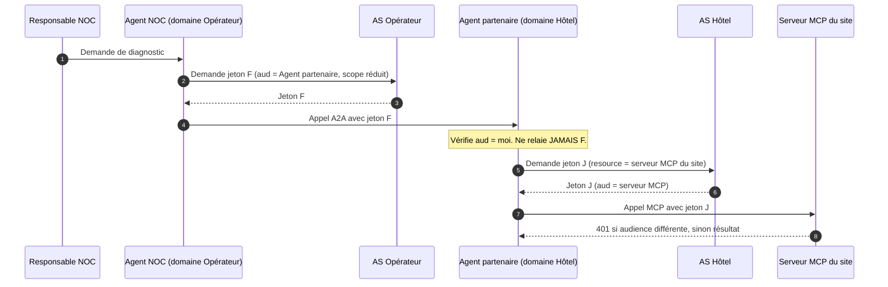
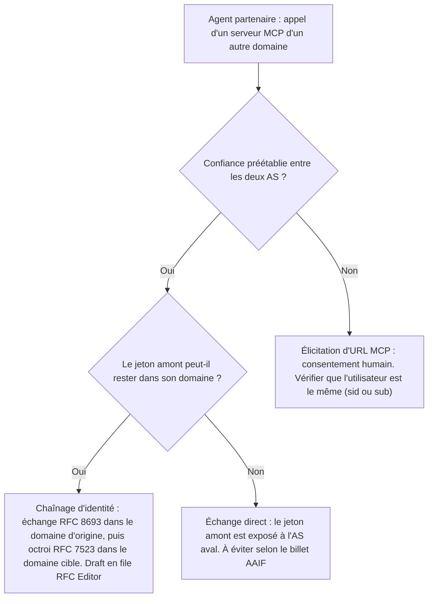

## Vendredi, 21 h 40 : le ticket est clos, et personne n'a rien vu

Vendredi, 21 h 40. Dans un hôtel de 180 chambres, le Wi-Fi des étages trois à cinq décroche au moment où un séminaire envahit la réception. Côté opérateur, un agent IA du centre de supervision (le NOC, pour Network Operations Center) pose un diagnostic, puis passe la main à l'agent du groupe hôtelier. Celui-ci interroge le logiciel de gestion de l'hôtel pour savoir quelles chambres sont occupées avant de redémarrer les bornes. Six minutes plus tard, le ticket est clos.

Lundi, en relisant les journaux, quelqu'un tique. Le jeton d'accès présenté au logiciel de l'hôtel n'avait été émis ni pour l'agent du groupe, ni pour ce logiciel. C'était celui de l'agent NOC, relayé tel quel. Rien n'a été piraté. Mais c'est exactement la mécanique qu'un attaquant rêve d'exploiter : un laissez-passer qui voyage plus loin que prévu, et des journaux incapables de dire qui a agi au nom de qui.

Le scénario est inventé. Chaque brique, elle, existe. Pour qui opère des réseaux dans des centaines d'hôtels, de magasins ou de résidences étudiantes, les chaînes d'agents qui traversent plusieurs entreprises commencent à quitter les démos pour entrer dans les appels d'offres. Le 19 novembre, un guide publié sur le blog de l'Agentic AI Foundation a mis des mots précis sur ce trou. Ma position tient en une phrase : l'autorisation se prouve saut par saut, et c'est un critère d'achat à exiger dès maintenant.

## Le 19 novembre : un guide signé Hitachi, pas une nouvelle norme

Deux protocoles organisent la vie des agents. MCP (Model Context Protocol) relie un agent à ses outils et à ses données : c'est la prise USB entre un modèle et un logiciel métier. A2A (Agent2Agent) fait dialoguer les agents entre eux, d'une entreprise à l'autre s'il le faut : c'est le standard téléphonique. Dans mon scénario, l'agent NOC parle A2A à l'agent du groupe hôtelier, qui parle MCP au système de l'hôtel.

Le 19 novembre, deux ingénieurs d'Hitachi, Yasutaka Mitsumoto et Yoshiyuki Tabata, ont publié sur le blog technique de l'AAIF (Agentic AI Foundation, la fondation qui héberge MCP) un billet intitulé « Designing secure authorization across A2A and MCP ». La méthode est simple : prendre les règles d'autorisation que MCP a formalisées, les appliquer une à une à A2A, noter les écarts. Neuf points, onze lignes de tableau, et une conclusion nette. Les implémentations A2A devraient adopter un profil de sécurité équivalent à celui de MCP, fondé sur OAuth 2.1 (le cadre standard qui délivre et encadre les jetons d'accès).

Soyons précis sur la nature du texte. C'est un guide de bonnes pratiques, rapporté à A2A v1.0.x (1.0.1 selon GitHub et le billet) et à la spécification MCP du 28 juillet 2026. Ce n'est ni une spécification, ni l'annonce d'une convergence des deux protocoles. Les cotations de son tableau reflètent le jugement des auteurs, pas une citation de la spec A2A. Je n'ai trouvé ni reprise presse ni avis d'analyste à ce jour. Mais c'est le premier document qui pose la question de bout en bout, plutôt que protocole par protocole. Exactement l'angle qui manque aux acheteurs.

## Un saut, un jeton : la leçon de la carte de chambre

Tout hôtelier applique déjà le bon principe. La carte magnétique d'un client ouvre une porte, pour une durée donnée. Quand l'équipe d'étage passe, la réception ne lui tend pas la carte du client : elle encode la sienne, limitée à ses étages et à son service. Perdue, elle se désactive sans toucher aux chambres. Et le journal de la serrure dit qui est entré, pas « quelqu'un qui avait une carte ». Relayer un jeton, c'est prêter sa carte de chambre au livreur, qui la prête au technicien, qui la prête à son sous-traitant.

*Une porte, une clé : chaque destinataire de la chaîne n'accepte que le jeton émis pour lui.*

Le billet formalise ce principe avec un exemple de voyage. Un agent planificateur délègue à un agent de vols, qui appelle le serveur MCP d'une compagnie baptisée Jet Flight, hébergée dans un autre domaine d'identité. Le jeton F est émis par le serveur d'autorisation du domaine A, pour l'agent de vols, avec le seul droit `flight.search`. Le jeton J est émis par le serveur d'autorisation de Jet Flight, pour son serveur MCP, avec le droit `jet-flight.search`. Deux émetteurs, deux audiences, aucun recouvrement.

L'audience, c'est le champ `aud` du jeton : le nom du seul destinataire autorisé à l'accepter. Un serveur qui la vérifie rejette un jeton rejoué. Un serveur qui l'ignore accepte n'importe quel jeton valide, d'où qu'il vienne. Sans jeton J, le serveur MCP répond donc 401. Avec des droits insuffisants, 403 `insufficient_scope`. Et si l'agent ne sait pas résoudre seul, la tâche A2A passe à l'état « authentification requise » et remonte vers un humain.

Transposons à notre vendredi soir. Trois destinataires, donc trois jetons. Le responsable NOC mandate l'agent NOC. Celui-ci obtient un jeton F dont l'audience est l'agent du groupe hôtelier, réduit au diagnostic. L'agent du groupe obtient à son tour un jeton J dont l'audience est le serveur MCP du site. Au moins deux serveurs d'autorisation (AS, pour Authorization Server) entrent en jeu : celui de l'opérateur et celui de l'hôtel.

*Scénario d'illustration. F et J n'ont ni le même émetteur ni la même audience ; la demande adressée à l'AS Hôtel est le point où se joue le passage d'un domaine à l'autre.*

L'idée s'industrialise déjà. Dans son architecture de référence « Third-Party A2A Integration & Token Exchange », mise à jour le 13 octobre, SAP décrit une passerelle qui rejette le jeton natif d'un runtime tiers, parce que son audience désigne l'agent et non la passerelle. Elle échange ensuite le jeton à chaque saut, en reciblant l'audience vers le composant suivant tout en préservant le sujet. C'est un éditeur, et certaines capacités sont encore annoncées « en préparation ». Le motif, lui, est bien là.

## L'asymétrie : MCP verrouille, A2A recommande

Si le principe est si clair, pourquoi un guide ? Parce que les deux protocoles ne l'encadrent pas avec la même fermeté.

MCP d'abord, parce qu'il a fait le travail. Premier piège : son autorisation est optionnelle, et un serveur local prend ses secrets dans son environnement, sans OAuth. Mais dès qu'un serveur est exposé en HTTP avec autorisation, la spec du 28 juillet 2026 se durcit. Les serveurs d'autorisation doivent implémenter OAuth 2.1. Le client doit nommer le serveur visé dans chaque demande, via le paramètre `resource` de la RFC 8707, que le serveur d'autorisation le gère ou non. Le serveur MCP doit vérifier que le jeton a été émis pour lui, n'en accepter ni n'en faire transiter aucun autre, et ne jamais relayer celui du client vers une API amont.

J'avais évoqué ces règles le 15 novembre. Ce qui compte ici, c'est leur périmètre : elles couvrent le saut serveur MCP vers API amont, pas les sauts A2A.

Le reste du profil suit la même logique. PKCE (Proof Key for Code Exchange, un mécanisme qui rend inutilisable un code d'autorisation intercepté) est obligatoire, avec la méthode S256 dès que c'est techniquement possible. Le client doit même abandonner si le serveur n'annonce pas la prendre en charge.

Même rigueur contre le mix-up, l'attaque où un client qui jongle entre plusieurs serveurs d'autorisation envoie son code au mauvais : le client doit vérifier le paramètre `iss` défini par la RFC 9207. La spec est explicite, PKCE seul ne suffit pas.

Côté A2A, le ton change. Le socle existe : chiffrement obligatoire en production, authentification de chaque requête entrante. Mais la fiche publique d'un agent (l'AgentCard) peut toujours déclarer une simple clé d'API, à côté d'OAuth2, d'OpenID Connect ou du TLS mutuel. PKCE y est « recommandé pour tous les clients », pas imposé, et les identifiants « devraient » être liés à l'agent à l'origine de la requête. Sur le relais ou l'échange de jetons, je n'ai trouvé aucune mention dans la partie relue de la spec, soit l'essentiel mais pas la totalité. Je ne dis pas qu'il n'y en a pas. Je dis que je ne l'ai pas trouvée.

Rendons-lui justice : A2A interdit de prendre le passage d'une tâche à l'état « authentification requise » pour une autorisation en soi. Le risque est identifié. La suite manque.

| Exigence | MCP (HTTP avec autorisation) | A2A v1.0.x, selon les auteurs du billet |
|---|---|---|
| Jeton lié à son seul destinataire (audience) | Obligatoire | Non défini |
| Interdiction de relayer un jeton reçu | Obligatoire (saut MCP vers API amont) | Non défini |
| PKCE en méthode S256 | Obligatoire | Recommandé, pas imposé |
| Vérification de l'émetteur (`iss`) contre le mix-up | Obligatoire côté client | Non défini |

*Colonne A2A : jugement des auteurs AAIF sur la spec, pas citation de celle-ci.*

L'AgentCard n'a d'ailleurs pas de champ standard pour un identifiant de ressource OAuth, ce qui complique la liaison d'audience par construction. Les auteurs recommandent donc de publier, pour chaque agent, des métadonnées de ressource protégée (RFC 9728) à l'adresse `/.well-known/oauth-protected-resource`. Une chaîne vaut son maillon le plus lâche, et c'est presque toujours le saut A2A. Des identifiants partagés entre plusieurs sauts rendent la confiance transitive, note WorkOS, éditeur à lire comme tel. Un agent qui accepte une clé d'API partagée en est l'exemple type. Qui tient la clé parle au nom de tous.

## Passer la frontière : trois voies, trois niveaux de confiance

Retour au schéma. La flèche délicate relie l'agent du groupe hôtelier à l'AS de l'hôtel. Comment obtenir J sans exposer F hors de son domaine ? Le billet propose trois voies, qui ne supposent pas la même confiance entre les deux entreprises.

*À la frontière entre deux domaines, le laissez-passer s'échange : le jeton d'origine ne passe pas la douane.*

**L'échange direct.** La RFC 8693 (Token Exchange) permet de présenter un jeton à un AS pour en obtenir un autre. Pas d'interaction humaine, mais l'AS cible doit accepter les jetons de l'autre domaine et leur faire confiance. Les auteurs pointent le vice caché : présenter F comme `subject_token` à l'AS de l'hôtel revient à l'exposer hors de chez soi. Cela contredit leur propre point neuf : « Do not use incoming tokens unchanged for downstream API calls. »

**Le chaînage d'identité.** Ici, F reste à la maison. Il est présenté à l'AS de l'opérateur, qui délivre une assertion signée (un JWT, JSON Web Token) adressée à l'AS de l'hôtel. Seule l'assertion traverse la frontière, puis s'échange contre un jeton local via le mécanisme d'octroi de la RFC 7523. Son audience doit désigner l'AS cible, une durée courte et un usage unique sont recommandés. L'AS vérifie aussi que les droits demandés ne dépassent pas ceux du jeton d'origine. Prérequis : une confiance établie à l'avance entre les deux domaines.

Attention au statut. Le document de référence, draft-ietf-oauth-identity-chaining-17 (19 juillet 2026), a été soumis à l'IESG, l'instance qui valide les standards de l'IETF, et attend dans la file de l'éditeur des RFC. Presque une RFC, donc. Pas encore. Il ne détaille que les flux entre deux domaines, même s'il pose que le même protocole se répète à chaque frontière franchie. Les lecteurs du 15 novembre y reconnaîtront le squelette de l'extension MCP Enterprise-Managed Authorization, appliqué là à un seul saut.

Autre « draft-17 » cité par le billet, à ne pas confondre : celui d'OAuth 2.1, daté du 31 octobre 2026 et toujours au stade de brouillon. La spec MCP s'appuie encore sur la révision 13 ; les auteurs affirment que leurs recommandations tiennent sous la 17, ce que je n'ai pas revérifié.

**L'élicitation d'URL.** Sans confiance entre domaines, MCP prévoit que le serveur renvoie un lien : un humain l'ouvre et consent directement auprès du service tiers. C'est la voie la plus lente, et la seule qui ne suppose aucun accord préalable. Côté A2A, ni le format de cette notification ni le guidage de l'utilisateur ne sont standardisés. Il faut une extension.

Pour un acheteur, la lecture est contractuelle. L'échange direct exige que le partenaire fasse confiance à vos jetons, et vous expose. Le chaînage exige un accord de fédération entre domaines, mais garde vos jetons chez vous. L'élicitation n'exige rien, sinon un humain disponible au bon moment. Ce choix se fait à la signature, pas à 21 h 40.

*Arbre de décision inspiré du billet AAIF : le niveau de confiance entre les deux domaines dicte la voie, et donc la clause du contrat.*

## Le maillon humain : qui a vraiment cliqué ?

Variante du vendredi soir. L'agent du groupe hôtelier n'a aucun lien de confiance avec l'éditeur de la caisse du restaurant de l'hôtel. Le serveur MCP de la caisse émet donc un lien d'autorisation, qui remonte la chaîne et atterrit dans le canal partagé de l'équipe de nuit. Un technicien clique, s'authentifie avec son propre compte, autorise. Qui a consenti à quoi ?

Le billet distingue trois personnes potentiellement différentes : celle qui a autorisé l'accès MCP, celle qui ouvre l'URL, celle qui autorise le service externe. Si elles divergent, un attaquant peut faire compléter par sa victime une autorisation qu'il a lui-même lancée, et récupérer l'accès qui va avec. C'est de l'hameçonnage d'autorisation. Aucune faille logicielle n'est nécessaire.

La spec MCP verrouille le cas sur un saut. Le serveur ne doit jamais réutiliser les identifiants du client pour le service tiers, et ces identifiants ne transitent pas par le client. Surtout, l'utilisateur qui termine le flux doit être celui qui l'a lancé. L'exemple de la spec met en scène Alice et Bob ; la parade passe par la comparaison du `sub`, l'identifiant de l'utilisateur porté par le jeton.

Sur plusieurs sauts, la corrélation se corse. Takashi Norimatsu, chez Hitachi, propose un identifiant de session aléatoire, le `sid`, qui relie la requête d'origine à l'interaction dans le navigateur. Deux réserves. C'est une proposition d'auteur, pas un standard. Et MCP étant sans état au niveau protocole dans sa version du 28 juillet, ce `sid` vit dans l'application côté A2A, pas dans MCP.

*Trois maillons, deux domaines : la nuit, c'est souvent un humain qui tient la jonction, et c'est là que la chaîne cède.*

## Sept clauses à écrire dans vos contrats

Le critère d'achat n'est pas « supporte MCP et A2A ». Tout le monde cochera la case. Le critère, c'est « prouve la chaîne » : l'agent du partenaire sait-il échanger un jeton au lieu de relayer le sien ? Voici ce que j'exigerais. Chaque ligne se vérifie en recette.

1. **Un jeton par destinataire.** L'audience (`resource` ou `aud`) de chaque jeton nomme le seul agent ou serveur qui le reçoit. Tout jeton d'une autre audience est refusé, et ce refus est documenté.
2. **Zéro relais, prouvé.** Un jeton rejoué sur le saut suivant doit échouer en 401. Exigez le procès-verbal du test.
3. **Frontière déclarée.** Le fournisseur précise laquelle des trois voies il supporte (échange, chaînage, élicitation) et ne présente jamais un jeton amont à l'AS d'un autre domaine.
4. **Profil MCP, y compris pour A2A.** PKCE en S256 obligatoire, validation de `iss`, aucune clé d'API partagée entre sauts, métadonnées de ressource protégée publiées pour chaque agent exposé.
5. **Anti-SSRF partout.** La SSRF (Server-Side Request Forgery) consiste à faire appeler une adresse interne par un serveur. Toute URL récupérée, qu'il s'agisse d'AgentCard, de métadonnées ou de webhooks, est filtrée contre les plages privées et locales. Côté A2A, la spec le recommande pour les webhooks, sans l'imposer.
6. **Deux identités par journal.** Le demandeur d'origine et l'acteur courant restent retrouvables à chaque saut, via le claim `act` de la RFC 8693, sans jamais stocker les jetons eux-mêmes.
7. **Élicitation vérifiée.** L'utilisateur qui ouvre l'URL est bien celui qui a initié la demande.

La clause six mérite un mot. DataRobot, autre éditeur, le formule bien : aplatir la chaîne en réémettant un jeton où l'agent devient le sujet fait disparaître l'utilisateur d'origine. J'en déduis qu'un incident devient inauditable. Pour cadrer la revue, l'OWASP range ces risques sous ASI03 (abus d'identité et de privilèges) et ASI07 (communication inter-agents non sécurisée) dans son Top 10 des applications agentiques.

## Ce qu'aucune brique ne règle encore, et pourquoi signer quand même

Soyons honnêtes sur les limites. Un jeton dit qui agit et avec quels droits ; il ne dit pas « pour ce ticket-là, ce soir, dans cet hôtel ». Aucune des briques citées ne traite ce contexte transactionnel. Aucune n'empêche un agent partenaire de mal agir avec un jeton parfaitement valide. Le chaînage d'identité n'est pas encore une RFC, la notification d'URL n'est pas standardisée côté A2A, et le `sid` reste une proposition.

Je n'ai trouvé aucun incident public documenté de « confused deputy » (un agent légitime manipulé pour agir au-delà de son mandat) dans une chaîne A2A et MCP. Le seul cas normatif côté MCP concerne des proxys à identifiant client statique, un problème différent. Tant mieux. Ce n'est pas une preuve d'innocuité, c'est un sursis.

Ma position est simple : je n'attendrai pas que la spec A2A transforme ses « devrait » en « doit ». La règle du jeton par saut coûte aujourd'hui une ligne de contrat et un test de recette de quelques minutes. Demain, avec des dizaines de partenaires branchés sur des centaines de sites, elle coûtera un audit de chaque chaîne existante et des renégociations que personne ne voudra mener. L'hôtellerie a compris depuis longtemps qu'on ne prête pas sa carte de chambre. Nos agents peuvent l'apprendre avant leur premier incident.

_Vues personnelles, pas position Wifirst._

## Sources

1. [AAIF Technical Blog — Designing secure authorization across A2A and MCP (Y. Mitsumoto, Y. Tabata, Hitachi), 19 novembre 2026](https://aaif.io/blog/designing-secure-authorization-across-a2a-and-mcp)
2. [MCP — Authorization, spécification 2026-07-28](https://modelcontextprotocol.io/specification/latest/basic/authorization)
3. [MCP — Authorization Security Considerations](https://modelcontextprotocol.io/specification/draft/basic/authorization/security-considerations)
4. [MCP — Security Best Practices (passthrough, confused deputy, SSRF, mix-up)](https://modelcontextprotocol.io/specification/draft/basic/security_best_practices)
5. [MCP — Elicitation (mode URL, anti-hameçonnage)](https://modelcontextprotocol.io/specification/draft/client/elicitation)
6. [MCP — Enterprise-Managed Authorization (extension Stable, 2026-07-28)](https://modelcontextprotocol.io/extensions/auth/enterprise-managed-authorization)
7. [A2A — Specification, v1.0.x (sections 4.5.8, 7, 13.2)](https://a2a-protocol.org/latest/specification/)
8. [A2A — Releases GitHub (v1.0.1 du 28 mai 2026, v1.0.0 du 12 mars 2026)](https://github.com/a2aproject/A2A/releases)
9. [RFC 8693 — OAuth 2.0 Token Exchange (janvier 2020)](https://www.rfc-editor.org/rfc/rfc8693.html)
10. [RFC 8707 — Resource Indicators for OAuth 2.0 (février 2020)](https://www.rfc-editor.org/rfc/rfc8707.html)
11. [RFC 9728 — OAuth 2.0 Protected Resource Metadata (avril 2025)](https://www.rfc-editor.org/rfc/rfc9728.html)
12. [RFC 9207 — OAuth 2.0 Authorization Server Issuer Identification (mars 2022)](https://www.rfc-editor.org/rfc/rfc9207.html)
13. [RFC 7523 — JWT Profile for OAuth 2.0 Client Authentication and Authorization Grants (mai 2015)](https://www.rfc-editor.org/rfc/rfc7523.html)
14. [IETF — draft-ietf-oauth-v2-1-17, OAuth 2.1 (31 octobre 2026)](https://datatracker.ietf.org/doc/draft-ietf-oauth-v2-1/)
15. [IETF — draft-ietf-oauth-identity-chaining-17 (19 juillet 2026, RFC Ed Queue)](https://datatracker.ietf.org/doc/html/draft-ietf-oauth-identity-chaining-17)
16. [SAP Architecture Center — Third-Party A2A Integration & Token Exchange (éditeur, mis à jour le 13 octobre 2026)](https://architecture.learning.sap.com/docs/ref-arch/f4a2c8)
17. [WorkOS — Agent-to-agent delegated tokens (éditeur, 29 octobre 2026)](https://workos.com/blog/agent-to-agent-delegated-tokens)
18. [DataRobot — Delegation chains, the confused deputy, and the protocols you actually deploy (éditeur, 16 juillet 2026)](https://www.datarobot.com/blog/delegation-chains-the-confused-deputy-and-the-protocols-you-actually-deploy/)
19. [OWASP — Top 10 for Agentic Applications (ASI03, ASI07), 9 décembre 2025](https://genai.owasp.org/2025/12/09/owasp-top-10-for-agentic-applications-the-benchmark-for-agentic-security-in-the-age-of-autonomous-ai/)
