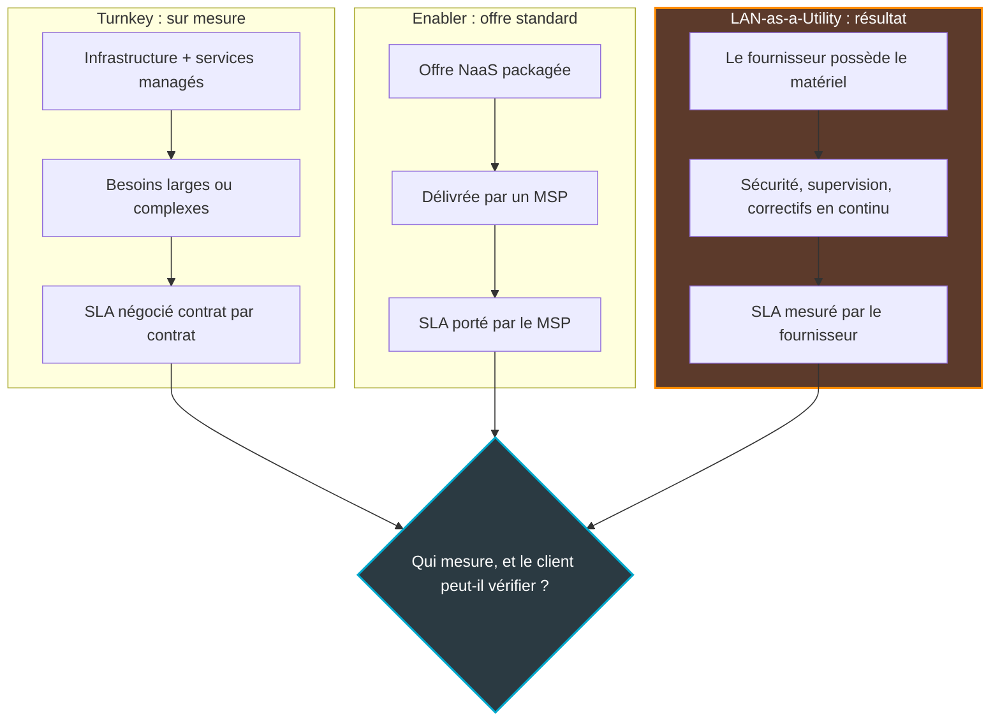
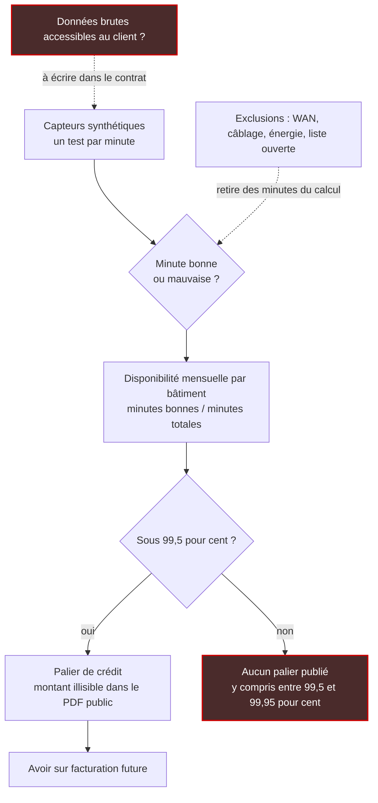

## Le jour où le Wi-Fi se paie comme l'électricité

Un directeur d'hôtel ne sait pas combien de bornes Wi-Fi sont vissées à ses plafonds. Il sait, en revanche, combien de clients ont pesté contre la connexion ce mois-ci. C'est cette réalité-là qu'une partie du marché commence à facturer. Non plus des équipements, mais un résultat. Un réseau qui fonctionne, mesuré en continu, garanti par contrat, avec des pénalités quand il flanche.

Mi-novembre, un chiffre a donné une taille à cette promesse. Le Campus NaaS (le réseau local d'entreprise vendu comme un service, matériel compris) pèserait 2,6 milliards de dollars en 2026 et 12 milliards en 2030, selon une prévision du cabinet Dell'Oro. Le chiffre est spectaculaire. Il arrive pourtant par un canal particulier : le communiqué de Nile, qui vend précisément ce modèle, repris par la presse spécialisée [1].

Hôtels, enseignes de retail, résidences étudiantes, campus de bureaux : tous les DSI qui exploitent des dizaines ou des centaines de sites verront passer ce chiffre dans un argumentaire commercial avant leur prochain renouvellement. Ma position tient en peu de mots. On n'achète pas un marché de 12 milliards. On achète un SLA (l'engagement contractuel de niveau de service), et ce SLA vaut exactement ce que vaut sa clause de mesure : qui mesure, avec quelles données, et ce qui se passe quand la mesure, ou le fournisseur, fait défaut.

## Turnkey, Enabler, Utility : trois façons de déplacer le risque

Le nom du modèle le plus en vogue dit tout. LAN-as-a-Utility : le réseau local traité comme l'eau ou l'électricité. Vous ne possédez ni la centrale ni les lignes. Vous payez un service, et c'est au fournisseur de garantir que le courant arrive à la prise.

Dell'Oro range le Campus NaaS (CNaaS dans son vocabulaire) en trois familles, telles que les reprend le communiqué [1] :

- **Turnkey** : infrastructure et services managés livrés ensemble, pour des entreprises aux besoins larges ou complexes.
- **Enabler** : des offres NaaS standardisées, que des fournisseurs de services managés (MSP, pour Managed Service Providers) délivrent à leurs propres clients.
- **LAN-as-a-Utility** : un modèle orienté résultat. Le fournisseur sécurise, supervise et maintient le réseau en continu, selon des niveaux de service définis, et reste propriétaire de l'infrastructure.

C'est la troisième famille qui tire la croissance. En juin, Dell'Oro notait que le revenu CNaaS des fournisseurs LAN-as-a-Utility, parmi lesquels il cite Meter et Nile, avait doublé en 2025 [3]. Siân Morgan, directrice senior du cabinet, décrit un Campus NaaS qui dépasse le financement alternatif du matériel pour devenir un mode de consommation « utility » de la connectivité sécurisée. Elle anticipe une demande favorable aux offres complètes, avec une responsabilité adossée au SLA [1].

Je lis ces trois familles comme trois positions d'un même curseur. Plus on avance vers le modèle utility, plus le fournisseur porte de lignes du contrat : matériel, exploitation, sécurité, correctifs. Et plus sa propre mesure devient la seule preuve que le service est rendu. Le schéma reprend la typologie Dell'Oro ; la répartition des rôles est ma lecture.

Où se situe un opérateur Wi-Fi managé B2B dans cette grille ? Lecture personnelle, pas classement Dell'Oro : aucune source consultée n'indique que le cabinet compte un acteur comme Wifirst dans ses chiffres. Selon les contrats, un tel opérateur tient le rôle d'Enabler, quand il délivre une offre standardisée sur des centaines de sites, ou concurrence directement le LAN-as-a-Utility, quand il porte l'infrastructure et l'engagement de résultat. Dans les deux cas, une seule question compte. Quelle ligne du contrat transforme la promesse en preuve ?

## 12 Md USD, mais 12 milliards de quoi ?

En mai, à propos du Magic Quadrant LAN de Gartner, nous écrivions ici que les analystes classent désormais des contrats, pas des boîtiers. Dell'Oro met aujourd'hui un prix sur ces contrats. Encore faut-il savoir lequel.

D'abord, la chaîne de transmission. Les chiffres de 2,6 et 12 Md USD proviennent d'une reprise publiée le 18 novembre par Communications Today, fondée sur un communiqué de Nile [1]. Nous n'avons retrouvé ni ce communiqué d'origine, ni la page Dell'Oro correspondante, ni le rapport. Le chiffre repose donc sur le relais d'un vendeur qui a tout intérêt à ce que le marché paraisse gros. Cela ne le rend pas faux. Cela impose de le lire avec des gants.

Ensuite, le périmètre. On ignore si ces 12 milliards comptent le matériel, l'abonnement ou les services, le revenu des constructeurs ou celui des prestataires. Et Dell'Oro a déjà publié plusieurs « 12 milliards » qui ne mesurent pas la même chose [2] [3] [4].

| Publication | Chiffre annoncé | Ce qui est mesuré |
|---|---|---|
| Dell'Oro, avril 2024 | plus de 12 Md USD en 2028 | CNaaS et LAN géré depuis le cloud public, additionnés |
| Dell'Oro, novembre 2024 | plus de 12 Md USD en 2028 | LAN géré depuis le cloud public seul ; le CNaaS, lui, est estimé à plus de 940 M USD en 2028 |
| Dell'Oro, juin 2026 | plus de 10 Md USD | réseau géré dans le cloud ; année et périmètre non précisés |
| Nile citant Dell'Oro, novembre 2026 | 2,6 Md USD en 2026, 12 Md USD en 2030 | CNaaS seul ; ventilation non précisée |

Ce tableau ne sert pas à opposer les chiffres, mais à empêcher qu'on les additionne ou qu'on les enchaîne. En novembre 2024, Dell'Oro voyait le CNaaS à un peu plus de 940 M USD en 2028 ; la nouvelle prévision le place à 2,6 Md USD dès 2026. Révision à la hausse ou changement de définition ? Le communiqué de juin 2026 indique que le nouveau rapport définit les caractéristiques clés du CNaaS [3], ce qui laisse la seconde hypothèse ouverte. Sans le rapport, impossible de trancher. Impossible, donc, d'en tirer une courbe.

Même prudence sur le rythme. De 2,6 à 12 Md USD en quatre ans, le taux de croissance annuel moyen implicite tourne autour de 47 %. C'est notre calcul, pas un chiffre Dell'Oro. Le cabinet évoquait en juin plus de 50 % pour le CNaaS, sans préciser la période [3] ; la reprise de novembre cite 99 % par an sur 2022-2025 [1]. Trois fenêtres, trois rythmes, aucune comparaison possible.

Enfin, la géographie. L'Amérique du Nord pesait environ 80 % du revenu CNaaS en 2022 ; les autres régions devraient en représenter 43 % en 2030 [1]. Deux années, deux indicateurs : ce n'est pas une courbe. Retenons seulement que ce marché s'est construit sur une base nord-américaine, et qu'aucune source ne l'isole pour l'Europe, l'hôtellerie, le retail ou les résidences étudiantes.

Le chiffre dit donc une chose : capitaux et fournisseurs se déplacent vers le modèle utility. Il ne dit rien de la qualité du SLA que vous allez signer.

## Vendre un résultat, c'est d'abord savoir le mesurer

*Du Turnkey au LAN-as-a-Utility, la part portée par le fournisseur grossit : matériel, exploitation, sécurité, niveau de service.*

Quand un fournisseur vend des bornes, sa responsabilité s'arrête à la livraison et à la garantie. Quand il vend un résultat, elle commence à l'installation et ne s'arrête plus. Il ne vend plus du matériel avec une marge, il vend une forme d'assurance. Et une assurance, ça se provisionne. Concrètement, le modèle exige cinq capacités de l'opérateur.

**Une télémétrie qui mesure l'expérience, pas l'équipement.** Qu'une borne réponde au ping ne prouve rien. La vraie question est ailleurs : un terminal, à cet endroit, à cette minute, fait-il passer du trafic avec le débit promis ? Il faut des tests synthétiques, c'est-à-dire des sondes qui se comportent comme des utilisateurs, exécutés en continu et site par site.

**Un SLA dont la mesure est vérifiable.** La minute « bonne » doit être définie noir sur blanc : seuil radio, débit par borne, bandes de fréquence, périmètre. Sinon, le client signe une promesse qu'il ne pourra jamais opposer.

**Le cycle de vie complet.** Propriétaire du matériel, le fournisseur finance, remplace et corrige. Il doit assurer des correctifs fréquents ; encore faut-il en fournir la preuve, sujet que nous avons creusé à propos des commandes campus de Cisco.

**Une équipe, malgré l'automatisation.** Le communiqué qui porte le chiffre le reconnaît lui-même : l'AIOps (l'exploitation réseau assistée par l'IA) exige toujours du personnel formé [1]. L'algorithme détecte. Quelqu'un doit encore décider.

**Un bilan qui encaisse la contrepartie.** L'opérateur porte le matériel, les crédits de service et sa dépendance au constructeur. Notre analyse du 18 novembre sur Cambium l'a montré : quand un constructeur se retire, les bornes tiennent, c'est la gestion qui vacille.

Le modèle n'est pas gratuit pour l'opérateur non plus. Une mesure contestable, des exclusions floues, et c'est lui qui passe ses fins de mois en litige plutôt qu'en exploitation.

## Pièce à conviction : le SLA public de Nile

Peu de fournisseurs publient leur SLA. Nile le fait, avec un document de six pages intitulé « Performance Guarantee » [5], et c'est à mettre à son crédit. Le PDF n'est pas daté ; son chemin de téléchargement suggère février 2024, il a pu évoluer depuis, et il précise lui-même que pourcentages et tranches sont susceptibles de changer. Ce qui suit n'est donc pas un jugement sur les contrats actuels de Nile. C'est une grille de lecture applicable à n'importe quel fournisseur, nous compris.

*Des capteurs qui jouent les utilisateurs, une mesure par minute : tout le SLA repose sur cette chaîne, et sur qui en détient les données.*

Le principe est élégant. Nile s'engage sur 99,95 % par bâtiment, sur trois métriques :

- **Disponibilité** : la capacité à faire passer du trafic via le « Nile Service Block », filaire comme sans-fil.
- **Couverture** : sur la bande 5 GHz, chaque capteur doit voir au moins une borne à -67 dBm ou mieux (plus la valeur est proche de zéro, plus le signal est fort), un niveau pensé pour la voix.
- **Capacité** : une référence de 1,7 Gb/s radio par borne. Six bornes doivent offrir environ 10 Gb/s ; si deux tombent pendant une minute, la mesure descend vers 6 Gb/s et la minute passe en violation.

La mesure repose sur des capteurs physiques et virtuels installés à côté des bornes. Ils jouent le rôle de terminaux d'utilisateurs et testent le réseau chaque minute. La disponibilité se calcule ensuite en minutes bonnes divisées par minutes totales. Nile parle d'un SLA financièrement garanti et se dit seul du secteur à le proposer, revendication que nous n'avons pas vérifiée.

C'est là que l'analogie électrique devient instructive. Votre compteur appartient au distributeur, mais il est homologué, et vous pouvez consulter votre courbe de consommation. Ici, le compteur, ce sont les capteurs du vendeur. Le document promet un rapport mensuel et un rapport trimestriel. Pas l'accès aux données brutes.

Trois angles morts apparaissent ensuite à la lecture. Ce sont mes constats, à prendre comme tels.

**Les crédits.** Ils s'appliquent sur la facturation future, par bâtiment ou par site, selon trois tranches de disponibilité mensuelle : de 97 % à moins de 99,5 %, de 95 % à moins de 97 %, et sous 95 %. Mais dans le PDF public, la colonne censée donner le pourcentage de crédit n'en contient aucun. Le tableau, visiblement corrompu, affiche à la place des descriptions de fonctions : isolation des hôtes, Zero Trust, accès invité. Le montant des pénalités n'y est donc pas lisible.

**La bande manquante.** Le tableau publié ne couvre pas l'intervalle entre 99,5 % et 99,95 %. Sur un mois de 30 jours, 99,95 % tolère environ 22 minutes mauvaises, 99,5 % environ 3 h 36 (notre calcul). Entre les deux, plus de trois heures de service dégradé sur lesquelles le document reste muet.

**Les exclusions.** Pannes du WAN (le lien vers l'extérieur du site), problèmes de câblage, pannes d'alimentation ou de climatisation, et la liste reste ouverte. C'est logique pour un vendeur, qui ne garantit que ce qu'il contrôle. C'est aussi, précisément, ce qui casse le plus souvent dans un bâtiment.

Rien de tout cela n'est scandaleux. C'est un SLA de vendeur, rédigé par un vendeur. Le problème commence quand l'acheteur le signe tel quel en croyant acheter 99,95 %.

## La désillusion a aussi ses chiffres

Le même mois, Network World rappelait que Gartner classe le NaaS dans le creux de la désillusion de son Hype Cycle 2026 des réseaux d'entreprise [6]. La pénétration plafonne entre 1 et 5 %, quand Gartner prévoyait en 2021 une adoption de 15 % pour 2024. Les griefs sont connus : tarification à la consommation parfois imprévisible, coût parfois supérieur à l'achat, verrouillage puisque le fournisseur possède le matériel. Gartner juge même le terme peu descriptif, tant d'offres se résument à une nouvelle grille tarifaire.

Le cabinet reconnaît pourtant une cible au modèle : les organisations aux ressources limitées qui veulent un réseau clé en main sous SLA, sans en posséder les actifs. À mes yeux, cela décrit assez bien un hôtel indépendant ou une enseigne de deux cents magasins.

Dell'Oro ne dit pas autre chose dans le même article. Selon Siân Morgan, les architectures des fournisseurs LAN-as-a-Utility ont retiré beaucoup de flexibilité. Mauricio Sanchez, son collègue, met en garde contre le *sticker shock*, la mauvaise surprise d'une facture à l'usage [6]. C'est le compromis central du modèle. On achète de la simplicité, on la paie en flexibilité.

Gartner et Dell'Oro ne se contredisent pas pour autant. Le premier mesure l'adoption du NaaS au sens large, le second le revenu du NaaS campus, parti d'une base minuscule. On peut croître très vite et rester marginal.

L'étude ISG 2026 le confirme [7]. Sur 200 décideurs réseau d'entreprises de plus de 1 000 salariés, en Amériques et en Europe, 61 % ont adopté le NaaS au moins partiellement, mais 1 % seulement jugent leur déploiement pleinement mature. 64 % y voient un changement d'architecture plutôt qu'un modèle de prix, et 42 % décrivent des dirigeants intéressés mais peu convaincus. Réserve importante : l'échantillon vise de grandes entreprises et un NaaS qui englobe le WAN. Il ne dit rien du Wi-Fi d'un hôtel ou d'une résidence étudiante.

Le cas le plus parlant reste celui de Rivers School, cité par Network World [6]. L'école est satisfaite de Meter, son fournisseur : moins de charge de gestion, économies attendues à long terme. Mais Meter facture au mètre carré et couvre mal les extérieurs, terrains de sport compris. L'unité de facturation et le périmètre de couverture ne sont pas des détails de bas de page. Ce sont le contrat.

Quant aux économies de personnel, le communiqué Nile, qui cite une estimation Dell'Oro, avance 2,1 ETP (équivalents temps plein) en moyenne [1]. Le chiffre ne vaut que pour les organisations de 250 à 499 salariés, et sa méthode n'est pas expliquée. À ranger avec les arguments commerciaux.

## Huit clauses à écrire avant de signer

Bob Brewer, de l'intégrateur ePlus, qui vend et exploite les technologies qu'il recommande, le dit sans détour : sur le verrouillage, l'exécution des SLA et la souveraineté des données, les détails comptent davantage que le discours marketing [8]. Il conseille de définir d'abord ce que réussir signifie à douze mois. Voici la traduction contractuelle que je recommande.

*Le tableau des crédits, l'export de télémétrie, la clause de sortie : trois pièces à exiger avant de signer.*

1. **La métrique.** Définir la minute bonne : seuils radio, débit par borne, bandes mesurées, SSID couverts (les noms de réseaux Wi-Fi diffusés), périmètre exact, extérieurs compris.
2. **Le compteur.** Export des données brutes de télémétrie, droit d'audit, possibilité d'une mesure indépendante. Un rapport mensuel donne le résultat, pas le calcul.
3. **Les exclusions.** Une liste fermée. Pour le WAN, le câblage et l'énergie, une obligation de diagnostic et de preuve de cause à la charge du fournisseur.
4. **Les crédits.** Leur montant, en pourcentage de quelle facture, leur plafond mensuel, leur forme (avoir ou remboursement), un droit de résiliation en cas de manquement chronique. Et un palier pour chaque bande entre l'engagement affiché et le premier seuil.
5. **L'unité de facturation.** Par bâtiment, par borne ou au mètre carré, avec un plafonnement contractuel des hausses.
6. **La sortie.** Restitution du matériel, portabilité de la configuration et des identifiants, délai de transition. Certaines offres n'ont pas d'option de rachat : le matériel repart avec le fournisseur, à vous de prévoir le jour d'après.
7. **Les correctifs.** Délai par niveau de criticité, preuve de déploiement, et partage des rôles face au Cyber Resilience Act (CRA), le règlement européen sur la cybersécurité des produits [9]. Depuis le 11 septembre 2026, le fabricant doit signaler sous 24 heures, puis notifier sous 72 heures, les vulnérabilités activement exploitées et les incidents graves. Quand l'opérateur possède l'infrastructure, qui est fabricant et qui est opérateur doit être écrit.
8. **La contrepartie.** Séquestre logiciel, droit de substitution, clause de changement de contrôle, pour une start-up comme pour un acteur installé. Nous l'avons détaillé à propos de Cambium.

## Un marché de résultats se juge à ses preuves

Les 12 Md USD de Dell'Oro, s'ils se confirment, disent une chose vraie : l'argent et les fournisseurs migrent vers le réseau vendu au résultat. Ils ne disent rien de la clause qui protège votre hôtel de Lyon un samedi soir de mariage. Un marché de 12 milliards est un argument de vendeur. La qualité de la clause de mesure est l'argument de l'acheteur.

D'où une règle pratique. Avant de signer un contrat de Campus NaaS, demandez trois documents : le tableau des crédits entièrement renseigné, un échantillon d'export brut de télémétrie, la clause de sortie. Si le fournisseur ne peut pas produire les trois, vous n'achetez pas un service garanti. Vous louez des bornes avec un abonnement.

Pour les opérateurs, nous compris, la leçon est symétrique. Publier sa méthode de mesure n'est pas un risque, c'est un avantage concurrentiel. Nile a fait la moitié du chemin en rendant son document public. L'autre moitié consiste à publier un tableau des crédits lisible et à ouvrir les données brutes au client.

Un SLA dont le client ne peut pas recalculer le résultat n'est pas un engagement. C'est un relevé.

---

_Vues personnelles, pas position Wifirst._

## Sources

1. [Communications Today — reprise du communiqué Nile citant Dell'Oro (Campus NaaS à 12 Md USD en 2030)](https://www.communicationstoday.co.in/campus-naas-market-to-reach-12b-by-2030/) — 18 novembre 2026. Relais d'un communiqué vendeur.
2. [Dell'Oro Group — Campus NaaS Startups Poised to Grab Larger Share of the Pie](https://www.delloro.com/?p=3268) — 6 novembre 2024.
3. [Dell'Oro Group — AI will Push Cloud-Managed Network Revenue over 10 Billion](https://www.delloro.com/?p=3311) — 30 juin 2026.
4. [Dell'Oro Group — Campus NaaS and Public Cloud-Managed LAN Revenues to Exceed 12 B in 2028](https://www.delloro.com/newsroom/campus-naas-and-public-cloud-managed-lan-revenues-to-exceed-12-b-in-2028/) — 2 avril 2024.
5. [Nile — Performance Guarantee (PDF)](https://nilesecure.com/wp-content/uploads/2024/02/Nile-Performance-Guarantee.pdf) — document vendeur, date de contenu non indiquée.
6. [Network World (Maria Korolov) — NaaS hasn't lived up to the hype. Is it still worth it?](https://www.networkworld.com/article/4242904/naas-hasnt-lived-up-to-the-hype-is-it-still-worth-it.html) — 2 novembre 2026.
7. [ISG — 2026 Network-as-a-Service Study](https://research.isg-one.com/isg-market-lens/network-as-a-service-study-2026) — 2026.
8. [ePlus (Bob Brewer) — Network as a Service: A Practitioner's Perspective on Where NaaS Stands in 2026](https://eplus.com/what-we-believe/content-hub/blogs/2026/07/network-as-a-service-a-practitioner-s-perspective-on-where-naas-stands-in-2026) — 29 juillet 2026.
9. [Commission européenne — Cyber Resilience Act, obligations de notification](https://digital-strategy.ec.europa.eu/en/policies/cra-reporting)
