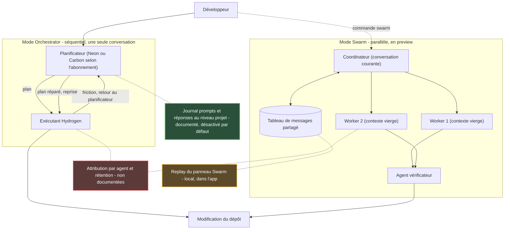

## Qui a poussé ce changement ?

Imaginez un vendredi, 19 heures. Un template de configuration part en production et, dans l'heure, les portails d'accès Wi-Fi de deux cents hôtels refusent les clients qui tentent de se connecter. Le correctif prendra vingt minutes. La première question du post-mortem, elle, n'aura rien de technique : qui a fait ce changement, et sur la base de quel raisonnement ?

Depuis des années, la réponse tient dans l'historique du dépôt de code. Un nom, une adresse, un ticket. Cette réponse est en train de se brouiller. Le 18 novembre, Google a lancé Gemini 4 Neon, un modèle que sa propre page de lancement présente comme le chef d'orchestre d'une équipe de sous-agents dans Antigravity, son environnement de développement assisté par IA. Un modèle conçoit le plan, un autre l'exécute ; dans un mode voisin, plusieurs agents travaillent côte à côte sur le même dépôt. La ligne qui arrive en production a désormais plusieurs auteurs. Aucun n'est humain.

Pour qui gère le Wi-Fi d'hôtels, d'enseignes de retail ou de résidences étudiantes, ce n'est pas une curiosité de développeur. Nos scripts de supervision, nos templates de contrôleurs et notre outillage d'infrastructure manipulent des identifiants et finissent sur des sites clients. Ma position tient en une phrase : avant d'activer un arbre d'agents sur ce code-là, exigez de savoir quel modèle, sur quel plan, a produit quel changement. À la date du 24 novembre, la documentation entreprise de Google ne le garantit pas.

## Un architecte, un artisan, et un chantier à plusieurs équipes

Pour comprendre ce que Google a réellement livré, oubliez un instant les noms de code. Pensez à un chantier.

Premier cas : un architecte et un artisan partagent le même carnet. L'architecte dessine le plan. L'artisan exécute. S'il tombe sur un mur porteur que personne n'avait vu, il ne bricole pas : il rend le carnet à l'architecte, qui inspecte, corrige le plan et lui rend la main. Un seul carnet, une seule personne au travail à un instant donné.

Second cas : un conducteur de travaux répartit le chantier entre plusieurs équipes qui ne communiquent que par le tableau d'affichage du préfabriqué, avec un contrôleur qualité qui passe derrière. Tout le monde travaille en même temps. Le rendement grimpe. La question « qui a posé cette cloison ? » devient nettement plus difficile.

Le premier cas, c'est l'**Orchestrator** d'Antigravity. Le second, c'est **`/swarm`**. La communication de Google les confond. Sa documentation, non.

### L'Orchestrator : une passation, pas une équipe

Le billet Antigravity consacré à Neon décrit une répartition nette des rôles. Neon planifie : architecture, raisonnement, choix structurants. Hydrogen, le modèle d'exécution, déroule les modifications de routine, les mises à jour de paquets, les tests. Et quand ça coince, le texte est explicite : « if Hydrogen hits friction, it hands back to Neon to inspect state, repair the plan, and resume execution ». Le billet ne dit rien du parallélisme, du nombre d'agents, de l'observabilité ni des approbations.

La documentation des modèles enfonce le clou. L'Orchestrator « isn't a router that classifies your prompt upfront » : ce n'est pas un aiguilleur qui trie votre demande à l'entrée. Il « keeps a single agent in your conversation ». Pour le travail parallèle, la doc renvoie explicitement ailleurs : sous-agents, Swarm, Boost ou Teamwork.

*L'Orchestrator fonctionne comme une boucle de passation : le planificateur conçoit, l'exécutant déroule, et la moindre friction renvoie le travail vers le plan.*

### Swarm : le vrai mode parallèle, encore en preview

Avec `/swarm`, on change de nature. La conversation courante devient coordinateur. Chaque worker reçoit sa propre conversation, avec un contexte vierge. La doc prévoit l'ajout d'un agent vérificateur, le `@verifier`, qu'elle associe aux équipes de deux à quatre workers. La coordination passe par un tableau de messages partagé. L'observabilité, elle, repose sur un panneau à trois vues (Board, Members, Graph) avec un replay consultable dans l'application.

Deux phrases de cette doc méritent d'être lues lentement : « Swarm is in preview » et « a swarm uses quota much faster than a single conversation ». Aucun nombre maximal d'agents n'est indiqué. Un worker qui tombe en erreur de quota se met simplement en pause. Quant au modèle qui anime ces workers quand on lance un essaim avec Neon, seul un guide tiers affirme qu'il s'agit d'Hydrogen ; la doc officielle ne le précise pas.

Or la page de lancement de Google résume Neon en « Orchestrator directing parallel Hydrogen subagents in Google Antigravity ». Pour illustrer, elle aligne des démonstrations qui relèvent de `/swarm` : un laboratoire 3D construit via le connecteur Blender MCP (Model Context Protocol, le standard qui branche un agent sur un outil externe) et une feuille Google Sheets de 100 000 cellules. Le marketing fusionne deux mécanismes que la documentation sépare soigneusement. Je m'en tiens à la doc : l'Orchestrator est séquentiel, `/swarm` est parallèle.

*Deux mécanismes, trois niveaux de traçabilité : ce qui est documenté (vert), ce qui ne l'est pas (rouge), ce qui reste confiné à l'application (ambre).*

## Erreur de plan ou erreur d'exécution ?

Revenons à nos deux cents hôtels. Quand un seul développeur travaille, le post-mortem pose une question : qu'est-ce qui a changé ? Dans un arbre d'agents, il en pose trois.

La première : le défaut vient-il du plan ou de son exécution ? Si le planificateur a mal compris la topologie des contrôleurs, corriger l'exécutant ne sert à rien. Si le plan était bon et qu'Hydrogen a mal appliqué une substitution de variable, réécrire les consignes de planification ne sert à rien non plus. La boucle de friction complique encore l'enquête : le plan exécuté n'est pas forcément le plan initial, puisque le planificateur a pu le réparer en cours de route.

La deuxième : quel modèle, dans quelle version ? Le jeu de planificateurs a changé en deux semaines. Lors du lancement de l'Orchestrator, le 12 novembre, InfoWorld citait Carbon (Ultra) et Argon (Pro et Ultra) comme planificateurs selon l'abonnement. La doc entreprise cite Carbon. Neon est arrivé six jours plus tard. Deux incidents à dix jours d'écart n'ont peut-être pas été produits par le même planificateur.

La troisième : quel mode ? Dans un essaim, une modification a pu naître chez un worker à contexte vierge, transiter par le tableau de messages, puis être validée par le vérificateur. Trois mains, trois conversations, un seul commit.

Les analystes interrogés par InfoWorld ne disent pas autre chose. Pareekh Jain (Pareekh Consulting) estime que les DSI « need visibility into which model made a particular decision or code change ». Amit Kumar Jena (Kanerika) relève que la documentation ne décrit pas de journaux par étape indiquant quel modèle a fait quoi. Il recommande des identités d'agent dédiées, des identifiants limités à la tâche et une approbation humaine avant toute fusion de code. Il invite aussi à vérifier que le contrat couvre bien tous les modèles que l'Orchestrator peut appeler.

Pourquoi j'insiste ? Parce que la réponse conditionne trois choses très concrètes. Le post-mortem d'abord : sans attribution, on corrige au hasard. La clause de responsabilité ensuite : quand un éditeur vous fournit plusieurs modèles dans une même chaîne, savoir lequel a produit le défaut n'est pas un détail de procédure. Le dossier de conformité enfin. Je ne prétendrai pas que NIS 2 (la directive européenne sur la cybersécurité) ou l'AI Act (le règlement européen sur l'IA) exigent mot pour mot une attribution par agent. Mais un auditeur qui lit un rapport d'incident demandera qui a fait quoi, et « un essaim » n'est pas une réponse.

*En mode parallèle, chaque câble qui part du coordinateur porte une modification potentielle. Reste à savoir lesquels restent traçables.*

## Par défaut, l'essaim est allumé et le journal éteint

C'est la phrase qui résume le mieux l'état de la documentation entreprise au 24 novembre. Elle mérite d'être détaillée.

Côté journalisation, la page d'administration Google Cloud des outils de développement IA est claire : « Prompts and responses logging » et « Metadata logging » sont désactivés par défaut. Une fois activés, les journaux atterrissent dans le projet Google Cloud de l'organisation. Aucune durée de rétention n'est précisée. Surtout, rien n'indique si ces journaux sont attribués par modèle ou par agent. On saura qu'une conversation a eu lieu, pas forcément qui, dans l'arbre, a dit quoi.

Côté parallélisme, `/teamwork` (en preview) et `/swarm` sont activés par défaut et gouvernés par le même réglage. Petite incohérence au passage : la doc Swarm qualifie le mode de preview, la doc d'administration entreprise non, alors qu'elle le fait pour Teamwork.

Côté Orchestrator, la surprise est ailleurs. La doc entreprise indique que l'Orchestrator de Gemini Enterprise fait tourner Carbon (High) comme planificateur et Hydrogen (High) comme exécutant. Le choix du couple planificateur et exécutant est réservé aux abonnements Google AI Pro et Ultra. Les « Orchestrator Settings » et le paramètre `--effort` ne sont pas disponibles. Neon n'y figure pas comme planificateur par défaut : la doc le cite parmi les planificateurs personnalisés réservés à Google AI Pro et Ultra, et le liste séparément comme modèle entreprise pris en charge. Le billet Neon dit seulement que les entreprises y accèdent « through Gemini for business », sans préciser si c'est dans l'Orchestrator. Il peut s'agir d'un simple retard de documentation : je l'écris donc comme absent de l'Orchestrator entreprise documenté au 24 novembre, sans présenter cela comme définitif.

Winbuzzer avait déjà relevé une contradiction du même ordre au lancement d'Hydrogen. Le tableau des modèles entreprise accepte Hydrogen seul mais exclut l'Orchestrator, alors que le billet de lancement promettait l'accès aux deux.

Reste la liste de ce qui n'est pas documenté, ce qui ne veut pas dire absent :

- le nombre maximal d'agents dans un essaim ;
- la granularité de l'audit par agent ;
- la rétention des journaux ;
- la politique d'administration des connecteurs MCP pour Swarm et les sous-agents ;
- les approbations dans l'application pour les workers.

Un mot enfin sur la portabilité. Les modèles tiers, Claude Opus 5.5 ou Sonnet 5.5, sont utilisables dans Antigravity pour Gemini Enterprise sur consentement administrateur, facturés à l'usage. Ils peuvent porter le raisonnement principal. Mais des modèles Gemini de fond restent mobilisés pour la coordination côté client (résumés, gestion du contexte) et consomment des tokens Google. Changer de cerveau ne change donc pas tout l'arbre, et l'Orchestrator documenté reste une paire Gemini. Pour l'attribution, c'est un acteur de plus dans la chaîne.

## L'économie pousse, la gouvernance traîne

Si je prends le temps de lister ces trous, c'est que l'argument économique arrivera sur le bureau des équipes bien avant l'argument de gouvernance. Et il est solide.

Neon est facturé 3 USD par million de tokens en entrée, 15 USD en sortie et 0,15 USD en entrée mise en cache, soit une remise de 95 %. Contexte d'un million de tokens, quatre niveaux de réflexion, « high » par défaut. Hydrogen coûte exactement moitié moins : 1,50 USD en entrée, 7,50 USD en sortie, avec le même contexte. Faire planifier le modèle cher et exécuter le moins cher, c'est l'idée même de l'arbre.

Sur le coût par tâche, deux chiffres circulent. Il ne faut surtout pas les additionner. Google annonce « 32 % lower cost per task than Carbon » au niveau de réflexion high. Artificial Analysis, qui mesure de façon indépendante, place Neon en mode xhigh à 61 sur son Intelligence Index, en troisième position. La tâche de l'index y coûte 6,44 USD contre 7,76 USD pour Carbon au tarif non remisé, soit environ 17 % de moins, en 21 minutes environ contre 36. Neon consomme pourtant environ 15 % de tokens de sortie en plus. L'écart de coût vient « purement », selon l'analyste, d'un prix au token inférieur de 25 %. Niveau de réflexion différent, charge de travail différente : deux mesures, pas une somme.

Même prudence sur le quota. Les chiffres de l'Orchestrator (24 % de quota en moins, 19 % plus rapide, réussite « proche de Carbon seul ») datent du lancement du 12 novembre. Ils proviennent de tests Google, avec Carbon comme planificateur. Ils ne valent pas pour Neon, et ne se traduisent pas en économie fixe en USD puisque le quota se mesure au travail effectué. Quant aux benchmarks agentiques mis en avant (Agent Arena, Zapier AutomationBench, SWE-sweep), ils mélangent classements tiers et tests internes, et le tableau comparatif complet n'existe qu'en image.

Surtout, aucun de ces chiffres ne porte sur une tâche de maintenance réseau. C'est toujours ainsi que la dette se crée : le gain est mesuré, le risque ne l'est pas.

## Ma liste avant d'allumer l'arbre

Je ne dis pas « n'y touchez pas ». Je dis : pas sur le code qui part chez les clients tant que ces cases ne sont pas cochées.

**Les réglages, d'abord.** Activer la journalisation des prompts et des réponses, désactivée par défaut. Décider consciemment du sort du réglage Teamwork, qui embarque `/swarm` et qui est activé par défaut. Choisir la région de traitement (global, us ou eu) en cohérence avec vos engagements clients. Donner aux agents des identités et des jetons limités à la tâche, jamais les identifiants d'un administrateur. Imposer une approbation humaine avant toute fusion.

**Le contrat, ensuite.** Demander par écrit la liste des modèles que l'Orchestrator et `/swarm` peuvent invoquer, y compris les modèles de fond utilisés pour la coordination. Faire préciser le statut preview de chaque mode et ce qu'il implique en matière d'engagement. Obtenir la durée de rétention des journaux.

**La portabilité, enfin.** L'arbre d'agents, avec son plan, son tableau de messages et son replay, vit dans Antigravity. Exigez l'export des journaux et des plans dans un format exploitable hors de l'outil. Aucune source publique ne dit que c'est possible aujourd'hui : c'est précisément la question à poser à l'éditeur.

En attendant que l'outil le fasse, imposez la convention vous-même. Chaque demande de fusion produite par un agent doit indiquer dans sa description le mode utilisé, le planificateur, l'exécutant et le niveau de réflexion. C'est rustique. C'est aussi la seule attribution par action dont vous soyez certain de disposer.

Mon arbitrage pour les dépôts sensibles (contrôleurs Wi-Fi, templates de configuration, secrets) est net. L'Orchestrator séquentiel, oui, avec journalisation activée et revue humaine. `/swarm`, pas encore. Non que le parallélisme soit dangereux en soi : simplement, un mode en preview, sans plafond d'agents documenté ni audit par agent, n'a rien à faire dans du code qui reconfigure des sites clients.

*La traçabilité d'un changement réseau se joue ligne par ligne : chaque modification sans auteur identifiable est un trou dans le registre.*

## Le commit doit avoir un auteur

Google a livré quelque chose d'intéressant. Séparer un modèle qui réfléchit d'un modèle qui exécute est sain, économiquement comme techniquement. La boucle de friction, où l'exécutant rend la main au lieu d'improviser, est exactement le comportement qu'on attend d'un bon junior.

Mais la communication a pris de l'avance sur la documentation, et la documentation a pris de l'avance sur la gouvernance. La page produit vend un parallélisme que la doc range ailleurs. L'offre entreprise ne documente pas encore le modèle qui fait la une. Et la configuration par défaut combine le mode le plus difficile à auditer avec une journalisation éteinte.

Un CTO n'a pas à choisir entre productivité et traçabilité. Il doit refuser qu'on lui vende l'une sans l'autre. Le jour où votre prochain post-mortem demandera « qui a fait ce changement ? », la réponse devra tenir en un nom de modèle, une version, un plan et une étape. Pas en un mot : « l'essaim ».

---

_Vues personnelles, pas position Wifirst._

## Sources

1. Google, *Introducing Gemini 4 Neon* (18 novembre 2026, mis à jour le 23 novembre 2026) — https://blog.google/innovation-and-ai/models-and-research/gemini-models/introducing-gemini-4-neon/
2. Antigravity, *Gemini 4 Neon in Google Antigravity* (18 novembre 2026) — https://antigravity.google/blog/gemini-4-neon-in-google-antigravity/
3. Antigravity, *Gemini 4 Hydrogen in Google Antigravity* (12 novembre 2026) — https://antigravity.google/blog/gemini-4-hydrogen-in-google-antigravity
4. Antigravity docs, *Models / Orchestrator* (consultée le 24 novembre 2026) — https://antigravity.google/docs/models
5. Antigravity docs, *Swarm* (consultée le 24 novembre 2026) — https://antigravity.google/docs/swarm
6. Antigravity docs, *Enterprise* (consultée le 24 novembre 2026) — https://antigravity.google/docs/enterprise
7. Google Cloud docs, *Configure AI developer tools settings* (consultée le 24 novembre 2026) — https://docs.cloud.google.com/gemini/enterprise/docs/ai-developer-tools-settings
8. Artificial Analysis, *Gemini 4 Neon intelligence gain* (18 novembre 2026) — https://artificialanalysis.ai/articles/gemini-4-neon-intelligence-gain
9. InfoWorld (Anirban Ghoshal), *Google adds multi-model Orchestrator, Gemini 4 Hydrogen, to Antigravity* — https://www.infoworld.com/article/4248403/google-adds-multi-model-orchestrator-gemini-4-hydrogen-to-antigravity.html
10. Winbuzzer, *Google Antigravity pairs Gemini 4 models for coding* (12 novembre 2026) — https://winbuzzer.com/2026/11/12/google-antigravity-pairs-gemini-4-models-for-coding-xcxwbn/
11. 9to5Google, *Gemini 4 Neon announcement* (18 novembre 2026) — https://9to5google.com/2026/11/18/gemini-4-neon-announcement/
