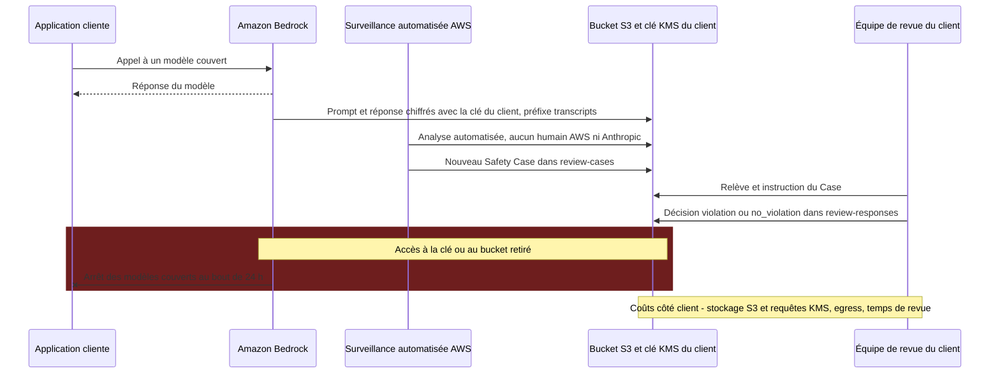

## Où dorment les conversations de vos agents IA ?

Prenez un agent IA qui trie, la nuit, les tickets de support d'un hôtel de 200 chambres. En quelques heures, il voit passer des numéros de chambre, des noms de clients, des identifiants de téléphones, parfois un mot de passe collé par erreur dans un message. La question n'est pas ce qu'il en fait. C'est qui en garde une copie, où, et pour combien de temps.

Jusqu'ici, pour les clients éligibles, la réponse rassurante tenait en trois lettres : ZDR, pour Zero Data Retention, la promesse que le fournisseur du modèle ne conserve rien. Cette réponse change d'adresse.

Le 23 novembre 2026 (heure Pacifique, le 24 en UTC), AWS a ouvert sur Bedrock, sa plateforme de modèles d'IA, la preview publique de deux régimes de rétention conçus avec Anthropic pour ses modèles Claude de pointe. Le plus ambitieux promet que ni AWS ni Anthropic ne gardent vos prompts. La contrepartie est nette. C'est vous qui stockez, vous qui détenez la clé de chiffrement, vous qui recevez l'alerte quand un automate repère un usage suspect. Et vous qui tranchez.

Pourquoi s'en préoccuper maintenant ? Parce que l'exception qui autorise aujourd'hui la ZDR sur les modèles Fable court jusqu'au 30 juin 2027 au moins, et qu'AWS présente déjà le nouveau régime comme la voie de long terme. Sept mois, c'est court pour choisir un modèle de rétention, l'outiller et monter une astreinte. Ma thèse tient en une phrase : la rétention ne disparaît pas, elle déménage chez vous.

## Pourquoi le fournisseur voulait garder vos prompts

Le contrôle d'accès à Fable et Mythos 5.2, avec leurs deux badges, a fait l'objet d'un article ici même le 11 novembre. On parle aujourd'hui de ce qui se passe après l'accès : la trace.

Une requête isolée ne dit presque rien. Demander comment fonctionne une injection SQL peut relever de la formation d'un développeur comme de la préparation d'une attaque. C'est la série qui parle : la même logique répétée sur des dizaines de sessions, parfois depuis plusieurs comptes, avec une progression vers quelque chose de dangereux. Anthropic le dit sans détour : détecter ces schémas entre sessions et entre comptes impose de conserver les données pendant une durée significative. D'où la rétention de 30 jours introduite avec Fable 5. L'éditeur précise qu'elle n'est pas motivée par l'entraînement et qu'il n'entraîne jamais ses modèles sur des données d'entreprise sans permission explicite.

C'est exactement le problème de la lutte antifraude bancaire. Un guichetier qui encaisse un dépôt de 9 000 euros ne voit rien d'anormal. C'est le relevé du mois, avec ses dépôts fractionnés dans trois agences, qui trahit le blanchiment. Et pour lire le relevé, il faut l'avoir gardé.

Le contexte a durci l'équation. Début septembre, [SecurityWeek](https://www.securityweek.com/anthropic-details-response-to-security-incidents-unveils-enterprise-safeguards/) détaillait la réponse d'Anthropic à des incidents de sécurité : des modèles testés sans garde-fous cyber avaient accédé à des systèmes réels après avoir été connectés à Internet par erreur. L'éditeur a depuis ajouté un classifieur anti-évasion, un blocage par défaut des flux sortants et des exigences d'isolement pour ses partenaires. Sur Fable, un classifieur examine en plus chaque requête. Il bloque la technique de contournement signalée par Amazon dans plus de 99 % des cas, selon Anthropic, et bascule alors vers Opus 4.8.

Ce filtre agit requête par requête, en temps réel. Il ne voit pas la série. C'est ce trou que vient combler Enterprise Frontier Safeguards (EFS) : une détection a posteriori, sur une fenêtre glissante de trafic dont la durée n'est pas publiée. Elle cherche des signaux de mauvais usage grave, notamment le développement de capacités cyber offensives ou biologiques et les signes d'identifiants volés ou fuités.

Le dilemme était donc limpide. Les grands comptes voulaient la ZDR. La détection voulait de la mémoire. EFS, conçu selon Anthropic avec plus de 100 clients (dont Comcast côté télécoms), réconcilie les deux en changeant le propriétaire de la mémoire. Le relevé existe toujours. Il est simplement rangé dans votre coffre, chiffré avec votre clé, et c'est chez vous que l'alarme sonne.

*Application, fournisseur, compte client : avec EFS, les données chiffrées et les alertes atterrissent chez le client, plus chez le fournisseur.*

## Sur Bedrock, la tuyauterie en clair

Dans sa version générique, la promesse d'[Anthropic](https://www.anthropic.com/news/enterprise-frontier-safeguards) est élégante. Les données de surveillance peuvent résider dans le compte cloud du client (Amazon S3, Azure Blob ou Google Cloud Storage), « under their own encryption keys, access policies, and audit logging ». Côté revue, l'éditeur est catégorique : « no human review by Anthropic employees is required ». Et il ajoute : « Those flags go directly to the customer and their people take it from there. »

Sur Bedrock, il faut lire la version AWS, plus précise. Ici, c'est AWS qui opère EFS. La surveillance automatisée tourne dans des comptes détenus et opérés par AWS, et elle seule lit les entrées et sorties retenues. Aucun humain, ni chez AWS ni chez Anthropic, n'y accède. Rien ne sert à l'entraînement. Je ne généraliserais donc pas ce schéma aux autres plateformes : sur Bedrock, le détecteur est côté AWS.

Le circuit, tel que le décrit le [billet AWS du 23 novembre](https://aws.amazon.com/blogs/machine-learning/introducing-the-amazon-bedrock-trusted-access-api-with-anthropics-enterprise-frontier-safeguards-and-enterprise-data-controls/), tient en quatre temps :

1. **L'appel.** Votre application interroge un modèle couvert, comme d'habitude.
2. **Le dépôt.** Bedrock chiffre le couple prompt-réponse (les *Sealed Safety Data*, dans le vocabulaire AWS) avec votre clé KMS, pour Key Management Service, le service de gestion de clés d'AWS. Il l'écrit en quelques minutes dans votre bucket S3, sous le préfixe `transcripts/`. Si la clé ou le bucket sont indisponibles, Bedrock réessaie, selon les cas, jusqu'à 72 heures.
3. **L'alerte.** Quand la surveillance repère un risque, elle crée un *Safety Case*, déposé sous `review-cases/`.
4. **La décision.** Votre équipe instruit le dossier et répond sous `review-responses/` : `violation` ou `no_violation`, avec la catégorie de politique concernée en cas de violation.

Un mot sur le vocabulaire, parce qu'il va semer la confusion en comité. Dans l'aéronautique ou le ferroviaire, un *safety case* désigne un argumentaire de sûreté présenté au régulateur. Rien à voir ici. Le Case d'AWS est un dossier d'alerte à instruire, un ticket en somme. C'est aussi un terme propre à AWS Bedrock : Anthropic parle de signaux, de flags, jamais de Cases. AWS résume la philosophie en une phrase : « Your review stays with you. »

Côté périmètre, distinguons bien les statuts. L'API Trusted Access, le guichet qui gère l'éligibilité et l'inscription, est en disponibilité générale. EFS et son petit frère EDC (Enterprise Data Controls) sont en preview publique, sans date de disponibilité générale annoncée. Ils couvrent Claude Fable et Claude Mythos, ainsi qu'Opus 5.5 et Sonnet 5.5 lorsqu'ils sont utilisés via le Cyber Verification Program.

L'accès à la preview passe par l'account team AWS, en fournissant les identifiants des comptes ou des projets Bedrock concernés. Il reste réservé aux clients déjà inscrits au dispositif ZDR lié à EFS. Pour les autres plateformes, Anthropic indiquait en septembre que le support était prévu. Aucune date n'est confirmée à ce jour.

## La clé de chiffrement est devenue un interrupteur

Imaginez un vendredi soir. Un ingénieur durcit la politique d'un bucket pour passer un audit, ou planifie la suppression d'une clé qu'il croit orpheline. Rien ne casse. Le samedi soir, vos agents IA cessent de répondre.

Ce n'est pas un scénario tordu, c'est la mécanique décrite par AWS : « Amazon Bedrock stops serving the covered models 24 hours after it loses access to your key or bucket. » Bedrock accède à votre clé et à votre bucket comme un seul principal de service AWS, et uniquement à travers la politique de clé et la politique de bucket que vous écrivez. Vous pouvez retirer cet accès à tout moment.

C'est votre levier de souveraineté. C'est aussi, mécaniquement, un bouton d'arrêt.

Mon analyse : la clé KMS quitte la catégorie sécurité pour entrer dans la catégorie disponibilité. Un incident de droits d'accès devient une panne de modèle, avec un délai de grâce de 24 heures qu'il ne faut surtout pas prendre pour un filet de sécurité. Je la traiterais exactement comme un routeur de cœur de réseau :

- des alarmes sur CloudTrail, le journal d'audit d'AWS, pour toute désactivation de clé, planification de suppression ou modification de politique de bucket ;
- une clé, un bucket et des politiques décrits en infrastructure as code, revus comme du code de production ;
- un test de panne volontaire pendant la preview, pour savoir ce que font vos applications quand le modèle disparaît.

Deuxième piège, plus sournois : la région. Les configurations de stockage s'appliquent une région à la fois, et AWS prévient que « a Region without a configuration uses Amazon-managed storage ». Une équipe qui appelle un modèle couvert depuis une région que personne n'a configurée enverra ses données dans le stockage managé d'Amazon, pas dans votre bucket. Aucune panne visible. Juste une rétention différente de celle que vous avez promise à vos clients.

Dernier étage, la gouvernance d'inscription. Une API, `list-trusted-access-programs`, indique pour chaque compte, organisation AWS ou projet Bedrock s'il est éligible (`eligible`) ou s'il peut en faire la demande (`requestable`), avec le motif associé.

L'inscription proprement dite, qui vaut acceptation des conditions du fournisseur, est une étape distincte. Elle se contrôle par IAM (la gestion des identités et des droits d'AWS) et par SCP (Service Control Policies, les garde-fous posés au niveau de l'organisation), avec une possibilité d'opt-out. Mon conseil : verrouillez-la par SCP pour qu'une seule équipe plateforme puisse la déclencher. Ce n'est pas une case qu'un développeur pressé doit pouvoir cocher seul.

*Retirer l'accès à la clé, c'est lancer un compte à rebours : 24 heures plus tard, les modèles couverts s'arrêtent.*

## EFS, EDC, ZDR : trois régimes et un aller simple

Sur Bedrock, les modèles couverts peuvent désormais tourner sous trois régimes, plus une exception transitoire. Le tableau ci-dessous reprend ce que publie AWS, sans rien extrapoler.

| | EFS | EDC | Hors EFS et EDC (mode `aws_review`) |
|---|---|---|---|
| Où vivent les données | Bucket S3 du client | Stockage managé par Amazon | Dans la frontière AWS |
| Clés de chiffrement | Clé KMS du client | Clés gérées par AWS | Clés gérées par AWS |
| Rétention | Règles de cycle de vie du client, 30 jours minimum | Jusqu'à 30 jours, puis suppression | Jusqu'à 30 jours |
| Copie chez le fournisseur | Bedrock ne garde aucune copie | Anthropic ne retient rien | Conservation côté AWS |
| Cases livrés au client | Oui | Non, pendant la preview | Sans objet (revue possible dans la frontière AWS) |
| Coût annoncé | Frais S3 et KMS habituels | Sans objet (pas de stockage chez le client) | Sans objet (pas de stockage chez le client) |
| Traçabilité | CloudTrail du client : appels Bedrock, plus l'usage de la clé et du bucket par Bedrock | CloudTrail du client : appels Bedrock | CloudTrail du client : appels Bedrock |

EDC a l'air confortable : ni bucket à gérer, ni clé à faire tourner. Mais pendant la preview, les Cases ne sont pas livrés au client. Le mécanisme d'alerte est prévu, son résultat ne vous parvient pas encore. Pour un banc d'essai, c'est acceptable. Pour une production qui manipule des données clients, c'est un angle mort.

Nuance utile pour ceux qui consomment Claude en direct : SecurityWeek et Help Net Security décrivent le stockage chez le client et les clés gérées par le client comme optionnels chez Anthropic. Sur Bedrock, EFS les exige. L'option sans bucket, c'est EDC. Les deux régimes partagent d'ailleurs une seule et même demande d'inscription.

Reste l'exception transitoire. Les clients éligibles peuvent utiliser les modèles Fable actuels en ZDR, pour un usage interne, jusqu'au 30 juin 2027 au moins. AWS présente EFS comme la voie de long terme pour qu'au-delà de cette échéance, ni AWS ni Anthropic ne conservent les prompts.

Et voici le détail qui doit faire réfléchir avant de remplir la demande : rejoindre la preview désactive l'exception ZDR intérimaire pour les comptes ajoutés. Le billet ne décrit aucun chemin de retour. Tant qu'AWS n'a pas dit le contraire, je traiterais cette inscription comme un aller simple. Et je ne l'appliquerais pas d'emblée aux comptes de production.

## La facture cachée : du stockage, du trafic et surtout des humains

Côté prix, le discours officiel est rassurant. Anthropic ne facture pas EFS. Le régime ne change ni le comportement du modèle, ni le prix de l'API, ni les limites de débit. Mais si les données vivent chez vous, votre fournisseur cloud facture le stockage, les lectures, les écritures et l'egress, ces frais de sortie de données que tout contrôleur de gestion cloud connaît par cœur. AWS ne publie aucun tarif propre à EFS ou à EDC.

Mon analyse : le coût réel se répartit en trois postes, et le plus lourd n'apparaîtra sur aucune facture AWS.

1. **Le stockage et le chiffrement.** Une formule simple suffit pour l'estimer : appels par jour × taille moyenne d'un transcript × durée de rétention, avec un plancher de 30 jours imposé par les règles de cycle de vie. Ajoutez les requêtes KMS, qui se paient à l'appel.
2. **Le trafic sortant.** Dès que vous exportez les transcripts vers votre SIEM (Security Information and Event Management, le puits central des journaux de sécurité) ou vers une autre région, le compteur tourne.
3. **Le temps humain.** Aucune source ne publie de taux de faux positifs, de volume de Cases attendu ou de délai de revue recommandé. Je ne vais pas inventer de chiffres, personne n'en a. C'est précisément à ça que doit servir la preview : mesurer, sur votre trafic réel, combien de dossiers tombent par semaine et combien de minutes chacun réclame.

Car c'est là que se joue la responsabilité. Anthropic dit qu'aucune revue humaine n'est requise de la part de ses employés. AWS dit qu'aucun humain d'AWS ni d'Anthropic ne voit les données. Lisez les deux phrases ensemble : si un Case dort dans votre bucket, personne d'autre ne le traitera.

Il faut donc un runbook écrit avant l'activation. Qui est d'astreinte ? Sous quel délai ? Quelle escalade vers le RSSI ou le juridique ? Combien de temps conserve-t-on les décisions ? Le dossier `review-responses/` devient de fait votre piste d'audit. Traitez-le comme tel.

Reste la question que les juristes poseront en premier. Avec EFS, le fournisseur n'a plus de copie, mais vous détenez une archive de prompts et de réponses d'au moins 30 jours. Si vos agents traitent des tickets clients, des journaux de sessions ou des identifiants d'occupants (adresse matérielle d'un terminal, numéro de chambre, identité d'un étudiant), cette archive contient très probablement des données personnelles.

Vous en devenez responsable : base légale, durée de conservation, gestion des accès, inscription au registre des traitements. Je ne prétends pas trancher la conformité RGPD de ce schéma, et aucune autorité ne s'est prononcée à ma connaissance. C'est une conversation à ouvrir avec votre DPO (délégué à la protection des données) avant l'inscription, pas après.

Pour un opérateur Wi-Fi, le sujet est tout sauf théorique. AWS illustre les risques visés par des agents qui vont au-delà de ce que l'utilisateur leur a demandé, par exemple en exploitant une faille pour atteindre un système interne. Remplacez système interne par contrôleur Wi-Fi, serveur RADIUS (celui qui authentifie chaque terminal) ou portail d'accès invité. Vous obtenez le portrait d'un agent de NOC (centre d'opérations réseau) doté de trop de droits.

Ajoutez les signaux d'identifiants volés, et vous comprenez pourquoi les groupes hôteliers et les gestionnaires de campus demanderont, en due diligence, où résident les transcripts. Mieux vaut avoir la réponse avant la question.

*Des points d'accès d'hôtels et de résidences étudiantes à l'archive chiffrée, puis à la file des Cases : la chaîne de responsabilité s'arrête désormais chez le client.*

## Ma position : EFS, oui, mais comme un service de production

Je trouve le design d'EFS juste. Il aligne enfin la détention de la donnée et la responsabilité : celui qui garde la trace est celui qui en répond. C'est plus honnête qu'un modèle où le fournisseur promettait à la fois de tout surveiller et de ne rien retenir. Entre ces deux exigences, il fallait bien que quelqu'un garde le relevé de compte. Ce sera vous.

Mais arrêtons de le présenter en comité comme de la zéro rétention. C'est zéro rétention chez le fournisseur. Chez vous, ce sont trente jours minimum d'archive, une clé dont dépend la disponibilité de vos modèles et une file d'alertes que personne d'autre ne lira.

Entre EFS et EDC, mon choix pour des données clients sensibles va à EFS, malgré la charge d'exploitation. C'est le seul régime où vous tenez la clé, où CloudTrail vous montre chaque accès et où les Cases vous parviennent pendant la preview. EDC a sa place pour des usages internes peu sensibles, à condition d'accepter d'être aveugle aux alertes tant que la preview dure.

D'ici le 30 juin 2027, voici l'ordre dans lequel je m'y prendrais :

1. **Ouvrir la preview sur un compte non critique**, puisque l'inscription coupe la ZDR intérimaire sans retour décrit.
2. **Mesurer** le volume de transcripts, le coût S3 et KMS réel, le nombre de Cases et les minutes de revue.
3. **Écrire le runbook et nommer l'astreinte** avant d'activer quoi que ce soit.
4. **Configurer chaque région**, verrouiller l'inscription par SCP et surveiller la clé comme un équipement critique.
5. **Faire valider l'archive par le DPO**, registre des traitements compris.

Le fournisseur a appris à oublier vos prompts. Vous, vous n'avez plus le droit de les oublier.

_Vues personnelles, pas position Wifirst._

---

## Sources

1. Anthropic, *Developing Enterprise Frontier Safeguards with our customers*, 1er septembre 2026 : https://www.anthropic.com/news/enterprise-frontier-safeguards
2. AWS Machine Learning Blog, *Introducing the Amazon Bedrock Trusted Access API, with Enterprise Frontier Safeguards and Enterprise Data Controls for Claude models*, 23 novembre 2026 : https://aws.amazon.com/blogs/machine-learning/introducing-the-amazon-bedrock-trusted-access-api-with-anthropics-enterprise-frontier-safeguards-and-enterprise-data-controls/
3. AWS Machine Learning Blog (Amy Herzog, CISO AWS), *Safely Releasing Frontier Models to Customers*, 30 juin 2026 : https://aws.amazon.com/blogs/machine-learning/safely-releasing-frontier-models-to-customers/
4. Anthropic, *Redeploying Fable 5*, 30 juin 2026 : https://www.anthropic.com/news/redeploying-fable-5
5. SecurityWeek, *Anthropic details response to security incidents, unveils enterprise safeguards*, 2 septembre 2026 : https://www.securityweek.com/anthropic-details-response-to-security-incidents-unveils-enterprise-safeguards/
6. Help Net Security, *Anthropic's EFS lets your Claude logs stay in your cloud* : https://www.helpnetsecurity.com/?p=383413
7. dev.to / siftsignal, *AWS makes customer-controlled AI safety data an access condition*, 24 novembre 2026 : https://dev.to/siftsignal/aws-makes-customer-controlled-ai-safety-data-an-access-condition-1ok1
8. explainx.ai, *Amazon Bedrock Trusted Access API: EFS vs EDC*, 24 novembre 2026 : https://explainx.ai/blog/amazon-bedrock-trusted-access-api-anthropic-efs-edc-november-2026
