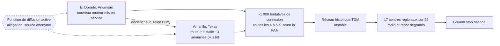
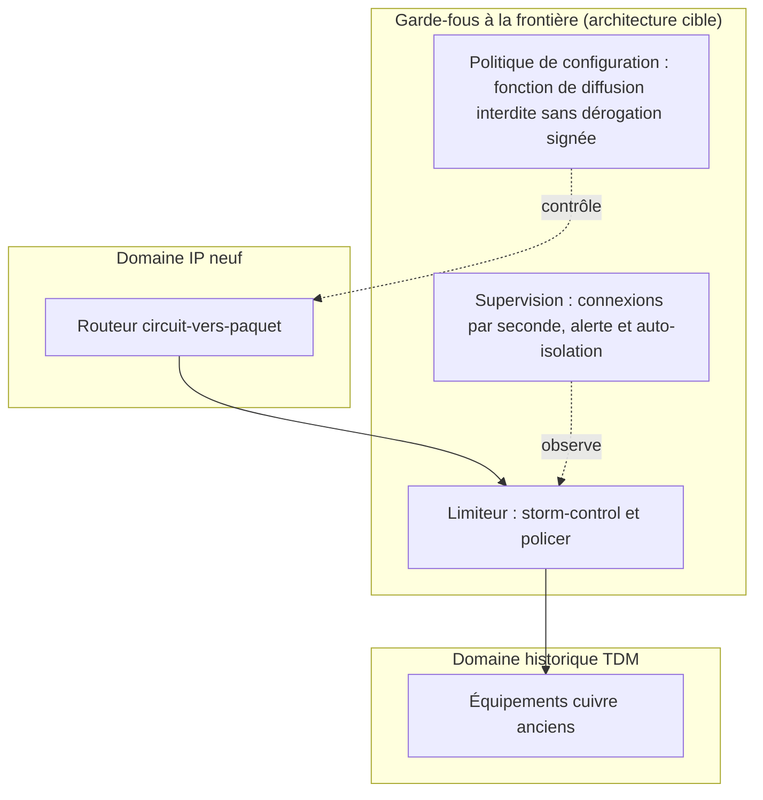
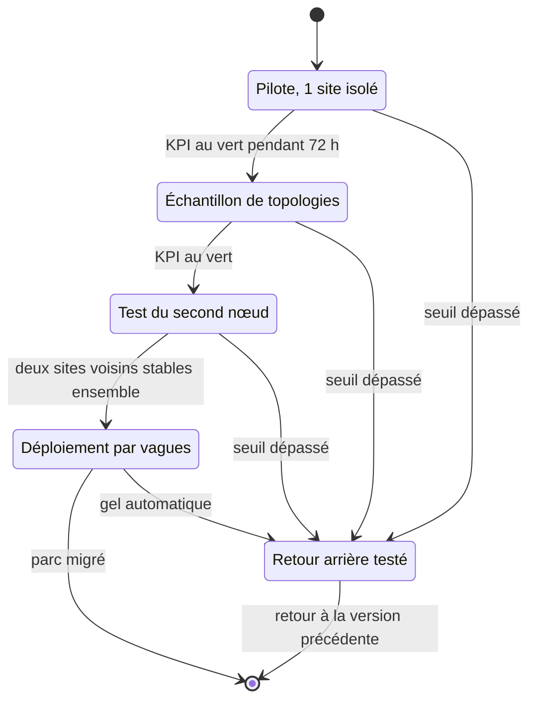

## Un vendredi 13, un pays entier cloué au sol

Vendredi 13 novembre 2026, milieu d'après-midi sur la côte Est des États-Unis. Dans les centres de contrôle aérien, les liaisons radio avec les avions se mettent à décrocher, les images radar à sauter. Les premiers symptômes apparaissent vers 15 h 30, heure de New York. L'ordre d'arrêt national suit dans la demi-heure (15 h 54 selon la chronologie de Wikipedia, les sources ne s'accordent pas à la minute près) : plus aucun décollage, nulle part dans le pays.

Il faudra près de cinq heures pour revenir à la normale. Dix-sept des vingt-deux grands centres de contrôle régionaux ont été touchés. Le nombre de vols annulés varie fortement selon les décomptes : environ 8 000 pour Wikipedia, plus de 18 000 selon certains médias.

Pas d'ouragan. Aucun indice de cyberattaque, selon les autorités. À l'origine, d'après le propre récit de la FAA (Federal Aviation Administration, l'aviation civile américaine) : des routeurs neufs, installés par un prestataire sur deux sites, un radar au Texas et une station radio dans l'Arkansas. Un chantier présenté comme routinier.

Depuis, trois récits s'affrontent : l'installateur, le constructeur, le vieux réseau. Au 25 novembre, personne n'a tranché. Je ne trancherai pas non plus.

La question qui m'intéresse est ailleurs. Elle vaut pour quiconque exploite des centaines de sites, qu'il s'agisse d'hôtels, de magasins ou de résidences étudiantes : comment un changement local, sur deux sites, peut-il immobiliser un pays entier ? Et qu'est-ce qui, dans nos propres migrations, empêche que cela nous arrive ?

## Ce que l'on sait, ce que l'on ne sait pas

Un ground stop national (l'interdiction de décoller imposée à tout le territoire) est rare, et hautement politique. La tentation est forte de choisir son camp au premier communiqué. Commençons par l'hygiène : ce qui est recoupé, ce qui reste allégué, et qui le porte.

Les faits recoupés tiennent en quelques lignes. La FAA décrit un flot de l'ordre de 1 000 tentatives de connexion toutes les 4 à 5 secondes, déversé sur la partie cuivre de son réseau télécom historique, le FTI (FAA Telecommunications Infrastructure). Deux sites sont désignés comme points de départ : un site radar à Amarillo, au Texas, et le site radio d'El Dorado, dans l'Arkansas. Là, L3Harris, prestataire réseau de la FAA, installait un nouveau routeur Juniper, marque détenue par HPE.

L3Harris a isolé les deux sites, et le réseau s'est stabilisé. La FAA a ensuite désactivé la fonction de diffusion (« broadcasting ») sur les routeurs neufs et sur plus de 60 autres routeurs Juniper, puis suspendu les installations. Le programme, d'après des chiffres de L3Harris cités par les treize sénateurs démocrates qui réclament une pause des déploiements : 3 648 routeurs prévus, environ 400 installés, 69 en service.

Pour le reste, voici les thèses en présence.

| Thèse sur la cause | Portée par | Statut au 25 novembre |
|---|---|---|
| L'installation ou le routeur est en cause, sans trancher entre les deux | Sean Duffy, secrétaire aux Transports (DOT) | Hypothèse ouverte |
| Le vrai problème est un parc ancien, avec des serveurs Cisco datant de 2001 | Sean Duffy, sur CNBC, rapporté par Network World | Allégation politique |
| Le réseau cuivre historique est instable ; la modernisation n'est pas en cause | FAA, questions-réponses officielles | Position institutionnelle |
| L'équipement « functioned as it was configured to by the installer » | HPE, propriétaire de Juniper | Position du vendeur, partie intéressée |
| Le matériel a fonctionné, c'est la bascule qui a déraillé | Leeham News (Vincent Bianco, ancien Air Traffic Manager de la FAA) | Analyse éditoriale informée |
| Une fonction de diffusion, désactivée par défaut, aurait été activée, on ignore par qui | Source anonyme citée par Network World | Non vérifiée |
| Une évaluation de risque a été faite, un technicien FAA était présent | FAA ; contesté par le syndicat des techniciens PASS, via Leeham News | Contesté |
| Un outil d'IA de gestion du trafic (SMART) serait impliqué | Réseaux sociaux | Aucun lien établi par les autorités ; le lien avec un don et un contrat est jugé « Mostly False » par PolitiFact |

L3Harris, l'installateur, n'a pas exposé de thèse publique dans les sources que j'ai pu consulter. Sur la piste cyber, la FAA et Duffy disent n'avoir aucun indice, même si Duffy a demandé au FBI d'analyser le routeur de l'Arkansas ; un expert en sécurité cité par Network World juge la piste non exclue. Dernier état connu, le fact-check de PolitiFact publié par WRAL le 24 novembre : cause non entièrement déterminée, installation fautive ou routeur défectueux, rien n'est tranché.

Mon parti pris est simple. La cause racine finira par être nommée. Elle comptera moins qu'on ne le croit.

## La mécanique : un interprète entre deux époques

Pour comprendre la panne, il faut se représenter le rôle de ce routeur. Le réseau de la FAA vit à cheval sur deux époques. D'un côté, des circuits cuivre en TDM (multiplexage temporel, la technologie des lignes téléphoniques d'avant Internet), où chaque liaison dispose d'un créneau réservé, réglé comme du papier à musique. De l'autre, l'IP, où tout le monde partage les mêmes tuyaux et où les paquets se bousculent.

Le routeur dit « circuit-vers-paquet » sert d'interprète : il emballe les vieux circuits dans des paquets IP, et inversement. Rien d'exotique. C'est une opération courante chez les opérateurs qui éteignent leur cuivre.

Maintenant, une image. Dans une maison bien câblée, quand un appareil provoque un court-circuit, le disjoncteur de la pièce saute. La cuisine est dans le noir, le reste de la maison continue de vivre. Le 13 novembre, l'appareil (défectueux ou mal réglé, on ne le sait pas encore) se trouvait quelque part entre une station radio de l'Arkansas et un radar du Texas. Et c'est le compteur général du pays qui a sauté.

Regardons le débit, parce qu'il en dit long. Mille tentatives toutes les 4 à 5 secondes, cela fait de l'ordre de 200 à 250 tentatives par seconde. Le calcul est le mien, pas celui de la FAA. À l'échelle d'un réseau IP moderne, c'est un filet d'eau : la plupart des équipements d'entreprise savent plafonner ce genre de flux à l'entrée d'un port. Ce n'est donc pas le volume qui a tout cassé. C'est qu'il soit arrivé, sans filtre, sur des équipements anciens qui n'ont jamais été conçus pour se défendre.

Le scénario décrit par Sean Duffy, rapporté par Leeham News, ajoute une couche. Le routeur d'Amarillo, installé environ trois semaines plus tôt, aurait commencé à inonder le réseau au moment où celui d'El Dorado entrait en service. El Dorado serait la 69e installation ; les précédentes, toujours selon le ministre, s'étaient déroulées sans incident. La FAA affirme de son côté, d'après le New York Times repris par Engadget, que le routeur avait été testé pendant un an avant le début du déploiement.

*Chaîne causale telle qu'elle ressort des déclarations publiques. En pointillés, l'élément qui ne repose que sur une source anonyme.*

Ce schéma a une vertu. Quelle que soit la case qu'on finira par incriminer, la flèche entre les tentatives de connexion et le réseau historique ne traverse aucune protection visible. C'est là que se joue l'essentiel.

*La jonction entre le réseau neuf et l'ancien : c'est là que se décide la protection du côté fragile.*

## Quatre garde-fous qui tiennent, quel que soit le coupable

Admettons qu'on ne sache jamais qui a activé quoi. Il reste quatre faits observables. Chacun renvoie à un garde-fou d'architecture, pas à une faute individuelle.

### « Désactivé par défaut » n'est pas un contrôle

Selon une source anonyme citée par Network World, la fonction en cause (multicast ou broadcast selon les sources : l'envoi d'un même flux à de nombreux destinataires) aurait été désactivée par défaut, puis activée, sans qu'on sache par qui. Rien de cela n'est vérifié. Ce qui est documenté, c'est la réaction de la FAA : désactiver cette même fonction sur les routeurs neufs et sur plus de 60 autres. J'en tire une inférence, qui n'engage que moi : elle y était au minimum activable, et probablement active sur une partie du parc.

Une valeur par défaut est une intention du constructeur, pas une garantie de l'exploitant. Le vrai contrôle, c'est la conformité de configuration. Concrètement : une configuration de référence par type d'équipement, une détection de dérive qui compare en continu l'état réel à cette référence, et des règles écrites sous forme de code (policy-as-code) qui refusent, ou au moins signalent, toute activation d'une fonction capable d'inonder le réseau hors d'une fenêtre validée.

### Un rayon d'impact sans cloison

Un radar au Texas, une station radio dans l'Arkansas. Résultat : 17 centres de contrôle régionaux sur 22, et plusieurs centres d'approche dans la foulée. C'est la donnée la plus parlante du dossier, et elle ne dépend d'aucune thèse.

En architecture, on parle de domaine de défaillance : la zone qui tombe avec un équipement. Bien dessiné, il s'arrête aux frontières d'un site, au pire d'une région. Il se construit par segmentation, en limitant la portée de la diffusion et en découpant le réseau en zones de service étanches. Je ne sais pas comment le FTI est segmenté. Mais le résultat parle de lui-même : si une cloison existait entre le neuf et l'ancien, elle n'a pas tenu.

*Un domaine de défaillance bien dessiné s'arrête aux limites d'un site. Le 13 novembre, l'onde a traversé presque tout le pays.*

### Entre le neuf et l'ancien, aucun limiteur visible

Le principe est vieux comme le réseau : c'est le côté robuste qui protège le côté fragile, parce que le côté fragile ne sait pas le faire. À la frontière entre le domaine IP neuf et le domaine TDM historique, trois outils standard transforment une inondation en nuisance locale. Le storm-control coupe ou bride automatiquement un port qui dépasse un seuil de trafic de diffusion. Le policer plafonne un débit. Une liste de contrôle d'accès refuse ce qui n'a rien à faire là.

À 200 ou 250 tentatives par seconde, ces mécanismes auraient vraisemblablement contenu le choc. Il manque aussi un œil. L3Harris a fini par bloquer les deux sites, après coup. Combien de minutes entre les premiers symptômes et ce blocage ? Qui a pris la décision, et sur quels indicateurs ? Les sources publiques ne le disent pas.

*L'architecture cible à la frontière : un limiteur côté réseau neuf, une politique de configuration opposable, une supervision capable d'isoler seule.*

### Le canari qui n'avait rien vu

Les mineurs descendaient des canaris au fond des puits : si l'oiseau tombait, il fallait remonter. En déploiement, le canari (canary) désigne ce premier lot limité qui sert de sentinelle. Dans le scénario décrit par Duffy, Amarillo a joué ce rôle pendant trois semaines, sans rien casser. Puis El Dorado est entré en service, et c'est Amarillo qui se serait mis à inonder le réseau.

Si ce récit se confirme, la leçon est cruelle. Le défaut ne s'est pas manifesté sur un nœud, mais sur un changement d'état : l'arrivée d'un second nœud. Faire passer un piéton sur un pont ne dit rien de ce qui arrive quand deux camions s'y croisent. Un an de tests, selon la FAA ? Ce ne serait alors pas la durée du test qui serait en cause, mais son périmètre. Un canari utile teste l'interaction, pas seulement la présence.

Reste la gouvernance. La FAA qualifie ces remplacements de routiniers, distincts de son grand programme de modernisation à 12,5 Md USD, rapporte CNBC. Sur l'existence même d'une évaluation de risque, la FAA et le syndicat PASS se contredisent publiquement. Selon Leeham News, l'Order 1030.8, en vigueur depuis septembre, interdit qu'un changement planifié avance sans signature d'acceptation du risque ; reste à savoir si ce chantier en relevait, et la FAA ne l'a pas dit.

Ce flou est un symptôme classique. Le changement étiqueté « routine » glisse sous le radar du processus réservé aux grands chantiers. Or c'est le geste banal, répété des dizaines de fois sans histoire, qui finit par surprendre.

## 2009 : la leçon était déjà écrite

À six jours près, dix-sept ans plus tôt, le même réseau tombait déjà. Le 19 novembre 2009, une panne du FTI touche 129 installations, bloque environ 75 % du trafic concerné et retarde la restauration de cinq heures. C'est du moins ce que retient la lettre de l'Inspector General du ministère des Transports publiée en juin 2010, telle que la résument Leeham News et Aerocorner. La cause désignée à l'époque : des erreurs de configuration et de procédure du prestataire, Harris (devenu depuis L3Harris), lors de la migration vers le nouveau réseau fibre : un routeur temporaire, placé entre l'ancien et le nouveau réseau, avait été mal configuré.

Un panel indépendant avait alors recommandé deux choses. Des outils automatisés pour les changements de configuration. Et un modèle du réseau pour tester ces changements avant de les appliquer. Seize ans plus tard, ce sont exactement les garde-fous dont il est question ici.

Attention à ne pas surinterpréter : rien ne dit que la même erreur s'est reproduite. Mais la réponse était écrite noir sur blanc. Elle n'était pas à inventer. Elle était à appliquer.

Le phénomène n'a d'ailleurs rien de propre à l'aviation. Dans l'enquête annuelle de l'Uptime Institute publiée en mai 2026 (Annual Outage Analysis), 41 % des répondants ayant subi une panne réseau majeure en attribuent la cause racine à la configuration ou à la gestion du changement. C'est la première cause citée, devant la défaillance d'un opérateur tiers et la panne matérielle, à 34 % chacune. Dans l'édition 2025, relayée par Network World, la même cause recueillait 50 %.

Trois réserves, pour être honnête avec ce chiffre. Il porte sur des exploitants de datacenters et de systèmes d'information, pas sur des réseaux de contrôle aérien. Chaque répondant pouvait citer jusqu'à trois causes (échantillon de 122 répondants). Et la tendance est à la baisse : neuf points en un an, ce que le rapport souligne lui-même. Ce chiffre ne prouve rien sur la FAA. Il rappelle seulement que le changement mal borné reste le scénario de panne le plus banal qui soit.

## Nos El Dorado à nous

Je n'ai pas de leçon à donner à la FAA. Faire vivre un réseau national à cheval sur deux époques, sous l'œil du Congrès, est un exercice que peu d'organisations mènent. Mais je relis le 13 novembre avec nos métiers en tête. En hôtellerie, en retail, en résidence étudiante, des centaines de sites partagent des briques centrales, et chaque migration de parc fait cohabiter l'ancien et le neuf pendant des mois. Ce qui suit est une lecture d'architecte, pas un retour d'incident.

*Un déploiement par paliers n'a de valeur que si le retour arrière fait partie du plan, et pas de l'improvisation.*

Première famille de risques : les fonctions « off par défaut, activables en un clic ». L'IGMP snooping (le switch qui écoute qui s'abonne à quel flux multicast), la conversion multicast vers unicast, les passerelles de découverte d'appareils qui permettent de caster son téléphone sur la télévision d'une chambre d'hôtel. Chacune est utile. Chacune, activée globalement par un modèle de configuration poussé sur tout un parc, reproduit la forme du scénario allégué d'El Dorado.

Deuxième famille : les domaines de défaillance. Prenez une résidence étudiante de plusieurs centaines de chambres posée dans un seul domaine de niveau 2, où la moindre trame de diffusion atteint tout le monde. C'est un El Dorado en puissance. La bonne question n'est pas « ce site peut-il tomber ? », mais « si ce site devient bavard, jusqu'où porte sa voix ? ». Jusqu'au contrôleur Wi-Fi partagé ? Jusqu'au serveur d'authentification commun à tout le parc ?

Troisième famille : la frontière entre l'ancien parc de bornes et de switchs et le nouveau. C'est là qu'on pose les limiteurs. Du storm-control sur les interfaces de jonction, des plafonds d'adresses et de sessions par port, une limitation de débit sur les protocoles bavards : attribution d'adresses (DHCP), résolution d'adresses (ARP), découverte d'appareils (mDNS).

Enfin, le pilote. Pas « cinq bornes », mais un échantillon de topologies : un étage, un magasin, un hôtel au profil calme. Avec des critères d'arrêt chiffrés et fixés avant de commencer : taux de retransmission, trames de diffusion par seconde, charge du contrôleur, volume de tickets au support. Et, leçon directe d'Amarillo, un test du second nœud : deux sites voisins mis en service ensemble, pour éprouver l'interaction.

*Déploiement par paliers : chaque étape a ses critères d'arrêt, et le retour arrière est un état prévu du processus.*

Le mode opératoire (runbook) qui en découle tient en six lignes :

1. Un contrôle de dérive avant tout changement : la configuration réelle correspond-elle à l'intention ?
2. Une fenêtre, et un propriétaire nommé pour la décision d'arrêt.
3. Un pilote isolé, puis un test d'interaction entre deux sites voisins.
4. Un gel automatique dès que deux indicateurs franchissent leur seuil.
5. Un retour arrière testé, pas seulement planifié, avec un délai cible mesuré.
6. Une revue après changement, y compris quand tout s'est bien passé.

Rien de spectaculaire. C'est justement le point : la résilience d'un parc multi-sites se joue sur des gestes ennuyeux, appliqués sans exception, surtout quand le changement paraît anodin.

## Le défaut n'est pas dans le routeur

D'ici quelques semaines, l'enquête désignera peut-être un coupable : un technicien, un réglage d'usine, un vieux multiplexeur. Ce sera utile pour les auditions au Sénat et pour les contrats. Pour un architecte, ce sera presque anecdotique.

Le vrai défaut du 13 novembre, c'est que deux sites aient suffi. C'est qu'une fonction à risque ait dû être coupée après coup, sur plus de 60 routeurs. C'est qu'un flot modeste ait pu traverser la frontière entre deux époques sans rencontrer de filtre. C'est qu'une série de déploiements réussis ait pu passer pour une preuve. Aucune de ces failles ne dépend du nom qui figurera dans le rapport final.

Avant votre prochaine bascule (cutover), cinq questions :

1. Quelle fonction désactivée par défaut ce changement peut-il activer, et qui le verrait ?
2. Si ce site devient bavard, jusqu'où porte sa voix ?
3. Qu'est-ce qui plafonne le trafic entre le neuf et l'ancien, et de quel côté ?
4. Mon pilote teste-t-il l'interaction, ou seulement la présence ?
5. Combien de minutes pour revenir en arrière, et ce chiffre a-t-il déjà été mesuré ?

Si une seule réponse est « je ne sais pas », le changement n'est pas routinier. Il est non borné. La FAA doit encore publier ses conclusions ; je reviendrai sur ce dossier quand elles tomberont.

---

_Vues personnelles, pas position Wifirst._

## Sources

1. [FAA, « Nationwide Ground Stop: Questions and Answers » (15 novembre 2026)](https://www.faa.gov/newsroom/nationwide-ground-stop-questions-and-answers)
2. [DOT, briefing de Sean Duffy sur la restauration de l'espace aérien (14 novembre 2026)](https://www.transportation.gov/briefing-room/icymi-us-transportation-secretary-sean-p-duffy-provides-update-restoration-airspace) ; voir aussi [DOT, point d'étape sur le ground stop national](https://www.transportation.gov/briefing-room/icymi-trumps-transportation-secretary-sean-p-duffy-shares-update-nationwide-ground)
3. [Network World (Maria Korolov), « FAA halts router installs as experts question how one change grounded the nation » (17 novembre 2026, mis à jour le 18)](https://www.networkworld.com/article/4249875/faa-halts-router-installs-as-experts-question-how-one-change-grounded-the-nation.html)
4. [Leeham News (Vincent E. Bianco III), « The Hardware Worked… » (19 novembre 2026)](https://leehamnews.com/2026/11/19/the-hardware-worked-faa-account-points-to-cutover-gone-wrong-not-failure-of-old-equipment/)
5. [Uptime Institute, Annual Outage Analysis 2026, Keynote Report 201, figure 11 (mai 2026)](https://datacenter.uptimeinstitute.com/rs/711-RIA-145/images/2026.AnnualOutageAnalysis.pdf)
6. [Network World (Denise Dubie), rapport Uptime 2025 sur les pannes réseau (8 mai 2025)](https://www.networkworld.com/article/3980366/networking-errors-pose-threat-to-data-center-reliability.html)
7. [Engadget, suspension des installations de routeurs par la FAA, citant le New York Times (novembre 2026)](https://www.engadget.com/2320202/faa-suspends-installation-router-ground-stop-flights-across-us/)
8. [CNBC, « Root cause of nationwide ground stop is unknown, FAA says » (14 novembre 2026)](https://www.cnbc.com/2026/11/14/root-cause-of-nationwide-ground-stop-is-unknown-faa-says.html)
9. [SDxCentral (Jack Lee), lettre des sénateurs et réponse de HPE (17 novembre 2026)](https://www.sdxcentral.com/news/hpe-doubles-down-as-faa-urged-by-senate-to-suspend-juniper-deployments/)
10. [AVweb (Matt Ryan, citant Reuters), « Senators Urge FAA to Pause Router Installations » (17 novembre 2026)](https://avweb.com/aviation-news/senators-faa-pause-routers-ground-stop/)
11. [WRAL / PolitiFact, fact-check du 24 novembre 2026](https://www.wral.com/news/state/fact-check-faa-ground-stop-ai-company-duffy-alfonso-november-24/)
12. [DOT Office of Inspector General, lettre CC-2010-012 sur la panne FTI du 19 novembre 2009 (juin 2010, archive)](https://webarchive.library.unt.edu/web/20161103185913/https://www.oig.dot.gov/sites/default/files/WEB%20FILE2_FTI%20%20Nov%2019%20outage-6-18-10_Final%20Signature%28a%29%20%282%29.pdf)
13. [Aerocorner, « Watchdogs Warned for Years… » (novembre 2026)](https://aerocorner.com/news/faa-ground-stop-fti-network-warnings-gao-inspector-general/)
14. [Wikipedia, « 2026 FAA nationwide ground stop » (contexte et chronologie)](https://en.wikipedia.org/wiki/2026_FAA_nationwide_ground_stop)
