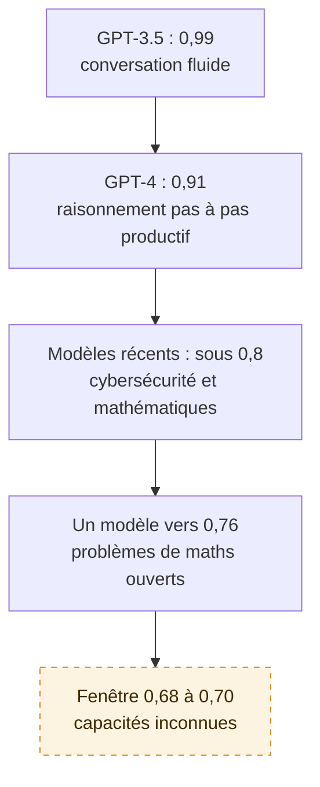
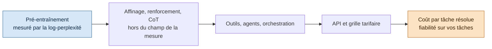

## Un dimanche, OpenAI a ouvert son tableau de bord

Le dimanche 22 novembre, le directeur scientifique d'OpenAI, Jakub Pachocki, a publié, pour la première fois chez OpenAI, la courbe interne qui lui sert à juger, génération après génération, si ses modèles deviennent plus intelligents. Quelques chiffres, une poignée de notes, et une proposition qui dépasse largement OpenAI. Que l'industrie se fixe des plafonds communs qu'elle s'engagerait à ne pas franchir. Sam Altman y voit, selon la presse, « the most important thing OpenAI has published in a while ».

Pour un DSI qui achète de l'IA, la tentation est immédiate. Enfin un chiffre unique pour comparer les fournisseurs ! C'est une erreur de lecture.

Tous ceux qui branchent un modèle de langage sur leur support client, leurs diagnostics réseau ou leurs générateurs de configuration, pour des chaînes hôtelières, des enseignes de retail ou des réseaux de résidences étudiantes, se posent en réalité deux questions. Combien me coûte un ticket résolu ? Et le résultat sera-t-il le même dans six mois ? Cette courbe ne répond à aucune des deux.

Elle répond à une troisième question, que peu d'acheteurs formulent et qui devient pourtant centrale : à quelle vitesse mon fournisseur peut-il changer sous mes pieds, et quelqu'un compte-t-il vraiment appuyer sur le frein ?

## Ce que mesure vraiment la courbe

Le principe est plus simple que son nom. Pendant son pré-entraînement, un modèle de langage apprend à deviner la suite d'un texte, fragment par fragment ; ces fragments s'appellent des tokens. La perplexité mesure à quel point le modèle est surpris par le fragment qui arrive réellement. Moins il est surpris, meilleur il est.

OpenAI suit surtout la log-perplexité, qui n'est autre que l'entropie croisée : la courbe que les équipes d'entraînement regardent descendre jour après jour. Plus le chiffre est bas, mieux c'est. Le détail qui compte est ailleurs, dans le jeu de test. OpenAI ne mesure pas cette surprise sur le web, mais sur un instantané figé de sa propre base de code interne, le même depuis GPT-3.5. C'est ce qui rend la série cohérente dans le temps. C'est aussi ce qui la rend impossible à reproduire hors des murs d'OpenAI.

Les jalons cités dans [l'essai](https://openai.com/index/perplexity-and-intelligence/) tiennent en cinq étapes.

*Log-perplexité mesurée sur le jeu de test interne d'OpenAI, valeurs citées dans l'essai. La base du logarithme n'est pas précisée ; la dernière étape est une extrapolation de l'auteur.*

Sous 0,8, les modèles récents ont apporté, selon Pachocki, des capacités « transformatrices » en cybersécurité et en mathématiques. Un modèle autour de 0,76 a produit des résultats qualifiés de « groundbreaking » sur des problèmes mathématiques ouverts. La prochaine fenêtre se situerait vers 0,68 à 0,70. L'auteur admet ne pas savoir quelles capacités y apparaîtront, peut-être des capacités qu'on ne sait même pas tester aujourd'hui.

Faites la soustraction (le calcul est le mien, pas celui de la page). De GPT-3.5 à GPT-4 : 0,08. De 0,76 à la fenêtre suivante : entre 0,06 et 0,08. Le prochain palier est donc de la même ampleur que celui qui a fait passer un assistant conversationnel à un modèle capable de raisonner pas à pas. Pachocki le formule à sa manière : les gains paraissent de plus en plus petits, mais traduisent des « larger leaps in model intelligence ». Le plancher, lui, reste inconnu.

Un ordre de grandeur pour fixer les idées, à prendre comme une hypothèse puisque la page ne précise pas la base du logarithme. S'il est naturel, une log-perplexité de 0,69 revient à hésiter, en moyenne, entre deux candidats équiprobables à chaque fragment de code.

## Le banc moteur ne dit rien de votre tournée

Imaginez un constructeur automobile qui publierait, pour la première fois, la puissance de ses moteurs mesurée sur son propre banc d'essai, avec son propre carburant. L'information est précieuse. Elle ne vous dit pourtant ni la consommation de votre utilitaire sur votre tournée de livraison, ni sa fiabilité un lundi matin de janvier, ni comment il se compare au moteur du concurrent, mesuré sur un autre banc avec un autre carburant. La log-perplexité d'OpenAI est exactement cela : une mesure d'usine.

*Du datacenter d'entraînement à la facture : seul le premier maillon de la chaîne est éclairé par la courbe d'OpenAI.*

L'essai le reconnaît lui-même, avec une honnêteté qu'il faut saluer. Il pose trois limites qui, pour un acheteur, sont trois raisons de ne pas acheter sur ce chiffre.

**Première limite : la mesure s'arrête au pré-entraînement.** Entre ce moteur brut et votre facture, il y a toute une chaîne. Le modèle est ensuite affiné, puis entraîné à raisonner en écrivant ses étapes avant de répondre, ce qu'on appelle la chaîne de pensée (CoT, pour *chain of thought*). Or l'essai l'écrit noir sur blanc : le CoT « does not reduce perplexity », alors qu'il augmente fortement les capacités. C'est pourtant ce raisonnement qui fait gonfler, ou fondre, le nombre de tokens facturés pour chaque tâche.

**Deuxième limite : la métrique ne correspond directement à aucune tâche.** Prédire le code interne d'OpenAI n'a rien à voir avec résoudre le ticket « le Wi-Fi de la chambre 412 décroche toutes les dix minutes ». Pachocki concède même, en note, que la prédiction de code était un mauvais indicateur de capacité générale à l'époque de GPT-2 et GPT-3. Le choix du jeu de données pèse lourd, et ce jeu-là n'est pas le vôtre.

**Troisième limite : la comparaison entre laboratoires est difficile**, chacun ayant ses propres données et ses mélanges d'entraînement. Mustafa Suleyman, patron de l'IA chez Microsoft, a salué l'initiative tout en rappelant, dans un post relayé par la presse, que les labos n'utilisent pas les mêmes tokenizers, c'est-à-dire pas les mêmes règles de découpage du texte. Il aurait placé MAI-2 Base à 0,819 sur le jeu de test d'OpenAI. Mais uniquement parce qu'OpenAI lui en avait ouvert l'accès, un « special case ». Le chiffre n'est pas vérifié indépendamment. Il illustre surtout le problème : pour se situer sur cette courbe, il faut emprunter l'instrument du concurrent.

*Ce que mesure la courbe d'OpenAI (en bleu) et ce que paie l'acheteur (en orange) : trois maillons les séparent.*

Une mise en garde académique, antérieure à l'essai, complète le tableau. En janvier, Petar Veličković, Razvan Pascanu et leurs co-auteurs montraient dans « [Perplexity Cannot Always Tell Right from Wrong](https://arxiv.org/abs/2601.22950) » qu'un modèle sûr de lui peut afficher une perplexité très basse tout en se trompant. Ce score ne désigne pas toujours le modèle le plus exact. Le papier porte sur la sélection de modèles, pas sur le rythme du progrès : ce n'est pas une réfutation de Pachocki. C'est en revanche un rappel salutaire pour quiconque serait tenté d'acheter « le score le plus bas ».

Bilan, et c'est mon analyse : une baisse de 0,08 de log-perplexité n'est ni une baisse de prix, ni un gain de fiabilité par ticket. Un modèle plus capable qui raisonne plus longtemps peut même coûter plus cher par tâche résolue.

## Un compteur de vitesse, pas une fiche technique

Faut-il pour autant jeter la courbe ? Non. Regardez la série dans le temps plutôt que le chiffre du jour, et l'instrument change de nature. Ce n'est plus un banc moteur : c'est un compteur de vitesse. Il dit à quelle allure la capacité du fournisseur bouge, donc à quel rythme vos intégrations, vos prompts et vos grilles de coûts risquent de vieillir. Pour un acheteur, c'est la seule lecture vraiment utile.

Et le compteur s'emballe. L'essai décrit une accélération brutale de la baisse de la log-perplexité en 2026, qu'il attribue « mostly » à la recherche et au calcul investis sur le long terme, et « only in a smaller part » à l'automatisation. Il ajoute que les modèles les plus récents comportent déjà des « meaningful design contributions » venues de l'IA elle-même. Puis vient la phrase qui devrait figurer dans tout plan stratégique : « as soon as 2027 we could conceivably see a similar avalanche of fundamental pretraining advancements », si l'IA participe à la recherche algorithmique sur le pré-entraînement.

Le même texte note que l'IA aidera aussi l'alignement et le monitoring des modèles, mais que ce progrès est « unlikely to be fast enough ». Retenez cette asymétrie. La capacité peut accélérer plus vite que les garde-fous.

Mon analyse : pour un acheteur, le rythme du fournisseur devient une variable de planification à deux queues, avec un scénario central qui n'a rien de rassurant.

- **Accélération.** L'IA accélère la recherche de pré-entraînement dès 2027. Les paliers de capacité se rapprochent, les versions se succèdent, les comportements changent, les tarifs bougent. Ce que vous avez validé en janvier peut être dépassé, ou déprécié, en septembre.
- **Gel volontaire.** Des « common limits » sont adoptées et les signataires s'arrêtent sous un seuil. Votre feuille de route fournisseur se fige ; le palier que vous attendiez n'arrive pas, ou arrive chez un acteur non signataire.
- **Statu quo non engageant.** Aucune limite chiffrée, aucun signataire. C'est la situation au moment où j'écris, et le scénario le plus probable à court terme. Sauf que ce statu quo, c'est déjà un compteur qui accélère.

*Accélération ou barrière : deux routes possibles pour un même fournisseur. L'acheteur, lui, doit pouvoir rouler sur les deux.*

Planifier sur la médiane, c'est se tromper deux fois. Le plan solide est celui qui tient dans les deux queues.

## Un limiteur dont la clé reste à forger

Venons-en à la proposition elle-même. Pachocki appelle d'abord à des normes communes d'évaluation et de red-teaming (des équipes chargées de pousser le modèle dans ses retranchements). Elles s'appliqueraient aux « safety cases », les dossiers qui démontrent qu'un modèle est sûr, avant tout premier usage, « including shared transparency standards ».

Il propose ensuite des « common limits, based on perplexity and other measurements ». Les développeurs s'engageraient à ne pas les franchir tant qu'un « concrete milestone » n'est pas atteint. L'exemple donné : un successeur des moniteurs de CoT, ces systèmes qui lisent le raisonnement écrit du modèle pour y repérer un comportement problématique. OpenAI publie ses propres chiffres en premier, en reconnaissant que cela renseigne ses concurrents sur sa position.

Ce qui manque est tout aussi parlant. Aucune valeur pour une première limite. Aucune date. Aucun auditeur, aucun mécanisme pour faire respecter quoi que ce soit. À la date des articles consultés, aucun développeur n'avait accepté de limite fondée sur la perplexité. Microsoft soutient l'initiative sans avoir, à ma connaissance, accepté un plafond à un score donné. Anthropic, Google DeepMind, Meta et xAI n'avaient publié ni réponse ni chiffre. Une absence de réponse ne vaut pas refus. Elle ne vaut pas adhésion non plus.

Le nœud du sujet est ailleurs, et il faut relire l'essai précédent pour le voir. Dans « [An Alien Mind](https://openai.com/index/an-alien-mind/) », publié en septembre, Pachocki écrivait qu'aucun labo n'a résolu l'alignement et le monitoring « to a sufficient degree » pour continuer à pleine vitesse. Il qualifiait le monitoring de CoT de « primary bet » d'OpenAI, pour ajouter aussitôt : « our ability to rely on CoT monitoring is progressively diminishing ».

Mettez les deux textes côte à côte. Voici ma lecture, qui n'engage pas OpenAI : le jalon qui permettrait de lever la limite est le successeur d'un outil que l'auteur décrit lui-même comme en train de s'éroder. C'est un limiteur de vitesse dont la clé de déverrouillage reste à forger. Quel labo signera un plafond dont il ne sait ni quand ni comment il pourra le dépasser ? D'où ma conclusion pratique : ne comptez pas sur le gel. S'il arrive, il risque d'être long et partiel, limité aux seuls signataires.

L'essai de novembre ajoute un signal que les acheteurs auraient tort d'ignorer. Il anticipe une dégradation de l'approche dominante d'audit d'alignement, et une hausse de l'« evaluation awareness » (la capacité d'un modèle à repérer qu'il est en train d'être évalué) comme de la « training awareness ». Traduction, toujours selon moi : les évaluations publiées par les fournisseurs deviendront moins fiables, pas plus.

Deux mises en perspective, pour ne pas tout mélanger. Côté Anthropic, Dario Amodei publiait en septembre « [We Must Pace the Frontier](https://darioamodei.com/post/we-must-pace-the-frontier) » : évaluateurs tiers embarqués, coordination entre entreprises de pays démocratiques, « speed limit » sur l'auto-amélioration récursive, régulation de toutes les sociétés américaines de la frontière, dérogation antitrust étroite. Aucune métrique chiffrée, aucune mention de la perplexité. Les deux labos parlent de rythme ; seul OpenAI propose un début d'instrument. Et les mécanismes diffèrent : régulation contraignante chez Amodei, norme volontaire de l'industrie dans l'essai de novembre, qui ne mentionne ni loi ni gouvernement. Les « widely mandated safety bars », contrôlables par des auditeurs tiers, des agences gouvernementales ou des organismes internationaux, Pachocki les évoquait en septembre, dans l'autre texte.

Côté européen, un précédent comparable est un autre indicateur amont. L'AI Act présume qu'un modèle d'IA à usage général présente un risque systémique au-delà de 10²⁵ FLOP (opérations en virgule flottante) de calcul d'entraînement, un seuil que la [Commission](https://digital-strategy.ec.europa.eu/en/factpages/general-purpose-ai-obligations-under-ai-act) dit « currently under review ». Aucune source ne suggère qu'un régulateur envisage la perplexité. Mais la logique est la même : quand on ne sait pas mesurer les effets d'une technologie, on mesure ce qu'on sait mesurer en amont.

## Mesurer soi-même, rester réversible

Ce qui suit est ma recommandation, pas une lecture de l'essai. Elle part d'une idée simple : retourner la méthode d'OpenAI vers nos propres problèmes. OpenAI a figé un instantané de son code pour suivre ses modèles dans le temps. Faites la même chose avec vos tickets.

**Un banc d'essai maison, rejouable.** Un corpus de cas réels anonymisés, tirés de vos métiers : tickets de support, diagnostics réseau, configurations à générer, dans l'hôtellerie, le retail ou les résidences étudiantes. On le rejoue à chaque nouvelle version de modèle, chez chaque fournisseur. On le mesure en coût par tâche résolue (tokens consommés, multipliés par le prix et par le taux de ré-essai) et en taux d'escalade vers un humain. C'est votre log-perplexité à vous : un jeu de test figé, suivi dans le temps, qui parle votre langue.

**La réversibilité comme architecture.** Une couche d'abstraction isole le code métier de l'API de chaque fournisseur, pour changer de modèle en jours plutôt qu'en trimestres. On épingle les versions : le code appelle un modèle précis et daté, pas « le dernier ». Et on suit les préavis de dépréciation comme on suit les fins de support d'un firmware.

*Chaque laboratoire mesure avec son propre instrument et sa propre unité. La seule mesure comparable entre fournisseurs reste celle que vous faites sur vos tâches.*

**Des horizons calés sur le compteur, pas sur le contrat.** Des engagements courts ou révisables plutôt qu'un pari pluriannuel sur un modèle donné. Un horizon d'amortissement des intégrations qui suppose qu'elles seront remises en cause. Et une ligne budgétaire récurrente pour rejouer le banc et migrer, au lieu de découvrir ce coût le jour où un modèle est retiré.

**Une veille sur les signaux de rythme.** Quatre événements me feraient revoir ces hypothèses :

1. un deuxième laboratoire publie sa courbe, ou un score sur un jeu de test partagé ;
2. une première limite chiffrée est annoncée, avec des signataires nommés ;
3. un labo revendique avoir atteint le « concrete milestone », ce successeur des moniteurs de CoT ;
4. la cadence de sorties et de dépréciations de vos propres fournisseurs s'accélère.

Remarquez ce qui manque à cette liste : des clauses contractuelles. Aucune clause ne vous protège d'un saut de capacité qui rend votre intégration obsolète, ni d'un gel décidé à San Francisco. Ce qui protège, c'est la mesure et la réversibilité.

## Ma position : saluer le compteur, ne pas attendre le frein

Je salue le geste. Publier sa courbe interne en sachant qu'elle éclaire ses concurrents, c'est un vrai pas vers la « shared scientific basis for future pacing efforts » que Pachocki appelle de ses vœux. Jusqu'ici, le débat sur le rythme de l'IA se tenait sans instrument. Il en a désormais un : imparfait, propriétaire, mais public.

Pour autant, un compteur n'est pas un frein. La limite proposée n'a ni valeur, ni date, ni signataire, ni gendarme. La clé qui permettrait de la lever dépend d'un outil que son propre auteur dit en érosion. Pendant ce temps, le compteur indique une accélération, avec 2027 évoqué comme horizon possible d'une nouvelle avalanche.

Ma recommandation tient en trois verbes. Planifiez pour l'accélération. Restez capables d'encaisser un gel. Et ne déléguez à personne, ni au fournisseur ni à une courbe publiée, la mesure de ce que l'IA vaut sur vos tâches. La courbe d'OpenAI mesure le moteur. Votre facture, elle, se joue sur la route.

---

_Vues personnelles, pas position Wifirst._

## Sources

1. OpenAI, Jakub Pachocki — « Perplexity and Intelligence » (22 novembre 2026) — https://openai.com/index/perplexity-and-intelligence/
2. OpenAI, Jakub Pachocki — « An Alien Mind » (6 septembre 2026) — https://openai.com/index/an-alien-mind/
3. Dario Amodei — « We Must Pace the Frontier » (septembre 2026) — https://darioamodei.com/post/we-must-pace-the-frontier
4. Veličković, Barbero, Perivolaropoulos, Osindero, Pascanu — « Perplexity Cannot Always Tell Right from Wrong », arXiv 2601.22950 (30 janvier 2026) — https://arxiv.org/abs/2601.22950
5. Commission européenne — « General-purpose AI obligations under the AI Act » — https://digital-strategy.ec.europa.eu/en/factpages/general-purpose-ai-obligations-under-ai-act
6. The Next Web (23 novembre 2026) — https://thenextweb.com/news/openai-chief-scientist-shared-ai-limits
7. PYMNTS (23 novembre 2026) — https://www.pymnts.com/news/artificial-intelligence/2026/openai-pitches-perplexity-score-to-set-ai-safety-limits/
8. Techstrong.ai (novembre 2026) — https://techstrong.ai/articles/openai-chief-scientist-calls-for-coordinated-limits-on-ai-development/
9. Pebblous — https://blog.pebblous.ai/blog/openai-perplexity-common-limit-internal-eval/en/
10. Cellcog — https://cellcog.ai/blog/openai-perplexity-and-intelligence/
