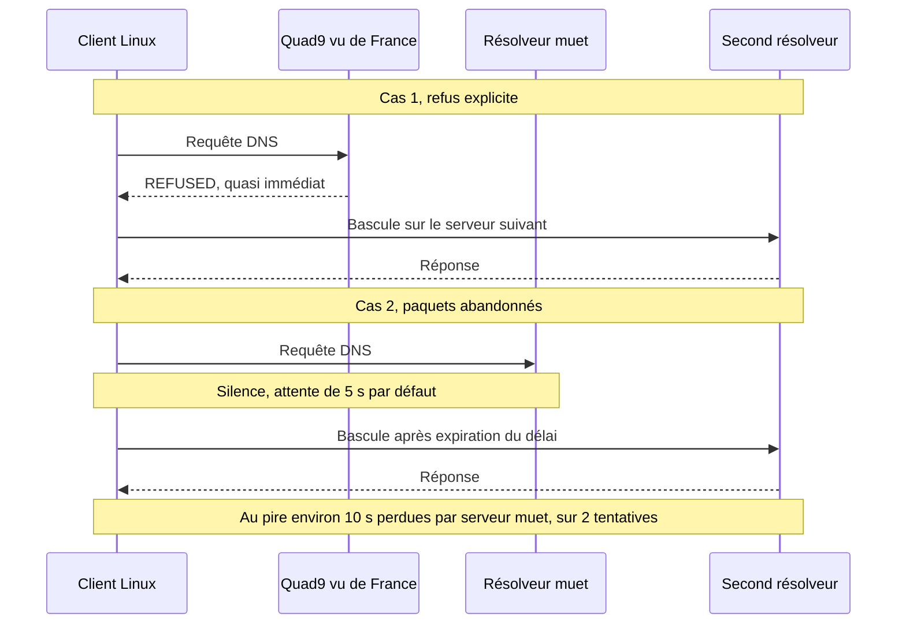
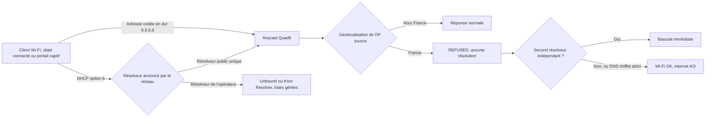

## Mardi 24 novembre, 9 heures : l'annuaire d'internet répond « pas pour vous »

Mardi 24 novembre 2026, 9 heures du matin, heure de Paris. Une fondation suisse a commencé à opposer une fin de non-recevoir à toute question venue d'une adresse française. Elle s'appelle Quad9, a son siège à Zurich et opère un résolveur DNS public, c'est-à-dire l'annuaire qui traduit le nom d'un site en adresse joignable. L'heure n'a rien d'un hasard : Quad9 l'a choisie pour que les utilisateurs pris de court s'en aperçoivent en heures ouvrées.

Pour la plupart des foyers, rien n'a bougé : leur box interroge par défaut le résolveur de leur fournisseur d'accès. Mais quelque part, dans un hôtel, une résidence étudiante, un magasin ou un service hospitalier, un boîtier configuré il y a des années avec l'adresse 9.9.9.9 gravée dans ses réglages vient de perdre la mémoire des noms. Le Wi-Fi s'allume. Le téléphone s'associe. La page ne charge pas. Selon Cloudflare, Quad9 est d'ailleurs utilisé en France par des administrations, des établissements d'enseignement, des hôpitaux et des services publics.

Ce n'est pas une panne. C'est une décision de justice suivie d'un choix d'entreprise, et ce ne sera pas la dernière. Ma thèse tient en une phrase : un résolveur public codé en dur est une dépendance fournisseur sans contrat, que la justice vient de rendre révocable du jour au lendemain, et dont l'opérateur du réseau encaisse la panne.

## Mille euros par jour, et un départ qui va bien au-delà

Mille euros par jour. Pour un grand groupe, c'est une ligne d'arrondi. Pour une fondation qui n'a même pas de comptes utilisateurs, c'est un précédent. Et un précédent, ça se multiplie.

Le 21 octobre 2026, le Tribunal judiciaire de Paris, saisi par beIN Sports France en procédure accélérée au fond, a enjoint à la Fondation Quad9 d'exécuter un premier jugement rendu le 13 mai. Le dispositif est sans ambiguïté : exécution « sous astreinte de 1 000 euros par jour de retard à compter du prononcé de la présente décision, et ce jusqu'au terme des mesures ordonnées ». Ce terme tombait le 14 novembre 2026, date du dernier match du tournoi WTA 2026. Le tribunal s'est réservé la liquidation de l'astreinte.

Le jugement de mai impose, lui, de bloquer l'accès à des sites de diffusion IPTV (télévision par internet) « à partir du territoire français », outre-mer compris à quelques exceptions près, « et/ou par ses utilisateurs à raison d'un contrat souscrit sur ce territoire ». Il vise aussi des sites non encore identifiés, ajoutés au fil des notifications de l'ARCOM, le régulateur de l'audiovisuel et du numérique. Retenez la formule sur le contrat. Elle comptera.

Les chiffres méritent une lecture précise. beIN réclamait 10 000 euros par jour et par nom de domaine resté accessible : sur 58 noms, Quad9 calcule que la note aurait atteint 580 000 euros par jour. Le tribunal a retenu 1 000 euros. Les 24 000 euros d'exposition souvent cités sont une estimation de Quad9, pas un montant liquidé ; au 24 novembre, aucune demande de paiement n'avait été formulée, selon TorrentFreak.

Sur le fond, beIN produit des constats selon lesquels 6 des 58 domaines seraient bloqués ; le directeur technique de Quad9 atteste qu'aucun ne l'est. Le tribunal ne tranche pas ce point : il sanctionne l'absence de moyens mis en œuvre. L'impossibilité de géolocaliser ? Quad9 « ne le démontre pas », répond le jugement. Son appel du jugement de mai est jugé « inopérant », l'exécution provisoire s'appliquant de droit, et un appel reste pendant devant la cour d'appel de Paris.

Le point décisif est ailleurs. L'injonction a expiré le 14 novembre, et Quad9 part quand même, dix jours plus tard. Dans son billet « Farewell, France » du 22 octobre, la fondation évoque une vingtaine d'autres procédures en cours en France, visant des centaines de noms. Le retrait est donc préventif : il anticipe les astreintes à venir plutôt qu'il ne répond à un blocage en vigueur.

Quad9 connaît le prix de ces guerres d'usure. L'affaire qui l'opposait à Sony Music en Allemagne (2021-2023), finalement gagnée, lui a coûté selon ses dires une somme à six chiffres. Sa posture, elle, a changé. En décembre 2024, face à Canal+, il bloquait les domaines visés pour tous ses utilisateurs dans le monde, faute de savoir géolocaliser. En 2026, il géolocalise, mais pour refuser la France entière. Entre imposer une décision parisienne à la planète et ne plus rien résoudre pour un pays, la fondation a tranché.

## Anatomie d'un refus : on n'éteint pas un pays sur un réseau anycast

Première question d'ingénieur : pourquoi ne pas simplement fermer les serveurs parisiens ? Parce que Quad9 fonctionne en anycast, et que l'anycast se moque des frontières.

Imaginez une chaîne de pharmacies qui partagerait un numéro de téléphone unique. Votre appel aboutit à l'officine la plus proche, sans que vous sachiez laquelle. Fermez l'officine de Paris, et l'appel sonnera à Bruxelles ou à Francfort. Pour refuser un appelant, baisser le rideau ne suffit pas : il faut savoir qui appelle.

C'est exactement la situation de Quad9. Selon ipregistry, la fondation annonce les mêmes préfixes réseau depuis plus de 200 sites dans 90 pays. Le 18 novembre, depuis une ligne Orange en Île-de-France, la requête de diagnostic `id.server` envoyée à 9.9.9.9 renvoyait `res714.cdg` : le client était servi depuis Paris. Fermer les sites français ne suffirait pas, car BGP (Border Gateway Protocol, le protocole de routage entre opérateurs) enverrait aussitôt le trafic vers le site suivant. D'où un filtrage requête par requête, sur l'adresse IP source.

Reste à décider qui est « en France ». Selon TorrentFreak, Quad9 s'appuie sur une base GeoIP (une table qui associe chaque adresse IP à un pays), jugée imparfaite ; ipregistry, qui semble lui-même vendre ce type de données, n'y voit qu'un mécanisme probable. Les effets de bord sont réels. TorrentFreak cite un Français passant par un VPN à Helsinki, servi normalement, et un Kényan sur un VPN français, refusé. Un filtre statistique décide désormais de la nationalité d'une requête.

*Un réseau anycast ne s'éteint pas pays par pays : fermer un site renvoie simplement le trafic vers le voisin. D'où un tri de chaque requête selon l'origine supposée de son adresse IP.*

Ce que voit le client ? Un refus net, pas un silence. La notice technique de Quad9 est limpide : « any query reaching any Quad9 service address will be refused, and no DNS resolution will be successful ». Elle liste quatre adresses : 9.9.9.9, 149.112.112.112, 2620:fe::fe et 2620:fe::9.

Les sondes de TorrentFreak ont confirmé le refus peu après 9 heures. Selon elles, il s'accompagne d'un code Extended DNS Error 18 « Prohibited », défini par la RFC 8914, et d'une note renvoyant à la loi française, que les navigateurs n'affichent généralement pas. La notice de Quad9, elle, parle seulement de refus : à valider en lab avant d'en faire une règle de supervision. Pour comparaison, OpenDNS, parti de France en 2024, renvoie selon ipregistry le code 16 « Censored ».

### Un refus vaut mieux qu'un silence, à une condition

La nuance paraît académique. Elle ne l'est pas. Un standard qui répond « numéro non attribué » vous libère en une seconde ; un téléphone qui sonne dans le vide vous immobilise jusqu'à ce que vous raccrochiez.

En DNS, c'est pareil. Une réponse REFUSED permet au stub resolver, le petit client DNS intégré au système, de passer immédiatement au serveur suivant. Des paquets abandonnés l'obligent au contraire à attendre. Sous Linux, la bibliothèque C standard (glibc) prévoit par défaut un délai d'attente de 5 secondes, 2 tentatives et 3 serveurs au maximum : au pire, une dizaine de secondes perdues par serveur muet.

Quad9 a donc choisi la sortie la plus propre. Encore faut-il disposer d'un plan B réellement indépendant. Les deux adresses IPv4 de Quad9, la « primaire » 9.9.9.9 et la « secondaire » 149.112.112.112, sont refusées ensemble. Une configuration « deux DNS » 100 % Quad9 n'offre donc aucune redondance face à ce risque. Elle protégeait d'une panne de serveur. Pas d'une décision de justice.

Reste le cas le plus dur : le DNS chiffré en mode strict. Comme le rappelle ipregistry, un téléphone Android dont le « DNS privé » pointe sur `dns.quad9.net`, ou un Firefox réglé en protection maximale, ne retombe pas sur le résolveur du réseau. Il échoue, point. Mullvad, dont le navigateur avait basculé ses utilisateurs vers Quad9 avec sa version 16.0, leur a demandé le 17 novembre de changer de résolveur DoH (DNS over HTTPS, du DNS chiffré transporté comme du trafic web) avant le 24. Les réglages du système et du routeur, rappelait l'éditeur, se corrigent à part.

Et personne ne viendra prévenir l'utilisateur. Faute de comptes, Quad9 n'a aucun moyen de notifier qui que ce soit, relève Cloudflare. L'entreprise ajoute que certains équipements sont « hardwired » sur le résolveur, ce qui rend la correction lente, voire impossible.

## Le 9.9.9.9 se cache partout où personne ne regarde

Ce qui suit relève de mon analyse d'ingénieur, pas d'un constat sourcé : chaque parc est différent, et rien ne remplace l'audit. Un jour, quelqu'un de bien intentionné a choisi 9.9.9.9 parce que l'adresse était facile à retenir. Puis elle a été recopiée de template en template, jusqu'à devenir invisible.

Coder un résolveur public en dur, c'est imprimer le numéro d'un standard étranger sur chaque plaque de porte d'un hôtel. Le jour où ce standard répond « pas pour vous », il faut repasser dans tous les couloirs, tournevis en main. Voici les couloirs à visiter.

- **Les scopes DHCP.** Le DHCP distribue à chaque appareil son adresse et ses réglages réseau ; son option 6 peut annoncer un résolveur public en direct sur les réseaux clients et invités.
- **Les équipements installés sur site (CPE, Customer Premises Equipment).** Firmwares, profils usine, configurations de secours réappliquées après une réinitialisation.
- **Les règles de redirection.** Une règle DNAT (réécriture de l'adresse de destination) qui force le port 53 vers un résolveur public fait disparaître l'adresse des écrans, tout en la rendant critique.
- **Le portail captif.** Les destinations autorisées avant authentification, et la résolution du nom du portail lui-même. Si ce nom ne se résout plus, personne ne s'authentifie.
- **Les objets connectés et la TV hôtelière.** Décodeurs, capteurs, affichage dynamique : leur DNS a parfois été figé en usine.
- **Les applications en DNS chiffré strict.** Android, navigateurs : ils ignorent ce que le DHCP leur annonce.
- **La supervision.** Sondes, synchronisation horaire, mises à jour : tout ce qui résout des noms, et remonte des alertes trompeuses quand la résolution tombe.

*Options DHCP, firmwares, portail captif, objets connectés : sans que personne l'ait décidé, tous ces chemins peuvent converger vers une seule adresse, donc un seul point de défaillance.*

Le symptôme est toujours le même, et c'est le plus pénible à diagnostiquer : « le Wi-Fi marche, internet non ». L'association radio réussit, le bail DHCP est attribué, la passerelle répond. Seule la résolution échoue. Côté support, cela produit des tickets « pas d'accès » sans aucune panne de lien, avec des indicateurs au vert partout. Un technicien de niveau 1 peut y perdre une matinée.

Dernier piège : le chemin de sortie. Un site dont le trafic quitte le réseau par un tunnel ou un VPN d'entreprise sortant à l'étranger restera servi par Quad9, comme les tests de TorrentFreak l'établissent pour les VPN. Deux sites au réglage identique peuvent donc se comporter différemment. L'audit se fait site par site, chemin de sortie par chemin de sortie, jamais sur le papier.

## Remplacer 9.9.9.9 par 1.1.1.1 : même dépendance, autre adresse

Le réflexe est compréhensible. Il est faux. Remplacer une adresse publique codée en dur par une autre, c'est déplacer la dépendance sans la traiter.

Regardez les mesures. Selon TorrentFreak, la liste de beIN comptait 118 domaines au 23 novembre, contre 58 dans le jugement du 21 octobre. Sur cette liste, Google DNS en bloquait 22, contre 91 le 28 octobre. Le résolveur de NordVPN en bloquait 20, Cloudflare 1.1.1.1 aucun. Autrement dit, le 8.8.8.8 de Google applique bel et bien des blocages en France, et leur périmètre varie fortement d'une mesure à l'autre.

Cloudflare affirme n'avoir jamais bloqué via 1.1.1.1 : selon l'entreprise, Canal+ a perdu en septembre sa demande d'astreinte contre elle, ses actions au niveau du CDN (réseau de diffusion de contenus) ayant été jugées suffisantes. TorrentFreak écrivait pourtant le 22 octobre que Cloudflare avait échappé à l'astreinte parce qu'il bloquait au moins certains domaines. Ma lecture, qui reste une inférence : le blocage se fait au niveau du CDN, pas du résolveur. En Allemagne, rappellent Cloudflare et TorrentFreak, les tribunaux ont rejeté le blocage DNS pour Cloudflare comme pour Quad9.

Mais la carte judiciaire bouge vite, et la Belgique montre la direction. Le 20 août 2026, le président du Tribunal de l'entreprise francophone de Bruxelles a confirmé le blocage DNS pour Google (LLC et Ireland), Cloudflare et Cisco. Délai : trois mois à compter de la signification. Astreinte : 100 000 euros par jour de non-conformité, due uniquement les jours de diffusion en direct des matchs de DAZN, plafonnée à 20 millions d'euros par société. Les mises à jour de liste s'appliquent sous cinq jours ouvrés, et une erreur de géolocalisation exceptionnelle n'entraîne pas d'astreinte si le résolveur la prouve.

La décision d'exécution du SPF Économie (l'administration fédérale belge) du 7 septembre ajoute aux intermédiaires tenus de bloquer, à leurs frais, les fournisseurs d'accès VOO, Orange Belgium, Proximus, Telenet et Digi. Cisco a annoncé qu'il suspendrait OpenDNS en Belgique, ce que l'administration accepte comme conformité. L'échéance tomberait début janvier 2027 selon Cloudflare, le texte belge ne fixant aucune date calendaire. Toujours selon Cloudflare, les trois sociétés ont fait appel.

Morale : il n'existe pas de résolveur public « sûr » au sens juridique. Il n'existe que des résolveurs dont le risque ne s'est pas encore matérialisé.

## Reprendre la main : inventorier, paramétrer, choisir

La méthode que je propose tient en quatre temps. C'est une proposition d'ingénieur, pas une norme.

1. **Inventaire passif.** Journaux DHCP, relevés de flux NetFlow ou IPFIX exportés par les routeurs, logs des pare-feux : tout ce qui part vers les quatre adresses de Quad9 ou vers `dns.quad9.net`.
2. **Sonde active depuis chaque site.** Un `dig @9.9.9.9 id.server CH TXT`, puis une requête ordinaire, pour constater le refus et relever l'éventuel code d'erreur étendu.
3. **Revue des templates de provisioning.** C'est là que l'adresse renaît à chaque remplacement de matériel.
4. **Test de bascule.** Couper l'accès à Quad9 sur un site pilote et chronométrer le temps de récupération réel.

Surtout, l'inventaire ne doit pas déboucher sur une simple substitution. L'objectif n'est pas une nouvelle constante : c'est un paramètre piloté par l'opérateur, modifiable en central et distribué par DHCP, plutôt qu'une valeur figée dans mille boîtiers.

Vient ensuite le choix d'architecture, qui doit être assumé. Première voie : un résolveur maîtrisé (Unbound, Knot Resolver ou PowerDNS Recursor) par cluster ou par région, avec validation DNSSEC (la vérification des signatures cryptographiques des réponses) et DNS chiffré vers les clients, plus un amont public en secours si besoin. Seconde voie : un résolveur public choisi et contractualisé, avec des engagements et un interlocuteur. Ce qui n'est plus défendable, c'est la troisième voie, celle que personne n'a choisie : l'adresse héritée.

Le jugement rend d'ailleurs visible une asymétrie. Il vise les utilisateurs « à raison d'un contrat souscrit sur ce territoire ». Un résolveur public n'a pas de contrat avec eux : il devine leur origine à l'aide d'une base GeoIP imparfaite. Un opérateur, lui, sait où sont ses clients. Il les a raccordés. C'est un avantage technique, et c'est aussi une responsabilité.

Car le corollaire est immédiat : un opérateur qui exploite son propre résolveur devient lui-même destinataire potentiel des listes de blocage. En Belgique, les fournisseurs d'accès sont visés au même titre que les résolveurs ; en France, TorrentFreak a constaté des blocages chez Orange, ainsi que des redirections chez Bouygues, Free et Completel, disparues lors de son dernier test. L'ingestion des listes de l'ARCOM, le délai d'application et la journalisation font donc partie du design dès le premier jour. Quelles obligations pèsent exactement sur tel ou tel acteur ? C'est une question pour les juristes, que ce billet ne tranche pas.

Côté chiffrement, les standards existent. La RFC 9463, dite DNR (novembre 2023), permet au réseau d'annoncer lui-même ses résolveurs chiffrés, via DHCPv4, DHCPv6 ou les annonces de routeur IPv6. L'opérateur pousse ainsi son résolveur chiffré comme il pousse aujourd'hui une adresse en clair. La RFC 9462, dite DDR, fait le chemin inverse : elle permet à un client de découvrir la version chiffrée d'un résolveur dont il ne connaît que l'adresse IP, sans repli explicite si la validation échoue.

Leur limite commune est structurelle. Une application qui code en dur son DNS chiffré en mode strict ignore le résolveur local, et ne se pilote donc pas par DHCP. Reste l'option musclée : bloquer ou rediriger, sur les réseaux managés, le DNS chiffré destiné aux résolveurs publics connus, si la politique de sécurité l'exige. C'est un arbitrage, pas une évidence : on reprend la maîtrise de la résolution, au risque de heurter des attentes légitimes de confidentialité et de casser certaines applications.

*Résolveur maîtrisé ou résolveur public contractualisé : un arbitrage d'architecture qui commence par un inventaire site par site, pas par un copier-coller d'adresse.*

Reste la question qui fâche : le coût. Migrer, c'est un inventaire et des changements de configuration, donc un chantier borné. Ne rien faire, c'est parier que votre résolveur public continuera d'absorber à votre place une exposition qui grimpe. En Belgique, elle atteint 100 000 euros par jour de match, jusqu'à 20 millions par société visée. En France, 1 000 euros par jour dans ce dossier, mais une vingtaine d'autres procédures et des listes dynamiques. Pour un opérateur, l'équation reste pourtant opérationnelle : le coût d'une panne de service, en tickets et en pénalités de SLA (engagements de niveau de service), contre le coût de conformité d'un flux de listes à ingérer.

## Ma position : le résolveur est une infrastructure, pas une case à cocher

Mon avis est tranché. Sur un réseau qui accueille du public, le résolveur par défaut doit être celui de l'opérateur : distribué par DHCP, annoncé en chiffré via DNR, supervisé comme n'importe quel composant critique, codes d'erreur étendus compris. Un résolveur public peut servir d'amont de secours, chez un fournisseur distinct, choisi en connaissance de cause. Plus jamais de constante gravée dans un firmware.

Je ne prends pas parti ici sur le fond de la lutte anti-piratage. Ce qui m'intéresse, c'est ce que l'épisode révèle : le DNS public, l'un des derniers services d'internet à se penser sans frontières, vient de redécouvrir la géographie. OpenDNS a quitté la France en 2024 et s'apprête à suspendre son service en Belgique. Quad9 refuse désormais les requêtes françaises. La résolution de noms devient un service territorial.

Cette territorialisation donne un temps d'avance à celui qui sait où sont les utilisateurs. Le résolveur public le devine ; l'opérateur le sait. Autant transformer cette asymétrie en architecture plutôt qu'en tickets d'incident.

Le 24 novembre à 9 heures, Quad9 a fait exactement ce qu'il avait annoncé publiquement le 22 octobre. Si vos boîtiers ne l'ont pas vu venir, le problème n'est pas à Zurich.

---

_Vues personnelles, pas position Wifirst._

## Sources

1. [Jugement du Tribunal judiciaire de Paris, 21/10/2026, RG 26/11882, beIN Sports France c. Fondation Quad9](https://torrentfreak.com/images/20261021-Jugement-selon-la-PAF.pdf)
2. [Quad9, « Farewell, France » (22/10/2026)](https://quad9.net/news/blog/au-revoir-france/)
3. [Quad9, « Quad9 Service Deactivation in France » (24/11/2026)](https://quad9.net/news/blog/quad9-service-deactivation-in-france/)
4. [SPF Économie (Belgique), décision d'exécution 260907-BAPO-D-FR-025, version EN (07/09/2026)](https://torrentfreak.com/images/260907-BAPO-D-FR-025-EN.pdf)
5. [Cloudflare, « Quad9's withdrawal from France: A canary in the coal mine » (17/11/2026)](https://blog.cloudflare.com/quad9-withdrawal-from-france/)
6. [TorrentFreak, « DNS resolver Quad9 will leave France after court orders piracy blocking penalty » (22/10/2026)](https://torrentfreak.com/dns-resolver-quad9-will-leave-france-after-court-orders-piracy-blocking-penalty/)
7. [TorrentFreak, « Quad9 Exits France as Expired Piracy Order Lingers at Google and ISPs » (24/11/2026)](https://torrentfreak.com/quad9-exits-france-as-expired-piracy-order-lingers-at-google-and-isps/)
8. [TorrentFreak, « Court Upholds Belgian Pirate DNS Blocking Order, OpenDNS Exit Looms » (17/09/2026)](https://torrentfreak.com/court-upholds-belgian-pirate-dns-blocking-order-opendns-exit-looms/)
9. [ipregistry, « Quad9 Leaves France on November 24. An IP Filter Will Decide Who Is in France » (18/11/2026)](https://ipregistry.co/blog/quad9-france-exit-geofencing-a-dns-resolver)
10. [Mullvad, « Quad9 will withdraw their service from France » (17/11/2026)](https://mullvad.net/blog/quad9-will-withdraw-their-service-from-france) ; [CyberInsider, Mullvad Browser et le retrait de Quad9 (18/11/2026)](https://cyberinsider.com/mullvad-browser-quad9-dns-france-withdrawal/)
11. [IETF RFC 8914, Extended DNS Errors](https://www.rfc-editor.org/rfc/rfc8914.html) ; [RFC 9463, DNR](https://www.rfc-editor.org/rfc/rfc9463.html) ; [RFC 9462, DDR](https://www.rfc-editor.org/rfc/rfc9462.html) ; [man resolv.conf, section 5](https://man7.org/linux/man-pages/man5/resolv.conf.5.html)
12. [Quad9, communiqué sur l'affaire Canal+ (10/12/2024)](https://quad9.net/news/press/quad9-faces-new-dns-censorship-legal-challenge-in-france-from-canal/)
13. [Cloudflare, décision de Cologne, Universal c. Cloudflare (05/12/2023)](https://blog.cloudflare.com/latest-copyright-decision-in-germany-rejects-blocking-through-global-dns-resolvers)
