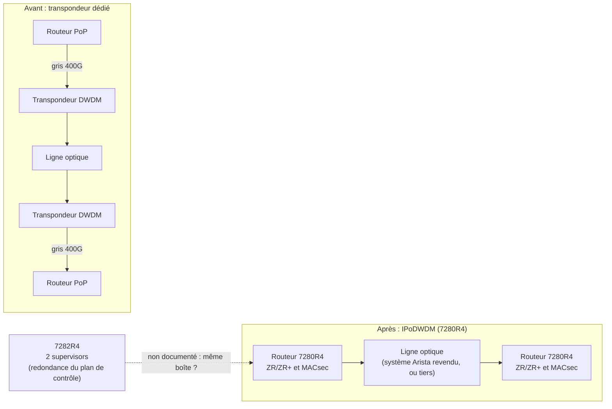
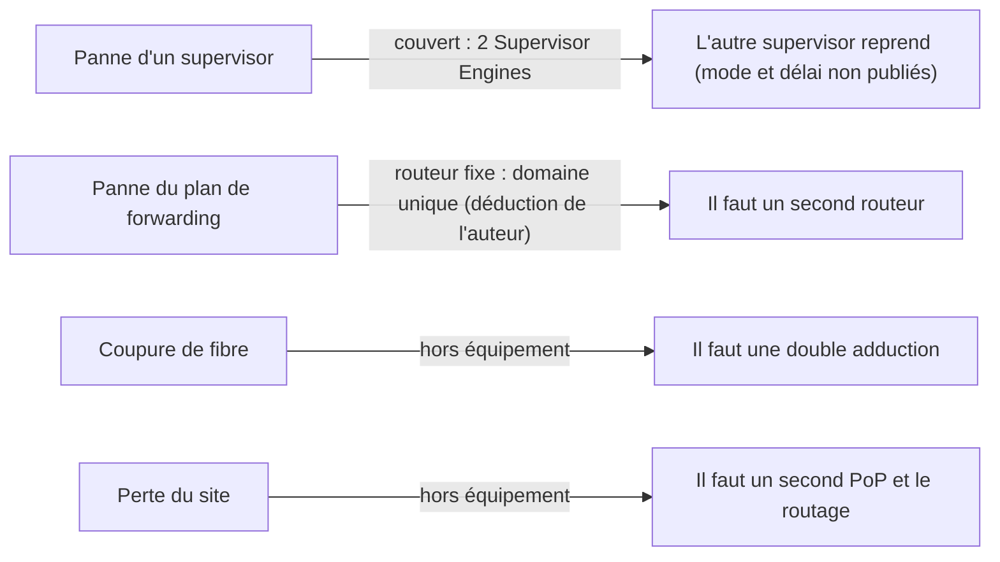

## Compter les boîtiers entre le routeur et la fibre

Ouvrez la baie d'un point de présence régional et comptez ce qui sépare le routeur de la fibre. Il y a souvent un étage de plus qu'on ne l'imagine : un châssis de transpondeurs, chargé de convertir le signal du routeur en une longueur d'onde capable de parcourir des dizaines, voire des centaines de kilomètres. Un équipement de plus à alimenter, à superviser, à couvrir par un contrat de support. Et une frontière de plus entre deux équipes qui se renvoient le ticket au milieu de la nuit.

Pour un opérateur qui raccorde des centaines de sites clients, hôtels, magasins ou résidences étudiantes, ces PoP (points de présence) concentrent tout. La collecte du trafic y converge, l'échange avec les autres réseaux s'y joue, la disponibilité promise au contrat s'y gagne ou s'y perd. Chaque boîtier retiré, c'est une source de panne en moins. Chaque boîtier qui reste doit justifier sa place.

Le 17 novembre, Arista a annoncé une série de routeurs qui touche exactement ce point. Le communiqué parle d'inférence IA distribuée. Le contenu est plus terre à terre, et plus utile. D'un côté, un routeur qui embarque l'optique de transport longue distance, jusqu'ici confiée au DWDM (le multiplexage de dizaines de longueurs d'onde sur une même fibre). De l'autre, un routeur qui double son cerveau pour survivre à une panne. Deux bonnes idées, mais dans deux boîtiers distincts, du moins dans tout ce qui a été publié. C'est là que commence le travail de l'architecte.

## Quatre routeurs, deux nouveautés qui comptent

Commençons par démêler l'annonce, car le communiqué lui-même entretient la confusion. Arista y présente quatre routeurs de sa génération R4. Le 7020R4 est disponible. Sa variante durcie, le 7020HR4, vise les sites radio 5G et n'arrivera qu'au début de 2027, sans mois ni prix annoncés. Le 7282R4 et le 7280R4 sont donnés comme disponibles. S'y ajoute un système de ligne optique enfichable : un amplificateur de 25,6 Tbps couvrant toute la bande C, des multiplexeurs et un OTDR enfichable (le réflectomètre qui localise une coupure de fibre).

Petit piège : le menu du communiqué ne cite que le 7280R4, alors que la section disponibilité nomme le 7282R4. Network World, SDxCentral et la chronique de SiliconANGLE confirment qu'il s'agit bien de deux produits distincts. Retenez la répartition. Elle structure tout le reste.

Le **7282R4** est un routeur fixe de deux unités de rack, jusqu'à 25,6 Tbps non bloquants, en ports 100, 400 et 800 Gigabit Ethernet. Sa singularité tient en deux cartes : deux Supervisor Engines, qui hébergent le plan de contrôle (le logiciel qui calcule les routes et pilote la machine). Objectif affiché : un plan de contrôle redondant. Arista le destine aux sites raccordés en simple attachement et aux points de peering IP, là où l'on échange du trafic avec d'autres réseaux.

Le **7280R4**, lui, devient une plateforme de transport cohérent. Il accepte des optiques ZR et ZR+ (des modules enfichables normalisés pour le transport longue distance, détaillés plus bas) en 400G ou 800G, avec du chiffrement MACsec intégré, c'est-à-dire le chiffrement de la liaison Ethernet elle-même. Ce n'est pas un nouveau modèle de base : la presse d'octobre 2025 signalait déjà le 7280R4 comme livrable. La nouveauté, c'est le volet cohérent et l'écosystème optique qui l'entoure. On ignore d'ailleurs si ces configurations constituent une nouvelle référence ou une simple qualification d'optiques.

## Le routeur apprend la langue des longues distances

Pour saisir ce que change le 7280R4, pensez à un interprète. Aujourd'hui, le routeur parle une langue de courte portée : une optique dite grise, efficace sur quelques kilomètres. Pour traverser une région, il confie son signal au transpondeur, qui le traduit en une longueur d'onde précise et robuste, capable de voyager loin. Avec les optiques ZR et ZR+, le routeur apprend la langue lui-même. L'interprète n'a pas disparu. Il tient désormais dans le module enfiché dans le port.

Ces optiques sont dites cohérentes : elles encodent l'information dans l'amplitude, la phase et la polarisation de la lumière, puis nettoient le signal par traitement numérique à la réception. C'est ce qui leur permet de porter loin. Le principe d'ensemble porte un nom, l'IPoDWDM : la couche IP posée directement sur le DWDM, sans étage de transpondeurs entre les deux.

Les normes fixent les règles du jeu. Le 400ZR est défini par l'OIF (Optical Internetworking Forum, l'organisme qui normalise ces optiques) pour une portée de référence de 120 km. Il s'appuie sur une modulation à seize états sur deux polarisations (DP-16QAM) et sur une correction d'erreurs standard, la CFEC.

Son cousin OpenZR+ adopte une correction d'erreurs plus puissante, l'OFEC, et vise de 450 km à plus de 1 000 km, selon la documentation technique de HPE/Juniper. Avec une condition qui pèsera lourd plus loin : l'interopérabilité exige la même modulation et la même correction d'erreurs aux deux bouts de la liaison.

Arista annonce du ZR/ZR+ en 400G et 800G sans préciser la portée du 800G ZR+. Les repères ci-dessus viennent de la documentation 400G, pas d'Arista. L'OIF a bien publié son accord d'implémentation 800ZR (OIF-800ZR-01.0) en octobre 2024. Mais la portée réelle d'une liaison 800G sur votre fibre, avec ses épissures et son vieillissement, se mesurera en labo et sur le terrain.

Reste la configuration exacte, que je n'ai trouvée que dans une seule source : la chronique de Zeus Kerravala (ZK Research) sur SiliconANGLE. Selon lui, les 25,6 Tbps correspondent à 64 ports 400G, dont la moitié accepte du ZR/ZR+. Arista aurait co-conçu la machine avec un hyperscaler (un géant du cloud) qui cherchait un pont entre optique grise et optique cohérente. Aucune fiche Arista consultée ne le confirme. C'est l'analyse d'un chroniqueur, pas une spécification.

*Un étage d'équipement en moins, mais un verrou qui se déplace vers le châssis, la ligne et les optiques qualifiées. La liaison pointillée pose la question que le communiqué laisse ouverte.*

Reste la ligne elle-même : amplificateurs, multiplexeurs, supervision de la fibre. Arista propose désormais son propre système de ligne enfichable. Kerravala rappelle toutefois qu'Arista n'est pas une société optique et qu'elle revend ces produits. Le fabricant d'origine n'est pas identifié. Gardez ce détail en tête, il va revenir.

*Avant, un châssis de transpondeurs s'intercale entre le routeur et la ligne ; après, l'optique cohérente s'enfiche directement dans le routeur.*

## Un étage de moins, mais pas pour tout le monde

Le gain est réel à une condition : posséder ou louer de la fibre noire, ou exploiter son propre DWDM. Dans ce cas, chaque paire de transpondeurs retirée libère un châssis, de l'énergie, de l'espace en baie et une ligne de contrat de maintenance. Combien, exactement ? Personne ne le chiffre, ni Arista ni la presse, et aucun prix n'a été publié. Je ne l'inventerai pas.

Si vous achetez des longueurs d'onde ou de la capacité à un opérateur de transport, le sujet change de nature. Vous ne rachetez rien. Vous demandez à votre fournisseur s'il accepte qu'une optique logée dans votre routeur se raccorde à sa ligne, avec quelle qualification, quelle supervision, quelle responsabilité en cas de panne. La question passe du bon de commande au contrat.

Vient ensuite l'échelle. Une machine à 25,6 Tbps est surdimensionnée pour un PoP régional qui collecte quelques centaines de sites. Le 7020R4, en une unité de rack et 48 ports jusqu'à 400G, colle bien mieux à cette taille, mais le communiqué ne lui associe aucune optique cohérente. Mon analyse : le 7280R4 cohérent est une machine de hub métro ou d'agrégation régionale, là où convergent plusieurs PoP. Pas un routeur de bordure à poser dans chaque ville.

Côté silicium, Arista annonce une gravure en 5 nm sans nommer l'ASIC. Fierce parle de Broadcom, SiliconANGLE des familles Jericho et Qumran ; aucune fiche constructeur ne le confirme à ce jour. Arista revendique aussi jusqu'à 60 % de consommation en moins face à des plateformes 7 nm et 16 nm qu'elle ne nomme pas. Aucune mesure indépendante ne l'étaye. Rien ne dit non plus si les optiques entrent dans le calcul, et leur consommation sur un châssis de 25,6 Tbps n'est pas publiée.

Arista vend enfin de la durée. Selon Kerravala, Gibbs, pour Arista, viserait dix ans de vie produit : le client changerait les optiques plutôt que le châssis, les ports montants 400G servant de marge. Le propos est rapporté, pas cité mot pour mot, et ne figure pas dans le communiqué. Il a pourtant sa logique. Quand l'optique évolue plus vite que le silicium, on la rend remplaçable.

## Le cadenas change de porte

Un transpondeur de moins, c'est aussi un fournisseur de moins dans la chaîne. On pourrait y voir la fin d'une dépendance. En réalité, le verrou se déplace, et il se pose à trois endroits.

**Le châssis et son logiciel.** Toute l'exploitation passe par EOS, le système d'exploitation réseau d'Arista, et le chiffrement par TunnelSec, le nom maison de sa famille de chiffrement. Pour Laliberte, de Liberté Research, l'argument le plus fort de la gamme est justement la cohérence opérationnelle pour qui utilise déjà EOS. C'est exact. C'est aussi la définition d'un verrou confortable : plus votre bordure, votre métro et vos datacenters parlent EOS, plus le coût de sortie grimpe.

**La ligne optique.** Prendre le système de ligne d'Arista, c'est dépendre d'un produit revendu dont on ne connaît pas le fabricant d'origine. Qui porte la feuille de route ? Qui répare ? Qui garantit les pièces dans sept ans ? Ces questions n'ont pas de réponse publique.

**La qualification des optiques.** Les normes 400ZR et 800ZR protègent l'interopérabilité de base. Mais en OpenZR+, il faut la même modulation et la même correction d'erreurs aux deux bouts, et les fonctions propriétaires ne relèvent d'aucune norme. Dans la vraie vie, le support dépendra de la liste d'optiques qualifiées par le constructeur. C'est là que le cadenas se pose.

Le contexte commercial éclaire le reste. Pour Sameh Boujelbene, chez Dell'Oro, Arista cherche à transformer son historique dans le routage cloud en victoires de production dans le métro et chez les opérateurs. Kerravala observe que les telcos n'ont jamais été un marché central pour Arista, si bien que toute croissance y serait additive. Arista arrive donc en challenger sur ce terrain.

Les références le confirment. Le communiqué ne cite que deux clients : Douglas Fast Net, dont le CTO s'exprime, et STNet, acteur régional de la fibre jusqu'au domicile, pour des services de réseau privé de niveau 2. Tous deux sont sur le 7020R4. Aucun client n'est nommé pour le 7282R4, ni pour le 7280R4.

## Deux pilotes dans le cockpit, un seul moteur

Le double supervisor du 7282R4 répond à une vraie question. Sur un site raccordé en simple attachement, ou sur un point de peering où l'on ne dispose que d'un lien vers un partenaire, doubler le réseau est impossible ou hors de prix. L'idée défendue par Gibbs se résume ainsi : quand on ne peut pas mettre la redondance dans le réseau, on la met dans l'équipement. Le blog d'Arista parle de plans de contrôle entièrement redondants.

L'image juste, c'est celle d'un monomoteur avec deux pilotes. Si l'un fait un malaise, l'autre reprend les commandes. Mais deux pilotes ne protègent pas d'une panne de moteur. Sur un routeur fixe comme le 7282R4, le plan de forwarding (le silicium qui commute réellement les paquets) reste un domaine de panne unique. C'est ma déduction d'architecte : aucune source ne la documente, ni dans un sens ni dans l'autre.

Même la redondance des pilotes reste floue. Aucune source ne mentionne de SSO (bascule à chaud qui conserve l'état), de NSF (le trafic continue d'être acheminé pendant le redémarrage du plan de contrôle) ou d'ISSU (mise à jour logicielle sans coupure). Aucune ne précise le modèle des supervisors.

Or tout l'enjeu est là. Deux cartes sans bascule avec état, c'est une redondance qui peut coûter, à chaque incident, la chute puis la reconstruction des sessions de routage avec vos voisins. Le délai de bascule, lui, n'est publié nulle part.

*Ce que couvre le double supervisor, et tout ce qui continue de relever de l'architecture du réseau.*

Ma position est nette. Le double supervisor est un bon outil pour les sites qu'on ne peut pas doubler. Il ne remplace ni la double adduction, ni le double PoP, ni un routage bien conçu. Là où je dispose de deux fibres et de deux sites, je préfère deux routeurs simples qui se secourent à un seul routeur doublé de l'intérieur.

Surtout, revenez à la répartition du début. Le double supervisor est sur le 7282R4. L'optique cohérente est sur le 7280R4. Aucune source ne dit que le 7280R4 dispose de deux supervisors, ni que le 7282R4 accepte du ZR/ZR+. Ce n'est pas impossible ; c'est non documenté. Un opérateur qui veut un routeur de PoP à la fois redondant et IPoDWDM devra se le faire démontrer, pas le déduire d'un communiqué.

*Illustration schématique : deux supervisors au-dessus d'un seul plan de forwarding. La redondance documentée couvre le plan de contrôle, pas le silicium de commutation ; le mode de bascule n'est pas publié.*

## La frontière quitte l'étagère optique

Supprimer le transpondeur, c'est aussi déplacer une frontière. Jusqu'ici, la démarcation physique entre l'équipe IP et l'équipe transport tombait sur l'étagère optique. Avec l'IPoDWDM, la longueur d'onde naît dans le port du routeur. Adtran, qui vend ses propres solutions optiques et prêche donc pour sa paroisse, tire de ses déploiements des leçons d'exploitation qui valent au-delà de ses produits.

Trois enseignements. La couche optique doit voir chaque longueur d'onde, sans quoi l'isolation d'une panne s'allonge. Les alarmes des moniteurs de canaux optiques (OCM) et des réflectomètres doivent être corrélées avec la télémétrie remontée par les optiques enfichables. Enfin, il faut une propriété de bout en bout clairement définie. Quand une longueur d'onde tombe à deux heures du matin, qui décroche ?

Dans les organisations que je connais, ces deux mondes ont des outils, des astreintes et parfois des managers différents. L'IPoDWDM ne les fusionne pas par magie. Il oblige à écrire noir sur blanc qui possède quoi.

Le chiffrement mérite la même rigueur. Sur le papier, du MACsec sur une liaison cohérente à 800G est séduisant pour la collecte entre sites (le backhaul) : la liaison entre deux PoP chiffrée sans boîtier dédié. Mais les sources divergent sur le périmètre. Le communiqué attribue le MACsec au 7280R4, et MACsec plus IPsec (le chiffrement au niveau IP) aux 7020R4 et 7020HR4.

Network World et Fierce écrivent, eux, que MACsec, IPsec et VXLANsec (le chiffrement des tunnels VXLAN) sont disponibles sur chaque port, via TunnelSec. La contradiction n'est pas tranchée. Et le débit MACsec réel sur un port 800G cohérent n'est documenté nulle part.

Avant de vendre ce chiffrement à un client dont le contrat impose des exigences de sécurité, trois vérifications s'imposent. Le débit mesuré à pleine charge. La gestion des clés : rotation, stockage, détenteur. Et l'alignement avec les clauses de sécurité effectivement signées.

*Un anneau métro reliant trois PoP par des longueurs d'onde chiffrées : séduisant sur le papier, à mesurer à pleine charge avant d'en faire une promesse contractuelle.*

## Acheter la fonction, pas le communiqué

Le récit de l'inférence IA distribuée ne tient pas, à ce stade. Fierce le relève : Arista n'annonce aucun partenaire de calcul, quand AT&T pilote de son côté le Cisco AI Grid avec Nvidia. Aucun client ni aucun test d'inférence n'est cité pour le 7282R4 ou le 7280R4. Le seul modèle taillé pour la périphérie radio, le 7020HR4, n'arrive qu'en 2027. Je laisse ce cadrage aux plaquettes commerciales.

Ce qui reste est plus intéressant que le marketing. Un acteur venu du datacenter met de l'optique cohérente enfichable dans un routeur de bordure, avec un système de ligne à son catalogue. Mon analyse : c'est une option de plus face aux fournisseurs historiques du routage opérateur, et une bonne raison de rouvrir les discussions avec eux. Mais une option ne vaut que si on la qualifie soi-même.

Pour un réseau de PoP régionaux, voici la démarche que je suivrais :

- **Fibre en propre ou louée** : évaluer le 7280R4 au niveau des hubs d'agrégation, là où ses 25,6 Tbps ont un sens, pas dans chaque PoP.
- **Capacité achetée à un opérateur de transport** : lui demander d'abord s'il accepte des optiques ZR/ZR+ logées dans vos routeurs, avant tout achat.
- **Haute dispo et cohérent dans le même boîtier** : exiger une démonstration en labo. Ne jamais la déduire.
- **7282R4** : obtenir par écrit le support de SSO, NSF et ISSU, des délais de bascule mesurés, et l'état de la redondance d'alimentation et de ventilation.
- **Responsabilités** : écrire le partage IP/optique avant la première commande, pas après le premier incident.
- **Chiffrement** : mesurer le MACsec à 800G à pleine charge avant de le promettre à un client.

Arista a eu raison de faire entrer le transpondeur dans le routeur. Un étage d'équipement en moins, c'est moins de pannes possibles et une frontière de moins entre deux équipes. Mais le verrou n'a pas disparu. Il a quitté l'étagère optique pour le châssis, la ligne revendue et la liste des optiques qualifiées. Avant de signer, une seule question compte vraiment : qui tient le cadenas ?

---

_Vues personnelles, pas position Wifirst._

## Sources

1. [Arista Networks — communiqué « New Etherlink Offerings for Distributed Inferencing » (17 novembre 2026)](https://www.arista.com/company/news/press-release/25174-pr-20261117)
2. [Network World — Arista élargit son offre de routage pour l'inférence IA sécurisée (17 novembre 2026)](https://www.networkworld.com/article/4249783/arista-expands-its-routing-options-to-support-secure-ai-inferencing.html)
3. [Fierce Network — Arista cible l'inférence IA distribuée avec de nouveaux routeurs, avec les avis de Dell'Oro et Liberté Research (17 novembre 2026)](https://www.fierce-network.com/broadband/arista-targets-distributed-ai-inferencing-new-routers)
4. [SDxCentral — Arista pousse la série R4 vers la périphérie (17 novembre 2026)](https://www.sdxcentral.com/news/arista-pushes-r4-series-to-the-edge-to-power-distributed-ai-inferencing/)
5. [SiliconANGLE — chronique de Zeus Kerravala, ZK Research, analyse et opinion (17 novembre 2026)](https://siliconangle.com/?p=854583)
6. [Let's Data Science — agrégateur, reprend le communiqué Arista et la chronique SiliconANGLE (17 novembre 2026)](https://letsdatascience.com/news/arista-launches-etherlink-r4-routers-for-distributed-ai-infe-5dd0b351)
7. [Arista Networks (blog vendor) — Real-time AI inferencing (novembre 2026)](https://blogs.arista.com/blog/real-time-ai-inferencing)
8. [HPE/Juniper — Coherent standards interoperability, documentation technique 400ZR et OpenZR+ (non daté)](https://networkingdocs.hpe.com/documentation/us/en/hardware/coherent-optics-cables-guide/optics-coherent/topics/concept/coherent-standards-interoperability.html)
9. [Adtran (blog vendor) — Scaling IPoDWDM: start with optical visibility and automation (non daté)](https://www.blog.adtran.com/en/scaling-ipodwdm-start-with-optical-visibility-and-automation)
10. [OIF — Releases 800ZR Coherent Interface Implementation Agreement (30 octobre 2024)](https://www.businesswire.com/news/home/20241030270894/en)
