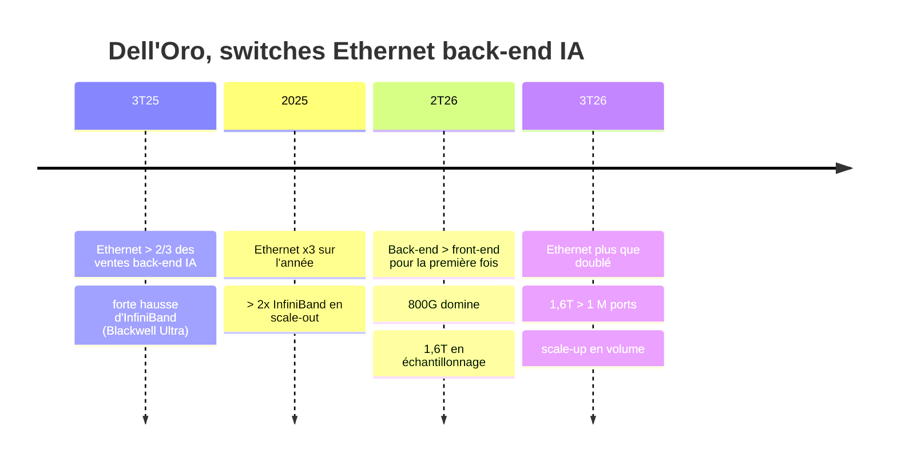
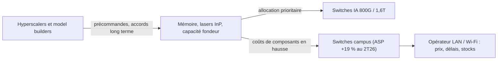

## Un million de ports, un seul trimestre

Un million de ports réseau livrés en un seul trimestre. Les générations précédentes avaient mis plusieurs trimestres, parfois des années, à franchir ce cap. Selon le cabinet Dell'Oro, qui a publié ses chiffres le 25 novembre, c'est le score des ports Ethernet à 1,6 térabit par seconde dès leur premier trimestre de production en volume, dans les réseaux internes des clusters d'intelligence artificielle. Sur la même période, les ventes de switches Ethernet dédiés à ces clusters ont plus que doublé.

On serait tenté d'y voir une affaire de géants du cloud. Erreur. Les switches qui équipent un hôtel de trois cents chambres, une enseigne de cent cinquante magasins ou une résidence étudiante puisent dans les mêmes réservoirs que ceux des clusters IA : mémoires, capacités de fabrication de puces et, en partie, lasers. Quand les plus gros acheteurs de la planète réservent ces capacités à l'avance, les autres passent après. Les switches de campus en font déjà l'expérience : leur prix moyen a bondi de 19 % au deuxième trimestre 2026, sur fond de pénurie de composants. Personne ne chiffre la part de l'IA dans cette hausse. La cause commune, elle, est documentée.

L'Ethernet est devenu la langue commune des fabrics IA (le maillage de liens qui fait travailler des milliers de puces comme une seule machine), mais cette victoire ne supprime pas la dépendance aux fournisseurs. Elle la fait descendre d'un étage, du protocole vers le silicium, l'optique et la télémétrie. C'est là que se décident les prix et les délais de tout le monde. Y compris les nôtres.

## Ce que dit le communiqué, et ce qu'il tait

Commençons par l'hygiène. Le communiqué de Dell'Oro sur le troisième trimestre 2026 est court et qualitatif. Il pose trois faits.

Premier fait : les ventes de switches Ethernet pour les réseaux « back-end » IA ont plus que doublé. Le back-end, c'est le réseau privé qui relie les accélérateurs (GPU et consorts) entre eux ; le front-end, lui, raccorde le cluster au reste du système d'information. Deuxième fait : le 1,6 Tbps a dépassé le million de ports dès son premier trimestre de volume, là où les transitions de vitesse précédentes avaient pris plusieurs trimestres, parfois des années. Troisième fait : les switches Ethernet de scale-up, ceux qui relient les puces à l'intérieur d'un même rack, sont entrés en déploiement de volume.

Sameh Boujelbene, chez Dell'Oro, résume la portée du trimestre : « 3Q 2026 marked two major inflection points for Ethernet in AI back-end networks ». Deux points d'inflexion, donc. La vitesse, et le scale-up.

Le classement des fournisseurs mérite qu'on s'y arrête. Celestica et NVIDIA partagent la première place. Arista, troisième, gagne deux points de part malgré un revenu différé significatif (des équipements livrés mais pas encore comptabilisés en chiffre d'affaires). Cisco, quatrième, affiche le plus fort gain de part du trimestre. Côté demande, les quatre premiers fournisseurs de cloud ont tiré l'essentiel de la croissance, devant les AI Model Builders, ces laboratoires qui entraînent leurs propres modèles.

Voilà pour ce qui est écrit. Ce qui ne l'est pas compte autant. Aucun montant en dollars. Aucune part de marché chiffrée, hormis les deux points d'Arista. Aucune comparaison quantifiée avec InfiniBand, la technologie concurrente historiquement portée par NVIDIA. Le texte ne précise pas non plus si « plus que doublé » s'entend sur un an ou sur un trimestre, en valeur ou en volume. Et le million de ports n'est pas ventilé entre scale-up et scale-out.

Un ordre de grandeur, à prendre comme mon propre calcul : un million de ports à 1,6 Tbps, cela représente 1,6 exabit par seconde (soit 1 600 pétabits) de capacité de ports cumulée. Pour aller plus loin, il faudrait le rapport payant, que je n'ai pas ouvert. Quiconque tire de ce communiqué un taux de croissance précis extrapole.

## Quatre jalons pour changer de langue

Le 3T26 n'a rien d'un coup de tonnerre isolé. Il prolonge une série que Dell'Oro documente trimestre après trimestre, et qui raconte une bascule progressive.

Au troisième trimestre 2025, l'Ethernet pesait déjà plus des deux tiers des ventes de switches back-end IA, contre moins de la moitié un an plus tôt. Celestica et NVIDIA se partageaient alors près de la moitié du segment Ethernet. Sur l'ensemble de 2025, les ventes Ethernet back-end ont plus que triplé, et l'Ethernet est devenu plus de deux fois plus gros qu'InfiniBand en scale-out.

Au deuxième trimestre 2026, nouveau symbole : les ventes de switches back-end ont dépassé celles du front-end pour la première fois. Le réseau interne des clusters IA pèse désormais plus lourd, en ventes de switches, que celui qui les relie au reste du monde. Le 800G représentait alors la grande majorité des expéditions, et le 1,6 Tbps n'en était qu'à l'échantillonnage. Un trimestre plus tard, il dépassait le million de ports.

*Les quatre jalons de la série Dell'Oro, valeurs confirmées uniquement.*

Deux nuances, pour ne pas céder au récit facile. D'abord, InfiniBand ne disparaît pas. Il a connu une forte hausse au 3T25, portée par les systèmes Blackwell Ultra de NVIDIA, et Light Reading titrait encore en juin sur un fort rebond d'InfiniBand au premier trimestre 2026. Le communiqué du 3T26 dit seulement que l'Ethernet a progressé plus vite que lui en scale-out. Ensuite, ce n'est pas la demande qui freine. Dès septembre, Dell'Oro décrivait un marché contraint par l'offre plutôt que par la demande, pour au moins un à deux ans.

La projection de juillet donne l'échelle. Après une forte révision à la hausse, le cabinet anticipe des dépenses cumulées en switches back-end IA approchant 1 000 Md USD sur la période 2026-2030, avec une offre contrainte sur tout l'horizon. Il prévoit aussi que le 1,6 Tbps montera en charge au moins cinq fois plus vite que le 800G. Le million de ports du 3T26 n'est que le premier jalon de cette rampe.

## Couloirs, rues, autoroutes : l'Ethernet entre dans le rack

Le second point d'inflexion demande un détour. Une ferme IA fait cohabiter trois réseaux, et une image urbaine aide à les distinguer. Le scale-up, ce sont les couloirs intérieurs d'un bâtiment : quelques dizaines de puces, dans un même rack, qui partagent leur mémoire comme si elles n'en formaient qu'une. Le scale-out, ce sont les rues entre les bâtiments : des milliers de serveurs reliés pour entraîner ou servir le même modèle. Le scale-across, ce sont les autoroutes entre villes, qui relient plusieurs datacenters.

Dans les rues, l'Ethernet a déjà gagné la bataille des ventes. Il s'appuie sur RoCE (une technique qui permet à un serveur d'écrire directement dans la mémoire d'un autre à travers un réseau Ethernet) et sur les travaux de l'Ultra Ethernet Consortium (UEC). Dans les couloirs, le roi s'appelle NVLink, l'interconnexion propriétaire de NVIDIA. Dell'Oro prévoit que l'Ethernet y deviendra le premier protocole d'ici la fin de la décennie, et que le scale-up pèsera plus de la moitié du marché back-end en 2030. Les volumes du 3T26 prouvent le démarrage. Pas le basculement.

Plusieurs chantiers de normalisation visent ces couloirs. À l'Open Compute Project (OCP), l'initiative ESUN (Ethernet for Scale-Up Networking), lancée en octobre 2025, a publié en mars 2026 une première spécification d'exigences côté opérateurs de réseau. Parmi les pistes décrites par l'OCP : un en-tête de 4 octets, là où la pile IP/UDP classique en consomme de 28 à 48. Dans des couloirs où chaque nanoseconde compte, ce régime minceur n'a rien de cosmétique. Arista, partie prenante, célèbre sur son blog le lever du soleil de l'Ethernet en scale-up, un enthousiasme de vendeur à lire comme tel.

D'autres pistes avancent en parallèle. Une déclinaison orientée transport, SUE-T, est travaillée dans l'orbite de l'OCP, sans que j'aie pu en consulter la spécification. Le consortium UALink (Ultra Accelerator Link) défend, lui, un protocole dédié aux accélérateurs, ni Ethernet ni NVLink. Et selon Network World, la version 1.1 de la spécification Ultra Ethernet, parue mi-octobre, étend à son tour son périmètre au scale-up et ajoute un contrôle de congestion programmable.

Précision importante : le communiqué de Dell'Oro ne cite aucun de ces standards. Le rapprochement entre les volumes du 3T26 et ces travaux est mon analyse, pas la sienne. Elle tient pourtant la route. Quand les couloirs se mettent à parler la même langue que les rues, toute la fabric devient Ethernet. Et c'est précisément là qu'on risque de confondre deux choses : une interface commune et un fournisseur commun.

*Le protocole s'ouvre en haut de la pile ; les étages du dessous, puce, laser, télémétrie, restent verrouillés.*

## Le verrou descend d'un étage

Le conteneur maritime est standardisé depuis des décennies. N'importe quel port du monde sait le décharger, n'importe quel camion sait le transporter. Cela n'a jamais empêché une poignée d'armateurs de contrôler l'essentiel des navires, ni les tarifs du fret de s'envoler quand les capacités ont manqué au sortir de la pandémie. Dans ces moments-là, les gros chargeurs sous contrat embarquaient en premier. Les petits attendaient sur le quai.

L'Ethernet des fabrics IA joue le rôle de ce conteneur : une interface standard, interopérable, documentée par l'IEEE, l'UEC et l'OCP. La valeur, et la dépendance, se logent trois étages plus bas.

**Le silicium.** L'un des deux co-leaders des switches Ethernet back-end IA s'appelle NVIDIA. Le même NVIDIA qui domine le scale-up avec NVLink, qui a longtemps porté InfiniBand et qui figure parmi les membres fondateurs d'ESUN. L'autre co-leader, Celestica, est un fabricant sous contrat (EMS/ODM) dont les switches, ouverts et compatibles avec des systèmes d'exploitation tiers comme SONiC, ciblent les hyperscalers (les géants du cloud). Arista et Cisco, troisième et quatrième, vendent surtout leur propre pile logicielle : Arista sur du silicium du commerce, Cisco avec ses propres puces. Choisir Ethernet ne dit donc rien de la diversité de vos fournisseurs de puces. On peut parler la langue commune et dépendre d'un seul fondeur.

**L'optique.** Un port à 1,6 Tbps, c'est d'abord un module optique. Au cœur de ce module, des lasers EML (à modulation par électro-absorption) fabriqués sur phosphure d'indium (InP), une filière industrielle étroite. Cet été, le patron de Lumentum, l'un des principaux fabricants, estimait que la pénurie de phosphure d'indium deviendrait pire que celle de la mémoire, rapporte Tom's Hardware. NVIDIA a d'ailleurs investi 2 Md USD dans chacun de Lumentum et Coherent en mars 2026, en échange d'engagements d'achat et d'un accès à leur capacité future. Sur la durée de la tension, les analystes divergent : TrendForce évoque un déséquilibre qui se prolonge au-delà de 2027 et Lumentum indique, selon son PDG, livrer plus de 30 % sous la demande, quand LightCounting prévoyait en avril, selon la presse spécialisée, la fin des pénuries d'émetteurs dès fin 2026. Je parierais sur la version prudente.

**La télémétrie et la congestion.** C'est l'étage le moins visible et le plus collant. Une fabric IA vit et meurt par sa gestion de la congestion : un lien saturé, et des milliers de GPU attendent en brûlant du courant. L'UEC 1.1 rend le contrôle de congestion programmable, toujours selon Network World. Mais la façon dont chaque constructeur exploite ces signaux, ordonnance les flux et expose, ou non, ses compteurs reste sa recette maison. C'est sur cette couche que se bâtissent les outils d'exploitation, les tableaux de bord, les automatismes. C'est aussi ce que l'on perd le jour où l'on change de fournisseur.

Ethernet est une interface commune. Pas un fournisseur commun. Le lock-in n'a pas disparu : il a changé d'étage.

*Un module optique 1,6 Tbps et sa puce laser en phosphure d'indium : c'est ici, plus que dans le protocole, que se joue la dépendance.*

## Du cluster IA au switch d'étage : une propagation à surveiller

Venons-en à ce qui touche directement ceux qui, comme nous, achètent des switches pour des hôtels, des magasins et des résidences. Une précaution d'abord : aucune source ne chiffre l'effet des switches IA sur les prix du campus. Ce qui suit est une inférence, assumée comme telle.

Les faits. Selon Dell'Oro, le prix moyen de vente (ASP, pour average selling price) des switches de campus a progressé de 19 % au deuxième trimestre 2026, et tous les constructeurs hors de Chine ont relevé le leur. Le cabinet anticipe des pénuries de mémoire jusqu'en 2027. Côté IA, le marché est contraint par l'offre, et les quatre premiers clouds captent l'essentiel de la croissance.

L'inférence. Les switches IA ne font pas grimper à eux seuls les prix du campus. Mais les deux marchés renchérissent pour la même raison, la pénurie de composants, et ils puisent dans les mêmes réservoirs de mémoire, de capacité de fabrication et, en partie, d'optique. Quand un hyperscaler engage des volumes qui pèsent sur le carnet de commandes d'un fondeur pendant plusieurs années, et qu'un opérateur LAN commande ses switches d'accès par centaines, l'ordre de passage au guichet n'a rien de mystérieux.

*Schéma de propagation : une inférence de l'auteur, pas le résultat d'une étude.*

J'en tire quatre conséquences pour un opérateur LAN et Wi-Fi.

**Les prix.** Si les pénuries de mémoire courent jusqu'en 2027, le +19 % du 2T26 n'a rien d'un accident de trimestre. Une grille tarifaire figée sur trois ans devient un pari. Les clauses de révision indexées sur le coût des composants, à l'achat comme dans les contrats clients, doivent revenir sur la table.

**Les délais et l'allocation.** En pénurie, c'est le fournisseur qui choisit qui il sert. Un stock tampon sur les références critiques (switches d'accès, optiques de raccordement) immobilise de la trésorerie. Une rupture au milieu d'un déploiement de cinquante sites coûte nettement plus cher.

**Les compétences.** Les technologies du back-end IA ne resteront pas éternellement confinées aux hyperscalers. Le jour où un groupe hôtelier ou une enseigne installera un serveur d'inférence local dans ses sites, il faudra savoir déployer RoCE, régler un réseau sans perte et lire une télémétrie de congestion. Concrètement, maîtriser PFC (Priority Flow Control, qui met un flux en pause avant saturation) et ECN (Explicit Congestion Notification, qui signale l'encombrement sans jeter de paquets). Ce jour n'est pas encore arrivé. Mieux vaut former avant qu'après.

**Les contrats fournisseurs.** Multi-sourcing des optiques, validation d'au moins deux constructeurs par fonction critique, export de la télémétrie dans des formats ouverts : ce sont ces clauses, et non le logo Ethernet sur la fiche technique, qui transforment une interface commune en liberté de choix réelle.

*Les fondeurs et les fabricants de lasers servent d'abord les grands datacenters ; le campus se partage ce qui reste.*

## La bonne question n'est plus « Ethernet ou pas ? »

Pendant des années, le débat des datacenters a opposé des protocoles : Ethernet contre InfiniBand, standard contre propriétaire. En scale-out, ce débat penche désormais nettement vers l'Ethernet, même si InfiniBand garde de solides positions. En scale-up, il ne fait que commencer. C'est une bonne nouvelle. Une langue commune abaisse le coût d'apprentissage, élargit le vivier d'ingénieurs et rend les architectures lisibles.

Mais y voir la fin de la dépendance serait naïf. Le lock-in a simplement suivi la valeur, vers le silicium, les lasers et les logiciels d'exploitation. Dans cinq ans, la question d'achat pertinente ne sera plus « Ethernet ou autre chose ? ». Ce sera : « quel étage de ma pile puis-je changer sans refaire tout le réseau ? »

D'ici là, je poserais quatre questions à chaque fournisseur, que l'on construise un cluster IA ou que l'on équipe trois cents hôtels. Qui fabrique le silicium de vos switches et de vos cartes réseau ? Qui fournit vos lasers, et avec quelle visibilité sur 2027 ? Que mesure exactement votre télémétrie ? Et que puis-je exporter le jour où je pars ?

Le fournisseur qui répond clairement aux quatre mérite la confiance. Celui qui répond « c'est de l'Ethernet, c'est standard » vient de vous montrer où il a posé son verrou.

---

_Vues personnelles, pas position Wifirst._

## Sources

1. [Dell'Oro Group — AI back-end Ethernet sales more than double in 3Q 2026 (25 novembre 2026)](https://www.delloro.com/newsroom/ai-back-end-ethernet-sales-3q-2026/)
2. [PR Newswire — miroir du communiqué Dell'Oro 3T26 (25 novembre 2026)](https://www.prnewswire.com/news-releases/ai-back-end-ethernet-sales-more-than-double-in-3q2026-as-scale-up-deployments-enter-volume-production-according-to-delloro-group-302949981.html)
3. [Dell'Oro Group — AI back-end networks switch sales surpass front-end networks for the first time in 2Q 2026 (3 septembre 2026)](https://www.delloro.com/news/ai-back-end-networks-switch-sales-surpass-front-end-networks-for-the-first-time-in-2q2026/)
4. [Dell'Oro Group — AI back-end networks continue their shift to Ethernet, over two-thirds of 3Q 2025 switch sales (5 décembre 2025)](https://www.delloro.com/news/ai-back-end-networks-continue-their-shift-to-ethernet-now-accounting-for-over-two-thirds-of-3q-2025-switch-sales-in-ai-clusters/)
5. [Dell'Oro Group — Ethernet more than doubles size of InfiniBand in AI scale-out networks in 2025 (10 mars 2026)](https://www.delloro.com/newsroom/ethernet-more-than-doubles-size-of-infiniband-as-the-leading-fabric-for-ai-scale-out-networks-in-2025/)
6. [Dell'Oro Group — AI back-end switch sales to approach 1 trillion USD over the next five years (28 juillet 2026)](https://www.delloro.com/newsroom/ai-back-end-switch-sales-to-approach-1-trillion-over-the-next-five-years/)
7. [Light Reading — Ethernet extends lead in AI scale-out networks despite strong InfiniBand rebound (2 juin 2026)](https://www.lightreading.com/network-technology/ethernet-extends-lead-in-ai-scale-out-networks-despite-strong-infiniband-rebound-dell-oro)
8. [Network World — Ultra Ethernet 1.1 extends the specification to scale-up networks (14 octobre 2026)](https://www.networkworld.com/article/4235340/ultra-ethernet-1-1-extends-the-specification-to-scale-up-networks-and-adds-programmable-congestion-control.html)
9. [Tom's Hardware — Lumentum CEO says the indium phosphide shortage will become worse than memory (31 juillet 2026)](https://www.tomshardware.com/tech-industry/semiconductors/lumentum-ceo-says-the-indium-phosphide-shortage-will-become-worse-than-memory)
10. [Open Compute Project — The OCP ESUN 1.0 specification has been released (10 mars 2026)](https://www.opencompute.org/news/the-ocp-esun-10-specification-has-been-released/)
11. [Arista Networks (blog vendor) — The sun rises on scale-up Ethernet (13 octobre 2025)](https://blogs.arista.com/blog/the-sun-rises-on-scale-up-ethernet)
12. [Dell'Oro Group — Market prices skyrocket, driving campus switch market to growth in 2Q 2026 (8 septembre 2026)](https://www.delloro.com/newsroom/market-prices-skyrocket-driving-campus-switch-market-to-growth-in-2q-2026/)
13. [TrendForce — InP shortage emerges as AI optical interconnect bottleneck (6 août 2026)](https://www.trendforce.com/news/2026/08/06/news-inp-shortage-emerges-as-ai-optical-interconnect-bottleneck/)
14. [NVIDIA Newsroom — NVIDIA announces strategic partnership with Lumentum (2 mars 2026)](https://nvidianews.nvidia.com/news/nvidia-announces-strategic-partnership-with-lumentum-to-develop-state-of-the-art-optics-technology)
