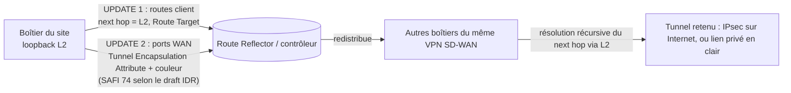
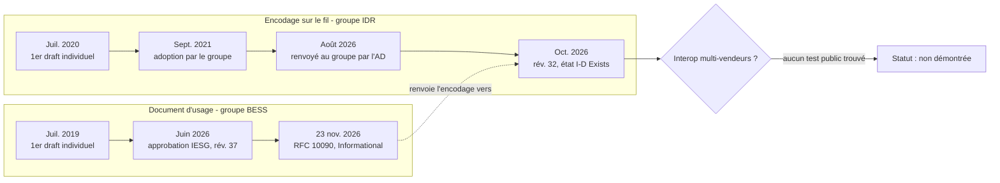
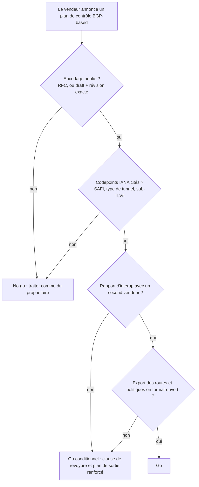

## Le prix d'un divorce réseau

Prenez un groupe hôtelier de 300 établissements, chacun relié au siège et au cloud par un boîtier réseau. Le jour où il veut changer de fournisseur, il ne remplace pas simplement des équipements. Il fait déménager toute son infrastructure d'une langue vers une autre. Nuits d'intervention, sites basculés un par un, terminaux de paiement qu'il ne faut surtout pas couper pendant les départs du dimanche matin. Le divorce coûte cher, et chacun le sait au moment de signer.

La raison tient en une phrase. Dans un SD-WAN (Software-Defined WAN, ces réseaux multi-sites pilotés par un contrôleur central), chaque constructeur fait dialoguer ses boîtiers et son contrôleur dans un protocole maison, ou dans du BGP agrémenté d'extensions propriétaires. Hôtellerie, résidences gérées, retail : tous les réseaux à plusieurs centaines de sites vivent avec ce verrou.

Le 23 novembre 2026, un document est venu esquisser une porte de sortie. La RFC 10090, classée « Informational », décrit comment BGP, le protocole de routage qui fait déjà tenir Internet et les réseaux privés des opérateurs, pourrait remplacer ces dialectes propriétaires. Sept ans de travail, 37 révisions. Sur le papier, c'est la nouvelle que les acheteurs de réseaux multi-sites attendaient.

En pratique, c'est plus subtil. La RFC décrit, elle ne spécifie pas. Les octets qui circuleraient réellement entre deux équipements de marques différentes vivent dans un autre document, toujours à l'état de brouillon, renvoyé à son groupe de travail en août. Cette nuance devrait changer la façon dont on rédige un appel d'offres.

## Une RFC qui décrit, et qui le dit

Premier réflexe à corriger : une RFC n'est pas forcément une norme. À l'IETF, l'organisme qui fabrique les protocoles d'Internet, ce sont en principe les documents de la voie « Standards Track » qui fixent ce qu'un équipement doit émettre et comprendre. La catégorie Informational sert à autre chose. Elle documente un problème, un usage, un vocabulaire partagé.

La RFC 10090 assume ce rôle sans détour. Sa section 1 explique que la publication vise à « establish a shared understanding of the SD-WAN problem space and deployment assumptions to assist with protocol development ». Son résumé va plus loin : BGP « can provide a standards-based mechanism for distributing information that may otherwise be exchanged using proprietary SD-WAN control plane mechanisms. However, extensions to BGP are needed to achieve this. » Traduction : le standard est possible, mais il n'est pas dans ce texte. La section 9 le confirme à sa manière, puisqu'elle ne demande aucune action à l'IANA (le registre mondial des numéros de protocole). Aucun nouveau code, aucun nouveau format de message.

Le document vient du groupe de travail BESS, qui traite des services construits sur BGP. Il est cosigné notamment par des ingénieurs de Futurewei, Cisco et Bell Canada. Ces affiliations racontent qui s'est intéressé au sujet. Elles ne disent rien du support produit de qui que ce soit.

Sur le fond, le modèle a de quoi rassurer un ingénieur réseau. Pour les routes des clients, la section 3.1.1 reprend tel quel le mécanisme des VPN MPLS (les réseaux privés virtuels des opérateurs) : des tables de routage isolées par client, les VRF, et des étiquettes d'appartenance, les Route Targets (RFC 4364 et 4659). Rien d'exotique. Tout opérateur connaît ce modèle par cœur.

La partie intéressante se trouve dans le scénario dit « Differential Encrypted » de la section 5.3. Chaque boîtier de site y envoie deux messages BGP distincts, deux UPDATE. Pensez à une carte de visite et à un plan d'accès. La carte de visite, l'UPDATE 1, dit en substance : voici les réseaux clients que je dessers, joignez-les via mon adresse interne stable, ma loopback.

Le plan d'accès, l'UPDATE 2, décrit les portes d'entrée physiques du site : fibre, 4G, lien privé. Il fournit aussi de quoi les ouvrir, avec les paramètres de chiffrement IPsec, les piles de labels MPLS et des couleurs. Le tout voyage dans le Tunnel Encapsulation Attribute, un attribut BGP normalisé par la RFC 9012.

Le destinataire recolle les deux messages grâce à la loopback commune, par résolution récursive du next hop (section 8 de la RFC 9012). On devine l'intérêt : la liste des réseaux clients et l'état des liens physiques ne vivent pas au même rythme, et ce découpage permet de les traiter séparément. Le trafic qui emprunte un lien privé peut rester en clair. Celui qui passe par Internet part chiffré.

*Le scénario « Differential Encrypted » de la section 5.3 : deux annonces séparées, recollées par la loopback commune.*

Au centre du dispositif trône un réflecteur de routes (RR, route reflector), ce serveur BGP qui redistribue les annonces de chacun à tous les autres. La RFC accepte qu'il soit fondu dans le contrôleur SD-WAN ou qu'il reste séparé. Elle laisse hors périmètre la coordination entre plusieurs RR, mais le désigne comme « the logical control point ». Elle suppose enfin un domaine administratif unique, cohérent avec le référentiel de service MEF 70.2. Petite ironie : Mplify 119, l'autre référentiel industriel cité en référence normative, ne mentionne pas BGP sur sa page de présentation.

*Deux flux pour un même site : la carte de visite des routes client d'un côté, le plan d'accès des ports WAN et de leurs clés de l'autre.*

## La forme de la prise, renvoyée à plus tard

Imaginez un règlement qui fixe, pour chaque pièce d'une maison, le nombre de prises électriques, leur puissance et les appareils qu'on y branchera. Puis qui renvoie, pour la forme de la prise elle-même, à un autre texte toujours en discussion. Vous pouvez câbler la maison. Vous ne pouvez pas garantir qu'un grille-pain acheté chez un autre fabricant s'y branchera.

C'est exactement la situation de la RFC 10090. Sa section 1 renvoie les extensions détaillées vers un document cité sous le nom [SD-WAN-DISC] : draft-ietf-idr-sdwan-edge-discovery, porté par le groupe IDR (Inter-Domain Routing), gardien de BGP à l'IETF. Celui-là vise bien la voie Standards Track. Il en est à sa révision 32, datée du 23 octobre 2026, et son état officiel reste « I-D Exists » : un brouillon vivant, pas une RFC en attente d'édition. Premier jet individuel en juillet 2020, adoption par le groupe en septembre 2021. Plus de cinq ans de travail.

Que contient-il ? La forme de la prise, justement. D'abord une nouvelle famille d'adresses BGP, le SAFI 74 (Subsequent Address Family Identifier, l'étiquette qui indique à un routeur quel type d'information transporte un message), déclinée en IPv4 et en IPv6. Ensuite un format de route, le Route-Type 1, qui empile un identifiant de port local (4 octets), une couleur SD-WAN (4 octets) et un identifiant de nœud (4 ou 16 octets). Soit un champ de 12 ou 24 octets selon la famille d'adresses.

S'y ajoutent un nouveau type de tunnel, « SD-WAN Hybrid », code 25, et une série de sous-champs au format type-longueur-valeur, les sub-TLVs 64, 65, 67, 68, 69 et 70. Ils portent notamment l'identifiant d'association de sécurité IPsec, un attribut étendu de port et un compteur de renouvellement des clés.

Détail qui compte : le draft précise que l'usage du Tunnel Encapsulation Attribute avec le SAFI 74 se situe « outside the scope defined by [RFC9012] », et qu'il « does not update [RFC9012] ». Il fixe donc ses propres règles, à côté de la RFC 9012, Proposed Standard d'avril 2021 mise à jour depuis par la RFC 9830.

Le parcours n'a rien d'un long fleuve tranquille. Le draft a été soumis le 3 août 2026 à l'IESG (Internet Engineering Steering Group, l'instance qui approuve les publications). Le 19 août, il était renvoyé à son groupe de travail par l'AD (Area Director, le directeur de domaine) responsable, pour des problèmes jugés significatifs. Les revues précoces de 2024-2025 n'étaient guère plus tendres : « Not Ready » pour le directorat Internet, « Not Ready » à deux reprises pour le directorat routage, « Has Issues » côté opérations, « Has Nits » côté sécurité. Une nouvelle revue sécurité a été demandée le 7 novembre et assignée le 16.

Reste un piège classique. À l'IANA, le SAFI 74 est bien enregistré (« SD-WAN Capabilities »), le type de tunnel 25 aussi (« SDWAN-Hybrid »). Des numéros alloués donnent une impression de maturité. Sauf que ces allocations précoces référencent les révisions 03 et 04 du draft, quand le texte en est à la 32. Le registre nomme encore le 67 « IPsec SA Nonce » et le 65 « Extended Port Property », là où la révision 32 parle de « IPsec SA Rekey Counter » et d'« Extended Port Attribute ». Un numéro réservé n'est pas un encodage figé.

Et les implémentations ? La note du shepherd, le responsable du suivi du document, évoque plusieurs implémentations d'un seul et même vendeur. Les sources publiques consultées ne montrent aucune trace d'un test d'interopérabilité entre deux constructeurs. Pour un protocole dont toute la raison d'être est de faire parler des marques différentes, c'est pourtant le seul indicateur qui compte.

*Deux documents, deux calendriers : la description est publiée, l'encodage sur le fil reste un brouillon.*

## L'IESG a posé la question qui fâche

Le plus parlant, c'est que l'interopérabilité a été mise sur la table pendant l'examen de la RFC 10090 elle-même. Ketan Talaulikar, qui se trouve être aussi l'AD responsable du draft d'encodage, a d'abord bloqué le document avec une position DISCUSS, avant de s'abstenir. En substance, il demandait comment cette normalisation permettrait à des passerelles et à des contrôleurs de vendeurs différents de travailler ensemble. Il indiquait ne connaître aucun support multi-vendeurs.

Il relevait aussi que les extensions BGP ne représentent qu'une petite partie d'une solution SD-WAN, et qu'aucun groupe de travail dédié au SD-WAN n'a été créé à l'IETF. Il doutait enfin de l'intérêt de publier dans le flux IETF plutôt que par la voie des soumissions indépendantes.

D'autres membres ont tiré sur le même fil. Roman Danyliw s'est abstenu, reprochant en substance au texte de mal séparer l'existant, les travaux futurs et le hors-périmètre. Ses exemples étaient précis : l'attribut d'encapsulation de tunnel, le provisionnement sans intervention (ZTP, Zero-Touch Provisioning), TLS pour BGP, et la question de QUIC. Éric Vyncke a demandé si l'absence de référence pour les attributs IPsec transportés dans les UPDATE signifiait qu'aucune RFC n'existait pour cette extension. La réponse figure dans la section précédente : pas encore. Mohamed Boucadair, lui, a levé son DISCUSS.

Le document a été approuvé le 2 juin 2026. Ce n'est pas un scandale. L'IESG a laissé passer un texte descriptif, ce qui correspond exactement au rôle de la catégorie Informational. Le problème n'est pas la RFC. C'est ce que les plaquettes commerciales risquent d'en faire.

Un exemple de ce qui peut mal tourner : le mot « couleur ». Le monde propriétaire l'utilise déjà. Le plan de contrôle de Cisco Catalyst SD-WAN repose sur OMP (Overlay Management Protocol), que le glossaire développeur de Cisco décrit comme le protocole qui « advertises to its peers the routes and services that it has learned from its local site ». Il s'appuie aussi sur les TLOC (Transport Locators), des couples adresse IP plus « color ».

Côté IETF, la RFC 9012 dispose de son propre sous-champ Color (code 4), que les procédures du draft n'utilisent pas. Le draft, lui, place une Color Extended Community sur les routes client et un champ SD-WAN-Color dans le format de route des liens physiques. Même mot, au moins trois sémantiques. C'est mon analyse, pas une affirmation des sources, mais la conséquence est simple : dans un appel d'offres, « nous supportons les couleurs » ne veut rien dire tant qu'on n'a pas précisé lesquelles.

*Document, brouillon, registre, produit : les couches du dessus sont solides, celle de l'interopérabilité reste en pointillés.*

## Un cerveau central, donc une panne centrale

Une politique mal saisie un mardi soir sur le contrôleur, et ce n'est pas un hôtel qui perd sa connectivité. C'est potentiellement tout le parc qui reçoit la même instruction fausse. La RFC 10090 le reconnaît sans fard dans sa section 8 : une erreur de politique sur le RR ou dans la logique du contrôleur « can have network-wide impact ».

Le texte pose donc des exigences. « All communication between SD-WAN edges and the RR must occur over a secure channel, such as TLS or IPsec. » Mais la section 3.1.5 ne détaille qu'IPsec, avec BGP sur TCP encapsulé dans un chemin IPsec, et renvoie les autres mécanismes hors périmètre. La remarque de Danyliw sur TLS et QUIC n'avait rien de gratuit. Autre exigence notable : les informations de plan de contrôle reçues sur des ports WAN raccordés à Internet doivent faire l'objet d'une validation stricte.

Le draft d'encodage est encore plus franc sur ses hypothèses. Ses mécanismes supposent un « walled garden », un jardin clos où chaque acteur est de confiance. Le RR doit y être pleinement fiable pour les matériaux de tunnel et de clés qu'il redistribue. Trois sujets lourds restent non analysés : les conséquences d'un RR compromis, mal configuré ou contraint, la confidentialité persistante (forward secrecy) et la charge du renouvellement des clés. Le draft exige en revanche l'authentification des pairs et la protection d'intégrité des sessions BGP, avec TCP-AO (TCP Authentication Option) cité en exemple.

Ce qui suit relève de mon analyse d'opérateur, pas du texte de la RFC. Pour un réseau de Wi-Fi managé qui couvre des centaines d'hôtels, de résidences et de magasins, cette centralisation impose trois disciplines. D'abord, cloisonner les politiques par client via les Route Targets, pour qu'une erreur sur un locataire ne déborde pas chez le voisin. Ensuite, traiter chaque changement de politique du RR comme un déploiement logiciel : par vagues, avec retour arrière testé et journal d'audit. Enfin, considérer chaque lien 4G ou 5G de secours, chaque accès fibre ou xDSL grand public, comme un port Internet soumis à la validation stricte que la RFC réclame.

Le chiffrement différencié mérite aussi un regard froid. Laisser en clair ce qui passe sur un lien privé et chiffrer ce qui transite par Internet a du sens, notamment dans le retail où circulent des flux de paiement. Mais la conformité dépend alors d'une décision prise par le contrôleur, site par site, lien par lien. Le jour où il faut prouver à un auditeur qu'aucun flux de paiement n'est sorti en clair, cette décision doit pouvoir se lire ailleurs que dans la console du vendeur.

*Un contrôleur, des centaines de sites : la section 8 rappelle qu'une erreur de politique au centre peut toucher tout le réseau.*

## Ce qu'un « BGP-based » doit prouver avant signature

Le sujet n'a rien d'académique. Selon Dell'Oro, les revenus mondiaux des fabricants sur le marché SASE (Secure Access Service Edge, la convergence du SD-WAN et des briques de sécurité cloud) ont atteint 3,5 Md USD au seul deuxième trimestre 2026. La croissance annuelle dépasse 20 %, et la note précise que le SD-WAN « strengthened materially », sans donner de chiffre SD-WAN isolé ni nommer de vendeur. Côté Gartner, le Market Guide SD-WAN du 5 août 2026, que je ne connais que par le résumé diffusé par Versa, décrit un marché mature en voie de devenir une fonction du SASE, et couvre 22 vendeurs.

Des appels d'offres se rédigent donc maintenant, et la mention « BGP-based » risque de fleurir dans les plaquettes. Voici la grille que j'appliquerais, toujours au titre de l'analyse d'auteur.

1. **La référence exacte de l'encodage** : une RFC, ou un draft avec son numéro de révision. « Conforme à la RFC 10090 » ne suffit pas, puisque cette RFC ne fixe aucun format sur le fil.
2. **Les codepoints réellement utilisés** : SAFI, type de tunnel, sub-TLVs, avec leur correspondance dans les registres IANA.
3. **Un rapport d'interopérabilité avec un second vendeur**, daté, avec les versions logicielles testées. Pas une feuille de route.
4. **L'export des routes et des politiques dans un format ouvert**, exploitable sans la console du vendeur.
5. **L'architecture RR et contrôleur** : intégrée ou séparée, redondance, et le niveau de service contractuel qui va avec.

*Grille de lecture proposée par l'auteur face à un argument « BGP-based » : chaque réponse négative a un coût, pas forcément un veto.*

Dernier piège, et non des moindres : confondre plan de contrôle ouvert et absence de verrouillage. Talaulikar l'a souligné en substance à l'IESG, les extensions BGP ne sont qu'une petite partie d'une solution SD-WAN. La gestion, la télémétrie et le provisionnement automatique des sites resteraient propriétaires. Même avec un encodage BGP parfaitement interopérable, migrer 300 sites restera un projet. Il sera simplement moins risqué.

## Mon verdict : lire la RFC, acheter l'encodage

Je ne fais pas partie de ceux qui jugeront la RFC 10090 inutile. Elle apporte un vocabulaire commun, des scénarios de déploiement nommés et des exigences de sécurité explicites sur le couple RR et contrôleur. C'est une excellente annexe d'appel d'offres. Je la glisserais dans le dossier de consultation dès le prochain renouvellement, ne serait-ce que pour obliger chaque vendeur à se positionner scénario par scénario.

Mais elle ne constitue ni un standard de plan de contrôle, ni une garantie d'interopérabilité. Une langue commune ne garantit pas qu'on se comprenne : encore faut-il partager le même dictionnaire. Ce dictionnaire, c'est le draft IDR, et il vient d'être renvoyé à son groupe de travail après des revues peu flatteuses. Rien ne permet de dire aujourd'hui quand il sera figé, ni s'il le sera avant l'échéance de vos contrats actuels.

D'ici là, la règle tient en une ligne. Le critère d'achat n'est pas la mention « BGP-based », c'est l'encodage publié, référencé à la révision près et testé face à un concurrent. Un vendeur qui coche ces trois cases mérite qu'on l'écoute. Un vendeur qui brandit le numéro 10090 sans le reste vend un transport BGP posé sur une sémantique maison. C'est respectable. Ce n'est pas de l'interopérabilité.

Il a fallu sept ans pour décrire le problème. On peut bien attendre quelques mois de plus avant de croire qu'il est résolu.

_Vues personnelles, pas position Wifirst._

## Sources

1. RFC 10090, « BGP Usage for Software-Defined WAN (SD-WAN) Overlay Networks », texte intégral, Informational, novembre 2026 : https://www.rfc-editor.org/rfc/rfc10090.txt
2. RFC 10090, page d'information RFC Editor (métadonnées, références) : https://www.rfc-editor.org/info/rfc10090
3. Datatracker IETF, RFC 10090 (flux, groupe BESS, AD responsable), mis à jour le 23 novembre 2026 : https://datatracker.ietf.org/doc/rfc10090/
4. Historique de draft-ietf-bess-bgp-sdwan-usage (chronologie 2019-2026) : https://datatracker.ietf.org/doc/draft-ietf-bess-bgp-sdwan-usage/history/
5. Ballot IESG de draft-ietf-bess-bgp-sdwan-usage (positions mai-juin 2026) : https://datatracker.ietf.org/doc/draft-ietf-bess-bgp-sdwan-usage/ballot/
6. draft-ietf-idr-sdwan-edge-discovery-32, Internet-Draft Standards Track, 23 octobre 2026 : https://www.ietf.org/archive/id/draft-ietf-idr-sdwan-edge-discovery-32.txt
7. Datatracker du draft IDR et son historique (état, revues, retour au groupe) : https://datatracker.ietf.org/doc/draft-ietf-idr-sdwan-edge-discovery/ et https://datatracker.ietf.org/doc/draft-ietf-idr-sdwan-edge-discovery/history/
8. IANA, registre SAFI : https://www.iana.org/assignments/safi-namespace/safi-namespace.xhtml
9. IANA, registre BGP Tunnel Encapsulation : https://www.iana.org/assignments/bgp-tunnel-encapsulation/bgp-tunnel-encapsulation.xhtml
10. RFC 9012, « The BGP Tunnel Encapsulation Attribute », Proposed Standard, avril 2021 : https://www.rfc-editor.org/info/rfc9012
11. MEF 70.2, SD-WAN Service Attributes and Service Framework (Mplify) : https://www.mplify.net/resources/mef-70-2-sd-wan-service-attributes-and-service-framework/
12. Mplify 119, Universal SD-WAN Edge Implementation Agreement, juin 2025 : https://www.mplify.net/resources/mplify-119-universal-sd-wan-edge-implementation-agreement/
13. Cisco DevNet, glossaire Catalyst SD-WAN (OMP, TLOC, color) : https://developer.cisco.com/docs/sdwan/glossary
14. Dell'Oro Group, « SASE Revenue Grows Above 20 Percent as SD-WAN Reaccelerates in 2Q 2026 », 15 septembre 2026 : https://www.delloro.com/newsroom/sase-revenue-grows-above-20-percent-as-sd-wan-reaccelerates-in-2q-2026/?article_lang=en
15. Gartner, Market Guide for SD-WAN, 5 août 2026, via le résumé publié par Versa Networks (source secondaire) : https://versa-networks.com/resources/reports/2026-gartner-market-guide-for-sd-wan/
