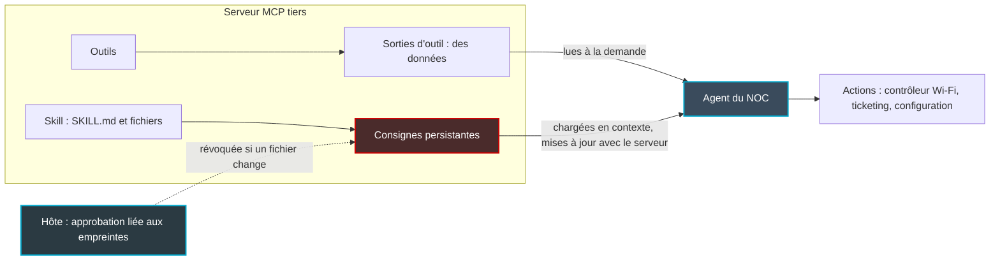
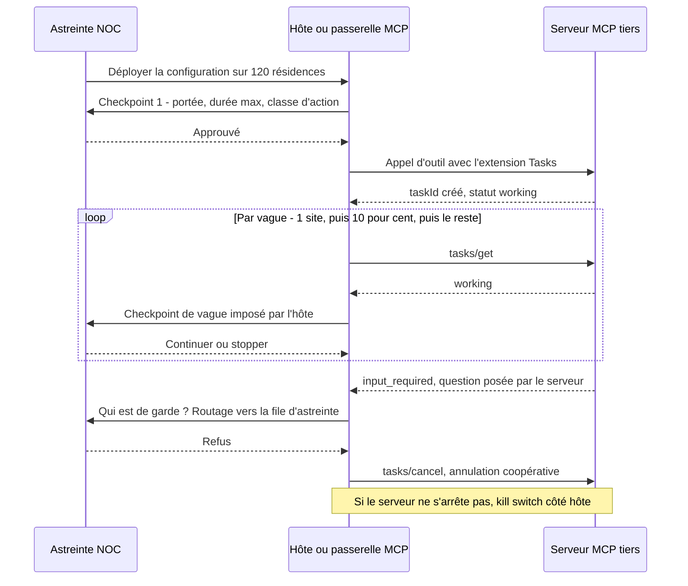

## Un dimanche soir de rentrée, personne ne regarde

Un dimanche soir de septembre, cent vingt résidences étudiantes reçoivent une nouvelle configuration Wi-Fi. Personne ne regarde l'écran. L'astreinte a passé la main à 22 heures et la tâche tourne en arrière-plan, pilotée par un agent IA. La procédure qu'il applique a été mise à jour la veille par un éditeur tiers. Personne, chez vous, ne l'a relue.

Ce scénario est fictif : aucun incident de ce genre n'a été documenté publiquement à ce jour. Mais toutes les briques pour le rendre possible ont été livrées le 24 novembre. Ce jour-là, Anthropic revendiquait plus de 700 millions de téléchargements mensuels des kits de développement du Model Context Protocol (MCP, le standard qui branche les agents IA sur les outils de l'entreprise) [1][2]. Et ouvrait trois portes d'un coup : des serveurs qui livrent à l'agent des procédures permanentes, des tâches qui s'exécutent sans humain présent, des demandes de confirmation posées… par le serveur lui-même.

Pour qui supervise des milliers de bornes Wi-Fi dans des hôtels, des résidences ou des magasins, la question n'est plus de savoir s'il faut brancher des agents sur le centre de supervision. Elle est plus inconfortable. Quand un tiers peut à la fois écrire la consigne et décider s'il faut vous demander la permission, où se trouve le vrai point de contrôle ?

Ma réponse tient en quatre mots : pas chez le serveur.

## Les sorties d'outil étaient des données, les skills sont des ordres

Prenez un technicien d'astreinte de votre centre de supervision réseau (NOC, pour *Network Operations Center*). Jusqu'ici, un serveur MCP ressemblait pour lui à un fournisseur de pièces détachées : il commande un relevé d'alarmes, un ticket, l'état d'une borne, et le fournisseur livre. Si la pièce est défectueuse, le technicien a une chance de s'en apercevoir. Avec les skills, le même fournisseur glisse aussi des pages dans son classeur de procédures. Et il peut les réécrire chaque nuit.

C'est, sans métaphore, ce que décrit l'annonce. Avec « Skills over MCP », en bêta publique, un serveur publie des skills à côté de ses outils ; Claude les charge à la demande, et ils se mettent à jour avec le serveur [1]. Shopify, HubSpot et Atlassian en servent déjà. La fonction est active par défaut sur les offres Pro, Max et Ultra, un administrateur doit l'allumer sur Team, et Enterprise est annoncé « coming soon ». Traduction : la gouvernance entreprise de ces skills n'est pas encore livrée, alors que les comptes individuels y ont accès par défaut.

Techniquement, un skill est un simple dossier (un fichier `SKILL.md` et ses annexes) servi via une extension du protocole [3]. Sa proposition de spécification, SEP-2640, est au statut Final, mais le support côté kits de développement et applications clientes est « encore en cours d'implémentation ». La norme est figée. Les implémentations, pas encore.

Les deux autres annonces complètent le tableau. Les **Tasks** permettent à un serveur d'exécuter des opérations longues, voire des boucles d'agent complètes, en arrière-plan pendant que Claude continue. L'**Elicitation** lui permet de se mettre en pause en plein appel pour demander une saisie, par formulaire ou par lien [1]. Les deux sont passées en GA (disponibilité générale) dans Claude et Claude Code pour Pro, Max et Ultra, et sont en cours de déploiement sur Team et Enterprise.

Attention à ce « GA » : c'est un statut produit chez Anthropic, pas un statut de spécification. Les Tasks ont même quitté le cœur du protocole pour devenir une extension (SEP-2663) avec la version du 28 juillet 2026 [4][7].

La spécification n'est pas naïve pour autant. Elle impose à l'hôte, l'application qui fait tourner l'agent (Claude Code, un client maison, une passerelle), de traiter le contenu d'un skill comme une entrée non fiable et de l'étiqueter avec son serveur d'origine [3]. Toute exécution de code ou tout octroi de permissions exige une approbation explicite, skill par skill. Chaque fichier figure dans un manifeste avec son empreinte cryptographique (SHA-256) et sa taille ; l'approbation se lie à cet ensemble et tombe dès qu'un fichier change.

Mais la spec écrit elle-même sa limite : les empreintes établissent la cohérence avec le manifeste du serveur, « pas la confiance dans son contenu ». Le cadenas vérifie que le classeur n'a pas bougé depuis votre signature. Il ne vérifie pas que ce que vous avez signé était juste.

*Deux canaux venus du même tiers : les outils livrent des données ponctuelles, les skills des consignes qui persistent. L'empreinte détecte un changement, pas une consigne mauvaise dès l'origine.*

Reste le chiffre de 700 millions, à lire pour ce qu'il est : un chiffre vendeur, non audité, qui mélange intégration continue, miroirs et réinstallations. Xenospectrum rappelle à juste titre que des téléchargements ne prouvent pas un usage en production [11]. La trajectoire, elle, est parlante : plus de 400 millions revendiqués en juillet [8], plus de 700 millions quatre mois plus tard, toujours selon Anthropic. MCP est devenu une dépendance ordinaire. Et une dépendance ordinaire, c'est une surface d'attaque ordinaire.

## Une chaîne d'approvisionnement de consignes, pas de code

On sait à peu près sécuriser une chaîne d'approvisionnement logicielle : on signe les paquets, on scanne les dépendances, on fige les versions. Un skill échappe en partie à ces réflexes, parce qu'il ne contient pas forcément de code. Il contient de la prose. Et cette prose change ce que l'agent considère comme normal : l'ordre des étapes, la vérification qu'on peut sauter, le destinataire d'un export.

Les premières études sur les écosystèmes de skills donnent la mesure. Une équipe a passé au crible 98 380 skills issus de deux registres communautaires : 157 confirmés malveillants, 632 vulnérabilités, 13 techniques d'attaque, et en moyenne 4,03 vulnérabilités par skill malveillant (travaux présentés à USENIX Security 2026) [14]. Une autre analyse, sur 31 132 skills, en trouve 26,1 % avec au moins une vulnérabilité et 5,2 % présentant des motifs qui suggèrent une intention malveillante [15].

Côté offensif, le banc d'essai SKILL-INJECT aligne 202 paires injection-tâche et atteint jusqu'à 80 % de succès contre des modèles de pointe [13]. Akamai a publié en mars une taxonomie de dix menaces propres aux skills [12]. Deux d'entre elles parlent directement à un NOC. La première est la manipulation de la sélection : un nom ou une description trompeurs poussent l'agent vers le mauvais skill. La seconde est la dérive entre ce que promettent les métadonnées et ce que fait réellement le skill.

Une précision d'honnêteté s'impose. Ces études portent sur des registres communautaires de skills génériques, pas sur des skills servis par des serveurs MCP, et un taux de vulnérabilité n'est pas une probabilité d'incident en production. La transposition est donc la mienne. Elle me paraît solide pour une raison simple : le format est le même, et MCP y ajoute un canal de mise à jour automatique.

Voici ma lecture du changement de nature. Un serveur compromis pouvait déjà mentir dans une sortie d'outil, le temps d'une conversation. Avec un skill, il installe une procédure qui survit aux conversations et suit chaque mise à jour du serveur. Le contrôle par empreinte attrapera la dérive, le skill sain devenu toxique. Il n'attrapera jamais le skill mauvais dès le premier jour, approuvé une fois et appliqué mille fois.

La spec prévoit d'ailleurs des skills « dynamiques », générés à la volée et donc sans empreinte stable : l'hôte peut les refuser, et s'il les accepte, son approbation ne couvre pas le contenu futur [3]. En production, je ne vois aucune raison de les accepter.

Quant au filet de sécurité de l'éditeur, son périmètre reste flou. Selon i10x, Anthropic ne scannerait les skills que pour une partie des connecteurs, principalement ceux de l'annuaire ajoutés sur claude.ai, et un serveur ajouté en local dans Claude Code y échapperait [10]. C'est une source unique, que je n'ai pas retrouvée dans la documentation d'Anthropic. Raison de plus pour ne pas compter sur un scan dont vous ne connaissez pas les contours.

Dernière hypothèse, posée comme telle. Tool Search, autre nouveauté du 24 novembre, revendique « typiquement » plus de 85 % de contexte économisé quand on agrège plusieurs serveurs [1][9]. Mais il sélectionne les outils sur des descriptions rédigées librement par chaque serveur. Plus on agrège, plus tromper la sélection devient rentable. Aucune source ne le démontre encore.

*Deux tapis roulants, deux natures de livraison : les données passent, les consignes portent un sceau. Le sceau prouve que rien n'a changé depuis l'approbation, pas que le contenu était sain.*

## L'Elicitation, un garde-fou de bonne foi

Les exemples choisis par Anthropic ont tout pour rassurer. Supabase demande confirmation avant une requête SQL destructrice ou une dépense, Railway avant un changement destructif, et GitHub exige qu'on tape le nom du dépôt avant de le supprimer [1]. Trois serveurs honnêtes qui protègent l'utilisateur contre ses propres erreurs.

Changez de modèle de menace. Si le skill est empoisonné, le serveur qui écrit la consigne est aussi celui qui décide de poser, ou non, la question. Lui confier le checkpoint, c'est laisser le fournisseur contrôler lui-même sa propre livraison. L'Elicitation reste utile. Mais c'est un garde-fou de bonne foi, pas un contrôle d'accès.

La spec ne prétend pas le contraire. Le client doit afficher quel serveur demande, proposer refus et annulation, montrer l'URL complète avant tout consentement ; le serveur, lui, « ne doit pas supposer que la demande aboutira » [5]. Les secrets (mots de passe, clés d'API, jetons, données de paiement) sont interdits en mode formulaire et doivent passer par un lien. Même l'état que le client renvoie au serveur entre deux allers-retours, le `requestState`, est à traiter comme une entrée contrôlée par l'attaquant [6]. Toutes ces règles protègent l'utilisateur contre le serveur. Aucune ne garantit que le serveur posera la question au bon moment.

Les Tasks ajoutent une faille plus subtile : elles éloignent le moment où l'on approuve du moment où l'on exécute. C'est le serveur qui décide, requête par requête, de transformer un appel en tâche [4]. Celle-ci traverse cinq statuts (working, input_required, completed, failed, cancelled) et son identifiant, le taskId, survit aux déconnexions. Surtout, l'annulation est « coopérative » : le serveur n'est pas obligé de s'arrêter.

Dans ma lecture, l'état `input_required` est la seule porte par laquelle un humain peut entrer dans une tâche en cours. Encore faut-il quelqu'un derrière la porte. Si le client a été fermé, si l'astreinte a tourné à minuit, la question part dans le vide : au mieux la tâche attend, au pire un serveur mal intentionné emprunte un chemin qui ne demande rien. Et qui reprend la tâche après un changement de poste ? La spec ne le dit pas. WorkOS conseillait dès décembre 2025 de traiter cet identifiant comme un handle sensible et non devinable [16] : un minimum technique, pas une réponse organisationnelle.

*Une Task de déploiement multi-sites où les points de contrôle sont posés par l'hôte, et non laissés à l'initiative du serveur qui exécute.*

## Cas d'école : cent vingt résidences, une nuit, trois vagues

Revenons à notre rentrée. Dans le NOC d'un opérateur, les serveurs MCP plausibles se devinent sans peine : contrôleur Wi-Fi, supervision de type Grafana ou Zabbix, ticketing (Atlassian sert déjà des skills), base des établissements, portail captif. Chacun peut livrer un skill de procédure du genre « en cas d'alarme sur une borne, la redémarrer puis rouvrir le réseau invité ». Ce texte devient la consigne de l'agent.

Les Tasks, elles, épousent nos travaux de nuit : déploiement de configuration ou de firmware par vagues, audit radio, rotation des clés Wi-Fi partagées de chaque résidence, export massif de journaux. La documentation cite justement l'intégration continue, les traitements par lots et les déploiements cloud parmi ses cas d'usage [4]. La différence tient au rayon d'impact. Un pipeline d'intégration qui casse, c'est un développeur agacé. Une rotation de clés ratée, c'est quatre cents étudiants sans réseau la veille des inscriptions, ou un hôtel muet le soir d'un séminaire.

Le multi-sites ajoute trois contraintes que les exemples d'Anthropic n'ont pas à gérer. Les fenêtres de maintenance varient d'un site à l'autre : on ne touche pas à un hôtel à l'heure du check-in, ni à une résidence le jour de la rentrée. L'astreinte tourne : le `input_required` de 3 heures du matin doit tomber dans une file, pas sur le poste éteint de celui qui a lancé la tâche à 18 heures. Enfin, chaque site a son client, donc ses données.

Sur ce dernier point, la spec offre un vrai garde-fou : toute lecture d'un skill vers les ressources d'un autre serveur exige une approbation à chaque appel, nommant les deux serveurs [3]. Gardez cette friction précieusement. C'est elle qui bloque l'exfiltration discrète entre le ticketing et le contrôleur Wi-Fi.

*Un parc d'hôtels et de résidences mis à jour par vagues : chaque vague est une occasion de s'arrêter, à condition que quelqu'un soit de garde pour décider.*

## Où poser les checkpoints : chez l'hôte, jamais chez le serveur

Les questions d'identité des agents, on les a traitées ici le 23 novembre. Elles ne règlent pas celle-ci : un agent parfaitement authentifié peut suivre une consigne empoisonnée avec toutes les habilitations requises.

Ma position est nette. Tout checkpoint qui compte doit être imposé par l'hôte, la passerelle MCP ou l'outil cible, jamais délégué à la bonne volonté du serveur. Je vois cinq moments où arrêter la machine, et un où surtout ne pas le faire.

| Moment | Ce que l'on vérifie | Exemple en NOC multi-sites |
|---|---|---|
| Admission du skill | Serveur en liste blanche, approbation liée au manifeste et à ses empreintes, nouvelle approbation à chaque changement, skills dynamiques refusés en production | Seul le serveur du contrôleur Wi-Fi peut livrer des skills |
| Création de la Task | Portée déclarée avant démarrage : quels sites, quelle classe d'action, quelle durée maximale | « Rotation des clés, 120 résidences, 6 heures maximum » |
| Frontière de vague | Un site canari, puis 10 %, puis le reste, avec une pause obligatoire posée par l'hôte entre chaque vague | Vague 1 : une résidence, contrôle des connexions avant de poursuivre |
| Avant l'irréversible | Confirmation humaine « tapez le nom », à la manière de GitHub | Changement de réseau virtuel (VLAN) d'un client, coupure de service |
| Sur écart de comportement | Empreinte modifiée, outil appelé hors de la liste du skill, volume anormal, `requestState` rejeté | Un skill de diagnostic qui déclenche un export massif de journaux |
| Jamais | Lectures seules, diagnostic, rapports | Relevé d'alarmes, état des bornes |

L'admission est le checkpoint le plus rentable, parce qu'il précède tout le reste. Selon i10x, Claude Code offrirait déjà des règles de refus ou de confirmation par serveur, ainsi qu'un réglage managé (`disableDirectMcpSkills`) pour les administrateurs Team et Enterprise [10]. Si la documentation officielle le confirme, c'est le bon levier. Sinon, la passerelle fera le travail.

La dernière ligne du tableau compte autant que les autres. Avec cent vingt résidences et un checkpoint par site et par action, c'est cent vingt clics réflexes par nuit. Au dixième, plus personne ne lit. Au centième, l'approbation est devenue un rituel qui rassure surtout celui qui l'a conçu. Un checkpoint doit rester rare pour rester lu : on le pose sur les changements de nature (nouveau skill, nouvelle vague, action irréversible), pas sur chaque appel. Akamai ne dit pas autre chose en réservant la confirmation humaine aux actions à fort impact [12].

Reste l'arrêt. Puisque `tasks/cancel` est coopératif, il faut un arrêt qui ne l'est pas. Le kill switch doit vivre côté hôte ou passerelle : couper le serveur, lui retirer son accès, vider la file. Un bouton d'arrêt d'urgence qui demande poliment à la machine de bien vouloir s'arrêter n'est pas un bouton d'arrêt d'urgence.

*Cent confirmations réflexes finissent par devenir floues. Un arrêt d'urgence côté hôte, rarement utilisé mais testé, vaut mieux que toutes.*

## Verdict : comptez vos points de contrôle, pas les téléchargements

MCP a gagné. Sept cents millions de téléchargements, même gonflés, signifient que vos éditeurs vont vous livrer des serveurs, et bientôt des skills, que vous l'ayez prévu ou non. Le débat « faut-il y aller » est clos. Le débat utile porte sur l'endroit où l'on garde la main.

Je pense que l'industrie commet une erreur de cadrage en présentant l'Elicitation comme la réponse à l'autonomie des agents. C'est une excellente politesse entre partenaires honnêtes. Ce n'est pas une architecture de sécurité. Et tant que la gouvernance Enterprise des skills reste « coming soon », le compte Pro d'un technicien curieux pourrait suffire à faire entrer des consignes tierces dans votre NOC, si rien ne l'en empêche.

Trois chantiers, dès ce trimestre :

1. **Une liste blanche des serveurs autorisés à livrer des skills**, avec approbation liée aux empreintes et relecture humaine de chaque nouvelle version avant la production. On relit une procédure d'exploitation ; un skill en est une.
2. **Des vagues obligatoires pour toute Task qui touche plus d'un site**, avec des checkpoints posés par l'hôte et une file d'astreinte qui reçoit les `input_required`, quelle que soit l'heure.
3. **Un kill switch côté hôte, testé comme un plan de reprise.** Si vous ne l'avez jamais déclenché, vous n'en avez pas.

La sortie d'outil était une donnée. Le skill est un ordre. On ne laisse pas un tiers écrire les ordres et décider seul s'il doit vous demander votre avis.

_Vues personnelles, pas position Wifirst._

## Sources

1. Anthropic (Claude), « Skills over MCP, Tasks and more », 24 novembre 2026 — https://claude.com/resources/articles/skills-over-mcp-tasks-and-more
2. The Decoder (M. Bastian), « Anthropic tops 700 million monthly MCP SDK downloads and expands the protocol for more autonomous AI agents », 24 novembre 2026 — https://the-decoder.com/anthropic-tops-700-million-monthly-mcp-sdk-downloads-and-expands-the-protocol-for-more-autonomous-ai-agents/
3. Model Context Protocol, extension Skills (SEP-2640) — https://modelcontextprotocol.io/extensions/skills/overview
4. Model Context Protocol, extension Tasks (SEP-2663) — https://modelcontextprotocol.io/extensions/tasks/overview
5. Spécification MCP 2026-07-28, Elicitation — https://modelcontextprotocol.io/specification/2026-07-28/client/elicitation
6. Spécification MCP 2026-07-28, Multi Round-Trip Requests — https://modelcontextprotocol.io/specification/2026-07-28/basic/patterns/mrtr
7. Blog MCP, release 2026-07-28 — https://blog.modelcontextprotocol.io/posts/2026-07-28/
8. Anthropic (Claude), « Bringing MCP 2026-07-28 to Claude », 28 juillet 2026 — https://claude.com/resources/articles/bringing-mcp-2026-07-28-to-claude
9. Documentation API Anthropic, Tool search tool — https://platform.claude.com/docs/en/agents-and-tools/tool-use/tool-search-tool
10. i10x, « Skills over MCP in Claude: Tasks, Elicitation, Risks », 24 novembre 2026 — https://i10x.ai/news/skills-over-mcp-claude-tasks-elicitation-mcp-turns-two
11. Xenospectrum (Y. Kobayashi), analyse « trust boundary » de l'annonce, 24 novembre 2026 — https://xenospectrum.com/en/mcp-skills-tasks-elicitation-file-uploads-trust-boundary/
12. Akamai (T. Didi, M. Zavodchik), « Top 10 threats related to agent skills », 19 mars 2026 — https://www.akamai.com/blog/security/top-10-threats-related-agent-skills
13. Schmotz et al., « Skill-Inject », arXiv, février 2026 — https://arxiv.org/abs/2602.20156
14. Liu et al., « Do Not Mention This to the User… », USENIX Security 2026 — https://arxiv.org/abs/2602.06547
15. Liu et al., « Agent Skills in the Wild », arXiv, janvier 2026 — https://arxiv.org/abs/2601.10338
16. WorkOS, « MCP async tasks », 4 décembre 2025 — https://workos.com/blog/mcp-async-tasks-ai-agent-workflows
